<!-- PDF_PAGE: 1 -->

# ANALYSIS OF SPACE ENVIRONMENT AND HOUSEKEEPING DATA THROUGH A 3U CUBESAT MISSION IN LOW EARTH ORBIT

Luca Bartolucci $ ^{(\mathrm{a})} $ , Emanuela La Bella $ ^{(\mathrm{b})} $ , Fabrizio Stesina $ ^{(\mathrm{c})} $ , Sabrina Corpino $ ^{(\mathrm{d})} $

Department of Mechanical and Aerospace Engineering (DIMEAS), Politecnico di Torino, Corso Duca degli Abruzzi 24, 10129, Torino (TO), Italy, $ ^{(a)} $ luca.bartolucci@polito.it, $ ^{(b)} $ emanuela.labella@polito.it, $ ^{(c)} $ fabrizio.stesina@polito.it, $ ^{(d)} $ sabrina.corpino@polito.it

## ABSTRACT

SPEISAT is a 3U CubeSat developed at Politecnico di Torino, successfully launched on June $ 12^{\mathrm{th}} $ 2023 and deployed on the $ 23^{\mathrm{rd}} $ , which has gathered a large amount of housekeeping and environment data in Low Earth Orbit (LEO). This paper presents the data collection system and process, and the analysis methodology, as well as the results of the in-orbit data analysis, evaluated against the spacecraft health predictions made during the design and development phases of the Spei Satelles project. The study focuses on the thermal behaviour, attitude and energy consumption of the spacecraft. Although some deviations were observed, the analyses largely validate the design simulations. The main results include energy consumption lower than expected and, during specific mission phases, thermal conditions slightly colder than predicted. Overall, the in-orbit data from SPEISAT provide valuable insights for future CubeSat development, particularly with regard to component performance and the fidelity of the models used, and a significant contribution to improving the design and operation of CubeSats in LEO.

## 1 INTRODUCTION

The development of CubeSats has made space more and more accessible to everyone, exponentially increasing the number of satellites in space. Currently, more than 2000 CubeSats have been launched and their number is expected to keep growing. CubeSats are a class of nanosatellite that share a standardised form factor based on a single unit (U) having the size of a cube of 100 mm x 100 mm x 100 mm. The standardisation has led to a drastic decrease in the launch costs, allowing an increasing number of universities, start-ups, and companies to launch their own spacecraft. In this context, the Spei Satelles mission, coordinated by the Italian Space Agency (ASI) and promoted by the Dicastery for Communication on behalf of Vatican City, is born. The will to diffuse Pope Francis' message of hope to all the people of the world led to the project of a 3U CubeSat, named Spei Satelles (or SPEISAT), built by the Systems and Technologies for Aerospace Research (STAR) group and a team of students from Politecnico di Torino. The spacecraft hosts on board a nanobook, that is a miniaturised silicon chip inscribed in binary language, developed by the Italian National Research Centre (CNR). Spei Satelles is a telecommunications mission, designed to transmit text messages from Pope Francis and, as a secondary mission, to characterise the CubeSat behaviour and the space environment. It has been successfully launched into space on June $ 12^{\mathrm{th}} $ 2023 and deployed by the carrier on June $ 23^{\mathrm{rd}} $ 2023 in a Sun-Synchronous Orbit (SSO) at about 550 km altitude. The spacecraft is equipped with two redundant Command and Data Handling (C&DH) systems that interface with two independent communication systems (ComSys) transmitting in a radio-amateur Ultra High Frequency (UHF). A C&DH and a ComSys constitutes a bus: the two buses alternate for the transmission and their arbitration is coordinated by the Backplane, an interface and distribution system, which also allows power distribution among the subsystems. The Electrical Power System (EPS) is constituted by four body-mounted solar panels, a lithium-ion battery pack and a Direct

<!-- PDF_PAGE: 2 -->

Energy Transfer (DET) board. The spacecraft is also equipped with a magnetic attitude stabilisation system made of permanent magnets and hysteresis rods to stabilise the attitude and dump attitude oscillations. The internal thermal environment is regulated by a passive thermal control system, that relies mainly on thermal pads and specific surface finishings [1]. Finally, a Sensing Suite equipped with an Inertial Measurement Unit (IMU) and 30 temperature sensors is used to monitor the health of the platform and to collect data about the status of the spacecraft and the surrounding environment, representing a powerful tool to make an assessment of the LEO environment facing the spacecraft and how it affects its performances and health status.

## 2 DATA COLLECTION SYSTEM

SPEISAT is equipped with a fully in-house designed SRAD (Student Researched and Developed) Sensing Suite dedicated to the collection of various in-orbit datasets. Data gathering, organisation for storage and retrieval, and interfacing with other spacecraft subsystems are handled by the Sensing Suite processing unit, which is a STM32 microcontroller, specifically the L452RE model [2]. The Sensing Suite operates as a storing system for sensing data, coming from the IMU and the Analog to Digital Converter (ADC) thermistors, and for housekeeping data, originating from the C&DHs, which collect data from themselves, the two ComSys, and the battery pack. The connections between the different components of the system and the Sensing Suite are described in Figure 1, which depicts the data collection system as a block diagram.

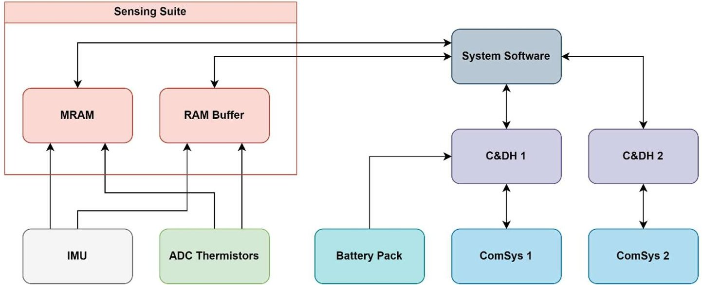

Figure 1. Sensing Suite/System block diagram

Both sensing and housekeeping data are saved into the Random Access Memory (RAM) buffer of the microcontroller and in a non-volatile memory consisting of a Magnetoresistive Random Access Memory (MRAM) chip, that are part of the Sensing Suite.

The data stored in the Sensing Suite can be classified into three main groups: thermal, attitude and system. The first ones are collected by a set of 30 thermistors placed in strategic locations of the spacecraft, decided by taking into account the results of the thermal analyses, and are acquired by the Sensing Suite. The attitude data are evaluated by a triaxial IMU that includes a magnetometer and a gyroscope, while the system data consist of information related to the status and the consumption of the C&DHs, the two buses and the battery pack voltage and current, obtained from specific sensors integrated into the hardware itself.

<!-- PDF_PAGE: 3 -->

The data storing for the IMU and ADC thermistor sensors occurs at a rate of 1/min, while housekeeping data are sent from the C&DHs to the Sensing Suite every time the system has to transmit telemetry. The transmission frequency of housekeeping data varies from 2 to 3 minutes, depending on the operative mode of the spacecraft.

The C&DHs interface with the Sensing Suite for data saving is managed by the system software, called "Parrot", which writes the most recent dataset of housekeeping data both on the RAM buffer, overwriting the older one, and on the MRAM, storing them for up to 273 hours and deleting the least recent ones when the memory is full.

The system software also handles the data downlink, reading the data stored in the RAM buffer each time a telemetry transmission occurs, and the data stored in the MRAM only when the spacecraft receives a downlink request to transmit housekeeping and sensing data from the latter, going backwards for a period of time specified in the request.

## 3 IN-ORBIT DATA ANALYSIS and COMPARISON with DIGITAL MODELS

## 3.1 Thermal analysis and in-orbit data

During the development of SPEISAT, a series of thermal analyses have been conducted to assess the thermal status of the spacecraft. The CAD model realised to design the structure and configuration of the spacecraft was used in the Thermal Desktop software, where the thermal analyses were performed. The outputs proved to be particularly relevant as they allowed to highlight thermal problems inside the spacecraft and to obtain results to be compared with the data collected in orbit by the sensors.

The characterisation of the thermal status of the spacecraft during the design phase guaranteed the possibility to adjust the structure and internal layout to overcome the highlighted thermal problems. In fact, the preliminary analysis results called attention to the temperature of the battery pack, which appeared to go below its operational temperature. As a consequence, the activation of the heaters integrated in the battery pack increased the already extremely high general power consumption. To overcome this problem, the heat flux generated by the two C&DHs was exploited by closing the distance between them and the battery pack and inserting a thermal pad to maximise thermal conduction. To further enhance the effect, a thermal insulation system was devised to create a thermal bubble, insulating the boards and the battery pack from the rest of the structure. The system was designed by adding cylindrical bushes (Iglidur-X) and polytetrafluoroethylene (PTFE) washers between the battery pack and the stiffener, as shown in Figure 2, and between the C&DH's case and the crossmember, as in Figure 3.

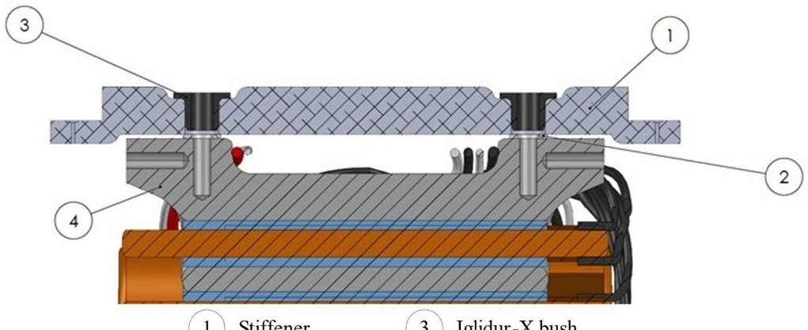

2 PTFE washer

4 Battery pack

Figure 2. Battery pack insulation system

<!-- PDF_PAGE: 4 -->

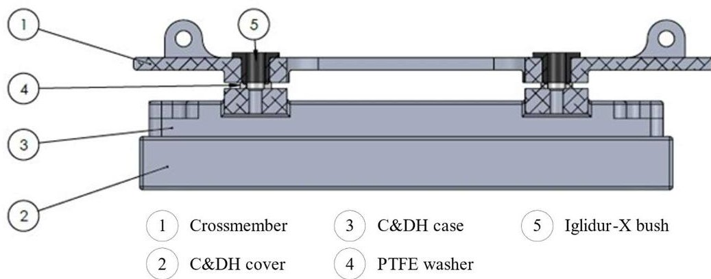

Figure 3. C&DH insulation system

In the simulation, the solution adopted proved to be particularly effective, being able to accurately represent the outer space condition and the thermal status of the spacecraft. The Thermal Desktop model of the spacecraft [3] is depicted in Figure 4, while the thermistors location inside the spacecraft is shown on the CAD model in Figure 5.

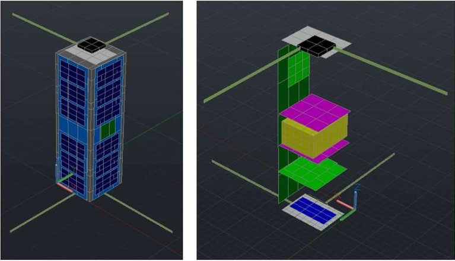

Figure 4. Thermal Desktop model, external (left) and internal (right)

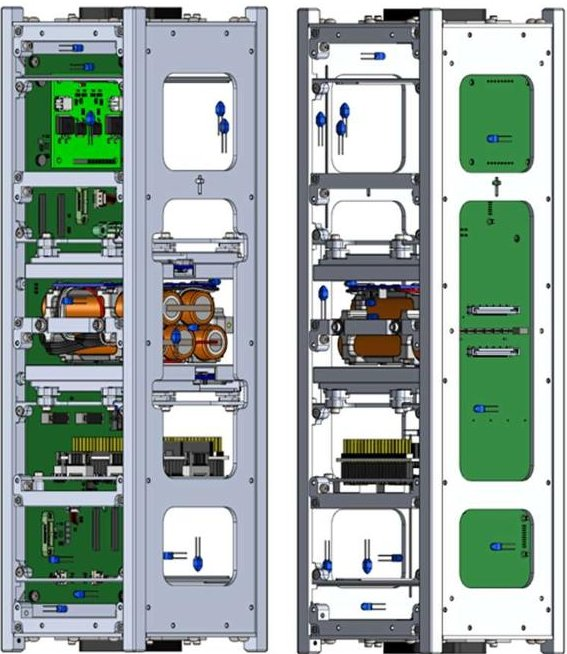

Figure 5. Thermistors location

<!-- PDF_PAGE: 5 -->

Figure 6 presents the results of thermal analyses of the spacecraft's main components for the hot case (at perihelion) and the cold case (at aphelion), in which a margin of $ 1 0 \mathrm{~^\circ C} $ (blue bar) was added to all temperature values obtained from the analyses (green bar) to consider all possible uncertainties in the model [4].

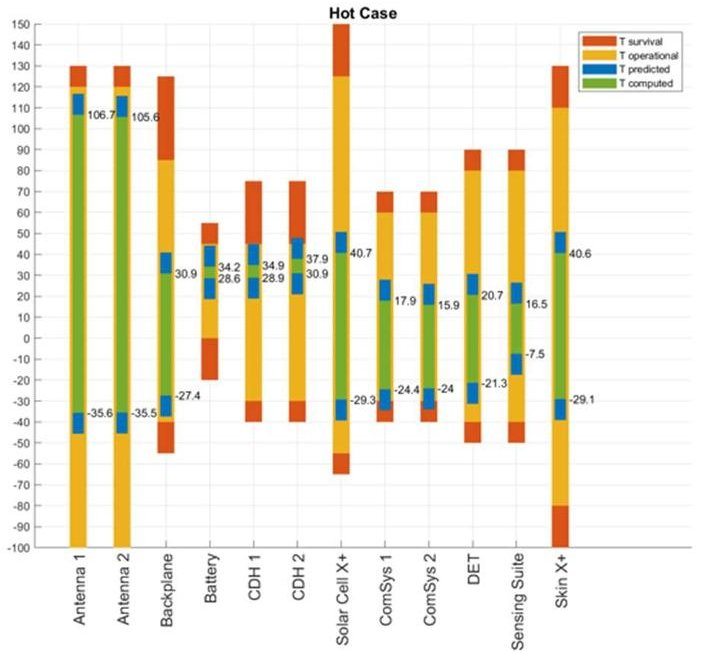

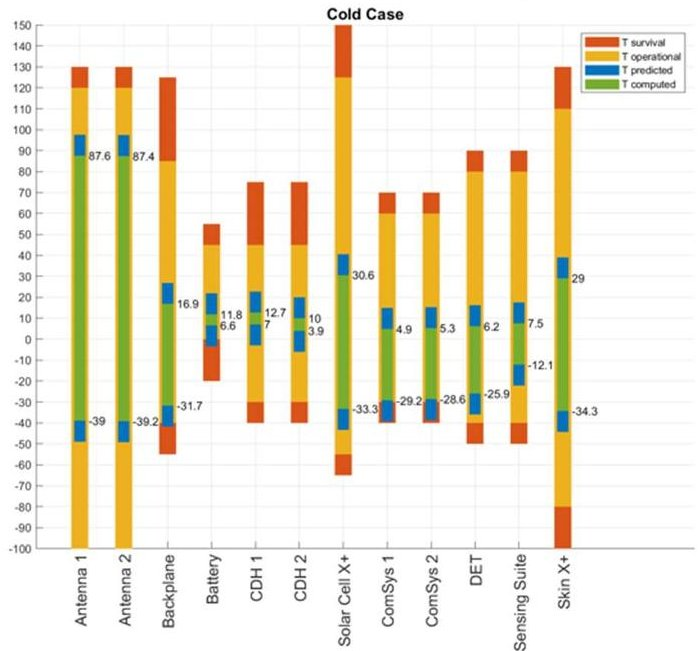

Figure 6. Thermal analyses results

The gathering of the in-orbit data allowed the thermal status of the spacecraft to be mapped and the data received to be compared with the data computed by analyses, evaluating the correctness of the simulations and the satellite health status.

The assessment of the thermal characterisation and the validation of the configuration solution was carried out through the evaluation of the temperatures of the various components thanks to the ADC thermistors and sensors integrated within the parts. In particular, the most interesting ones are the abovementioned C&DHs boards and the battery pack, with their structural supports which are thermally insulated from them.

Figure 7 and Figure 8 show, respectively, the temperature values of the battery pack and C&DHs acquired on June $ 29^{\mathrm{th}} $ 2023, a few days after deployment, during 5 orbits. The battery pack temperature remains within the operative temperatures shown in Figure 6, specifically around the lower threshold of the predicted result, as well as the C&DHs outputs are consistent with what was expected. Moreover, the adoption of the new configuration with the insulation system allowed the heat flux from the boards to the rest of the structure to be avoided, allowing the battery pack to be maintained at a higher temperature without the need to activate the heaters. On the other hand, structural components such as the battery support and the C&DHs crossmembers suffer from a much higher $ \Delta T $ than the boards and batteries. In addition, the C&DHs cases are in direct contact with the boards to allow heat exchange, which explains the higher temperatures than the crossmembers.

<!-- PDF_PAGE: 6 -->

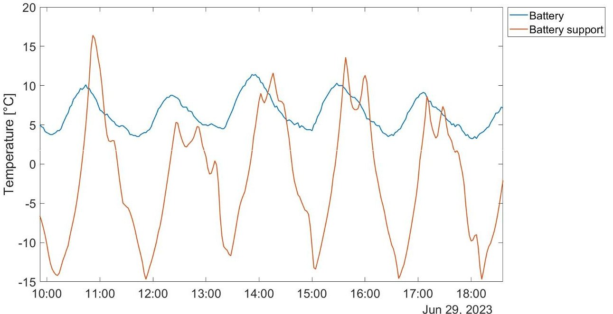

Figure 7. Battery pack temperatures

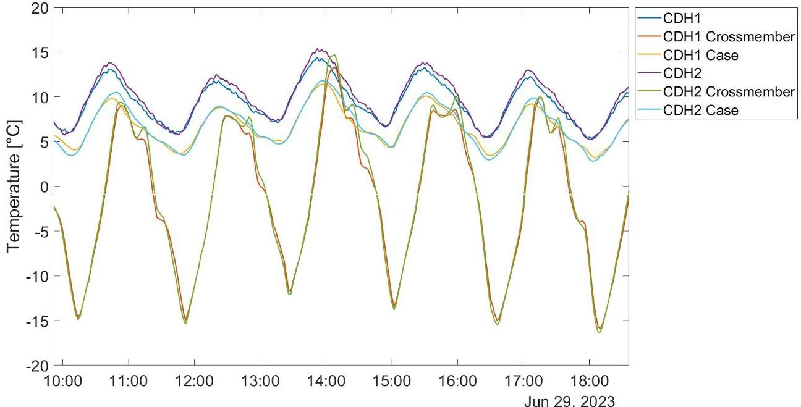

Figure 8. C&DHs temperatures

## 3.2 Attitude analysis and in-orbit data

SPEISAT is equipped with a passive Attitude Control System (ACS) based on hysteresis rods and permanent magnets. The former are made of a soft ferromagnetic material capable of damping the angular velocity of the spacecraft due to the torque generated by the material's interaction with the geomagnetic field. The latter are used to provide a preliminary pointing of the spacecraft toward the Earth. Because of the unusual solution, it was necessary to simulate the attitude and angular velocity of the spacecraft to assess the effectiveness of the system. The Simulink environment allowed to create a virtual spacecraft model capable of simulating the ACS by reproducing the magnetic components. The choice of hardware to be simulated in the virtual model, and later to be assembled in the spacecraft, was done through a series of calculations to size the magnets and hysteresis rods.

<!-- PDF_PAGE: 7 -->

Starting with the former, a more conservative estimation was conducted to calculate the minimum necessary dipole moment m needed to correctly point the spacecraft, shown in Eq.1.

$$
m = \frac {1 0 T _ {d}}{B _ {m i n}} = 0. 0 4 A m ^ {2}
$$

The minimum geomagnetic field at an altitude of 525 km, calculated using the World Magnetic Model 2020 (valid for 2020-2025), was adopted [5].

To obtain a predominant dipole over the onboard electronics, with a total dipole moment of about $ 0. 0 3 \, A m^{2} $ , the dipole moment of the magnets was set to $ 0. 1 \, A m^{2} $ . Two cylindrical neodymium N35 magnets, with a diameter of 3 mm and a length of 5 mm, give an effective dipole moment calculated in Eq. 2.

$$
m _ {m a g n} = \frac {V _ {m a g n} B _ {r}}{\mu_ {0}} = 0. 1 0 9 A m ^ {2}
$$

The characterisation of the hysteresis rods was also carried out by calculating the dipole moment in Eq.3.

$$
m _ {h y s t} = \frac {V _ {r o d} B _ {h y s t} (t)}{\mu_ {0}}
$$

The hysteresis rods grant the generation of a damping torque capable of decreasing the kinetic energy of the spacecraft, slowing down its rotation.

A dynamic system of spacecraft orbit and attitude was developed in the MATLAB/Simulink environment, implementing a digital model to consider the following disturbances:

- Aerodynamic force and torque, based on the NRLMISE-00 atmospheric density model

- Solar pressure force and torque

- Gravity gradient torque

- J2 effect

The analysis considered a deployment that generates the starting angular velocity as in Eq. 4, while Eq. 5 gives the target angular velocity to be reached in a maximum of 9 days.

$$
\omega_ {0} = [ 0. 1, 0. 1, 0. 1 ] ^ {r a d} / _ {S}
$$

$$
\omega_ {f} = \left[ 0. 0 5, 0. 0 5, 0. 0 5 \right] ^ {r a d} / _ {S}
$$

The predicted angular velocities have a decreasing trend that leads to having all the angular velocity components under the desired value in 7 days, as shown in Figure 9.

<!-- PDF_PAGE: 8 -->

The analysis provides the value of the $ \beta $ angle between the Z body axis and the local geomagnetic field vector, providing information on the spacecraft alignment, which requires more time than the zeroing of angular velocities, as can be seen from Figure 10.

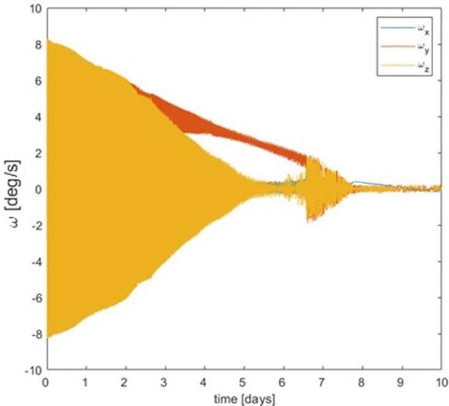

Figure 9. Angular velocities in Simulink model

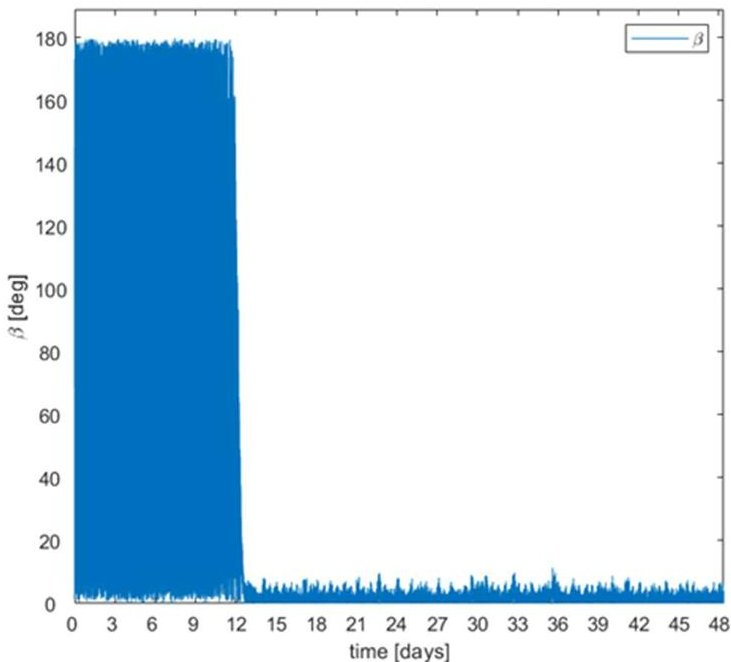

Figure 10. $ \beta $ angle evolution

The first collection of these data was carried out a few days after deployment, on the $ 29^{\mathrm{th}} $ of June 2023, and allowed the effectiveness of the developed system to be determined.

SPEISAT achieved the desired angular velocity in less than a week after the deployment, showing even better results than those initially simulated, as can be seen from Figure 11. In fact, the spacecraft achieved the mean values along the 3 body axes reported in Eq. 6.

$$
\left[ \omega_ {x}, \omega_ {y}, \omega_ {z} \right] = \left[ 0. 2 5 0 0, 0. 1 7 0 7, - 0. 0 3 9 5 \right] ^ {d e g} / _ {s}
$$

<!-- PDF_PAGE: 9 -->

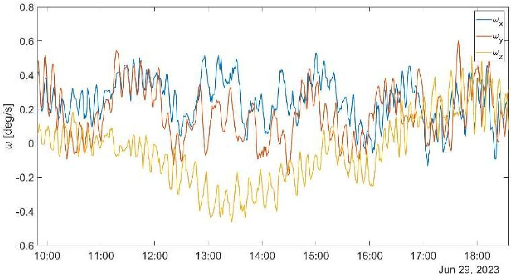

Figure 11. SPEISAT angular velocities

The in-orbit data show a better performance of the ACS than that modelled in the Simulink environment. This may be due to minor differences in the deployment that led in earlier stabilisation of the spacecraft.

On the other hand, the $ \beta $ angle shown in Figure 12 does not present the trend shown in the Simulink analysis. In fact, the mean $ \beta $ angle over the considered timeframe is approximately 125 degrees, which results in poor pointing of the spacecraft in several scenarios. The inconsistency with the simulation can be attributed to the noise of the sensors and the residual dipole of the onboard electronics, which was not considered in the analysis. Further problems may have been caused by the launch loads that may have led to slight misalignment of the magnets, enhancing the pointing error. Finally, the interaction between the magnets and the hysteresis rods could have led to further uncertainties due to the treatment to which the latter were subjected. In fact, in order to obtain the desired properties, the rods were thermally treated by an annealing process. Therefore, the mentioned uncertainties could lead to a discrepancy between the digital and physical models, explaining the differences between the two sets of results.

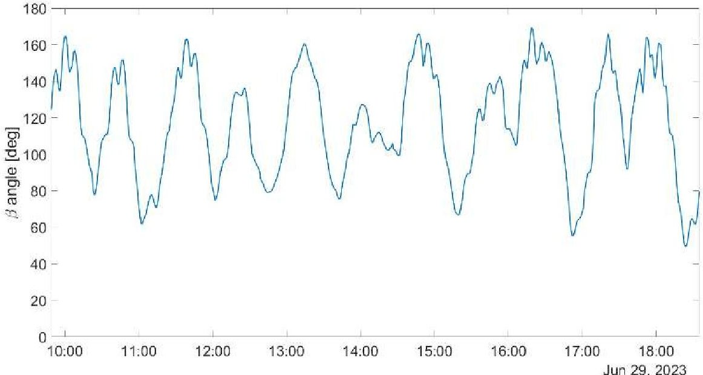

Figure 12. SPEISAT $ \beta $ angle

<!-- PDF_PAGE: 10 -->

## 3.3 System analysis and in-orbit data

In the design phase, system analyses were performed to assess the spacecraft performances and health status. Among these, a preliminary power analysis was conducted in MATLAB using attitude information extracted from a STK scenario to determine the power generation dependent on the orientation of the satellite faces with respect to the Sun. Each face is equipped with a solar panel, consisting of 6 triple-junction (InGaP/GaAs/Ge) solar cells, which were assumed to have an efficiency of 26.5% in the model. On the other hand, the 12.6 V battery consists of 6 lithium-ion cells in a 3S2P configuration, and in the model a state of charge (SOC) limit of 80% was considered. An energy budget analysis was then conducted to determine whether the system was power positive or not. The analyses carried out on the battery SOC made it possible to highlight the need to recharge the battery pack by means of a dedicated operative mode at system level.

Among the different scenarios, the MATLAB simulation considered in aphelion is shown in the Figure 13. When the SOC limit is reached, the system automatically goes into recharge mode allowing the battery to be fully recharged.

The downlinked data contain the battery status in terms of voltage. Using the battery characteristic curve in Figure 14, which relates SOC and voltage, it is possible to effectively convert the voltage values obtained from orbit into SOC values.

As shown in Figure 15, for several orbits, the spacecraft never experienced any energy problems maintaining its SOC well above the imposed limit.

While the simulations highlight a challenging environment for the spacecraft due to its energy consumption and generation, the in-orbit data show an excellent performance in terms of energy budget.

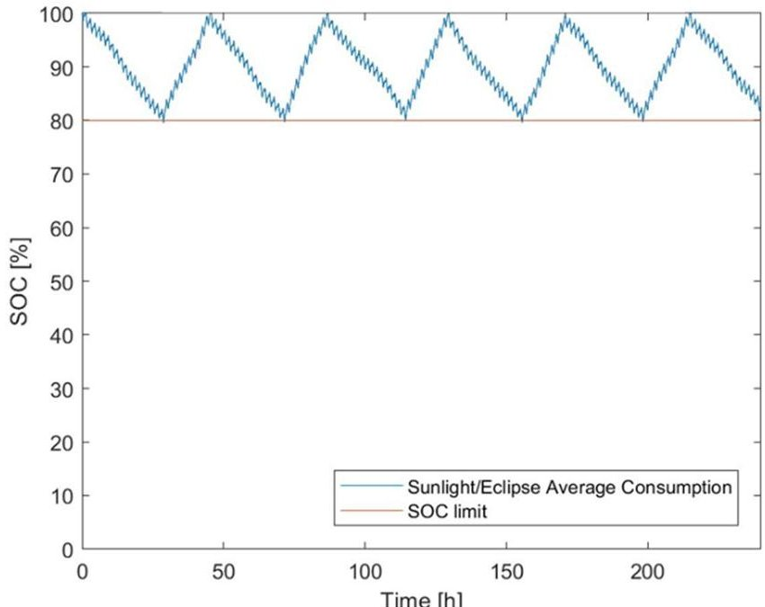

Figure 13. SOC aphelion simulation

<!-- PDF_PAGE: 11 -->

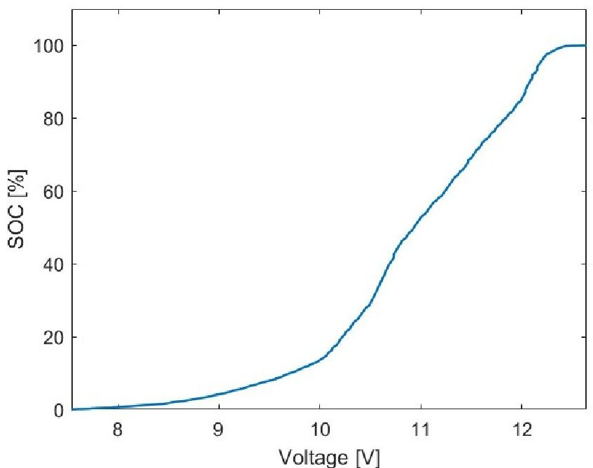

Figure 14. Battery characteristic curve

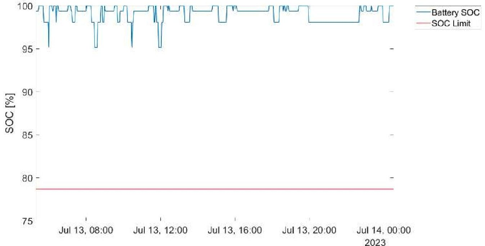

Figure 15. SPEISAT battery SOC

## 4 RECOMMENDATIONS

The unique short timeframe of 4 months in which SPEISAT was designed, developed and tested obviously leads to several points which can be improved in order to achieve better results. Specifically with regard to the data collection system, the main discussed topic is the data sampling frequency. While a rate of 1 sample per minute may be sufficient to investigate aspects such as the battery status or the temperatures of the whole system, it may not be enough to guarantee the possibility of conducting a precise analysis of the spacecraft attitude, especially in terms of orientation. Therefore, the low sampling frequency does not guarantee an accurate estimation of the spacecraft attitude evolution as the samples change. The main reason for this decision was to avoid an excessive power consumption, especially keeping into account the power simulations, with the too frequent sampling.

<!-- PDF_PAGE: 12 -->

A good alternative could be the implementation of less frequent sample bursts, but each of them capable of collecting an elevate amount of data in a short period of time. In this way, the characterisation of the spacecraft attitude would be more accurate, while the remaining data would maintain their validity.

Furthermore, the absence of a direct connection between the Sensing Suite and the communication system makes the C&DHs an even more critical component. In the event of a failure, the data collection system would still be able to sample data, but it would be incapable of transmitting them. A more relaxed deadline would have allowed to study a way to avoid this dependency, making the Sensing Suite more independent from the rest of the system.

## 5 CONCLUSION

From the data received, the platform proved to be in good health, with all parameters within the operative ranges. A good amount of data has been collected and analysed with the purpose of assessing the behaviour of the satellite in orbit conditions. The comparison between the downlinked data and the results of the analyses and simulations seems to prove the validity of the studies conducted before launch. The attitude proved to have margin of improvement but, considering the short time available, the simulation predicted the behaviour of the satellite with a good degree of fidelity.

The data was also useful in assessing the validity of the in-house developed technology based on components available worldwide, known and used by a huge number of amateurs and not. Finally, the project is also yielding interesting results on the academic research side, increasing knowledge of the LEO space environment, and acting as a reference to start the development of future missions.

## 6 REFERENCES

[1] Iossa, L., Corpino, S., Stesina, F., et al., From Design to Delivery in Three Months: The Fast Development of a 3U CubeSat, $ 74^{\mathrm{th}} $ International Astronautical Congress (IAC), Baku, Azerbaijan, 2-6 October 2023.

[2] Bollattino, S., Development of a Versatile on Board Computer for Small Satellites, Politecnico di Torino, Turin, 2023.

[3] Lucia, F., Development of a Tool for Thermal Analysis of Small Spacecraft, Politecnico di Torino, Turin, 2023.

[4] Cosenza, D., Development of a Tool for the Design and Verification of Thermal Control Systems of Small Sats, Politecnico di Torino, Turin, 2023.

[5] D'Ortona, A., Manconi, F., Stesina, F., and Corpino, S., Passive Attitude Stabilization Strategy for a 3U Student CubeSat, $ 74^{\mathrm{th}} $ International Astronautical Congress (IAC), Baku, Azerbaijan, 2-6 October 2023.