<!-- PDF_PAGE: 1 -->

# Conceptual Development of CubeSat Missions with GREATCUBE+: Methodology and Possible Applications

Carlo Girardello* ID

Technical University of Dresden, Dresden, 01069 Saxony, Germany Carsten Scharlemann, $ ^{\ddagger} $ Wolfgang Treberer-Treberspurg, $ ^{\ddagger} $ Markus Trenker, $ ^{\ddagger} $ Christoph Obertscheider, $ ^{\ddagger} $ and Anand Nair Radhakrishnan $ ^{\ddagger} $

University of Applied Sciences Wiener Neustadt, Wiener Neustadt, 2700 Niederosterreich, Austria

Martin Tajmar $ ^{\S} $ Technical University of Dresden, Dresden, 01069 Saxony, Germany

https://doi.org/10.2514/1.A35741

CubeSats have a 65% success rate. Failures derive from design mistake or components malfunctions. To improve the success rate, Technical University of Dresden and FHWN (University of Applied Sciences Wiener Neustadt) developed GREATCUBE+. a software tool for the conceptual design of CubeSats. Its layered structure comprises three levels: empirical, where successfully flown missions are used for an initial tradeoff; analytical, where a design refinement is performed; and numerical, for the final assessment of the proposed architecture. The tool provides teams with information related to commercial off-the-shelf products which will satisfy the mission requirements. To turn this software into a universally applicable tool, it is possible to perform the design of CubeSat mission with many payload's typologies such as attitude determination and control subsystem, telemetry telecommunication and command, onboard computer, propulsion unit and technology demonstration or scientific payloads. GREATCUBE+ has been validated using the information of existing CubeSats as baseline for its simulation. The achievable accuracy when comparing the simulated outcomes and the real design is of almost 100% for volumes, 90% for masses, and 80% for power generation. By implementing this tool during the conceptual development phase, it is hoped that teams could benefit in reliability thanks to the usage of flight proven equipment recommended via GREATCUBE+ together with a quicker development time.

## Nomenclature

$ O A P $ = orbit average power, W $ R^{2} $ = Statistical coefficient of determination [0,1] $ rad $ = absorbed radiation dose [U] = CubeSat units

## I. Introduction

CUBESATS were developed in the early 2000 as a joint effort between California Polytechnic State University and Stanford University. This type of nanosatellite benefits from being standardized. The CubeSat design specification document [1], published by California Polytechnic State University, states that CubeSats are made of one or more $ 1 0 \times1 0 \times1 0 $ cm cubic units, or [U]s, with each of them recommended to not weigh more than 2 kg [1]. One of the core features of CubeSats is the extensive usage of commercial off-the-shelf (COTS) components. COTS components made space affordable for a vast number of teams, stakeholders, and players with limited budgets [2], given the contained cost of such satellites compared to their larger relatives. Currently, more than a thousand CubeSats have been launched from teams scattered around the whole world, and multiple database sources exist to track them and to list their mission goals and statuses [3].

Received 29 March 2023; revision received 2 August 2023; accepted for publication 15 September 2023; published online 31 October 2023. Copyright 2023 by the authors. Published by the American Institute of Aeronautics and Astronautics, Inc., with permission. All requests for copying and permission to reprint should be submitted to CCC at www.copyright.com; employ the eISSN 1533-6794 to initiate your request. See also AIAA Rights and Permissions www.aiaa.org/randp.

*Doctoral Student, Institute of Aerospace Engineering, Technische Universität Dresden; carlo.girardello@fhwn.ac.at.

$ ^{\dagger} $Head of the Aerospace Engineering Department.

$ ^{ \ddagger} $Research Associate.

$ ^{\S} $Full Professor (W3) and Head of Space Systems Chair, Technische Universität Dresden.

The current success rate of CubeSats is approximately 65%. The ones that fail end up being space debris [4]. This is caused by different factors, mainly due to design flaws, subsystem failures, and lack of sufficient testing by designing teams [5,6]. The exact percentage of design related flaws is difficult to determine because it is a function of the teams' decisions. According to the work of Alanazi and Straub [7], which performed a statistical analysis of CubeSat mission failures, 24% fail due to design. In his work, it is also added that the simpler the cubesat to design, the most likely it is to succeed. The work of Bouwmeester et al. [8] in 2022 analyzed the topic of CubeSat reliability, introducing design flaws as one of the causes for early CubeSat failures [8]. Additionally, Langer introduced the analysis of subsystems as a source for failures. From his analysis, it emerged that the vast majority of the causes for dead-on-arrival CubeSats are, in order, unknown (33%) , Electrical Power Subsystem (EPS)-related failures (28%) onboard computer (16%) , telecommunication and command (14%) attitude determination and control subsystems (3%) , and payload (2%) [9]. All those parameters may involve design-related issues linked to wrong assembly, poor mission planning, and wrong assumptions. On this, Swartout [10] pointed out that many of the early failures are due to poor system-level testing. Hence, by providing a design solution which is COTS based, it is hoped that mission success could increase. Sequentially, teams could have more time to dedicate to testing. To improve the success rate of CubeSat missions, the GREATCUBE+ project was commenced as a joint program between Technical University of Dresden and the University of Applied Sciences of Wiener Neustadt.

The main objective is to guide teams with a software which provides a clear design solution for the introduced mission requirement using COTS products with flight heritage. GREATCUBE+ is capable of performing this task via an intensive usage of empirical correlations, derived from a database of successfully flown missions, analytical equations directly retrieved from literature, and numerical analysis. To be reliable and useful for teams, GREATCUBE+ needs to be flexible in its possible application scenarios. This is necessary if the tool is to be used by as many teams as possible, regardless of the payload that they want to launch. Hence, the tool can consider various types of payload. The currently available payload types are an

<!-- PDF_PAGE: 2 -->

attitude determination and control subsystems (ADCS), a telemetry, telecommunication and command (TTC) subsystem, an onboard computer (OBC), a propulsion unit, and any technology demonstration or scientific payload. Designing teams can implement only one payload per mission scenario. GREATCUBE+ provides, at the end of its operations, a complete design of the CubeSat in terms of weights, volumes, and power requirement. Additionally, it is comprehensive of a detailed list of COTS which are up to the task of satisfying the current mission requirements and a final CubeSat model in an initial graphics exchange specification (IGES) format with the previously mentioned COTS as subsystems. In the past, the software capabilities were displayed with a thermal analysis [11]. Here, its usage is extended with a power and orbital analysis.

The databases of available COTS within GREATCUBE+ are divided into nine different sheets, each representing a subsystem or a major part of one (e.g., a battery pack is not representative of the EPS entirely), and the current division is presented in Table 1.

Phase 0 and phase A are the ideal scenarios for the implementation of GREATCUBE+ because they are the sections in which the conceptual development takes place. Teams could use this tool while discussing the mission requirements in order to already have a model to perform an initial analysis on. A summary of the phases of a space mission are presented in Table 2.

Table 1 Subsystem's dataset composition for GREATCUBE+

<table border="1"><tr><td>Subsystem name</td><td>Number of COTS available in the databases</td></tr><tr><td>OBC</td><td>19</td></tr><tr><td>ADCS</td><td>44</td></tr><tr><td>Propulsion</td><td>27</td></tr><tr><td>EPS(battery pack)</td><td>15</td></tr><tr><td>EPS(solar cells)</td><td>13</td></tr><tr><td>Structure</td><td>22</td></tr><tr><td>Transceiver</td><td>11</td></tr><tr><td>Antenna</td><td>21</td></tr><tr><td>Payload type</td><td>5</td></tr></table>

Table 2 Summary of a space project phases with expected outcome and final documentation as described in ECSS-M-ST-10C Rev. 1 [12] and the CubeSat Handbook

<table border="1"><tr><td>Phase name</td><td>Outcome</td><td>Documentation</td></tr><tr><td>Phase 0</td><td>Mission analysis</td><td>Mission definition review</td></tr><tr><td>Phase A</td><td>Preliminary budgets: link, power, mass, data, pointing Preliminary environment analysis</td><td>Preliminary requirements review</td></tr><tr><td>Phase B</td><td>Updated budgets Project and engineering management plans are established. Preferred design is verified.</td><td>Preliminary design review</td></tr><tr><td>Phase C</td><td>Definition of system, subsystem, and components characteristics Project and engineering management plans are finalized Assembly, integration, and verification plans are finalized.</td><td>Critical design review</td></tr><tr><td>Phase D</td><td>Qualification of the system is finalized. Space and ground segments are interoperational.</td><td>Acceptance review</td></tr><tr><td>Phase E</td><td>System is operational in orbit</td><td>Commissioning results review</td></tr><tr><td>Phase F</td><td>Disposal</td><td>Mission closeout review</td></tr></table>

GC+ is a plug-and-play type of software. To perform simulations with it, the user must have a valid MATLAB license, FreeCAD, and Python. If this software are available, the user can run the Run Me.m file and press run to start a simulation. No in-depth analysis of the code is necessary in order to operate the tool. To successfully operate GREATCUBE+. it is only necessary to answer the series of questions which are posed throughout the simulation.

## II. Methodology

GREATCUBE+ is a layered software which is divided in three major levels:

1) GREATCUBE+ Empirical Level (GEL) is the initial layer of GREATCUBE+ which uses empirical correlations to build up a COTS based model. The empirical correlations are retrieved from a database of flown missions. GEL links user-introduced inputs with system and subsystem values.

2) GREATCUBE+ Analytical Level (GAL) is the second layer of GREATCUBE+. It uses well-proven analytical equations to perform a refinement of the COTS-based model inherited from GEL. As output, it produces a new COTS-based model, which is expected to have an increased quality when comparing it to the one proposed in GEL.

3) GREATCUBE+ Numerical Level (GNL) is the final layer of GREATCUBE+. The analytical model inherited by GAL does not provide any information on the position of the COTS products recommended. GNL uses a genetic algorithm with three optimizing functions to assess the position of the subsystems. The goals are to respect the center-of-gravity (COG) requirement of the launcher and specific positions for certain subsystems.

In the following subsections, each of the mentioned layers will be described in detail from a methodological standpoint, focusing mainly on their concept of operations.

## A. GEL and the Empirical Model

GEL is the starting point of each simulation with GREATCUBE+. In this layer, the mission requirements introduced by the user are analyzed and compared to empirical correlations. This step is performed to link the user inputs to successfully flown missions and to retrieve as much information as possible from past flight heritage. The goal of GEL is to assess a system and subsystem model which is in line with the empirical trend of the empirical correlations under a mass, volume, and power perspective. This process mimics the standard procedures which take place in the framework of the phase 0/A using the ECSS-M-ST-10C regulation [12].

In real applications, when designing teams are provided with the mission scenario, usually the first step taken in the conceptual phase is the identification of past flown mission similar architectures for analogous scenarios or the identification of concepts to satisfy the mission requirements [12]. This process is embodied by GEL. A visual representation of the concept of operations involved in this initial layer is presented in Fig. 1.

The starting point is represented by the introduction of the inputs from the user or designing team. As mentioned earlier, GREATCUBE+ can be used for any type of CubeSat mission which has as

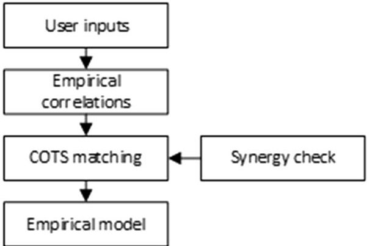

Fig.1 GEL concept of operations. The user introduces the available inputs, and the tool iterates through a database of the past flown mission to retrieve the empirical architecture which better suits the mission requirements.

<!-- PDF_PAGE: 3 -->

a main payload an ADCS, a TTC, an OBC, a propulsion unit, a technology demonstration, or scientific payload or no payload at all. In allowing this input flexibility, GC+ will cover the greatest majority of CubeSat missions that can be simulated.

Additionally to the type of payload, GEL needs at least one of the following inputs in order to proceed: 1) payload mass (kilograms) and 2) satellite on-orbit average (OAP)/payload OAP (watts).

OAP represents the average power required for a single orbit as introduced by Clark and Logan [13]. With this information only, GC+ is capable of providing an empirical model (EM) for the current simulation scenario. The reason why the software requires the payload typology and at least one of the two types of information related to the payload derives from the fact that all satellites, CubeSats included, are strongly payload centric [14]. Additionally, it is possible to add a separate, optional, set of parameters: 1) alignment requirement or pointing accuracy of the payload (degrees), 2) total amount of data produced by payload per orbit (kilobytes per second) and number of available ground stations, and 3) mission $ \Delta V $ (meters/second).

These secondary inputs serve the purpose of identifying already at this stage the presence of the relevant subsystems of reference: an ADCS for the alignment requirement, a specific TTC for the total amount of data, or a propulsion system in case the $ \Delta V $ is provided. If an alignment requirement is not introduced, it is assumed by GEL that an ADCS will not be present. If an ADCS is not present, a propulsion unit cannot be oriented. Hence, no propulsion unit will be present, and no $ \Delta V $ will be asked. If the user does not specify the amount of data produced by the payload, the telecommunication band the user will be forced to use for its TTC subsystem is going to be an omnidirectional Ultra High Frequency/Very High Frequency (UHF/VHF) antenna, assuming a data rate of 9.6 kB/s [15]. A summary of the essential inputs required per each payload type, once the payload mass has been introduced, is presented in Table 3.

The user can add any of the optional parameters listed previously to increase the amount of inputs provided. As an example, in the case of a camera as an input, it would be a technology demonstrator payload. To run the software, it is necessary to add the camera mass and the payload type as essential inputs. If more information on the payload is available, for example, alignment requirement or data rate, it will be

Table 3 Summary of the additional inputs to be introduced per different payload type in GEL

<table border="1"><tr><td>Payload type</td><td>Additional information required</td></tr><tr><td>Tech. Demonstr./Sci. Payload</td><td>None</td></tr><tr><td>ADCS</td><td>Volume, [U]Max. torque, mNmSatellite/payload OAP, WAlignment/pointing accuracy, deg</td></tr><tr><td>Propulsion unit</td><td>Specific impulse, or $I_{\mathrm{sp}}$, sSatellite/payload OAP, WPropellant mass, kgIdle power consumption, WPeak power consumption, WVolume, [U]Thrust, mNAlignment/pointing accuracy, deg</td></tr><tr><td>OBC</td><td>None</td></tr><tr><td>TTC</td><td>Total amount of data produced by the payload to be transmitted per orbit, kB/sNo. of available ground stationsIdle power consumption, WPeak power consumption, WTransceiver frequency [S-Band, UHF.]Interface [UART, I2C]Alignment/pointing accuracy, deg</td></tr></table>

possible to add these as an optional input. Based on the values of those inputs, GEL would evaluate different design alternatives. As an example, for elevated data rates, an high-speed downlink COTS would be selected. Consequently, because the ideal usage of GREATCUBE+ is located within the phase 0/A timeframe, more refined information may not be reliable or even available at these early stages from the designing team. This is the main reason for which the user inputs are not all mandatory.

The main objective of GEL is to provide a CubeSat model which satisfies the user-introduced inputs based on empirical trends for masses, volumes, and power consumption. Sequentially, it shall use those values to link selected COTS products for further analysis via the subsequent levels. To do so, it is necessary to develop empirical correlations which link these inputs to the system and subsystem values necessary for the definition of a satellite mission in terms of mass, volumes, and power consumption.

UART, Universal Asynchronous Receiver-Transmitter; I2C, inter integrated circuit; mNm, milli Newton meter.

The list of subsystems composing a CubeSat mission are directly inherited by NASA [6], Wertz et al. [14], and Fortescue et al. [16], and they are composed of weights, volumes, and power consumption of 1) a payload unit; 2) an ADCS, if necessary, to ensure the proper orientation of the satellite; 3) a TTC system which could ensure proper communication from and to the satellite; 4) an OBC which could survive in the harsh environment of space; 5) a battery pack which can sustain the eclipse needs or the excessive power demands in peak power modes; 6) supporting structure; 7) detailed composition of the solar panels and solar cells for harvesting the proper amount of power; and 8) a propulsion unit, if available, which could satisfy the $ \Delta V $ requirement.

The task of linking mission requirements to system design parameters via the usage of empirical laws has been analyzed various times in the past by many researchers worldwide. It is relevant to mention the work of Chang et al. [17,18], in which they performed the conceptual design for a small satellite with an optical payload via empirical laws with a software named System Engineering Design Tool (SEDT). SEDT is a software tool which can be used to perform the conceptual design of a small satellite for optical payloads. It uses characteristic equations obtained via an internal database to estimate mass, volumes, and power requirements of subsystems down to component level. It is meant as a support tool for designing teams, and it provides a complete justification sheet for the selection of components, a final model, and a cost estimation.

Jacobs and Selva [19] created a similar tool for small satellites design: The Catalog Design Tool. This tool has two modes: forward and backward. In forward, the user manually selects the components wanted for the satellite, and the software determines the feasibility of this design. In the backward mode, the user introduces a set of mission requirements, and the software creates a set of possible designs based on them. The optimum is reached via the analysis of the Pareto front.

Aas et al. [20,21] developed System Level Tool for Conceptual Design of Small Satellites (SCALES). This system-level tool provides only system outputs: mass, power requirement, and volume of the system as a whole. It is intended for small satellites and nanosatellites but not suitable for CubeSats. The analysis performed by the authors in terms of software development architecture set the basis for GREATCUBE+'s multidisciplinary and concurrent approach. In the framework of SCALES, the authors looked into a new set of correlations which could be suitable for the design of nano- and microsatellites [20]. The previously mentioned projects, together with many more like SmallSatCEM by McInnes et al. [22], System Engineering Module (SEM) by Ridolfi et al. [23], and the work of Nogrady [24] set the basis for GEL analysis using empirical laws and correlating them to COTS products.

The characteristic equations are retrieved in GC+ from the set of databases of CubeSat missions which are provided within the software. Via the information which was retrieved, it was possible to create an empirical link from the user-introduced inputs to many system and subsystem variables, as introduced in the following.

As an example of the empirical correlations implemented in GEL, it is possible to link the specified payload mass to the empirical value for the CubeSat mass via a polynomial fitting of the second degree from a dataset of 63 existing missions. This data set comes from a

<!-- PDF_PAGE: 4 -->

literature review performed by the authors on CubeSat missions with available payload mass and CubeSat mass.The fitting function together with the relevant data points are presented in Fig. 2.

From the outcome of this equation, which has an $ R^{2} $ value of 0.9516, it is possible to estimate other different parameters using different empirical correlations as shown in previous work [11]. As a follow-up example of this, the link between the CubeSat mass and form factor can be expressed via the empirical equation presented in Fig. 3.

This correlation, with an $ R^{2} $ of 0.89, takes into account another data set of past flown missions collected by the authors during another literature review [3]. This literature review resulted in a database of 1438 flown satellites. The reason these databases differ in terms of data points expressed is related to the fact that not all the necessary information was always listed when performing the separate reviews. For some CubeSats, it was clearly marked what the mass of their payloads was, while for others it was omitted. Clearly, the CubeSat total mass and the form factor are instead much more likely to be listed. Hence, the difference in database size is explained.

GEL is capable of providing empirical correlations to the user introduced inputs for the following cases: 1) payload mass as a function of the satellite mass; 2) CubeSat mass, which is always an output of the empirical correlations, used to estimate the form factor; 3) CubeSat mass, which is always an output of the empirical correlations, used to estimate the Satellite OAP, if not introduced by the user; 4) alignment requirement as a function of ADCS mass and power consumption; 5) data rate as a function of the total amount of data and number of available ground stations; 6) total amount of data as a function of TTC mass and power consumption and data rate; 7) TTC power as a function of satellite OAP; 8) ADCS mass and power as a function of the satellite mass and power; 9) ADCS mass as a function of CubeSat mass; 10) satellite power as a function of the number of solar panels; and 11) satellite power as a function of the CubeSat mass.

An analysis of the empirical correlations acting in GEL has been treated already in the past [11]. It can be observed that system values parameters, as an example CubeSat mass, are the outputs of separate empirical correlations which use different variables as input (e.g., satellite OAP vs CubeSat mass and payload mass VS CubeSat mass). Hence, different variables lead to the same type of output via separate empirical laws. The values of those output variables differ because the empirical correlations are different. This may lead to conflicting results, and hence a quality-based solution, which implements weights based on the $ R^{2} $ value of each empirical equation, is applied. With this improvement, the outcome of the empirical correlations is a single value per each variable [11].

Once the outputs of the empirical correlations have been weighted and collected, GC+ performs an internal check between the different outputs. Specifically, the current power production empirically retrieved is cross-checked with the power demand imposed by the user; it checks if some subsystems can be ignored (e.g., the propulsion subsystem is not necessary if no $ \Delta V $ is introduced). Additionally, if the current form factor allows only a certain amount of power to be delivered via body-mounted solar panels but the current power demand exceeds it, GEL calculates how many deployable solar panels would be necessary and advises the user in case an alignment requirement was not introduced. If, instead, an alignment requirement was introduced, in addition to the deployable solar panels calculation, GC+ estimates the empirical value for an ADCS system based on the database of flying missions with an ADCS which have been collected.

With this synergy check, it is possible for GEL to link ADCS, TTC, and power production values to real COTS products using the database of components which is available within the software. The selection aims to keep the mass and power consumption of the proposed COTS as close as possible to the outputs of the empirical correlations. At the same time, GEL takes care of satisfying the user-introduced requirements. As an example, if an alignment requirement has been introduced, GEL

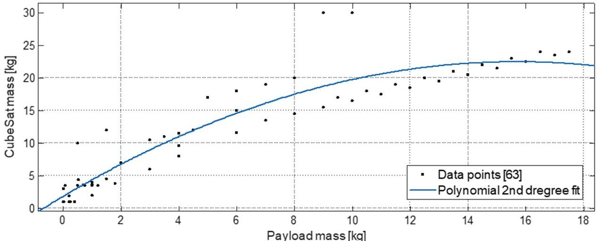

Fig. 2 GEL payload mass vs CubeSat mass empirical equation.

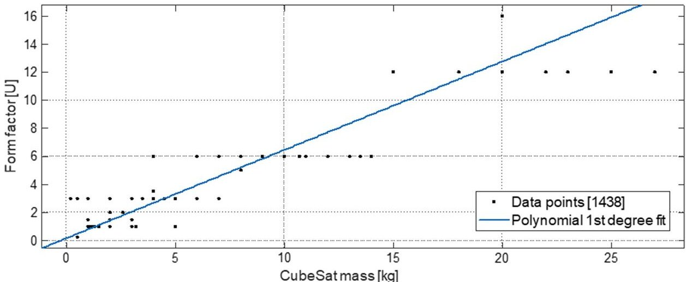

Fig. 3 GEL form factor vs CubeSat mass empirical equation.

<!-- PDF_PAGE: 5 -->

will select the closest ADCS which can satisfy that requirement. If multiple choices are available, it will keep the one which is closest to the output of the empirical correlations. A more detailed analysis will be performed in the framework of GAL.

The number of available combinations with the COTS currently included in GC+ is high, as displayed in Table 1. To pick the optimal one, GEL chooses the ones which are the closest to the empirical outcomes of the equations in terms of weights, volumes, power consumption, and satisfaction of the user requirements (e.g., ADCS with a specific pointing accuracy). GEL is hence capable of providing a system model, the empirical model. This EM is composed of COTS products which are the closest to the values of the empirical correlations just introduced. In some cases, naturally, a more elegant solution is applied to the estimation of the correct COTS product at this stage. An example can be provided by the selection of the ADCS subsystem. The empirically retrieved mass and power consumption obtained from the empirical equations are considered of secondary importance if the pointing accuracy introduced by the user is not respected by the proposed COTS. Priority is given to a system that could provide the necessary alignment. This approach has been validated with nine existing missions, and the comparisons are presented in Fig. 4.

Observing the two separate plots, it is possible to notice how the assumption of linking the empirical values to COTS products to build up the EM led to an overall accuracy of 86% for the mass. There is a larger discrepancy specifically for NanoBob, TempestD, and Hermes. This can be due to a quality deficit of the empirical correlations for bigger CubeSats, heavier subsystems used in the reference missions, or multiple payloads. Additionally, CLIMB has not flown yet, but because its data were easily retrievable within the design team, it has been introduced in the plot. For the volumes, the model currently respects the volumes for most cases, with the exception of NanoBob, CXBN-2, and SE-01. This may be motivated by several reasons. The COTS recommended via GEL may not represent the actual need of the satellite, or designing teams may be using a different COTS not included in GC+'s databases. To

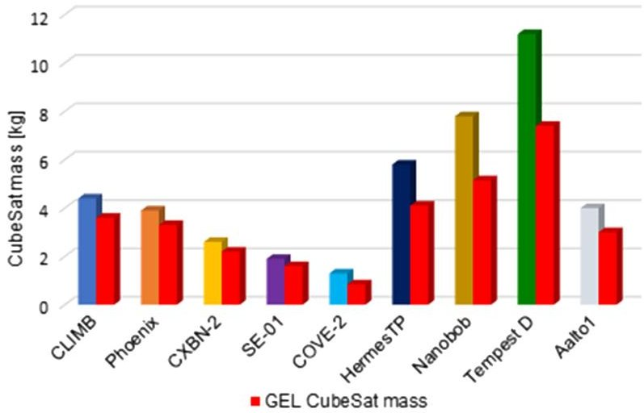

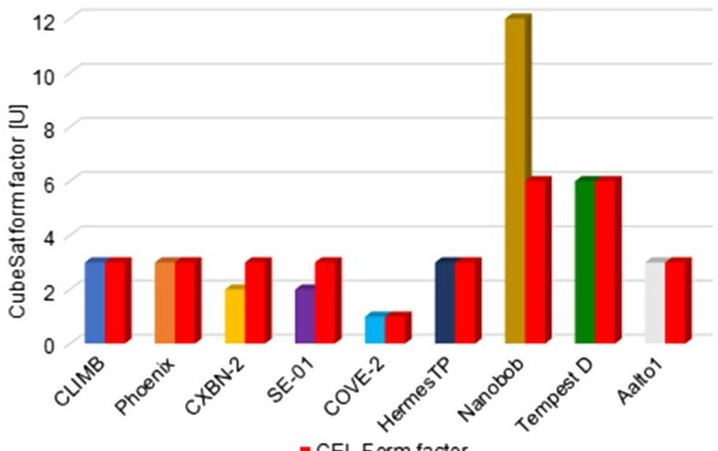

Fig. 4 GEL comparison between empirical values and real CubeSat values for weights (top) and form factor (bottom). Database status: 27 May 2023.

improve these values, a more detailed refinement of the systems needs to be performed via the analytical level, GAL. Previous research demonstrated how the COTS-based model performs better in terms of accuracy with reference to the real values when compared to the model built up solely of empirical values [25-27].

## B. GAL and Analytical Model

From a conceptual perspective, the layout of the analytical level is illustrated in Fig. 5.

The starting point of the analytical level is the introduction of additional inputs to perform a refinement of the EM, as introduced in Table 4.

The COTS selection performed in GEL is solely empirical. The empirical value is linked to a specific COTS product via the closest match in terms of mass, power, and particular feature (e.g., closest alignment requirement for an ADCS system). In GAL, a more detailed tradeoff between the components present in the COTS databases take place. The equations used in this level are directly inherited from academical textbooks like Space Mission Analysis and Design (SMAD) [14] or Spacecraft System Engineering [16] and are presented in Table 5.

As it happened with GEL, many scientists have investigated in the optimization of COTS products for the conceptual development phase. An example, including the ones already introduced in Sec. II.A, is the work of Asundi and Fitz-Coy [28].

The purpose of GAL is to refine individually the subsystems in order to provide a COTS composition which is satisfying both under an empirical and analytical perspective. To perform this task, GAL requires additional inputs from the user. The necessary inputs are listed in Table 4.

In contrast to GEL, there is no differentiation between mandatory or optional inputs. In this level, the user is required to fill in all the requested inputs. Once GAL retrieves all the necessary data, each of them is used in analytical equations which serve to perform the COTS refinement of a specific subsystem. As a leading example, the expected orbital altitude together with the eventual thruster misalignment data are considered together to estimate the amount of torques that the CubeSat will experience in orbit.

The same applies with the power cycles of other subsystems with reference to the EPS. Via the assessment of the percentage of time in which a specific subsystem is supposed to be operating at peak power consumption, it is possible to refine the value of the mission power budget. This value can then be used to calculate the necessary solar

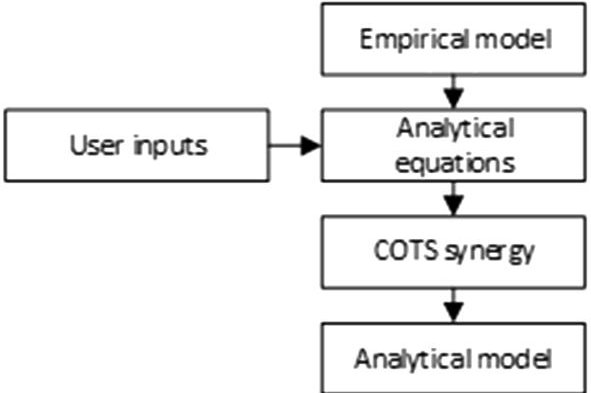

Fig. 5 GAL concept of operations.

Table 4 Summary of inputs required by GAL for the subsystem refinement (left) and interested subsystems (right)

<table border="1"><tr><td>Input</td><td>Target subsystem</td></tr><tr><td>Payload volume, duty cycle, dimensions</td><td>Structure, EPS</td></tr><tr><td>Lifetime</td><td>EPS</td></tr><tr><td>Min./Max. payload temperature</td><td>Thermal</td></tr><tr><td>Power cycles other subsystems</td><td>Structure, EPS</td></tr><tr><td>Radiation tolerance</td><td>OBC, payload</td></tr><tr><td>Expected orbital altitude</td><td>EPS, thermal, ADCS</td></tr><tr><td>Eventual thruster misalignment</td><td>Propulsion, ADCS</td></tr><tr><td>Electronics efficiency</td><td>Thermal, EPS</td></tr></table>

<!-- PDF_PAGE: 6 -->

Table 5 Summary of the analytical correlations involved in the subsystem refinement of GAL from SMAD [14] and Spacecraft System Engineering [16]

<table border="1"><tr><td>Subsystem</td><td>Inputs</td><td>Equations</td></tr><tr><td>Payload</td><td>Payload volume [U] and its dimensionsMin. and max. operating temperatures for the payload, CIdle and peak power consumption, WPayload duty cycle, %Lifetime, yrCritical radiation dose, krad</td><td>Inputs to be used for computationin all the other subsystems</td></tr><tr><td>Thermal</td><td>Min. and max. operating temperatures for the payload, COverall efficiency electronics, %Altitude, km</td><td>Conductive heat exchange, W/m2[14]Radiative heat exchange, W/m2[14]Solar flux, W[14]Albedo flux, W[14]Earth infrared flux, W[14]Internal heat source, W[14]</td></tr><tr><td>TTC</td><td>Duty cycle transceiver, %Altitude, km</td><td>Transmission window, s:Transmission-Window=Period·DutyCycleUpdated data rate, kB/sData-Rate=(DataUserInput1.5/Nr.GroundStation·480)[11]</td></tr><tr><td>Structure</td><td>Volumes of all COTS proposed viaGAL</td><td>Closest COTS to fulfill the volumes requirement</td></tr><tr><td>OBC</td><td>Critical radiation dose, krad</td><td>Closest COTS to fulfill the radiation requirement</td></tr><tr><td>Propulsion</td><td>Duty cycle propulsion unit, %</td><td>Tsiolkovsky rocket equation[14,16]Updated ΔV,m/s</td></tr><tr><td>EPS</td><td>Duty cycles of all the subsystems, %Orbital altitude, kmLifetime, yr</td><td>Por orbital period,s[14]βangle,deg[14]Eclipse time[s][14]Solar cells lifetime degradation[14]End of life power consumption,W[14]Beginning of life power consumption,W[14]Eclipse power,W[14]Nr.of necessary solar cells[14]Nr.of solar panels[14]Battery pack mass,kg[14]Closest match with COTS products</td></tr><tr><td>ADCS</td><td>Altitude,kmDuty cycle of ADCS,%Necessary alignment time,s or % of the orbitEventual misalignment of propulsion unit</td><td>Inertia matrix of a cube with slabs(in case of solar panels)[14]Solar radiation torque,mNm[14]Drag torque,mNm[14]Magnetic torque,mNm[14]Gravitational torque,mNm[14]Parasitic torque,mNm,in case a propulsionunit with a misalignment is present[14]Total torque to be stored,mNms[14]</td></tr></table>

mNms, milli Newton meter per second.

panels area and solar cells composition to satisfy this requirement. With this value, it is possible to select the proper battery pack. A summary of the analytical correlations used for the refinement of the COTS products in GAL is presented in Table 5.

One of the research questions of GAL is how to treat a substitution in a COTS within GAL. The first option is to either substitute the newly found COTS directly and perform a synergy check to ensure that the others can still operate. The second approach relies on storing new COTS separately and merging them together in a new model once all the subsystems have performed their refinement, naturally ensuring that the volumes and power requirements are satisfied. The approaches have been named GAL1 and GAL2 and are illustrated in Fig. 6. In this figure, the whole set of available refinements is displayed. It could be that, due to the mission requirements, some subsystems are to be excluded because they are not present. As an example, if the $ \Delta V $ has not been introduced in GEL, no propulsion unit will be present with the empirical model. Hence, no propulsion refinement will take place in GAL. The same applies when an alignment requirement for the payload is not

present. Hence, no ADCS will be present. Another case is when the payload is not a technology demonstrator but a part of the critical subsystems. In this scenario, GAL performs the refinement of the critical subsystem but does not recommend any COTS product. In this way, teams may have access to the set of information provided by the refinement. As an example, for an ADCS payload, it may be useful for teams to know the estimated magnetic, solar, and gravitational torques for a specific altitude.

The two alternatives displayed in the figure are representative of the concurrent engineering methodology which is commonly used in the conceptual development of space missions nowadays [29-34]. In the latter, the criticality of the subsystem seems to play a major role.

<!-- PDF_PAGE: 7 -->

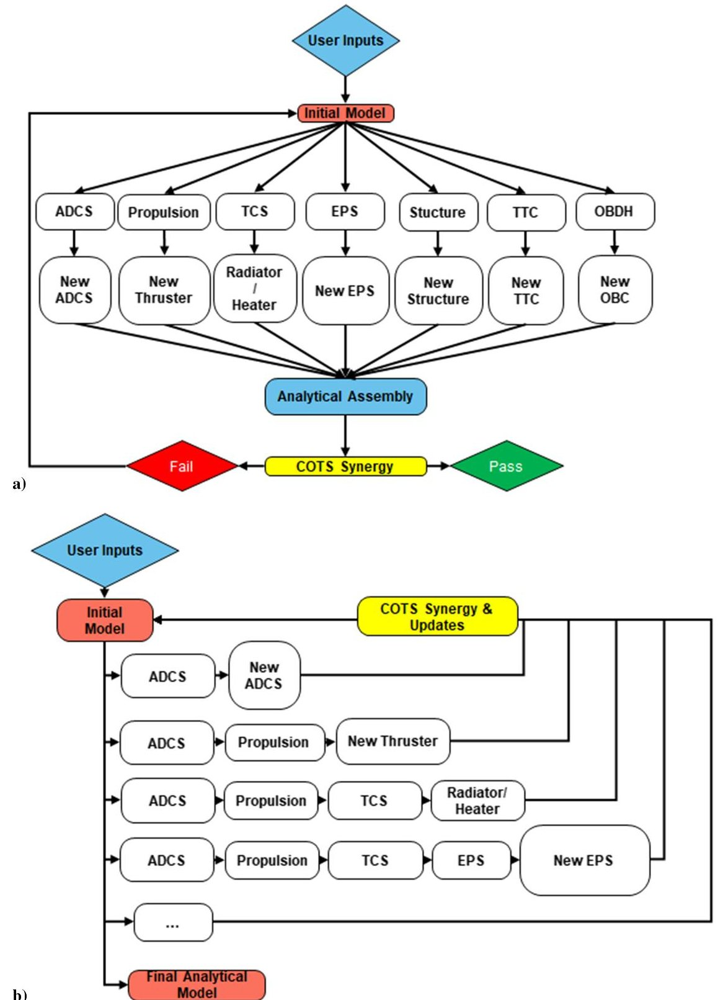

Fig. 6 a) GAL1 and 2. GAL1 systematic approach of storing the new COTS separately and b) GAL2 subjective subsystem priority approach. Adapted with permission from [11].

This means that a subsystem priority of refinement is introduced; hence, the most important components of the system are refined in an early stage of the design. In this approach, the upcoming subsystems will perform a refinement of a new model which is based on the most important subsystems. It can be visualized as a concurrent engineering activity performed from an expert system engineer as project leader which addresses first the focus upon the subsystems which are subjectively considered as critical. The former approach is still a concurrent engineering application. The difference is that each subsystem performs the refinement from the same initial level, and at the end, a new model is built with all the new COTS products, and its synergy is checked sequentially. These two models have been developed in the framework of GAL to provide information as to which of the two delivers the best results.

Within GAL1, graphically represented in the top part of Fig. 6, the subsystems are analyzed sequentially using the same EM as a starting point. The new COTS are stored separately and then assembled all together in order to perform a synergy check. If the current layout can

fit the proposed form factor with the proposed solar panels architecture and no major changes are required, the model passes the check, and GAL proceeds with the analytical model (AM) definition. In case the assembly fails the COTS synergy check, this unsuccessful model is used as an initial model for an additional iteration, substituting the initial empirical model.

GAL2, graphically represented in the bottom part of Fig. 6, proceeds by asking the user the order in which the subsystems priority needs to be addressed. Once all the inputs have been introduced, the subsystems are refined in the order specified. Every time a new COTS is found more suitable than the one proposed in the empirical model, it is immediately substituted in the empirical model, and a COTS synergy check similar to the one of GAL1 takes place. The process is concluded when the last subsystem is refined and the analytical model is obtained. Because the synergy check is always active, there is no need for a last round of it.

The quality of both methods has been estimated by iterating the same CubeSats as the ones presented for GEL. The plotted outcomes are illustrated in Fig. 7.

<!-- PDF_PAGE: 8 -->

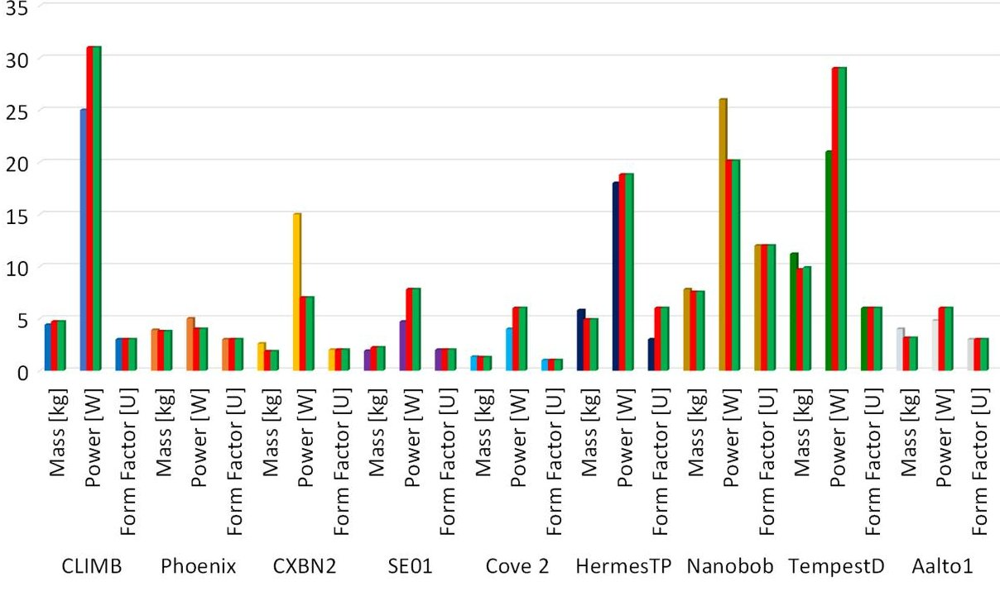

Fig. 7 GAL 1 and 2 results comparison.

Both methods are qualitatively equal. The outcomes of this analysis displayed how the concurrent engineering principles lead to the same result in case of proper implementation. The COTS recommendations are based on the outcomes of the analytical equations listed in Table 5. The results obtained via the correlations are useful in order to evaluate features that the future COTS shall have. The COTS data which are listed in the database are directly inherited from the producers' datasheets. With these values, it is possible to suggest a COTS which satisfies the user requirements. As a comparison with the previous layer, a specific COTS suggested via GEL needs only to satisfy the user-introduced alignment requirement, and it shall have the closest mass and power consumption data of the empirical correlations between the COTS present in the database. With GAL, in addition to the alignment, the COTS shall also be capable of withstanding the total torque to be stored calculated via the correlations mentioned previously.

The final conclusion on GAL1 and GAL2 is that the methods implemented will not alter the results and hence both methods are available within GREATCUBE+.

The accuracy achieved via the subsystem refinement displayed a positive increase. Masswise, GAL can improve the predicted outcome by providing results which are bigger than 90%, and similarly for volumes. For the estimation of the power productions, the accuracy of GREATCUBE+ is of 80%. In some cases, as examples, CLIMB, NANOBOB, and PHOENIX, all the necessary inputs for the simulation were known, and they were retrieved from the relevant publications or directly from the team [35-37], while for the others, many values had to be reasonably assumed. In the case of all known values, the accuracy is more than 96% for weights and 100% for volumes, while it is 82% for power. For the latter, the output value heavily depends on the duty cycles input. This shows that if more data were available online the real accuracy of the tool could be way higher without the usage of assumptions. The proposed AM is then comprised of COTS products which come with datasheets including power consumption, weights, volumes, electrical connections, and physical properties, which are backed up by analytical equations.

## C. GNL and Numerical Model

The numerical level GNL is the final layer composing GREATCUBE+. It uses as input the AM, and it produces as output the numerical model (NM).

The AM is composed of a detailed list of COTS products which have been selected for the CubeSat that is under development by analytical and empirical correlations. The model currently proposed is functional under a power, volume, and mass perspective thanks to the COTS synergy check. No information is provided for the current

positioning of these COTS, which is the task of GNL. The position of the subsystems composing the satellite may influence the thermal budget, the COG requirement of the launcher provider, and the design feasibility.

The architecture of GNL is displayed in Fig. 8.

Once the AM is provided, in case a payload is present onboard GNL requires the user to select a fixed location for it. For simplicity, the choices are between the bottom, center, and top part of the CubeSat. Sequentially, the software takes all the dimensions and masses provided by the COTS datasheets and optimizes their position internally via the usage of a genetic algorithm. For the sake of clarity, the COTS products are assumed to be boxes.

The problem of optimizing the position of boxes inside a bigger container is a well-known problem in the field operational research, named the bin packing problem or three-dimensional bin packing problem. The usage of a genetic algorithm (GA) has been addressed by many researchers as the optimal solution for this type of problem, also applied to spacecraft design [38-45].

The genetic algorithm is a mean to solve complex problems by using a better technique when compared to the classical gradient based methods [46]. Initially, GAs were developed to mimic biological systems in order to optimize complex problems. Henceforth, the terminology commonly used in GAs theory is representative of this origin of the algorithm; in other words, organisms are solutions, genes are coded strings or variables, and survival of the fittest translates into optimal solutions.

With this method implemented in GC+, once the initial population of COTS products is generated inside the CubeSat, the GA identifies the optimal solution in terms of positioning by optimizing three functions. These are as follows:

1) CubeSat COG must lie within the limits imposed by the launcher provider [1,47] as presented in Table 6. This optimizing function can be described by Eq. (1):

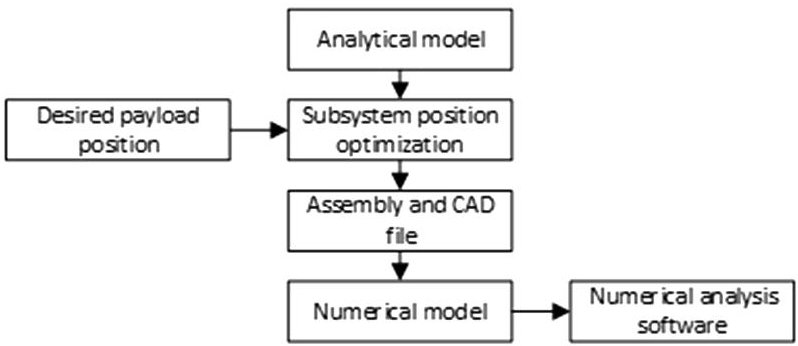

Fig. 8 GNL concept of operations.

<!-- PDF_PAGE: 9 -->

Table 6 CubeSat COG locations range

<table border="1"><tr><td>Form factor, [U]</td><td>X axis,cm</td><td>Y axis,cm</td><td>Z axis,cm</td></tr><tr><td>1</td><td>±2</td><td>±2</td><td>±2</td></tr><tr><td>2</td><td>±2</td><td>±2</td><td>±4</td></tr><tr><td>3</td><td>±2</td><td>±2</td><td>±6</td></tr><tr><td>6</td><td>±2</td><td>±2</td><td>±12</td></tr><tr><td>12</td><td>±2</td><td>±2</td><td>±24</td></tr></table>

$$
\frac {\sum \left(\mathrm {C O T S} _ {i , \mathrm {m a s s}} \cdot \mathrm {D i s t a n c e} _ {i , \mathrm {C G}}\right)}{\sum \mathrm {C O T S} _ {i , \mathrm {m a s s}}} < \mathrm {C O G} _ {\mathrm {r e q u i r e m e n t}}
$$

2) One side of each COTS product must always be in contact with the panels of the internal structure, to mimic mechanical interfaces. It can be described via Eq. (2):

$$
\max \sqrt {\left(\mathrm {C O T S} _ {i , \mathrm {C O G}} - \mathrm {C O G} _ {\mathrm {r e q u i r e m e n t}}\right) ^ {2}}
$$

3) The individual Z axis, in the case of form factors bigger than 3, must be as close as possible to the centers of the stacked [U]'s so it could mimic the placement between the structure rails, as presented in Eq. (3):

$$
\min \sqrt {\left(\mathrm {C O T S} _ {i , \mathrm {C O G} (X , Y)} - \mathrm {C O G} _ {(X , Y) \mathrm {r e q u i r e m e n t}}\right) ^ {2}}
$$

The structure rails are used to create the shell containing the CubeSat's subsystems. The structure weight and dimensions from the COTS datasheet are used to create such a shell, and it is included in the calculation, as the eventual solar panels. A visual representation of how those concepts are operating within the GA is displayed in Fig. 9.

On the left of the figure, the COTS is placed unrealistically. It is far from the outer shell, so no mechanical connection can be made. Additionally, because the COTS is placed between the two internal rails of the dummy 12 [U], it would not be possible in real applications. With the introduction of the previously mentioned constraints, it would be physically doable. The impact of each of the constraints presented can be altered by the designing team by introducing a subjective weight. As an example, for a team leader, it may not be important to have a strict COG placed as close as possible to the geometric center, as is the case for the right part of Fig. 9. In the figure, priority was given to the mechanical interface connection. Hence, the impact of the optimizing functions can be lowered at will by expressing the personal preference in percentage within the range 0-100%.

With this approach, designing teams are allowed to test out different setups for their current COTS architectures.

Once the optimum solution for the COTS architecture has been found, GNL proceeds in creating an IGES file out of the current design architecture. This IGES file is then ready to be used in other simulation environments in order to further refine and analyze the

current CubeSat proposed via the usage of GREATCUBE+ with multiple numerical methods. In previous works [11,25-27], analyses of different missions were performed with ANSYS $ ^{\circ} $ . In this test case proposed in the following, the usage is extended with an additional software package: STK $ ^{\circ} $ .

## III. Test Case Application

In this section, a real CubeSat mission will be used as a reference for validation of GREATCUBE+. The reference CubeSat mission is PW-SAT2 [48], a Polish CubeSat developed by the students of the Warsaw University of Technology and launched in December 2018.

The payloads implemented in PW-SAT2 were a deployable deorbitation system for increasing drag effects, an innovative sun sensor, and a commercial one together with two cameras [49]. The form factor was a 2U (A cubesat which is defined by 2 stacked [U]s of 10 cm x 10 cm x 10 cm one on top of the other), with two deployable solar panels. A summary of the features of PW-SAT2 is presented in Table 7.

PW-SAT2 was selected to demonstrate GREATCUBE+ capabilities due to the great amount of information available online. This allowed for minimal assumptions being necessary to operate the software.

As mentioned in earlier sections, the starting point of the simulation with GREATCUBE+ is with GEL. In GEL, the following inputs presented in Table 8 are introduced via the integrated graphical user interface (GUI) presented to the designing teams which is composed of a series of simple pop-up windows inquiring for the inputs. Because GC+ is capable of simulating only a single payload, the list of payloads onboard PW-SAT2 has been merged together in terms of mass, volumes, and power consumption as a single technology demonstrator box.

As discussed earlier, those inputs are used to assess empirically the values of system and subsystem parts based on the collected database of space missions. Hence, the payload mass, power, alignment, and total data are used to estimate the CubeSat mass, form factor, power production, and COTS based solely on empirical data. The outcomes of GEL are presented in a table at the end of the layer simulation, and for the sake of clarity, it is presented in a formatted form in Table 9.

Notably, the values estimated by GEL are already close to the real PW-SAT-2 values, although in some cases, they differ. As an example, the solar panel configuration resulted from GEL differs from the one actually implemented on PW-SAT2. Hence, there is a discrepancy in the power production between the real satellite and GEL's model. Additionally, the lack of information on how the subsystems are operating negatively affects the outcome of this estimation. To perform a sturdier analysis, additional inputs are necessary. This will be answered within the GAL layer.

GAL takes as a starting model the EM just described and proceeds in performing an analytical analysis based on the equations listed previously. This is a mean to retrieve more useful data from the

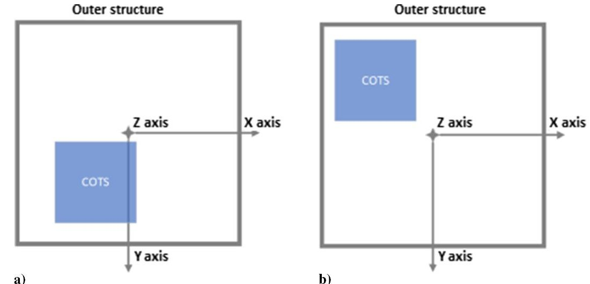

Fig. 9 Additional constraints operating principle in a dummy 12 [U]. The incorrect placement of a COTS (left) and a realistic COTS placement after the integration of the three additional constraints (right) are shown.

<!-- PDF_PAGE: 10 -->

Table 7 List of relevant information on PW-SAT2 retrieved from the CubeSat's CDR [49]

<table border="1"><tr><td>Data</td><td>Qty.</td><td>Feature</td><td>Comments</td></tr><tr><td>In-house ADCS</td><td>1</td><td>194g</td><td>Volume:0.1x0.1x0.2</td></tr><tr><td>Form factor</td><td>——</td><td>2U</td><td></td></tr><tr><td>CubeSat mass</td><td></td><td>2.6kg</td><td>COG
X:6mm
Y:-7mm
Z:8mm</td></tr><tr><td>TT&amp;C</td><td>1</td><td>-</td><td>ISIS UHF downlink/VHF uplink</td></tr><tr><td>Data rate</td><td>1.2kbps</td><td></td><td></td></tr><tr><td>EPS</td><td>1</td><td></td><td>Capacity:40Wh</td></tr><tr><td>Solar cells</td><td>12</td><td>Efficiency30%</td><td></td></tr><tr><td>Solar panels</td><td>2+1</td><td>2 deployable
1 body mounted</td><td></td></tr><tr><td>Payload:deorbiting
system,cameras,
sensors all together</td><td></td><td>Mass:1.1kg
Volume:0.8U
Idle power:1.5W
Peak power:5W</td><td>Assumed from CDRs</td></tr><tr><td>Geometric model</td><td></td><td></td><td></td></tr></table>

Table 8 GEL inputs for the simulation of PW-SAT2

<table border="1"><tr><td>Input</td><td>Value</td><td>Status</td></tr><tr><td>Payload type</td><td>Technology demonstrator</td><td></td></tr><tr><td>Payload mass</td><td>1.1kg</td><td>Sum of payloads listed in CDR</td></tr><tr><td>Payload OAP</td><td>1.5W</td><td>Assumption</td></tr><tr><td>Alignment req.</td><td>15deg</td><td>From CDR</td></tr><tr><td>Total amount of data per orbit</td><td>3.5Mb</td><td>Assumed from the CDR data rate of 1.9kbps</td></tr></table>

current system under study. As an example, the selection of the ADCS proposed in the EM is solely based on the trend for CubeSats with a similar mass and with a similar alignment requirement. This value is subsequently used through the database of ADCS systems, which is internally included in GREATCUBE+ for the closest match. Via GAL, it is possible to estimate the maximum external torque based on the proposed solar radiation, drag, magnetic, gravitational, and eventually parasitic torque. Sequentially, GAL compares this value with the COTS maximum torque storage and then performs a reasoned selection based on these parameters, naturally considering the userintroduced pointing accuracy. The inputs required by GAL to perform the mentioned refinement are described in Table 10.

Once all the necessary inputs have been inserted, GREATCUBE+ allows the designing teams to decide which of the two methods (GAL1 and GAL2) introduced in earlier sections will be used for the simulation. Because there is no significant difference between them apart from a conceptual one, only the results of GAL1 will be

displayed in the following. GAL1 follows the principles presented in the top part of Fig. 6 to perform its refinement. Each time a subsystem stops its optimization, a window opens for the user to see the outcome of the simulation for that specific subroutine. As an example, Fig. 10 represents the proposed power budget for PW-SAT2 with the newly found architecture.

The power budget has been estimated starting from the duty cycles introduced by the user and, applying a highly conservative approach, implements always the highest-power-demanding subsystem as operating while in eclipse. Via the refinement performed with GAL, it was discovered that the EPS proposed by the EM setup was not enough to sustain the power demands, and hence it calculated how many solar panels, solar cells, and battery capacity are necessary for the survival of the CubeSat. Naturally, being in GAL1, this value will be merged at the end, once all the subsystems have been refined, and the synergy check will combine them and supervise them. A summary of the outcome of this analysis is presented in Table 11 to evaluate the proposed design of GAL with the actual values of PW-SAT2.

Based on the outcomes presented in the table, it is clear that the accuracy of the system has improved from GEL to GAL. Now, the proposed CubeSat uses a light, low-power ADCS composed of magnetorques from Tensor Tech. For the real PW-SAT2, a similar ADCS has been employed, with the difference of being built in house. Masswise, the difference between the model proposed in GAL and the real PW-SAT2 is approximately 0.250 kg, approximately 9%. The form factor is a 2U, and powerwise, the power budget has been assessed to 9.87 W, quite representative of the real satellite's power demand. Hence, the overall accuracy of the design compared

Table 9 Outcome of GEL simulation with the inputs presented in Table 5; on the right, real values from PW-SAT2

<table border="1"><tr><td>Variable</td><td>Value</td><td>Note</td><td>PW-SAT-2 real value</td></tr><tr><td>CubeSat mass</td><td>2.42kg</td><td></td><td>2.6kg</td></tr><tr><td>Form factor</td><td>2U</td><td></td><td>2U</td></tr><tr><td>Power budget</td><td>5.6W</td><td>OAP is 3.7W</td><td>10W</td></tr><tr><td>Data rate</td><td>10.12kbps</td><td>Equals 1.35kbps</td><td>1.9kbpss</td></tr><tr><td>ADCS</td><td>ADCS MTQ from Tensor Tech.0.14kg</td><td>Pointingaccuracy:10degMax. value in currentdatabase</td><td>In house built0.194kg</td></tr><tr><td>Battery pack</td><td>2 batteries with 207Wh/kg densityTotal capacity:12Wh</td><td></td><td>4 batteries in-housebuilt40Wh</td></tr><tr><td>TT&amp;C</td><td>NanoAvionics UHF AntennaEnduroSat UHF Transceiver2</td><td></td><td></td></tr><tr><td>Solar panels</td><td>1</td><td></td><td>2 deployable and 1 body mountedIn-house built0.4kg</td></tr><tr><td>Structure</td><td>2U platform from ISIS space</td><td>0.206kg</td><td></td></tr><tr><td>OBC</td><td>Average weight and power of OBCavailable in internal database</td><td>0.072kg0.72 power consumption</td><td>CubeSpace CubeComputer</td></tr></table>

<!-- PDF_PAGE: 11 -->

Table 10 List of inputs used for the simulation of PW-SAT2 using GAL

<table border="1"><tr><td>GAL inputs</td><td>Value</td><td>Notes</td></tr><tr><td>Payload volume and Dimensions</td><td>0.8U
10×10×8cm</td><td>Assumed from CDR CAD model</td></tr><tr><td>Payload peak and idle power Consumption</td><td>5W/1.5</td><td>From power budget displayed in CDR</td></tr><tr><td>Lifetime</td><td>4yr</td><td>Effective lifetime</td></tr><tr><td>Radiation tolerance</td><td>4000rad</td><td>Assumed</td></tr><tr><td>Payload min. and max. Operating temperature</td><td>-10/10℃</td><td>Assumed from CDR</td></tr><tr><td>Duty cycles per orbit</td><td>5% payload
100% ADCS
100% OBC
25% TTC</td><td>Assumed</td></tr><tr><td>Electronics efficiency</td><td>80%</td><td>Assumed for all COTS</td></tr><tr><td>Altitude</td><td>575km</td><td></td></tr></table>

to the reference satellite is 91% for masses and approximately 100% for power and volumes from a system perspective. The proposed model is the AM, and it will be used within GNL to provide an estimate on the position of the suggested COTS in order to create a numerical model suited for further simulations.

GNL, as mentioned earlier, uses a genetic algorithm to solve the COTS positioning problem, applying three major optimizing functions described in Sec. II.C. Because the payload might be, like the device for de-orbiting PW-SAT2, bounded to specific position requirements, GNL asks the designing team to select the position in which it has to be placed. The alternatives proposed are 1) top (+Z axis), just below the transceiver unit; 2) middle, as close as possible to the geometric center; and 3) bottom (-Z axis), facing deep space or just above a thruster, in case it is present.

Because there is no thruster and the deorbiting device needs to face deep space, it has been decided to place it on the bottom of the satellite. The outcome of the simulation performed with GNL reached convergence in 21 possible solutions generations with a center of gravity expressed via Eq. (4):

$$
\mathrm {G N L C O G}: \left[ \begin{array}{l} \mathrm {C O G} _ {X} \\ \mathrm {C O G} _ {Y} \\ \mathrm {C O G} _ {Z} \end{array} \right] = \left[ \begin{array}{l} 5. 4 5 \\ - 0. 9 4 \\ - 1 8 \end{array} \right] [ \mathrm {m m} ]
$$

$$
\mathrm {P W} - \mathrm {S A T 2 C O G}: \left[ \begin{array}{c} 6. 6 2 \\ - 6. 9 8 \\ 7. 5 7 \end{array} \right] [ \mathrm {m m} ]
$$

The proposed setup fulfills the launcher requirement for the COG positioning introduced in Table 6. The outcome of GNL differs from the real PW-SAT2 because it is not considering all the additional spacing PCBs which are currently implemented within the real satellite and all the payloads have been merged within a single box. The model proposed by GNL at the end of the simulation is composed of boxes which represent the COTS proposed, and it is displayed in Fig. 11, together with the real setup of PW-SAT2 [48], inverted on the Z axis.

GNL is capable of allocating efficiently the heaviest subsystems such that the overall COG would be within the appropriate limits. Additionally, the comparison with the real model demonstrates how close to reality the outcome of the simulation can be. It mirrors the allocation of the subsystems for all of them with the sole exclusion of the antenna. Hence, for the purpose of allocating the positions of the subsystems, the model proposed with GNL can be considered validated. The weights for the optimizing functions are 100% for COG placement within the boundaries imposed by the launcher provider, 80% for mimicking mechanical interfaces, and 60% for minimizing the individual Z axis distances from the structure's Z axis.

With the current model, saved as an IGES file, it is possible to export it to various software tools for additional analysis. For this paper, the software chosen is ANSYS $ ^{\circ} $ and STK.

In ANSYS $ ^{\circ} $ , a thermal analysis is performed on the system using the data provided by the PW-SAT2 Critical Design Review (CDR) [48] as a reference. Naturally, because the payloads are merged within the same box in GC+ and the components implemented in PW-SAT2 are built in house or they simply differ from the COTS suggested in GREATCUBE+ , a validation of the thermal model proposed with GNL cannot be performed.

The boundary conditions of the PW-SAT2 model generated with GREATCUBE+ are presented in Table 12. For the materials, the following properties have been applied.

The heat dissipated by the COTS is introduced in Table 13. The values have been retrieved from the idle power consumption of the components inherited by GAL analysis multiplied by an electronics efficiency of 80% , which has been introduced as an assumption in the framework of GAL.

The external fluxes have been divided between solar, albedo, and infrared. The solar flux has been estimated to have a value of approximately 1373 W/m $ ^{2} $ [14,50]. The albedo and IR combined have been estimated to have a value of 242 W/m $ ^{2} $ [14].

The output of the steady-state analysis, measured with the worsthot-case (WHC) scenario, is presented in Fig. 12.

The average temperatures of the components of this thermal simulation are presented in Table 14. It is possible to compare these results with the temperature operative range of the COTS proposed in GAL. In this case, the placement of a radiator, as forecasted in GAL, would be necessary to keep the COTS products within the allowed operative range.

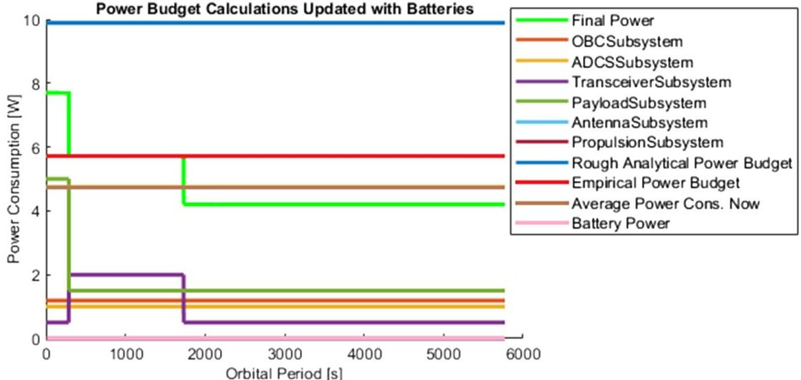

Fig.10 EPS refinement performed via GAL. Current power information is displayed to provide the user with the proper justifications for the design choices implemented.

<!-- PDF_PAGE: 12 -->

Table 11 GAL outcome of the iteration performed with PW-SAT2's inputs

<table border="1"><tr><td>Variable</td><td>PW-SAT2 value[50]</td><td>GEL Value</td><td>GAL value</td><td>Note</td></tr><tr><td>ADCS</td><td>In houseMass:0.194kgPower:0.68W</td><td>ADCS MTQTensor TechMass:0.14kgPower:1W</td><td>ADCS MTQTensor TechMass:0.14kgPower:1W</td><td></td></tr><tr><td>Pointing Acc.-(ADCS)</td><td>15 deg</td><td>10 deg</td><td>10 deg</td><td></td></tr><tr><td>Solar panels</td><td>3</td><td>1</td><td>3</td><td></td></tr><tr><td>Solar cells</td><td>12</td><td>6</td><td>18</td><td>GAL considers the whole panel surface to be eligible for solar cells coverage wherePW-SAT2 has a camera on half a panel.</td></tr><tr><td>Power budget</td><td>10 W</td><td>5.6 W</td><td>9.87 W</td><td></td></tr><tr><td>Form factor</td><td>2U</td><td>2U</td><td>2U</td><td></td></tr><tr><td>CubeSat mass</td><td>2.6 kg</td><td>1.98 kg</td><td>2.8 kg</td><td></td></tr><tr><td>Battery pack</td><td>In house built4 batteries24 Wh assumed</td><td>207 Wh/kg densityTotal capacity:12 Wh</td><td>EPS 1 EnduroSatCapacity:20.4 Wh</td><td></td></tr><tr><td>OBC</td><td>CubeSpaceCubeComputer</td><td>Average values fromdatabase</td><td>Telos 10 witha high radiationtolerance(1 krad)without Al shieldingMass:0.6 kgPower:1 W peak0.5 W idle</td><td>Radiation input hasbeen used as a designparameter for thisrefinement.</td></tr><tr><td>Structure</td><td>In-house builtMass:0.4 kg</td><td>ISIS 2U platformsolar panelsnot included:0.206 kg</td><td>ISIS 2U platformsolar panelsnot included:0.206 kg</td><td></td></tr><tr><td>Thermal</td><td>PassiveWHC and WCCN/A</td><td>NA</td><td>PassiveRadiative area needed:0.0156m2WHC:14.51℃WCC:-4.48℃</td><td></td></tr><tr><td>TTC</td><td>N/A</td><td>NanoAv. UHF Ant.Enduro. UHF Trans.2</td><td>NanoAv. UHF Ant.Enduro. UHF Trans.2</td><td>No data retrieved for PWSAT2</td></tr></table>

deg, degrees; Al, Alluminium; Ant., Antenna; Trans., Transceiver; N/A or NA, Not Available; WHC, Worst Hot Case; WCC, Worst Cold Case; ADCS MTQ Tensor Tech is the commercial name of the part suggested via the software.

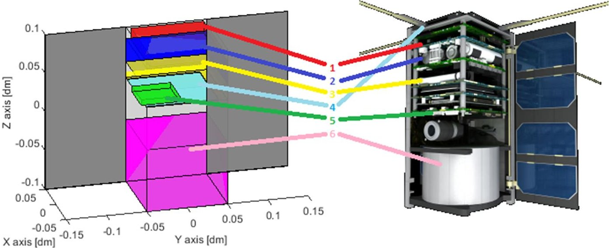

Fig. 11 GNL outcome for PW-SAT2: 1) transceiver (red), 2) battery pack (blue), 3) ADCS (yellow), 4) antenna (light blue), 5) OBC (green), and 6) payload (magenta). Picture of the real satellite taken from PW-SAT2 website [48]. Adapted with permissions from Marcin wietli on https://pw-sat.pl/en/ [48]. Copyright 2023 PW-Sat2/Marcin wietli.

These temperatures cannot be compared to the one proposed in the CDR model of PW-SAT2 due to the fact that in GNL different components and materials are implemented. This model solely serves the purpose of illustrating the operational capabilities of GREATCUBE+ and its ability to be implemented in different software tools for multiple applications. As a possible follow-up, the materials of the outer shell may change, active thermal control techniques can be implemented, or new allocations of COTS products for an improved thermal analysis may be suggested. Another possible application of the model is in the STK environment. The exported version of PW-SAT2 which can be implemented in STK is displayed in Fig. 13.

With STK, the designing teams can perform different simulations which could be used to support the design proposed by GREATCUBE+. As an example, the eclipse and sunlight times can be calculated for cross-checking it with the values used for GAL analysis. Via this, different orbits may be defined, and a more in-depth study of the current power consumptions may be adjusted accordingly. For PW-SAT2, it is possible to retrieve an eclipse time of 2088 s via STK, where GAL performed its computations with an eclipse period of 2132 s and a sunlight time of 3660 s, similar to the GAL input of 3672 s for a polar orbit at 575 km altitude.

Additionally, with some modifications of the model provided at the end of GREATCUBE+ simulation, it is possible to evaluate the

<!-- PDF_PAGE: 13 -->

Table 12 Materials and properties used in the thermal simulation performed with ANSYS for the GNL model

<table border="1"><tr><td>Component</td><td>Material</td><td>Density,kg/m3</td><td>Specific heat,J/kgK</td><td>Conductivity,W/mK</td><td>Emissivity</td><td>Absorptivity</td></tr><tr><td>Panels</td><td>Aluminium6061</td><td>2710</td><td>1017.1</td><td>155.3</td><td>0.07</td><td>0.13(front panel)0.7 others</td></tr><tr><td>Payload</td><td>Aluminium6061</td><td>2710</td><td>1017.1</td><td>155.3</td><td>0.07</td><td>0.7</td></tr><tr><td>Solar panel</td><td>GaAs/aluminum</td><td>2710</td><td>1017.1</td><td>155.3</td><td>0.85(GaAs)</td><td>0.91</td></tr><tr><td>OBC</td><td>FR-4</td><td>1850</td><td>1100</td><td>0.2</td><td>0.07</td><td>0.7</td></tr><tr><td>ADCS</td><td>FR-4</td><td>1850</td><td>1100</td><td>0.2</td><td>0.07</td><td>0.7</td></tr><tr><td>Battery</td><td>Aluminum6061</td><td>2710</td><td>1017.1</td><td>155.3</td><td>0.07</td><td>0.7</td></tr><tr><td>Antenna</td><td>Aluminum6061</td><td>2710</td><td>1017.1</td><td>155.3</td><td>0.07</td><td>0.7</td></tr><tr><td>Transceiver</td><td>Aluminum6061</td><td>2710</td><td>1017.1</td><td>155.3</td><td>0.07</td><td>0.7</td></tr></table>

GaAs, Gallium arsenide; J/kgK, Joule/kilogram-Kelvin; W/mK, Watt/ milliKelvin.

Table 13 Heat dissipation generated by the components by considering the electronic efficiency input of 80%

<table border="1"><tr><td>Component</td><td>Total heat generation,W</td><td>Volume,m3</td><td>Internal heat,W/m3</td></tr><tr><td>Payload</td><td>0.35</td><td>8.e-4</td><td>437.5</td></tr><tr><td>ADCS</td><td>0.2</td><td>2.e-004</td><td>1000</td></tr><tr><td>Battery pack</td><td>0.5</td><td>3.e-004</td><td>1667</td></tr><tr><td>Transceiver</td><td>0.4</td><td>1.215e-004</td><td>3292.2</td></tr><tr><td>Antenna</td><td>0</td><td>8.1e-006</td><td>0</td></tr><tr><td>OBC</td><td>0.2</td><td>1.512e-005</td><td>13228</td></tr></table>

power budget by introducing the solar cells proposed in GAL. The current setup suggested in the GREATCUBE+-based PW-SAT2 is displayed in Fig. 14.

The solar cells number is provided as an outcome of GAL, and it is equal to 18 solar cells. The allocation of the solar cells is subjective to the user. In the graphical solar architecture introduced in STK, the solar cells have been distributed on the three main solar panels in groups of four for the deployable ones and in a single string of two for the main body directly facing the sun. Additionally, there are two strings of four solar cells on the lateral panels of the satellite.

The proposed architecture has been designed based on the actual architecture of PW-SAT2 for this specific case. Naturally, different solar architectures are available, and the organization of the solar cells on the panels is subjective to the designer's judgement. With this information, it is possible to estimate the current power budget with the architecture proposed, and the outcome is shown in Fig. 15. The maximum power produced by this architecture is 10.3 W. This amount reflects the estimated power budget retrieved with GAL in Fig. 10. Hence, the power architecture model can be considered a valid architecture solution.

Table 14 Average temperatures of the components introduced in ANSYS from the GNL analysis

<table border="1"><tr><td>Component</td><td>Average temperature WHC,℃</td></tr><tr><td>Payload</td><td>60.12</td></tr><tr><td>OBC</td><td>55.12</td></tr><tr><td>Antenna</td><td>52.86</td></tr><tr><td>ADCS</td><td>56.3</td></tr><tr><td>Battery pack</td><td>58.64</td></tr><tr><td>Transceiver</td><td>58.6</td></tr></table>

The proposed mission has been performed to demonstrate the capabilities of GREATCUBE+ in performing the design of CubeSat missions efficiently and quickly.

## IV. Conclusions

It is hoped that GREATCUBE+'s capabilities as a software tool for the conceptual design of CubeSat missions will make an impact on the development time and the success rate of small satellites. The current results presented show that for masses, volumes, and power production GREATCUBE+'s accuracy can reach more than 90% with sufficient information provided. The capability of implementing payloads of different nature turns it into a reliable tool that can be used by any design group. The outcome of the test case proposed in Sec. III took PW-SAT2 as a reference satellite for evaluation. By comparing the design proposed by GNL and the actual satellite, it is possible to evaluate the accuracy of the relevant subsystem correctly so that the launcher COG requirements could be satisfied. The model provided by GREATCUBE+ can be exported to different software for thermal and electrical analysis. The model quality is then illustrated from a

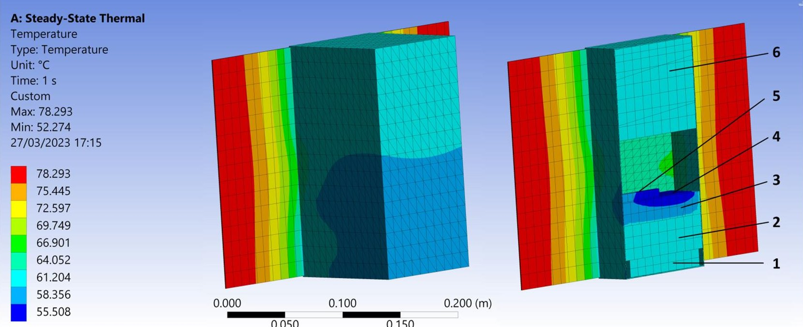

Fig. 12 ANSYS steady state analysis outcome for PW-SAT2 in WHC scenario: 1) transceiver, 2) battery pack, 3) ADCS, 4) antenna, 5) OBC, and 6) payload.

<!-- PDF_PAGE: 14 -->

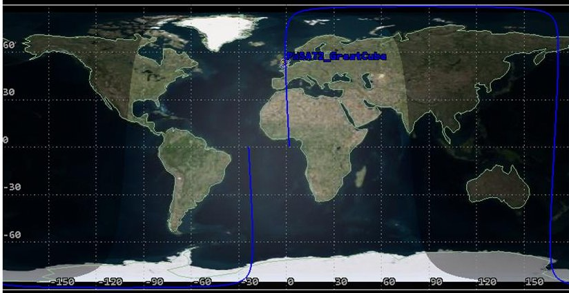

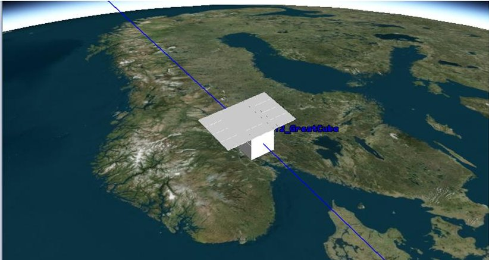

Fig. 13 STK visualization of PW-SAT2 design as outputted from GREATCUBE+.

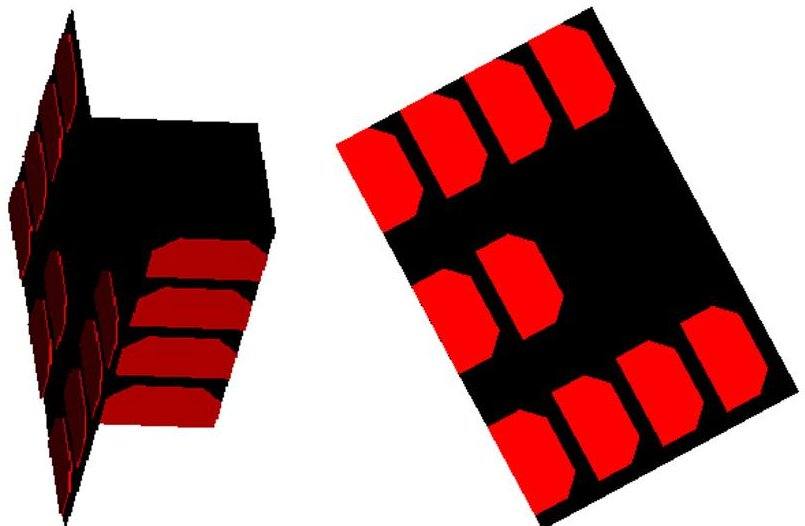

Fig. 14 STK visualization of PW-SAT2 solar panels and cells architecture for power budget simulation.

COG placement point of view. In the framework of GAL, the COTS proposed within the refinement are justified by well-proven analytical calculations, and an objective tradeoff between components

ensures that the model is validated from a mission requirements perspective. The empirical level, which provided the basic skeleton of the system from a historical perspective, displayed in the PW-SAT2 case a good approximation only with five inputs. The accuracy provided via GC+ for PW-SAT2 reached 95% for masses, 100% for volumes, and 98% for power production. GREATCUBE+'s database can be kept up to date by updating new components over time using the datasheets provided by the producers.

## Acknowledgments

This work was funded by the Institute of Science and Technology Austria in lower Austria (project number K3-F-767/002-2019) and the University of Applied Sciences Wiener Neustadt. The authors would like to acknowledge the support of Technical University Dresden and University of Applied Sciences Wiener Neustadt during the development of this project.

## References

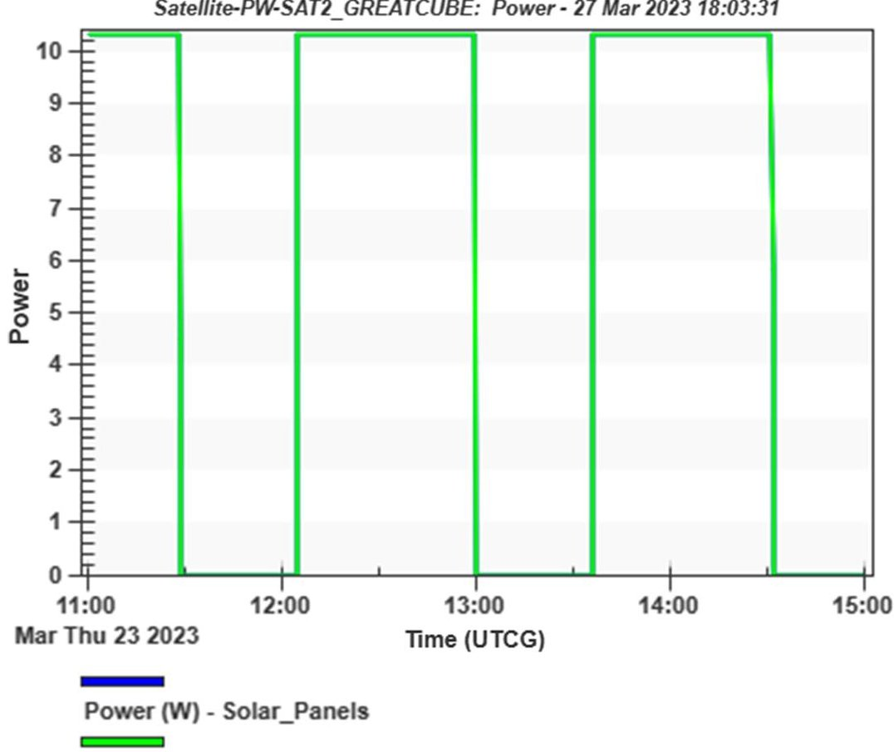

Power (W) - All Solar Panel Groups

Fig.15 STK output for solar panels power production expressed in watts.

<!-- PDF_PAGE: 15 -->

[2] Villela, T., Costa, C. A., Brandao, A. M., Bueno, F. T., and Leonardi, R., "Towards the Thousandth CubeSat: A Statistical Overview," International Journal of Aerospace Engineering, Vol. 2019, Jan. 2019, Paper 5063145. https://doi.org/10.1155/2019/5063145

[3] Kulu, E., "NANOSAT Database," https://www.nanosats.eu/ [24 Sept. 2023].

[4] Jacklin, S. A., "Small-Satellite Mission Failure Rates," NASA/TM 2018-220034, March 2019.

[5] Tolmasoff, M., Delos, R., and Venturini, C., "Improving Mission Success of Cubesats," Proceedings of the US Space Program Mission Assurance Improvement Workshop, Boeing Aerospace Rept. TOR2017-01689, El Segundo, CA, 2017.

[6] Chin, J., Coelho, R., Foley, J., Johnstone, A., Nugent, R., Pignatelli, D., Pignatelli, S., Powell, N., and Puig-Suari, J., "CubeSat 101, Basic Concepts and Processes for First Time CubeSat Developers," NASA, 2017, https://www.nasa.gov/wp-content/uploads/2017/03/nasa_csli cubesat 101_508.pdf [retrieved 24 Oct. 2023].

[7] Alanazi, A., and Straub, J., "Statistical Analysis of CubeSat Mission Failure," 32nd Annual AIAA/USU Conference on Small Satellites, Dept. of Computer Science, North Dakota State Univ. Paper SSC18-WKII-04, 2018.

[8] Bouwmeester, J., Menicucci, A., and Gill, E., "Improving CubeSat Reliability: Subsystem Redundancy or Improved Testing?," Reliability Engineering & System Safety, Vol. 220, April 2022, Paper 108288. https://www.sciencedirect.com/science/article/pii/S0951832021007584 [retrieved 22 Oct. 2023]. https://doi.org/10.1016/j.ress.2021.108288

[9] Langer, M., and Bouwmeester, J., "Reliability of CubeSats-Statistical Data, Developers' Beliefs and the Way Forward," 30th Annual AIAA/ USU Conference on Small Satellites, Paper SSC16-X-2, 2016.

[10] Swartwout, M. A., "The First One Hundred CubeSats: A Statistical Look," Journal of Small Satellite, Vol. 2, No. 2, 2013, pp. 213-233, https://api.semanticscholar.org/CorpusID:220625425 [retrieved 22 Oct. 2023].

[11] Girardello, C., Tajmar, M., and Scharlemann, C., "GREATCUBE+: Conceptual Design Tool for CubeSat's Design," CEAS Space Journal, June 2023, pp. 1-18. https://doi.org/10.1007/s12567-023-00509-9

[12] ECSS Secretariat, "ESA-ESTEC, Space Project Management: Project Planning and Implementation (ECSS-M-ST-10C)," Space Project Management Standards, Noordwijk, The Netherlands, 2009.

[13] Clark, C., and Logan, R., "Power Budget for Mission Success," 8th Annual CubeSat Developers' Workshop, California Polytechnic State Univ., San Luis Obispo, CA, 2011.

[14] Wertz, J. R., Everett, D. F., and Puschell, J. J., Space Mission Engineering: The New SMAD, Microcosm Press, Hawthorne, CA, 2011.

[15] Liu, S., Theoharis, P. I., Raad, R., Tubbal, F., Theoharis, A., Iranmanesh, S., Abulgasem, S., Khan, M. U. A., and Matekovits, L., "A Survey on CubeSat Missions and Their Antenna Designs," Electronics, Vol. 11, No. 13, 2022, p. 2021, https://www.mdpi.com/2079-9292/11/13/2021 [retrieved 22 Oct. 2023] https://doi.org/10.3390/electronics11132021

[16] Fortescue, P., Swinerd, G., and Stark, J., Spacecraft Systems Engineering, Wiley, Hoboken, NJ, 2011.

[17] Chang, Y.-K., Hwang, K.-L., and Kang, S.-J., "SEDT (System Engineering Design Tool) Development and Its Application to Small Satellite Conceptual Design," Acta Astronautica, Vol. 61, No. 7, 2007, pp. 676-690, https://www.sciencedirect.com/science/article/pii/S0094576507001099 [retrieved 22 Oct. 2023]. https://doi.org/10.1016/j.actaastro.2007.01.067

[18] Chang, Y.-K., Hwang, K.-L., Kang, S.-J., Moon, B.-Y., Kim, S.-J., and Chang, J.-S., "Development of System Engineering Design Tool (SEDT) for Small Satellite Conceptual Design," Small Satellites for Earth Observation: Selected Proceedings of the 5th International Symposium of the International Academy of Astronautics, De Gruyter, Berlin, April 2005, pp. 222-229. https://doi.org/10.1515/9783110919806.222

[19] Jacobs, M., and Selva, D., "A CubeSat Catalog Design Tool for a MultiAgent Architecture Development Framework," 2015 IEEE Aerospace Conference, IEEE Publ., Piscataway, NJ, 2015, pp. 1-10. https://doi.org/10.1109/AERO.2015.7119240.

[20] Aas, C., Zandbergen, B. T., Hamann, R. J., and Gill, E. K., "SCALES: A System Level Tool for Conceptual Design of Nano-and Microsatellites," Small Satellites for Earth Observation: 7th International Symposium of the International Academy of Astronautics (IAA), Delft Univ. of Technology, Delft, The Netherlands, May 2009, pp. 1-8.

[21] Aas, C. L., Zandbergen, B. T., Hamann, R. J., and Gill, E. K., "Development of a System Level Tool for Conceptual Design of Small Satellites," Proceedings of the 7th Annual Conference on Systems Engineering

Research: CSER 2009, Research School of Systems Engineering, Loughborough Univ., Loughborough, U.K., 2009, pp. 1-9.

[22] McInnes, A., Harps, D., Lang, J., and Swenson, C., "A Systems Engineering Tool for Small Satellite Design," 15th Annual AIAA/USU Conference on Small Satellites, Paper SSC01-VI-5, 2001.

[23] Ridolfi, G., Mooij, E., and Chiesa, S., "A Modeling Framework for the Concurrent Design of Complex Space Systems," AIAA Modeling and Simulation Technologies Conference, AIAA Paper 2010-7782, 2010. https://doi.org/10.2514/6.2010-7782

[24] Nogrady, S. K., "Development of a CubeSat Conceptual Design Tool and Implementation of the EPS Design Module," Ph.D. Dissertation, California Polytechnic State Univ., San Luis Obispo, CA, 2021.

[25] Girardello, C., Tajmar, M., and Scharlemann, C., "GREATCUBE+: A Multipurpose Tool for CubeSat Conceptual Design," DGLR2022, Dresden by Lilienthal-Oberth e.V., Vol. 2022, Paper 570329, 2022.

[26] Girardello, C., Tajmar, M., Scharlemann, C., and Treberer-Treberspurg, W., "Concurrent Engineering Methodology for CubeSat Conceptual Design," Proceedings of the 10th Conference on Systems & Concurrent Engineering for Space Applications 2022, Online Conference by ESA Conference Bureau/ATPI Corporate Events, Vol. 2022, Paper 14, 2022.

[27] Girardello, C., Tajmar, M., and Scharlemann, C., "GREATCUBE+: A Multidisplinary Software Tool for CubeSat System and Subsystem Design," Small Satellites Systems and Servises: 4S Symposium 2022, Villamoura by ESA Conference Bureau/ATPI Corporate Events, Vol. 2022, Paper 63, 2022.

[28] Asundi, S. A., and Fitz-Coy, N. G., "CubeSat Mission Design Based on a Systems Engineering Approach," 2013 IEEE Aerospace Conference, IEEE Publications, Piscataway, NJ, 2013, pp. 1-9. https://doi.org/10.1109/AERO.2013.6496900

[29] Bandecchi, M., Melton, B., and Ongaro, F., "Concurrent Engineering Applied to Space Mission Assessment and Design," ESA Bulletin, Vol. 99, Sept. 1999.

[30] Braukhane, A., and Quantius, D., "Interactions in Space Systems Design Within a Concurrent Engineering Facility," 2011 International Conference on Collaboration Technologies and Systems (CTS), German AeroSpace Center (DLR), Inst. of Space Systems, Bremen, Germany, 2011, pp. 381-388. https://doi.org/10.1109/CTS.2011.5928714

[31] Smith, J. L., "Concurrent Engineering in the Jet Propulsion Laboratory Project Design Center," SAE Transactions, Vol. 107, Jan. 1998, pp. 1106-1118.

[32] Findlay, R., Braukhane, A., Schubert, D., Pedersen, J., Müller, H., and Eßmann, O., "Implementation of Concurrent Engineering to Phase B Space System Design," CEAS Space Journal, Vol. 2, Nos. 1-4, 2011, pp. 51-58.

https://doi.org/10.1007/s12567-011-0013-y

[33] Romberg, O., and Martelo Gomez, A., "Teaching Space Master Concurrent Engineering," 9th International Conference on Systems & Concurrent Engineering for Space Applications SECESA 2020, 2020, https://elib.dlr.de/136434/ [retrieved 22 Oct. 2023].

[34] Fachhochschule Wiener Neustadt GmbH, "CubeSat: CLIMB" 2022, https://cubesat.fhwn.ac.at/climb/.

[35] "What is Concurrent Engineering?," European Space Agency, 2022, https://www.esa.int/Enabling_Support/Space_Engineering_Technology/ CDF/What_is_concurrent_engineering [retrieved 24 Oct. 2023].

[36] Kerstel, E., Gardelein, A., Barhelemy, M., Fink, M., and Siddarth, J. K., "Nanobob: A CubeSat Mission Concept for Quantum Communication Experiments in an Uplink Configuration," EPJ Quantum Technology, Vol. 5, No. 6, 2018. https://doi.org/10.1140/epiqt/s40507-018-0070-7

[37] "Phoenix CubeSat," Arizona State Univ., 2022, https://phxcubesat. asu.edu/ [retrieved 24 Oct. 2023] https://doi.org/10.1140/epjqt/s40507-018-0070-7

[38] Zhao, X., "The 3D Dimensional Container Loading Problem," Ph.D. Dissertation, Southampton Business School, Univ. of Southampton, Southampton, England, U.K., 2017.

[39] Wu, Y., Li, W., Goh, M., and De Souza, R., "Three-Dimensional Bin Packing Problem with Variable Bin Height," European Journal of Operational Research, Vol. 202, No. 2, 2010, pp. 347-355. https://doi.org/10.1016/j.ejor.2009.05.040.

[40] Yan, Y. F., "3D Bin Packing in Mixed Case Palletization," Master Thesis, Univ. of Waterloo, Waterloo, ON, 2015.

[41] Chen, C., Lee, S., and Shen, Q., "An Analytical Model for the Container Loading Problem," European Journal of Operational Research, Vol. 80, No. 1, 1995, pp. 68-76, https://www.sciencedirect.com/science/article/pii/037722179400002T [retrieved 22 Oct. 2023]. https://doi.org/10.1016/0377-2217(94)00002-T

<!-- PDF_PAGE: 16 -->

[42] de Silva, E. F., "Algorithms for Solving 3D Cutting and Packing Problems with Real-World Constraints," Ph.D. Dissertation, Katholieke Universiteit Leuven, Leuven, Belgium, 2020.

[43] Kang, J., Moon, I., and Wang, H., "A Hybrid Genetic Algorithm with a New Packing Strategy for the Three-Dimensional Bin Packing Problem," Applied Mathematics and Computation, Vol. 219, No. 3, 2012, pp. 1287-1299. https://doi.org/10.1016/j.amc.2012.07.036

[44] Che, C., Wang, Y.-S., and Teng, H.-F., "Test Problems for QuasiSatellite Packing: Cylinders Packing with Behavior Constraints and All the Optimal Solutions Known," Optimization Online, 2008.

[45] Zhong, C.-Q., Xu, Z.-Z., and Teng, H.-F., "Multi-Module Satellite Component Assignment and Layout Optimization," Applied Soft Computing, Vol. 75, Feb. 2019, pp. 145-161, https://www.science direct.com/science/article/pii/S1568494618306537 [retrieved 24 Oct. 2023].

https://doi.org/10.1016/j.asoc.2018.11.021

[46] Moon, T. K., and Stirling, W. C., Mathematical Methods and Algorithms for Signal Processing, Vol. 1, Prentice-Hall, Upper Saddle River, NJ, 2000.

[47] "NanoRacks CubeSat Deployer (NRCSD) Interface Control Document," NanoRacks, Vol. NR-SRD-029, 2013, pp. 1-53, https://nanoracks.com/wp-content/uploads/Nanoracks-CubeSat-Deployer-NRCSD-IDD.pdf [retrieved 22 Oct. 2023].

[48] "What is PW-SAT2," Warsaw University of Technology, 2022, https://pw-sat.pl/en/mission/ [retrieved 24 Sept. 2023].

[49] Students' Space Association, W. U. O. T., "Critical Design Review PW-SAT2—Project Overview," PW-SAT2 website, 2016, https://pw-sat.pl/en/documentation/ [retrieved 22 Oct. 2023].

[50] "Energy and Environment-Life Under the Pale Sun," Univ. of Washington, Washington, D.C., 2022, https://www.ocean.washington.edu/courses/ as222d/lecture1.1.pdf [retrieved 24 Sept. 2023].

K. Cahoy Associate Editor