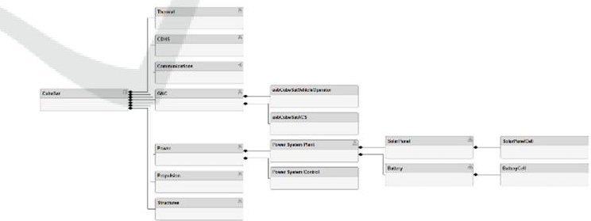
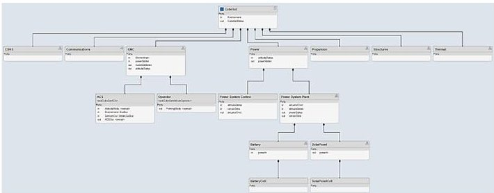
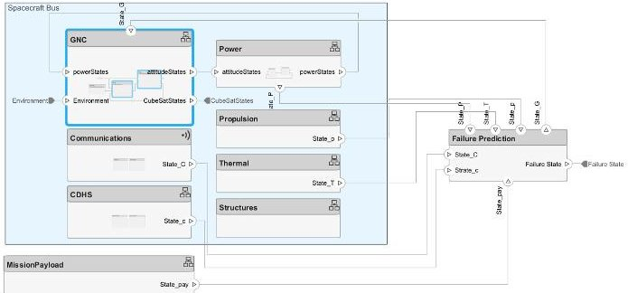
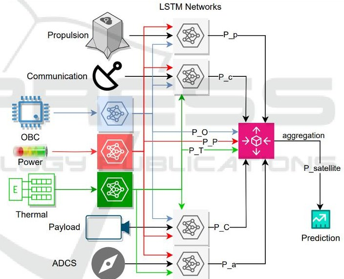
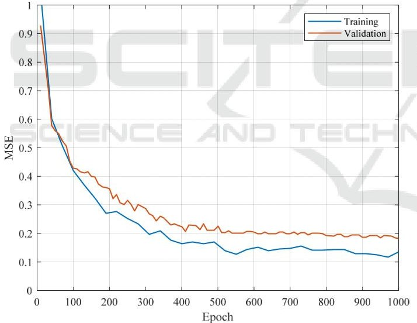
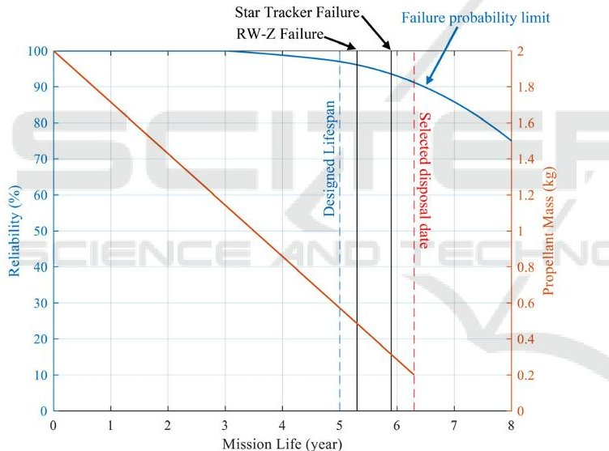

<!-- PDF_PAGE: 1 -->

# MBSE-Enhanced LSTM Framework for Satellite System Reliability and Failure Prediction

M. Amin Alandihallaj $ ^{1} $ $ ^{a} $ , Mahya Ramezani $ ^{2} $ $ ^{b} $ and Andreas M. Hein $ ^{1} $ $ ^{c} $

$ ^{1} $Space Systems Engineering (SpaSys) Research Group, Interdisciplinary Centre for Security, Reliability and Trust (SnT), University of Luxembourg, Luxembourg

$ ^{2} $Automation and Robotics Research Group (ARG), Interdisciplinary Centre for Security, Reliability and Trust (SnT), University of Luxembourg, Luxembourg

Keywords: Model-Based Systems Engineering, LSTM, AI, Satellite Failure Prediction, Space System Reliability.

Abstract: This paper investigates the integration of Artificial Intelligence (AI) and Model-Based Systems Engineering (MBSE) in the field of satellite system reliability. We employ Long Short-Term Memory (LSTM) networks, an AI technique, to predict the failure probabilities of various subsystems. These LSTM models are integrated into an MBSE framework, enhancing the accuracy of system-wide failure prediction and operational decisionmaking. The approach involves training LSTM networks on simulated datasets representing a range of operational scenarios for each subsystem. The outputs from these networks are then aggregated using a weighted approach to determine the optimal disposal time, aiming to extend the satellite's operational lifespan. The performance of the system is evaluated a simulated real mission scenario. This research highlights the potential of AI-MBSE integration in advancing satellite system design and maintenance strategies.

## 1 INTRODUCTION

The growing concern of space debris accentuates the need for precise failure prediction and effective end-of-life management of satellites. With an increasing number of satellites in orbit, the likelihood of component failures contributing to debris is a significant issue. Moreover, for missions requiring rapid satellite replacement to avoid service disruption (M. A. Alandihallaj & M. R. Emami, 2022a, 2022b), accurately predicting satellite end-of-life is crucial. Therefore, precise prediction of satellite component failures and timely execution of end-of-life strategies are imperative not only for orbital sustainability but also for operational efficiency.

In addressing these challenges, various studies (Bottone et al., 2008; Islam & Rahimi, 2020; Park et al., 2023) have explored advanced predictive methods focusing on failures in space missions. (Islam & Rahimi, 2020) introduced Bayesian networks for predicting failures in satellite systems, providing a robust framework for handling complex scenarios. Similarly, (Park et al., 2023) and (Islam & Rahimi,

2020) have contributed to this domain with systemlevel prognostics for reaction wheel motors and data-driven time series prediction methods, respectively. These approaches are vital in pre-empting the generation of space debris through component-level failure prediction.

Further, (Gures et al., 2019)and (Peng et al., 2019) have investigated the reliability of satellite systems. (Gures et al., 2019) highlighted the integration of real-life failure data to enhance satellite design, aiming to prevent failures that may lead to debris. (Peng et al., 2019) adopted a comprehensive statistical approach to analyze the reliability of satellites and their subsystems, pinpointing potential contributors to unreliability and subsequent debris generation.

Innovative lifetime prediction methods proposed by (Zhao et al., 2016) and residual life prediction for key components by (Muthusamy & Kumar, 2022) are pivotal in space debris mitigation. These studies present methodologies for predicting satellite end-of-life with greater accuracy, facilitating timely decommissioning before they become hazards.

<!-- PDF_PAGE: 2 -->

The inherent complexity of satellites, where various parameters and environmental factors influence component lifespan and functionality, presents a significant challenge in accurately predicting component failures. Traditional methods often struggle to fully anticipate the complex interactions and dependencies within satellite systems.

Model-Based System Engineering (MBSE) has been recognized as an effective framework for managing satellite system complexity throughout various phases, including design (Gao et al., 2019; Spangelo et al., 2012), operation (Spangelo et al., 2013), mission simulation (Kaslow et al., 2014), and optimization (Crane & Brownlow, 2015). MBSE, through detailed and integrated system models, enables a comprehensive understanding of component interactions and behaviors. This approach is crucial for identifying potential failure points and optimizing system design for enhanced reliability (Rakalina et al., 2021). However, the dynamic and time-sensitive nature of satellite operations necessitates advanced analytical capabilities for precise component failure prediction.

One tool that surpasses parametric models in dealing with complex autocorrelation sequences is Long Short-Term Memory (LSTM) networks, which have shown successful results in various engineering fields (Ramezani et al., 2023). The integration of LSTM networks with MBSE offers a significant advancement in addressing this challenge. LSTMs enhance the MBSE framework with deep learning capabilities, enabling the processing and interpretation of complex time-series data from satellite systems (Islam & Rahimi, 2020). This integration improves the accuracy and timeliness of predicting potential component failures. LSTMs' ability to analyze historical and real-time data facilitates the identification of failure patterns, leading to earlier and more precise predictions. This capability is vital for proactive maintenance and effective end-of-life planning. The continuous learning of LSTMs, combined with the comprehensive system understanding provided by MBSE, allows for dynamic adaptation and nuanced predictions, taking into account the complex interdependencies within the satellite system. Ultimately, this synergy improves decision-making, enabling engineers and mission planners to develop more effective maintenance, anomaly response, and disposal strategies.

This paper explores the integration of LSTM with MBSE and its practical implications. Section 2 discusses MBSE's role in satellite system

management. Section 3 introduces LSTM networks and their suitability for enhancing failure prediction in time-sensitive systems and outlines the methodology for integrating LSTM with MBSE, focusing on improving predictive analysis for satellite components. Section 4 presents a case study demonstrating this approach's application and effectiveness. Finally, Section 5 concludes the paper, summarizing key findings and discussing the broader contributions of this research to satellite system management.

The integration of LSTM with MBSE represents a significant contribution to satellite engineering, offering a novel approach to enhancing predictive maintenance and end-of-life strategies for satellite systems. This research addresses the pressing need to mitigate space debris risks and ensure the sustainability of space missions.

## 2 MBSE IN MATLAB ENVIRONMENT

The initial step in adopting MBSE is the selection of an appropriate tool for system modeling. Several tools are available in the market, such as SysML Designer (Friedenthal et al., 2014) and MagicDraw (Neuendorf, 2006) each with its unique capabilities and features. However, the integration of learning methods and mission simulation plays a crucial role in the selection process. This integration is often more streamlined when working within a single environment, as opposed to linking different tools like MagicDraw with simulation software such as Systems Tool Kit (STK) and MATLAB.

Recognizing this need for a cohesive environment, MATLAB has recently expanded its offerings to include toolboxes that are specifically designed for MBSE. The ease of integrating learning methods and optimization algorithms in MATLAB makes it an ideal choice for this purpose. The MATLAB environment provides a unified platform for both system modeling and the subsequent application of advanced analytical methods, thereby simplifying the process and enhancing the efficiency of the overall system design and analysis.

MATLAB $ ^{\circ} $ , Simulink $ ^{\circ} $ , System Composer $ ^{\circ} $ , and Requirements Toolbox $ ^{\circ} $ collectively form an integrated suite that significantly enhances MBSE capabilities. This suite enables the creation of descriptive architectural models that seamlessly transition into detailed implementation models. The interconnected environment ensures consistent

<!-- PDF_PAGE: 3 -->

alignment across architectural and design elements, enabling systems engineers to establish a digital thread. This thread facilitates seamless navigation between system requirements, architectural models, implementation models, and embedded software.

Within this framework, engineers can capture and manage system requirements, enabling thorough impact and coverage analysis. System architectures can be optimized by capturing architecture metadata and interfacing directly with MATLAB analytics for domain-specific trade studies. Additionally, engineers can create model views that isolate components relevant to various engineering concerns, assisting in validating requirements through simulation-based testing. The framework also aids in translating and refining requirements into architectures, with components prepared for simulation and implementation using Model-Based Design in Simulink.

System Composer $ ^{\mathrm{TM}} $ plays a crucial role in specifying and analyzing architectures for modelbased systems engineering and software architecture modeling. It allows for the allocation of requirements while refining architecture models for design and simulation in Simulink $ ^{\circ} $ . Simulink Requirements creates a digital thread, ensuring traceability and highlighting potential system impacts, thereby facilitating comprehensive requirements coverage.

Architecture models within this environment are developed through direct authoring, importing from other tools, or leveraging architectural elements of Simulink designs. These models consist of components and interfaces that can capture behaviors in various formats such as sequence diagrams, state charts, or Simulink models. With System Composer, engineers can develop architecture models and manage system requirements effectively, working at varying levels of abstraction and adding details as needed. Requirements Toolbox $ ^{\mathrm{TM}} $ complements this by enabling the direct capture and management of system requirements, establishing a comprehensive framework for requirements traceability and impact analysis.

In summary, MATLAB, Simulink, and System Composer provide a comprehensive toolset for capturing and managing system requirements, optimizing system architectures, and validating system designs. This integrated approach supports the spectrum of satellite system engineering activities, from initial requirements capture to detailed design and verification, ensuring accurate representation and alignment with stakeholder needs.

This paper focuses on the modeling of a hypothetical FireSat space system, a low Earth orbit

(LEO) spacecraft dedicated to detecting, identifying, and monitoring forest fires. The FireSat space system serves as an illustrative example in the widely recognized and utilized Space Mission Analysis and Design (SMAD) by (Wertz et al., 1999), providing a relevant context for our study.

In the MATLAB environment, the modeling process begins with defining a set of system-level requirements for the FireSat mission using CubeSat technology (M. Alandihallaj & M. R. Emami, 2022; Emami & Alandihallaj, 2022). These requirements form the foundation for the subsequent development of the system architecture and data interfaces, which are constructed using System Composer.

The architecture of the FireSat system (shown in Figure 1) is composed of several key elements: components, ports, and connectors. Each component within the architecture represents a part of the system that fulfills a specific function, be it a system, subsystem, hardware, software, or another conceptual entity. Components are essential in defining the architecture's structure and functionality.

Ports are nodes situated on a component or within the architecture, signifying points of interaction with the external environment. These ports enable the flow of information to and from other components or systems, playing a pivotal role in the system's communicative capabilities. Connectors, represented as lines, establish connections between ports. They are crucial in describing how information is transferred and shared between components within the architecture, illustrating the system's information flow, as shown in Figure 2.

Figure 1: The hierarchy of the system architecture.

Figure 2: The data flow of the CubeSat as the space segment.

<!-- PDF_PAGE: 4 -->

A noteworthy aspect of the model is the inclusion of a failure block for each element of the satellite. This block is responsible for calculating the health status of the component based on its current state. All the failure models are aggregated in one failure prediction section, as shown in Figure 3.

Figure 3: The connection of the failure prediction block with subsystems.

The modeling of the failure is grounded in existing literature, ensuring a realistic and reliable representation of component behavior. For instance, models for reaction wheels are based on (Park et al., 2023; Rahimi et al., 2020), control moment gyros (CMGs) by (Muthusamy & Kumar, 2022), attitude sensors by (Yuan et al., 2021), and temperature sensors by (Abdelkhalek et al., 2019). These models contribute to a comprehensive and robust simulation of the FireSat system, enabling detailed analysis and evaluation of its performance and reliability in various operational scenarios.

## 3 METHODOLOGY

## 3.1 LSTM Networks

LSTM networks, a specialized variant of recurrent neural networks, were conceptualized by (Hochreiter & Schmidhuber, 1997) to address the shortcomings of traditional Recurrent Neural Networks (RNNs), particularly the vanishing gradient problem. The LSTM network is distinguished by its unique structure, which includes memory blocks composed of interconnected gates. These gates control the flow of information and enable the network to retain or discard data based on its relevance.

The fundamental mechanism of an LSTM unit encompasses the interplay of the forget gate, input gate, and output gate. The forget gate determines which information is removed from the cell state, described by

$$
f _ {t} = \sigma \left(w _ {f} \left[ h _ {t - 1}, x _ {t} \right] + b _ {f}\right)
$$

where $ \sigma $ is the sigmoid function, and $ w_{f} $ and $ b_{f} $ are the weights and biases associated with the forget gate, and $ [h_{t-1},x_{t}]$ is the concatenation of the previous output and current input. The input gate, $ i_{t} $ , and the candidate state, $ \hat{C}_{t} $ , collectively decide which new information will be stored in the cell state, $ C_{t} $ . This process is governed by

$$
i _ {t} = \sigma \left(w _ {i} \left[ h _ {t - 1}, x _ {t} \right] + b _ {i}\right)
$$

$$
\hat {C} _ {t} = \tanh \left(w _ {C} \left[ h _ {t - 1}, x _ {t} \right] + b _ {C}\right)
$$

$$
C _ {t} = f _ {t} C _ {t - 1} + i _ {t} \hat {C} _ {t}
$$

Finally, the output gate, formulated as

$$
o _ {t} = \sigma \left(w _ {o} \left[ h _ {t - 1}, x _ {t} \right] + b _ {o}\right)
$$

along with the cell state, determines the next hidden state $ h_{t}=o_{t}\tanh(C_{t}) $ . These elements work in unison to update and maintain the cell state over time, allowing the LSTM to learn and remember information across long sequences.

## 3.2 Application of LSTM in FireSat's Subsystem Failure Prediction

The FireSat space system's components, such as the reaction wheel, are modeled using parameters like friction F, lag L, and temperature T, which are functions of wheel speed S and time t. These parameters form the state of each subsystem and are crucial for predicting potential failures. The state of a subsystem at any given time, represented as $ S S_{t} $ , is either directly measured through sensors or estimated using techniques like Kalman filters (Alandihallaj et al., 2023).

Data from these subsystems is collected and preprocessed to form a structured dataset for LSTM analysis, where each data point $ d_{t} $ is a vector of $ SS_{t} $ for the entire satellite. LSTM networks are particularly adept at learning from such time-series data, allowing them to recognize patterns that may indicate impending failures.

In training the LSTM model, the network's weights are adjusted to minimize the loss function, typically the Mean Squared Error (MSE), expressed as

$$
M S E = \frac {1}{N} \sum_ {t = 1} ^ {N} \left(\hat {y} _ {t} - y _ {t}\right) ^ {2}
$$

Here, $ \hat{y}_{t} $ represents the predicted output, and $ y_{t} $ is the actual output. The LSTM learns from historical data to recognize the precursors of failures, thereby enabling predictive analysis.

Once trained, the LSTM model can use real-time data to predict the failure times of subsystem components. It analyzes the current state of the

<!-- PDF_PAGE: 5 -->

system and provides predictions about which components are likely to fail and when. This information is critical for proactive maintenance and planning the disposal phase of the mission. The model calculates the latest feasible time for initiating the disposal phase by estimating the operational lifespan of essential components.

Integrating these predictions into the FireSat's MBSE framework enhances the system's overall decision-making process. The combination of LSTM's predictive capabilities with MBSE's comprehensive system modeling approach presents a robust solution for maintaining system reliability and efficiency.

## 3.3 LSTM Architecture

In addressing the diverse and complex nature of the FireSat space system, a bespoke approach is adopted, featuring a distinct LSTM network for each subsystem. This strategy is tailored to the unique operational characteristics and failure dynamics of subsystems such as the On-Board Computer (OBC), Thermal Control, Propulsion, Communication, Payload, Attitude and Orbit Control System (ADCS), and Power.

Each LSTM model receives time-series data specific to its subsystem. This data includes operational parameters, sensor readings, and performance indicators that are characteristic of each subsystem. For instance, for the ADCS LSTM, inputs might encompass angular velocity measurements, torque commands, star tracker data, and relevant thermal and power metrics.

Acknowledging the systemic impact of the power and thermal control subsystems, their operational data are incorporated as additional inputs in the LSTM models of the other subsystems. This integration is vital for capturing the broader operational context and the interdependencies within the satellite system.

The LSTM models are designed to balance learning complexity and computational efficiency. A typical configuration for each subsystem's LSTM may consist of 2-3 layers, with 50-100 neurons in each layer. For complex subsystems like ADCS, an LSTM with 3 layers of 100 neurons is used, whereas simpler subsystems may use a 2-layer network with 50 neurons.

The output from each LSTM is a probabilistic time series indicating the likelihood of subsystem failure over a forecasted time horizon. This output format enables dynamic risk assessment and proactive decision-making. The output of each subsystem's LSTM at time point

$$
P _ {S u b S y s t e m} (t) = \left[ p _ {t _ {1}} p _ {t _ {2}} p _ {t _ {3}} \dots p _ {t _ {N}} \right]
$$

where $ P_{SubSystem}(t) $ denotes the predicted failure probability series for a subsystem over the future with a certain interval time, $ t_{i}. $

A weighted aggregation method is employed to integrate the individual LSTM outputs into an overall system failure probability. This method assigns a weight to each subsystem's output, reflecting its operational significance. The system-wide failure probability at each time point is computed as

$$
P _ {S a t} (t) = \frac {1}{m} \sum_ {i = 1} ^ {m} \omega_ {i} P _ {S u b S y s t e m _ {i}} (t)
$$

where $ 0\leq\omega_{i}\leq1 $ represents the weight corresponding to i th subsystem's importance.

The system architecture is shown in Figure 4, which allows for a nuanced understanding of the system's overall health by accounting for both the individual risks of each subsystem and their collective influence on the satellite's functionality.

Figure 4: The architecture of the failure detection system.

## 4 CASE STUDY

In this case study, we employed the developed MATLAB model, as introduced in the previous chapters, to simulate various error conditions in the FireSat space system. This simulation aimed to replicate a range of real-world operational challenges the satellite might face over its operational lifespan of five years. To create a realistic training dataset for the LSTM networks, we introduced errors and anomalies across different subsystems. These included increased loads in the power subsystem lines, failures in temperature sensors and heaters in the thermal

<!-- PDF_PAGE: 6 -->

control subsystem, malfunctions in the ADCS sensors and actuators, and issues in uplink and downlink communications. To add further complexity and mimic the intricacies of an operational satellite, we simulated additional scenarios like fluctuations in solar panel efficiency, software glitches in the OBC, degradation in battery performance, and failure in the propulsion system components.

The LSTM networks for each subsystem were trained using this simulated dataset. The training focused on predicting the failure probability of each subsystem over the upcoming year at one-month intervals. Given the equal criticality of each subsystem to the mission, we assigned equal weights of importance in the aggregation process for systemwide risk assessment.

To ensure a robust training process, the dataset was divided into three parts: 70% of the data was used for training the LSTM networks, 20% for validation, and the remaining 10% for testing. This allocation was strategically chosen to maximize the learning potential from a substantial training set while still reserving enough data for a thorough validation and an unbiased assessment of the model's performance.

Figure 5: The training and validation loss (MSE) plot.

During the training phase, each LSTM model was exposed to its respective subset of data, learning to identify and predict failure patterns specific to each subsystem of the FireSat space system. The training process was monitored by observing the MSE, a key metric indicating how well the model's predictions aligned with the actual data.

The Mean Squared Error (MSE) graph depicted in Figure 5 illustrates the learning progress of LSTM networks trained for failure prediction in the FireSat space system. The graph shows two curves, representing the MSE for the training and validation datasets over the course of 1000 epochs.

At the outset of training, the validation MSE starts lower than the training MSE. This initial lower error in the validation set is expected as the validation process benefits from a model that has already begun learning from the training data. Consequently, the validation curve begins from a point of initial knowledge, which is why its MSE is lower at the start of the learning process.

As training progresses, the training MSE consistently remains below the validation MSE. This trend is typical and indicates that the model is fitting well to the data it has seen during training. The training curve's decline reflects the network's growing proficiency in modeling the complex relationships within the training data.

The validation curve, while starting lower, soon settles at a higher MSE value compared to the training curve. This behavior is indicative of the model encountering new patterns or complexities in the validation data that were not present or less prevalent in the training data. However, both MSE values decrease over time, signifying that the network is improving its prediction capabilities for both the training and validation sets.

Towards the end of the training process, both curves plateau, suggesting that further training epochs may yield diminishing returns in terms of learning and model improvement. The convergence of the MSE values, particularly with the validation MSE stabilizing at a slightly higher value than the training MSE, signifies that the model has achieved a reasonable balance between fitting the training data and generalizing to unseen data.

The final portion of the graph, where both MSE curves level off, indicates that the LSTM networks have reached an optimal point of training. This convergence suggests that the models are wellcalibrated and that the training process has been successful in preparing the networks for accurate failure prediction in the simulated FireSat mission scenario.

The trained LSTM network was employed to predict failures in a simulated real mission scenario of the FireSat. This scenario is designed to test the LSTM system's ability to accurately predict the optimal time for satellite disposal based on failure probabilities, extending the satellite's operational lifetime beyond the initial estimate.

The FireSat's designed operational lifetime, based on average workload estimations of its components, was initially set to 5 years using traditional analytical failure models. However, in this simulated real mission scenario, the LSTM system was tasked with recalculating failure probabilities over time, focusing

<!-- PDF_PAGE: 7 -->

on components critical to the disposal phase. The goal was to identify a disposal time where the probability of failure was less than 10%.

To accurately calculate this failure probability, the LSTM considered the health and functionality of key components necessary for the disposal phase. These included the accuracy of the ADCS being better than 10 degrees, at least 10% of the propellant in the propulsion system remaining, and the operational integrity of the OBC and command and housekeeping communication bands.

Figure 6 presents a detailed visualization of the calculated reliability (inversely related to failure probability) and the failure of different components throughout the mission timeline. A critical observation from this analysis is that while some essential components, such as the reaction wheel-Z (RW-Z) and the star tracker, failed before the estimated disposal phase, the mission was still viable. The system could maintain the required control accuracy using alternative components like sun sensors and magnetorquers.

Figure 6: Calculated reliability using the proposed method over the mission.

As a result of the LSTM's dynamic failure predictions, the disposal of the FireSat is planned for 6.3 years into the mission. This timing coincides with the point at which the remaining mass of the propulsion system's propellant is predicted to reach the critical threshold of 10%. However, if the propellant levels were to remain above this threshold, the disposal operation would be deferred to 6.5 years, the epoch when the model anticipates the overall failure probability would rise above 10%.

This case study demonstrated the LSTM approach's effectiveness in extending the operational lifetime of the FireSat beyond its initially estimated 5 years. By integrating the LSTM-derived predictions

with the system model, a more accurate and dynamic assessment of the satellite's health and operational capabilities was achieved. This integration allowed for an informed and strategic decision regarding the extension and timing of the disposal phase, thereby optimizing the satellite's utility and lifespan.

The findings from this case study underscore the value of employing advanced LSTM methodologies in conjunction with detailed system modeling. This approach not only enhances the accuracy of lifetime predictions for space missions but also illustrates the potential for extending operational timelines through informed, data-driven decision-making processes.

## 4 CONCLUSIONS

The integration of AI with MBSE, as demonstrated in this study, shows significant potential in enhancing the reliability and longevity of satellite systems. The LSTM-based predictive analysis, aligned with the structured approach of MBSE, provides a comprehensive method for assessing system health and failure risks. The case studies validate the effectiveness of this integrated approach, where AI enhances traditional system engineering practices. This research contributes to the field of space system engineering by offering a method to extend satellite operational life through advanced AI techniques, paving the way for more resilient and efficient satellite operations. The AI-MBSE integration presented here could serve as a model for future applications in complex system analysis and management.

## REFERENCES

Abdelkhalek, H. S., Medhat, H., Ziedan, I., & Amal, M. (2019). Simulation and prediction for a satellite temperature sensors based on artificial neural network. Journal of Aerospace Technology and Management, 11.

Alandihallaj, M., & Emami, M. R. (2022). Monitoring and Early Detection of Wildfires Using Multiple-payload Fractionated Spacecraft. 73rd International Astronautical Congress (IAC), Paris, France.

Alandihallaj, M., Yalcin, B. C., Ramezani, M., Olivares Mendez, M. A., Thoemel, J., & Hein, A. (2023). Mitigating fuel sloshing disturbance in on-orbit satellite refueling: an Experimental study. International Astronautical Congress IAC, Baku, Azerbaijan.

Alandihallaj, M. A., & Emami, M. R. (2022a). Multiple payload fractionated spacecraft for earth observation. Acta astronautica, 191, 451-471.

<!-- PDF_PAGE: 8 -->

Alandihallaj, M. A., & Emami, M. R. (2022b). Satellite replacement and task reallocation for multiple-payload fractionated Earth observation mission. Acta astronautica, 196, 157-175.

Bottone, S., Lee, D., O'Sullivan, M., & Spivack, M. (2008). Failure prediction and diagnosis for satellite monitoring systems using Bayesian networks. MILCOM 2008- 2008 IEEE Military Communications Conference, San Diego, CA, USA.

Crane, J., & Brownlow, L. (2015). Optimization of multisatellite systems using integrated Model Based System Engineering (MBSE) techniques. 2015 Annual IEEE Systems Conference (SysCon) Proceedings, Vancouver, BC, Canada.

Emami, M. R., & Alandihallaj, M. A. (2022). Performance Enhancement of Fractionated Spacecraft for Earth Observation. 44th COSPAR Scientific Assembly. Held 16-24 July, 44, 57.

Friedenthal, S., Moore, A., & Steiner, R. (2014). A practical guide to SysML: the systems modeling language. Morgan Kaufmann.

Gao, S., Cao, W., Fan, L., & Liu, J. (2019). MBSE for satellite communication system architecting. IEEE Access, 7, 164051-164067.

Güreş, S. D., Ulusoy, I., & Durmaz, B. (2019). Satellite failure estimation vs. reliability prediction analysis. 2019 Annual Reliability and Maintainability Symposium (RAMS), Orlando, FL, USA.

Hochreiter, S., & Schmidhuber, J. (1997). Long short-term memory. Neural computation, 9(8), 1735-1780.

Islam, M. S., & Rahimi, A. (2020). Use of a data-driven approach for time series prediction in fault prognosis of satellite reaction wheel. 2020 IEEE International Conference on Systems, Man, and Cybernetics (SMC), Toronto, ON, Canada.

Kaslow, D., Soremekun, G., Kim, H., & Spangelo, S. (2014). Integrated model-based systems engineering (MBSE) applied to the Simulation of a CubeSat mission. 2014 IEEE Aerospace Conference, Big Sky, MT, USA.

Muthusamy, V., & Kumar, K. D. (2022). Failure prognosis and remaining useful life prediction of control moment gyroscopes onboard satellites. Advances in Space Research, 69(1), 718-726.

Neuendorf, D. (2006). Review of MagicDraw UML $ ^{\textcircled{R}} $ 11.5 Professional Edition. J. Object Technol., 5(7), 115-118.

Park, H. J., Kim, S., Lee, J., Kim, N. H., & Choi, J.-H. (2023). System-level prognostics approach for failure prediction of reaction wheel motor in satellites. Advances in Space Research, 71(6), 2691-2701.

Peng, J., Zhou, Z., Wang, J., Wu, D., & Guo, Y. (2019). Residual remaining useful life prediction method for lithium-ion batteries in satellite with incomplete healthy historical data. IEEE Access, 7, 127788-127799.

Rahimi, A., Kumar, K. D., & Alighanbari, H. (2020). Failure prognosis for satellite reaction wheels using Kalman filter and particle filter. Journal of Guidance, Control, and Dynamics, 43(3), 585-588.

Rakalina, T., Izygon, M., Wang, L., Conway, I., Radu, S., Ishihama, N., Feather, M., Witulski, A., & Evans, J. (2021). Model Based Systems Engineering for CubeSat Mission Reliability.

Ramezani, M., Habibi, H., Sanchez-Lopez, J. L., & Voos, H. (2023). UAV Path Planning Employing MPC-Reinforcement Learning Method Considering Collision Avoidance. 2023 International Conference on Unmanned Aircraft Systems (ICUAS), Warsaw, Poland.

Spangelo, S. C., Cutler, J., Anderson, L., Fosse, E., Cheng, L., Yntema, R., Bajaj, M., Delp, C., Cole, B., & Soremekum, G. (2013). Model based systems engineering (MBSE) applied to Radio Aurora Explorer (RAX) CubeSat mission operational scenarios. 2013 IEEE Aerospace Conference, Big Sky, MT, USA.

Spangelo, S. C., Kaslow, D., Delp, C., Cole, B., Anderson, L., Fosse, E., Gilbert, B. S., Hartman, L., Kahn, T., & Cutler, J. (2012). Applying model based systems engineering (MBSE) to a standard CubeSat. 2012 IEEE aerospace conference, Big Sky, MT, USA.

Wertz, J. R., Larson, W. J., Kirkpatrick, D., & Klungle, D. (1999). Space mission analysis and design (Vol. 8). Springer.

Yuan, Z., Song, N., Pan, X., Song, J., & Ma, F. (2021). Fault detection, isolation, and reconstruction for satellite attitude sensors using an adaptive hybrid method. IEEE Transactions on Instrumentation and Measurement, 70, 1-12.

Zhao, H., Yang, H., & Xiong, X. (2016). Satellite lifetime prediction with random failure. 2016 11th International Conference on Reliability, Maintainability and Safety (ICRMS), Hangzhou, China.