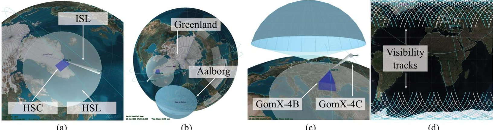
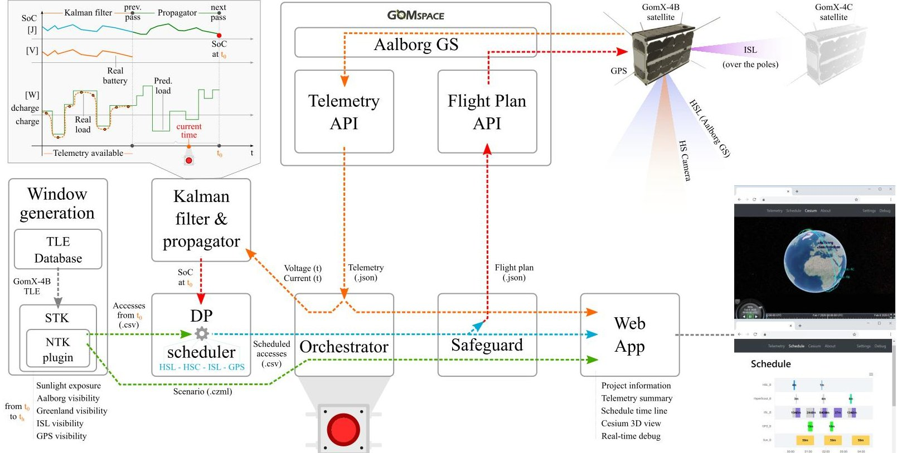
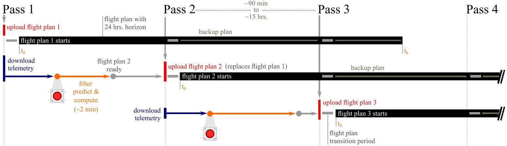
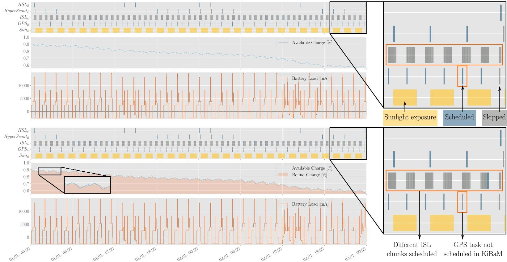
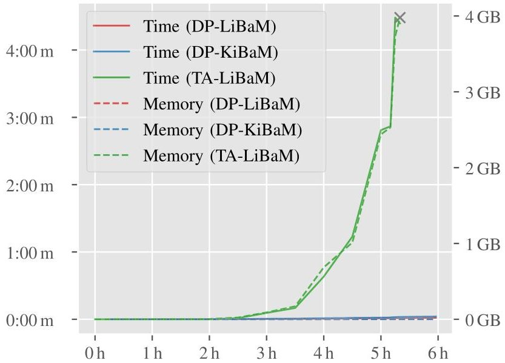
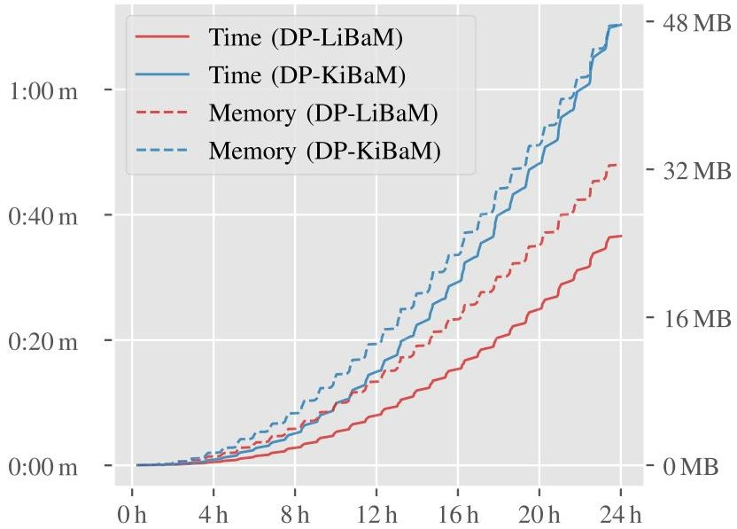
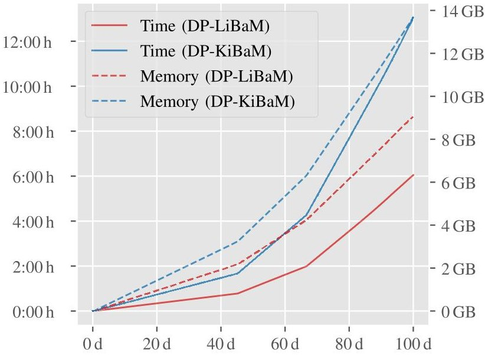
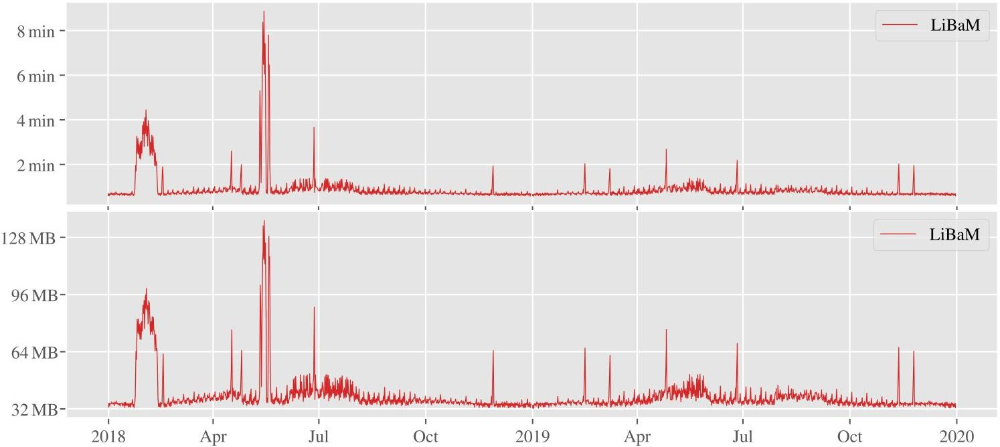

<!-- PDF_PAGE: 1 -->

# Managing Fleets of LEO Satellites: Nonlinear, Optimal, Efficient, Scalable, Usable, and Robust

Gregory Stock, Juan A. Fraire, Tobias Mömke, Holger Hermanns, Fakhri Babayev, and Eduardo Cruz

Abstract-Size and weight limitations of low-earth orbit (LEO) small satellites make their operation rest on a fine balance between solar power infeed and power demands of communication technologies on board, buffered by on-board battery storage. As a result, the problem of planning battery-powered payload utilization together with intersatellite communication is extremely intricate. Nevertheless, there is a growing trend toward constellations and megaconstellations that are to be managed using sophisticated software support. Earlier work has leveraged cost-optimal reachability in priced timed automata for deriving near-optimal finite-horizon schedules to operate a single LEO satellite in orbit. This article harvests that work and improves it in several dimensions, all needed for true in-orbit applicability: 1) the battery representation is no longer bound to be linear, but can be kinetic, which means that the optimization problem includes nonlinearities; 2) the management is perpetuated by a receding horizon scheduling strategy; 3) the model is continuously improved with the latest telemetry received from orbit; 4) a tandem of satellites equipped with state-of-the-art intersatellite link transponders is considered; 5) the core optimization problem is now solved using dynamic programming with antichain-based pruning, which is proven to be optimal and despite all the additional features outperforms the earlier approach by orders of magnitude; 6) the entire approach is grounded in the concrete requirements of the GOMX-4 LEO mission; 7) care is taken to make the approach usable by the space engineers, and robust against failures of parts of the toolchain; and 8) an extensive test campaign validates accuracy, efficiency, scalability, and robustness with respect to the operational requirements and constraints of LEO constellations.

Index Terms—Energy management, low-earth orbit (LEO) satellite constellations, mission planning, satellite operations.

Manuscript received April 17, 2020; revised June 17, 2020; accepted July 6, 2020. Date of publication October 2, 2020; date of current version October 27, 2020. This work was supported in part by the ERC Advanced under Grant 695614 (POWVER), in part by the DFG under Grant 389792660, as part of TRR 248 (https://perspicuous-computing.science), and in part by the Key-Area Research and Development Program of Guangdong Province under Grant 2018B010107004. This article was presented in the International Conference on Embedded Software 2020 and appears as part of the ESWEEK-TCAD special issue. (Corresponding author: Juan A. Fraire.)

Digital Object Identifier 10.1109/TCAD.2020.3012751

## I. INTRODUCTION

THERE is an increasing interest of the space community in low-earth orbit (LEO) satellites for Earth observation, as well as in deploying large-scale LEO networks with the purpose of providing timely access to information [1]. LEO satellites orbit the Earth at a height between 400 and 2000 km. They have the advantage of being close enough for high-resolution Earth observation and for good signal quality reception from communication devices on the ground. However, orbital periods in between 90 and 130 min render short visibility episodes from ground sites, where a LEO satellite appears on the horizon and disappears on the opposite side in about 6-12 min. Depending on the latitude of the location, a LEO satellite will appear over a spot two to four times a day. In these systems, on-board communication and observation technologies induce notoriously high power demands that are generally difficult to counterbalance by solar infeed and on-board battery storage, due to size and weight limitations. Furthermore, the position of LEO objects relative to each other, to the Sun, and to points of interest on Earth is the result of the superposition of an excessive number of (approximately) periodic rotations. It takes several decades for all these elements to repeat the same relative position, and interim gravitational perturbations, station-keeping maneuvers, or mission parameter changes prevent the use of scheduling or planning mechanisms based on periodicity. All this makes the algorithmic problem of dynamic battery-powered satellite operation and intersatellite communication a very difficult, yet an important one.

While around 2000 active satellites are currently in orbit, recent studies show that constellations totaling more than 50000 are on the launch schedule for the next ten years [2]. Especially in the presence of communication interdependencies, the management of such constellations will require profound models as well as effective algorithmic techniques for administering their operation, based on a proper extrapolation of the electric power budget as part of the intersatellite and satellite-to-ground communication design [3]. This is to be embedded into a domain-specific software infrastructure that seamlessly plugs into the usage context of satellite operators.

For single LEO satellite missions with multiple modes of operation, the default approach to master the challenge is thus far a manual one: a human operator takes ad hoc decisions about what task the satellite is to effectuate next. Previous in-orbit experiments with the GOMX-3 satellite [4], [5] have shown that already in this context there is massive room for

<!-- PDF_PAGE: 2 -->

improvement by properly modeling and analyzing the satellite's battery, together with the operational constraints and orbital environment of the satellite. At the core of that work is a representation of the problem as a network of priced timed automata and an engine [6] to solve cost-optimal reachability over a limited time horizon. This has resulted in an automated and resource-optimal day-ahead one-shot scheduling over a time horizon of 36 h, effectuated in orbit in March 2016.

That approach, however, fell short in a number of dimensions. On the one hand, the timed automata formulation is bound to linear dynamics (to assure the decidability of the underlying problem class). Therefore, a nonlinear battery model was not a constituent part of the scheduling approach. Moreover, there was no mechanism in place to extend the scheduling beyond the 36-h boundary, nor to utilize up-to-date in-orbit data regarding the battery state. In addition, the overall solution was not prepared to support challenging intersatellite linking constraints, as mandated for modern networked satellite constellations. All of these shortcomings are attacked in this article, together with an efficiency gain in the order of 10000%—with respect to the maximum horizon limit sustainable with our tool support.

We present the crucial components of software infrastructure for safe, fully automated, energy-effective, dynamic, and reward-optimal operation of LEO satellites and satellite constellations. The distinguishing features are as follows.

1) The battery abstraction can be either linear or kinetic.

2) The scheduling is perpetuated by a receding horizon strategy where the underlying model is continuously improved with the latest telemetry received from orbit.

3) Data transfer between different satellites in orbit is accounted for by providing support for scheduling of intersatellite links (ISLs).

4) The core algorithmic problem is now framed as dynamic programming with antichain-based pruning.

5) The resulting software framework is directly applied for the automated management and operation of the GOMX-4 LEO mission.

6) The approach is carefully crafted to take into account the usability by the space engineers, and robustness against failures of parts of the toolchain.

7) An extensive test campaign validates accuracy, efficiency, scalability, and robustness with respect to the operational requirements and constraints of LEO constellations.

Organization of This Article: Section II presents the algorithmic core challenge in abstract terms and develops the dynamic programming approach to its solution. That is placed in the LEO specific context in Section III, where it is embedded into a toolchain. Section IV presents the empirical evaluation of the toolchain on concrete problem instances. Section V concludes this article.

## II. ABSTRACTION: FROM SPACE TO ALGORITHMICS

This section introduces the core ingredients that make up the abstract algorithmic problem faced, together with a presentation of the details of our solution to it.

## A. Battery Models

There are two battery models that are often used as faithful formal representations of energy storage in satellites. A thorough comparison of state-of-the-art formal battery models can be found in [7].

1) The linear battery model (LiBaM) is arguably the most used and simple model of energy storage. It can be thought of as a well-holding fluid which represents the available charge and is drained (or replenished) proportional to a (time-varying) load $ \ell (t) $ on the battery.

2) The kinetic battery model (KiBaM) can be thought of as two interconnected wells holding fluid, namely the available charge a(t) that is directly affected by a load $ \ell (t) $ on the battery, and the bound charge b(t), that is not directly influenced, as such representing chemically bound energy inside the battery. Bound charge is converted into available charge over time (or vice-versa) via diffusion from one well to the other, proportional to the difference in height in both wells. The diffusion speed is regulated by a nonnegative diffusion rate $ \nu $ . Mathematically, the (2-D) state of charge (SoC) evolves according to two coupled differential equations $ \dot{a}(t)=-\ell(t)+\nu \cdot(b(t)-a(t)) $ and $ \dot{b}(t)=\nu \cdot(a(t)-b(t)) $ assuming that both wells have the same capacity. The nonlinear dynamics (with respect to the system dynamics, not the differential equations) of the KiBaM can faithfully account for a number of nonlinear effects of in-orbit batteries, like the recovery effect and the rate-capacity effect [7].

## B. Algorithmic Core of the Problem

The algorithmic core of the problem is as follows. We are given a start time $ t_{0} $ an end time $ t_{h} $ and a set of tasks T which we want to schedule on the satellite within the contiguous time interval $ I=[t_{0}, t_{h}]$ . Each task $ i\in T $ has a start time $ s(i) $ and an end time $ t(i) $ which both lie in the given time interval I, defining a fixed time window $ [s(i), t(i)) $ in which i can be scheduled. The task windows reflect observation tasks or communication opportunities of the satellite. If task i is scheduled, it implies a load $ d(i) $ along the entirety of the time window. This load affects the battery SoC, it drains the battery. Tasks can be either scheduled entirely or not at all, i.e., a task cannot be stopped in the middle of its operation. The battery is replenished by sunlight exposure at known (but practically aperiodic) intervals representing insolation episodes. The aim is to identify a set $ T^{\prime}\subseteq T $ of selected tasks that form a feasible schedule in the sense that the battery 1) starts off from a given initial SoC $ c_{\mathrm{init}} $ ; 2) never during interval I drops below a given minimum SoC $ c_{\mathrm{min}} $ ; and 3) respects a given maximum SoC $ c_{\mathrm{max}} $ (meaning that the battery cannot be overcharged). Scheduling a task i causes the SoC to drop within its time window, as a function of the current SoC, the load $ d(i) $ , and the choice of battery model. Choosing LiBaM makes $ c_{\mathrm{init}} $ , $ c_{\mathrm{min}} $ $ c_{\mathrm{max}} $ 1-D, while these boundaries and the SoC itself at any time point are 2-D in KiBaM. Some tasks may be mutually exclusive because they require distinct attitudes of the satellite. Some further optional constraints come in handy, including the

<!-- PDF_PAGE: 3 -->

requirement that the SoC at the end of I is above a prespecified threshold, so as to be able to continue with a new schedule computed under this assumption.

With all this in mind, the empty set is a feasible solution, but of course not an intended one. Instead, we strive for a feasible set $ T^{\prime} $ of tasks that is optimal with respect to a given objective. The obvious and natural way forward is to ask the space engineers for the reward $ r(i) $ accrued by each task i, and for optimality to select a set $ T^{\prime} $ that maximizes the total reward $ r(T^{\prime})\coloneqq \sum_{i\in T^{\prime}} r(i). $

## C. Dynamic Programming With Pruning

We now solve the optimization problem above using advanced dynamic programming techniques. The essence of dynamic programming is to store partial solutions that potentially lead to optimal solutions in a data structure called the DP table and to explore further based on the entries. Both the running time and the memory consumption of the dynamic program are determined by the number of entries in the DP table. It is, therefore, crucial to keep this table as small as possible. As stated, tasks may require distinct attitudes. Since attitude-conflicts reduce the number of possibilities to be considered simultaneously, the problem only becomes more difficult without these. When the DP table is constructed, entries with conflicting attitudes are simply not added. For the formal exposition of the algorithm we do not consider them, while they are treated properly in the implementation and in the experimental analysis. Furthermore, there are the following additional properties that are important for the model.

1) There is a given constant background load (needed to keep the satellite operational at any point in time).

2) Some tasks are enforced to be scheduled.

3) The satellite battery is charged via solar panels (thus increasing the SoC) during insolation episodes.

4) Scheduling a task i may require additional actions right before or after, for instance, to preheat a device or to slew the satellite into a certain attitude. We can add the required time to the time window of i, taking into account that the load d(i) now changes over time (in a piecewise constant manner).

The first three of these properties determine a load profile within the interval I. Since the load profile is deterministic and known a priori, it only influences the operation of the DP by altering the SoC-change within a time interval. Thus, its effect can be encapsulated in a function called by the DP without contributing to state space to be considered. Enforced tasks are not considered in the sequel when referring to tasks.

The DP for the core problem computes an optimal schedule subject to the given parameters and battery model. In the following, we assume the KiBaM model which is more general than the LiBaM model. The functionality of the DP is inspired by algorithms for resource allocation problems with similar objectives (see [8]). To compute the schedule, we generate a table of solutions depending on the point in time $ t $ the SoC $ (c_{a}, c_{b}) $ , and the set of active tasks S, i.e., the tasks running at the given point in time. Formally, the entries of

the DP table are tuples of the form $ ( t,c_{a},c_{b},S) $ that arise as projections of timed system traces at the relevant discrete time instants.

In particular, we are only interested in those points in time where a change happens, for example, the start and end of a task (and its preheating/slewing) and changes in the load profile. Thereof, the DP only has to consider the time points t where a task can start its processing, preheating, or slewing (whichever is first), because this is where a decision is to be taken. The remaining time points mentioned above are needed to track the SoC change between time steps considered by the DP. If we know the set of tasks running at a point in time and the solar infeed, we can compute the total load of the system. Given the load, the state of battery charge, and the battery model, we can compute the parameters valid at the subsequent point in time by querying the solution of the KiBaM equations [9] (which itself needs constant time).

If E is the set of all possible table entries, then a DP table is a subset of $ E\times\mathbb{R}^{+} $ . If for entry e we find (e, w) in the table, we call the pair (e, w) a DP cell. For a DP cell $ C=(e,w) $ , we write $ DP(e) $ to denote the value w of the cell. We will construct the DP table so that $ DP(t,c_{a},c_{b},S) $ is the total reward the DP can collect until time t (including S) if the SoC is $ (c_{a},c_{b}) $ at time t. For an increasing sequence of time points, a DP cell C at time $ t_{i+1} $ is compatible with a cell $ C^{\prime} $ at time $ t_{i} $ if each task that spans both $ t_{i} $ and $ t_{i+1} $ either is contained in the task sets of both cells C and $ C^{\prime} $ or in none, the SoC has changed exactly as computed (using the battery model and loads within the time interval $ [t_{i},t_{i+1}) $ ), and in the entire time interval $ [t_{i},t_{i+1}] $ , the SoC stays within the given bounds. (It is here where conflicting attitudes will force the cell to be dropped.) A DP cell C is reachable if there is a sequence of compatible DP cells starting from the initial configuration and reaching C.

We use the above insights to fill the DP table as follows. We start from a well-defined initial state of the schedule at time $ t_{0} $ (e.g., 90 % of maximum battery charge and no running tasks). For the initial state, we store a reward of zero. Let $ t_{1} $ be the next point in time that we have to consider. There is only one state at $ t_{0} $ . We compute the SoC $ (c_{a}, c_{b}) $ at $ t_{1} $ based on the background load, the solar infeed, and the (possibly zero) elapsed time. We then consider the subsets of tasks available at time $ t_{1} $ . From each scheduled task i, we obtain a reward $ r(i) $ . For each feasible set of tasks S starting at time $ t_{1} $ , we create a cell $ [(t_{1}, c_{a}, c_{b}, S), r(S)] $ in the DP table.

For the subsequent steps, we proceed analogously. At a point in time $ t_{i+1} $ , we compute the DP table entries for $ t_{i+1} $ for each entry of the DP table for $ t_{i} $ . Among the obtained entries for $ t_{i+1} $ , we only store those that are compatible with entries for $ t_{i} $ . (Note that these conditions are satisfied at $ t_{1} $ since there are no tasks at $ t_{0} $ .) The rewards stored at $ t_{i+1} $ are the sum of the reward at $ t_{i} $ and the reward from the newly scheduled tasks at $ t_{i+1} $ ; if an entry for the given parameters exists already, we keep the one with maximum reward. (This forces the DP to represent a functional relation invariantly.) Given the entries of the DP table for the last time step, we can recursively determine the corresponding schedule. The computed schedule is feasible by construction, based on the following

<!-- PDF_PAGE: 4 -->

inductive argument: We only fill the DP table with cells such that the chosen task-sets are available. At each point in time t, the DP cells for t can only be filled if the SoC stays within the determined boundaries until t. Since the final results are chosen at the last possible point in time within the schedule, this property is true for all computed solutions within the entire instance.

1) Optimality: Optimality hinges on a specific monotonicity property (enjoyed by KiBaM and hence LiBaM).

Lemma 1 (Monotonicity): Suppose there is a schedule computed using the DP with task set U and overall value $ r(U) $ which can be reached by the DP from a cell $ ((t_{i}, c_{a}, c_{b}, S), w) $ For arbitrary $ \alpha ,\beta \geq 0 $ and an arbitrary $ S^{\prime}\subseteq S $ , if the DP cell $ C^{\prime} = (t_{i}, c_{a} + \alpha ,c_{b} + \beta ,S^{\prime}) $ is reachable and $ \mathrm{DP}(t_{i}, c_{a} + \alpha ,c_{b} + \beta ,S^{\prime})\geq w $ , then there is a schedule of value at least $ r(U) $ obtained by a sequence of DP cells containing $ C^{\prime}. $

Proof: The lemma follows from: 1) charging or discharging two identical batteries with SoC $ (c_{a}, c_{b}) $ , respectively, $ (c_{a}+\alpha, c_{b}+\beta) $ may induce a change in difference in SoC, but the SoC of the first battery will never surpass (with respect to the 2-D product order, a partial order) the SoC of the second battery (which can be proven based on the result [9]); 2) since each task has a nonnegative load, the total load of $ S^{\prime} $ is at most the total load of S. Decreasing the load leads to an increased SoC, which is covered by 1); and 3) independent of the battery model, if we can obtain a value $ w^{\prime}\geq w $ for an intermediate result, the same remaining schedule leads to a reward of at least $ r(U)+(w^{\prime}-w)\geq r(U). $

We will now show that monotonicity implies optimality of the DP computation.

Lemma 2 (Optimality): The DP algorithm computes a feasible set of tasks Alg such that for all feasible task sets $ \tau, $ $ r(\mathrm{Alg})\geq r(\tau). $

Proof: Given an arbitrary feasible solution $ \tau $ , we show that the DP computes a solution Alg with $ r(\mathrm{Alg})\geq r(\tau) $ . We encourage the reader to imagine $ \tau $ to be an optimal feasible solution such that in the end $ r(\mathrm{Alg})=r(\tau) $ ; the reasoning, however, is generic. For a point in time $ t $ , let $ T(t) $ be the set of tasks starting before or at $ t $ and ending after $ t $ . Let $ \tau_{t} $ be $ \tau $ restricted to all tasks $ i\in \tau $ with $ s(i)\leq t $ . We inductively maintain the following invariants. At each point in time $ t_{j} $ , the DP may select a DP cell $ C $ for $ t_{j-1} $ and a set of tasks $ S $ compatible with $ C $ in such a way that (i') at $ t_{j} $ , the SoC is at least that of $ \tau $ (in both parameters $ c_{a} $ and $ c_{b} $ ), (ii') $ S\subseteq \tau \cap T(t_{j}) $ and (iii') the total profit of already scheduled tasks (including $ S $ ) is at least $ r(\tau_{t_{j}}) $ .

Initially, at time $ t_{0} $ , there are no tasks that can be scheduled and the invariant is satisfied vacuously. Let $ t_{j} $ be a point in time such that the invariants are satisfied for $ t_{j-1} $ . Let $ S\coloneqq \tau \cap T(t_{j}) $ and $ S^{\prime}\coloneqq S\backslash \tau_{t_{j-1}} $ (the tasks from $ \tau $ starting at $ t_{j} $ ). Let $ (t_{j-1}, c_{a}^{\prime}, c_{b}^{\prime}, S^{\prime \prime}) $ be an entry of the DP table which satisfies the invariants. Then, when choosing $ S $ at time $ t_{j} $ , the monotonicity property implies (i'). Invariant (ii') is satisfied by construction. For invariant (iii') , note that at time $ t_{j} $ , we increase the reward by the same amount as $ \tau $ , starting from at least $ r(\tau_{t_{j-1}}) $ . We conclude that at the last point in time $ t_{\mathrm{l a s t}} $ where a task from $ \tau $ starts, invariant (iii') implies that the weight of the computed solution is at least $ r(\tau) $ . Since $ \tau $ is feasible, the invariants

imply that in all subsequent steps after $ t_{\mathrm{last}} $ , choosing the set $ \varnothing $ is feasible. As a result, also at the last point in time, we obtain a feasible solution of reward at least $ r(\tau) $ .

2) Efficiency: The running time and memory consumption of the DP depends on the number of tasks, the precision of the battery model, and the maximum number of tasks that can be chosen at a single point in time. In our setup, the number of tasks is limited by the number task types. A task type is a type operation that can be performed by the satellite like for example sending data or recording videos. For each task type, we only have the choice to use it at a given point in time or not to use it.

Lemma 3 (Efficiency): Let n be the total number of tasks, $ c_{\mathrm{max}} $ the range of capacities in the battery model (for a single parameter $ c_{a} $ in the LiBaM model and for two parameters $ (c_{a}, c_{b}) $ in the KiBaM model), and k be the number of different task types. Then both the memory consumption and running time of the DP is bounded from above by $ O(n)\cdot c_{\mathrm{max}}^{2}\cdot 2^{k} $ in the KiBaM model and by $ O(n)\cdot c_{\mathrm{max}}\cdot 2^{k} $ in the LiBaM model.

Proof: The running time of the dynamic program is dominated by the size of the DP table. It is therefore sufficient to analyze the number of entries, which asymptotically implies both matching memory consumption and running time. Recall that the number of considered time steps is O(n), since each task only contributes a constant number of changes. There are $ c_{\mathrm{max}}^{2} $ possible states of charge. Finally, the number of subsets of tasks is limited to $ 2^{k} $ since at each point in time, at most one task of each type is available. The size of the DP table is therefore bounded from above by $ O(n)\cdot c_{\mathrm{max}}^{2}\cdot 2^{k} $ entries using the KiBaM model and $ O(n)\cdot c_{\mathrm{max}}\cdot 2^{k} $ using the LiBaM model.

In our setup, the parameters $ c_{a} $ and $ c_{b} $ have the precision of mJ, which together with the upper and lower bounds on the SoC determines the range of capacities. In the application of the DP which we will consider later, there will be $ k=4 $ different types of tasks and therefore at most $ 2^{4}=16 $ different subsets of active tasks to be considered at each point in time. Thus, if $ c_{\mathrm{max}} $ is polynomial and k is a constant (both being natural assumptions), the size and the running time are polynomial. In practical terms, however, the number of possible entries is prohibitively large. In order to control the size, we use the following two insights.

1) In realistic scenarios, we can expect the DP table to be sparse: most of the potential entries stay empty. Instead of a multidimensional array, we therefore use nested hash tables. $ ^{1} $ Since writing and reading from a hash table can be done in amortized constant time, the asymptotic performance of the algorithm stays the same. We use, however, only the space needed for the computation.

2) An entry in the DP table can be dominated by another entry. For example, if all parameters are the same except for the first parameter of the battery capacity, the entry with higher capacity cannot be worse than the other one. More generally, the entries of the DP table form a partial order and we only have to keep the antichain formed by

<!-- PDF_PAGE: 5 -->

the top elements of the separate chains. The algorithm includes a pruning step which repeatedly removes the unnecessary entries. More precisely, given a time point t, after computing all DP cells for t, we remove those cells that are strictly worse than other existing cells.

We describe the pruning in more detail in the following.

3) Pruning: Let us consider a point in time $ t_{i} $ and all DP cells $ (t_{i}, c_{a}, c_{b}, S) $ at time $ t_{i} $ , where $ (c_{a}, c_{b}) $ is the KiBaM SoC and S is the set of selected tasks. For each such cell, we have stored a value $ w\coloneqq DP(t_{i}, c_{a}, c_{b}, S) $ . In order to lower the number of considered DP cells, we have a closer look at the values $ c_{a}, c_{b}, S $ , and w.

The insights from the monotonicity properties discussed in the optimality proof (Lemma 1) lead to the following partial order of tuples $ (c_{a}, c_{b}, S, w) $ . We have $ (c_{a}, c_{b}, S, w) \leq (c_{a}^{\prime}, c_{b}^{\prime}, S^{\prime}, w^{\prime}) $ if simultaneously $ c_{a}^{\prime} \geq c_{a}, c_{b}^{\prime} \geq c_{b}, S^{\prime} \subseteq S $ and $ w^{\prime} \geq w $ holds. If neither $ (c_{a}, c_{b}, S, w) \leq (c_{a}^{\prime}, c_{b}^{\prime}, S^{\prime}, w^{\prime}) $ nor $ (c_{a}^{\prime}, c_{b}^{\prime}, S^{\prime}, w^{\prime}) \leq (c_{a}, c_{b}, S, w) $ , these tuples are incomparable. We note that this order is closely related to a product order. In a product order, however, we compare tuples of linearly ordered sets. While in our case, the entries for the SoC and the reward are linear orders, the subset relation of the task sets is a partial order itself.

Our pruning applies the partial order defined above as follows. For each pair of DP table entries $ ( t_{i}, c_{a}, c_{b}, S) $ and $ ( t_{i}, c_{a}^{\prime}, c_{b}^{\prime}, S^{\prime}) $ of the DP table with $ DP(t_{i}, c_{a}, c_{b}, S)=w $ and $ DP(t_{i}, c_{a}^{\prime}, c_{b}^{\prime}, S^{\prime})=w^{\prime} $ , if $ ( c_{a}, c_{b}, S, w)\leq(c_{a}^{\prime}, c_{b}^{\prime}, S^{\prime}, w^{\prime}) $ , we remove $ ( t_{i}, c_{a}, c_{b}, S) $ ; if $ ( c_{a}, c_{b}, S, w) > ( c_{a}^{\prime}, c_{b}^{\prime}, S^{\prime}, w^{\prime}) $ , we remove $ ( t_{i}, c_{a}^{\prime}, c_{b}^{\prime}, S^{\prime}) $ ; if $ ( c_{a}, c_{b}, S, w) $ and $ ( c_{a}^{\prime}, c_{b}^{\prime}, S^{\prime}, w^{\prime}) $ are incomparable, we keep both entries.

For each chain of the partial order, we only have to keep the top-most element. The set of the top-most entries of all chains forms an antichain. We, therefore, obtain an upper bound on the number of DP table entries if we analyze the width of the largest antichain in the partial order. To this end, we consider S separately. In our concrete setting, we will need to distinguish only a small number k of task types. For our concrete use case (discussed below), k=4 which has the implication that at each point in time, there are less than $ 2^{4}=1 6 $ choices of sets S.

Only considering the remaining tuple, we are left with a product order. Let $ c_{\mathrm{max}} $ be the number of different possible states of charge of $ c_{a}, $ $ c_{b} $ , and let $ r_{\mathrm{max}} $ be the total number of possible different rewards. In our setting, we have $ c_{\mathrm{max}}\gg r_{\mathrm{max}} $ . De Bruijn et al. [10] and Griggs [11] provided mathematical results that allow us to upper bound the width of antichains in product orders. The number of incomparable tuples is bounded from above by $ c_{\mathrm{max}}\cdot r_{\mathrm{max}} $ if we use the KiBaM model and by $ r_{\mathrm{max}} $ if we use the LiBaM model. Together with the subsets of S with k=4, after the pruning there are at most $ 1 6 \cdot c_{\mathrm{max}}\cdot r_{\mathrm{max}} $ and $ 1 6 \cdot r_{\mathrm{max}} $ DP table entries per time step, respectively. The pruning, therefore, reduces the worst-case time and space demand by a factor of $ r_{\mathrm{max}} / c_{\mathrm{max}}. $

## III. CONCRETIZATION: COMPUTATIONS DRIVING SPACE

There are a number of software tools and software libraries for mission planning, analysis, and operations in daily use in

the LEO domain worldwide, among them STK [12] (commercial, most powerful, and most expensive), GMAT [13] (developed by NASA, open source), Orekit [14] (platformindependent library, open-source), and FreeFlyer [15] (commercial). All of them are orbit-proof by a multitude of successful space missions, yet none of them supports battery-aware scheduling. Still, they have other important functionalities, especially with respect to predicting orbital dynamics and planning spatial trajectories, accessible through programming interfaces. We now describe how we leverage their proven reliability as part of a workflow that seamlessly integrates our core innovation, and applies this to a satellite configuration currently in orbit.

## A. The GomX-4 Mission

Since early 2018, the twin satellites GOMX-4A and GOMX-4B (6 liters each) are on a research and development mission in orbit. They together are demonstrators of key enabling technologies for future nano satellite constellations. The overall GOMX-4 mission focuses on demonstrating miniaturized technologies, namely orbit maintenance, intersatellite communication, high speed downlinking, and advanced remote sensing. These are considered key building blocks for a controlled deployment, operation, and maintenance of a future CubeSat-based Arctic surveillance constellation. The concrete application context of the mission is that of collecting observation and remote sensing data over the Greenland territory to deliver it to a ground station located in Aalborg, Denmark.

Payloads: The payload of the GOMX-4B satellite is composed of the battery and a number of sensors and therefore determines the possible tasks which the management software can schedule.

1) UHF Link: The UHF Link enables communication between GOMX-4B and the ground station at Aalborg. Telemetry and telecommands (i.e., flight plans) are transferred via this link.

2) Hyper Scout Camera: The hyper-scout camera (HSC) is an imaging device that is used to observe the Greenland territory.

3) High Speed Link: High speed link (HSL) serves as a fast connection to the ground station at Aalborg, used to transfer acquired data to ground.

4) ISL: The ISL enables data transfer between the GOMX- 4 twins and other satellites close enough and able to communicate in S-Band.

5) Global Positioning System: The global positioning system (GPS) payload enables GOMX-4B to receive GPS satellite location signals to determine its precise local position.

UHF is enabled whenever Aalborg is in line of sight, so it can be considered as a recurring background load on the battery, similar to sunlight exposure (but with opposite effects on the battery). ISL transceivers are installed on board for gaining experience with data transfer between satellites, whenever possible over the poles. The restriction to over-the-pole episodes is rooted in the necessity to comply with international

<!-- PDF_PAGE: 6 -->

(a)

(b)

(c)

(d)

Fig.1. GomSpace mission scenario situations: (a) GOMX-4B can establish an ISL contact with GOMX-4C and also use HSC to capture images from Greenland territory; (b) Aalborg communication range does not allow to establish an UHF or HSL link with GOMX-4B at this moment; (c) GOMX-4B trajectory indicating a contact with Aalborg in the next seconds; and (d) ISL opportunities highlighted over the north and south poles.

radio frequency regulations regarding the use of S-Band over inhabited regions.

Scenario: The concrete scenario we consider consists of the GOMX-4B satellite and an imaginary satellite GOMX 4C acting as a receiver/transmitter of data in the constellation. The latter is placed in orbit in such a way that the resulting communication opportunities are nontrivial to plan for. For this, the GOMX-4C satellite is shifted in RAAN angle and mean anomaly by $ 1 0^{\circ} $ each, with respect to GOMX-4B. The RAAN angle indicates the angle of the orbital plane in the equator, while the mean anomaly stands for the position of the satellite along the trajectory in the orbit. As illustrated in Fig. 1, the resulting configuration renders two satellites that separate maximally at the equator and become aligned in an along-track configuration as they come close in the poles. It is in this condition that the intersatellite distance is minimal, and the ISL antennas become aligned. As a result, ISL transmission between GOMX-4B and GOMX-4C is only possible during over-the-pole episodes. Thereby, potential interference with ground radio-frequency services operating on S-Band in populated regions is avoided. The scenario can be chained up to arrive at larger satellite constellations with nontrivial communication opportunities. Since future GomSpace missions will exploit ISLs for continuous networked operation, interdependency in data flow models are appealing extensions of the present work, where scalability is to be considered in terms of satellite fleet and orbital parameter diversity.

## B. Architecture of the Toolchain

The toolchain we developed is tailored to the very stringent requirements of the LEO domain, where efficiency, ease of use, reliability, and robustness are of prime importance. The overall architecture is presented in Fig. 2.

The toolchain is controlled by a simple push of a button that triggers the planning procedure to deliver an optimal schedule for time $ t_{0} $ if pushed at a preceding current time. Pushing the button triggers a telemetry fetch and the computation of the flight plan with a horizon $ t_{h} $ covering well beyond the next satellite pass. While it would be very straightforward to mechanize the button-pushing events, the push-button

approach enforces the presence of a human operator to oversee and safeguard the entire chain. Indeed, we have invested in visualization support to enable the operator to grasp the various outcomes. While the operator is the external authority overseeing the approach, the Orchestrator acts as the central coordinator of the automatized process within the toolchain.

Orchestrator: The Orchestrator takes care of coordinating the availability of up-to-date information within the toolchain. In particular, it interfaces with the satellite operator's API in order to receive the latest telemetry of the satellite. The telemetry (logs of voltage and current measurements of the satellite's battery) is fed to the Kalman filter, and the flight plans provided by the DP module are transferred into the required format and delivered to the satellite operators' API, after being checked by the safeguard module.

Dynamic Programming: The Dynamic programming module receives the access windows regarding HSL, HSC, ISL, and GPS (so k=4, as previously mentioned), together with the background load and SoC estimates regarding the battery at $ t_{0} $ (the beginning of the scheduling interval I). As discussed in Section II-C, it delivers an optimal set of tasks to schedule, assuring that the battery stays above a minimum SoC. It can be configured to recover a higher charge by the end of the scheduling horizon $ t_{h} $

Kalman Filter and Propagator: Receding-horizon scheduling is a well-known approach [16] to perpetuate finite-horizon scheduling. Our instantiation of the receding-horizon principle is visualized in Fig. 3. In a nutshell, we work with schedules of 24 h in length, that are replaced whenever the satellite passes over the ground station. The time span between any two consecutive passes lies somewhere between 90 min and 15 h. Computing a flight plan takes about 2 min on average.

This process is combined with the incorporation of in-orbit measurements into the battery model [5], displayed in the upper left of Fig. 2. The SoC of the battery at the beginning of the scheduling period is obtained by means of a Kalman filter combined with a propagator. The Kalman filter exploits the available telemetry of the satellite to properly estimate the real load the battery was feeding energy to, and the battery voltage that is used to correct (filter) the estimated SoC during the period. Both battery voltage and current telemetry are sampled on the satellite, which together can be used to determine the

<!-- PDF_PAGE: 7 -->

Fig. 2. Toolchain integrated into the GomSpace mission operations API.

output and input load of the battery at least once every two minutes (apart from gaps in the downlinked data due to storage and transmission problems). By means of current integration (also known as Coulomb counting), the evolution of the stored energy can be properly approximated and the actual SoC at the end of the telemetry period be determined while learning adjustments to the battery model parameters via Kalman filtering [5]. Next, the propagator operates for the period when no telemetry is available and propagates the battery SoC using the predicted (scheduled) load and the battery model. At the end of the process, the SoC at time $ t_{0} $ is made available to the DP scheduler.

Window Generation: The STK module interfaces with STK [12] to leverage state-of-the-art orbital propagators. The module extends the network toolkit plugin (NTK) [17] to interface with a database to obtain the latest orbital parameters of the twin satellites. In this, the two-line element (TLE) format [18], which encodes in two lines of text all the necessary Keplerian parameters defining the orbit of the satellites is leveraged. Furthermore, the plugin computes the corresponding TLE of the imaginary GOMX-4C satellite, based on the actual data for GOMX-4B with RAAN angle and mean anomaly shifted by $ 1 0^{\circ} $ . Afterward, STK's built-in simplified general perturbations 4 (SGP4) algorithm is used to propagate the trajectories of both satellites into the future. SGP4 is based on accurate analytical and numerical methods considering perturbations caused by the Earth's shape, drag, radiation, and gravitation effects from other bodies such as the sun and moon [19].

The resulting trajectories are enriched by sensors mimicking the antenna and camera coverage of each payload in GOMX- 4B. According to GOMX-4B specifications, a conic HSL sensor is configured with 2000 km maximum range and $ 6 5^{\circ} $ of half-angle pointing in the nadir direction (to ground), a

conic ISL sensor with 1300 km of range and auto-tracking to the GOMX-4C satellite is placed in the along-flight direction, and a rectangular HyperScout sensor mimicking the camera is placed also in the nadir direction with $ 1 6^{\circ} $ and $ 2 3^{\circ} $ of across and along angles, respectively. Finally, we model the Greenland territory by a polygon composed of 15 latitude and longitude points and set the ground station location in Aalborg to the actual site of the GomSpace station at $ 4 9. 2 3^{\circ} $ and $ 6. 9 8^{\circ} $ latitude and longitude coordinates. The Aalborg ground station considered with a sensor of $ 7 0^{\circ} $ of half-angle and 2000 km of maximum range standing for the HSL downlink antenna.

Based on the aforementioned STK scenario, the plugin is able to compute relevant accesses. We care about sunlight access for GOMX-4B satellite, to model the time episodes in which the on-board batteries are charged. Sunlight exposure is computed internally in STK using accurate planetary dynamics and exported to the DP model in the form of simple tables indicating the start and end time of each exposure episode. Also, we capture the contact windows between the two HSL sensors on the flight segment (GOMX-4B) and the ground segment (Aalborg ground station), standing for high-speed downlink tasks. Next, visibility conditions between the HyperScout camera and Greenland territory are stored as potential camera tasks. Finally, ISL tasks can occur only when the ISL sensor on GOMX-4B can point to GOMX-4C on a distance no larger than 1300 km. Depending on the small orbital variations, these episodes last around 20 min as both satellites orbit over the North and South poles. Since the power demand of the ISL payload is considerable, we allow for intermittent utilization of the resource. To account for this, the ISL windows are partitioned into 8 smaller chunks of 160-s each.

The STK script also generates a .czml file containing the resulting scenario which is then fed to the Web App which includes a Cesium plugin to visualize a 3-D interactive view

<!-- PDF_PAGE: 8 -->

Fig. 3. Receding-horizon scheduling along different passes over the ground station. The computed flight plan extends well beyond the needed time horizon as a backup plan in case the next update fails.

accessible via any Web browser. Finally, a socket interface was put in place on STK to deliver the resulting set of window files containing the accesses to the DP scheduler in .csv format. All the described process is fully automatic and requires no human intervention whatsoever.

Safeguarding: The safeguard module takes care of a number of plausibility checks and safeguarding mechanisms. This is important because a satellite in orbit is a very precious asset, and any risk of damage or loss needs to be avoided. The safeguarding pertains to two dimensions, namely the contents of the flight plan itself, and the time at which it is ready for upload.

With respect to the former, each flight plan is checked with respect to the following four questions before uploading it to the satellite.

1) Are tasks being scheduled only at time intervals in which they are indeed possible?

2) Are background loads, including sunlight exposures, accounted for only at time intervals in which they are indeed present?

3) Are the mutual exclusion constraints, preheating, and slewing actions respected?

4) Is the predicted battery behavior indeed safe?

The former two checks are very simple to implement by referring to the original access windows. We check the first three altogether by running the flight plan through a timed automata representation (in UPPAAL [20]) of the GOMX-4 scenario, parametrized with the access windows. This harvests the excellent readability of the automaton representations, and can be performed in simulation mode, thus without running into memory exhaustion issues.

The last item of the above list is tackled by a stand-alone implementation of the KiBaM, on which we simulate the load induced along the flight plan while ensuring the SoC does not drop below the configured threshold. By its nature, the KiBaM is more accurate and more pessimistic than the corresponding LiBaM, therefore this check is meaningful and valuable even if the schedule has been computed on LiBaM.

The other dimension of safeguarding relates to the time sensitivity of the toolchain. In essence, we expect the computation to finish swiftly so that the new flight plan is ready for upload before the subsequent pass of the satellite. Indeed this takes (see Section IV) about 2 min on average, but this is not at all

guaranteed. We want to compute a schedule for one day with n potential tasks. In our setting, each task i has a reward $ r(i) $ in the order 300 on average. There are at most k=4 simultaneously available tasks per time step, and $ c_{\mathrm{max}} $ different possible values of each of the two KiBaM parameters. Using our analysis from Section II-C, we conclude that the DP module has an upper bound of $ O(n^{2})\cdot c_{\mathrm{max}} $ on the number of entries. We even have the concrete guarantee that the constant factor in the Oh-notation is at most in the order of 10000. However, already for a one day schedule, this is a prohibitive number since n is roughly 500 and $ c_{\mathrm{max}} $ is in the order of 140000000; even when using the LiBaM model where we save a factor of $ c_{\mathrm{max}} $ , we cannot exclude reaching the limit of available memory—and worse: time.

To account for this problem, we consider any push-button event as failed if the resulting flight plan is not available 10 min before the pass. We keep an empty flight plan as fall back on the satellite. However, we do revert to that only if we are approaching the end of the planning horizon $ t_{h} $ , which means that we must have witnessed consecutive failures of the chain. In light of the fact that each flight plan computed covers 24 h, this is truly meant as a safe fall back for exceptional cases. Section IV will explore this strategy in practice.

Web App: In order to visually inspect the status and decision taken by the toolchain, a Web app is leveraged. During the planning process, the orchestrator acts as a backend by updating 1) the scenario file obtained from STK; 2) the schedule produced by the DP; and 3) the latest telemetry obtained from the satellite. The Web App integrates a 3-D scenario visualizer based on Cesium [21] to easily grasp the dynamics behind the schedule computed by the tool. The schedule is presented in a timeline view and the telemetry is plotted using ApexCharts [22].

Telemetry and Flight Plans API: The toolchain interfaces with the satellite constellation operation center by means of standard API formats. Although GomSpace made available a specific .json format both for telemetry and flight plan commands, the toolchain can be easily adapted to other structures. In particular, the telemetry reports the battery voltage and input/output current, while the flight plan is an array of time intervals on which each of the satellite payloads should be enabled. In any case, this interfacing happens through a secured VPN connection.

<!-- PDF_PAGE: 9 -->

Fig. 4. Accuracy evaluation: example schedules for the LiBaM (top) and KiBaM (bottom) models.

## IV. EVALUATION

In this section, we present the evaluation results of a thorough test campaign designed to assess the accuracy, efficiency, scalability, and robustness of the toolchain. The presented outcomes are framed in the context of the scenario comprising GOMX-4B and GOMX-4C illustrated in Fig. 1. All measurements have been performed on a Linux machine, equipped with an Intel Core i7-4790 CPU running at 3.60 GHz and 32 GB of main memory. Telemetry data from the 2018-2019 time-frame is used in our studies, because real orbital data from TLEs is already publicly available, enabling the computation of the true access windows of the satellite.

## A. Accuracy

Compared to the LiBaM, the KiBaM is known to be a more accurate representation of battery dynamics. Thus, far it was not possible to perform battery-aware satellite scheduling using the KiBaM. To shed light on this, we present here the results of an (in retrospect) challenging instance. We run our case study in a two day horizon (January 1, 2019 00:00 January 3, 2019 00:00) with $ \nu=0.0015 $ with an initial SoC of 90% and a minimal SoC of 55%, and no need to recover a higher charge by the end of the scheduling horizon. We obtain the results presented in Fig. 4 for both battery models. The top rows of the two charts each indicate the sunlight exposure episodes and payload utilization windows. Payload windows chosen by the DP to be executed in orbit are highlighted in blue, or gray if skipped. Notably, ISL opportunities are actually eight equal sized, independent, and consecutive chunks. The second rows of the two charts display the evolution of the battery SoC. In the case of LiBaM this is just a single plot, while the SoC in KiBaM consists of available

(blue) and bound (red shaded) charge values, as discussed in Section II-A. In the bottom of each chart, the battery loads in terms of the electric current flow at each point in time are depicted. As expected, the more tasks are scheduled, the more the battery is stressed.

The computed schedules differ in some places, but if one looks at the total task counts being scheduled, the quantitative difference is that the LiBaM model can sustain 48 GPS tasks, one more than the KiBaM can sustain. Since both problems are solved optimally, and the respective profits differ, this means that the LiBaM-induced solution will violate the battery constraints if run on the KiBaM, and indeed this violation is confirmed by running the LiBaM solution on our stand-alone KiBaM. The case is challenging mainly because it is beneficial to operate close to the minimum SoC for some time, and it is here where the bound charge in the KiBaM prevents certain options that are possible in LiBaM. This phenomenon obviously depends on the rate $ \nu $ . Furthermore, it turns out that in many other circumstances, the LiBaM-optimal schedule is KiBaM-optimal, too, especially if it is enforced to end up with a higher charge by the end of the scheduling horizon. Concretely, for the scenario we shall fly in space (stay above 55%, return to 80%) , the optimal values in our experiments so far did always agree. Note that prior to our toolchain, it was impossible to study this question.

## B. Efficiency

We first study the efficiency of the DP approaches (DP-KiBaM and DP-LiBaM) in comparison with the battery-aware scheduling approach based on cost-optimal reachability analysis in priced timed automata [4], [5] and LiBaM. The latter (TA-LiBaM) has been applied in the GOMX-3 context and can be viewed as the state-of-the-art baseline. We here consider it

<!-- PDF_PAGE: 10 -->

Fig. 5. Efficiency evaluation: running time and memory utilization of the TA and DP approaches with a scheduling horizon of up to 6 h.

adapted to fit precisely the GOMX-4 scenario, and solve it using the UPPAAL CORA tool [23], [24].

Results for running time and memory utilization of TA-LiBaM, DP-LiBaM, and DP-KiBaM, are presented in Fig. 5. For increasing scheduling horizon $ t_{h} $ , the timed automata approach quickly exhausts the available 4 GB of memory (limited by the 32-b code architecture of UPPAAL CORA). For shorter horizons, the solution time of TA-LiBaM increases notably with respect to the DP executions, reaching more than 4:20 min when the same instance is completed in less than 5 s by the DP. Thus, the DP not only outperforms the state-of-the-art methods in accuracy but also by several orders of magnitude in terms of processing performance.

Next, we look closer into the efficiency spectrum of the DP when using LiBaM and KiBaM models. The measured running time for computing the LiBaM solution for the scenario in Fig. 4 is 2 min, while for KiBaM it is 13 min. To get a deeper understanding of the difference, we study the accuracy and computation time tradeoff between the two battery models supported. In other words, we care about the practical implications of a more accurate (and computationally more demanding) model, and compare the measurements of calculation time and memory utilization of the DP module when executed on each of the models.

The results in Fig. 6 compare the running time and memory consumption of the DP module when calculating a flight plan for the same 24-h time period using the linear and KiBaM with $ \nu=0.005 $ . In this case, we start and end at 80% SoC. The minimum threshold is set to 55%. While the LiBaM schedule is delivered in 36 s, the KiBaM processing terminates in 1:10 min, so 100% slower. The graph represents the internal behavior of the DP with respect to resource consumption, focussing on one of the dimensions of the DP table, namely the time progression within the considered time window. The x-axis of the graph reflects these values. The y-axis depicts the amount of resources (time/space) used for filling all relevant cells of the DP table until the point in time of the x-axis. Therefore, an increase in the gradient reflects an increased number of DP-cells filled per scheduled time step. The DP table size enables

Fig. 6. Efficiency evaluation: running time and memory utilization of the DP scheduler up to a 24 h horizon with LiBaM and KiBaM models.

Fig. 7. Scalability evaluation: running time and memory utilization of the DP scheduler up to a 100 day horizon with LiBaM and KiBaM models.

an indirect estimation of the search space of the DP which in turn is strictly related to the actual system memory consumption of the algorithm. We find that the latter is almost twice the size consumed by the DP table data structure.

Notably, the profit obtained with KiBaM and LiBaM turns out to be identical here, and this is a phenomenon that we observed often in cases where it does not appear profitable to operate close to the minimum charge.

## C. Scalability

In order to understand the practical limits of the tool, we stretch the scheduling horizon way beyond one day and measure the required time and memory resources. This experiment allows us to determine up to which extent longer time frames can be spanned by a schedule, and thus can be considered for cases where future flight plan update opportunities are sparse or cannot be used.

The results in Fig. 7 show the development of the running time and memory consumption within a run of the DP for a time horizon of 100 days for both LiBaM and KiBaM, starting

<!-- PDF_PAGE: 11 -->

Fig. 8. Robustness evaluation: running time (top) and estimated memory consumption (bottom) measured during a two year operation period, using DP-LiBaM.

on January 1, 2019. The setup is the same as in Section IV-B. The graph confirms our previous conclusion, namely that the KiBaM scheduling is slower by factor two and more memory intensive. The memory consumption coincides with the number of entries in the DP table. In particular, the DP cannot remove entries from previous time steps, since they are needed to compute the actual schedule after reaching the last time step. The graph reflects, for both battery models, the expected monotonous increase of the memory consumption over time where the interesting aspect is the rate of increase. There is a first phase where the increase resembles an exponential function (quite short, see Fig. 6). The reason for that is that in the almost empty DP table, almost all choices at a given time step lead to new entries at the subsequent time step. Afterward, the function resembles a piecewise linear function. We conclude that eventually, the number of new choices gets saturated in the sense that there is a large number of choices that have matching parameters within the table or that are sorted out in the pruning phase. A roughly identical number of new entries per time unit gives a linear function in the graph. There is a sudden increase in the rate of memory-consumption at day 45 and another one at day 66. While the reason for the sudden increase is unclear, it is consistent with our other measurements where at certain intervals of the input data, the running time and memory consumption of the DP spike (see Fig. 8, first spike in 2019). Such a spike would have exactly the observed effect: the additional options lead to an increased set of incomparable DP table entries. For each of these entries, the DP has to compute follow-up results, since it will be clear only later whether the entry is needed or not. Therefore, after an increase of DP-states at one point in time, also the number of new entries per time unit increases.

Notably, applying the approach from earlier work using the LiBaM and priced timed automata [5] to this scenario struggles to schedule more than 6 h of our scenario, due to memory exhaustion. The tool therefore gives us at least a 400-fold improvement over that work.

## D. Robustness

For the particular receding horizon case of the GomSpace mission, the quantitative difference between the LiBaM and KiBaM turns out to be negligible. This is rooted in the safetymargin condition imposed by GomSpace for the battery SoC: start at 80%, end at 80%, and never drop below 55%. This does not stress the battery to the point where the KiBaM accuracy actually pays off during scheduling. (Note that the KiBaM is used during safeguarding anyhow.)

The objective of the robustness evaluation is to validate that the receding horizon approach is indeed suitable for the fully automated operation of the GomSpace mission. To this end, we run an extended and accelerated analysis of the tool as if it had been operating the GOMX-4B and GOMX-4C satellites over a two year period spanning 2018 and 2019. In this context, we compute the sequence of contact plans pass-after-pass of the satellite over the ground station.

During the experiment, we measure the running time of each DP run. This is the core computation step of the toolchain. The approximately 90min orbital period-minus 10min safeguarding—must not be exceeded, such that a schedule is always computed before the next flight plan upload opportunity. Again, we track the memory utilization by means of the number of entries in the DP table.

The results of the test campaign are plotted in Fig. 8. A total of 1125 schedules are computed throughout a year. The tool is able to consistently deliver schedules within less than 22 min, however, with some perceivable variance at places. The spikes in resource consumption are rooted in peculiarities of the exact time alignment of the different schedulable tasks. Such alignments are correlated for consecutive days.

On average, the schedule is ready to upload in less than 2 min. The memory consumption of the DP table is always below 700 MB, and in the order of 200 MB on average. These results confirm that the toolchain can be safely used to manage the GOMX-4 mission. Indeed the safeguarding mechanisms never kicked in, meaning that neither was a flight

<!-- PDF_PAGE: 12 -->

plan delivered that violated any of the constraints, nor was the minimum time window of 80 min ever close to getting too short.

## V. CONCLUSION

The commercial exploitation of near-Earth space is on the spot with thousands of satellites being prepared for launch. While immediate practical and technical challenges are concentrating most of the attention of the space community, this article has focussed on a unique opportunity to support this development by advanced computing techniques.

We have presented the nucleus of a fully automated satellite constellation management framework with highly accurate and scalable power-aware scheduling at its core. The approach is highly flexible in the way that it can transparently express components and related tasks of any modern networked mission, with a configurable optimization goal. Always-safe and best-to-follow receding-horizon schedules are delivered by it.

At the time of writing, the toolchain is being integrated into the mission operations and control center at GomSpace. An experiment is planned for a two-week period in which the GOMX-4B satellite will be autonomously operated following the details discussed in this article. A successful validation will be a crucial step in making this unique technology available to the space sector.

While the space domain is particular in the sense that power infeed is (short and medium term) foreseeable, the underlying algorithmic technology is not restricted to the space context in any way. Indeed, there is an ample spectrum of future applications for battery-aware scheduling in heterogeneous situations found for instance in light electric mobility, cleaning robots, drones, and so forth.

## REFERENCES

[1] J. Alvarez and B. Walls, "Constellations, clusters, and communication technology: Expanding small satellite access to space," in Proc. IEEE Aerosp. Conf., Mar. 2016, pp. 1-11. [Online]. Available: https://doi.org/10.1109/AERO.2016.7500896

[2] J. R. Kopacz, R. Herschitz, and J. Roney, "Small satellites an overview and assessment," Acta Astronautica, vol. 170, pp. 93-105, May 2020. [Online]. Available: https://doi.org/10.1016/j.actaastro.2020.01.034

[3] J. A. Fraire, G. Nies, H. Hermanns, K. Bay, and M. Bisgaard, "Battery-aware contact plan design for LEO satellite constellations: The Ulloriaq case study," in Proc. IEEE Global Commun. Conf. (GLOBECOM), Dec. 2018, pp. 1-7. [Online]. Available: https://doi.org/10.1109/GLOCOM.2018.8647822

[4] G. Nies et al., "Mastering operational limitations of LEO satellites—The GomX-3 approach," Acta Astronautica, vol. 151, pp. 726-735, Oct. 2018. [Online]. Available: https://doi.org/10.1016/j.actaastro.2018.04.040

[5] M. Bisgaard, D. Gerhardt, H. Hermanns, J. Krcal, G. Nies, and M. Stenger, "Battery-aware scheduling in low orbit: The GomX-3 case," Formal Aspects Comput., vol. 31, no. 2, pp. 261-285, 2019. [Online]. Available: https://doi.org/10.1007/s00165-018-0458-2

[6] G. Behrmann, K. G. Larsen, and J. I. Rasmussen, "Optimal scheduling using priced timed automata," SIGMETRICS Perform. Eval. Rev., vol. 32, no. 4, pp. 34-40, 2005. [Online]. Available: https://doi.org/10.1145/1059816.1059823

[7] M. R. Jongerden and B. R. Haverkort, "Which battery model to use?" IET Softw., vol. 3, no. 6, pp. 445-457, 2009. [Online]. Available: https://doi.org/10.1049/iet-sen.2009.0001

[8] A. Bar-Noy, R. Bar-Yehuda, A. Freund, J. Naor, and B. Schieber, "A unified approach to approximating resource allocation and scheduling," J. ACM, vol. 48, no. 5, pp. 1069-1090, 2001.

[9] H. Hermanns, J. Krcal, and G. Nies, "How is your satellite doing? Battery kinetics with recharging and uncertainty," Lites, vol. 4, no. 1, pp. 1-28, 2017. [Online]. Available: https://doi.org/10.4230/LITES-v004-i001-a004

[10] N. De Bruijn, C. van Ebbenhorst Tengbergen, and D. Kruyswijk, "On the set of divisors of a number," Nieuw Arch. Wiskunde, vol. 23, no. 2, pp. 191-193, 1951.

[12] AGI Systems Tool Kit (STK) V11.7. Accessed: Mar. 3, 2020. [Online]. Available: http://www.agi.com/products/stk/

[11] J. R. Griggs, "Maximum antichains in the product of chains," Order, vol. 1, no. 1, pp. 21-28, 1984.

[13] NASA General Mission Analysis Tool (GMAT) (V. R2016a). Accessed: Mar. 3, 2020. [Online]. Available: https://software.nasa.gov/software/ GSC-17778-1

[14] Orekit V10.1. Accessed: Mar. 3, 2020. [Online]. Available: https://www.orekit.org/

[15] FreeFlyer V7.5. Accessed: Mar. 3, 2020. [Online]. Available: https://aisolutions.com/freeflyer/

[16] S. Chand, V. N. Hsu, and S. P. Sethi, "Forecast, solution, and rolling horizons in operations management problems: A classified bibliography," Manuf. Service Oper. Manag., vol. 4, no. 1, pp. 25-43, 2002. [Online]. Available: https://doi.org/10.1287/msom.4.1.25.287

[17] J. A. Fraire, "Introducing contact plan designer: A planning tool for DTN-based space-terrestrial networks," in Proc. 6th Int. Conf. Space Mission Challenges Inf. Technol. (SMC-IT), Alcala de Henares, Spain, Sep. 2017, pp. 124-127.

[18] C. Levit and W. Marshall, "Improved orbit predictions using two-line elements," Adv. Space Res., vol. 47, no. 7, pp. 1107-1115, 2011. [Online]. Available: https://doi.org/10.1016/j.asr.2010.10.017

[19] D. Vallado, P. Crawford, R. Hujsak, and T. Kelso, "Revisiting spacetrack report# 3," in Proc. AIAA/AAS Astrodyn. Special. Conf. Exhibit., 2006, p. 6753.

[20] K. G. Larsen, P. Pettersson, and W. Yi, "UPPAAL in a nutshell," Int. J. Softw. Tools Technol. Transf., vol. 1, nos. 1-2, pp. 134-152, 1997. [Online]. Available: https://doi.org/10.1007/s100090050010

[21] Cesium. Accessed: Mar. 3, 2020. [Online]. Available: https:// cesium.com/

[22] ApexCharts. Accessed: Mar. 3, 2020. [Online]. Available: https:// apexcharts.com/

[23] G. Behrmann, K. G. Larsen, and J. I. Rasmussen, "Priced timed automata: Algorithms and applications," in 3rd Int. Symp. Formal Methods Compon. Objects (FMCO), Nov. 2004, pp. 162-182. [Online]. Available: https://doi.org/10.1007/11561163_8

[24] Uppaal Cora. Accessed: Jun. 17, 2020. [Online]. Available: http://people.cs.aau.dk/ adavid/cora/