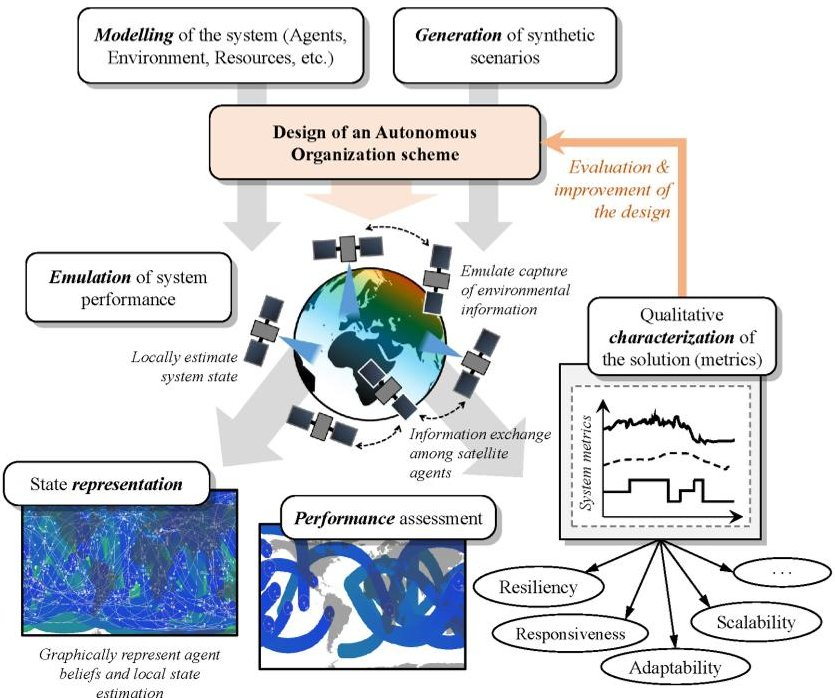
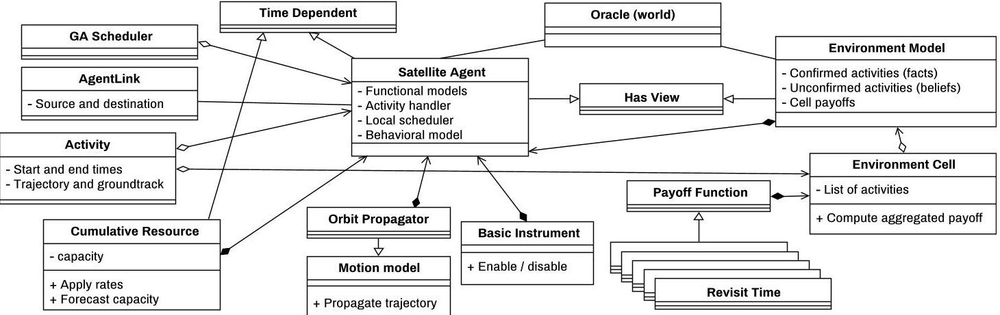
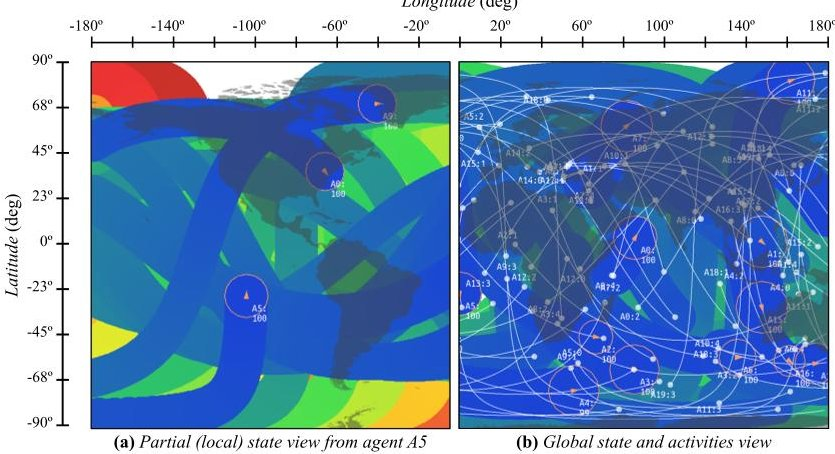
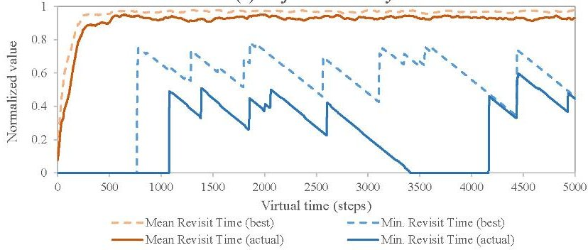
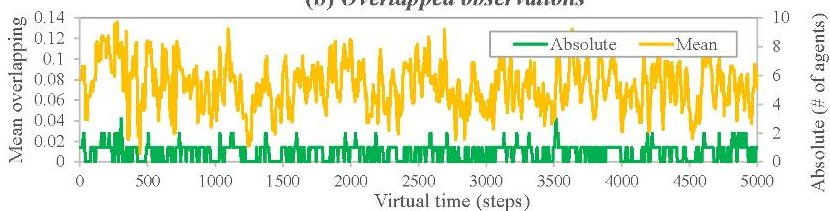

<!-- PDF_PAGE: 1 -->

# A Design-Oriented Characterization Framework for Decentralized, Distributed, Autonomous Systems: the Nano-Satellite Swarm Case

Carles Araguz $ ^{*} $ , Marc Closa, Elisenda Bou-Balust, and Eduard Alarcon Dept. Electronics Engineering, Technical University of Catalonia-UPC BarcelonaTech, Spain. $ ^{*} $ E-mail: carles.araguz@upc.edu

Abstract—The design of autonomous operational schemes for distributed, decentralized systems is expected to bring multiple qualities to systems of this kind. One of their instances are Earth-observing swarms of nano-satellites, in which their collective function targets global performance figures. The design of autonomous operations can be modelled as a collective scheduling problem subject to resource constraints. There are many system-wide qualities of interest, such as resiliency, adaptability, responsiveness, among others, that need specific frameworks to characterize the proposed solutions. This paper presents one such design-oriented tool that can evaluate these autonomous organization schemes—potentially for large-scale and highly heterogeneous scenarios with dynamic contexts and multiple time-scales—and illustrates its usage in the evaluation of an autonomous nano-satellite swarm that collectively optimizes revisit times.

Index Terms—autonomy, distributed satellite systems, nanosatellite swarm, self-organizing systems, multi-agent systems

## I. INTRODUCTION

We live in an era where machines are starting to carry out a myriad of activities without the need for constant human supervision. Our society is surrounded by devices that can sense our bodies, drive us home, irrigate our crops, efficiently control the temperature of our homes, or monitor natural disasters. Current technological trends, the rise of paradigms like the Internet of Things, and a constant eagerness to make everything 'smart' have fostered the design of systems composed of multiple networked devices that interact to one another in an autonomous manner: teams of robots, flocks of drones, fleets of cars, swarms of satellites.

The need for autonomy has largely been discussed in literature (e.g. generic self-organizing systems [1, 2], or space systems [3-5]), where many authors have presented some of its potential benefits: namely, improving performance in systems with high uncertainties; ameliorating responsiveness, flexibility and adaptability in dynamic contexts; and ultimately handling complexity (especially in large-scale systems).

Research conducted in the aerospace field has traditionally been concerned with autonomy as a means to improve reliability and tolerance to failures. Nowadays, with the advent of distributed spacecraft architectures, many research endeavors are also exploring challenging autonomous functions—sometimes related to flight formation and trajectory planning [6, 7].

Fig. 1. Block diagram of the characterization framework

In the same category of systems, nano-satellite architectures composed of hundreds of small spacecraft are also revealing the need for a system-level autonomy that can orchestrate these large-scale, Earth observation (EO) systems. Characterized by the limiting resource capacities of this class of spacecraft (e.g. low power generation and communication bandwidths), densely populated nano-satellite swarms or constellations are seen to require novel operational concepts grounded on autonomy in order to deliver their expected benefits and ultimately make these systems feasible [8]. This owes, in part, to the dynamic nature of these types of mission architectures. Satellites are expected to operate in fully-networked environments where they would provide in-orbit data services, allow incremental deployment strategies and opportunistic coalitions, while maximizing science return and improving the system's resiliency.

Noteworthy, many of the traits of this kind of space architectures can also be observed for other ground-based systems. Two common and identifying characteristics are: (1) the spatial distribution of their conforming entities, and (2) their likely decentralized organization scheme. This poses several design challenges to their autonomous coordination

<!-- PDF_PAGE: 2 -->

Fig. 2. UML description of the modelling approach for a swarm of Earth-observing nano-satellites

mechanisms, mainly owing to the fact that their ability to coordinate and exchange information is strongly tied to their communication links. For EO satellites flying in multiple orbits these links would only allow communication when the two peers are in close vicinity (i.e. a satellite "encounter").

Certainly, conceiving suitable paradigms that would bring autonomy to nano-satellite swarms is not a trivial exercise. Autonomous operation schemes should provide the means by which spacecraft coordinate and satisfy the system's function. Nevertheless, this shall not be the unique goal of a design. This paper argues that the goodness of an autonomous organizational scheme for distributed, decentralized systems (and also for the aforementioned particular case) needs not only be concerned with the assessment of the autonomous function itself (i.e. the performance) but should also evaluate the very overarching qualities of the system, such as its resiliency, scalability, adaptability, etc. In order to do that, designers may require the support of specific tools that enable a comprehensive assessment of their solutions. In this sense, this paper proposes a design-oriented framework (Fig. 1) aimed at addressing these needs, and illustrates its application for an autonomous, self-organizing scheme for nano-satellite swarms. Thus, the objectives of the design-oriented framework presented herein are three-fold: to allow the modelling of the system and simulate its performance; to conceive and implement autonomous operation schemes; and to verify their resulting qualitative aspects and limitations in order to identify and address possible design flaws.

## II. MODELLING A GENERIC AGENT-CENTRIC OBSERVING SYSTEM

A swarm of EO nano-satellites can be described generically as a system composed of multiple independent agents that capture information of their environment. The motion of these agents is determined by their orbital trajectories. In this work, orbital parameters are assumed to be fixed and predictable, as is the case of most small spacecraft (which tend to lack the ability to perform orbital maneuvers). This simplifies the modelling of the system, albeit makes the problem slightly less generic. Figure 2 depicts the proposed modelling of the system in UML.

EO systems, and especially distributed satellite systems, are often designed to provide data with a given spatial and spectral resolutions, a maximum temporal resolution (i.e. time between two consecutive observations of the same spot, the so-called "revisit time"), and a maximum latency (i.e. the delay between the capturing of data and its reception). This essentially suggests that the state information that the observing agents handle will encompass global geo-located information (estimated or factual) of the environment they observe.

Satellite agents also have the ability to interact and exchange information. This process, however, is always subject to the availability of a communications link. Regardless of the simplicity or level of detail in their link models, satellite agents shall present impaired communication capabilities that are strongly affected by their relative distances. Another determining characteristic is their limited capacity to generate and store energy. When satellite agents enable their observation device (i.e. instrument) they shall inflict a consumption of energy and data storage. Therefore, agents will need to optimize the collection of data while minimizing the resources spent therein. That is to say that their autonomous operations scheme will ultimately solve a scheduling problem subject to resource constraints.

## A. Activity model

The unit of information understood, generated and exchanged by agents is called an Activity. Activities, denoted with $ a_{i} $ , represent atomic tasks that have been scheduled by an agent. Each activity encompasses its start and end times $ (\tau_{s} $ and $ \tau_{e} $ , respectively) and the trajectory of the agent described with its orbital parameters and state. Satellite Agents are assumed to be able to determine what another agent is capturing based on the other agent's position and velocity vectors. This would not be necessarily unrealistic provided that satellites embark modern processing units, but does imply that agents have moderate reasoning capabilities.

Each agent is capable of generating its own plan of actions $ S=\{a_{0}, a_{1}, \dots, a_{N}\} $ , where $ a_{j} $ denotes the agent's j-th Activity. They are also allowed to retract from their plan of actions and to modify them partially or totally. Thus, activities can be labelled as confirmed $ (a_{i}^{*}) $ or discarded $ (a_{i}^{\otimes}) $ .

<!-- PDF_PAGE: 3 -->

When an activity is confirmed (either past or future), $ a_{i}^{*} $ becomes a fact. In addition, agents share a confidence level $ u_{j}\in[0,1]\mid u_{j}(a^{*})=1,u_{j}(a^{\otimes})=0. $

The usefulness of an activity can be assessed with a given decay function $ \delta(a_{i})\in[0,1]. $ This function quantifies the impact of the activity with regards to system goals (i.e. activities that are older than the maximum revisit time may no longer be useful to an agent and could safely be forgotten).

## B. Satellite Agent model

Satellite Agents are composed of several models that describe their state and function. Their state is represented with their remaining resource capacities (e.g. energy and data storage) and position and velocity vectors. Both energy and storage are modelled as Cumulative Resource capacities that do not return to their initial capacity after a consumption rate is removed. Satellite motion is encapsulated in a trajectory model that implements a Keplerian Orbit Propagator. Satellites can exchange information when another agent is within their communication ranges. However, exchange of information can only happen if both agents have enough energy to enable their emulated links.

Instances of this agent-centric system are formally defined as a set of $ N $ agents $ \mathcal{A} $ . Each agent's knowledge base $ (\beta) $ is constructed from interactions and exchange of some subset $ S_{i}^{\prime} $ thus yielding:

$$
\beta_ {i} = \left[ \begin{array}{c c c c} \mathcal {S} _ {a} ^ {\prime} & \mathcal {S} _ {b} ^ {\prime} & \dots & \mathcal {S} _ {k} ^ {\prime} \end{array} \right] ^ {T}
$$

Given that agents can retract from their plans of action, an agent i has information within $ S_{j}^{\prime}\big|_{i\neq j} $ that can be partial and not necessarily always accurate.

## C. Local Environment Model

Agents reason about, and try to optimize, the system performance. Their locally-inferred global state $ \mathcal{E} $ is updated with the information they exchange with other agents $ S_{i}^{\prime} $

Each agent can segment their environment in an arbitrary number of Environment Cells, resembling the information maps for distributed anti-flocking of mobile sensor nodes described in [9]. Agents that have higher computational capabilities (i.e. memory, processing time) will tessellate their Environment Models with smaller cells, whereas satellites that present constraints in memory or processing power, may reduce the number of cells to the minimum. This also emulates the fact that true environment information can never be fully grasped and will always be approximated during the reasoning processes of agents. Environments modelled as a 2-dimensional space will give (2) where $ e_{i} $ is the state information of a single environment cell, for agent $ \mathcal{A}_{i}. $

$$
e _ {i} (x, y) = f \left(\beta_ {i}\right) \quad e _ {i} \in \mathcal {E} _ {(A \times B)}
$$

Fig. 3. Graphical state and agent views

## III. CHARACTERIZATION OF DISTRIBUTED DECENTRALIZED, AUTONOMOUS ALGORITHMS

The proposed framework implements the aforementioned multi-agent system and complements it with tools that allow the generation and visualization of system metrics and state. Fig. 3 shows two alternative views that can assist the design process by compressing several essential variables and state information. The views display revisit time in a color-coded 2-d surface. The environment is represented as an equirectangular projection of the Earth, and agents are superimposed on top of it. In Fig. 3b, all agent activities are also displayed as white lines that follow the agent's trajectory. This view, therefore, shows the true global state of the system despite it not being known by each agent. Fig. 3a, on the other hand, displays the state of the environment as (partially) known by a single agent, allowing to inspect local beliefs (i.e. $ \mathcal{E} $ ).

Based on global and local information, the framework can compute several system metrics of interest. Currently, the characterization of performance is based on two EO metrics, namely, revisit time and coverage, as well as a figure that shows agent's geographical overlapping during simultaneous captures. Values for some of these metrics are shown in Fig. 4 and discussed in the following sections.

## IV. PRELIMINARY AUTONOMOUS OPERATIONAL CONCEPT FOR NANO-SATELLITE SWARMS

In order to verify the modelling approach as well as to test the characterization framework, this paper provides a preliminary collective mission planning scheme that enables autonomous operations and tries to optimize performance and resource utilization. This preliminary organization scheme is grounded on a two-tiered decisional process, implemented as part of the agent's behavior and reasoning capabilities. The low-level process solves a local planning problem, whereas the upper tier implements an activity exchange policy among the agents. In this preliminary version, all agents are assumed to have the same behavior and computation capabilities, although their instrument and communications link present different resource demands and characteristics (e.g. link range and instrument area).

<!-- PDF_PAGE: 4 -->

## A. Activity exchange policy upon encounter

Upon encounter with another agent j, agent i assesses its internal state and decides which portion of $ \beta_{i} $ needs be shared with agent j. This is modelled as a function $ f(\beta_{i},\delta ,\mathcal{E}_{i}) $ that takes into account confidence levels of each activity, their usefulness ( $ \delta $ ) and the state of the system $ \mathcal{E} $ .Having exchanged local information, agents update their knowledge base and decide whether to (re-)schedule their plans of action.

## B. Evolutionary local scheduler

The planning of activities is designed as a scheduling process based on evolutionary heuristics. In particular, the current version of this autonomous operational scheme implements a Genetic Algorithm Scheduler (GAs) that maximizes the objective function in (3), subject to resource constraints [10]:

$$
f (\mathbf {x}) = \frac {1}{\lambda} \sum_ {i} P _ {i} x _ {i}
$$

$$
\text {w i t h} \quad \lambda = \frac {1}{N _ {k}} \sum_ {k = 1} ^ {N _ {k}} \left(\frac {1}{C _ {k}} \sum_ {i} \left(\tau_ {e i} - \tau_ {s i}\right) r _ {k} x _ {i}\right)
$$

where x is the vector of binary decision variables $ x_{i} $ linked to a proposed activity, and $ N_{k} $ is the number of resources. Each activity defines a consumption rate $ r_{k} $ for each resource k of capacity $ C_{k} $ . The generation of potential activities is carried out based on a function $ p_{\mathcal{E}}(x,y)\in[0,1] $ that computes a payoff figure for each observable point in the trajectory of an agent. As such, this payoff function is tied to the local state information maintained by an agent $ \mathcal{E} $ , that ultimately depends on its beliefs and known facts. Payoffs obtained for every point allow the agent to determine critical observation areas in its trajectory and to propose activities accordingly. Once activities are generated, their aggregated payoff $ P_{i} $ is computed to drive the optimization function.

## V. RESULTS

Concluding with the illustration of this design-oriented framework, this section introduces preliminary results with which the autonomous operation concept summarized in Section IV has been evaluated. The analysis has focused on two indicators (Fig. 4): system performance and efficiency. The former is represented as the normalized revisit time (where 0 means that the system has not achieved its target performance). The latter indicator, efficiency, is studied with the number of overlapped observations in any given location of the environment. Both indicators have allowed to detect design flaws and incorrect behavior when the system was emulated for a swarm size of 5 and 10 nano-satellites.

Mean values compress the environment state into a single figure, which averages revisit time for all cells in the environment. Series labeled with "best" correspond to the ficticious value that would be obtained if agent instruments would be enabled constantly (which we know is not possible given power resource constraints).

Two conclusions can be drawn from these results:

(a) Performance analysis

(b) Overlapped observations

Fig. 4. Preliminary assessment of the autonomous operational scheme

1) Although the system would be able to maintain target revisit time, there is a period of time (i.e. $ 3 5 0 0 < t < 4 2 0 0 $ ) where agents repeatedly miss a certain geographical area and yield unexpected performance. Likewise, their revisit time exceeds the target one during most of the time, suggesting that their ability to optimize resource utilization globally can be improved.

2) The second analysis (Fig. 4b) reveals that the system is slightly inefficient. The number of overlapped measurements of some point in the surface of the Earth has been repeatedly equal or greater than 1. This suggests a lack of coordination between agents and stresses the need to improve the autonomous operational scheme.

## VI. CONCLUSIONS AND PROSPECTIVE

The presented framework allowed to characterize an autonomous operational scheme and to identify areas of the design that can benefit from improvements. Likewise, this framework can also be used to perform comprehensive benchmark and trade-off analysis, where multiple different operational schemes can be assessed and compared. Thus, the uniqueness of the presented characterization framework does not lie in its ability to simulate a distributed and decentralized agent-based system but to explore multiple of their instances, as well as to facilitate both a quantitative and qualitative evaluation of the design [11]. Aside from testing and fine-tuning the solution, this framework has been conceived to compute system metrics reflecting many of the quality attributes of a system (the so-called "ilities", [12, 13]), especially targeting the emulation of large-scale systems, highly heterogeneous architectures with dynamic contexts and structures, and multiple time-scales, and allowing to demonstrate the overarching benefits of specific autonomous organizations schemes.

## ACKNOWLEDGEMENTS

This work is partially supported by ICREA under the ICREA Academia programme.

<!-- PDF_PAGE: 5 -->

## REFERENCES

[1] F. Rossi, S. Bandyopadhyay, M. Wolf, and M. Pavone. "Review of Multi-Agent Algorithms for Collective Behavior: a Structural Taxonomy". In: 2018 IFAC Workshop on Networked & Autonomous Air & Space Systems. 2018, pp. 1-6.

[2] Y. Rizk, M. Awad, and E. W. Tunstel. "Decision Making in Multi-Agent Systems: A Survey". In: IEEE Transactions on Cognitive and Developmental Systems 10 (3 2018), pp. 514-529.

[3] C. Iacopino and P. Palmer. "Autonomy". In: Distributed Space Missions for Earth System Monitoring. Ed. by M. D'Errico. Vol. 31. Springer Science & Business Media, 2012. Chap. 10, pp. 309-329.

[4] M. Tipaldi and L. Glielmo. "A Survey on Modelbased Mission Planning and Execution for Autonomous Spacecraft". In: IEEE Systems Journal (2017), pp. 1-13.

[5] C. Araguz, E. Bou-Balust, and E. Alarcón. "Applying autonomy to distributed satellite systems: Trends, challenges, and future prospects". In: Systems Engineering 21.5 (2018), pp. 401-416.

[6] J. S. Llorente, A. Agenjo, C. Carrascosa, C. de Negueruela, A. Mestreau-Garreau, A. Cropp, and A. Santovincenzo. "PROBA-3: Precise formation flying demonstration mission". In: Acta Astronautica 82.1 (2013), pp. 38-46.

[7] E. Gill, O. Montenbruck, and S. D'Amico. "Autonomous formation flying for the PRISMA mission". In: Journal of Spacecraft and Rockets 44.3 (2007), pp. 671-681.

[8] D. Selva, A. Golkar, O. Korobova, I. Lluch, P. Collopy, and O. de Weck. "Distributed Earth Satellite Systems: What Is Needed to Move Forward?" In: Journal of Aerospace Information Systems 14.8 (2017), pp. 412- 438.

[9] N. Ganganath, C.-T. Cheng, and K. T. Chi. "Distributed antiflocking algorithms for dynamic coverage of mobile sensor networks". In: IEEE transactions on industrial informatics 12.5 (2016), pp. 1795-1805.

[10] F. Xhafa, J. Sun, A. Barolli, A. Biberaj, and L. Barolli. "Genetic algorithms for satellite scheduling problems". In: Mobile Information Systems 8.4 (2012), pp. 351- 377.

[11] C. Araguz, D. Llaveria, E. Lancheros, E. Bou-Balust, A. Camps, E. Alarcón, I. Lluch, H. Matevosyan, A. Golkar, S. Tonetti, S. Cornara, J. Cote, S. Pierotti, P. Rodriguez, A. Alvaro, M. Sochacki, and J. Narkiewicz. "Optimized model-based design space exploration of distributed multi-orbit multi-platform Earth observation spacecraft

architectures". In: 2018 IEEE Aerospace Conference. 2018, pp. 1-16.

[12] H. McManus, M. Richards, A. Ross, and D. Hastings. "A Framework for Incorporating "ilities" in Tradespace Studies". In: AIAA SPACE 2007 Conference & Exposition. 2007, pp. 941-954.

[13] O. de Weck, D. H. Rhodes, and A. M. Ross. "Investigating Relationships and Semantic Sets amongst System Lifecycle Properties (Ilities)". In: $ 3^{rd} $ International Engineering Systems Symposium, CESUN 2012. Delft, The Netherlands, 2012.