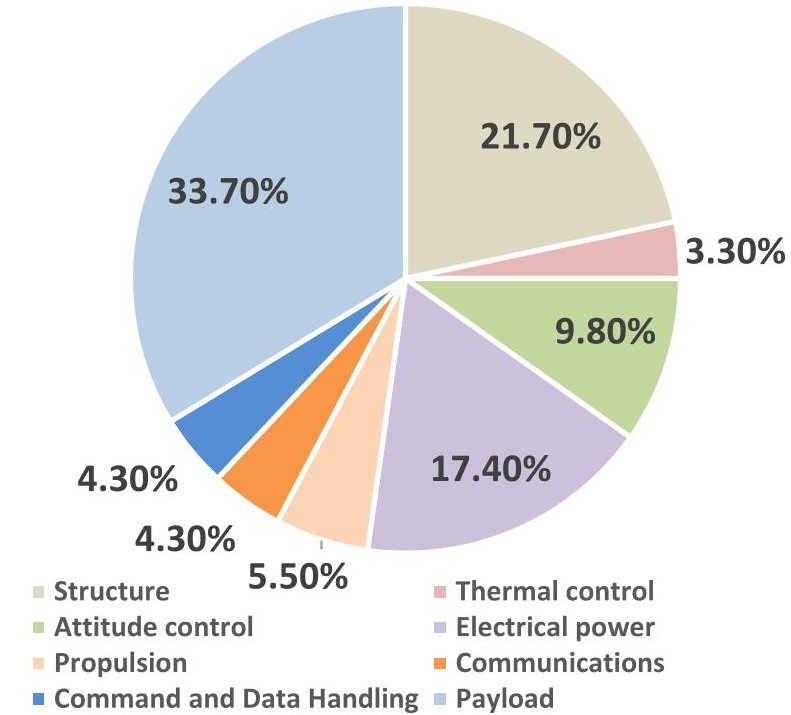
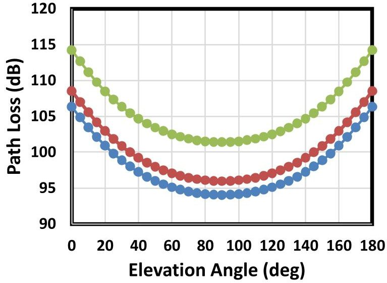
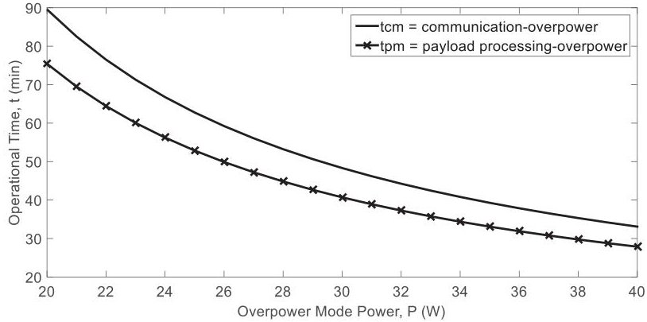
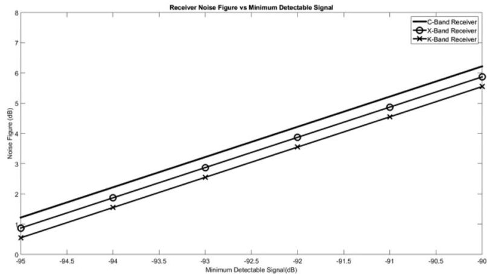

<!-- PDF_PAGE: 1 -->

# Parametric System Engineering Analysis of Capability-Based Small Satellite Missions

Sunday Cookey Ekpo $ ^{ID} $ , Member, IEEE

Abstract—To achieve appropriate link budget and system engineering analyses of capability-based small satellites missions, an objective assessment and computation of the component-, subsystem-, and system-levels parameters requirements must be carried out. This paper presents the measurement-derived parametric models for the system engineering analysis of communication, meteorology, planetary, and other small satellite programs with recourse to the initial mission, conceptual design, and postmission objectives. Mass and power margins are the critical resources under investigation besides the link contingencies and operational times. The case study spacecraft systems engineering analyses indicate a transmit power for data transmission uplink and downlink of at least 33 dBm for the generic communication, meteorology, and planetary missions applications. The presented parametric models also reveal a signal-to-noise ratio of at least 16 dB per radio communication link for worst case noise floor and path loss. For a 30-W power utilization, a two-power communicationoverpower mode mission operates for an extra 8.3 min compared with a three-power payload-overpower mode mission. This holds a great promise for the development of adaptive subsystems for reconfigurable multiband, and multistandard transponders for multipurpose missions and postmission applications.

Index Terms Adaptive systems, capability engineering, parametric study, satellite communication, system engineering.

## I. INTRODUCTION

THE conceptual design of satellites involves several modeling and simulation approaches that span single person calculations to multiple organizations employing complex and advanced interconnected computer models for optimized solutions [1]. The four design approaches that are currently utilized within the space community include back-of-the envelope techniques, single-use, computer-aided models, serial processes, and integrated concurrent engineering [1]----[4]. These techniques can be combined to meet the customer's needs or a hybrid of several design methods may be implemented. Whatever the adopted design approach, a single solution or specific mission design interests may be the focus.

The conceptual design is influenced by several factors and design constraints and has no unique "right" technique. Issues

ranging from the project manager's background, corporate culture, team leadership, cultural differences, and dynamics also determine the choice of a conceptual design approach for a spacecraft mission.

The fundamental motivations for the capability-based space satellites (CSSs) (such as a highly adaptive small satellite (HASS) [1]) concept include, but are not limited to, in-orbit adaptability, reliability, multifunctionality, enhanced portability, system-level simulation of spacecraft, reduced manufacturing and integration complexities, cost-effectiveness, safety, low carbon footprint, postmission re-application, and flexibility in deployments. A HASS is a reconfigurable, multifunctional, and adaptive small space satellite that has capabilities for dynamic space applications and operations while retaining its designed optimal performance. This capability-based space system design paradigm will gain increasing and expanding applications in the future deployments of constellations of small satellites [1] [6]. A HASS system architecture has an in-built redundancy and radiation shield for onboard semiconductor components that can be re-engineered while in orbit. The adaptive multifunctional architecture does not follow a subsystem-oriented design approach; it embraces the small satellites scaling techniques [2], [7]. The design process accomplishes functions and eliminates conventional subsystem boundaries. It focuses on the identification and specification of subsystem-level functional requirements. In this approach, the functions of several subsystems are implemented on a single circuit card [6].

Moreover, a capability-based satellite system is developed as a network of functions with reconfigurable intra- and intersubsystem and module links. This eliminates a single point of failure, enhances a deterministic operation, and/or helps to sustain a real-time performance. The functionality of a module and/or subsystem can be seamlessly transferred to another module and/or subsystem via the adaptable point-to-point network of the adaptive satellite system [6] [9]. Thus, all the HASS subsystems can directly access the resources of the other subsystems. In this paper, mass and power margins are the critical resources under investigation for achieving an optimal, economical, reliable, and sustainable capability-based small satellite mission [1], [8], [9].

The existing conventional parametric models for system engineering analysis of small satellite missions are based on the work of Charles Brown [3]. Other documented small satellite missions have been mission-based and application-specific [6] with no particular published guiding system engineering design principles. Moreover, the integrated cost, size, weight, and power

<!-- PDF_PAGE: 2 -->

(C-SWaP) limitations of small satellites are not the core systemlevel design considerations [8] since commercial-off-the-shelf components are often favored for this type of mission. Ekpo and George [5] and Waseem and Sadiq [10] provide small satellite architecture technologies, and model-based systems engineering in conceptual design of small satellites that satisfy delineated "all-analog" and "all-digital" system designs only.

Ekpo and George [1] introduces a common design procedure for capability-based small satellite systems engineering but focuses on a system engineering analysis of various categories of highly adaptive small satellites for a meteorology satellite (METSAT) mission. Ekpo and George [5] considers the design methodology of adaptive small satellites that enables an optimal architecture for a mission. Ekpo and George [5] and and Ekpo et al. [11] explore the fact that an adaptive small satellite design problem is a multicriteria optimization design problem that must be judiciously assessed for a cost-effective first-pass success. The parametric models presented in this paper cover other satellite missions as well with an allowance for adapting the models to suit next- and future-generation satellite system engineering design processes. The developed and validated models can be adapted to suit any mission of choice with allowance for assessing the impact of integrated emerging device to systemlevel technologies.

The parametric models presented in this paper allow for "integrated digitized analog" satellite systems [5] and can be adapted to meet the user and the system requirements definitions for delineated "all-analog" and "all-digital" satellite designs if required. Within the scope of this paper, the system engineering of capability-based small satellite missions is analyzed with recourse to the industry-standard parametric estimation of the subsystems design characteristics. This research work provides comprehensive spacecraft system simulation parameters models that are measurement derived for precision mission programs. Moreover, the operational times of the capabilitybased satellite subsystems can be modeled for accurate near real-time orbital dynamics assessment. Furthermore, the communication link budget and payload operational times can be reliably assessed with recourse to the high-level performance requirements of spacecraft mission and postmission systems. This paper provides a parametric system engineering analysis of capability-based small satellite missions respecting the enabling and emerging space satellite technologies. The frontal objective of this paper is to develop and present estimating spacecraft power and mass relationships that can be utilized to provide reliable and sustainable mission and conceptual system engineering decisions to satisfy performance definitions and budget constraints. This is important because of the increasing dependence on cost-effective, reconfigurable space-borne assets [especially in the low-earth orbit (LEO)] to complement terrestrial radio access technologies. The focus of this paper is to provide the quantitative engineering principles platform for the subsystems design parameters of sustainable small satellites based on their systems definitions and requirements.

This paper is organized as follows. Section II explains the satellite system engineering estimating relationships and margins for the communication, meteorology, planetary, and other

mission applications. Section III details the postmission satellite mission applications including the operational time. The capability-based small satellite communication link budget analysis is presented in Section IV. Section V concludes this paper.

## II. SATELLITE SYSTEM ENGINEERING

Single-use, computer-aided models for conceptual design represent a system engineering design process tool for the entire spacecraft modules and their respective integrated subsystems and subsystems [2], [3], [11] - [13]. This approach allows for a more detailed analysis of the spacecraft subsystems and their interdependencies than the back-of-the-envelope technique. The historical data of spacecraft (including mass, power, size, data link margins, and orbit parameters) are required to establish this technique. This involves utilizing appropriate statistical curve-fitting algorithms (such as linear programming) to obtain equations that define a design resource of interest as explicit parametric functional relationships of other independent variables that strongly determine it. Depending on the coefficient of determination that fits the spacecraft model of interest, an estimating relationship can be a simple linear function; logarithmic equation; or a complex, higher order polynomial. Systems engineers find this method to be particularly helpful for sizing subsystems that require expert inputs following their basic conceptual design definitions. For instance, the sizing of the solar panel and structure as functions of the spacecraft's mass or thermal control subsystem as a function of the spacecraft's power and mass. Also, a physical quantity such as the subsystems' power consumption can be expressed as a function of the spacecraft's mass. It is worthwhile to note that the accuracy of this technique depends largely on the consistency of the mathematical relationships of the subsystems (i.e., the plotted historical spacecraft data lie closely with the curve-fit).

The empirical mass and power estimating relationship (PER) approach is relatively simple and easy. This approach has been adopted in the development of the system engineering design process for the HASS systems using the data of past space programs of built systems. Adaptive and active devices strongly influence the system-on-chip and multichip design paradigms for HASS systems. To ensure that the developed system engineering (SE) design process model works well for the presented adaptive satellite architecture (i.e., integrated digitized radio frequency (RF)/microwave analog systems substrates), the design parameters (such as cabling harnesses, subsystems integration, system configurations, and technology options) are modified to reflect the technological advancements for the estimating relationships. This has revealed a good technical agreement between the reported system design parameters (such as payload mass fraction) and those of past space programs. The results of the power and mass budgets analyses for the meteorology, communication, and planetary missions using HASS systems are presented here. The SE analysis for each considered mission is based on the functional relationships and derivations.

The choice of the payload- and mass-based PER models for each spacecraft mission is informed by the combined statistical analysis of past and current spacecraft missions with

<!-- PDF_PAGE: 3 -->

recourse to the emerging small satellite technologies. For instance, given the limited size, weight and power generation capability of small satellites, the payload design for the meteorology mission in LEO is modeled using the PERs [1]. Similarly, the business needs of communication and planetary missions limit the spacecraft category to the higher end of the microsatellites and beyond.

The subsystem mass reduction $ M_{\mathrm{SMR}} $ of a capability-based small satellite based on the satellite category and cabling factor is given by

$$
M _ {\mathrm {S M R}} = M _ {\mathrm {O D M}} C _ {\mathrm {M F}}
$$

where $ M_{\mathrm{ODM}} $ is the on-orbit dry mass of a conventional satellite in kilogram, and $ C_{\mathrm{MF}} $ is the cable mass factor. The corresponding HASS subsystems (core bus and payload modules) mass for allocation $ M_{\mathrm{SSH}} $ in kg is given by

$$
M _ {\mathrm {S S H}} = \frac {M _ {\mathrm {O D M}} \left(1 - C _ {\mathrm {M F}}\right)}{1 + C _ {f}}
$$

where $ C_{f} $ is the mass contingency factor. The mass margin for HASS systems is obtained as $ M_{\mathrm{Hmargin}}=C_{f} M_{\mathrm{SSH}} $ [1], [3]. Furthermore, the equivalent on-orbit dry mass $ M_{\mathrm{HODM}} $ of the capability-based small satellite is given by [1]

$$
M _ {\mathrm {H O D M}} = M _ {\mathrm {O D M}} \left(1 - C _ {\mathrm {M F}}\right).
$$

The abovementioned analysis was applied in the derivation of the mass allocation of HASS systems for communication, planetary, and meteorology missions based on past spacecraft historical database/missions and the American Institute of Aeronautics and Astronautics guidelines [1]-[3], [8].

To demonstrate how the power margin of LEO satellites as a function of the generated solar array power is derived, the following definitions apply:

x = maximum spacecraft power available from the solar array, W, and

$ y $ = actual core bus and payload subsystems power, W.

The power contingency $ P_{\mathrm{margin}} $ is therefore derived thus

$$
y C _ {f} = P _ {\mathrm {m a r g i n}}
$$

$$
x - y = P _ {\mathrm {m a r g i n}}.
$$

From (4) and (5), the power margin becomes

$$
P _ {\mathrm {m a r g i n}} = \frac {x C _ {f}}{\left(1 + C _ {f}\right)}.
$$

Equation (6) assumes that the payload subsystem is developed along with the core bus subsystems. A capability-based satellite system employs an adaptive device(s) in its architecture. Following the preceding analyses and discussions, the power contingency function for a capability-based application cannot follow the conventional definition. Hence, the power budget of a HASS is modeled with recourse to the requirements of the subsystems and the mission. It is a system capability-based model and the total in-orbit power $ P_{T} $ of a HASS system is given by [1]

$$
P _ {T} = P _ {p l} + P _ {\mathrm {b u s}} + P _ {\mathrm {m a r g i n}} ^ {\prime}
$$

TABLE I

CORE BUS SUBSYSTEMS POWER ALLOCATION FOR HASS MISSIONS

<table border="1"><tr><td></td><td colspan="8">Percentage of Total Core Bus Subsystems Power Allocation(%)</td></tr><tr><td></td><td colspan="2">Communication</td><td colspan="2">Planetary</td><td colspan="2">Meteorology</td><td colspan="2">Other</td></tr><tr><td>Subsystem</td><td>STP</td><td>CFP</td><td>STP</td><td>CFP</td><td>STP</td><td>CFP</td><td>STP</td><td>CFP</td></tr><tr><td>Thermal</td><td>30.5</td><td>30.5</td><td>28.8</td><td>28.8</td><td>48.8</td><td>48.8</td><td>33.2</td><td>30.1</td></tr><tr><td>ADC</td><td>28.5</td><td>28.5</td><td>20.6</td><td>20.6</td><td>19.3</td><td>19.3</td><td>11.1</td><td>11.1</td></tr><tr><td>EP</td><td>14.6</td><td>14.6</td><td>7.5</td><td>7.5</td><td>3.5</td><td>3.5</td><td>1.5</td><td>1.6</td></tr><tr><td>CDH</td><td>19.3</td><td>19.3</td><td>17.5</td><td>17.5</td><td>13.2</td><td>13.2</td><td>15.1</td><td>15.1</td></tr><tr><td>Comms</td><td>0</td><td>0</td><td>23.6</td><td>23.6</td><td>15.2</td><td>15.2</td><td>30.1</td><td>30.1</td></tr><tr><td>Propulsion</td><td>7.1</td><td>7.1</td><td>1</td><td>1</td><td>0</td><td>0</td><td>4.0</td><td>4.0</td></tr><tr><td>Mechanism</td><td>0</td><td>0</td><td>1</td><td>1</td><td>0</td><td>0</td><td>5.0</td><td>5.0</td></tr></table>

where $ P_{\mathrm{margin}}^{\prime} $ is the power margin, and $ P_{\mathrm{bus}} $ is the core bus power. The corresponding power contingency $ P_{\mathrm{margin}}^{\prime} $ is given by

$$
P _ {\mathrm {m a r g i n}} ^ {\prime} = P _ {\mathrm {m a r g i n}} + \delta P
$$

where $ \delta P $ is the maximum differential power (W) resulting from the dynamic operation and application of a HASS system.

Combining (7) and (8) together, we obtain the final in-orbit payload-based HASS power budget function as

$$
P _ {T} = P _ {p l} + \left(1 + C _ {f}\right) P _ {\mathrm {b u s}} + \delta P.
$$

As observed in (9), the adaptive power margin function $ P_{\mathrm{margin}}^{\prime} $ is dependent upon the deterministic system application. Since $ P_{\mathrm{margin}} $ is defined for the conventional spacecraft without any obvious recourse to the adaptive power regimes, $ P_{\mathrm{margin}}^{\prime} $ must be greater or equal to $ P_{\mathrm{margin}} $ . Hence, the constraint on (9) for a capability-based small satellite system is given by

$$
P _ {\mathrm {m a r g i n}} \leq P _ {\mathrm {m a r g i n}} ^ {\prime} \leq \left(P _ {\mathrm {m a r g i n}} + \delta P\right).
$$

Consequently, for a capability-based satellite system, (9) becomes

$$
P _ {T} = f \left(P _ {p l}\right) + k f (M) + C _ {f} P _ {\mathrm {b u s}} + \delta P + C
$$

where k is the power per unit mass or specific power (W/kg) for each satellite category, $ f \left( P_{p l} \right) $ is the payload power (W), and C is a mission-based power constant (W) [1], [3]. Equation (11) represents the complete in-orbit total spacecraft power budget function for the conceptual design of a capability-based small satellite system.

Table I states the core bus subsystem power allocation for capability-based small satellite systems (such as a HASS) [1]. The presented analysis covers thermal, attitude determination and control (ADC), electrical power (EP), command and data handling (CDH), communications, propulsion, and mechanism subsystems.

## A. Meteorology Mission

A judicious analysis of PERs with recourse to the orbital patterns must be carried out to understand and validate the operational times of capability-based satellite systems' modules, subsystems, and subsubsystems. Two case studies are considered in this paper. Case study 1 represents a spacecraft team payload (STP), and case study 2, represents customer-furnished payload (CFP).

<!-- PDF_PAGE: 4 -->

From (11), the total in-orbit PERs of capability-based small satellites for meteorology missions in LEO are presented as follows:

1) Microsatellites

Case study 1

$$
\begin{array}{l} P _ {T} = 0. 5 2 2 M _ {\mathrm {H A M}} + 0. 5 \left(P _ {p l} + \left(1 + C _ {f}\right)\right) \\ \times \left(1 - C _ {l f}\right) \left(P _ {t} - P _ {p l}\right)) + 7. 7 8 \\ \end{array}
$$

where $ C_{\mathrm{l f}} $ is the cable loss factor, and $ C_{f} $ is the contingency factor.

Case study 2

$$
P _ {T} = 0. 5 2 2 M _ {\mathrm {H A M}} + 0. 5 P _ {t} \left(1 + C _ {f}\right) \left(1 - C _ {l f}\right) + 7. 7 8.
$$

## 2) Nanosatellites

Case study 1

$$
\begin{array}{l} P _ {T} = 1. 1 3 M _ {\mathrm {H A N}} + 0. 5 \left(P _ {p l} + \left(1 + C _ {f}\right) \left(1 - C _ {l f}\right)\right) \\ \times \left(P _ {t} - P _ {p l}\right)) + 1. 7 2. \\ \end{array}
$$

Case study 2

$$
P _ {T} = 1. 1 3 M _ {\mathrm {H A N}} + 0. 5 \left(1 + C _ {f}\right) \left(1 - C _ {l f}\right) P _ {t} + 1. 7 2.
$$

## 3) Picosatellites

Case study 1

$$
\begin{array}{l} P _ {T} = 2. 5 M _ {\mathrm {H A P}} + 0. 5 \left(P _ {p l} + \left(1 + C _ {f}\right) \left(1 - C _ {l f}\right)\right) \\ \times \left(P _ {t} - P _ {p l}\right)) + 0. 3 5. \\ \end{array}
$$

Case study 2

$$
P _ {T} = 2. 5 M _ {\mathrm {H A P}} + 0. 5 \left(1 + C _ {f}\right) \left(1 - C _ {l f}\right) P _ {t} + 0. 3 5.
$$

4) Femtosatellites

Case study 1

$$
\begin{array}{l} P _ {T} = 5. 1 5 M _ {\mathrm {H A F}} + 0. 5 \left(P _ {p l} + \left(1 + C _ {f}\right) \left(1 - C _ {l f}\right)\right) \\ \times \left(P _ {t} - P _ {p l}\right)) + 0. 0 8 3 5. \\ \end{array}
$$

Case study 2

$$
P _ {T} = 5. 1 5 M _ {\mathrm {H A F}} + 0. 5 \left(1 + C _ {f}\right) \left(1 - C _ {l f}\right) P _ {t} + 0. 0 8 3 5.
$$

A good and reliable system engineering analysis reveals the design margins that can be sustained in the event of system failure or re-engineering. The case studies presented in this paper assume that the payload is developed along with the core bus subsystems and not customer-held. The communications subsystem includes the uplink and downlink power requirements for receiving engineering data from and transmitting scientific data to a ground station, respectively.

Table II shows the power budget analysis of highly adaptive small satellites system engineering for a meteorology mission in LEO. Assume that the payload equipment for the meteorology mission will utilize 15, 10, 1, and 0.5 W for the representative highly adaptive microsatellite (HAM), nanosatellite, picosatellite, and femtosatellite, respectively [1].

TABLE II

HASS POWER BUDGET ANALYSIS FOR A METEOROLOGY MISSION [1]

<table border="1"><tr><td colspan="2">Satellite Category:Highly Adaptive Microsatellite (HAM)(18.4kg)</td></tr><tr><td colspan="2">In-orbit Total Power Summary</td></tr><tr><td>Parameter</td><td>Value(W)</td></tr><tr><td>Maximum available payload power in LEO</td><td>18.02</td></tr><tr><td>Maximum available core bus power in LEO</td><td>16.75</td></tr><tr><td>Required payload power</td><td>15.00</td></tr><tr><td>Calculated payload power</td><td>14.42</td></tr><tr><td>Payload power margin</td><td>3.60</td></tr><tr><td>Calculated core bus power</td><td>13.40</td></tr><tr><td>Core bus power margin</td><td>3.35</td></tr><tr><td>Total HAM power required</td><td>31.75</td></tr><tr><td>Power savings</td><td>1.67</td></tr><tr><td>Maximum power of a18.4-kgHAMinLEO</td><td>34.77</td></tr><tr><td>Max.availableHAMpowermargininLEO</td><td>6.95</td></tr></table>

TABLE III

<table border="1"><tr><td colspan="2">Satellite Category:Highly Adaptive Microsatellite(HAM)</td></tr><tr><td colspan="2">Conventional on-orbit dry mass(kg):20</td></tr><tr><td colspan="2">Subsystem mass reduction(kg)=1.6</td></tr><tr><td colspan="2">Equivalent on-orbit dry mass of a HAM=18.4</td></tr><tr><td colspan="2">Total subsystem mass for allocation(kg)=(18.72/1.25)=14.72</td></tr><tr><td colspan="2">HAM Mass Allocation Summary</td></tr><tr><td>Parameter</td><td>Value(kg)</td></tr><tr><td>Subsystem budget total</td><td>14.72</td></tr><tr><td>Mass margin</td><td>3.68</td></tr><tr><td>Mass-saving</td><td>1.6</td></tr><tr><td>Maximum on-orbit dry mass</td><td>18.4</td></tr><tr><td>Launch cost-saving($)</td><td>16,000.00</td></tr></table>

The power estimations for the various subsystems are utilized to develop the link budget and the operational times [8] of the payload subsystem. The payload-based PER $ P_{t} $ used to derive the total METSAT power requirements $ P_{T} $ is given by [3]

$$
P _ {t} = 1. 9 6 P _ {p l}.
$$

The system engineering design parameters for the meteorology mission are summarized as: payload holder: spacecraft design team; $ C_{\mathrm{M F}}=8\% $ ; orbit: LEO; design phase: conceptual design; power contingency factor $ (C_{f})= $ mass contingency factor $ (C_{f})=25\% $ [3]; class of design = 2 (next generation) [3]; cable loss factor $ C_{\mathrm{l f}}=1.6\% $ [3].

Table III presents the mass budget analysis of HASSs for a meteorology mission. It shows that an intelligent parametric system engineering design process can achieve mass savings and the elimination of undue system oversizing. It indicates the operational and business implications of the mission for satisfying and qualifying end users, technology platforms, and service delivery components. The subsystem mass allocation for the meteorology mission is given in Fig. 1.

At the conceptual design stage, Tables II and III enable the system engineer to allocate spacecraft resources to the various components and subsystems of the functional modules of the spacecraft.

<!-- PDF_PAGE: 5 -->

Fig. 1. Core bus subsystem mass allocation for the METSAT.

TABLE IV

HASS POWER BUDGET ANALYSIS FOR A COMMUNICATION MISSION

<table border="1"><tr><td colspan="3">Core Bus Subsystem Power Allocation</td></tr><tr><td>Core Bus Subsystem</td><td>Allocation(%)</td><td>Power(W)</td></tr><tr><td>Thermal control</td><td>30.5</td><td>18.08</td></tr><tr><td>Attitude control</td><td>28.5</td><td>16.89</td></tr><tr><td>Electrical power</td><td>14.6</td><td>8.65</td></tr><tr><td>Command and data handling</td><td>19.3</td><td>11.44</td></tr><tr><td>Communications</td><td>0</td><td>0</td></tr><tr><td>Propulsion</td><td>7.1</td><td>4.21</td></tr><tr><td>Mechanics</td><td>0</td><td>0</td></tr><tr><td colspan="3">In-orbit Total Power Summary</td></tr><tr><td colspan="2">Parameter</td><td>Value(W)</td></tr><tr><td colspan="2">Maximum available payload power in LEO</td><td>42.74</td></tr><tr><td colspan="2">Maximum available core bus power in LEO</td><td>74.09</td></tr><tr><td colspan="2">Required payload power</td><td>35.00</td></tr><tr><td colspan="2">Calculated payload power</td><td>34.19</td></tr><tr><td colspan="2">Payload power margin</td><td>7.74</td></tr><tr><td colspan="2">Calculated core bus power</td><td>59.27</td></tr><tr><td colspan="2">Core bus power margin</td><td>14.82</td></tr><tr><td colspan="2">Total HAM subsystems power required</td><td>94.27</td></tr><tr><td colspan="2">Power savings</td><td>3.13</td></tr><tr><td colspan="2">Maximum power of a 97-kg HAM in LEO</td><td>116.83</td></tr><tr><td colspan="2">Max. available HAM power margin in LEO</td><td>23.37</td></tr></table>

## B. Communication Mission

Based on the database of past spacecraft missions, the communication and planetary spacecraft would require at least 56 and 122 W, respectively, for an appreciable mission accomplishment [1]. From (11), the total in-orbit PERs of capability-based microsatellites for communication missions in LEO are similar to the case studies 1 and 2 in (12) and (13).

Table IV shows the HASS power budget analysis for a communication mission. The SE design analysis for the 97-kg HAM gives a calculated payload power of 34.19 W with a corresponding power margin of 8.55 W relative to the maximum available

payload power in LEO. Assume that the actual payload subsystem consumes 35 W, the calculated power margin of the payload would be 7.74 W (i.e., reduced by approximately 9.5%). The calculated payload power margin is approximately 22% of the actual payload power and well above the minimum power contingency (10%) required for the subsystem at liftoff [3]. The HASS power budget analysis for the case study communication satellite in LEO (see Table IV) shows that the power generation capability of the 97-kg HAM (i.e., 116.83 W) is sufficient for it. Hence, given the payload power requirement, no deployable solar reflectors would be required. However, to boost the payload power and enable more mission functions, deployable solar reflectors can be integrated into the four-panel array of the HAM. The reflectors would increase the solar intensity of the solar panels by approximately 51%. The payload-based PER $ P_{t} $ is given by [3]

$$
P _ {t} = 1. 1 5 6 8 P _ {p l} + 5 5. 4 9 7.
$$

The total communication satellite system power requirements $ P_{T} $ is obtained from (21). Hence, the total PER for the communication mission $ P_{T} $ is adjusted to account for the extra power generation from the solar reflectors as follows:

$$
\begin{array}{l} P _ {T} = 0. 5 2 2 M _ {\mathrm {H A M}} + 0. 5 P _ {t} \left(1 + C _ {f}\right) \left(1 - C _ {l f}\right) \\ + 7. 7 8 + N P _ {\mathrm {r e f l e c t o r}}. \\ \end{array}
$$

Similarly, the mass estimating relationship for the communication mission is adjusted to account for the extra weight of the solar reflectors as follows:

$$
M _ {\mathrm {H A S S}} = M _ {\mathrm {C O D M}} \left(1 - C _ {\mathrm {M F}}\right) + N M _ {\mathrm {r e f l e c t o r}}.
$$

The system engineering design parameters [3] for the communication mission are summarized thus: payload holder: spacecraft design team; $ C_{\mathrm{M F}}=3\% $ ; number of solar of reflectors, $ N=4 $ ; mass of solar reflector $ M_{\mathrm{reflector}}=0.16 $ kg; generated power per reflector $ P_{\mathrm{reflector}}=15 $ W; orbit: LEO; design phase: conceptual design; power contingency factor $ (C_{f}) $ = mass contingency factor $ (C_{f}) $ = 25% ; class of design = 2 (next generation); cable loss factor $ C_{\mathrm{l f}}=1.7\% $ ; conventional on-orbit dry mass (kg) = 100; subsystem mass reduction (kg) = 3; equivalent on-orbit dry mass of an HAM (kg) = 97; total subsystem mass for allocation (kg) = (97/1.25) = 77.6.

Table V shows the mass budget for the communication mission; the corresponding power budget is stated in Table V. For the conceptual design and development phase, the mass contingency of 0.25 is chosen (i.e., next-generation class of design). This yields a mass of 77.6 kg for allocation to the subsystems of the 97-kg communication spacecraft. Compared with the subsystems mass allocation for a conventional microsatellite [3] developed for the same mission, a mass-saving of 2.4 kg is realized. A 7-year communication mission utilizing the presented 97-kg HAM would require an end-of-life (EOL) power of 96.11 W [1], [3]. This gives the design point for the mission and can be easily accommodated based on the power generation capability of the spacecraft and the total power requirement of the subsystems for the mission (see Table IV). Furthermore, the HAM system can adapt its mission capabilities to lengthen the design lifetime

<!-- PDF_PAGE: 6 -->

TABLE V

HASS MASS BUDGET ANALYSIS FOR A COMMUNICATION MISSION

<table border="1"><tr><td colspan="3">Satellite Category:Highly Adaptive Microsatellite(HAM)</td></tr><tr><td colspan="3">Subsystem Mass Allocation</td></tr><tr><td>Subsystem</td><td>Allocation(%)</td><td>Allocated mass(kg)</td></tr><tr><td>Structure</td><td>21.6</td><td>16.76</td></tr><tr><td>Thermal control</td><td>4.1</td><td>3.18</td></tr><tr><td>Attitude control</td><td>7.2</td><td>5.59</td></tr><tr><td>Electrical power</td><td>26.8</td><td>20.80</td></tr><tr><td>Propulsion</td><td>7.2</td><td>5.59</td></tr><tr><td>Communications</td><td>-</td><td>-</td></tr><tr><td>CDH</td><td>4.1</td><td>3.18</td></tr><tr><td>Payload</td><td>29.0</td><td>22.50</td></tr><tr><td colspan="3">HAM Mass Allocation Summary</td></tr><tr><td>Parameter</td><td colspan="2">Value(kg)</td></tr><tr><td>Subsystem budget total</td><td colspan="2">77.6</td></tr><tr><td>Mass margin</td><td colspan="2">19.4</td></tr><tr><td>Mass-saving</td><td colspan="2">3.0</td></tr><tr><td>Max. on-orbit dry mass</td><td colspan="2">97.0</td></tr><tr><td>Launch cost-saving($)</td><td colspan="2">30,000</td></tr></table>

of the spacecraft thereby prolonging the mission or enabling a postmission reuse.

## C. Planetary Mission

From (11), the total in-orbit PERs of capability-based microsatellites for planetary missions in LEO are similar to the estimating relationships presented in case studies 1 and 2 in (12) and (13).

The cost of scientific satellites for planetary exploration and astronomical observation is prohibitively high. Hence, the current researches in the space community focus on achieving advanced capabilities for scientific and other missions using small payload subsystems and advanced small spacecraft technologies. For instance, a 72-kg Japan's innovative technology demonstration experiment (INDEX) satellite was launched to test the functionalities of modern sensor, processor, semiconductor, and battery technologies in a nearly sun-synchronous LEO at 655-km altitude [9]. The INDEX is a scientific microsatellite with a size of $ 7 2 \times6 2 \times6 2 \mathrm{c m}^{3} $ . The solar panel capability of the INDEX satellite was 150 W at launch time; 120 W could be generated using two solar-concentrator paddles each weighing 1.3 kg. Two thin-film reflectors with a total mass of 0.32 kg were also integrated into the two paddles. The reflectors improved the solar intensity on the deployed solar panels by 25%. Hence, the power generation capability of the solar array was increased by 30 W yielding a specific power of about 94 W/kg for the two reflectors. As a scientific satellite for the observation of aurora and demonstration of advanced spacecraft technologies, the INDEX carried space-qualified field programmable gates array devices within its sensors and actuators. It also had an integrated control unit that performed command and data-handling, thermal control, and attitude determination and control; the conventional satellite design would have these subsystems mounted separately onboard the spacecraft [7]. This implementation is supported onboard the HASS systems through the adaptive multifunctional architecture design. A 66.88-kg HAM with four thin-film solar

reflectors each weighing 160 g can sustain the scientific requirements of the INDEX satellite mission. The power budget of the HAM system indicates that it would have a power generation capability of at least 145 W and it enhances its solar intensity by a factor of 1.71. This results in a mass saving of 7.1% relative to the mass of the INDEX satellite. The payload subsystem of the HAM for the planetary mission is designed based on advanced sensor technologies such as miniature cameras. For instance, the imaging and mapping of the moon's surface (lunar mission) can be accomplished by developing integrated adaptive and/or reconfigurable payload sensors along the core bus subsystem. Cameras such as star tracker (for wide-field coverage, long-wave infrared, near-infrared/shortwave-infrared) and ultraviolet visible can be deployed onboard a HASS system for lunar surface mapping and earth observation missions. The Clementine spacecraft, launched to image and map the moon surface, utilized two star trackers (each 4.5 W and 0.29 kg), an integrated laser ranger and high-resolution imager (9.5 W, 1.12 kg), long-wave infrared imager (13 W, 2.1 kg), near-infrared imager (11 W, 1.92 kg), and ultraviolet-visible imager (4.5 W, 0.41 kg). The system engineering design parameters [3], [8] for the planetary mission are summarized as: payload holder: spacecraft design team; $ C_{\mathrm{M F}}=7\% $ ; number of solar of reflectors N=4; mass of solar reflector $ M_{\mathrm{reflector}}=0.16 \mathrm{~kg} $ ; generated power per reflector $ P_{\mathrm{reflector}}=15 \mathrm{~W} $ ; orbit: LEO; design phase: conceptual design; power contingency factor $ (C_{f}) $ = mass contingency factor $ (C_{f}) $ = 25% ; class of design = 2 (next generation); cable loss factor $ C_{\mathrm{l f}}=2.7\% $ ; required payload power = 25 W; conventional on-orbit dry mass (kg) = 108.17; subsystem mass reduction (kg) = 7.53; equivalent on-orbit dry mass of an HAM (kg) = 100.64; total subsystem mass for allocation (kg) = (100.64/1.25) = 80.51.

The payload-based PER $ P_{t} $ , which is used to derive the total planetary satellite system power requirements $ P_{T} $ , is given by [3]

$$
P _ {t} = 1. 1 3 P _ {p l} + 1 2 2.
$$

The total power $ \left(P_{T}\right) $ and mass $ \left(M_{\mathrm{HASS}}\right) $ estimating relationships for the planetary mission are as obtained in (22) and (23), respectively.

The Clementine spacecraft was deployed in the lunar orbit and had an on-orbit dry mass of 228 kg [9]. From Table VI, it is evident that the mass of the HAM system is approximately 44.14% of the mass of the Clementine spacecraft. Furthermore, the payload module of the HAM system can accommodate the payload sensors of the Clementine spacecraft for the lunar mission with a mass contingency of 3.37 kg (see Table VII). Depending on the image resolution and/or detail level required, the adaptive architecture of the HAM can be reconfigured to combine the sensors for accomplishing the mission. Each sensor enables a unique field-of-view (FOV). The near-infrared $ ( 1 6 0 \times1 6 0 \mathrm{k m}^{2} $ FOV), ultraviolet-visible $ ( 1 6 0 \times1 2 5 \mathrm{k m}^{2} $ FOV), long-wave infrared $ ( 2 5 \times2 5 \mathrm{k m}^{2} $ FOV), and high-resolution imagers $ ( 7. 5 \times9 \mathrm{k m}^{2} $ FOV) can be aligned together to capture the same background. Various configurations of this arrangement can be achieved within the power budget of the payload module onboard the HAM system. For the charge-coupled device (CCD)

<!-- PDF_PAGE: 7 -->

TABLE VI

HASS POWER BUDGET ANALYSIS FOR A PLANETARY MISSION

<table border="1"><tr><td colspan="3">Core Bus Subsystem Power Allocation</td></tr><tr><td>Core Bus Subsystem</td><td>Allocation(%)</td><td>Power(W)</td></tr><tr><td>Thermal control</td><td>28.8</td><td>34.85</td></tr><tr><td>Attitude control</td><td>20.6</td><td>24.93</td></tr><tr><td>Electrical power</td><td>7.5</td><td>9.07</td></tr><tr><td>Command and data handling</td><td>17.5</td><td>21.17</td></tr><tr><td>Communications(UL and DL)</td><td>23.6</td><td>28.55</td></tr><tr><td>Propulsion</td><td>1</td><td>1.21</td></tr><tr><td>Mechanics</td><td>1</td><td>1.21</td></tr></table>

In-orbit Total Power Summary

<table border="1"><tr><td>Parameter</td><td>Power(W)</td></tr><tr><td>Maximum available payload power in LEO</td><td>28.72</td></tr><tr><td>Maximum available core bus power in LEO</td><td>151.24</td></tr><tr><td>Required payload power</td><td>25.00</td></tr><tr><td>Calculated payload power</td><td>22.98</td></tr><tr><td>Payload power margin</td><td>5.74</td></tr><tr><td>Calculated core bus power</td><td>120.99</td></tr><tr><td>Core bus power margin</td><td>30.25</td></tr><tr><td>Total HAM subsystems power required</td><td>145.99</td></tr><tr><td>Power savings</td><td>7.86</td></tr><tr><td>Maximum power of a 100.64-kg HAM deploying four solar reflectors in LEO</td><td>179.96</td></tr><tr><td>Maximum available HAM power margin in LEO</td><td>35.99</td></tr></table>

TABLE VII

HAM MASS BUDGET ANALYSIS FOR A PLANETARY MISSION

<table border="1"><tr><td colspan="3">Satellite Category:Highly Adaptive Microsatellite(HAM)</td></tr><tr><td colspan="3">Subsystem Mass Allocation</td></tr><tr><td>Subsystem</td><td>Allocation(%)</td><td>Allocated mass(kg)</td></tr><tr><td>Structure</td><td>27.8</td><td>22.38</td></tr><tr><td>Thermal control</td><td>3.3</td><td>2.67</td></tr><tr><td>Attitude control</td><td>9.7</td><td>7.81</td></tr><tr><td>Electrical power</td><td>20.4</td><td>16.42</td></tr><tr><td>Propulsion</td><td>14.0</td><td>11.27</td></tr><tr><td>Communications</td><td>6.5</td><td>5.23</td></tr><tr><td>Command and data handling</td><td>6.5</td><td>5.23</td></tr><tr><td>Payload</td><td>11.8</td><td>9.50</td></tr></table>

HAM Mass Allocation Summary

<table border="1"><tr><td>Parameter</td><td>Value(kg)</td></tr><tr><td>Subsystem budget total</td><td>80.51</td></tr><tr><td>Mass margin</td><td>20.13</td></tr><tr><td>Mass-saving</td><td>7.53</td></tr><tr><td>Maximum on-orbit dry mass</td><td>100.64</td></tr><tr><td>Launch cost-saving($)</td><td>75,300</td></tr></table>

based cameras and/or sensors, the HASS architecture presents a power-efficient payload integration platform for a cost-effective mission. Moreover, the operational power generation and overpower modes (such as power-storing, processing, uplink, and downlink) of the HAM can be reconfigured to allow for the desired configuration of the payload sensors to be implemented.

## D. Quality and Reliability Analyses of CSS Systems

This section presents the analyses of the quality and reliability of HASS systems. The development of space systems is informed by the market segment they are expected to serve. For instance, space products manufactured for the civilians are influenced by the level of innovation built into it whereas those

developed for the governments have their emphasis on the system quality and reliability [8], [14]. A high reliability is required for space-borne equipment due to the prohibitive cost of in-orbit maintenance and the returns-on-investment expected. The quality factor of a space system is assessed and determined by the part quality $ Q_{p} $ and the number of components n constituting the product [8], [14]. The value of $ Q_{p} $ is raised to the exponent n to obtain the overall system quality factor $ Q_{s} $ . Assume that the quality value for a part $ Q_{p} $ is 0.995 (i.e., 99.5% of unit pass) and a 140 such parts comprise a system. The overall quality factor of the system is approximately 50% of system units pass.

Due to the existence of subsystem boundaries, conventional spacecraft reliability calculations are subsystem based. For the purpose of comparing the conventional spacecraft and capability-based satellite architectures, each bus subsystem is assigned a reliability of 0.9999. The payload subsystem is assumed to contain a solid-state power amplifier （ $ R=0.9994 $ ）and an antenna （ $ R=1 $ ）Based on the published reliability parameters [9], a conventional nanosatellite has a system-level reliability of 93.74% at the end of the 30th day of operation. The absence of the subsystem boundaries (at the functional subsystem-level only) enables a baseline HASS system architecture to achieve a reliability of 99.88% . The system-level reliability of the spacecraft decreases with the increase in the number of components constituting the modules and subsystems. The absence of subsystem boundaries in a capability-based system translates the reliability calculation to a functional module-based one. Assume each adaptive multifunctional structural unit-borne functional module has a reliability factor of 0.9999. The advanced mass-producible manufacturing process [9] envisaged for the capability-based system architecture provides a feasible platform for obtaining multifunctional modules with reliability values close to unity. Since the reliability parameter is functionally determined, the combined core bus subsystems reliability $ R_{\mathrm{CBM}} $ $ = R_{\mathrm{payload}}=0.9999 $ . Substituting these values into $ R_{\mathrm{HASS}}= $ $ R_{\mathrm{payload}}R_{\mathrm{CBM}} $ yields a system-level reliability of 99.98% for the HASS system. It can be concluded that to obtain a space-borne equipment with a desired reliability and quality, the unit pass reliability and quality values of its constituent components must be appreciably much higher. Furthermore, the objective would be to reduce the number of component footprints and integrate subsystems onto a common multifunctional module.

## III. POSTMISSION SATELLITE APPLICATIONS

Integrated pre- and postmission system engineering analyses are important for a holistic understanding of the feasible mission applications and operations that capability-based spacecraft architectures can enable.

## A. Postmission Analysis and Applications

Given that a HASS design lifetime (in years) is $ T_{\mathrm{life}} $ and postmission reapplication years $ T_{\mathrm{pm}} $ , its conceptual system engineering design would require a system parameters estimate for $ T_{\mathrm{HASS}} $ given by

$$
T _ {\mathrm {H A S S}} = 2 \sqrt {T _ {\mathrm {l i f e}} T _ {\mathrm {p m}}}
$$

<!-- PDF_PAGE: 8 -->

where $ T_{\mathrm{HASS}} $ is the overall mission and postmission reapplication lifetime of the HASS system in years.

According to (25) and for a three-year postmission reuse, the maximum capability-based design lifetime (CDL) for an initial five-year HAN mission is approximately seven years eight months. Hence, the postmission system engineering task would involve remotely reengineering functional system parameters with appropriate trade-offs to support the emergent postmission program. At this stage, the postmission function could be such that demands less from the ADC and propulsion subsystems. This is especially so for conserving premium resources such as power which is technically being reduced to the EOL value. Following a judicious estimation of the postmission lifetime, the overall SE design process follows the same procedure as the initial mission, and conceptual design techniques.

## IV. CAPABILITY-BASED SMALL SATELLITE LINK BUDGET

## A. Communication Link Design Parameters

To assess the parametric SE design process with recourse to the communication uplinks and downlinks, a link budget analysis is required. A link design involves the development of a comprehensive budget based on the parameters that characterize a given satellite communication system network. The following parameters define a satellite communication link: data rate, maximum bit error rate, frequency, modulation and coding, symbol rate, transmitter, antenna gains, system gains and losses, and receiver noise for achieving a given spacecraft mission's required link margin [13]. Carrier link margin and data link margin constitute the two main satellite links margins that characterize the uplink and downlink performances of spacecraft communication system networks [13].

## B. Link Budget Analysis

This paper presents a link budget analysis for a microsatellite deployed for meteorology, communication, and planetary missions at altitudes-frequencies pairs of 4 GHz, 700 km; 2 GHz, 750 km; and 1.5 GHz, 800 km, respectively. The power budget analysis procedure in [1] will be utilized for these three generic space satellite missions. Fig. 2 shows the path loss values as a function of the elevation angle above the horizon at different frequencies and altitudes for each case study spacecraft mission. Though the elevation angle ranges from $ 0^{\circ} $ to $ 180^{\circ} $ , the practicable range for an LEO satellite mission is approximately $ 160^{\circ} $ (and spans from about $ 10^{\circ} $ to $ 170^{\circ} $ ). The practicable highest path losses for the meteorology, communication, and planetary missions are 107.0, 114.2, and 106.3 dB, respectively.

For the meteorology mission (see Table II), the calculated core bus power is 13.4 W and 15.2% (i.e., 33.10 dBm) is allocated for the communication subsystem for uplink and downlink data transmission. The calculated core bus power and allocated communication subsystem percentage for the communication mission are 59.27 W and 19.3% (i.e., 40.58 dBm), respectively (see Table IV). The planetary mission (see Table VI) has calculated core bus power and communication subsystem allocations of 120.99 W and 23.6% (i.e., 44.56 dBm), respectively.

f (1.5 GHz; 800 km) f(2 GHz, 750 km) f(4 GHz; 700 km)

Fig. 2. Path loss for the case study generic spacecraft missions.

To assess the signal-to-noise ratio (SNR) performance of the link, the following assumptions are made for each microsatellite and the ground station: omnidirectional antennas with gains of 0 dBi are installed; and a receiver noise floor of -90 dBm. This design yields SNRs of 16.1, 16.38, and 28.26 dB for the meteorology, communication, and planetary microsatellites missions, respectively. Practical measurements of fiber-integrated satellite reception system revealed modulation error ratio of 16.1, 16.8, and 16.5 dB at 10.905, 10.906, and 11.126 GHz, respectively. These values agree with the SNR thresholds of the link analysis in this paper. It should be noted that the SNR will vary with the transmission due to a variable path loss. A constant SNR at the ground station receiver would imply that the microsatellites perform dynamic reconfiguration of their transmit powers to accommodate the radio link and range of the ground station. Maintaining a constant SNR would ensure that a minimum power is transmitted resulting in equipment downsizing and onboard microsatellite battery longevity. This further supports the need for adaptive multifunctional architectures onboard capability-based satellites that can utilize trajectory data to adapt power transmission following an established radio communication link. An onboard data processing is sustained for low-cost link profiling and critical and noncritical information transmission.

The operational times of the satellites can be estimated based on the prevailing power modes [9], [11]. Given the power consumption of the maximized power mode $ P_{\mathrm{max}} $ the corresponding maximized operational time $ t_{\mathrm{max}} $ is obtained as

$$
t _ {\max } = \frac {E _ {o} + P _ {s} \left(\sum_ {i = 1} ^ {N - 2} t _ {i} + t _ {e} - \tau_ {o}\right) - \left(\sum_ {i = 1} ^ {N - 2} P _ {i} t _ {i}\right)}{P _ {\max } - P _ {s}}
$$

where $ E_{o} $ is the total energy produced by the spacecraft's solar panels (J); $ P_{s} $ is the power-storing mode power consumption (W); $ \tau $ o is the orbital period of a satellite (s); $ t_{e} $ is the eclipse time of a satellite (s); $ P_{i} $ is the i th power mode's power consumption (W); and $ t_{i} $ is the operational time (s).

<!-- PDF_PAGE: 9 -->

Fig. 3. CSS operational times versus overpower modes.

Fig. 4. Receiver noise figure versus minimum detectable signal.

Fig. 3 shows the plots of the payload processing-overpower and the communication-overpower modes for a METSAT mission. The orbital, payload, and power modes parameters are obtained from [8]. The data communication downlink duration/temporal window is assumed to be 10 min [8], [9]. The satellite altitude is 800 km at $ 1 8 0^{\circ} $ inclination [8]. For the Sanyo CCD camera module payload [8] under consideration, the calculated communication-overpower mode power consumption is 25.29 W. The payload operational time in Fig. 3 considers three power modes: power-storing, payload processing-overpower, and communication-overpower. Similarly, the communication operational time considers power-storing and communication-overpower modes. It is obvious from the "operational timepower consumption decay" plots that the higher the required power for an overpower mode operation, the lower the operational time the satellite can sustain it to accomplish the mission's task (see Fig. 4). Alternatively, the higher the available power for an overpower mode operation, the lower the operational time that satellite would utilize to accomplish the mission; communication data uplinks and downlinks can be achieved directly and/or via intersatellite links. Hence, the C-SWaP limitations of small satellite systems imply that advanced, sustainable, and low-power consumption components are required for costeffective missions. Moreover, for the same power consumption per an overpower mode of operation, the higher the number of modes, the higher the operational time required to accomplish the mission tasks. Assuming a communication-overpower and

payload processing-overpower modes powers of 25 W, respectively, the corresponding operational times are approximately 62.8 and 52.9 min.

To enable the payload subsystem operate for a longer period of time, advanced low-power subsystems (see Table I) (including reconfigurable digitized analog components) must be utilized in its design (see Fig. 3). Hence, premium onboard resources [15], [16] can be judiciously adapted for sustainable, optimal, reliable, high-performing, and cost-effective satellite programs.

A further analysis of the receiver sensitivity of CSS for mission and postmission applications reveals that at bandwidths of 60,65, and 70 MHz for the C-, X-, and K-bands, the noise figure decreases by 5 dB for a -5 dBm improvement in the minimum detectable signal (see Fig. 4). This holds a great promise for reconfigurable low-noise amplifier architectures that can offer inorbit device-level reconfiguration for mission optimization [13]. This is applicable in distributed satellite networks (including satellite constellation, formation flying spacecraft, fractionated spacecraft, and swarms/clusters) [17], [18] with adaptive broadband beamforming [19], [20] capabilities. Most of the published works on distributed satellite systems emphasize formal representation and analysis [17] without the physical layer design constraints and enhancements. This paper proactively considers small satellite size, mass, cost, and power budgets in developing the functional estimating relationships that are applicable to past and future spacecraft missions with embedded innovative concept designs.

A prevailing novelty of this paper is the development of parametric estimating relationships for capability-based small satellite designs that satisfy past and future mission requirements. With the presented mathematical models, the mass, power, size, and cost of small satellites can be reliably and sustainably estimated with recourse to the enabling and emerging space subsystems technologies. Another prevailing novelty of this paper is that inputs from the concurrent engineering design techniques [4] can be integrated at the subsystem- and system-levels to optimize the deliverables of the mission and conceptual design objectives.

## V. CONCLUSION

This paper presents parametric models for a holistic system engineering design analysis of capability-based small satellite programs. The presented case study design yields SNRs of 16.1, 16.38, and 28.26 dB for the meteorology, communication, and planetary microsatellites missions, respectively. These results agree with practical satellite downlink systems that utilize the fiber-integrated reception system technology. Furthermore, for a 30-W power utilization for the communication-overpower and two-power mode mission, the achieved operational time is 48.3 min. For the same power consumption level, the payload processing-overpower mode for a three-power mode mission would only operate for 40.7 min. The presented satellite system models functions can be integrated seamlessly with popular electronic design automation tools for sustainable, optimized, secure, and advanced space-borne systems development.

<!-- PDF_PAGE: 10 -->

The presented small satellite SE design process addresses highlevel system requirements with recourse to the historical and emerging subsystems technologies. Hence, interconnected device, subsystem and system models can be accurately designed and characterized using the appropriate adapted parameter estimating relationship. My future work will investigate the optimal subsystems operational times assignments for integrated reconfigurable real-time earth-space communication systems operations.

## REFERENCES

[1] S. C. Ekpo and D. George, "A system engineering analysis of highly adaptive small satellites," IEEE Syst. J., vol. 7, no. 4, pp. 642-648, Dec. 2013.

[2] S. Sepahban, J. Aguilar, A. Dawdy, S. Paige, and J. Sercel, "Modeling and simulation in conceptual design," in Space Modeling and Simulation: Roles and Applications Throughout the System Life Cycle, L. B. Rainey, Ed. El Segundo, CA, USA: The Aerospace Press, 2004, pp. 197-223.

[3] C. Brown, Elements of Spacecraft Design. Reston, VA, USA: AIAA, 2002.

[4] R. Stevens, "Concurrent engineering methods and models for satellite concept design," in Proc. IEEE Aerosp. Conf., 2015, pp. 1-15.

[5] S. Ekpo and D. George, "A system-based design methodology and architecture for highly adaptive small satellites," in Proc. IEEE Int. Syst. Conf., 2010, pp. 516-519.

[6] B. Jackson and K. Epstein, "A reconfigurable multifunctional architecture approach for next generation nanosatellite design," in Proc. IEEE Aerosp. Conf., 2000, pp. 185-188.

[7] D. Barnhart, T. Vladimirova, and M. Sweeting, "Very-small-satellite design for distributed space missions," J. Spacecraft Rockets, vol. 44, no. 6, pp. 244-257, 2007.

[8] S. Ekpo, D. George, and B. Adebisi, "A multicriteria optimisation design of SPSE for adaptive LEO satellites missions using the PSI method," in Proc. Amer. Inst. Aeronaut. Astronaut. Space Conf. Expo., 2013, pp. 1-19.

[9] H. Helvajian and S. W. Janson, Small Satellites: Past, Present, and Future. Reston, VA, USA: AIAA, 2008.

[10] M. Waseem and M. U. Sadiq, "Application of model-based systems engineering in small satellite conceptual design-A SysML approach," IEEE Aerosp. Electron. Syst. Mag., vol. 33, no. 4, pp. 24-34, Apr. 2018.

[11] S. Ekpo, B. Adebisi, G. Danielle, R. Kharel, and M. Uko, "System-level multicriteria modelling of payload operational times for communications satellites missions in LEO," Recent Prog. Space Technol., vol. 4, no. 1, pp. 67-77, 2014.

[12] W.J. Larson and J. R. Wertz, Space Mission Analysis and Design. Torrance, CA, USA: Microcosm, Inc., 1992.

[13] S. C. Ekpo and D. George, "Impact of noise figure on a satellite link performance,"IEEE Commun.Lett.,vol.15,no.9,pp.977-979,Sep.2011.

[14] R. Hassan and W. Crossley, "Spacecraft reliability-based design optimization under uncertainty including discrete variables," J. Spacecr. Rockets, vol. 45, pp. 394-405, 2008.

[15] S. Ekpo and D. George, "4-8 GHz LNA design for a highly adaptive small satellite transponder using InGaAs pHEMT technology," in Proc. IEEE 11th Annu. Wireless Microw. Technol. Conf., 2010, pp. 1-4.

[16] P. Hershey, B. Wolpe, J. Klein, and C. Dekeyrel, "System for small satellite onboard processing," in Proc. Annu. IEEE Int. Syst. Conf., 2017, pp. 1-6.

[17] W. Edmonson and E. Al, "Systems engineering of intersatellite communications for distributed systems of small satellites," in Proc. Annu. IEEE Syst. Conf., 2015, pp. 705-710.

[18] F. Dong, X. Li, Q. Yao, Y. He, and J. Wang, "Topology structure design and performance analysis on distributed satellite cluster networks," in Proc. 4th Int. Conf. Comput. Sci. Netw. Technol, 2015, pp. 881-884.

[19] S. C. Ekpo, B. Adebisi, and A. Wells, "Regulated-element frost beam former for vehicular multimedia sound enhancement and noise reduction applications," IEEE Access, vol. 5, pp. 27254-27262.

[20] Q. Yu, W. Meng, M. Yang, L. Zheng, and Z. Zhang, "Virtual multibeam forming for distributed satellite clusters in space information networks," in Proc. IEEE Wireless Commun., 2016, pp. 95-101.

Sunday Cookey Ekpo (M'08) received the M.Sc. degree in communication engineering and the Ph.D. degree in electrical and electronic engineering with specialty in highly adaptive satellite system design; multiphysics design and modeling of radio frequency (RF), microwave, millimeter-wave, and optical transceivers; Internet of things sensors characterization; multiobjective system engineering; and complex systems optimization from the University of Manchester, Manchester, U.K., in 2008 and 2011, respectively.

He is a Lecturer of Electrical and Electronic Engineering with the Manchester Metropolitan University, Manchester, U.K. He is a Chartered Engineer.

Dr. Ekpo is a Fellow of the Higher Education Academy, U.K. He is a member of the Institution of Engineering and Technology, U.K., and the American Institute of Aeronautics and Astronautics, USA.