<!-- PDF_PAGE: 1 -->

Research article Full text access Get rights and content

# Conceptual Moon imaging micro/nano-satellite design optimization under uncertainty

Xingzhi Hu $ ^{a b} $ , Yong Zhao $ ^{b} $ , Xiaoqian Chen $ ^{b} $ , Valerio Lattarulo $ ^{c} $ Show more

More actions

Highlights

- A potential Moon imaging micro/nano-satellite mission is analyzed and modeled.

- A reliability-based robust design optimization approach is established and applied.

- Beneficial Pareto-optimal overall designs of conceptual lunar nanosats are gained.

## Abstract

Low-cost Moon imaging micro/nano-satellites have been receiving much attention from the engineering community. The reliability-based robust design optimization (RBRDO) of these weight/size/power constrained satellites is crucial. In this study, the configuration of this conceptual design problem considering uncertainty is analyzed and the interdisciplinary relations are described. Discipline models including orbit, payload, propulsion, and communication are mainly discussed. A new RBRDO approach to lunar micro/nano-satellite system design is presented, involving dimension reduction, dynamic response surface, system decoupling, and multiobjective alliance search. The optimization goal includes payload cost-effective ratio and satellite mass, and five reliability constraints are considered including satellite installation volume and battery cycles. Through identifying a dominant active subspace for high-dimensional inputs, the in-loop uncertainty quantification is greatly accelerated by about two orders of magnitude. A smooth and uniformly distributed Pareto front is therefore obtained to provide beneficial Pareto-optimal solutions, which indicates that the orbit altitude gathers around 200km and the mission cycle is nearly 2.4 years. An optimal trade-off design has the minimum satellite mass of 8.95kg and smaller cost-effective

<!-- PDF_PAGE: 2 -->

ratio. Compared with the deterministic optimization, the RBRDO approach is preferable for designing Moon imaging micro/nano-satellites of high reliability and robustness.

Keywords

Lunar micro/nano-satellite; Moon imaging; Uncertainty-based design optimization; Reliability-based robust design optimization; Conceptual system design

Previous article in this issue

Next article in this issue >

## 1. Introduction

With the increasing development and application of miniaturized satellites, the use of micro/nano-satellites for low-cost interplanetary exploration has become a trend in this area. In 2015, NASA announced its interplanetary micro/nano-satellite projects to enable low-cost Solar System exploration missions [1], [2], [3]]. Researchers, from University of California, Massachusetts Institute of Technology, Surrey Satellite Technology Limited, and Imperial College London, are also studying micro/nano-satellites for lunar exploration. These existing studies are mainly focused on the improvement of related subsystem or instrument technologies in US and Europe [3], [4], [5], [6], [7]]. However, due to high-density system integration, interdisciplinary coupling, and multiple uncertainty propagation for weight/size/power constrained micro/nano-satellites, the multidisciplinary design optimization under uncertainty [8] which dominates system design direction and cost should be investigated. Compared with the former deterministic optimization, the non-deterministic optimization is seldom made for lunar satellites yet and our work can be an innovative attempt to consider uncertainty effects for Moon imaging micro/nano-satellite.

The formulations and approaches for uncertainty-based design optimization are roughly classified as either robust design optimization (RDO) or reliability-based design optimization (RBDO) [9]. The basic idea behind RDO is to simultaneously optimize a statistical measure of the system performance (e.g. the mean) while minimizing another statistical measure of system variability (e.g. standard deviation) [10]. Typically RDO lends itself to the identification of solutions representing a trade-off between robustness and performance. RBDO is to minimize a cost function for the problem, while making allowances for a specific risk and target reliability under various sources of uncertainty [11]. To improve the system design for both robustness and reliability, some researchers combine RDO and RBDO as reliability-based robust design optimization (RBRDO) [12,13], but often use an alternative single-objective method with scalarization which minimizes a weighted sum of the objectives. One shortcoming of this method is its inability to obtain parts of the Pareto set

<!-- PDF_PAGE: 3 -->

that are non-convex [14]; the other is the difficulty associated in a reasonable priori selection of the weights [15]. Thus, a multiobjective search algorithm combining an effective uncertainty propagation can be preferable for RBRDO.

The neglect of uncertainty effects has caused performance degradations and even mission failures of low-Earth orbit micro/nano-satellites, which might be much worse for the Moon imaging ones. Fully considering uncertainty propagation in the conceptual design is one of the most effective ways to improve the system robustness and reliability, but very few studies are about it until now. This paper gives a RBRDO approach to this pressing multidisciplinary optimization of Moon imaging micro/nano-satellites. Section 2 characterizes the design problem and analyzes all disciplinary relations. The related discipline models are detailed in Section 3, mainly involving orbit, payload, propulsion, and communication. The proposed RBRDO approach is studied in Section 4, including active subspaces for dimension reduction, response surface construction, system decoupling, and multiobjective alliance algorithm. In Section 5, the RBRDO formulation and result of a lunar nano-satellite are discussed to show the efficiency and adaptability. Conclusions and recommendations for future research are drawn in Section 6.

## 2. Problem configuration

The system design of a Moon imaging satellite is a complicated systematic project and must be considered from all aspects of performance, cost, launch, telemetry and control, orbit, and satellite itself. Considering the lunar mission characteristics, multidisciplinary optimization are usually required to effectively search the design space and make reasonable trade-offs among several objectives. Especially for micro/nano-satellites under highly weight/size/power constrained conditions, how to minimize the mission risk and cost, and increase the amount of attainable imaging information under the premise of operation lifetime and system performance, is an important issue to be solved for overall system design.

The main task of Moon imaging micro/nano-satellites is to achieve the imaging of whole Moon coverage, with its scientific goal to obtain three-dimensional images of the lunar surface, and analyze the distribution of useful elementary substances and types on the lunar surface. For the mission goal, the satellite needs to equip with miniaturized imaging cameras, which demand a surface resolution greater than $ d_{s} $ . The global coverage, i.e. the satellite camera swept synthesis should cover the whole lunar surface, should satisfy a certain overlapping ratio $ \sigma_{w0} $ . Moreover, the payload information cost per unit, i.e. cost-effective ratio $ f_{C-I} $ , is an important concern for designers in deep-space exploration mission.

Compared with the Earth observation satellite, the function of Moon imaging satellite is similar, but the special characteristics of the Moon and its environment bring more difficulties for the micro/nano-satellite system design. Due to the far distance between the Earth and the Moon, technical difficulties of satellite launch, telemetry and control, and

<!-- PDF_PAGE: 4 -->

communication become more severe. The system design needs comprehensive consideration into various coupled factors. For example, the lunar orbiting parameters affect the maneuver capability of micro/nano-satellites during Earth orbiting, Earth-Moon transfer and lunar orbiting, thus affecting the consumption of propellant and ultimately the size of propulsion subsystem. The changes of subsystems will lead to variation in the size of satellite mass and economic cost. Thus, the optimization design is a process of multidisciplinary trade-offs and iterations, coupled with various uncertainties during the Earth-Moon transfer and the lunar orbiting, which is a highly non-linear multidisciplinary design optimization (MDO) problem. The simplification assumptions are

(1) Mature micro/nano-satellite frames can be inherited and revised for the Moon imaging use;

(2) The micro/nano-satellite launch from the Earth can follow the common way like piggyback, and modulation phases during the parking orbit and lunar orbit are not to consider;

(3) The long mission may require radiation hardening due to the time spent in the Earth's Van Allan belts and outside the magnetosphere. The increased mass of radiation-hardened equipment and shielding materials is assumed to be included in the design margin.

A micro/nano-satellite system generally involves subsystems like payload, propulsion, power, structure, thermal, communication, attitude determination and control (ADCS), and command and data handling (CDH), as shown in Fig.1. M and P with subscript "*" mean the mass and power value of the discipline "*". In the orbit discipline, the altitude h and inclination i are set as the design variables to determine other orbit parameters. The payload may be a CCD camera with the design variable of focus length $ f_{c} $ . The mission cycle $ T_{life} $ plays a key role in orbit and power disciplines, which should also be optimized. The interdisciplinary relations and couplings are described by an extended design structure matrix (XDSM). For instance, $ A_{f} $ of satellite structure also interferes with other disciplines like ADCS and propulsion, requiring a decoupling strategy for effective solution.

<!-- PDF_PAGE: 5 -->

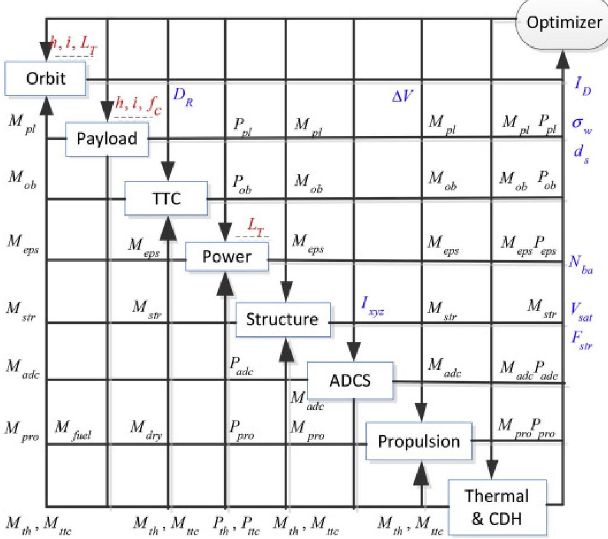

Download: Download high-res image (458KB)

Download: Download full-size image

Fig.1. Extended design structure matrix of micro/nano-satellite system design.

## 3. Discipline models

This section briefly presents the disciplines for which models of Moon imaging micro/nano-satellite design need to be considered. The structure, thermal, ADCS, and CDH are assumed to be simplified and inherited from the existing models and the area of solar arrays for the power subsystem can also be deduced, referred to in Refs. [16], [17], [18], [19]]. As orbit, payload, propulsion, and communication largely affect the Moon imaging mission in conceptual design, their disciplinary models and uncertainties regarding this particular application are mainly discussed.

## 3.1. Orbit

To ensure the velocity increment $ \Delta V $ ability of the satellite flying to the Moon, a low thrust transfer using reformulated Edelbaum approach [17,20] is employed in the conceptual design of propulsion subsystem. No excess $ \Delta V $ is granted by the launch vehicle or deployment

<!-- PDF_PAGE: 6 -->

mechanism. The key relevant expressions are as follows:

$$
\Delta V = V _ {0} \cos \beta_ {0} - \frac {V _ {0} \sin \beta_ {0}}{\tan \left(\frac {\pi}{2} \Delta i + \beta_ {0}\right)},
$$

$$
\tan \beta_ {0} = \frac {\sin \left(\frac {\pi}{2} \Delta i\right)}{\frac {V _ {0}}{V _ {1}} - \cos \left(\frac {\pi}{2} \Delta i\right)}
$$

$$
V _ {0} = \sqrt {\frac {\mu_ {e a r t h}}{R _ {e} + h _ {0}}}, V _ {f} = \sqrt {\frac {\mu_ {e a r t h}}{R _ {e} + h _ {f}}}
$$

where $ \beta_{0} $ is the yaw angle of initial thrust vector, $ V_{0} $ and $ V_{f} $ are the speed of the initial and final circular orbit, $ \Delta i $ is the orbital inclination change, $ h_{0} $ and $ h_{f} $ are the altitude of initial and final orbit, respectively. $ R_{e} $ is the average Earth radius and $ \mu_{earth}=3.986\times10^{14}m^{3}/s^{2}. $ $ \Delta V $ plays a vital role in the computation of satellite mission cycle and propellant mass.

The total transfer time can be approximately derived as $ L_{Tt}=\Delta V/a_{T} $ , here $ a_{T} $ is the thrust acceleration.

$$
\beta (t) = \tan^ {- 1} \left(\frac {V _ {0} \sin \beta_ {0}}{V _ {0} \cos \beta_ {0} - a _ {T} t}\right)
$$

$$
V (t) = \sqrt {V _ {0} ^ {2} - 2 V _ {0} \cos \beta_ {0} a _ {t} t + a _ {t} ^ {2} t ^ {2}}
$$

$$
\Delta i (t) = \frac {2}{\pi} \left[ \tan^ {- 1} \left(\frac {V _ {0} \cos \beta_ {0} - a _ {T} t}{V _ {0} \sin \beta_ {0}}\right) + \frac {\pi}{2} - \beta_ {0} \right]
$$

where $ \beta(t), V(t) $ , and $ \Delta i(t) $ represent thrust azimuth, speed velocity, and orbital inclination change, respectively. The stable low thrust transfer is feasible. Furthermore, Edelbaum theory can be extended to consider shadows and perturbation influence, and the required $ \Delta V $ is basically the same due to the continuous transfer with low thrust.

## 3.2. Payload

The payload design should balance mission requirements and satellite characteristics. To obtain three-dimensional imaging information, the lunar micro/nano-satellite needs to

<!-- PDF_PAGE: 7 -->

satisfy the following coverage constraint:

$$
\sigma_ {w} = \frac {S _ {w} - \Delta \lambda}{S _ {w}} \geq \sigma_ {w 0}
$$

$$
S _ {w} = 2 R _ {L} \left\{\sin^ {- 1} \left[ \left(h _ {f} + R _ {L}\right) \sin \omega_ {x} / R _ {L} \right] - \omega_ {x} \right\} / \sin i
$$

where $ \sigma_{w} $ is the overlapping coverage rate, $ S_{w} $ is the coverage area of charge coupled device (CCD) camera, $ \Delta\lambda $ is the sub-satellite track movement of longitude per orbit, $ \Delta\lambda=\Delta\lambda_{w}=\omega_{L} T_{p} $ if the global coverage cycle equals the Moon's rotation, here $ \omega_{L} $ is the rotation angular velocity and $ T_{p} $ is the orbital period. Fig. 2 describes a two-dimensional surface coverage diagram of lunar orbiting satellite, in which the point S represents the satellite and $ O_{L} $ is the center of the Moon. The half field angle of CCD array is $ \omega_{x}=\tan^{-1}\left(\mu_{0}\sqrt{N_{c}^{2}+N_{p}^{2}}/2 f_{c}\right) $ , here $ \mu_{0} $ is the pixel size, and $ N_{c} $ and $ N_{p} $ are the pixel number along the flight direction and normal to the orbit plane, respectively.

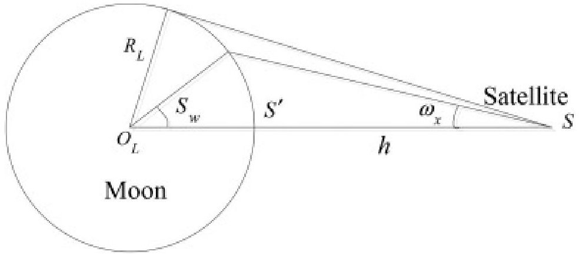

Download: Download high-res image (86KB)

Download: Download full-size image

Fig. 2. Surface coverage diagram of lunar orbiting satellite.

The total amount of attainable imaging information is defined as the whole data of lunar surface obtained by the satellite during its mission cycle:

$$
I _ {D} = D _ {R} T _ {w} \frac {3 6 5 L _ {T w}}{M}
$$

where $ L_{Tw}=L_{T}-L_{Tt} $ is life cycle of orbiting the Moon, constituting the whole mission cycle with $ L_{Tt}. $ $ T_{w} $ is the working period of CCD camera for each coverage period M. The total payload data rate $ D_{R} $ is

$$
D _ {R} = 2 \omega_ {x} V _ {N} \frac {h _ {f} \cdot s \cdot b _ {i t}}{d _ {\mathrm {s}} ^ {2} q}
$$

<!-- PDF_PAGE: 8 -->

where $ V_{N}=2 \pi R_{L} / T_{p} $ is the velocity of lunar surface track, s is the sample number per pixel, $ b_{it} $ is the bits for each sample, q stands for the frame rate, and $ d_{s}=\mu_{0} h_{f} / f_{c} $ is the observation resolution. A corresponding payload model can be determined and other technical specifications are therefore obtained [16,21].

## 3.3. Propulsion

The propulsion design largely affects the value of $ \Delta V $ and the mission durability. Compared with chemical propulsion, solar electric propulsion (SEP) is preferable for a high $ \Delta V $ with long mission requirement and can be miniaturized with high propulsion efficiency, like miniature xenon ion (MiXI) thruster [22,23]. The thrust force is

$$
T = \frac {2 \eta_ {t} P _ {t}}{I _ {s p} g}
$$

where $ \eta_{t} $ is the thruster energy efficiency, g is the acceleration due to the Earth gravity and $ P_{t} $ is the input power to the thruster. This determines the propellant mass flow rate

$$
\dot {M} _ {f u e l} = \frac {T}{I _ {s p} g}
$$

$$
t _ {b u r n} = M _ {f u e l} / \dot {M} _ {f u e l}
$$

where $ t_{burn} $ is the maximum mission duration. The $ \Delta V $ provided by the thruster can be estimated as

$$
\Delta V = I _ {s p} g \ln \left(\frac {M _ {d r y} + M _ {f u e l}}{M _ {d r y}}\right)
$$

$$
M _ {f u e l} = M _ {d r y} \left(e ^ {\Delta V / I _ {s p} g} - 1\right)
$$

where $ M_{fuel} $ is the propellant mass and $ M_{dry} $ is the satellite mass excluding the propellant. In the practical use, an additional margin of 10%-20% is often considered for the propellant.

## 3.4. Communication

The communication subsystem often contains transponders and antennas. The long distance between the Moon and the Earth ( $ \sim 3 8 4, 0 0 0 $ km) challenges this weight/size/power constrained micro/nano-satellite, so communication is regarded as a crucial discipline. The

<!-- PDF_PAGE: 9 -->

link equation for transmission is

$$
f _ {b} = \frac {P _ {t} L _ {l} G _ {t} L _ {s} L _ {a} G _ {r}}{k T _ {s} \left(E _ {b} / N _ {0}\right)}
$$

The total data downloaded is computed by integrating $ f_{b} $ over time. A communication margin $ f_{ar} $ is added and Eq. (16) can be expressed in dB form:

$$
\begin{array}{l} 1 0 \log P _ {t} = 1 0 \log \left(\frac {E _ {b}}{N _ {0}}\right) + 1 0 \log k + 1 0 \log f _ {b} + 1 0 \log f _ {a r} - 1 0 \log G _ {t} \\ - 1 0 \log L _ {l} - 1 0 \log L _ {s} - 1 0 \log L _ {a} - 1 0 \log \left(\frac {G _ {r}}{T _ {s}}\right) \\ \end{array}
$$

where $ P_{t} $ is the transmitting power, $ E_{b} / N_{0} $ is the normalized signal-to-noise ratio (SNR), k is the Boltzmann constant, $ f_{b} $ is the data rate $ D_{R} $ $ G_{t} $ is the transmitter gain, $ G_{r} $ is the constant receiver gain, $ L_{l} $ is a line loss factor, $ L_{a} $ is transmission $ \rightharpoonup $ path $ \rightharpoonup $ loss $ \rightharpoonup $ and polarization $ \rightharpoonup $ loss $ \rightharpoonup $ , and $ T_{s} $ is the system noise temperature. $ L_{s} $ is a free space loss, expressed as

$$
L _ {s} = \left(\frac {c}{4 \pi R _ {\varepsilon} f _ {s}}\right) ^ {2}
$$

where $ f_{s} $ is the frequency and c is the light speed. $ R_{\varepsilon} $ is the maximum slope distance from the satellite to the ground station, which is related to the altitude of lunar orbit.

The communication power is therefore correlated with the communication frequency, lunar orbit altitude, and payload data. It is noted that the practical power consumption required is $ P_{tr}=2 P_{t}. $

## 4. RBRDO approach

This section is to study a systematic approach to achieve the reliable and robust design optimization of Moon imaging micro/nano-satellites. As interdisciplinary couplings and high-dimensional inputs exist in this satellite design optimization problem, uncertainty quantification and optimization require much more model evaluations. As shown in Fig. 3, a dynamic response surface is constructed in the active subspace with reduced dimension and a multiobjective alliance algorithm (MOAA) based on adaptive penalty function is presented for Pareto-optimal (PO) solution search.

<!-- PDF_PAGE: 10 -->

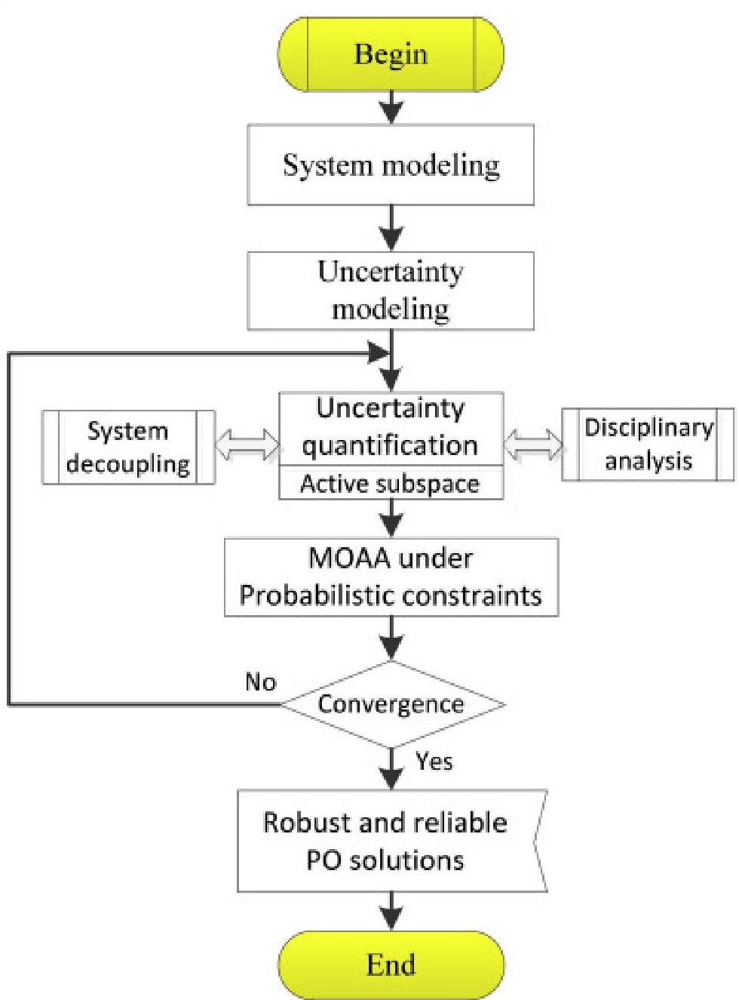

Download: Download high-res image (267KB)

Download: Download full-size image

Fig. 3. Schematic diagram of RBRDO workflow.

## 4.1. Active subspace for dimension reduction

Within the optimization cycle, uncertainty quantification for high numbers of dimensions is usually challenging, requiring an exponential increase in the number of expensive model simulations. Active subspaces can be an effective strategy of dimension reduction [24], constituted by the eigenvectors of a symmetric and positive semidefinite matrix whose elements are the average products of partial derivatives of the objective interest. If a dominant active subspace exists, the resulting active variable [25] can be reduced coordinates for equivalent propagation analysis. The average derivative of $ \mathrm{w}_{1} $ is

<!-- PDF_PAGE: 11 -->

$$
C = \int_ {\mathbf {X}} \left(\nabla_ {\mathbf {X}} f\right) \left(\nabla_ {\mathbf {X}} f\right) ^ {T} \rho d \mathbf {x} = \mathbf {w} \Lambda \mathbf {w} ^ {T}
$$

$$
\mathbf {w} = \left[ \mathbf {w} _ {1} \mathbf {w} _ {2} \right] \Lambda = \left[ \begin{array}{c c} \Lambda_ {1} & \\ & \Lambda_ {2} \end{array} \right]
$$

where C is symmetric and positive semidefinite, $ \varLambda=diag\left(\lambda_{1},\cdots,\lambda_{m}\right),\lambda_{1}\geq\cdots\geq\lambda_{m}\geq0 $ is a matrix of eigenvalues, and $ \rho $ is the sampling density. $ \varLambda_{1} $ contains l comparatively larger eigenvalues and $ \mathbf{w}_{1} $ includes the first l eigenvectors. $ \mathbf{w}_{1}^{T}\mathbf{x} $ is the reduced coordinate y, i.e. the active variable. The mean-squared gradients of $ \mathbf{w}_{1} $ with respect to y is given by the following lemma [24]:

$$
\begin{array}{l} \int_ {\mathbf {X}} \left(\nabla_ {\mathrm {y}} f\right) ^ {T} \left(\nabla_ {\mathrm {y}} f\right) \rho d \mathbf {x} = \int_ {\mathbf {X}} \operatorname {t r a c e} \left(\left(\nabla_ {\mathrm {y}} f\right) \left(\nabla_ {\mathrm {y}} f\right) ^ {T}\right) \rho d \mathbf {x} \\ = \operatorname {t r a c e} \left(\mathbf {w} _ {1} ^ {T} C \mathbf {w} _ {1}\right) = \lambda_ {1} + \lambda_ {2} + \dots + \lambda_ {l} \\ \end{array}
$$

Consider an extreme situation where all eigenvalues are zero except $ \lambda_{1} $ , then $ \mathbf{w}_{1} $ would be expressed by a univariate function $ g \left( \mathbf{w}_{1}^{T} \mathbf{x} \right) $ where $ \mathbf{w}_{1} $ is the first column of w. In practical use, the smaller ones of ranked eigenvalues are not precisely zero, but they may be so much smaller that $ f\left( \mathbf{x} \right) $ can be well approximated by a function of $ l<n+m $ dimensions. If the above subspace is admitted, certain surrogate models, like response surfaces, can be performed in the l-dimensional space instead of all uncertainty dimensions at much less cost.

The matrix C must be computed to identify the active subspace. For time-consuming simulation-based design, Eq. (19) is difficult to compute and an alternative way is to use finite difference approximations for the eigenvalues, like

$$
C \approx \widehat {C} = \frac {1}{M} \sum_ {j = 1} ^ {M} \nabla_ {\mathrm {X}} f \left(\mathbf {x} _ {j}\right) \nabla_ {\mathrm {X}} f \left(\mathbf {x} _ {j}\right) ^ {T} = \widehat {\mathrm {w}} \widehat {\Lambda} \widehat {\mathrm {w}} ^ {T}
$$

where M is the number of samples. The eigenvalue decay of $ \widehat{C} $ is employed as evidence of an active subspace. Specifically, a large gap between the eigenvalues indicates a separation between the corresponding active and inactive subspace defined by $ \widehat{\mathrm{w}}_{1} $ and $ \widehat{\mathrm{w}}_{2} $ , respectively. Thus, if an active subspace is discovered for the output of a physical model, surrogate construction and uncertainty propagation can focus on the active variable more efficiently, which overcomes the dimensionality curse of random variables in the system design optimization.

<!-- PDF_PAGE: 12 -->

Checking the error of estimated subspace is necessary for dimension reduction of high confidence. However, the convergence of subspace coefficients is impracticable due to a limited budget of system design procedures. Instead, a nonparametric bootstrap method [26] is employed to explore the variability of subspace error with the following distance metric:

$$
e _ {i} ^ {*} = d i s t \left(\widehat {\mathbf {W}} _ {1}, \widehat {\mathbf {W}} _ {i, 1} ^ {*}\right) = \left\| \widehat {\mathbf {W}} _ {1} \widehat {\mathbf {W}} _ {1} ^ {T} - \widehat {\mathbf {W}} _ {i, 1} ^ {*} \widehat {\mathbf {W}} _ {i, 1} ^ {*} ^ {T} \right\| = \left\| \widehat {\mathbf {W}} _ {1} ^ {T} \widehat {\mathbf {W}} _ {i, 2} ^ {*} \right\|,
$$

where $ e_{i}^{*} $ is the i th bootstrap estimate error, and $ \widehat{\mathbf{W}}_{i,1}^{*} $ and $ \widehat{\mathbf{W}}_{i,2}^{*} $ are the i th bootstrap eigenvectors for active and inactive subspaces, respectively. The bootstrap estimates may be biased, but the deviation decreases as the number of samples increases, which can be employed as the indication of dimension reduction accuracy.

## 4.2. Dynamic response surface

A cheaper surrogate based on a few chosen runs is often built for approximating the response PDF. Response surface approximation is common in uncertainty quantification, including well-known polynomial approximations [27]; but these established methods are limited to the f(x) of fixed design points and few studies have addressed the issues associated with uncertain design points, i.e. design variable uncertainty. The number of reduced dimensionality may differ for each design when the active subspace is identified, which makes the response surface construction quite complex. This section presents a dynamic multivariate polynomial regression (DMPR) for fitting the response surface.

A reduced dimension is confirmed for each design point based on Eq. (21) and the corresponding l-dimensional reduced coordinates y are automatically regarded as the active variable. The DMPR is differentiable and also applicable when the response interest is nonlinear, i.e., the scatter plot gives a non-linear or curvilinear structure [28]. A general equation for quadratic response surface is

$$
f ^ {(p)} = \beta_ {0} + \sum_ {1 \leq j \leq l} \beta_ {j} y _ {j} ^ {(p)} + \sum_ {1 \leq j \leq k \leq l} \beta_ {l - 1 + j + k} y _ {j} ^ {(p)} y _ {k} ^ {(p)}
$$

where $ \beta $ is the DMPR coefficient matrix including $ \beta_{0},\beta_{j} $ , and $ \beta_{l-1+j+k},f^{(p)} $ is the pth sample of system response $ ( p=1,\dots,M) $ $ y_{j}^{(p)} $ and $ y_{k}^{(p)} $ are the corresponding active variables of the pth sample.

$$
f ^ {(p)} = \beta^ {T} \mathbf {y} ^ {(p)}
$$

<!-- PDF_PAGE: 13 -->

$$
\beta^ {T} = \left[ \beta_ {0}, \beta_ {1}, \dots , \beta_ {l}, \dots , \beta_ {n _ {l} - 1} \right]
$$

$$
\left(\mathbf {y} ^ {(p)}\right) ^ {T} = \left[ 1, y _ {1} ^ {(p)}, \dots , y _ {l} ^ {(p)}, y _ {1} ^ {(p)} y _ {2} ^ {(p)}, \dots , \left(y _ {l} ^ {(p)}\right) ^ {2} \right]
$$

where $ n_{l}=(l+1)(l+2)/2. $

$$
\mathbf {f} = \mathbf {Y} \beta
$$

$$
\mathbf {Y} ^ {T} = \left[ \mathbf {y} ^ {(1)}, \mathbf {y} ^ {(2)}, \dots , \mathbf {y} ^ {(M)} \right]
$$

$$
\mathbf {f} ^ {T} = \left[ f ^ {(1)}, \dots , f ^ {(p)}, \dots , f ^ {(M)} \right]
$$

In the DMPR, the solution of $ \beta $ is obtained by Least Square Method (LSM) and validated by leave-one-out cross validation (LOOCV) for every design. As the reduced coordinates y are normalized, the terms or degrees of DMPR can be adjusted by setting a coefficient threshold to determine which terms or degrees are retained in the polynomial. The estimated system response is

$$
\hat {f} ^ {(p)} = \widehat {\beta} ^ {T} \mathbf {y} ^ {(p)}
$$

$$
\widehat {\beta} = \left(\mathbf {Y} ^ {T} \mathbf {Y}\right) ^ {- 1} \mathbf {Y} ^ {T} \mathbf {f}
$$

Furthermore, cross validation can evaluate the prediction accuracy by withholding part of the data for training the surrogate model and then testing the resulting model on the withheld data. LOOCV is particularly useful [29] when the dataset is comparatively small due to the expense of simulations. A multi-criteria assessment using Mean Absolute Error (MAE) and Standard Deviation of Error (SDE) is incorporated for goodness-of-fit statistics. The formulae of MAE and SDE are as follows:

<!-- PDF_PAGE: 14 -->

$$
M A E = E _ {\varepsilon} = \frac {1}{M} \sum_ {p = 1} ^ {M} \left| f ^ {(p)} - \hat {f} ^ {(p)} \right|
$$

$$
S D E = \sigma_ {\varepsilon} = \sqrt {\frac {1}{M} \sum_ {p = 1} ^ {M} \left(\left| f ^ {(p)} - \hat {f} ^ {(p)} \right| - E _ {\varepsilon}\right) ^ {2}}
$$

## 4.3. System decoupling strategy

A significant difficulty encountered in multidisciplinary optimization under uncertainty is computationally expensive, since the process is iterative, multiplying the cost of multidisciplinary system analysis (MDA). In a multidisciplinary context, the problem is expanded to include u (x), which should satisfy the multidisciplinary compatibility requirements written in the form

$$
A _ {k} (\mathbf {x}, u (\mathbf {x})) = 0
$$

where $ A_{k} $ represents the required relation associated with the kth discipline.

The multidisciplinary feasible (MDF) method [30] is a direct approach to this problem through variable reduction. However, the computational cost is expensive, since u (x) must be solved for every iteration. Disciplinary analysis conducted in parallel is regarded as an effective method to reduce the overall cost and the uncertainty propagation can be efficiently achieved by employing already built single-disciplinary methods.

Coupling variables in the multidisciplinary analysis are influenced by the input uncertainties. A partial first-order second moment (PFOSM), borrowing from Individual Discipline Feasible (IDF), is proposed to achieve parallel propagation. As shown in Fig. 4, $ \mu_{u} $ and $ \sigma_{u} $ are derived for the coupling variables in satellite system design. They then become ordinary random variables and propagate together with input uncertainties in respective disciplinary analysis modules.

$$
\mu_ {u} \approx u \left(\mu_ {\mathrm {x}}\right)
$$

$$
\sigma_ {u} ^ {2} \approx \sum_ {i = 1} ^ {m} \left(\frac {\partial u}{\partial x _ {i}}\right) ^ {2} \sigma_ {x _ {i}} ^ {2}
$$

where $ \mu_{u} $ and $ \sigma_{u} $ are the mean value and standard deviation of coupling variables,

<!-- PDF_PAGE: 15 -->

respectively. $ \partial u / \partial x_{i} $ is the gradient, $ \sigma_{x_{i}}^{2} $ is the variance of inputs, and n is the number of components in x.

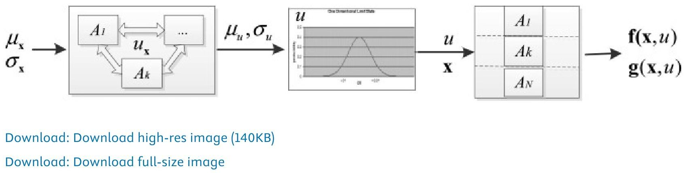

Fig. 4. Decoupled formation based on PFOSM.

This strategy avoids the in-loop convergence for system compatibility and results in a significant computational saving. In contrast to the direct FOSM [31], PFOSM, with more accurate probabilistic analysis, allows non-linearity in the response function and non-normal behavior of input variables. Moreover, the system decoupling using PFOSM ensures high efficiency of the solving process.

## 4.4. Multiobjective alliance algorithm based on adaptive penalty function

Alliance algorithm is an evolutionary-based metaheuristic optimization algorithm [32] based on a number of tribes struggling to conquer a space that offers resources that enable them to survive. Tribes try to improve survival skills via forming alliances. A MOAA workflow is generally shown in Fig. 5, in which the two main search elements of the algorithm are the formation of alliances and the creation of new tribes. One MOAA cycle ends when the strongest possible alliances of existing tribes have been created. The algorithm then begins a new cycle starting with new tribes whose creation is determined by the previous strongest alliances. The MOAA has been successfully applied to the optimization of satellite constellation refueling [33], benchmark aerodynamic optimization problem [34], etc.

<!-- PDF_PAGE: 16 -->

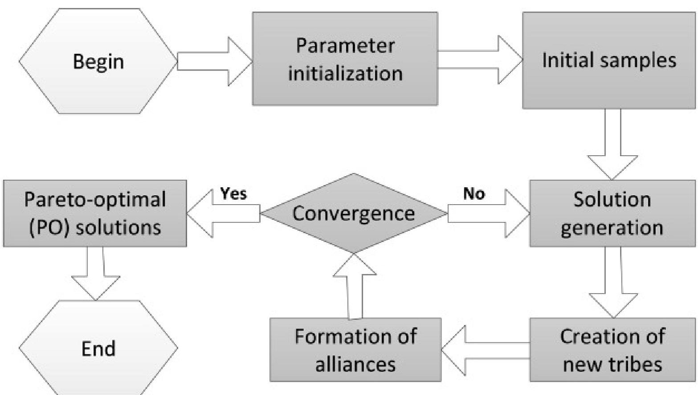

Download: Download high-res image (266KB)

Download: Download full-size image

Fig. 5. Schematic diagram of MOAA workflow.

Previous alliance algorithms usually regard the constraints as a set of resource demands, which has low efficiency of tackling multiple probabilistic constraints. This paper revises the MOAA with an adaptive fitness function. For the problem of micro/nano-satellite design optimization, a tribe t is a tuple $ [\mathbf{x}_{t},\mathbf{s}_{t},\mathbf{e}_{t} ] $ , composed of a design point $ \mathbf{x}_{t} $ in the solution space, a set of skills $ \mathbf{s}_{t} $ , and an alliance vector $ \mathbf{e}_{t} $ . The set of skills depends on the f and g, which is formulated as

$$
s _ {t, i} = f _ {i} \left(\mathbf {x} _ {t}\right), i = 1, 2, \dots , N
$$

$$
\operatorname {f i t n e s s} \left(\mathbf {x} _ {t}\right) = \tilde {f} _ {i} = f _ {i} \cdot 1 0 ^ {\hat {}} \sum_ {j = 1} ^ {K} k _ {j} \left(\mathbf {x} _ {t}\right) v _ {j} \left(\mathbf {x} _ {t}\right), j = 1, \dots , K
$$

where N and K are the number of objectives and constraints, respectively. The punishment factor is $ k_{j} \left( \mathbf{x} \right)=1 0^{a_{j} / M} $ and the constraint violation degree is set as

$ v_{j} \left( \mathbf{x} \right)=\max \left\{0, \eta_{j}-\Pr \left\{g_{j} \left( \mathbf{x} \right)\leq0\right\} \right\} $ a $ _{j} $ is the number of violations with respect to the jth constraint and $ \eta_{j} $ is the required reliability. This adaptive penalty function aggregates all multiple constraints into a single criterion, providing a preferable fitness to reflect the tribe skills.

<!-- PDF_PAGE: 17 -->

The algorithm steps can be performed adaptively. In the first cycle of MOAA, the tribes, i.e. design solutions, are chosen randomly with a uniform distribution. In subsequent cycles, new tribes are sampled from a Gaussian distribution with defined mean and an adaptive standard deviation as follows.

$$
\begin{array}{l} \mathrm {i f} p _ {1} \leq P _ {1}: \mathbf {x} _ {t} = \mathbf {b} _ {r} \\ \mathrm {i f} p _ {1} > P _ {1} \cap p _ {2} \leq P _ {2}: x _ {t, j} = G \left(b _ {r, j}, \sigma\right), \\ \mathrm {i f} p _ {1} > P _ {1} \cap p _ {2} > P _ {2}: x _ {t, j} = b _ {r, j} \\ \end{array}
$$

where $ p_{1} $ and $ p_{2} $ are the random variables between 0 and 1, $ P_{1} $ and $ P_{2} $ are the probabilistic factors between 0 and 1, r is a random integer between 1 and $ N_{P}, N_{P} $ is the number of PO solutions; $ b_{r,j} $ is the jth variable of the rth PO solution. This cycle is repeated until all tribes are generated.

In the formation of alliances, $ \mathbf{x}_{a} $ is consisted of components drawn from the tribes within the alliance. Each component has a $ 1 / N_{a} $ probability if an alliance of $ N_{a} $ tribes are given. This part is similar to the uniform crossover used in the genetic algorithm (GA) and evolution strategy (ES) [35], but the number of tribes involved in the creation of an alliance is not fixed. Other tribes can join once the alliance is formed. By introducing an additional probability $ P_{3} $ , the component is modified as

$$
\left\{ \begin{array}{l} \mathrm {i f} p _ {3} \leq P _ {3}: x _ {a, j} = G \left(x _ {c, j}, \sigma_ {j}\right) \\ \mathrm {i f} p _ {3} > P _ {3}: x _ {a, j} = x _ {c, j} \end{array} \right.,
$$

where $ c=U_{d}\left(1,N_{a}\right) $ is the discrete uniform distribution and $ x_{c,j} $ is the jth component of the selected tribe. All components of an alliance are defined through this modification.

A new alliance will only be confirmed if $ \mathbf{x}_{a} $ is all individually better than or at least as good as $ \mathbf{x}_{t} $ , i.e. the nondominated point. Through the interaction, many alliances are formed but only the strongest one will conquer the environment. The tribes in this strongest alliance correspond as the best solutions to the problem obtained so far, which are used as the input for another MOAA cycle or the final result if the algorithm ends. The maximum number $ \mu_{f_{\mathrm{x}}} $ is set to control the archive of PO solutions and the algorithm control parameters recommended are given in Table 1. This MOAA not only solves the selection of constraint punishment, but also keeps the benefits of alliance algorithm and extends its applicability.

<!-- PDF_PAGE: 18 -->

<table border="1"><tr><td>Parameter</td><td>Value</td></tr><tr><td>Probability1 for tribe creation($\lambda_{5}$)</td><td>0.5</td></tr><tr><td>Probability2 for tribe creation($P_{2}$)</td><td>0.2</td></tr><tr><td>Initial standard deviation($\sigma_{ini}$)</td><td>0.3</td></tr><tr><td>Final standard deviation($\sigma_{end}$)</td><td>0.001</td></tr><tr><td>Std for alliance creation($\sigma_{a}$)</td><td>0.1</td></tr><tr><td>Maximum PO solutions($\mu_{fx}$)</td><td>100</td></tr><tr><td>Factor for neighborhood evaluation</td><td>10</td></tr></table>

## 5. Application to a Moon imaging nano-satellite

## 5.1. Optimization formulation

A lunar imaging nano-satellite based on a 3U CubeSat frame is exemplified here. As mentioned in Section 2, the optimization target includes payload cost-effective ratio and satellite mass, and the system reliability and surface resolution are considered as the constraints. Through the problem uncertainty propagation, density distributions of these optimization targets and constraints, including mean values and standard deviations, can be obtained by kernel density estimate (KDE) [36], respectively.

The overall mathematical formulation of RBRDO is

$$
\left\{ \begin{array}{l l} \mathrm {f i n d} & \mu_ {d} = \left[ \mu_ {h} \quad \mu_ {i} \quad \mu_ {f _ {c}} \quad \mu_ {L _ {T}} \right] \\ \mathrm {m i n} & \mu_ {f _ {C - I}}, \mu_ {M _ {s a t}}, \sigma_ {f _ {C - I}} \\ & \mu_ {f _ {C - I}} = \int f _ {C - I} s _ {d} \left(f _ {C - I}\right) \mathrm {d} f _ {C - I}, \mu_ {M _ {s a t}} = \int M _ {s a t} s _ {d} \left(M _ {s a t}\right) \mathrm {d} M _ {s a t} \\ & \sigma_ {f _ {C - I}} = \sqrt {\int f _ {C - I} ^ {2} s _ {d} \left(f _ {C - I}\right) \mathrm {d} f _ {C - I} - \mu_ {f _ {C - I}} ^ {2}} \\ \mathrm {s . t .} & g _ {1}: \Pr \left\{d _ {s} \leq 3 0 \mathrm {m} \right\} \geq 0. 9 9 \\ & g _ {2}: \Pr \left\{\sigma_ {w} \geq 0. 1 \right\} \geq 0. 9 9 \\ & g _ {3}: \Pr \left\{N _ {B a} \leq 1 0, 0 0 0 \right\} \geq 0. 9 9 \\ & g _ {4}: \Pr \left\{V _ {s a t} \leq 3 \mathrm {U} \right\} \geq 0. 9 9 \\ & g _ {5}: \Pr \left\{F _ {s t r} \geq 1 \right\} \geq 0. 9 9 \\ & 2 0 0 \mathrm {k m} \leq \mu_ {h} \leq 6 0 0 \mathrm {k m}, 8 0 ^ {\circ} \leq \mu_ {i} \leq 9 0 ^ {\circ} \\ & 2 0 \mathrm {m m} \leq \mu_ {f _ {c}} \leq 2 0 0 \mathrm {m m}, 2 \mathrm {y e a r} \leq \mu_ {L _ {T}} \leq 6 \mathrm {y e a r} \end{array} \right.
$$

where $ s_{d} \left( \cdot \right) $ is the density distribution of the optimization target estimated by KDE. Satellite mass $ M_{sat} $ is the sum of all disciplinary subsystems, which should be minimized. Another

<!-- PDF_PAGE: 19 -->

optimization target required to be minimum is the cost-effective ratio $ f_{C-I}=C_{sat}/I_{D} $ , here $ C_{sat} $ employs the common Demonstration Satellite Cost Model (DSCM) [37]. The constraints include surface resolution $ d_{s} $ , overlapping coverage rate $ \sigma_{w} $ , battery cycles $ N_{Ba} $ , installation volume $ V_{sat} $ , and safety index of structure reliability $ F_{str} $ . The inequality constraint functions define the boundaries between feasible and unfeasible domains corresponding to violation of constraints. It requires that $ \operatorname* {Pr}\{\cdot \} $ through distribution measurement should be more than or at least equal to the reliability level 99%.

The uncertainties involved are roughly divided into two kinds: uncertain design variables d and system uncertainty parameters p. These uncertainties sketched in Table 2 are generally defined according to disciplines, including those associated with orbit, satellite platform, payload, and the representation uncertainty of empirical margins. Their specific distribution domains are in accordance with the design requirements.

Table 2. Uncertainties required to consider in micro/nano-satellite system design.

<table border="1"><tr><td>Discipline</td><td>Parameter</td><td>Sign</td><td>Distribution</td><td>No.</td></tr><tr><td rowspan="2">Orbit</td><td>Lunar orbit altitude(km)</td><td>h</td><td>Normal</td><td>$d_{1}$</td></tr><tr><td>Lunar orbit inclination(deg)</td><td>i</td><td>Normal</td><td>$d_{2}$</td></tr><tr><td>Payload</td><td>CCD Focus length(mm)</td><td>$f_{c}$</td><td>Normal</td><td>$d_{3}$</td></tr><tr><td>Multiple</td><td>Mission cycle(year)</td><td>$T_{life}$</td><td>Interval</td><td>$d_{4}$</td></tr><tr><td rowspan="3">Propulsion</td><td>Efficiency</td><td>$\eta_{t}$</td><td>Normal</td><td>$p_{1}$</td></tr><tr><td>Input power(kW)</td><td>$P_{t}$</td><td>Normal</td><td>$p_{2}$</td></tr><tr><td>specific impulse(s)</td><td>$I_{sp}$</td><td>Normal</td><td>$p_{3}$</td></tr><tr><td rowspan="3">Power</td><td>Solar energy-conversion efficiency</td><td>$\eta_{a}$</td><td>Normal</td><td>$p_{4}$</td></tr><tr><td>Array energy-mass density(W·h/kg)</td><td>$\gamma_{a}$</td><td>Normal</td><td>$p_{5}$</td></tr><tr><td>Average discharge depth</td><td>DOD</td><td>Normal</td><td>$p_{6}$</td></tr><tr><td rowspan="2">Multiple</td><td>System mass margin</td><td>$\varepsilon_{m}$</td><td>Interval</td><td>$p_{7}$</td></tr><tr><td>System power margin</td><td>$\varepsilon_{p}$</td><td>Interval</td><td>$p_{8}$</td></tr></table>

## 5.2. In-loop uncertainty quantification

This section illustrates the uncertainty quantification process with active subspaces and dynamic response surface, which is the crucial in-loop for uncertainty-based design optimization. Different sets of design variables can be generated to check if a low-dimensional active subspace exists for the 12-dimensional uncertainty space. 100 randomly

<!-- PDF_PAGE: 20 -->

selected set of design variables are applied with active subspaces and surrogate model construction. The first 3 larger eigenvalues are shown in Fig. 6. Though some perturbation effect exists with the change of design variables, each set still has a comparatively dominant one-dimensional active subspace.

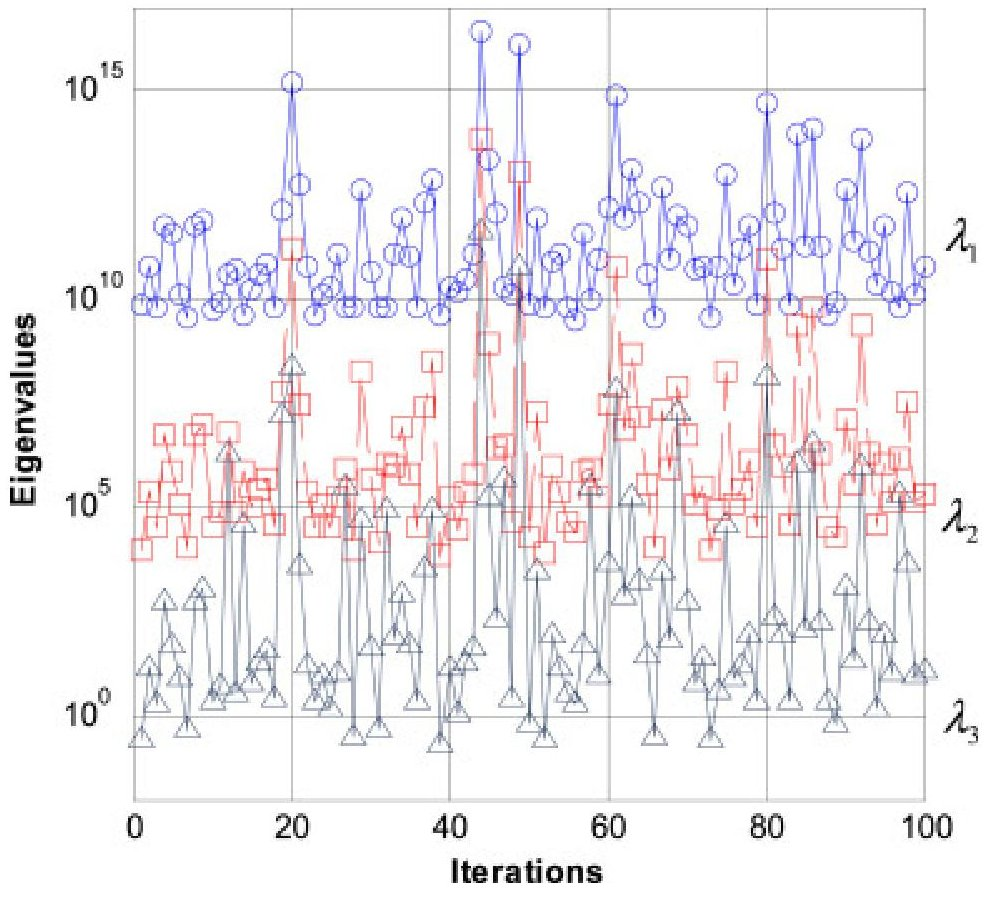

Download: Download high-res image (683KB)

Download: Download full-size image

Fig. 6. Sorted eigenvalues for cost per unit under 12-dimensional uncertainties.

20 physics-based simulation points for identifying the active subspace and the Monte Carlo validation are shown in Fig. 7, which indicates that a one-dimensional DMPR is obtained for uncertainty propagation. This dynamic response surface has a good accuracy, since 100 Monte Carlo samples are consistent with it. Moreover, 2000 simulations are conducted based on the response surface and physics-based models, respectively, of which the expected values are shown in Fig. 7(b). The proposed approach has just about 1.6% error and more importantly improves the efficiency by two orders of magnitude. Significance analysis and LOOCV also evaluate and verify the quantification accuracy, as displayed in Table 3. Thus, this in-loop uncertainty quantification can be effectively incorporated in the optimization process.

<!-- PDF_PAGE: 21 -->

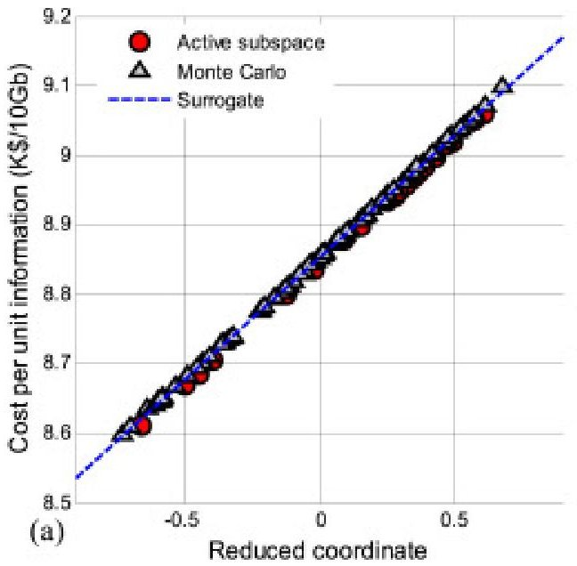

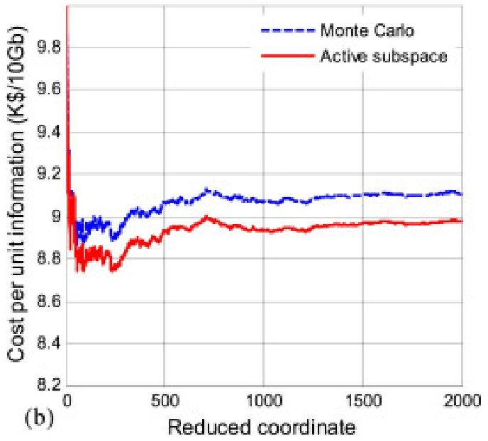

Download: Download high-res image (300KB)

Download: Download full-size image

Fig. 7. Response surface fitting and verification: (a) Scattered fitting samples; (b) Monte Carlo verification.

Table 3. Significance analysis and cross validation result.

<table border="1"><tr><td>Target</td><td>R2adj</td><td>MAE</td><td>SDE</td><td>MAE of LOOCV</td><td>SDE of LOOCV</td></tr><tr><td>fC-I</td><td>0.98</td><td>0.133</td><td>0.118</td><td>0.147</td><td>0.129</td></tr><tr><td>Msat</td><td>0.97</td><td>0.154</td><td>0.111</td><td>0.172</td><td>0.130</td></tr></table>

## 5.3. RBRDO result and discussion

The RBRDO approach is applied to this fragmented and multi-modal optimization problem. 2000 solutions are obtained, in which 1721 ones are feasible as shown in Fig. 8. The mean of satellite mass, and the mean and standard deviation of cost per unit are expressed as the objectives. A series of Pareto-optimal (PO) solutions can be extracted as Fig. 9, which is a smooth and uniformly distributed Pareto front. The trade-off relations among the three objectives are visualized, i.e. negative correlation between the mean of satellite mass and the other two. All PO design solutions are detailed in Fig. 10 by parallel coordinates, which indicates that the orbit altitude gathers around 200km and the mission cycle is around 2.4 years for the optimum design. It is also practically feasible for decision-makers to choose suitable solutions according to different preferences of information cost and satellite mass.

<!-- PDF_PAGE: 22 -->

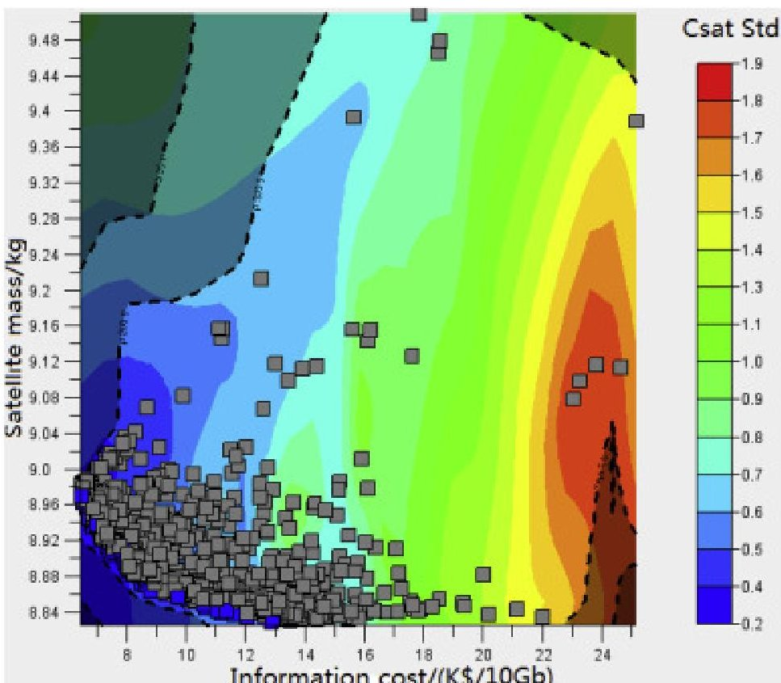

Download: Download high-res image (380KB)

Download: Download full-size image

Fig. 8. All feasible solutions obtained by RBRDO.

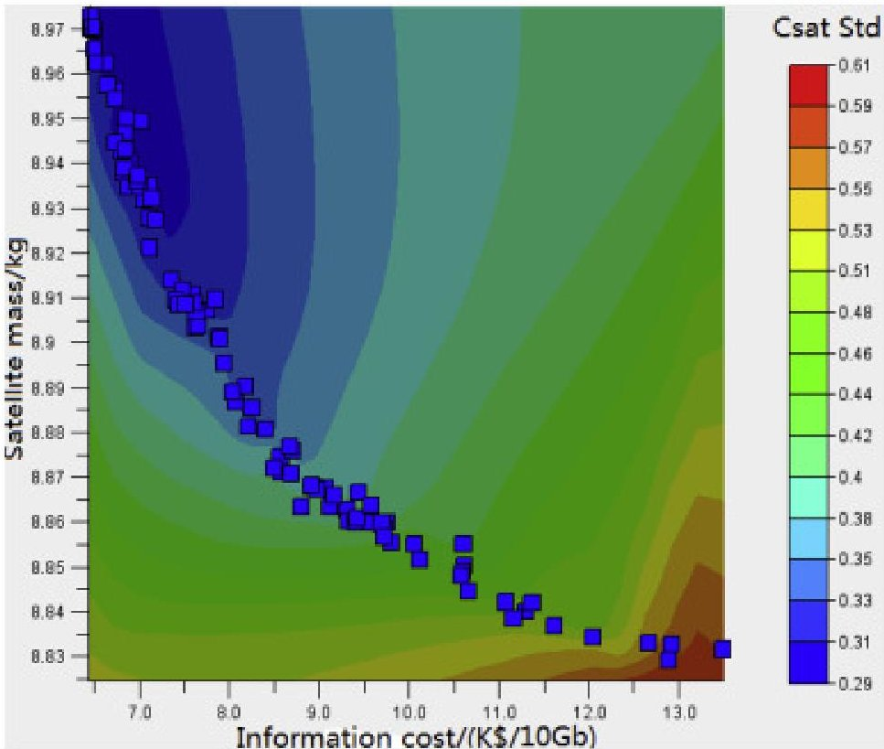

Download: Download high-res image (265KB)

Download: Download full-size image

Fig. 9. Pareto front visualized for the three objectives.

<!-- PDF_PAGE: 23 -->

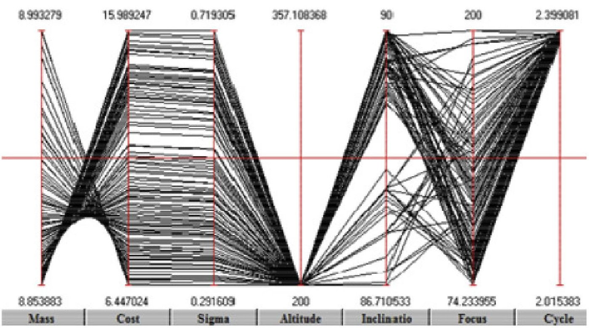

Download: Download high-res image (803KB)

Download: Download full-size image

Fig. 10. PO design solutions shown by parallel coordinates.

Furthermore, the PO solutions obtained through RBRDO are compared with the deterministic MDO, as shown in Fig.11. The distributions of these two Pareto fronts are accordant with the actual situation. Due to the lack of considering uncertainty, the deterministic MDO may make the design easily fall into the shaded area, which is not reliable or robust. Specifically, if the satellite mass is chosen as 8.95kg, a corresponding optimum design is obtained as shown in Table 4. Both RBRDO and the deterministic MDO have the same the orbit altitude, but others are slightly different. As for the probabilistic constraints, only RBRDO can satisfy installation volume and the number of battery cycles. Thus, the RBRDO is preferable for designing Moon imaging micro/nano-satellites of high reliability and robustness.

<!-- PDF_PAGE: 24 -->

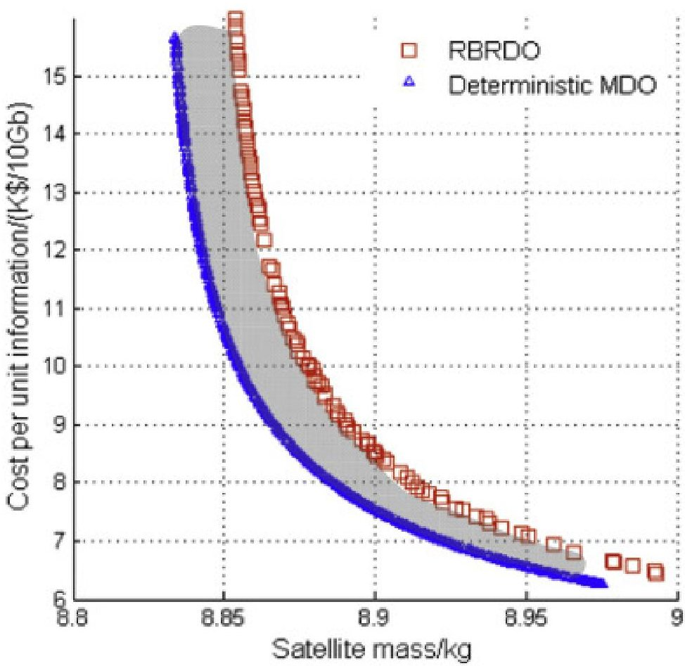

Download: Download high-res image (403KB)

Download: Download full-size image

Fig. 11. PO solution comparison RBRDO vs. deterministic MDO.

Table 4. PO design solution comparison RBRDO vs. deterministic MDO.

<table border="1"><tr><td>Type</td><td>Parameter</td><td>RBRDO</td><td>MDO</td></tr><tr><td rowspan="4">Design variables</td><td>h</td><td>200.0</td><td>200.0</td></tr><tr><td>i</td><td>87.96</td><td>85.10</td></tr><tr><td>fc</td><td>177.2</td><td>184.1</td></tr><tr><td>Tlife</td><td>2.39</td><td>2.43</td></tr><tr><td rowspan="4">Constraints</td><td>ds</td><td>Pr=1</td><td>Pr=1</td></tr><tr><td>Fstr</td><td>Pr=1</td><td>Pr=1</td></tr><tr><td>Vsat</td><td>Pr=1</td><td>Pr=0.89</td></tr><tr><td>NBa</td><td>Pr=1</td><td>Pr=0.35</td></tr><tr><td rowspan="4">Objectives</td><td>$\mu_{C_{sat}}$</td><td>7.17</td><td>6.66</td></tr><tr><td>$\sigma_{C_{sat}}$</td><td>0.258</td><td>0.341</td></tr><tr><td>$\mu_{M_{sat}}$</td><td>8.953</td><td>8.949</td></tr><tr><td>$\sigma_{M_{sat}}$</td><td>0.145</td><td>0.142</td></tr></table>

<!-- PDF_PAGE: 25 -->

## 6. Conclusions

A RBRDO approach including the problem modeling is systematically presented to address the uncertainty-based design optimization of Moon imaging micro/nano-satellites. The mission features are analyzed and the interdisciplinary relations are described. Considering the particularity of lunar micro/nano-satellite missions, discipline models of orbit, payload, propulsion, and communication are mainly established, and others inherit the mature architecture. The RBRDO approach is detailed, involving active subspaces for dimension reduction, dynamic response surface construction, system decoupling, and multi-objective alliance algorithm (MOAA) based on adaptive penalty function, which can solve fragmented and multi-modal optimization problems under high-dimensional uncertainties.

The conceptual design of a Moon imaging nano-satellite is exemplified considering 12 uncertainties of both design variables and system uncertainty parameters. The optimization target includes payload cost-effective ratio and satellite mass, while system reliability and surface resolution are considered as constraints. Through a discovered dominant active subspace, the in-loop uncertainty quantification can be effectively achieved and incorporated in the optimization process. A smooth and uniformly distributed Pareto front is obtained to provide the PO solutions for trade-off objectives, which indicates that the orbit altitude gathers around 200km and the mission cycle is about 2.4 years for the optimum design. Compared with the deterministic MDO, the RBRDO is proved to be preferable for reliable and robust micro/nano-satellite design under uncertainty, exhibiting high effectiveness at considerably less cost.

Future study will focus on a more general formulation of micro/nano-satellite missions to the Moon. Various spacecraft sizes will be investigated, from several kilograms to a larger satellite of approximately 40kg. The scientific payload will be extended to offer more kinds of lunar exploration information and a detailed ADCS subsystem will be considered to ensure the three-axis stabilization during the transfer to Moon and orbiting the Moon. In addition, more uncertain parameters and complex models of this problem will further examine the efficacy of the RBRDO approach.

## Acknowledgments

This work was supported in part by National Nature Science Foundation of China [Grant Nos. 11702305 and 51205403] and China Preresearch Generic Technology [Grant No. 41406030102]. The authors thank the anonymous reviewers for their valuable comments and suggestions in improving this paper.

## References

<!-- PDF_PAGE: 26 -->

[1] R.L. Staehle, D. Blaney, H. Hemmati, M. Lo, P. Mouroulis, P. Pingree, T. Wilson, J. Puig-Suari, A. Williams, B. Betts Interplanetary CubeSats: opening the solar system to a broad community at lower cost CubeSat Developers' Workshop, Logan, UT (2011) Google Scholar

[2] R. Staehle, D. Blaney, H. Hemmati, D. Jones, A. Klesh, P. Liewer, J. Lazio, W.Y. Lo, P. Mouroulis, N. Murphy Interplanetary CubeSat architecture and missions AIAA Space Conference & Exposition, Pasadena, California (2012) Google Scholar $ \rightharpoonup $

[3] A. Phipps, A. da Silva Curiel, M. Meerman, D. Gibbon, M. Sweeting, L. Gomes Low cost lunar orbiter system design Aerospace Conference, 2003. Proceedings. 2003 IEEE, IEEE (2003), pp. 1-237 Google Scholar

[4] O. Kara System-level Optimization Approach for Small Satellite Moon Missions by Using Electric Propulsion and Mission Cost Survey for Turkish Space Economy (2016) Google Scholar

[5] H. Hemmati Laser-communications with lunar CubeSat 2nd International Workshop on Lunar-cubes (2013) Google Scholar

[6] I. Garrickbethell NanoSWARM: a nano-satellite mission to measure particles and fields around the Moon AGU Fall Meeting (2015) Google Scholar

[7] L. Feruglio, S. Corpino Neural networks to increase the autonomy of interplanetary nanosatellite missions Robot. Autonom. Syst., 93 (2017), pp. 52-60 View PDF View article View in Scopus Google Scholar [8] T.A. Zang, M.J. Hemsch, M.W. Hilburger, S.P. Kenny, J.M. Luckring, P. Maghami, S.L. Padula, W.J. Stroud

<!-- PDF_PAGE: 27 -->

Needs and opportunities for uncertainty-based multidisciplinary design methods for aerospace vehicles National Aeronautics and Space Administration, Langley Research Center (2002) Google Scholar

[9] X. Hu, X. Chen, G.T. Parks, W. Yao Review of improved Monte Carlo methods in uncertainty-based design optimization for aerospace vehicles Prog. Aero. Sci., 86 (2016), pp. 20-27 View PDF View article View in Scopus Google Scholar

[10] A. Messac, A. Ismail-Yahaya Multiobjective robust design using physical programming Struct. Multidiscip. Optim., 23 (2002), pp. 357-371 View in Scopus Google Scholar

[11] D.M. Frangopol, K. Maute Life-cycle reliability-based optimization of civil and aerospace structures Comput. Struct., 81 (2003), pp. 397-410 View PDF View article View in Scopus Google Scholar

[12] W. Yao, X.Q. Chen, W.C. Luo, M. van Tooren, J. Guo Review of uncertainty-based multidisciplinary design optimization methods for aerospace vehicles Prog. Aero. Sci., 47 (2011), pp. 450-479 View PDF View article View in Scopus Google Scholar

[13] Z.P. Mourelatos, J. Liang A methodology for trading-off performance and robustness under uncertainty J. Mech. Des., 128 (2006), p. 856 Crossref View in Scopus Google Scholar

[14] I. Das, J.E. Dennis A closer look at drawbacks of minimizing weighted sums of objectives for Pareto set generation in multicriteria optimization problems Struct. Optim., 14 (1997), pp. 63-69 View in Scopus Google Scholar

[15] W. Yao, J. Guo, X. Chen, M. Van Tooren Utilizing uncertainty multidisciplinary design optimization for conceptual design of space systems

<!-- PDF_PAGE: 28 -->

8th Annual Conference on Systems Engineering Research, Hoboken, USA (2010), pp. 324-333 View in Scopus Google Scholar

[16] R.W. James, J.L. Wiley Space Mission Analysis and Design (third ed.), Space Technology Library (1999) Google Scholar

[17] O. Kara, A. Karabeyoglu Small satellite architecture optimization: electric propulsion Moon imaging mission AIAA SPACE 2015 Conference and Exposition (2015), p. 4600 Google Scholar

[18] S.C. Spangelo, D. Kaslow, C. Delp, B. Cole, L. Anderson, E. Fosse, B.S. Gilbert, L. Hartman, T. Kahn, J. Cutler Applying model based systems engineering (MBSE) to a standard cubesat Aerospace Conference, 2012 IEEE, IEEE (2012), pp. 1-20 Crossref Google Scholar

[19] X.Z. Hu, G.T. Parks, X.Q. Chen, P. Seshadri Discovering a one-dimensional active subspace to quantify multidisciplinary uncertainty in satellite system design Adv. Space Res., 57 (2016), pp. 1268-1279 View PDF View article View in Scopus Google Scholar

[20] T.N. Edelbaum Optimum low-thrust rendezvous and station keeping J. Spacecraft Rockets, 40 (2003), pp. 960-965 Google Scholar

[21] C. Liu Uncertainty modeling with clouds in satellite system design optimization Harbin Institute of Technology (2011) Google Scholar

[22] R. Conversano, R. Wirz CubeSat Lunar Mission Using a Miniature Ion Thruster (2011) Google Scholar

[23] R.W. Conversano, R.E. Wirz Mission capability assessment of CubeSats using a miniature ion thruster

<!-- PDF_PAGE: 29 -->

J. Spacecraft Rockets, 50 (2013), pp. 1035-1046 View in Scopus Google Scholar

[24] P.G. Constantine Active Subspaces: Emerging Ideas for Dimension Reduction in Parameter Studies SIAM (2015) Google Scholar

[25] T.M. Russi Uncertainty quantification with experimental data and complex system models University of California, Berkeley (2010) Google Scholar

[26] B. Efron, R.J. Tibshirani An Introduction to the Bootstrap CRC press (1994) Google Scholar

[27] R.C. Smith Uncertainty Quantification: Theory, Implementation, and Applications SIAM (2013) Google Scholar

[28] H. Gatignon Statistical Analysis of Management Data Springer Berlin (2009) Google Scholar

[29] A. Agrawal, P.D. Deshpande, A. Cecen, G.P. Basavarsu, A.N. Choudhary, S.R. Kalidindi Exploration of data science techniques to predict fatigue strength of steel from composition and processing parameters Integrating Materials & Manufacturing Innovation, 3 (2014), pp. 1-19 Google Scholar

[30] E.J. Cramer, J. Dennis, J.E.,P.D. Frank, R.M. Lewis, G.R. Shubin Problem formulation for multidisciplinary optimization SIAM J. Optim., 4 (1994), pp. 754-776 Crossref Google Scholar

[31] S. Mahadevan, N. Smith Efficient first-order reliability analysis of multidisciplinary systems

<!-- PDF_PAGE: 30 -->

Int. J. Reliab. Saf., 1 (2006), pp. 137-154

Crossref View in Scopus Google Scholar

[32] V. Lattarulo, S.G.V. Dijk Application of the "Alliance algorithm" to energy constrained gait optimization The Robocup International Symposium (2011), pp. 472-483 Google Scholar

[33] V. Lattarulo, J. Zhang, G.T. Parks Application of the MOAA to satellite constellation refueling optimization Evolutionary Multi-criterion Optimization, Springer (2013), pp. 669-684 Crossref View in Scopus Google Scholar

[34] V. Lattarulo, T. Kipouros, G.T. Parks

Application of the Multi-objective Alliance Algorithm to a benchmark aerodynamic optimization problem

Evolutionary Computation (CEC), 2013 IEEE Congress on, IEEE, Santa Clara, CA (2013), pp. 3182-3189

Crossref View in Scopus Google Scholar

[35] H.-P.P. Schwefel Evolution and Optimum Seeking: the Sixth Generation John Wiley & Sons, Inc (1993) Google Scholar

[36] D.W. Scott

Kernel Density Estimators, in: Multivariate Density Estimation

John Wiley & Sons, Inc (2008), pp. 125-193

Crossref Google Scholar

[37] M.A. Broder, E.M. Mahr, D.E. Barkmeyer, E.L. Burgess, S.B. Toas, G. Hogan Review of three small-satellite cost models AIAA SPACE 2009 Conference & Exposition (2009), p. 6689 Google Scholar

View Abstract