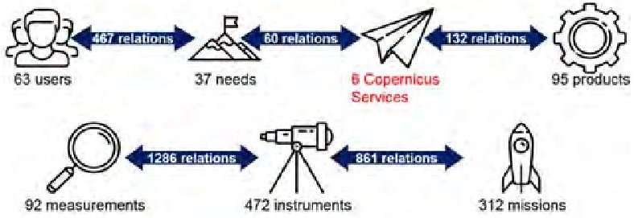
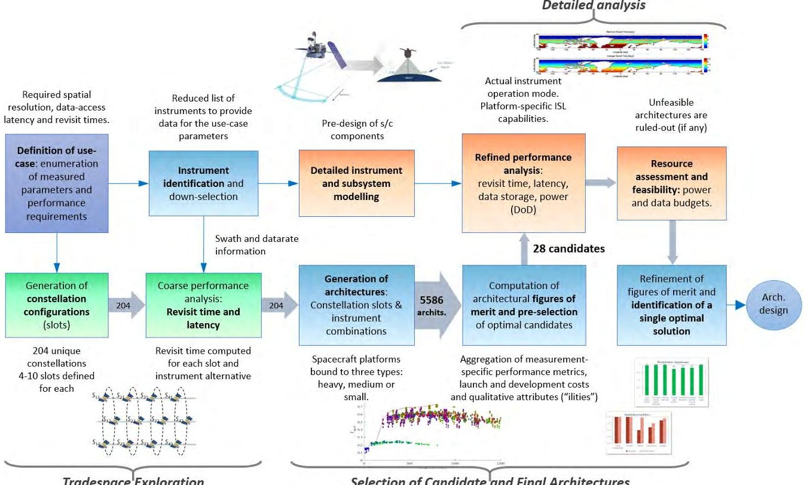
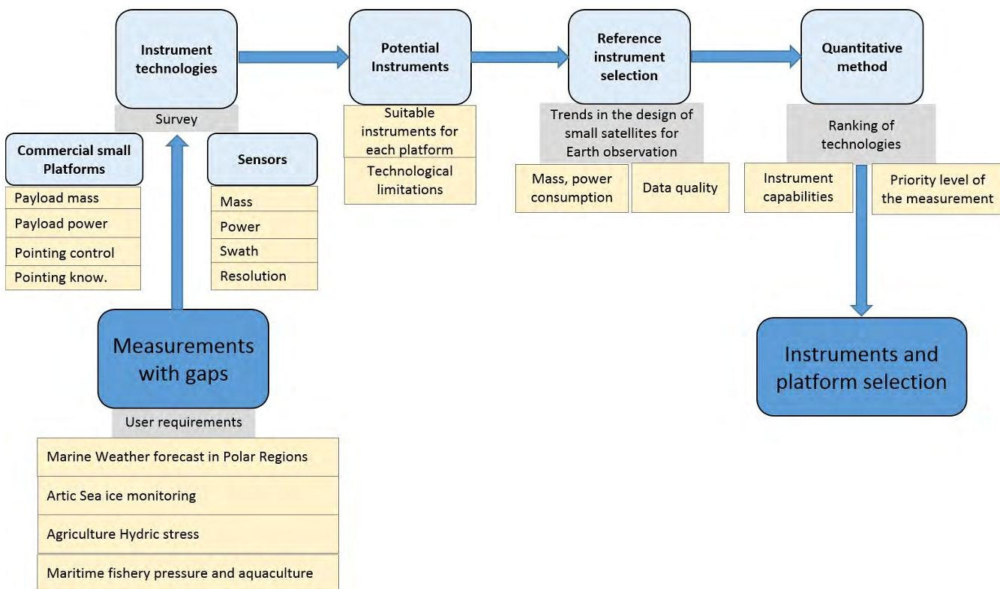
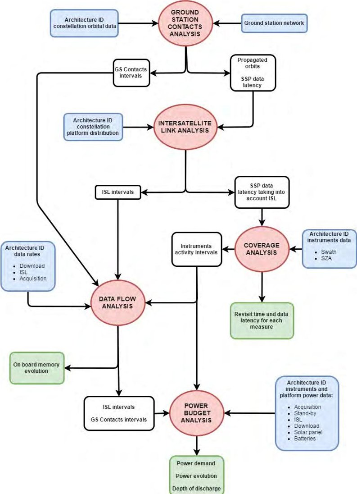
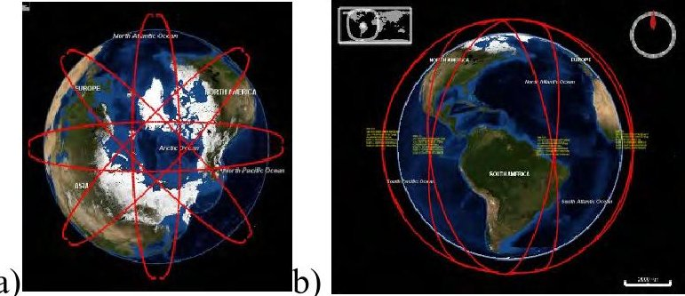
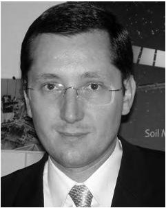
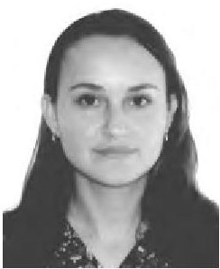
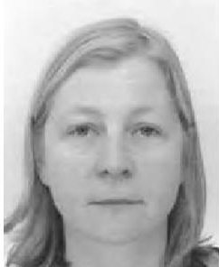

<!-- PDF_PAGE: 1 -->

Received April 18, 2018, accepted May 25, 2018, date of publication June 5, 2018, date of current version July 12, 2018. Digital Object Identifier 10.1109/ACCESS.2018.2844257

# Design and Optimization of a Polar Satellite Mission to Complement the Copernicus System

EDUARD ALARCÓN $ ^{1} $ , ANGEL ALVARO SANCHEZ $ ^{2} $ , CARLES ARAGUZ $ ^{1} $ , GILBERT BARROT $ ^{3} $ , ELISENDA BOU-BALUST $ ^{1} $ , ADRIANO CAMPS $ ^{1} $ , STEFANIA CORNARA $ ^{4} $ , JUDITH COTE $ ^{5} $ , ANTONIO GUTIÉRREZ PEÑA $ ^{6} $ , ESTEFANY LANCHEROS $ ^{1} $ , OLIVIA LESNE $ ^{3} $ , DAVID LLAVERÍA $ ^{1} $ , IGNASI LLUCH I RUIZ $ ^{7} $ , JOÃO MALÉS $ ^{6} $ , ANTOINE MANGIN $ ^{3} $ , HRIPSIME MATEVOSYAN $ ^{7} $ , ANGEL MONG $ ^{4} $ , JANUSZ NARKIEWICZ $ ^{8} $ , STEPHANE OUREVITCH $ ^{9} $ , HYUK PARK $ ^{1} $ , STEPHANE PIEROTTI $ ^{5} $ , UDRIVOLF PICA $ ^{9} $ , ARMEN POGHOSYAN $ ^{7} $ , PEDRO RODRÍGUEZ $ ^{2} $ , JOAN A. RUIZ DE AZÚA $ ^{1} $ , PIERRE SICARD $ ^{3} $ , MATEUSZ SOCHACKI $ ^{8} $ , STEFANIA TONETTI $ ^{4} $ , AND SEBASTIAN TOPCZEWSKI $ ^{8} $

$ ^{1} $Universitat Politècnica de Catalunya and IEEC/UPC, 08034 Barcelona, Spain

$ ^{2} $Thales Alenia Space, 28760 Madrid, Spain

$ ^{3} $ACRI-ST, 06904 Biot, France

$ ^{4} $DEIMOS Space, 28760 Madrid, Spain

$ ^{5} $Thales Alenia Space, 31100 Toulouse, France

$ ^{6} $DEIMOS Engenharia, 1998-023 Lisbon, Portugal

$ ^{7} $Skolkovo Institute of Science and Technology, 143026 Moscow, Russia

$ ^{8} $Warsaw University of Technology, 00-661 Warszawa, Poland

$ ^{9} $SpaceTec Partners, 1050 Brussels, Belgium

Corresponding author: Stephane Pierotti (stephane.pierotti@thalesaleniaspace.com)

This work was supported in part by the EU H2020 ONION Project under Grant 687490, in part by Thales Alenia Space, and in part by the Project AGORA of the Spanish Ministry of Economy and Competitiveness, and ICREA Academia Award from the Catalan Government, and under Grant ESP2015-70014-C2-1-R.

ABSTRACT The space industry is currently witnessing two concurrent trends: the increased modularity and miniaturization of technologies and the deployment of constellations of distributed satellite systems. As a consequence of the first trend, the relevance of small satellites in line with the "cheaper and faster" philosophy is increasing. The second one opens up completely new horizons by enabling the design of architectures aimed at improving the performance, reliability, and efficiency of current and future space missions. The EU H2020 ONION project ("Operational Network of Individual Observation Nodes") has leveraged on the concept of fractionated and federated satellite systems (FFSS) to develop and design innovative mission architectures resulting in a competitive advantage for European earth observation (EO) systems. Starting from the analysis of emerging needs in the European EO market, the solutions to meet these needs are identified and characterized by exploring FFSS. In analogy with terrestrial networks, these systems envision the distribution of satellite functionalities amongst multiple cooperating spacecrafts (nodes of a network), possibly independent, and flying on different orbits. FFSS are considered by many as the future of space-based infrastructures, as they offer a pragmatic, progressive, and scalable approach to improve existing and future space missions. This paper summarizes the main results of the ONION project and the high-level design of the marine weather forecast mission for polar regions.

INDEX TERMS Satellite, mission, constellation, federation, sensors, fractionation, SAR, GNSS-R, VIS/NIR/SWIR/LWIR, imagers, polar, weather, ice, marine, currents.

## I. INTRODUCTION

Federated Satellite Systems (FSS) [1] are one of the newest distributed architecture paradigm proposals, featuring opportunistic resource exchange among fully independent missions. It bridges a gap in the taxonomy of Distributed

Satellite Systems (DSS) regarding component uniformity and independency. On the operational status side, a number of constellations have been deployed and have been operational for decades, e.g. the A-Train constellation [2]. On the side of fractionated system architectures, DARPA's F6 [3]

<!-- PDF_PAGE: 2 -->

TABLE 1. Types of DSS architectures [1].

<table border="1"><tr><td>Type</td><td>Mission goals</td><td>Cooperation</td><td>Homogeneity</td><td>Autonomy</td></tr><tr><td>Constellations</td><td>Mission goal shared(e.g.Iridium, GPS)</td><td>Cooperation required to support mission goals</td><td>In general homogeneous components,some differences possible(e.g.GPS generations)</td><td>Autonomous</td></tr><tr><td>Trains</td><td>Mostly independent,but could be shared</td><td>Cooperation from optional to required</td><td>Heterogeneous components</td><td>Autonomous</td></tr><tr><td>Clusters</td><td>Mission goal shared</td><td>Cooperation required to support mission goals</td><td>Homogeneous components</td><td>From autonomous to completely co-dependent</td></tr><tr><td>Swarms</td><td>Mission goals shared</td><td>Cooperation required to support mission goals</td><td>From homogeneous to heterogeneous components</td><td>From autonomous to completely co-dependent</td></tr><tr><td>Fractionated Satellites</td><td>Mission goals shared</td><td>From optional(service areas) to required(distributed critical spacecraft functions)</td><td>Heterogeneous components</td><td>From autonomous to completely co-dependent</td></tr><tr><td>Federated Satellites</td><td>Independent mission goals</td><td>Ad-hoc,optional</td><td>Heterogeneous components</td><td>Autonomous</td></tr></table>

program remains the most recent comprehensive research effort. The F6 Program (Free Flying Future, Fast, Flexible, Fractionated Free-flying Spacecraft United by Information Exchange) was a US Defense Advanced Research project that started in 2007 aiming to demonstrate the feasibility of Fractionated Spacecraft by 2015. The project was discontinued in 2012. It targeted a broad range of missions, not necessarily related with Earth Observation. Besides this effort, specific EO applications for fractionated systems have been studied [4], but no fully fractionated EO system has been launched to date. The same thing can be said about federations, although the Disaster Monitoring Constellation can be consider a precursor of it, in which each satellite belongs to a different partner and resources are shared as needed [5]. However, there are a number of deployed missions that can be considered precursors of DSS [6]-[8] and more achievements and operational systems are expected over the next decade.

This work summarizes the main results of the EU H2020 ONION project aiming to review the emerging Fractionated, Federated and Distributed Satellite System concepts, to identify potential benefits to be obtained in light of the observation needs in different Earth Observation domains, and to propose to the EU an overall strategy and technical guidelines to develop and implement such concepts in the time frame 2021-2027.

This manuscript is organized as follows. First, a brief overview of fractionated and federated observation system concepts is presented. The potential benefits that can be obtained in light of the observation needs in different Earth Observation domains are then identified. After a comprehensive analysis, the Marine Weather Forecast in polar regions use-case ranked as the top priority, followed by the Artic Sea Ice Monitoring, Maritime Fishery Pressure and Aquaculture, and the Agriculture Hydric Stress.

Then, a Systems Architecture Study is performed for the Marine Weather Forecast use-case, including the architectural analysis, the tradespace exploration, the performance analysis and simulation, and the selection of the winning candidate architecture. Finally, a more detailed design of the final architecture is conducted, and its applicability to the other top

priority use-cases is assessed concluding that the resulting mission concept can be a truly Polar Copernicus mission. The key required technology challenges to be faced in time frame 2021-2027 are identified. The last section summarizes the main conclusions of this work.

## II. REVISION OF FRACTIONATED AND FEDERATED OBSERVATION SYSTEM CONCEPTS

In the frame of ONION, a survey of the state of the art in Distributed Satellite Systems (DSS) was conducted, including a comprehensive review of Fractionated and Federated technologies. A detailed classification of the different distributed architectures, the expected trade-offs, the key enabling technologies, and the translation of user needs and technology maturity into functional requirements were performed. The requirements were structured in 4 thematic areas: the requirements on payloads, the operational requirements, the space-to-space interface requirements, and the space-to-ground interface requirements. These complementary approaches enable mission concepts that otherwise would be impractical, or even impossible, with traditional approaches, while enhancing reliability, affordability, sustainability, scalability, and flexibility. Table 1 [1] summarizes the different DSS architecture types, their main goals, and properties. Note that several DSS could also be classified as formation-flying missions.

## III. IDENTIFICATION OF POTENTIAL BENEFITS AS A FUNCTION OF THE OBSERVATION NEEDS IN DIFFERENT EARTH OBSERVATION DOMAINS

The World Meteorological Organization (WMO) is the international organization in charge of collecting the user requirements (https://www.wmo-sat.info/oscar/). The needs of different users, stakeholders, and beneficiaries of Earth Observation (EO) services were reviewed and analyzed, identifying the key elements of the value chain of the European EO infrastructure and building a comprehensive knowledgebase of those elements, represented as a relational database (Fig. 1).

<!-- PDF_PAGE: 3 -->

TABLE 2. Scoring of the top 10 use-cases not satisfied by the existing EU Copernicus infrastructure.

<table border="1"><tr><td></td><td></td><td></td><td colspan="5">Related Service score</td><td></td></tr><tr><td>Use-case name</td><td>Number of users</td><td>Related need score</td><td>FPBI* coverage</td><td>FPBI accuracy</td><td>FPBI frequency</td><td>FPBI access</td><td>Service score</td><td>Final Score normalized</td></tr><tr><td>Marine Weather Forecast</td><td>14</td><td>0.8823</td><td>&lt;10%</td><td>60-70%</td><td>50-60%</td><td>50-60%</td><td>1</td><td>1</td></tr><tr><td>Sea ice monitoring</td><td>15</td><td>0.8749</td><td>&lt;10%</td><td>60-70%</td><td>50-60%</td><td>50-60%</td><td>1</td><td>0.9916</td></tr><tr><td>Fishing pressure, stock assessment</td><td>12</td><td>0.6829</td><td>&lt;10%</td><td>60-70%</td><td>50-60%</td><td>50-60%</td><td>1</td><td>0.774</td></tr><tr><td>Land for Infrastructure Status Assessment</td><td>17</td><td>1</td><td>30-40%</td><td>10-20%</td><td>10-20%</td><td>50-60%</td><td>0.67</td><td>0.7556</td></tr><tr><td>Agriculture (hydric stress)</td><td>24</td><td>0.9972</td><td>30-40%</td><td>10-20%</td><td>10-20%</td><td>50-60%</td><td>1</td><td>0.7535</td></tr><tr><td>Land for Basic Maps</td><td>18</td><td>0.9055</td><td>30-40%</td><td>10-20%</td><td>10-20%</td><td>50-60%</td><td>0.67</td><td>0.6842</td></tr><tr><td>Sea Ice melting emissions</td><td>15</td><td>0.7135</td><td>&lt;10%</td><td>60-70%</td><td>50-60%</td><td>50-60%</td><td>1</td><td>0.6739</td></tr><tr><td>Atmosphere for Weather Forecast</td><td>14</td><td>0.8823</td><td>&lt;10%</td><td>30-40%</td><td>50-60%</td><td>30-40%</td><td>0.67</td><td>0.6667</td></tr><tr><td>Climate for Ozone Layer &amp; UV</td><td>14</td><td>0.7058</td><td>&lt;10%</td><td>40-50%</td><td>30-40%</td><td>50-60%</td><td>0.83</td><td>0.6666</td></tr><tr><td>Natural habitat monitoring, protected species monitoring</td><td>18</td><td>0.6903</td><td>&lt;10%</td><td>40-50%</td><td>40-50%</td><td>50-60%</td><td>0.83</td><td>0.652</td></tr></table>

$ ^{(*)} $FPBI - Fraction of Products that Would Benefit from Improvement

FIGURE 1. Graphical relationship of the data in the database.

The creation of this database and the quantitative scoring methodology developed to analyze and select the most promising use-cases not satisfied by the existing EU Copernicus infrastructure was described in detail in [9]. The top 10 uses cases identified are listed in Table 2, which also indicates the total number of identified users, the overall ranking and the fraction of products that would benefit from and improvement in terms of coverage, accuracy, frequency (i.e. revisit time), and access (data availability). Finally, the ONION project User Advisory Board recommended to address the four use-cases indicated with a mark of 1 in the service score. As it will be shown after the detailed analysis, the "Marine Weather Forecast" mission can almost satisfy the other three use-cases leading to a single ONION "polar" mission, the "ONION Marine Weather Forecast" (OMWF) to complement the Copernicus system. The ONION "Agriculture Hydric Stress" (OAHS) mission was also analyzed in view of the synergies with the OMWF one. Tables 2-6 summarize the main characteristics of the above proposed services, which are graphically described in https://www.youtube.com/watch?v = LF7alaLTSyc.

## IV. SYSTEMS ARCHITECTURE STUDY AND IDENTIFICATION OF KEY REQUIRED TECHNOLOGY CHALLENGES TO

TABLE 3. Main characteristics of the proposed service "marine weather forecast."

## BE FACED IN TIME FRAME 2021-2027

The Systems Architecture Study has been performed in different steps. First, an analysis of the architectural elements

<table border="1"><tr><td>End-users</td><td>Oil/Gas/Mining industry &amp; Fishing and aquaculture industry etc.</td></tr><tr><td>Summary of Needs</td><td>Monitoring sea conditions for offshore operations in polar regions.
Operational tool type early warning system.</td></tr><tr><td>Location</td><td>Arctic and subarctic regions (over latitude 60°N, target value: over 50°N)</td></tr><tr><td>Services activated</td><td>Deliver in Near Real Time (NRT), and routinely, weather forecasts (nowcast and 3-day forecasts), maps and service alerts via web applications and compatible with modelling software.
• Marine weather forecasting
• Ocean current forecasting
• Route optimization
• Search and rescue operations</td></tr><tr><td>Service characteristics</td><td>Spatial resolution: &lt;1km
Temporal resolution (model):1h
Latency time: near real time(&lt;1h)
Revisit time (observation):&lt;24h
Service duration: continuously and on demand for specific offshore operations.</td></tr></table>

has been performed, followed by an exploration of the tradespace (i.e. different configurations, namely orbital planes, number and type of spacecrafts, payloads etc.). Then, a performance analysis and simulation have enabled the evaluation of architecture candidates. Finally, the best candidate has been selected and an accurate design performed. The procedure is explained graphically in Fig. 2. This systematic approach aims at addressing the following open questions:

1. How can FFSS be optimally architected? That is, how should the instruments be distributed? Is there an optimal instrument technology to address all measurements? Which kind of spacecraft platforms is more likely to satisfy certain user needs while allowing for cost-effective and technologically feasible solutions? Are small-satellite technologies feasible alternatives to design such architectures? How many spacecrafts are needed? And what should their orbital parameters be?

2. How can user needs be satisfied? That is: low-latency (near-real-time), short revisit times (ideally 1 h), and high spatial resolution (10 m to 1 km, depending on the application).

<!-- PDF_PAGE: 4 -->

TABLE 4. Main characteristics of the proposed service "artic sea ice monitoring: extent, type and thickness."

<table border="1"><tr><td>End-users</td><td>Sea Ice as a barrier for ship traffic, fisheries and offshore operations</td></tr><tr><td>Location</td><td>Arctic regions (over latitude 60°N)</td></tr><tr><td>Services activated</td><td>Sea ice monitoring: extent, type and thicknessDeliver in NRT,and routinely, maps and service alerts via web applicationsRoute optimization</td></tr><tr><td>Service characteristics</td><td>Sea ice thicknessSpatial resolution:＜10m(horizontal),1cm(vertical)Temporal resolution:1hRevisit time:＜3hCoverage:ArcticLatency time:near real time(&lt;1h)Usage conditions:1cm accuracyService duration:continuously and routinely serviceand on demand for specific operationsSea ice type&amp; extentSpatial resolution:10m horizontalTemporal resolution:1hRevisit time:＜3hCoverage:ArcticLatency time:near real time(&lt;1h)Usage conditions:5% accuracyService duration:continuously and routinely serviceand on demand for specific operations</td></tr></table>

TABLE 5. Main characteristics of the proposed service "maritime fishery pressure."

<table border="1"><tr><td>End-users</td><td>Fishing and aquaculture industry</td></tr><tr><td>Summary of Needs</td><td>Knowledge of oceanographic conditions and fishing pressure in support of monitoring fish stocks environment.
Improve understanding of fish stock resilience and vulnerability to natural and anthropogenic factors (e.g. climatic versus over-fishing effects).
Surveillance and control of marine resources for enhanced fisheries protection and detection of illegal, unreported, and unregulated fishing and supporting activity (e.g. refueling or catch transfer).</td></tr><tr><td>Location</td><td>Major fishing areas: priority 51- Western Indian Ocean (6-Madagascar) &amp; 18 Arctic Sea</td></tr><tr><td>Service activated</td><td>Satellites can assist the fishing industry in many ways for fish stocks monitoring. The types of assistance that satellites can offer include the following:
An online tool providing continuously observations, combining satellite and in-situ data, to assist fishermen to plan their fishing operations.
Fast communications to vessels for transmitting satellite observations and derived-products.
Accurate information of the “state” and “evolution” of fish stocks on all of world&#x27;s major fishing areas by coupling the fishery pressure and oceanic conditions.
Widen area surveillance and control of marine resources in Member State Exclusive Economic Zones for enhanced fisheries protection and detection of illegal, unreported, and unregulated fishing and supporting activity.</td></tr><tr><td>Service characteristics</td><td>Spatial resolution: 1km
Temporal resolution (given by models): 24h
Latency time: near real time(&lt;1h)
Revisit time: 72h (cloud free)
Service duration: on demand.</td></tr></table>

3. How can FFSS be designed so that they satisfy high-level system qualities? That is, how to force or promote certain ilities in final designs? And what is the impact of small satellite technologies on system ilities?

TABLE 6. Main characteristics of the proposed service "hydric stress monitoring for agriculture."

<table border="1"><tr><td>End-users</td><td>Agriculture professionals / insurance companies / Decision makers</td></tr><tr><td>Need summary</td><td>Detection and Monitoring of water stress on crops to better manage irrigation.</td></tr><tr><td>Type of operations</td><td>Water management and drought monitoring for agriculture</td></tr><tr><td>Location</td><td>Europe and Water scarcity prone areas (regions such as China, India, and Sub-Saharan Africa)</td></tr><tr><td>Services activated</td><td>Routine delivery of information, indicators and geospatial products assessing the crop conditionsAlert service showing the area affected by the drought according to a predefined thresholdPortal/Global information system providing a range of services aimed at the better monitoring of droughts</td></tr><tr><td>Service characteristics</td><td>Spatial resolution:＜1kmRevisit time: dailyLatency time: intra-dayGeographical coverage:Local to globalService duration:continuously</td></tr></table>

## A. ARCHITECTURAL ANALYSIS

The architectural elements analysis included an analysis of the different payloads required to obtain the measurements needed to fulfill the user requirements, and a survey of the commercial platforms where these payloads can be boarded. Basic payload parameters include mass, power, swath, and spatial resolution, which were mostly derived from the OSCAR [10] and CEOS [11] databases.

However, the estimated power consumption, required aperture (either optical or microwave), mass, and the achievable swath were recomputed according to the required spatial resolution, swath, and satellite altitude. Basic parameters of commercial platforms were taken into account, including the payload mass and power, as well as the pointing control knowledge and accuracy. Platforms are classified as large (200 kg payload, 600 kg dry mass), such as the SSTL 600 or the Astrosat 100, mid class (50 kg payload, 166 dry mass), such as the TETx from OHB, the SSTL 150, or the SN-50, and small class (2 kg payload, 6 kg dry mass), such as a 6 U CubeSat. After this analysis, a matching between payloads (or combination of payloads) and platforms was conducted. The list of sensors satisfying the requirements is summarized in Table 7, where the light, mid and dark gray colors indicate that the payload can be embarked on a small, medium or large platform [12]. The selection process is illustrated in Fig. 3. A number of possible combinations of payloads and platforms are feasible. Table 8 summarizes the main instrument types, the type of platform (small, medium or large), and the properties of a reference instrument in terms of mass, power, data rate, and swath. At this stage, the tradespace exploration can be performed by selecting the optimum configuration of platforms/instruments, orbital planes, and number of spacecrafts per orbital plane.

## B. TRADESPACE EXPLORATION

The tradespace exploration includes the 3 first steps of the classic paradigm: Formulation, Enumeration, and the

<!-- PDF_PAGE: 5 -->

Selection of Candidate and Final Architectures

FIGURE 2. Graphical explanation of the Systems Architecture Study to select the optimum configuration.

TABLE 7. List of required sensors to satisfy the observational requirements of the different use-cases.

<table border="1"><tr><td rowspan="2">Technologies
Use cases</td><td colspan="3">Passive Optical</td><td colspan="3">Active Optical</td><td colspan="3">Passive Microwave</td><td colspan="3">Active Microwave</td></tr><tr><td>IR Spectrometer</td><td>Multispectral imager VIS/MWIR/TIR</td><td>Hyperspectral imager(VIS/NIR)</td><td>Lidar</td><td>Microwave Radiometer(K,Ka,W-bands)</td><td>Microwave Radiometer(X,K,Ka,W-bands)</td><td>Microwave Radiometer(L-band)</td><td>Microwave Sounder(W,Y-bands)</td><td>GNSS-R</td><td>AIS</td><td>Scatterometer</td><td>Altimeter</td><td>Altimeter(SAR)</td><td>SAR</td></tr><tr><td>Marine Weather Forecast-polar regions</td><td>X</td><td>X</td><td></td><td>X</td><td>X</td><td>X</td><td></td><td></td><td>X</td><td></td><td>X</td><td>X</td><td>X</td><td></td></tr><tr><td>Sea ice monitoring</td><td>X</td><td>X</td><td>X</td><td>X</td><td>X</td><td>X</td><td>X</td><td></td><td>X</td><td></td><td></td><td>X</td><td>X</td><td>X</td></tr><tr><td>Fishing pressure, stock assessment</td><td>X</td><td>X</td><td>X</td><td></td><td></td><td></td><td></td><td></td><td></td><td>X</td><td></td><td></td><td></td><td>X</td></tr><tr><td>Land for infrastructure status assessment</td><td></td><td>X</td><td>X</td><td></td><td></td><td></td><td></td><td></td><td></td><td></td><td></td><td></td><td></td><td>X</td></tr><tr><td>Agriculture(hydric stress)</td><td></td><td>X</td><td>X</td><td></td><td></td><td></td><td>X</td><td></td><td>X</td><td></td><td>X</td><td></td><td></td><td>X</td></tr><tr><td>Land for basic maps</td><td></td><td>X</td><td>X</td><td></td><td></td><td></td><td>X</td><td></td><td>X</td><td></td><td></td><td></td><td></td><td>X</td></tr><tr><td>Sea ice melting emissions</td><td>X</td><td>X</td><td>X</td><td>X</td><td>X</td><td>X</td><td>X</td><td></td><td>X</td><td></td><td></td><td>X</td><td>X</td><td>X</td></tr><tr><td>Atmosphere for weather forecast</td><td></td><td>X</td><td></td><td>X</td><td>X</td><td>X</td><td></td><td>X</td><td></td><td></td><td>X</td><td></td><td></td><td></td></tr><tr><td>Climate for ozone layer&amp;UV</td><td></td><td></td><td>X</td><td></td><td></td><td></td><td></td><td></td><td></td><td></td><td></td><td></td><td></td><td></td></tr><tr><td>Natural habitat monitoring,protected species monitoring</td><td></td><td>X</td><td></td><td></td><td></td><td></td><td>X</td><td></td><td>X</td><td></td><td></td><td></td><td></td><td>X</td></tr></table>

Evaluation of the different architectures implies some assumptions on the revisit time model (i.e. instrument apertures, ground control points etc.), and on the latency model (i.e. inter-satellite link behavior, location of the ground stations etc.) The down selection, analysis, and visualization

steps are performed later as part of the architecture candidate selection.

For the OMWF use-case the number of nodes was selected among the following eleven possibilities {4,6,8,10,12,16,20, 24,32,40,48}, orbital height among the following three values

<!-- PDF_PAGE: 6 -->

FIGURE 3. Instrument and platform selection process to meet the user observation requirements.

TABLE 8. Main instrument types, Reference instrument, Parameters, and Required platform: Large: 600 kg Dry mass, 200 kg Payload; Medium: 166 kg Dry mass, 50 kg Payload, and Small: 6 kg Dry mass, 2 kg Payload 6U CubeSat). Swaths at 3 different heights: 510, 657, and 807 km.

<table border="1"><tr><td>Instrument and platform type</td><td>Reference instrument</td><td>Mass(kg)</td><td>Power(W)</td><td>Data rate(kbps)</td><td>Swath(km)</td><td>Mature(y/n)</td></tr><tr><td rowspan="3">OpticalVIS/NIR/TIRImager(Medium)</td><td>AVHRR/3(MetopC)</td><td>33</td><td>27</td><td>621.3</td><td>1636,2186,2812</td><td>y</td></tr><tr><td>VIIRS/JPSS</td><td>275</td><td>240</td><td>5,900</td><td>3000</td><td>y)</td></tr><tr><td>(METImage/MetopSG-A)</td><td>262</td><td>140</td><td>20,000</td><td>2800</td><td>y)</td></tr><tr><td>HyperspectralVIS/NIROptical Imager(Small)</td><td>CHRIS(PROBA-1)</td><td>14</td><td>8</td><td>1,000</td><td>10,12,18</td><td>n</td></tr><tr><td>TIR sounder(Small)</td><td>EON-IR(CIRAS)</td><td>14</td><td>40</td><td>320</td><td>937,1220,1518</td><td>n</td></tr><tr><td>L-band MWR(Medium)</td><td>MIRAS(SMOS)</td><td>355</td><td>511</td><td>89</td><td>661,856,1058</td><td>y</td></tr><tr><td>MWR W,Y(Small)</td><td>TEMPEST-D</td><td>3</td><td>8</td><td>20</td><td>1066,1392,1739</td><td>n</td></tr><tr><td>MWR K,Ka,W(Medium)</td><td>SSM/I</td><td>48.5</td><td>45</td><td>5</td><td>925,1159,1367</td><td>y</td></tr><tr><td>MWR X,K,Ka,W(Large)</td><td>TMI(TRMM)</td><td>65</td><td>50</td><td>8.8</td><td>1065,1325,1576</td><td>y</td></tr><tr><td>GNSS-R(Small)</td><td>DDMI(CYGNSS)</td><td>2</td><td>12</td><td>200</td><td>730,946,1170</td><td>n</td></tr><tr><td>Radar Altimeter,Ka(Large)</td><td>Altika(SARAL)</td><td>40</td><td>85</td><td>43</td><td>6.5,8.2,10.1</td><td>y</td></tr><tr><td>SAR Altimeter(Large)</td><td>SRAL(Sentinel-3)</td><td>70</td><td>149</td><td>12,000</td><td>12.53,16.13,19.6</td><td>y</td></tr><tr><td>SAR-X(Large)</td><td>Severjanin-M</td><td>150</td><td>1000</td><td>10,000</td><td>289,358,425</td><td>y</td></tr></table>

MWR: Microwave Radiometer, GNSS-R: Global Navigation Satellite Systems Reflectometry, SAR: Synthetic Aperture Radar

{510,657,807} km, number of orbital planes among the following five values {2,3,4,6,8}, and the Walker constellation either Delta, or Star type. For the OAHS use-case the number of nodes and orbital heights are the same as for the OMWF case, but the number of orbital planes was selected among the following three values {1,2,3}, because of less stringent requirements on revisit time. Since the design methodology is the same, only OMWF results are presented.

For the above possible configurations, uneven distributions (e.g. 8 nodes in 3 planes) are ruled out. Additionally each architecture presents several slot configurations (i.e. positions of the spacecrafts in the orbit) that increase the tradespace.

An ad-hoc simulation-based revisit time assessment tool ("ONIONETA") and a simulation-based latency estimator tool ("OCOMNET") were used to evaluate the different architectures. These tools are geometry based and include the SGP4 orbital propagator [13].

The optimization procedure is quite sophisticated. The interested reader is referred to [14], where it is described in detail. An aggregated figure of merit is defined which encompasses: system-level performance metrics; use-case requirements; development and launch costs; and architectural quality attributes, which assess and weight several of the so-called "ilities" of an architecture and allow selecting designs that exhibit the desired qualities.

<!-- PDF_PAGE: 7 -->

TABLE 9. Down selected configurations: Payloads, Platform, Mass, power and maximum data rate.

<table border="1"><tr><td>Name</td><td>1</td><td>2</td><td>3</td><td>4</td><td>5</td><td>6</td><td>7</td><td>8</td><td>9</td><td>10</td><td>11</td><td>12</td></tr><tr><td>GNSS-R</td><td>y</td><td>n</td><td>y</td><td>y</td><td>y</td><td>n</td><td>n</td><td>n</td><td>n</td><td>y</td><td>y</td><td>n</td></tr><tr><td>Optical Imager(med.res.)VIS/NIR/TIR</td><td>n</td><td>n</td><td>y</td><td>n</td><td>n</td><td>y</td><td>y</td><td>n</td><td>y</td><td>y</td><td>y</td><td>n</td></tr><tr><td>Radar altimeter(Ka-band)</td><td>n</td><td>n</td><td>n</td><td>y</td><td>n</td><td>y</td><td>n</td><td>n</td><td>n</td><td>y</td><td>n</td><td>n</td></tr><tr><td>MWR W-,Y-bands(small)</td><td>n</td><td>y</td><td>n</td><td>y</td><td>n</td><td>n</td><td>n</td><td>n</td><td>n</td><td>n</td><td>n</td><td>n</td></tr><tr><td>MWR K-,Ka-,W-bands(medium)</td><td>n</td><td>n</td><td>n</td><td>n</td><td>y</td><td>n</td><td>n</td><td>n</td><td>n</td><td>n</td><td>y</td><td>y</td></tr><tr><td>MWR X-,K-,Ka-,W-bands(large)</td><td>n</td><td>n</td><td>n</td><td>n</td><td>n</td><td>n</td><td>n</td><td>n</td><td>n</td><td>y</td><td>y</td><td>n</td></tr><tr><td>MWR K-,Ka-(for WV,nadir-looking)</td><td>n</td><td>n</td><td>n</td><td>n</td><td>n</td><td>n</td><td>y</td><td>n</td><td>n</td><td>n</td><td>n</td><td>y</td></tr><tr><td>Ku-,C-band SAR altimeter</td><td>n</td><td>n</td><td>n</td><td>n</td><td>n</td><td>n</td><td>y</td><td>n</td><td>n</td><td>n</td><td>y</td><td>n</td></tr><tr><td>X-band SAR</td><td>n</td><td>n</td><td>n</td><td>n</td><td>n</td><td>n</td><td>n</td><td>y</td><td>y</td><td>n</td><td>n</td><td>y</td></tr><tr><td>Mass[kg]</td><td>2</td><td>3</td><td>33</td><td>45</td><td>51</td><td>71</td><td>128</td><td>150</td><td>181</td><td>138</td><td>168</td><td>218</td></tr><tr><td>Power[W]</td><td>12</td><td>8</td><td>33</td><td>105</td><td>45</td><td>112</td><td>210</td><td>1000</td><td>1027</td><td>138</td><td>168</td><td>1058</td></tr><tr><td>Total Max Data Rate[kbps]</td><td>232</td><td>24</td><td>764</td><td>291</td><td>238</td><td>567</td><td>10662</td><td>1101</td><td>1633</td><td>810</td><td>10900</td><td>1135</td></tr><tr><td>Platform size</td><td>S</td><td>S</td><td>M</td><td>M</td><td>L</td><td>L</td><td>L</td><td>L</td><td>L</td><td>L</td><td>L</td><td>L</td></tr></table>

## C. PERFORMANCE ANALYSIS, SIMULATION,

## AND SELECTION OF WINNING

## CANDIDATE ARCHITECTURE

After having down-selected a set of candidates from all possible architectures, a detailed analysis is needed to find the optimum architecture. Orbits are assumed to be Sun Synchronous (SSO). Visibility intervals with the ground station network are computed, Inter-Satellite Link (ISL) constraints are applied to calculate when a platform can communicate with another one via ISL and Sub-Satellite Point (SSP) data latency is calculated taking into account contacts with the ground stations and the ISLs. Then, revisit time and data latency are computed as a function of instrument properties (i.e. swath) and the areas of interest for each measurement separately, taking into account only the instruments generating that particular measurement. Finally, the used capacity of the mass memory and the evolution of the batteries Depth of Discharge (DoD) are computed taking into account instrument's activity intervals, ground station contact intervals, and ISL intervals. The whole process is described in Fig. 4, and the final results are summarized in Table 9. Providing simulation parameters is out of the scope of this manuscript, as it aims at describing the methodology and results. The interested reader is referred to [15].

To perform the simulations of the OMWF, two ground stations are assumed: one in Svalbard (latitude 78.1 $ ^{\circ} $ , longitude 15.5 $ ^{\circ} $ ), and a second one in Inuvk (latitude 68.4 $ ^{\circ} $ , longitude $ -133.7^{\circ} $ ). Data flow and on-board data handling are not critical points, but the poor constellation connectivity reduces the opportunities for ISL due to small platform's range limitations, thus the maximum data latency is about one orbital period (around 90 min), and in this configuration the ISLs do not help to improve maximum data latency. The maximum revisit time requirement for the less demanding measurements is in general fulfilled, but when the requirement goes below a few hours, just few architectures are able to fulfill it. However, the most critical aspect turns out to be the power budget, because the illumination conditions are different from orbital plane to orbital plane (different LTAN, i.e. Local Time

FIGURE 4. Detailed performance analysis and simulation flow diagram for each configuration (defined by its identification number -ID-).

of the Ascending Node), and a unique design for the power subsystem is not able to provide enough power to all the spacecrafts.

Finally, the winning architecture for the OMWF use-case consists of a constellation of 16 nodes distributed in 8 orbital planes at about 800 km altitude. Nodes are 8 large platforms including an X-band SAR and a multispectral optical imager, and 8 small platforms including a GNSS-R payload.

<!-- PDF_PAGE: 8 -->

FIGURE 5. a) Polar and b) Equatorial views of the winning architecture.

TABLE 10. Winning ONION architecture for the maritime marine weather forecast use-case.

<table border="1"><tr><td>Sat</td><td>LTAN[h]</td><td>M[°]</td><td>Type</td><td>Instruments</td></tr><tr><td>1</td><td>3</td><td>0</td><td>Large</td><td>SAR-X+Optical</td></tr><tr><td>2</td><td>3</td><td>180</td><td>Large</td><td>SAR-X+Optical</td></tr><tr><td>3</td><td>6</td><td>0</td><td>Small</td><td>GNSS-R</td></tr><tr><td>4</td><td>6</td><td>180</td><td>Small</td><td>GNSS-R</td></tr><tr><td>5</td><td>9</td><td>0</td><td>Large</td><td>SAR-X+Optical</td></tr><tr><td>6</td><td>9</td><td>180</td><td>Large</td><td>SAR-X+Optical</td></tr><tr><td>7</td><td>12</td><td>0</td><td>Small</td><td>GNSS-R</td></tr><tr><td>8</td><td>12</td><td>180</td><td>Small</td><td>GNSS-R</td></tr><tr><td>9</td><td>15</td><td>0</td><td>Large</td><td>SAR-X+Optical</td></tr><tr><td>10</td><td>15</td><td>180</td><td>Large</td><td>SAR-X+Optical</td></tr><tr><td>11</td><td>18</td><td>0</td><td>Small</td><td>GNSS-R</td></tr><tr><td>12</td><td>18</td><td>180</td><td>Small</td><td>GNSS-R</td></tr><tr><td>13</td><td>21</td><td>0</td><td>Large</td><td>SAR-X+Optical</td></tr><tr><td>14</td><td>21</td><td>180</td><td>Large</td><td>SAR-X+Optical</td></tr><tr><td>15</td><td>0</td><td>0</td><td>Small</td><td>GNSS-R</td></tr><tr><td>16</td><td>0</td><td>180</td><td>Small</td><td>GNSS-R</td></tr></table>

TABLE 11. Revisit time performance for the different variables of the OMWF Use-case and the optimal selected architecture.

<table border="1"><tr><td>Revisit Time [h]</td><td>Ocean Currents</td><td>Wind speed</td><td>Wave height</td><td>Wave direction</td><td>Sea surface temperature</td><td>Atmospheric pressure</td><td>Sea ice coverage</td></tr><tr><td>Requirement</td><td>&lt;24</td><td>&lt;24</td><td>&lt;3</td><td>&lt;3</td><td>&lt;24</td><td>&lt;24</td><td>&lt;3</td></tr><tr><td>Maximum</td><td>7</td><td>2.5</td><td>2.5</td><td>7</td><td>11</td><td>11</td><td>2.5</td></tr><tr><td>Average</td><td>2.1</td><td>0.7</td><td>0.7</td><td>2.1</td><td>0.5</td><td>0.5</td><td>0.4</td></tr></table>

As illustrated in Fig. 5 and listed in Table 10, where M indicates the satellite orbital mean anomaly.

The final performance in terms of revisit time, latency, mass memory usage and DoD are presented in Tables 11 to 13.

## D. FINAL ARCHITECTURE DESIGN

The 16 nodes of winning architecture are distributed in 8 orbital planes, half of them are large platforms including an X-band SAR and a multispectral optical imager, and the other half are small platforms including a GNSS-R payload. In this winning architecture, the number of nodes is driven by the revisit time, while the high resolution is achieved thanks

TABLE 12. Latency performance for the different variables of the OMWF use-case and the optimal selected architecture.

<table border="1"><tr><td>Data Latency[h]</td><td>Ocean Currents</td><td>Wind speed</td><td>Wave height</td><td>Wave direction</td><td>Sea surface temperature</td><td>Atmospheric pressure</td><td>Sea ice coverage</td></tr><tr><td>Requirement</td><td>&lt;1</td><td>&lt;1</td><td>&lt;1</td><td>&lt;1</td><td>&lt;1</td><td>&lt;1</td><td>&lt;1</td></tr><tr><td>Maximum</td><td>0</td><td>1.4</td><td>1.4</td><td>0</td><td>1.4</td><td>1.4</td><td>1.4</td></tr><tr><td>Average</td><td>0</td><td>~0</td><td>~0</td><td>0</td><td>~0</td><td>~0</td><td>~0</td></tr></table>

TABLE 13. Mass memory and power performance for the different variables of the OMWF use-case and the optimal selected architecture.

<table border="1"><tr><td></td><td>Mass Memory[MByte]</td><td>Depth of Discharge[%]</td></tr><tr><td>Requirement</td><td>&lt;256</td><td>&lt;20</td></tr><tr><td>Maximum</td><td>126</td><td>10</td></tr><tr><td>Average</td><td>65</td><td>5</td></tr></table>

TABLE 14. Reference parameters used in the detailed design.

<table border="1"><tr><td>Reference orbit</td><td>14+7/27(around800km)</td></tr><tr><td>Launch date</td><td>1stJuly,2022</td></tr><tr><td>Mission lifetime</td><td>S/C Heavy Platform:4.5 yearsS/C Small Platform:1.5 years</td></tr><tr><td>The S/C configuration is modelled with a constant effective drag area.</td><td>The value depends on the platform type:- S/C Heavy Platform:10m2- S/C Small Platform:0.1m2- Drag coefficient(CD):2.2</td></tr><tr><td>Dry mass:</td><td>S/C Heavy Platform:600kgS/C Small Platform:6kg</td></tr><tr><td>S/C specific impulse</td><td>S/C Heavy Platform:220s(Hydrazine or similar)S/C Small Platform:85s</td></tr></table>

TABLE 15. $ \Delta V $ and mass budgets for the large and small nodes.

<table border="1"><tr><td>Platform</td><td>Large</td><td>Small</td></tr><tr><td>Nominal Orbit Acquisition ΔV[m/s]</td><td>18.2</td><td>18.2</td></tr><tr><td>Orbit phasing ΔV[m/s]</td><td>3.1</td><td>3.1</td></tr><tr><td>In-plane orbit control ΔV[m/s]</td><td>8.3</td><td>3.1</td></tr><tr><td>Collision Avoidance ΔV[m/s]</td><td>2.8</td><td>0.93</td></tr><tr><td>EOL Disposal ΔV[m/s]</td><td>47.4</td><td>47.4</td></tr><tr><td>Total Budget ΔV[m/s]</td><td>79.8</td><td>72.7</td></tr><tr><td>Total Fuel Mass[kg]</td><td>22.61</td><td>0.52</td></tr><tr><td>Initial mass[kg]</td><td>622.61</td><td>6.52</td></tr><tr><td>Final mass[kg]</td><td>600</td><td>6</td></tr></table>

to the SAR instruments, complemented by the GNSS-R ones which are smaller and cheaper.

The detailed OMWF mission analysis has included the communications architecture, taking into account different RF and Optical ISLs per platform type and the trade-off between different network protocol architectures [16]. Refined data flow and power budget analysis have been

<!-- PDF_PAGE: 9 -->

TABLE 16. Requirements met, partially met, and not feasible for the polar use-cases.

<table border="1"><tr><td></td><td>Requirements met</td><td>Requirements partially met</td><td>Requirements not feasible</td></tr><tr><td>Marine Weather Forecast</td><td>Horizontal wind speed over sea
Significant wave height
Dominant wave direction
Sea surface temperature
Atmospheric pressure at sea level</td><td>Ocean surface currents
Percentage of sea ice cover</td><td>Percentage of sea ice cover</td></tr><tr><td>Sea Ice Monitoring</td><td>Horizontal wind speed over surface
Significant wave height
Dominant wave direction
Sea surface temperature
Atmospheric pressure at sea level</td><td>Sea Ice drift
Sea Ice extent
Iceberg tracking
Sea ice thickness
Sea ice classification</td><td></td></tr><tr><td>Marine Fisheries</td><td>Ocean Colour radiometry
Ocean surface Chlorophyll
Sea surface temperature
Atmospheric pressure at sea level
Coloured Dissolved (Organic) Matter</td><td></td><td>Vessels and fish farming cages, position tracking.</td></tr></table>

performed (not presented). Moreover, a detailed assessment of the Delta-V and fuel budget analysis is included for: a nominal orbit acquisition composed by correction of launcher injection errors, and acquisition of nominal satellite position inside the constellation, orbit maintenance to control the orbit altitude, collision avoidance to avoid collision with space debris objects, and End-of-Life (EOL) Disposal to comply with EOL guidelines (Tables 14 and 15). This is important as nowadays most small (nano-) satellites, namely CubeSats, do not have orbit control capabilities, and this feature will drive important design considerations for the small platform nodes.

## V. CONCLUSIONS AND FUTURE RESEARCH LINES

This manuscript has described the process from the definition of the use-case to the selection of an optimal satellite system architecture fulfilling the requirements. The analysis has been based on the recommendations of the ONION project User Advisory Board focusing on the Marine Weather Forecast (OMWF) use-case.

The following steps have been addressed:

- Selection of the payloads adapted to the OMWF use case, to be used in the simulations.

- Tradespace exploration process, during which a design space has been generated and different architectures evaluated based on a coarse performance model.

- Pre-selection of a reduced set of candidate architectures from the whole design space.

- Different simulations are performed on these candidate architectures to define the best one. Those simulations include downlink and inter-satellite link simulations, as well as mission and system simulations.

Based on these results, the final architecture has been selected, and it has been analyzed in detail, including orbit control requirements, which is important for the small satellites.

As it has been seen, most of the payloads in the OMWF use-case can also address some of the needs of other usecases, and in particular for Artic sea ice monitoring and

Maritime Fishery Pressure and Aquaculture use-cases it can be interesting to examine to which extent the ONION infrastructure could be used for these other applications as well.

For the Arctic sea ice monitoring use-case the area of interest corresponds to the same one as for the OMWF. Strict revisit time requirements are only fulfilled for some of the measurements, maximum data latency is on the order of an orbital period, and constraints on the maximum on-board memory and DoD are fulfilled.

For the Maritime Fishery Pressure and Aquaculture, the area of interest includes the sea over latitude $ 6 0^{\circ} $ N and the Western Indian Ocean. However, vessels cannot be tracked because of lack of an appropriate instrument in the OMWF (only medium-resolution optical instruments are available). Revisit time requirements, maximum on-board memory and DoD are fully satisfied, and the maximum latency are on the order of an orbital period as for the OMWF.

Table 16 summarizes the requirements that are met, those that are partially met, and those that are not feasible for this combined "Polar Marine Weather Forecast" mission, formed by the combination of the Marine Weather Forecast, Sea Ice Monitoring, and Marine Fisheries use-cases.

The extension to other use-cases, such as the OAHS one would require an L-band microwave radiometer payload that is not present in the OMWF one and, with today's technology, would require a large array (either real or synthetic).

Future DSS developments will greatly benefit from payload fractionation, but this requires the development of high speed inter-satellite links for data exchange and clock synchronization to create such large synthetic and real aperture arrays for high resolution imaging at low microwave frequencies. Also, the development of new unfocused InSAR instruments with coarse resolution for ocean applications possibly with on board processing will reduce the data downlink requirements. Finally, the development of more compact GNSS-R [17] and multispectral/hyperspectral imagers with spatial resolution below 1 km in the TIR and $ \sim10 $ m in the VIS/NIR [18] will foster their use in small satellites (e.g. CubeSats). Moreover, the inclusion of network

<!-- PDF_PAGE: 10 -->

communications is still a research line hat shall be addressed in the near future in order to deploy efficient heterogeneous FSSs.

## REFERENCES

[1] A. Golkar and I. L. I Cruz, "The federated satellite systems paradigm: Concept and business case evaluation," Acta Astronautica, vol. 111, pp. 230-248, Jun./Jul. 2015.

[2] The Afternoon Constellation. Accessed: Mar. 30, 2018. [Online]. Available: https://atrain.nasa.gov/

[3] System F6. Accessed: Mar. 30, 2018. [Online]. Available: https://www.darpa.mil/program/system-f6

[4] J. Chu, J. Guo, and E. K. A. Gill, "Fractionated space infrastructure for long-term earth observation missions," in Proc. IEEE Aerosp. Conf., Big Sky, MT, USA, Mar. 2013, pp. 1-9, doi: 10.1109/AERO.2013.6496854.

[5] Disaster Monitoring Constellation International Imaging. Accessed: Mar. 30, 2018. [Online]. Available: http://www.dmcii.com/

[6] FASTRAC. (Formation Autonomy Spacecraft With Thrust, Relnav, Attitude and Crosslink). Accessed: Mar. 30, 2018. [Online]. Available: https://earth.esa.int/web/eoportal/satellite-missions/f/fastrac

[7] Swarm. (Geomagnetic LEO Constellation). Accessed: Mar. 30, 2018. [Online]. Available: https://directory.eoportal.org/web/eoportal/satellitemissions/s/swarm

[8] TDX (TanDEM-X: TerraSAR-X Add-On for Digital Elevation Measurement). Accessed: Mar. 30, 2018. [Online]. Available: https://directory.eoportal.org/web/eoportal/satellite-missions/t/tandem-x

[9] H. Matevosyan, I. Lluch, A. Poghosyan, and A. Golkar, "A value-chain analysis for the Copernicus earth observation infrastructure evolution: A knowledgebase of users, needs, services, and products," IEEE Geosci. Remote Sens. Mag., vol. 5, no. 3, pp. 19-35, Sep. 2017.

[10] OSCAR: Observing Systems Capability Analysis and Review Tool. Accessed: Mar. 30, 2018. [Online]. Available: https://www.wmosat.info/oscar/spacecapabilities

[11] CEOS Mission. Instruments and Measurements Database Online. Accessed: Mar. 30, 2018. [Online]. Available: http:// database.eohandbook.com/

[12] E. Lancheros et al., "Sensor and platform selection of a Copernicus mission to monitor the polar regions," to be published.

[13] M. H. Lane and F. R. Hoots, "General perturbations theories derived from the 1965 lane drag theory," Aerospace Defense Command, USAF, New York, NY, USA, Spacetrack Rep. 2, Dec. 1979. [Online]. Available: http://www.dtic.mil/dtic/tr/fulltext/u2/a081264.pdf

[14] C. Araguz et al., "Optimized model-based design space exploration of distributed multi-orbit multi-platform earth observation spacecraft architectures," in Proc. IEEE Aerosp. Conf., Big Sky, MT, USA, Mar. 2018.

[15] S. Tonetti et al., "Mission and system performance analyses for an operational network of earth observation satellite nodes," in Proc. Int. Astron. Congr., 2018.

[16] J. A. R. de Azúa, A. Calveras, and A. Camps, "Internet of satellites (IoSat): Analysis of network models and routing protocol requirements," IEEE Access, vol. 6, pp. 20390-20411, Mar. 2018.

[17] H. Carreno-Luengo et al., "3Cat-2—An experimental nanosatellite for GNSS-R earth observation: Mission concept and analysis," IEEE J. Sel. Topics Appl. Earth Observ. Remote Sens., vol. 9, no. 10, pp. 4540-4551, Oct. 2016, doi: 10.1109/JSTARS.2016.2574717.

[18] Hyperscout. Accessed: Mar. 30, 2018. [Online]. Available: http://hyperscout.nl/

EDUARD ALARCON is currently a Faculty Member of the EE School, Universitat Politècnica de Catalunya, where he endeavors as an educator and a mentor of researchers. He is also the Vice President of Technical Activities for the IEEE Circuits and Systems Society and the Editor-in-Chief of the IEEE JOURNAL OF EMERGENT TOPICS IN CIRCUITS AND SYSTEMS. His research interests include the areas of small satellites, nanotechnology-enabled wireless communications, and on-chip energy management and harvesting.

ANGEL ALVARO SANCHEZ received the degree in telecommunication engineer from ETSIT UPM. He is currently a Digital Chief Engineer and a Research and Development Manager with Thales Alenia Space, Spain, and an Associate Professor with URJC. With a 21-year career in the space sector, he has been technically responsible for digital units in the Rosetta mission and has managed the company operations and led the European FP7 projects among other tasks.

CARLES ARAGUZ received the B.Sc. and M.Sc. degrees in electronics engineering from the Universitat Politecnica de Catalunya in 2014 where he is currently pursuing the Ph.D. degree. In 2012, he joined the Nano-Satellite and Payload Laboratory as a Graduate Researcher. His research interests include autonomous distributed satellite systems, mission planning and scheduling algorithms, and the development of model-based simulators.

GILBERT BARROT has over 25 years of experience in the field of processing and quality management of EO data. Most of his projects have been involved in revolved around data and configuration management activities. He has developed an innovative solution for the long term archive of the Sentinel 3 SLSTR and SYN PAC based on a disk archive. He is a specialist of reprocessing campaigns (e.g., the Sentinel-3 Land and Water reprocessing campaigns). He is also involved in the

Sentinel-2 and Sentinel-3 Mission Performance Centres. He is the Head of the ACRI-ST ICT Department.

ELISENDA BOU-BALUST received the M.Sc. degree in telecom engineering from Universitat Politecnica de Catalunya (UPC) in 2011, the M.Sc. degree in electronic engineering from ULPGC in 2011, and the Ph.D. degree from UPC in 2017. He is currently an Adjunct Professor at UPC and a CTO at Vilynx. Since 2007, she has specialized in large-scale AI systems, co-authored over 40 articles and five patents and participated in national and international research and development projects.

<!-- PDF_PAGE: 11 -->

ADRIANO CAMPS is currently a Full Professor with Telecom Barcelona, Universitat Politecnica de Catalunya. His research interests include synthetic aperture microwave radiometry (i.e., ESA SMOS Earth Explorer Mission), GNSS-Reflectometry, nanosats as affordable platforms to test new remote sensors and communication systems, and radio frequency interference detection and mitigation systems for microwave radiometers and GNSS receivers. From

2017 to 2018, he is the President of the IEEE Geoscience and Remote Sensing Society.

ESTEFANY LANCHEROS was born in Barranquilla, Colombia, in 1986. She received the B.Sc. degree in electronic and telecommunications engineering from the Universidad Autonoma del Caribe, Barranquilla, Colombia, in 2009, and the M.Sc. degree in electrical engineering from the University of Puerto Rico, Mayaguez Campus, in 2012. In 2016, she joined the Passive Remote Sensing Group, Universitat Politècnica de Catalunya, where he is currently pursuing the

Ph.D. degree focusing on Earth observation concept to complement the Copernicus system and application to GNSS-R from small satellites.

STEFANIA CORNARA received the M.Sc. degree in aerospace engineering from the Politecnico of Milan. She is currently the Head of the System Engineering and Earth Observation Mission Analysis Division, DEIMOS Space, Madrid. She is involved in mission analysis activities and in system-level engineering studies for Earth Observation and Science missions.

OLIVIA LESNE received the Ph.D. degree in GPS geodesy from the University of Paris VI, Paris, France. She participated to numerous European projects (for some as coordinator) on GPS meteorological applications, natural hazards and environmental services. She is currently a Project Manager with the Systems and Services Department and is involved in Earth observation data archiving at ACRI-ST.

JUDITH COTE graduated in space systems from the Ecole Nationale Supérieure de l'Aeronautique et de l'Espace in 2000. She joined Thales Alenia Space, France, in 2000, and has been involved in several European and national projects as mission analysis or system engineer. She is currently a System and Mission Engineer with the Earth Observation Advanced Studies Directorate.

DAVID LLAVERIA received the B.Eng. degree in telecommunication engineering from the Universitat Politecnica de Catalunya (UPC), Barcelona Spain, in 2017. He is currently pursuing the M.S. degree in telecommunication engineering with the Antennas, Microwaves and Photonics for Communications and Earth Observation Specialization Program, UPC. Since 2016, he has been a Research Assistant with the Nano-Satellite and Payload Laboratory. He joined the UPC Team

involved in the ONION Project in the framework of the H2020 Program from 2016 to 2017.

ANTONIO GUTIERREZ PENA was born in Oviedo, Spain, in 1975. He received the degree in aeronautical engineering from the Universidad Politécnica de Madrid, Spain, in 1999. From 1999 to 2001, he was a Project Engineer with GMV, Madrid. In 2001, he co-founded DEIMOS Space, and from 2001 to 2003, he was a Contractor at the European Space Agency, Italy, during the GSOV, Commissioning and Cal/Val phases of Envisat, being responsible for the Mission Planning System. In 2003, he joined the Ground Segment Systems Division, DEIMOS Engenharia, as a Project Manager for SMOS L1 Processor Prototype. He is currently the Head of the Ground Segment Systems, DEIMOS Group, coordinating the tasks of a team of over 70 people devoted to the design, development, and validation of ground segment facilities for Earth observation missions, both public and commercial, as well as science missions.

IGNASI LLUCH I RUIZ received the B.S. and M.S. degrees in aerospace engineering from the Universitat Politcnica de Catalunya in Barcelona Spain. He is currently pursuing the Ph.D. degree with the Skolkovo Institute of Science and Technology. He is also an Assistant Researcher with the Skolkovo Institute of Science and Technology. He developed his master's degree thesis on novel satellite navigation systems while working at GMV Aerospace Barcelona. Afterward, he joined

the European Space Agency, European Space Research and Technology Centre, Noordwijk, The Netherlands, to work with the Galileo Evolutions Team. His research interests include advanced satellite navigation systems, intersatellite link technologies, constellation design, and federated and fractionated systems.

<!-- PDF_PAGE: 12 -->

JOÃO MALES was born in Guarda, Portugal, in 1990. He received the master's degree in aerospace engineering from the Instituto Superior Tecnico in 2014. He has been a Research Engineer involved in the AVERT Project with ESA and is currently a Project Engineer with DEIMOS, where he participated in several projects alongside both the European Commission and ESA. The main focus of his work is the data processing field.

JANUSZ NARKIEWICZ has been a Full Professor since 2007 where he is currently the Head of the Department of Automation and Aeronautical Systems, Faculty of Power and Aeronautical Engineering, Warsaw University of Technology. His current research activities and interest cover: computer modeling and simulation, avionics control and navigation systems, rotary wing aeromechanics, and space vehicles.

ANTOINE MANGIN received the Ph.D. degree in fluid mechanics at Orsay in 1990 with a focus on the vortex flows. He has over 25 years in the EO application domain. He has a large experience in water quality assessment from satellite-based data, based on numerous projects in which he played a key role as a scientific and/or technical coordinator. He is the Coordinator of the Expert Group on ORFEO for coastal water applications. He managed the ESA-Innovator SMART and the

SAFI (EU-FP7) Projects, exploiting EO information to support aquaculture. He is the Scientific Director of ACRI-ST.

STEPHANE OUREVITCH received the M.B.A. degree from INSEAD and the master's degree in law, political science/int'1 affairs (Sciences Po). He is currently a Partner at SpaceTec Partners, with over 30 years of professional experience. He is also the Project Director for several DG GROW service contracts related to Communication regarding applications of Space Data (Copernicus and European Space Expo.). He acts as an expert on Copernicus and Space Policy on

several study contracts, with his excellent knowledge of the space industry in a very international context. He held top management positions at Becker Avionics (including, managing a 300-people group of companies across three continents), Dassault Electronique, and ABB.

HRIPSIME MATEVOSYAN received the B.S. degree in informatics and applied mathematics from Yerevan State University, Armenia, and the M.S. degree in control and applied mathematics from the Moscow Institute of Physics and Technology, Russia. She is currently pursuing the Ph.D. degree with the Skolkovo Institute of Science and Technology, Moscow. He is also an Assistant Researcher with the Skolkovo Institute of Science and Technology. For her master's degree

thesis, which was developed while working at the Institute for Systems Programming, Russian Academy of Sciences, Moscow, she researched novel scientific methods for static program analysis for C/C++ languages and integrated them in state-of-the-art compilers. Her research interests include complex systems architecture and federated and fractionated satellite systems.

HYUK PARK is currently a Ramon y Cajal Fellow and a Tenure-track Assistant Professor with the Castelldefels School of Telecommunications and Aerospace Engineering, Universitat Politecnica de Catalunya, Barcelona, Spain. His main research interests include in the area of remote sensing and space engineering including system design modeling and simulation, and image processing.

ANGEL MONGE received the M.Sc. degree in aerospace engineering from the Universidad Politécnica de Madrid. He is currently the Head of the Mission Planning with the Earth Observation Division, DEIMOS Space, Madrid. He is involved in ground segment and mission planning systems for Earth observation missions.

STEPHANE PIEROTTI received the Diploma degree in environmental engineering. After 20 years in computing industry, he joined Thales Alenia Space as a Project Manager for the development of space applications in Earth observation. In the last 10 years, he coordinated EC and ESA Projects. He is currently involved in the H2020 ONION Project.

UDRIVOLF PICA received the M.Sc. degree in space engineering from the Sapienza University of Rome and the M.Sc. degree in space economics from the International Space University, Strasbourg. He was a Systems Engineering Research Assistant with the Skolkovo Institute of Science and Technology, Moscow. He is currently a Senior Consultant at SpaceTec Partners, providing strategy, management, and technical consulting services in European

space programmes, with a focus on Earth observation.

<!-- PDF_PAGE: 13 -->

ARMEN POGHOSYAN received the B.S. and M.S. degrees in geosciences from Yerevan State University and the Ph.D. degree in earth and environmental sciences from the University of Illinois at Chicago in 2013. He is currently a Research Scientist with the Skolkovo Institute of Science and Technology. He has interdisciplinary research interests that bridge innovative scientific approaches in Earth and space sciences to find novel solutions for managing natural resources and addressing environmental challenges.

PEDRO RODRÍGUEZ received the B.Sc. and M.Sc. degrees in industrial engineering (electronics) from the Politechnical University of Madrid in 1998. In 1999, he joined the space sector company Alcatel Space España, which later became Thales Alenia Space España, where he is currently developing his work as a Technical Responsible with the Digital Equipments Department.

JOAN A. RUIZ DE AZUA was born in Barcelona Spain. He received the degree in aerospace engineering from Supaero, Toulouse, France, and the degree in telecommunications engineering from the Unversitat Politecnica de Catalunya Barcelona, in 2015, and the M.S. degree in network protocols from Supaero in 2015. He is currently pursuing the Ph.D. degree with the Universitat Politecnica de Catalunya. He received the best M.S. thesis on critical communications

from the Official Spanish Telecommunications Chartered Institute in 2016. He has participated in different projects of ground segment for Ariane 5 and Ariane 6 programs in GTD company, in collaboration with CNES and ESA. He is currently participating in the Fly Your Satellite Program from the ESA. His research interests include satellite architectures, satellite networks, cognitive networks, Internet of Things, and embedded software. He is a member of the FSSCat Project, which has received the ESA Sentinel Small Sat (S^3) Challenge of the Copernicus Masters Competition.

PIERRE SICARD received the Ph.D. degree in atmospheric chemistry in 2006. He is involved in climate change and air pollution impacts on forests ecosystems, to share scientific knowledge and harmonize effective strategies aimed to reduce the risk for forests related to air pollution and climate change. He is at ACRI-ST and he is currently a Coordinator of the Research Group RG 7.01.09-Ground-level Ozone-under the International Union of Forest Research Organizations

and is involved as a Regional Expert Group on Climate in "Provence-Alpes-Cote d'Azur" region, France.

MATEUSZ SOCHACKI received the M.Sc. degree in aerospace engineering from the Warsaw University of Technology (WUT) in 2016, where he is currently pursuing the Ph.D. degree. He is currently an Assistant Professor with the Department of Automation and Aeronautical Systems, Faculty of Power and Aeronautical Engineering, WUT. He joined the University Staff as a Research Technician. His research activities focus over orbital mechanics, satellite systems, spacecraft modeling, navigation, and control.

STEFANIA TONETTI received the Ph.D. degree in aerospace engineering from the Politecnico di Milano. She is currently a Project Manager and a Senior Mission Analyst with the System Engineering and Earth Observation Mission Analysis Division, Flight Systems Business Unit, DEIMOS Space. She has a wide experience in the mission analysis of Earth observation missions.

SEBASTIAN TOPCZEWSKI received the M.Sc. degree in aerospace engineering from the Warsaw University of Technology (WUT) in 2014, where he is currently pursuing the Ph.D. degree. He is currently an Assistant Professor with the Department of Automation and Aeronautical Systems, Faculty of Power and Aeronautical Engineering, WUT. His research activities focus over aircraft supervision systems, avionics, navigation, and control systems.

