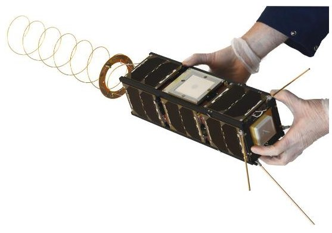
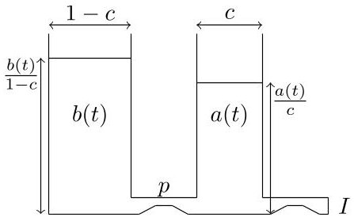
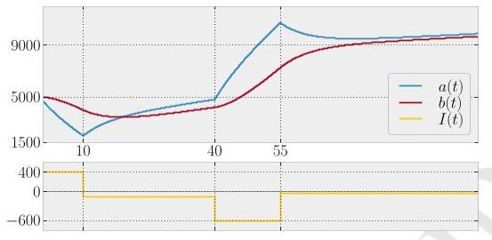
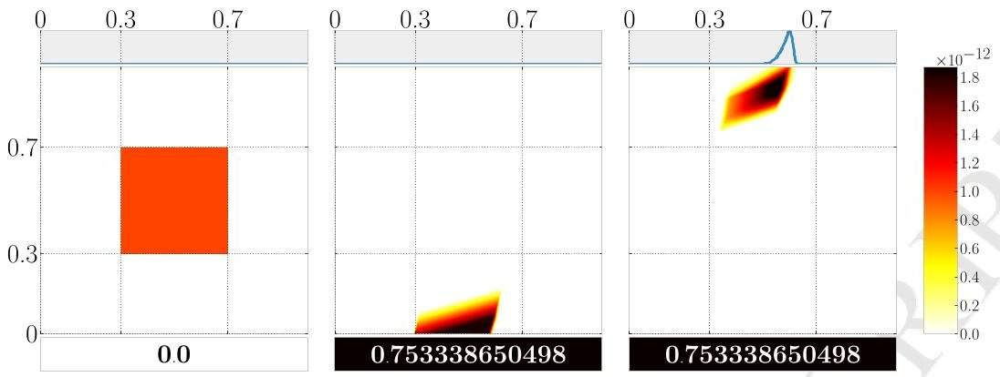
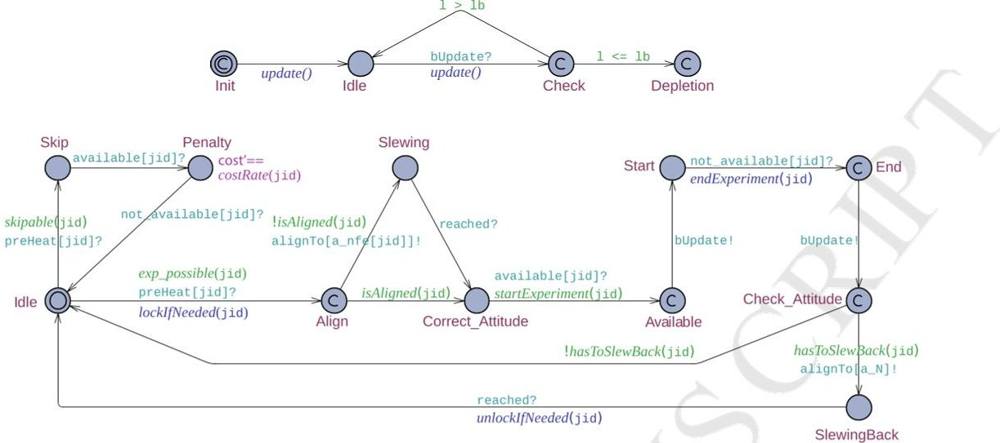
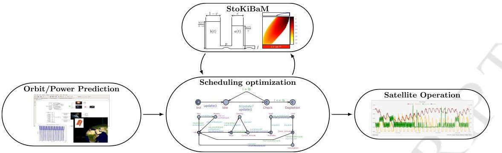
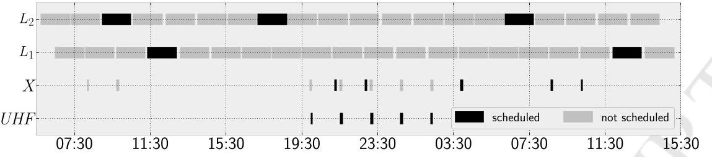
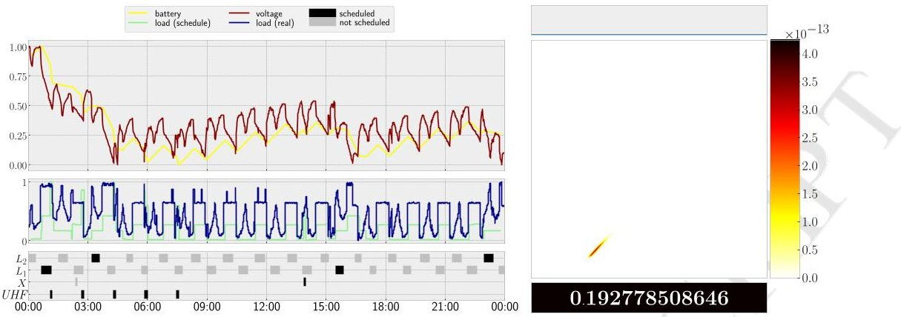
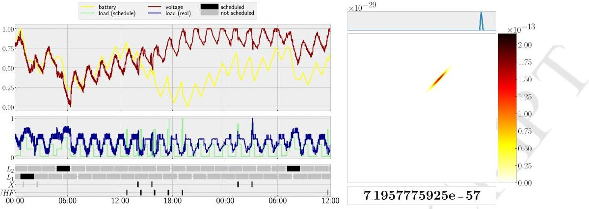
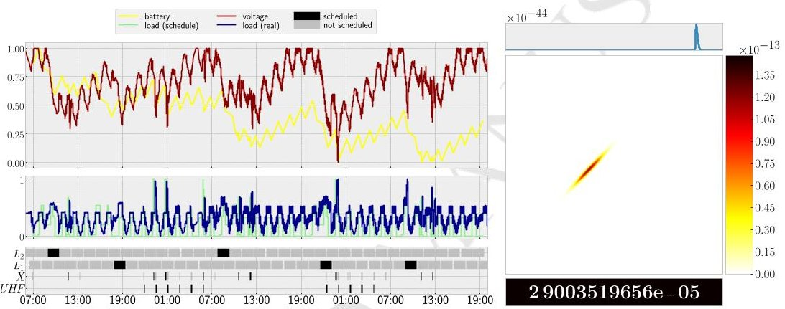

<!-- PDF_PAGE: 1 -->

# Mastering operational limitations of LEO satellites - The GOMX-3 approach

Nies, Gilles; Stenger, Marvin; Král, Jan; Hermanns, Holger; Bisgaard, Morten; Gerhardt, David; Haverkort, Boudewijn; Jongerden, Marijn; Larsen, Kim G.; Wognsen, Erik R. Published in: Acta Astronautica

DOI (link to publication from Publisher): 10.1016/j.actaastro.2018.04.040

Creative Commons License CC BY-NC-ND 4.0

Publication date: 2018

Document Version Accepted author manuscript, peer reviewed version

Link to publication from Aalborg University

Citation for published version (APA): Nies, G., Stenger, M., Král, J., Hermanns, H., Bisgaard, M., Gerhardt, D., Haverkort, B., Jongerden, M., Larsen, K. G., & Wognsen, E. R. (2018). Mastering operational limitations of LEO satellites - The GOMX-3 approach. Acta Astronautica, 151, 726-735. https://doi.org/10.1016/j.actaastro.2018.04.040

<!-- PDF_PAGE: 2 -->

# Accepted Manuscript

Mastering operational limitations of LEO satellites - The GOMX-3 approach

Gilles Nies, Marvin Stenger, Jan Krčal, Holger Hermanns, Morten Bisgaard, David Gerhardt, Boudewijn Haverkort, Marijn Jongerden, Kim G. Larsen, Erik R. Wognsen

PII: S0094-5765(17)30321-1

DOI: 10.1016/j.actaastro.2018.04.040

Reference: AA 6840

To appear in: Acta Astronautica

Received Date: 28 February 2017

Revised Date: 3 March 2018

Accepted Date: 22 April 2018

Please cite this article as: G. Nies, M. Stenger, J. Krčal, H. Hermanns, M. Bisgaard, D. Gerhardt, B. Haverkort, M. Jongerden, K.G. Larsen, E.R. Wognsen, Mastering operational limitations of LEO satellites - The GOMX-3 approach, Acta Astronautica (2018), doi: 10.1016/j.actaastro.2018.04.040.

This is a PDF file of an unedited manuscript that has been accepted for publication. As a service to our customers we are providing this early version of the manuscript. The manuscript will undergo copyediting, typesetting, and review of the resulting proof before it is published in its final form. Please note that during the production process errors may be discovered which could affect the content, and all legal disclaimers that apply to the journal pertain.

<!-- PDF_PAGE: 3 -->

# Mastering Operational Limitations of LEO Satellites - The GomX-3 Approach

Gilles Nies $ ^{a,1} $ , Marvin Stenger $ ^{a} $ , Jan Krčal $ ^{a} $ , Holger Hermanns $ ^{a} $ , Morten Bisgaard $ ^{b} $ David Gerhardt $ ^{b} $ , Boudewijn Haverkort $ ^{c} $ , Marijn Jongerden $ ^{c} $ , Kim G. Larsen $ ^{d} $ , Erik R. Wognsen $ ^{d} $

$ ^{a} $Saarland University, Saarland Informatics Campus, Saarbrücken, Germany $ ^{b} $GomSpace ApS, Aalborg, Denmark $ ^{c} $University of Twente, Enschede, The Netherlands $ ^{d} $Aalborg University, Aalborg, Denmark

## Abstract

When working with space systems the keyword is resources. For a satellite in orbit all resources are sparse and the most critical resource of all is power. It is therefore crucial to have detailed knowledge on how much power is available for an energy harvesting satellite in orbit at every time especially when in eclipse, where it draws its power from onboard batteries. This paper addresses this problem by a two-step procedure to perform task scheduling for low-earth-orbit (LEO) satellites exploiting formal methods. It combines cost-optimal reachability analyses of priced timed automata networks with a realistic kinetic battery model capable of capturing capacity limits as well as stochastic fluctuations. The procedure is in use for the automatic and resource-optimal day-ahead scheduling of GomX-3, a power-hungry nanosatellite currently orbiting the earth. We explain how this approach has overcome existing problems, has led to improved designs, and has provided new insights.

## 1. Introduction

The GomX-3 CubeSat is a 3 liter $ ( 3 0 \times1 0 \times1 0 \mathrm{c m}, $ 3kg) nanosatellite designed, delivered, and operated by Danish sector leader GomSpace. GomX-3 is the first ever In-Orbit Demonstration (IOD) CubeSat commissioned by ESA. The GomX-3 system uses Commercial-off-the-shelf (COTS) base subsystems to reduce cost, enabling fast delivery schedules to focus on payload development and testing. GomX-3 was launched from Japan aboard the HTV-5 on August 19, 2015. It successfully berthed to the ISS

<!-- PDF_PAGE: 4 -->

Figure 1: The final GomX-3 nanosatellite (left) and its deployment from the ISS (right) together with AAUSAT5 (picture taken by Astronaut Scott Kelly).

a few days later. GomX-3 was deployed from the ISS on October 5, 2015. Figure 1 shows the satellite and its deployment.

Both GomSpace and ESA are interested in maximizing the functionality of their nanosatellite missions. As such, GomX-3 has been equipped with a variety of technical challenging payloads and components, among them:

1. An agile 3-axis attitude determination and control system (ADCS) with a precision of $ 2^{\circ} $ or less, to augment further payloads by adding the possibility of tracking associated targets. The attitude control is realized through a combination of reaction wheels and magnetorquers, the latter enables positional adjustments with respect to the earth's magnetic field.

2. Worldwide in-flight tracking of commercial aircraft, especially on transatlantic flights, by acquisition of beacons through an ADS-B (Automatic Dependent Surveillance - Broadcast) receiver and a helix antenna designed for data collection at 1090 MHz.

3. An FPGA-based software defined radio, designed to monitor signals in L-Band (1-2 GHz radio spectrum), primarily used to screen and characterize spot beams of the INMARSAT geostationary satellite series.

4. Testing an experimental high-rate data transmitter designed to send in the X-Band spectrum (8-12 GHz), promising data downlink speed of up to 100 Mbps, as a third party payload. Downlink opportunities are provided by ESA ground stations in Toulouse (France) or Kourou (French Guiana).

In addition, it features a UHF (Ultra high frequency - frequency range: 300 MHz and 3 GHz) software defined radio module for downlinking collected data to - and uplinking new instruction from the GomSpace base station in Aalborg, Denmark.

For a satellite in orbit all resources are sparse and the most critical resource of all is power. Power is required to run the satellite, to communicate, to calculate, to perform experiments and all other operations. Detailed knowledge on the power budget, i.e. energy expenditure of hardware modules when in use/idle, is thus essential when

<!-- PDF_PAGE: 5 -->

operating a satellite in orbit. Furthermore, in a satellite not all power is used as it is generated.

The satellite passes into eclipse each orbit, thus making energy harvesting capabilities indispensable. For this purpose, GomX-3 flies a 14.8 V Li-Ion battery pack holding a capacity of 2.6 Ah in the context of GomSpace's NanoPower P31u power system, and is equipped with a total number of 11 NanoPower P110 solar panels, each delivering a power of around 5.5W orbit average.

The harvested solar energy is then either used immediately if needed, or utilized to recharge the on-board batteries to power the satellite in eclipse.

This energy harvesting challenge is especially apparent for nanosatellites where not only the actual satellite but also the resources are very small. Given the large amount of payloads in the small satellite, volume constraints were important during the design phase and consequently power constraints are severe during in orbit operations due to relatively small energy storage capabilities.

An operator of such a spacecraft is thus faced with a highly complex task when having to manually plan and command in-orbit operations constantly balancing power and data budgets.

In this paper we report on our joint activities, part of the EU-FP7 SENSATION project, to leverage on formal modeling and verification technology, so as to provide support for commanding in-orbit operations while striving for an efficient utilization of spacecraft flight time. Concretely, we have developed a toolchain to automatically derive battery-aware schedules for in-orbit operation. The heterogeneous timing aspects and the experimental nature of the application domain make it impossible to use traditional scheduling approaches for periodic tasks.

The schedules we derive are tailored to maximize payload utilization while minimizing the risk of battery depletion. The approach is flexible in the way it can express intentions of spacecraft engineers with respect to the finer optimization goals. It comes as an automated two-step procedure, and provides quantifiable error bounds.

For the first step, we have developed a generic model of the GomX-3 problem characteristics in terms of a network of priced timed automata (PTA) [1]. This model is subjected to a sequence of analyses with respect to cost-optimal reachability (CORA) with dynamically changing cost and constraint assignments. We use UPPAAL CORA for this step. The latter is a well understood and powerful tool to find cost optimal paths in PTA networks [2]. At this stage, the battery state is taken into consideration only by a linear battery model, owed to the facts that it is the most widely used model for energy and because nonlinearities are not supported in UPPAAL CORA. As this model is known to be unjustifiably optimistic, any schedule generated in this step has a risk of not being safe when used in-orbit, running on a real battery and with real payload.

To account for this problem, a second step validates the generated schedule on a much more accurate model of the on-board battery, a model that includes nonlinearities and also accounts for the influence of stochastic perturbations of load or battery state. For this step, we employ a stochastic enhancement [3] of the kinetic battery model [4] (KiBaM) with capacity bounds. As a result it is possible to discriminate between schedules according to their quantified risk of depleting the battery. Low risk schedules are shipped to orbit and executed there. The satellite behaviour is tightly monitored and the results gained are used to improve the model as well as the overall

<!-- PDF_PAGE: 6 -->

Figure 2: The two-wells depiction of the KiBaM (left) and a SoC evolution trace over time under a piecewise constant load (right).

procedure.

The entire toolchain has been developed, rolled out, experimented with, and tailored for in-the-loop use when operating the GomX-3 satellite. We report on experiences gained and lessons learned, and highlight the considerable prospect behind this work, in light of future developments in the space domain.

This paper is an extended and revised version of a conference paper presented at the International Astronautical Conference in 2016 [5]. A more detailed technical description of the toolchain engineered is provided in [6]. The present paper conceptually overarches these by providing a complete description of the GomX-3 satellite and its space domain context as well as a discussion about how to include battery ageing effects into the present scheduling toolchain.

## 2. Kinetic Battery Model

Batteries in-the-wild exhibit two non-linear effects widely considered to be the most important ones to capture: the rate capacity effect and the recovery effect. The former refers to the fact that if continuously discharged, a high discharge rate will cause the battery to provide less energy before depletion than a lower discharge rate. Thus a battery's effective capacity depends on the rate at which it is discharged. The latter effect describes the battery's ability to recover to some extent during periods of no or little discharge. We use the kinetic battery model (KiBaM) as the simplest model capturing these effects. It is known to provide a good approximation of the battery state of charge (SoC) across various battery types [3]. For a survey on battery models providing a context for the KiBaM, we refer to [7,8].

The KiBaM divides the stored charge into two parts, the available charge and the bound charge. When the battery is strained only the available charge is consumed instantly, while the bound charge is slowly converted to available charge by diffusion. For this reason the KiBaM is often depicted by two wells holding liquid, interconnected by a pipe, as illustrated in Figure 2.

The diffusion between available and bound charge can take place in either direction depending on the amount of both types of energy stored in the battery. Both non-linear effects are rooted in the relatively slow conversion of bound charge into available charge or vice versa. The KiBaM is characterized by two coupled differential

<!-- PDF_PAGE: 7 -->

equations:

$$
\dot {a} (t) = - I (t) + p \left(\frac {b (t)}{1 - c} - \frac {a (t)}{c}\right),
$$

$$
\dot {b} (t) = p \left(\frac {a (t)}{c} - \frac {b (t)}{1 - c}\right).
$$

Here, the functions a(t) and b(t) describe the available and bound charge at time t respectively, $ \dot{a} (t) $ and $ \dot{b} (t) $ their time derivatives, and I(t) is a load on the battery. We refer to the parameter p as the diffusion rate between both wells, while parameter $ c \in[0,1] $ corresponds to the width of the available charge well, and 1-c is the width of the bound charge well. Intuitively, $ a(t)/c $ and $ b(t)/(1-c) $ are the level of the fluid stored in the available charge well and the bound charge well, respectively. Figure 2 shows a SoC trace of the KiBaM ODE system. We denote the KiBaM SoC at time t as $ [a_{t};b_{t}]$ and consider I(t) to be piecewise constant.

Adding Randomness and Capacity Limits. The KiBaM model has been extended with capacity limits (say $ a_{\mathrm{m a x}} $ for the available charge and $ b_{\mathrm{m a x}} $ for the bound charge), as well as means to incorporate stochastic fluctuations in the SoC and the load imposed on the battery. Both extensions come with their own set of technical difficulties. For a complete technical development of this we refer to [3]. In this setting SoC distributions may not be absolutely continuous, because positive probability may accumulate in the areas $ \{[0;b]\mid 0 < b < b_{\mathrm{m a x}}\} $ where the available charge is depleted and $ \{[a_{\mathrm{m a x}};b]\mid 0 < b < b_{\mathrm{m a x}}\} $ where the available charge is full. Therefore, one works with representations of the SoC distribution in the form of triples $ \langle f,\bar{f},z\rangle $ where

- f is a joint density over ]0, $ a_{\max}[\times ]0, b_{\max}[ $ , which represents the distribution of the SoC in the area within the limits,

- $ \bar{f} $ is a density over $ \{a_{\mathrm{max}}\} \times ]0,b_{\mathrm{max}} $ [ and captures the bound charge distribution while the available charge is at its limit $ a_{\mathrm{max}} $

- $ z\in[0,1] $ , the cumulative probability of depletion.

It is possible to analytically express an under-approximation of the SoC distribution $ \langle f_{T},\bar{f}_{T},z_{T}\rangle $ after powering a task $ (T,g) $ when starting with the initial SoC distribution $ \langle f_{0},\bar{f}_{0},z_{0}\rangle $ , where T is a real time duration and g is the probability density function over loads. We omit the derivation of these expressions due to their lengthiness. Sequences of tasks $ (T_{0},I_{0}) $ ,..., $ (T_{k},I_{k}) $ can be handled iteratively, by considering the resulting SoC distribution after powering the i-th task $ (T_{i},I_{i}) $ to be the initial SoC distribution for powering the $ (i+1) $ -st task.

Figure 3 displays the SoC distributions while powering an exemplary task sequence, on the same colorscale. Each distribution $ \langle f,\bar{f},z\rangle $ is visualized as three stacked parts: f is represented in the heat map (middle), the curve of $ \bar{f} $ in the small box (top), z in the small box as a color-coded probability value representing the cumulative depletion risk (bottom).

<!-- PDF_PAGE: 8 -->

Figure 3: An exemplary battery with $ a_{\mathrm{max}}=b_{\mathrm{max}}=5\cdot10^{6}, $ $ c=0.5, $ $ p=0.0003 $ with an initially uniform SoC density over the area $ [0.3,0.7]a_{\mathrm{max}}\times[0.3,0.7]b_{\mathrm{max}} $ (left), subjected to a task sequence (500, $ \mathcal{U} $ [3000, 3600]), (600, $ \mathcal{U} $ [ -3300, -3900] ) with $ \mathcal{U} $ denoting a uniform distribution. Roughly 75% of the SoC density flows into the depletion area (negative available charge) after powering the first task and is thus accumulated in z (middle). The remaining 25% are considered alive and transformed further. Some of it even reaches the capacity limit $ a_{\mathrm{max}} $ of the available charge (right).

## 3. Modeling the GomX-3 Nanosatellite

## 3.1. Priced Timed Automata

The model of Timed Automata (TA) [9] has been established as a standard modeling formalism for real time systems. A timed automaton is an extension of finite state machines with non-negative real valued variables called clocks in order to capture timing constraints. Thus, a timed automaton is an annotated directed graph over a set of clocks C with vertex set (called locations) L and edge set E. Edges and locations are decorated with conjunctions of clock constraints of the form c $ \bowtie $ k where c $ \in $ C, k $ \in $ $ \mathbb{N} $ and $ \bowtie \in \{<, \leq, =, \geq, >\} $ . For edges such constraints are called guards, for locations they are called invariants. Edges are additionally decorated with reset sets of clocks. Intuitively, taking an edge causes an instantaneous change of location and a reset to 0 for each clock in the reset set. However, an edge may only be taken (nondeterministically at any time point) if its guard and the target location's invariant are satisfied.

If this is not the case the current location remains active if its invariant permits, and clocks increase continuously with their assigned rates, thus modeling the passing of time. In order to reason about resources, TAs are enriched with non-negative integer costs and non-negative cost rates in the form of annotations for edges and locations respectively [1]. The result are priced timed automata (PTA). The intuition is that cost accumulates continuously in a proportional manner to the sojourn time at locations and increases discretely upon taking an edge as specified by the respective annotations.

The most relevant problem to consider in the context of PTA is that of computing the minimum cost to reach a certain target location in a given PTA. This so-called cost-optimal reachability analysis (CORA) receives dedicated attention in the literature [2,10] and is well-known to the community. It is implemented in the prominent tool UPPAAL CORA [11]. As input UPPAAL CORA accepts networks of PTAs extended by discrete variables, and thus allows for modular formalization of individual components.

<!-- PDF_PAGE: 9 -->

The set of goal states is characterized by formulae over the variables in the network of PTAs.

## 3.2. GOMX-3 Objectives

GomX-3 mission objectives are threefold: Tracking of ADS-B beacons emitted by commercial airplanes, testing a high-rate X-Band transmitter module for in-space adequacy, and monitoring spot-beams of geo-stationary satellites belonging to the InmarSat family, via an L-Band receiver. In addition, it features a UHF software defined radio module for downlinking collected data to and uplinking new instructions from the GomSpace base station in Aalborg, Denmark. In the sequel, we refer to the operation of one of these payloads as a job. Each of these jobs comes with its own set of satellite attitude configurations, making an advanced 3-axis attitude control system indispensable. This attitude control uses magnetorquers and reaction wheels to enable the satellite to slew into any dedicated position with a precision of up to $ 2^{\circ} $ . It is especially power-hungry.

As an earth-orbiting satellite, GomX-3 naturally enters eclipse. To continue operation, it draws the necessary power to sustain its operation from an onboard battery system. These batteries are, in turn, charged by excess energy harvested during insolation periods by solar panels that cover any non-occupied surface.

Since its launch, GomX-3's follows the roughly equatorial orbit of (and below) the ISS. Therefore, insolation periods as well as operation windows for the different jobs are well predictable over the time horizon of about a week ahead, yet they are highly non-periodic. Exploiting the predetermined attitude configurations per mode of operation, the net power balance of every job can be predicted by the in-house GomSpace PowerSim tool.

Table 1 contains a complete table of GoMX-3's relevant hardware components, their energy consumption per second, as well as their contribution to the background load.

This information is the essence of the power-relevant behavior of GomX-3. In order to understand their joint implications for the energy budget of GomX-3, it is important to accurately model these power-relevant aspects of the satellite components, and their interplay.

The GomX-3 mission has been commissioned by ESA for the purpose of thoroughly testing the in-orbit adequacy of the X-Band transmitter module. That module has never been spaceborne before, but is considered for use in future more complex space missions. The weight and volume restrictions for CubeSats (1kg per liter unit) have direct implications on the battery dimensioning: they must neither be too heavy nor take up too much space. As a result, the primary mission goal of GomX-3 has been to maximize the number of jobs carried out, so as to gather a maximum amount of diagnostic data about the X-Band module, while avoiding the battery SoCs to drop below a certain threshold. The concrete objectives spelled out by GomSpace engineers changed several times along the mission. This meant that the models needed to be sufficiently flexible to reflect such requirement changes once made formal.

GomX-3 switches to Safe Mode if the battery SoC falls below a given threshold. For GomX-3 this threshold is at 40% of the battery's capacity. In Safe Mode, all nonessential hardware components are switched off, preventing the satellite from being

<!-- PDF_PAGE: 10 -->

<table border="1"><tr><td>Module</td><td>Description</td><td>Power Cons.(mJ/s)</td><td>bg. duty cycle(%)</td></tr><tr><td>NanoMind A3200 OBC</td><td>Onboard Computer</td><td>276</td><td>100</td></tr><tr><td>NanoPower P31U,NanoPower P110</td><td>electrical power supply system with a variety of NanoPower P110 solar panels</td><td>127</td><td>100</td></tr><tr><td>NanoPower BP4</td><td>Battery pack consisting of 4 Li-ion cells, integrated heater and temperature sensor</td><td>3360</td><td>0</td></tr><tr><td>NanoCom AX100,NanoCom ANT430</td><td>UHF reception and transmission for communication GomSpace headquarters in Aalborg</td><td>276(reception),2630(transmission)</td><td>1000</td></tr><tr><td>NanoCom ADS-B,Helix Antenna</td><td>Reception of Aircraft ADS-B transponder beacons</td><td>552</td><td>100</td></tr><tr><td>NanoMind A3200 ADCS</td><td>Attitude Determination and Control System component on the NanoMind A3200 onboard computer</td><td>278</td><td>100</td></tr><tr><td>Magnetometer,Sun sensors</td><td>Sensors to measure the suns position relative to the satellite as well as the strength and direction of the earth&#x27;s magnetic field</td><td>190</td><td>100</td></tr><tr><td>Magnetorquers</td><td>Device to change attitude via the earth&#x27;s magnetic field</td><td>584</td><td>25</td></tr><tr><td>Reaction wheels</td><td>Module for attitude changes via generated torque and momentum storage capability</td><td>992</td><td>100</td></tr><tr><td>GPS</td><td>Global Positioning System</td><td>1436</td><td>10.77</td></tr><tr><td>SOFT</td><td>FPGA-based Software Defined Radio Platform,used for spot-beam characterization of geostationary satellites.X-Band requires this module to be in transmission mode,while L-Band requires reception mode.</td><td>3863(reception),2825(transmission)</td><td>0,0</td></tr><tr><td>X-band Transmitter</td><td>Module for fast transmission on the X-Band frequency band,to downlink to ESA ground station in Kourou and CNES antenna in Toulouse.</td><td>9120</td><td>0</td></tr></table>

Table 1: A listing of the hardware modules built into GomX-3. The last column features the background duty cycle in percent, indicating with which intensity each module runs thereby contributing to the background load.

<!-- PDF_PAGE: 11 -->

productive. The primary objective is thus to avoid Safe Mode while maximizing secondary objectives. Several such secondary objectives need to be taken into account, as follows.

- Whenever possible the UHF connection to the GomSpace base station must be scheduled and maintained throughout the entire operation window in order to enable monitoring the status of GomX-3 and to uplink new instructions if need be. This is crucial to maintain control over the satellite and thus considered vital for the mission.

- Independent of the satellite attitude, the ADS-B helix antenna is able to receive ADS-B beacons. Thus this hardware module will be active at all times, thereby constantly collecting data of airplane whereabouts.

- The X-Band windows are small, as the downlink connection can only be established if the satellite is in line of sight and close enough to the receiving ground station. The corresponding downlink rate, however, is relatively high.

- L-Band jobs will have job windows as long as an orbit duration but vary a lot depending on the time of the year, and will collect a lot of data if successful. The variations in window length can be observed in Section 5, where actual schedules are visualized.

- L-Band jobs are to become as balanced as possible across the available INMARSATS.

- Jobs filling their entire job window are most valuable. Jobs that have been aborted early or started late are not considered interesting and are to be avoided.

- L-Band and X-Band jobs are mutually exclusive, as they require different attitudes. UHF jobs may be scheduled regardless of the current attitude, even when L-Band or X-Band jobs are concurrently executed.

- Only downlinked data are useful, thus the time spent on data collection payloads (L-Band, ADS-B) and downlink opportunities (X-Band) needs to be balanced in such a way that only a minimal amount of data needs to be stored temporarily in the satellite's memory. This induces the need to weigh data collection rate and downlink speed against each other.

Based on these observations and the expertise of GomSpace engineers, it was deemed that two fully executed X-Band jobs are enough to downlink the data of one successful L-Band job together with the ADS-B data collected in the meanwhile.

## 3.3. PTA Modeling

As the central modeling formalism, PTAs are employed to describe the behavior of GomX-3, with special emphasis being put on flexibility w.r.t. the optimization objective. In order to allow for easy extensibility, the model has been kept modular and generic. Notably, the PTA formalism is not expressive enough for the nonlinearities of

<!-- PDF_PAGE: 12 -->

the kinetic battery model. Therefore we use a simple linear model (intuitively corresponding to a single well holding liquid) instead, and account for this discrepancy later. The component models belong to the following categories.

Background load comprises the energy consumption of modules that are always active, including the ADS-B module for tracking airplanes, the reaction wheels and magnetorquers (even though not at full power) for keeping the attitude invariant.

Jobs are dealt with in a generic way, so that only the common characteristics are modeled. A job has a finite time window of when it can be executed, it may be skipped, it may require an a priori warm-up time (to ramp up the physical modules required for the job, especially the ACDS) as well as a specific attitude, it may need to activate a set of related modules inducing piecewise constant loads, and its windows may occur in a periodic pattern.

Battery represents a relatively simple linear battery which can support piecewise constant loads. It keeps track of its (one-dimensional) state of charge and updates that based on the (dis)charge rate and the time until the load changes again. Since the battery is modeled as an automaton, the system can monitor and take decisions based on the remaining battery charge.

Attitude represents the predetermined attitude requirements of each job and the worst case slewing time of 5 minutes. However, preparing the ACDS and actual slewing can be abstracted into one single warm-up period, since both stages consume the same amount of energy. Thus, the worst-case warm-up time before entering the visibility range of any experiment window requiring slewing was raised to 10 minutes.

Sun is a simple two-state automaton (insolation and eclipse) based upon the predicted insolation times, triggering a constant energy infeed due to the solar panels.

Among these components, the PTAs modeling the battery and the job aspects are the most interesting. They are depicted in Figure 4 and explained in more detail below.

Job: This automaton represents the execution or skipping of a job. It starts in its ldle location, waiting to be notified of impending warm-up duties. At this point the take-or-skip decision is taken, as witnessed by the two outgoing transitions into locations labeled Skip and Align. A job is either skipped because it is not optimal to take it, or because the attitude requirements do not match the current attitude of the satellite because of an already ongoing job.

If the job is skipped, cost is accumulated with rate costRate(jid) over the duration of the job, effectively returning into location Idle. If it is taken, attitude requirements of the scheduled job are checked via the guard isAligned(jid). If not satisfied, the satellite starts slewing (location Slewing) to the correct attitude (location Correct_Attitude). Upon notification, the job is executed (Start $ \rightarrow $ End $ \rightarrow $ Check_Attitude) triggering the battery via channel bUpdate to update its SoC, and finally checks whether it has to change attitude to minimize atmospheric drag using guards hasToSlewBack(jid) to finally return to location Idle.

<!-- PDF_PAGE: 13 -->

Figure 4: The Battery automaton (top) and the Job instance automaton (bottom).

Battery: This model represents a simple linear battery with capacity that can be (dis)charged with piecewise constant loads. It is notified of load changes via channel bUpdate, upon which it updates the system variables by executing the function update $ \cdot $ . In the function's body, the length of a constant load interval is computed via the difference of global integer variables new_time and old_time. The result multiplied by rate is then subtracted from its internal SoC 1, upon which it ends up in location Check. A check is performed whether the SoC fell below a threshold 1b, upon which we either transition into (and stay in) the Depletion location or return to Idle to power another task.

## 3.4. Cost Model and Reachability Objectives

In the following we explain how the objectives derived by GomSpace engineers were turned into constraints and cost parameters of the PTA model.

The Safe Mode threshold is kept variable and must be set before scheduling. It appears as 1b (for lower bound) in the automata models. Depending on the degree of aggressiveness of the intended schedule, it can either be set close to the real Safe Mode threshold of 40% or it can be set higher, for example to 55%, thereby adding an implicit safety margin.

UPPAAL CORA computes cost-minimal schedules. Therefore, we interpret the cost annotations of PTA transitions as penalties for skipped jobs. Likewise cost rates in states accumulate penalty per time unit if a job window is left unused. An optimal schedule will then have the property that a minimal portion of important jobs windows was left unexploited.

An immediate consequence of this setup is that UHF jobs have a high penalty if skipped, as they are supposed to be scheduled every time they are possible. For L-Band and X-Band jobs, the number of jobs scheduled should result in an average ratio of 1/2, according to the GomSpace directives. To arrive there, we proceed as follows. Let $ \Delta_{X} $ and $ \Delta_{L} $ denote the job windows length expectations of X-Band and L-Band jobs,

<!-- PDF_PAGE: 14 -->

Figure 5: Scheduling workflow.

respectively. Then the cost rate for skipping L-Band and X-Band window portions is set $ 2 \cdot \Delta_{X} $ and $ \Delta_{L} $ , respectively. Likewise, the L-Band jobs on different INMARSAT are internally viewed as different jobs. Their cost rates for skipping should be set equal.

In order to generate an optimal schedule from the network of PTAs up to a certain time horizon (treated as an orbiting count), we need to define the goal set of states to be used in a reachability objective as supported by UPPAAL CORA. To this end, we simply introduce a small automaton that counts the orbits already scheduled and manages this number globally, say in a variable n. A query for a schedule of n orbits can then easily be formulated as $ \exists \diamond(n=20). $

## 4. The Scheduling Workflow

The scheduling workflow, depicted in Figure 5, loops through a two-step procedure of schedule generation and schedule validation. The latter is needed to account for the inaccuracies of the simple linear battery model, which is used for schedule generation, relative to real battery kinetics. Therefore any generated schedule is validated along the stochastically enhanced KiBaM known to be sensitive to such effects. If the validation does not exhibit good enough guarantees, the current schedule is discarded and excluded from the generation step, and a new schedule is computed. Otherwise it will be accepted, upon which we break the loop and ship the schedule to orbit. Upon rejection of a schedule the constraint set may be loosened, to ensure termination of the synthesis-validation loop.

## 4.1. Schedule Generation

The mission times to be considered for automatic scheduling span between 24 and 72 hours. Longer durations are not of interest since orbit predictions are highly accurate only for a time horizon of a handful of days, and because GomX-3 is as a whole an experimental satellite, requiring periods of manual intervention. However, even a 24 hour schedule computation constitutes a challenge for plain CORA, since the number of states grows prohibitively large.

<!-- PDF_PAGE: 15 -->

Heuristics. The state-space explosion can, to a certain extent, be remedied by using heuristics, i.e. exclusion of certain schedules at the risk of losing optimality. Here is a brief overview of the heuristics used:

1. Take every job if the battery is almost full. Job opportunities will be taken if the battery is close to being full, since the battery cannot store more energy anyway. This minimizes the risk of not being able to harvest energy due to a full battery.

2. Force discard of schedules on depletion. This simple, yet effective heuristic forces the PTA network into a dedicated deadlock location (Depletion) whenever the battery automaton reaches a non positive SoC, resulting in the schedule to be dropped.

The following heuristics are specific to objectives expressed by the GomSpace engineers.

3. An L-Band job precedes two X-Band jobs. To avoid storage of large amounts of data on the satellite, we bound the ratio of data collection and downlink jobs. A ratio $ \mathrm{r_X} / \mathrm{r_L} $ can be approximated greedily by adding a global variable r (initially 0) as well as guards to the Job automaton such that X-Band jobs are scheduled only if $ \mathrm{r} \geq \mathrm{r_L} $ and L-Band jobs are scheduled only if $ \mathrm{r} < \left( \mathrm{r_X}+\mathrm{r_L} \right) \cdot \mathrm{r_X} $ . Upon scheduling an X-Band and L-Band job, we set $ \mathrm{r} \ :=\mathrm{r}-\mathrm{r_L} $ and $ \mathrm{r} \ :=\mathrm{r}+\mathrm{r_X} $ respectively. With $ \mathrm{r_X} \ :=\ 2 $ and $ \mathrm{r_L} \ :=\ 1 $ schedules never start with an X-Band job and in the long run, the ratio of X-Band to L-Band jobs stays between 1 to 1 and 2 to 1.

4. Keep L-Band jobs in balance across INMARSATS. Similarly to the realization of the above heuristic we bound the difference among L-Band jobs on the relevant INMARSATS to at most 2.

5. Always schedule UHF jobs. Instead of penalizing skipped UHF jobs by annotations of large costs (to enforce their scheduling), we enforce them on the automaton level, omitting any cost annotation.

## 6. Impose upper bound on discharging loads. This heuristic does what it says.

Especially heuristic 6 proves useful in several ways. First, the KiBaM used in the validation step yields less energy before depletion if subjected to high loads due to the rate-capacity effect (that is not captured by the linear battery model). Second, high loads are reached when UHF jobs are scheduled in addition to an L- or X-Band job. Such situations seem lucrative to UPPAAL CORA, given that they do not accumulate much cost. Yet, they often result in schedules that leave the battery (almost) empty. Third, the bound can be chosen such that parallel experiments, and thus high loads, occur only during periods of insolation, such that solar input is able to support them.

To give some insight into the effect of each heuristic on the computation with UPPAAL CORA, we provide a comparison by means of an example, reported in the following table.

<!-- PDF_PAGE: 16 -->

Figure 6: Depiction of a schedule. Job windows of a certain type, i.e L-Band on different INMARSATS $ ( L_{1}, $ $ L_{2}), $ X-Band (X) and UHF, are displayed as black (grey) bars if they were indeed scheduled (not scheduled).

In the example all the above mentioned heuristics were implemented (first row), except for the one mentioned (other rows), where the optimal value column indicates the costs accumulated on the optimal path found by UPPAAL CORA.

<table border="1"><tr><td>heuristics used</td><td>CORA time</td><td>states explored</td><td>optimal value</td></tr><tr><td>all</td><td>2.6</td><td>172452</td><td>262792</td></tr><tr><td>all but 1</td><td>10.2</td><td>700429</td><td>262792</td></tr><tr><td>all but 2</td><td>80.7</td><td>5474775</td><td>262792</td></tr><tr><td>all but 3</td><td>8.9</td><td>592233</td><td>258081</td></tr><tr><td>all but 4</td><td>3.7</td><td>224517</td><td>262792</td></tr><tr><td>all but 5</td><td>2.7</td><td>175191</td><td>262792</td></tr><tr><td>all but 6</td><td>86.1</td><td>6029126</td><td>243269</td></tr></table>

It becomes apparent that heuristic 2 and 6 are the most effective. Most of the combinations studied induce the schedule depicted in Figure 6.

At first sight, dropping heuristics 3 or 6 lead to superior solutions, as witnessed by the lower optimal value.

Without heuristic 3 one more X-Band job can indeed be scheduled, explaining why this schedule is cheaper in terms of accumulated penalty. It is, however, scheduled before the first L-Band job, rendering it useless because there is nothing to downlink. As expected, without heuristics 6, UPPAAL CORA predominantly schedules UHF jobs parallel to X- or L-Band jobs, thereby straining the battery. The large number of states explored indicates that the state space exploration in this case is often misguided into eventual battery depletion.

Dynamic scheduling. Another issue is that UPPAAL CORA's optimization criterion is static, i.e., the price rates cannot be updated based on the schedule generated so far. This is contrasted by the GomSpace engineering intention of having a dynamic scheduling approach. We take care of this by viewing the PTA network as being parameterized, i.e., as templates that need to be instantiated by concrete values. This enables us to divide the scheduling interval into disjoint subintervals that can be scheduled individually, with distinct scheduling objectives and prices, all the while carrying over resulting quantities as initial values to the subsequent subinterval to be scheduled. Important quantities that need to be passed on are the resulting battery state, the number of individual jobs already scheduled and the state of the PTA network at the end of the

<!-- PDF_PAGE: 17 -->

previous subinterval. This information allows us to adjust the prices and scheduling objective at the end of each subinterval, depending on the requirements previously fixed. The subschedules are then conjoined to a schedule for the actual time interval. This line of action is a trade-off between optimality and being dynamic, as it implements a greedy heuristics.

Given the back-to-back nature of this approach, it is undesirable to start with an almost empty battery after a scheduling interval. We require the battery to have a certain minimum charge at the end of the schedule. This requirement translates directly to a reachability query on the PTA network: $ \exists \diamond (\mathrm{n}=2 0 \land 1 \geq 7 5 0 0 0 0 00), $ where 1 is the global variable representing the battery SoC.

## 4.2. Schedule Validation

As mentioned, UPPAAL CORA's expressiveness does not allow for direct modeling of the KiBaM as a PTA. Instead the schedule computed is based on the simple linear model, that is known to not capture important effects that can be observed from measurements of real batteries. In order to validate whether the computed schedule truly does not violate the constraints we impose, we need to validate the schedule along the above mentioned stochastic KiBaM with capacity limits. In fact, such a schedule can be seen as a sequence of tasks $ \left(T_{j}, I_{j}\right) $ which can immediately be used as input to the method to bound the cumulative risk of premature battery depletion of the computed schedule. The initial KiBaM SoC distribution is assumed to be a truncated 2D Gaussian around the initial battery state given to the PTA network, and white noise is added to the loads of the tasks. If the validation step exhibits a low enough depletion risk, the computed schedule is accepted, otherwise the schedule is excluded, and another schedule is computed. There may be several paths that are optimal to UPPAAL CORA, but that can be discriminated by the StoKiBaM. Thus, we don't loosen the constraint set after each failed schedule validation run, in the hope that among the multitude of optimal schedules there is one that survives the KiBaM validation. Only upon failure of UPPAAL CORA to provide any more schedules exhibiting the same accumulated costs, we raise the safe-mode threshold slightly.

## 4.3. Schedule Shipping

In order to uplink a schedule to GOMX-3, several comma separated files (.csv) are generated. Each file contains a list of job opportunities of a certain type, for example L-Band (see below), given by two timestamps representing the start time and the end time of the job window respectively, the implied duration of the timestamps, as well as a flag that shows whether the opportunity should be taken. One such file is displayed in Table 2.

## 4.4. Implementation

The operational windows for jobs are provided by GomSpace and their inhouse tool PowerSim. In addition to the interval to be scheduled, they serve as input to a Python script, which wraps the scheduling and validation parts. The python script (i) preprocesses the csv tables provided by GomSpace, (ii) instantiates the PTA templates with

<!-- PDF_PAGE: 18 -->

<table border="1"><tr><td>Access</td><td>Start Time(UTCG)</td><td>Stop Time(UTCG)</td><td>Duration(sec)</td><td>Scheduled</td></tr><tr><td>1</td><td>17 Nov 2015 00:38:38.922</td><td>17 Nov 2015 01:09:42.642</td><td>1863.720</td><td>1</td></tr><tr><td>2</td><td>17 Nov 2015 02:16:24.134</td><td>17 Nov 2015 02:45:23.914</td><td>1739.781</td><td>0</td></tr><tr><td>$\vdots$</td><td>$\vdots$</td><td>$\vdots$</td><td>$\vdots$</td><td>$\vdots$</td></tr><tr><td>$\vdots$</td><td>$\vdots$</td><td>$\vdots$</td><td>$\vdots$</td><td>$\vdots$</td></tr><tr><td>15</td><td>17 Nov 2015 23:41:20.490</td><td>18 Nov 2015 00:12:38.983</td><td>1878.493</td><td>0</td></tr></table>

Table 2: A table showing the data stored in a csv file representing part of a schedule.

those numbers, (iii) calls UPPAAL CORA on the PTA instances, (iv) postprocesses the optimal trace output by UPPAAL CORA to extract a schedule, (v) calls a simplified version of the StoKiBaM tool, written in C++, to validate the schedule, (vi) complements each operational window in the csv tables with the taken-or-skipped information, as dictated by UPPAAL CORA, (vii) and finally, produces plots of the generated schedule as well as the resulting SoC distribution, including the depletion risk, for visual inspection.

The preprocessing step is mainly conversion of absolute date-time objects (i.e. "17 Nov 2015 00:38:38.922") to UPPAAL CORA-compatible relative unix timestamps (0 being the starting point of the scheduling interval) represented as integers, as well as the selection of operational windows actually contained in the scheduling interval.

Postprocessing includes parsing of UPPAAL CORA's textual format of a trace, filtering it to remove intermediate states and, finally, the conversion back to date-time objects to decide which operational windows were actually taken. The generated csv files (and optionally the plots) are sent to GomSpace.

The tool including the templates, the models, a few operational window tables and the necessary executables (except for UPPAAL CORA, which has to be acquired separately) can be accessed under

https://www.powver.org/gomx3-supplementary-material/

## 5. Results

A number of successful experiments have been carried out on GomX-3 in-orbit, so as to evaluate and refine our method, focusing on the determination of schedules to be followed for the days ahead. These in-orbit evaluations have successfully demonstrated the principle feasibility and adequacy of the approach, as we will discuss in this section.

In Figures 7-9 three representative in-orbit experiments are summarized. The schedules are visualized as three stacked plots of data against a common time line (left). The bottom ones are Gantt charts showing which jobs are scheduled (black bars) and which job windows are skipped (gray bars) respectively. The plots in the middle display the loads imposed by the jobs as predicted (light green) and as actually measured (dark blue) on GomX-3. The top plots presents the battery SoC of the linear battery (yellow) as predicted by UPPAAL CORA as well as the actual voltage (dark red) logged by GomX-3. Voltage and SoC are generally not comparable. However, both quantities exhibit similar tendencies during the (dis)charging process. The battery, voltage and load curves have all been normalized to the interval [0,1] for comparison reasons.

<!-- PDF_PAGE: 19 -->

Figure 7: Schedule November 17, 2015 midnight to November 18, 2015 midnight.

<table border="1"><tr><td>Experimentdd.mm.yyhh:mm</td><td>Duration(h)</td><td>initialSoC(%)</td><td>Depletionthreshold(%)</td><td>Min.SoC(%)</td><td>Depletionrisk(%)</td><td>Safe Modeentered(nr.)</td></tr><tr><td>17.11.1500:00</td><td>24</td><td>85</td><td>40</td><td>40.3</td><td>≈19.3</td><td>2</td></tr><tr><td>14.02.1600:00</td><td>36</td><td>90</td><td>55</td><td>69.0</td><td>&lt;10^{-50}$</td><td>0</td></tr><tr><td>20.03.1607:00</td><td>60</td><td>90</td><td>55</td><td>55.9</td><td>&lt;10^{-2}$</td><td>0</td></tr></table>

Table 3: Summary of the experimental data. The table reports on the value chosen as internal depletion threshold to the battery automaton, the initial SoC provided to UPPAAL CORA, the minimal SoC along the schedule generated by UPPAAL CORA, the depletion risk as calculated by the stochastic KiBaM validation step and how often GomX-3 actually entered Safe Mode.

On the right, the three components of the SoC density resulting from the validation step are displayed, obtained by running the generated schedule along the stochastic KiBaM with capacity limits. It is to be interpreted as in Figure 3. The most crucial part is at the bottom of the plot, quantifying the risk of entering Safe Mode as specified by the GomSpace engineers (40%). The data is summarized in Table 3.

November 2015. The schedule presented in Figure 7 spans November 17, 2015. It is a schedule that optimizes for maximum L-Band payload operations, yielding 4 L-Band operations and 1 X-Band operation together with the 5 UHF ground station passes. The battery SoC and the measured battery voltage show a close correspondence. The validation step using the stochastic KiBaM estimates the risk of entering Safe Mode to over 19%. Indeed, GomSpace reported that GomX-3 entered Safe Mode (which we wanted to prevent) twice, if only for a short period of time, indicating a discrepancy between the data used in the scheduling synthesis step and GomX-3's factual energy budget.

February 2016. Figure 8 presents a schedule spanning one and a half day, starting on February 14, 2016. It illustrates how optimized scheduling can be utilized to not only take power limitations into consideration but also handle secondary constraints like data generation and data downlinking balance via L-Band and X-Band tasks. There is a noticeable difference in the length of L-Band job windows, relative to the earlier

<!-- PDF_PAGE: 20 -->

Figure 8: Schedule February 14, 2016 midnight to February 15, 2016 noon

Figure 9: Schedule March 20, 2016 7 AM to March 22, 2016 7 PM

experiment reported, as a consequence of experiences gained by the engineers in the meanwhile.

GomSpace engineers gave notice that L-Band jobs shall receive special treatment from now on: (i) Generally, the hardware modules related to L-Band jobs shall remain active for one whole orbit duration, once such a job is scheduled. (ii) The ACDS needs 30 minutes of warm-up time to prepare for the L-Band job. The initial SoC and the depletion threshold were communicated to us as 90% and 55%. The plot exhibits a drift between battery SoC and measured voltage around 3 PM of the first day, after initially showing a close correspondence, indicating that the battery is in a better state relative to our pessimistic predictions. The GomSpace engineers were able to track down this drift to a mismatch in the net power balance computed as input to the toolchain.

March 2016. The third schedule we present (Figure 9) is the longest in duration, spanning from March 20 at 7 AM to March 22 at 7 PM.

For this instance, the behaviour of GomX-3 was slightly adjusted. Due to the ability of changing attitude, a measure to increase the GomX-3 mission time by minimizing drag, was introduced by GomSpace. After each job, GomX-3 should return to the so-called nominal attitude (pointing the Helix antenna towards the flight direction),

<!-- PDF_PAGE: 21 -->

thereby extending its mission time. Thus, each scheduled job opportunity that requires a non-nominal attitude automatically had a 10 minutes ADCS cool-down phase appended. The energy consumption of cool-down and warm-up phases agree. After initial close correspondence of SoC and voltage, around 18 hours into the test run we observe a slight but continuous drift between predicted battery SoC and measured voltage, yet not as steep as in the February test run, since GomSpace engineers supplied corrected numbers.

A certain drift still persists, likely because every step in the scheduling pipeline is purposely designed to be pessimistic in order to never underapproximate depletion risk. Sources for pessimism consist of, but are not limited to overapproximation of actual slewing times with their worst case as well as underestimation of solar infeed.

## 6. Discussion and Conclusion

This paper has presented a battery aware scheduling approach for low-earth orbiting nanosatellites. The heterogeneous timing aspects and the experimental nature of this application domain pose great challenges, making it impossible to use traditional scheduling approaches for periodic tasks. Our approach harvests work on schedulability analysis with (priced) timed automata. It is distinguished by the following features: (i) The TA modeling approach is very flexible, adaptive to changing requirements, and particularly well-suited for discussion with space engineers, since easy-to-grasp. (ii) A dynamic approach to the use of cost decorations and constraints allows for a split scheduling approach optimizing over intervals, at the (acceptable) price of potential suboptimality of the resulting overall schedules. (iii) A linear battery model is employed while computing schedules, but prior to shipping any synthesized schedule is subjected to a quantitative validation on the vastly more accurate Stochastic KiBaM. The schedule is discarded if the guarantees are insufficient, resulting in recomputation of another schedule with a possibly looser constraint set, to ensure termination of this synthesis-validation loop. Especially the second point distinguishes the present approach from existing solutions, operating on very similar models [12]. These are however tailored to the synthesis of infinite schedules with respect to more periodic problems with static optimization criteria. The third of the above aspects is very close in spirit to the approach developed in [13], where a simulation-based analysis of computed schedules is used to validate or refute CORA schedules, under a model with stochastic breakdowns and repairs of production machinery. The stochastic KiBaM validation step is not based on simulation, but exact (or conservative) up to discretization.

The GomX-3 in-orbit experiments have demonstrated an indeed great fit between the technology developed and the needs of the LEO satellite sector. The schedules generated are of unmatched quality: It became apparent that relative to a comparative manual scheduling approach, better quality schedules with respect to (i) the number of experiments performed, (ii) the avoidance of planning mistakes, (iii) the scheduling workload, and (iv) the battery depletion risk are provided. At the same time, the availability of scheduling tool support flexibilizes the satellite design process considerably, since it allows the GomSpace engineers to obtain answers to what-if questions, in com-

<!-- PDF_PAGE: 22 -->

bination with their in-house PowerSim tool. This helps shortening development times and thus time-to-orbit.

There are (at least) two important extensions to be made to improve the current model, both related to the aging of the battery.

The first extension relates to the well-known fact that batteries degrade over time. However, it is far from well understood how this aging process develops exactly. A frequent and accepted assumption is to relate the aging process to the number and frequency of charge-discharge cycles, as well as the depth of the discharges. Hence, during the period of the satellite mission, the used battery will slowly degrade, thus, effectively, changing the KiBaM parameters p and c. The degradation will be most noticeable in a decrease of the usable capacity of the battery. During an experiment as presented in this paper, which takes up to 60 hours (see the rows in Table 3), the degradation is expected to be very small. However, between these experiments the battery degradation will surely be noticeable. This is witnessed by battery measurements we are currently performing in our lab. We notice that for the battery cells used in GomX-3, during the first (circa) 130 full cycles, the battery capacity decreases very slowly, however, from around 130 full cycles onwards, we notice a quite dramatic increase (by as much as factor of 5) in the capacity degradation factor per cycle. In the long run, the battery model parameters need to be adjusted to reflect this degradation, thus potentially requiring the need for new schedule computations, in order to not underestimate the depletion risk in later parts of the mission. For further details on battery aging effects, we refer to [14].

A second, related issue that needs further investigation is the relation between the actual discharge profile, which is intimately related to the usage profile, and the aging process. In another work-package of the SENSATION project, we have introduced a so-called score function based on a (fast) Fourier analysis of the charge-discharge profile of the batteries, thus allowing for a ranking of different usage profiles [15]. We subsequently used these rankings as a criterion for optimization for the overall lifetime of a battery-powered system. In a simplified setting, among others, with an ideal battery and much more abstract workloads, it has been possible to synthesize schedules that allow for a trade-off between optimal short-term payload throughput and operational life of the satellite, using the recently introduced tool component UPPAAL STRATEGO [16].

To conclude, state of the art technology and very rapid development cycles will continue to be crucial factors in the nanosatellite market. However, with product maturation happening through fully operational missions like GomX-3, the push towards larger nanosatellite constellations has been going on for some time in the industry. In fact, GomSpace will launch a spacecraft tandem (GomX-4 A and B) early 2018 and is actively pursuing several projects with much larger constellations. Deploying constellations of a large number of satellites (2 to 1000) brings a new level of complexity to the game. The need to operate a large number of satellites asks for a larger level of automation to be used than has previously been the case in the space industry. The technology investigated here is beneficial in terms of optimization and planning of satellite operations, so as to allow for more efficient utilization of spacecraft flight time. A spacecraft operator is faced with a highly complex task when having to plan and command in-orbit operations constantly balancing power and data budgets. This leads to the fact that for larger constellations tools for optimization, automation and validation

<!-- PDF_PAGE: 23 -->

are not only a benefit, but an absolute necessity for proper operations.

## Acknowledgments

This work has received support from the EU 7th Framework Programme project 318490 (SENSATION), by the European Space Agency under contract number RFP/NC/IPL-PTE/GLC/as/881.2014, by the CDZ project 1023 (CAP), by the Czech Science Foundation project P202/12/G061, and by the ERC Advanced Investigators Grants POWVER and LASSO. The GOMX-3 mission is supported by the European Space Agency under contract number RFP/NC/IPL-PTE/GLC/as/881.2014.

[1] G. Behrmann, A. Fehnker, T. Hune, K. Larsen, P. Pettersson, J. Romijn, F. Vaandrager, Hybrid Systems: Computation and Control: 4th International Workshop, HSCC 2001 Rome, Italy, March 28-30, 2001 Proceedings, Springer, Berlin, Heidelberg, 2001, Ch. Minimum-Cost Reachability for Priced Time Automata, pp. 147-161. doi:10.1007/3-540-45351-2_15. URL http://dx.doi.org/10.1007/3-540-45351-2_15

[2] G. Behrmann, K. G. Larsen, J. I. Rasmussen, Optimal scheduling using priced timed automata, ACM SIGMETRICS Performance Evaluation Review 32 (4) (2005) 34-40.

[3] H. Hermanns, J. Krcal, G. Nies, How is your satellite doing? battery kinetics with recharging and uncertainty, LITES 4 (1) (2017) 04:1-04:28. doi:10.4230/ LITES-v004-i001-a004. URL https://doi.org/10.4230/LITES-v004-i001-a004

[4] J. F. Manwell, J. G. McGowan, Lead acid battery storage model for hybrid energy systems, Solar Energy 50 (5) (1993) 399-405.

[5] G. Nies, M. Stenger, J. Krcal, H. Hermanns, M. Bisgaard, D. Gerhardt, B. Haverkort, M. Jongerden, K. G. Larsen, E. R. Wognsen, Mastering operational limitations of leo satellites-the gomx-3 approach.

[6] M. Bisgaard, D. Gerhardt, H. Hermanns, J. Krcal, G. Nies, M. Stenger, Batteryaware scheduling in low orbit: The gomx-3 case, in: J. S. Fitzgerald, C. L. Heitmeyer, S. Gnesi, A. Philippou (Eds.), FM 2016: Formal Methods - 21st International Symposium, Limassol, Cyprus, November 9-11, 2016, Proceedings, Vol. 9995 of Lecture Notes in Computer Science, 2016, pp. 559-576. doi:10.1007/978-3-319-48989-6_34. URL https://doi.org/10.1007/978-3-319-48989-6_34

[7] M. R. Jongerden, B. R. Haverkort, Which battery model to use?, IET Software 3 (6) (2009) 445-457. doi:10.1049/iet-sen.2009.0001. URL http://dx.doi.org/10.1049/iet-sen.2009.0001

[8] M. R. Jongerden, Model-based energy analysis of battery powered systems, Ph.D. thesis, Enschede (December 2010). URL http://doc.utwente.nl/75079/

<!-- PDF_PAGE: 24 -->

[9] R. Alur, D. L. Dill, A theory of timed automata, Theoretical Computer Science 126 (1994) 183-235.

[10] K. Larsen, G. Behrmann, E. Brinksma, A. Fehnker, T. Hune, P. Pettersson, J. Romijn, As cheap as possible: Efficient cost-optimal reachability for priced timed automata, in: Computer Aided Verification, Springer, 2001, pp. 493-505.

[11] UPPAAL CORA, http://people.cs.aau.dk/~adavid/cora (2006 (accessed September 2016)).

[12] P. Bouyer, E. Brinksma, K. G. Larsen, Optimal infinite scheduling for multipriced timed automata, Formal Methods in System Design 32 (1) (2008) 3-23. doi:10.1007/s10703-007-0043-4. URL http://dx.doi.org/10.1007/s10703-007-0043-4

[13] A. Mader, H. Bohnenkamp, Y. S. Usenko, D. N. Jansen, J. Hurink, H. Hermanns, Synthesis and stochastic assessment of cost-optimal schedules, International journal on software tools for technology transfer 12 (5) (2010) 305-318.

[14] M. R. Jongerden, B. R. Haverkort, Battery aging, battery charging and the kinetic battery model: A first exploration, in: N. Bertrand, L. Bortolussi (Eds.), Quantitative Evaluation of Systems - 14th International Conference, QEST 2017, Berlin, Germany, September 5-7, 2017, Proceedings, Vol. 10503 of Lecture Notes in Computer Science, Springer, 2017, pp. 88-103. doi:10.1007/978-3-319-66335-7_6. URL https://doi.org/10.1007/978-3-319-66335-7_6

[15] E. R. Wognsen, B. R. Haverkort, M. R. Jongerden, R. R. Hansen, K. G. Larsen, A score function for optimizing the cycle-life of battery-powered embedded systems, in: Formal Modeling and Analysis of Timed Systems - 13th International Conference, FORMATS 2015, Madrid, Spain, September 2-4, 2015, Proceedings, Vol. 9268 of Lecture Notes in Computer Science, Springer, 2015, pp. 305-320.

[16] A. David, P. G. Jensen, K. G. Larsen, M. Mikucionis, J. H. Taankvist, Uppaal stratego, in: Tools and Algorithms for the Construction and Analysis of Systems - 21st International Conference, TACAS 2015, Held as Part of the European Joint Conferences on Theory and Practice of Software, ETAPS 2015, London, UK, April 11-18, 2015. Proceedings, Vol. 9035 of Lecture Notes in Computer Science, Springer, 2015, pp. 206-211.