<!-- PDF_PAGE: 1 -->

# Architectural Framework and Toolflow Concepts for Rapidly Composable Wireless Spacecraft

James Lyke

Air Force Research

Laboratory

3550 Aberdeen Ave

Kirtland AFB, NM 87112

Jerker Freden, Mikael Ahlberg

Swedish Defence Materiel

Administration

SE-115 88

Stockholm, Sweden

Fredrik Bruhn

Bruhnspace

Rapphonsvagen 7B

SE-756 53

Uppsala, Sweden

Jeff Preble Spaceworks 15475 North Greenway-Hayden Loop Scottsdale, AZ 85260

Abstract—This paper provides a glimpse of work being done in a nearly decade-long joint US/Sweden and spacecraft research collaboration exploring rapid spacecraft design based on modular components whose simplicity and composability motivate the exploitation of modern design automation approaches and concepts that have been popularized in consumer and industrial online commerce. Modular systems are engineered to minimize tight couplings between components, with an aim of permitting interchangeability of elements and free composability to form many different possible system designs. Physical wiring often contributes to the complexity, and reducing or eliminating it aids in the objectives of modularity. In this paper, we consider an approach to create modular spacecraft, with a particular emphasis on cube satellites having a 6U form factor, based on a composition of "nearly wireless" elements. Since efficient power delivery remains problematic, our scheme permits the introduction of two terminals (analogous to residential wall outlets) for the sole purpose of power access. All other functions are delivered through a wireless network self organized based on a given collection of components necessary to form a particular spacecraft design. Panel structures can be prewired for power-only distribution, eliminating the need for custom wiring harnesses. In the proposed 6U Cubesat concept, a primary flat surface (~200mm x 300mm) substrate is the basis of a "dinner tray" convention. Modules are added to the pegboard-like "dinner tray" by plugging them in topside, forming a single unified planar interface for electrical, mechanical, and thermal integration. Electrical power blocks energize the substrate, processor modules provide wireless connection access points, and all other modules extract power from the strategically distributed contact points throughout the substrate. Once powered, these modules are networked through a "join and discovery" mechanism which provides a dynamically extensible application programming interface (API) expressed in the form of electronic data sheets. A sophisticated middleware layer (running on the same processing modules that provide the wireless "hotspots") matches applications using a "brokerage" publish and subscribe mechanism. When the dependencies of each application is satisfied through the existence of suitable modules, the application is activated. The entire application suite is a hierarchy implemented as a direct acyclic graph (DAG) of these dependencies that when satisfied form a viable system (in this case a spacecraft) design. The implications of the method are profound in that it is possible to rapidly develop an virtually infinite variety of system designs given a sufficiently large collection of building block hardware and software applications. This paper describes a pushbutton toolflow (PBTF) motivated by concepts electronic design automation, only they are now extended to encompass satellite (or other

system) designs. This pushbutton toolflow involves a configurator concept through which the user could negotiate (with relatively simple wizard like dialogs) a variety of viable spacecraft designs. The tool would access a multi-vendor "electronic store", where prebuilt components and applications are marshaled into DAGs corresponding to buildable systems. The approach is analogous to a shopping cart metaphor, in which system cost and delivery times can be tracked based on the collection of dependencies formed by the selection of particular components need to satisfy design constraints. Documentation, including bill of materials, data sheets, and a full work breakdown structure can be produced as a byproduct. The toolflow itself could be extended to encompass automatic program generation and three-dimensional printing approaches to permit automated, customizable software and hardware generation (respectively), to complement the catalog of available components. The toolflow has other profound impacts, such as the ability to publish "recipes" (i.e., useful system representations) for use by other users, the ability to automatically coordinate communications (through a "space dialtone" concept) between orbiting platforms in ground station networks, and techniques that arrange for the construction and launch of these configurator produced spacecraft design by cooperating third-party networks..

## TABLE OF CONTENTS

1. INTRODUCTION ...1

2. STORYBOARD FOR RAPID SPACECRAFT...3

3. RELATED CONCEPTS...5

4. CLOSING THE GAPS IN PLUG-AND-PLAY...8

5. PROGRESS TO DATE ...14

6. SUMMARY...16

REFERENCES...17

BIOGRAPHY...18

## 1. INTRODUCTION

One of the goals of a the "Nanosatellite And Plug-and-play Architecture" (NAPA) program (a joint US / Sweden research initiative) [1] is to understand how to accelerate the time to create spacecraft missions based (eponymously) on ultra-compact space platforms and modular architectures

<!-- PDF_PAGE: 2 -->

involving plug-and-play (PnP) mechanisms. PnP is emphasized, in particular those mechanisms of selfdescription and self-organization that ostensibly can dramatically accelerate the time to assemble, integrate, and test platforms. The work was driven by the vision of operationally responsive space (ORS) [2], which seeks to short-circuit protracted acquisition timelines through a capability to translate mission requirements (a user's urgent needs) into an operating spacecraft on orbit in extremely compressed timeframe where it would also be launched quickly, activated in orbit, and provide its anticipated services in the minimum time possible.

One of the interesting problems that we consider in the present paper (setting aside the politics of space systems development and justifications of why do we actually need to create a system so rapidly) is the pure research challenge itself of creating a complex system and placing it into a usable status of the quickest possible. We have learned over the preceding decade that the answer lies not in single technology (such as plug-and-play or additive manufacturing concepts) but in the fusion of a variety of ideas, some involving little technology identifying and enforcing key conventions that aid the momentum of the rapid creation process and removes many obstacles that we consider in principle to be inessential (non value-added). We propose a reference concept for the process itself in Figure 1, a diagram that is best read from the bottom up. While much of this diagram requires greater explanation, the purpose we undertake in the sequel, we for now will suggest that it is possible to create any system (whether spacecraft or some other platform) only when we consider a more complete ecosystem, to include the environment the system operates in, the associated supply chain, and a software tool concept that can seamlessly manage the workflow, tracing its arc from the inception of ideas (e.g., "mission capture") through the useful lifetime (which should account for most of the mission timeline) and possibly even the "clean-up" steps that constitute handling

end-of-life considerations (e.g., disposal). We place a premium on the tool, which in some sense operates "above the fray", maintaining the most global concept of awareness in translating wishes and ideas into a constructible reality. We refer to this tool in the process that it manages as "the pushbutton toolflow" (PBTF). Its key steps involve:

- Capturing the essential concepts of the mission or service we wish to acquire (perhaps to identify if we even need space-based solution);

- Designing the orbital configuration of one or more spacecraft necessary to implement mission;

- Engaging in the critical design steps, to include the synthesis of one or more spacecraft, identification of launch needs ("Launch Works") communications infrastructure "Space Dial tone") and interaction with supply chains behind all of these to create an understanding of cost, schedule, and in other ways, develop with as much automation is possible the full specifications and documentation for all system elements and interfaces, to include the instructions, forming (for lack of a better term) the actual recipes needed to implement the desired mission or service;

- Managing the acquisition of components, their assembly, integration, and test (AI&T), and movement of the necessary elements to launch sites;

- Deployment, activation, and the on-orbit checkout of systems in bringing them online to deliver the the desired mission products

In this paper, we will attempt to create a more vibrant explanation of this PBTF and its role in enabling "satellite design automation", not having "all of the answers", but to sketch the framework we believe will be necessary to realize

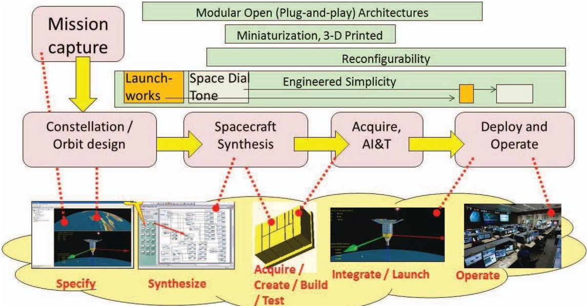

Figure 1. A summary of the proposed rapid spacecraft development process (and supporting technologies) under study in the nano satellite and plug-and-play architecture (NAPA) program.

<!-- PDF_PAGE: 3 -->

the ultimate vision of creating systems the quickest timeframe possible. Beyond this, we identify a more focused (bit simplified) approach to the plug-and-play problem based on the use of wireless technology. We believe such an approach could serve as an important enabler in the PBTF.

## 2. STORYBOARD FOR RAPID SPACECRAFT

In this section, we consider a storyboard for a presently fictional spacecraft development to expose the concepts and features pertaining to pushbutton toolflow (PBTF) and the user interface/user experience that might accompany such a tool. Within the NAPA program, we refer to this work as the "iMission", partly being "imagineering", but not quite science fiction, as the work is informed by the concurrent research and development activities being carried out within the larger NAPA program (including actual spacecraft development) and elsewhere (we discuss some of these influences in the next section).

We envision using web browsers for PBTF, especially activities involving specification, design, and coordination (e.g., procuring components, working out communications leases, identifying launch opportunities). We feel that web methodologies do not represent a loss of generality, as modern web-based architectures are sufficiently expressive for most purposes, familiar to users, offer robustness and scalability, and readily connect to other networked elements.

The general PBTF workflow for mission and spacecraft platform is shown in Figure 2. The idea of the PBTF workflow is suggested by the high level functional blocks, each translating a major design activity (such as "spacecraft synthesis") into a hierarchy of inter-related steps (analogous to a work breakdown structure). These activities, large and small, are automatically coordinated into "constructible" implementations. By "constructible", we mean that the processes themselves can detect discontinuities/infeasibilities in design specifications (such as missing components or

inadequate power supply) and provide warnings and/or suggested alternatives. The goal is to guarantee correctness by construction, avoiding steps where manual hardware and software engineering would be required to otherwise resolve these steps. The PBTF workflow would support at least two broad operating concepts: guided and expert mode. In the guided mode, a wizard-like navigation approach (a managed connection of modal dialogs) would walk a user through the workflow, completing the tasks sequentially from left to right. In the expert mode, a user could jump to specific points in the workflow. In expert mode, rule and constraint violations (such as "no launch opportunities exist for the orbits selected" or "you can't build a spacecraft without a power subsystem") would be accumulated and tracked to advise the user during the design activities.

## PBTF for Missions - Design Workflow

While a detailed discussion of mission development is beyond the scope of the present paper (which concentrates more on platform-level workflow concepts), it is important to provide a sketch of the prospective framework. As shown in Figure 2a, the workflow involves a set of processes that translate the users design (extracted through the process of mission capture) into a design of spacecraft that are launched and placed into operation. The process would be interactive, since most decisions involving orbits would affect location of ground stations, aspects of mission products, power budgets, control precisions necessary to operate the spacecraft, etc.

## PBTF for Platforms - Design Workflow

For this paper, we focus on the particular convention of CubeSat spacecraft platform referred to as "6U" (10 cm x 20 cm x 30 cm), a boxlike structure that fits the conventions of standard cannisterized satellite dispenser (CSD) [3], which would be mounted on a launch vehicle.

In the structural conventions that we define for this spacecraft exercise, we begin with a flat baseplate, which constitutes a

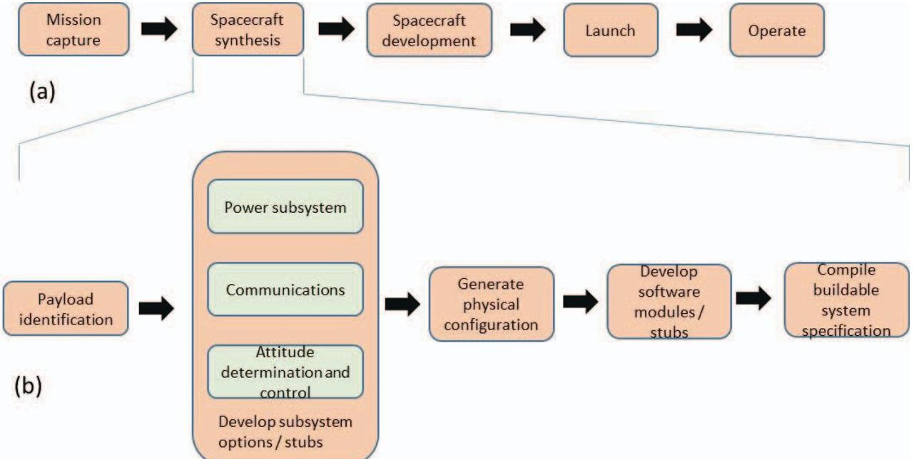

Figure 2. Potential automated workflows for rapid spacecraft. (a) Mission-level. (b) Platform level.

<!-- PDF_PAGE: 4 -->

substrate onto which components are arranged to form spacecraft. The concept is inspired by concepts such as the Pumpkin SUPERNOVA concept [4], which uses a baseplate as an attachment surface for six 1U cubes (and variations). We refer to these conventions as "SPARC-X", which will serve as the focus of the iMission work. In SPARC-X, most physical components are boxlike in shape, each

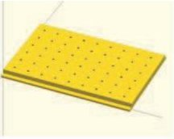

(a)

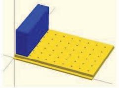

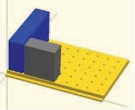

(d)

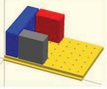

(b)

(c)

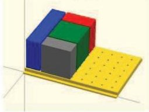

(e)

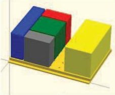

(f)

Figure 3. Storyboard for rapid spacecraft. (a) Baseplate, onto which components are added. (b) Power unit. (c) Computer. (d) Radio. (e) Attitude determination and control. (f) Payload.

approximately 10 cm high in integer multiples of 0.25U (e.g. n.2.5 cm x 10 cm x 10 cm). These SPARC-X modules could be computers, radios, guidance systems, payloads, electrical power systems, and other component possibilities. When viewed from above, the arrangements formed by placing a number of SPARC-X modules onto a baseplate can be thought of as a two-dimensional (planar) floorplan, analogous to arrangement of shapes in a Tetris game. They are "plug-and-play", in the sense they can be quickly added to the floor plan through simple mechanical attachment, and by convention can be automatically recognized and integrated into an overall network, which ultimately becomes the spacecraft platform.

The fictional exercise we now describe corresponds to an expert mode implementation of the spacecraft using PBTF and plug-and-play concepts, through the sequence shown in Figure 3. The beginning point is the baseplate (or more crudely, a "dinner tray") (Figure 3a). The "dinner tray" substrate is a pegboard-like grid which (like the electrical outlets in a building) distributes power throughout the ground. In its simplest form, like for wiring and buildings, it might be passive copper traces. The distribution of connecting points follow a convention that make it possible to plug any SPARC-X module onto the plate in any legal orientation (four Manhattan directions) or position (integer multiples of the unit spacing, $ \sim 2. 5 \mathrm{c m} $ ).

Because of the specially designed thin side rails, the baseplate may be slid into a CSD for deployment as the satellite. Even the bare baseplate could be launched into orbit, though there would be little purpose in doing so. The goal is to populate the dinner tray with the elements necessary to form a working spacecraft.

It is reasonable to choose electrical power subsystem (EPS) module as the first SPARC-X component added to the baseplate (Figure 3b), so as to energize the baseplate to power subsequent modules. This is depicted as a 0.5x2U brick (e.g. 5cm x 20cm x 10cm). As for any module in this approach, the power module has mechanical and electrical contacts. In this way, so long as it fits on the plate, it will be guaranteed to make mechanical and electrical contact. The passive plate, now with the addition of a power source is energized. The "brick", which can be crudely thought of being like a battery pack for a cordless drill contains power management, charge storage (batteries), and photovoltaic (PV) arrays to get energy from the sun (the PV arrays are not shown, but are hinged, spring-loaded assemblies that can be attached later in the integration process). For convenience in the laboratory, a bypass connection is available to run the system from a bench power supply.

At this point the sequence, any other modules that are added will tap into the now-energized electrical grid. The next module chosen is a SPARC-X processor module, which implements the central onboard computer (OBC) computer of the spacecraft (Figure 3c). We now have a live satellite. The computer can now boot and begin interacting with the power system through a plug-and-play interface, though at this point there is little more to do then to run on idle power until other components are added. However, if placed into orbit, this "spacecraft" could operate, possibly tumbling aimlessly, having no guidance, communications, and at this point no purpose.

For convenience, a debug port on the SPARC-X OBC is available for connection to a serial terminal interface. This feature implements a developer's console that allows for variety of monitoring, configuration, and others functions to be implemented interactively through command line interface to test and debug the evolving spacecraft configuration

The next module added is a radio block (Figure 3d), which implements the primary communications function of the spacecraft, sometimes referred to as timing, telemetry, and communications (TT&C). This particular radio module is designed to talk to specific ground stations distributed throughout the world (such as those forming the Universal Space Network). The radio is designed with a particular open standard communications protocol, connecting to a centralized (or cloud-based) server operated by a third party that offers a subscription service. Using a nominal licensing fee/data rate plan, the radio can connect through any participating ground node when the spacecraft is "in sight". The mission products in this case are aggregated into a SQL database as part of a web service, protected with good web security approaches, accessible through a number of convenient web applications (including mobile devices), which are also extensible by third parties using a well-established application programming interface (API).

Conveniently, there is a "test only setting" that allows the radio to work in the laboratory over wireless (e.g., 802.11)

<!-- PDF_PAGE: 5 -->

connection. The default setting for the radio is to operate in server mode, and the user can connect to configure the radio through the server during early development. In the initial development phase, the radio will be placed into a "laboratory phase". In the laboratory phase, the radio implements an 802.11 client that connects through the same web service infrastructure. For the most part, the look and feel of spacecraft operations at this point will be very similar to that in the orbiting spacecraft (after the radio has been placed into "product phase"). In the meantime, the "laboratory phase" system can implement a mimicry of its "day in a life" operation.

We next add a 1U size SPARC-X attitude determination and control (ADAC) module (Figure 3e).

Storefront In the fictive exercise thus far, the narrative suggests a researcher being in a well-equipped, well-stocked facility where piles of spacecraft components are simply sitting around waiting to be used. We can imagine instead a storefront, suggested in Figure 4, where many module contributors can post their offerings according to the traditional categories for components and payloads. This imagined dialogue is one where a user selects a listing of available guidance components of different sizes, levels of performance, cost, and delivery schedule.

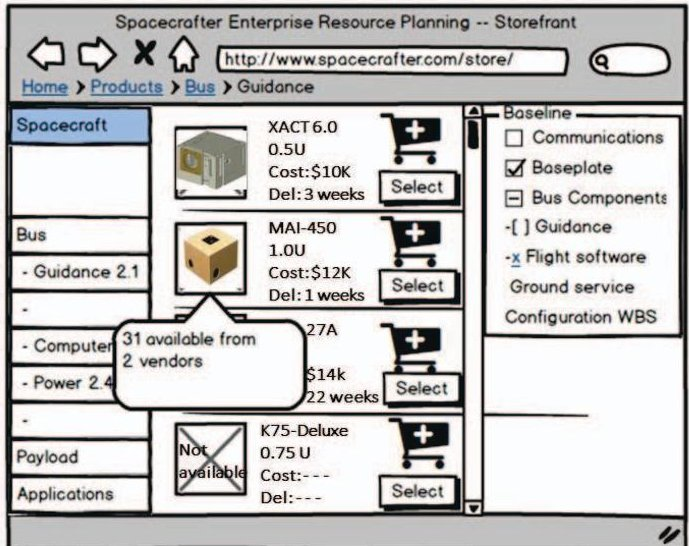

Figure 4. The (presently imagined) storefront for coordinating component purchases online.

The addition of an ADACS module considerably improves the possible utility of the spacecraft (it still does not have a defined payload nor flight software), but the spacecraft (as a theoretic possibility) can now point to the sun (for efficient photon-gather) or reorient as needed by any payload that might be added later. We can verify many of these rich features through datasheet query (or reading the manual) and exercise them through the command line of the test console, however we still do not have any flight software installed in the computer, nor do we have payload.

We next add a 2U size payload, which is perhaps a space weather sensor package containing a number of simple instruments (Langmuir probes, radiation monitors, etc.) (Figure 3f). The addition of a payload now gives the imagined

spacecraft "purpose". The laboratory infrastructure at this point can exercise most of the features in the various components, but no automatic software program has been created to operate the spacecraft. Any more than the random parts (wheels, water pumps, doors) in the bins of an automotive junkyard cannot "understand" their identity in the context of a larger whole (system platform), we should not expect that the arrangement of commodity (albeit sophisticated) components would "understand" how to work in a coordinated fashion to carry out any expected mission. At this stage in the narrative, the designer would have to hand create the software, possibly assisted with powerful tools, to form spacecraft capable of carrying out even a primitive mission. However, in the so-called "guided mode", we believe it is possible to construct a full "recipe", containing the necessary specification of hardware and software for a platform capable of independent operation and placed into orbit. We have heaped many expectations upon this tool, and hope to provide a sufficient basis in the following sections for the reader to also believe the possibility of these bold claims.

## Component Design Workflow

The component design workflow refers to concepts that lead to the creation of components that fit within the plug-and-play and PBTF framework (for example, preparing a new compliant ADAC module that can registered in the storefront shown in Figure 4). The details on how these components (hardware and software) can be created are not elaborated in detail here, though in the earlier plug-and-play research, significant investments were made in the creation of compliant interface circuitry [5], automatic code generators for electronic data sheets and application shells [6], and compliance testing tools.

## 3. RELATED CONCEPTS

Design automation has become increasingly necessary for humans to manage the development of complex systems, whether integrated circuits, computer code, or complex mechanical structures. The PBTF concept draws its influence from many real-world sources, whether direct, indirect, or metaphorically. We discuss some of these influences in this section.

## Electronic design automation (EDA)

The multibillion-dollar EDA industry struggles to stay on top of systems that are exceptionally complex (e.g., billions of transistors) and yet must be brought into the marketplace swiftly. The pace is driven through combination of factors, including Moore's law [7], extremely competitive environments, and the frenetic pace by which consumer and industrial products of increasing capability are foisted into the marketplace. EDA flows at the most basic level work with the processes of schematic capture, which design representations are composed. In the earliest days, schematics were hand rendered with graphical tools, often one gator one transistor at a time. At more sophisticated

<!-- PDF_PAGE: 6 -->

levels, pre-created third-party intellectual property (IP) blocks of impressive sophistication (including entire microprocessor cores, multiported memories, and media access/high-speed interfaces) can be rapidly added into design floorplan more quickly than a user could create the IP from scratch. Automatic, parameterizable macros and IP generators also exist to assist designers, and high-performance system on-chip buses (such as Wishbone [8] and AXI [9]) give designers a chip level plug-and-play infrastructure to simplify the task of uniting these building blocks rapidly. Simulation and verification tools, which assist in the preparation of sophisticated testbenches, are essential in creating modern silicon systems having any chance first pass success.

EDA tools provide inspiration for other types of design automation, including satellite design automation (SDA). Ideas such as "schematic capture" become "mission capture" or "problem capture". These are the disciplined methodologies for transcribing requirements into a form suitable for further analysis and design construction. Sophisticated simulator tools are used to verify performance. Design representations, when following specific disciplined conventions, lend themselves to synthesis. In EDA, this involves transforming initial design representations into implementations based on building block libraries. Libraries can be interchanged and upgraded, allowing to new processes having higher performance and lower power consumption. Similarly, we can envision with SDA, representing many parts of the satellite construction problem as component libraries, which requires new concepts and domain engineering, so as to make interchangeable a variety of components from different vendors that perform the same function. It was in part this consideration that led to the original work on the space plug-and-play architecture (SPA) program which worked on the surface issues of interchangeability, leaving the detailed domain engineering as an exercise for subject matter experts.

Integrated development environment (IDE) / build environment-A "Hello, World!" for Spacecraft

IDEs provide an (at times) immersive framework in which the creative processes of design expression can be fluidly negotiated, usually for environments involving code development, for software (e.g., C++, Java, etc.) as well as hardware (Verilog and VHDL). Their features emphasize programmer productivity, often supporting real-time syntax development aids and in place compilation and testing. Eclipse tools [10] represent one of the more well-known examples of the flexible and extensible IDE.

Build environments can be thought of as being on the more elaborate end of the IDE spectrum. They usually involve a particular group of tools, configured, modified, and extended to create software and/or hardware entities. They are exemplified as tools that are often accompanied by (or preloaded with) a valid, extremely simple worked example of a system (such as smart phone application) that can be transformed and manipulated by users into more

sophisticated products (see, for example, the Android App Inventor [11]. In the case of software applications, it would be a "Hello, World!" program (a trivial example that proves the compilation and build chain for the tools works properly). For SDA, this would mean a tool preloaded with a buildable "do nothing" spacecraft having valid communication linkage and a possible launch opportunity identified (or presumed).

## Software Configurators-In search of "DellSat"

While design automation has become increasingly necessary for humans to manage the development of the most complex systems (integrated circuits and software), even for less complicated undertakings, such as specifying a personal computer (e.g. Dell computer), a pizza (e.g. Dominoes), or an engagement ring (e.g., Union Diamonds), there are menudriven selectors that navigate the user through an overwhelming decision space to quickly choose a desired product. The software concepts are sometimes referred to as configurators. Configurators are tools, often embedded in software applications that manage an interactive dialog with a user navigating through a complex space of design choices. They are often found online in the form of product configurators [12]. Effective implementations can hide complexity from the user, by presenting only those options leading to viable solutions, which tend to be more efficient at guiding users to find viable solutions. Configurators are built upon well-established formalisms, such constraint satisfaction problems (CSP), which manage complex rule sets to find a solution space (if it exists) and parameter (linear and non-linear) optimization, which drives for the best choices within these spaces subject to selected constraints (e.g., minimum schedule or cost, etc.).

## LEGO and LEGO-Like Building Brick Toys

Perhaps no concept in the public consciousness better captures the notion of perfect (structural) modularity better than the LEGO brand [13] of building bricks, toys which encourage creative thinking to the free-form arrangement of components that are easily assembled into an infinite variety of designs. The influence of the LEGO concept operates metaphorically in many framework concepts. We can think of a "LEGO universe", for example, whose elements conform to the specific structural conventions. Components that adhere to these conventions fit within the "universe", whereas other components do not. The metaphor applies in many other modular frameworks, even those that do not have tangible physical structure.

## Additive manufacturing

Additive manufacturing (more popularly known as "3-D printing") refers to a family manufacturing technologies that allow for the run-time construction of nearly arbitrarily shaped structures. Some have concluded upon watching such 3-D printers at work that we should simply "cut to the chase" and 3-D print complex systems at will, including spacecraft. Perhaps one day this will be possible. Presently, the several known fabrication architectures [14] are capable of rendering

<!-- PDF_PAGE: 7 -->

only a limited palette of materials. At least some of these materials do not support the desirable properties needed to make a basic platform (e.g., spacecraft). Consequently, at least some "non 3-D printed" elements are necessary. Ideas, such as "print and pick and place" [15] have been discussed to allow the possibility of embedding electronic and other elements as "inclusions" within a 3-D printed flow.

In PBTF, we nonetheless envision 3-D printing is playing a powerful role in rapid system development. It is possible during an automated design process, for example, to identify the need for custom structural adapters. While it is inconceivable to maintain a theoretic infinitude of mechanical brackets, is very straightforward to consider the possibility of algorithmically generating computer-aided design (CAD) files (using software such as OpenScad [16]) that specify needed structures. These files could be added to the "BOM package", printed locally, or sent to bureaus (such as Shapeways [17]) for third-party fabrication.

## Model-based Systems Engineering (MBSE)

## Automatic program generation

MBSE refers to the automation of systems engineering processes, where the knowledge of domains are captured in concise electronic descriptions (e.g., "models") and the models (represented in languages such as SysML) are used by tools that can ultimately broker simulation, and presumably in the future, synthesis approaches [18]. The approaches are also under study for application to cubesats [19]. In some respects, PBTF embraces many of the principles of MBSE. Many of the steps we show in the flow lend themselves to MBSE treatment. In particular, PBTF eschews any processes in which unnecessary forms of human error (whether syntactical or semantic) may creep into the development flows. It also makes simpler the implementation of test driven development strategies.

Automatic program generation (or auto-coding) has two broad possibilities, the first being in productivity enhancement (e.g., using a higher order language) and the second being in translating an automated embodiment into a different one (as in translating a Matlab simulation of a control system into C code for use in an embedded computer [20]). For plug-and-play systems in particular, work has been done in using autocoding for spacecraft control systems [21]. As such, auto-coding would likely find a variety of applications in the PBTF, possibly to form a variety of software module and configuration setting scripts on demand.

## Web-based shopping cart

As known to any consumer who has purchased products online, the shopping cart provides an effective mechanism for coordinating purchases of products, with familiar mechanisms of inventory query, the aggregation of costs with estimated shipping expenses, expected delivery schedules, product and vendor reliability "star feedback", etc. While e-commerce software frameworks may not be directly usable

"out of the box" for PBTF, the metaphors are nonetheless powerful empirically evolved over years and billions purchases. We can, for example, exploit the concept the category hierarchy in products (e.g., the familiar "breadcrumb trails") as a model for a comprehensive work breakdown structure (WBS). We can track the worst case delivery times, aggregate costs, and therefore approximate at least major portions of a WBS, Gantt chart, and project budget, respectively.

## Enterprise resource planning (ERP)

Whereas shopping carts can be thought of the "public-facing" manifestation of an e-commerce system, ERPs are the "business-facing" software ecosystems that coordinate inventory, supply chain, product planning, and other related functions. In a PBTF concept, for example, we might envision component developers interfacing with a type of ERP tool to manage components introduced to users.

## Modular Platforms

A number of platforms have been created that are modular and/or provide build environments to permit developer communities to enrich the available features or adapt them to better suit end application concepts.

Modular smart phones A concept called "Phonebloks" [22] promoted a very refined level of modularity, in which the smart phone can be broken into a number of functional modules, representing cameras, computers, and other functional blocks. Rather than throwing out the phone and upgrading to a new one, this modular approach allows for incremental upgrades and replacements. Google formed Project Ara [23] in an effort to turn the Phonebloks idea into actual products. Ara has released standards and development kits for both modules and software applications.

Smartwatches Pebble created one of the first smartwatches that could be configured by users with applications that were developed by third-party vendors. It was followed by many other vendors, who created both platforms and third-party development concepts.

Cubesatkit Pumpkin has created a small community of developers for structures, components, and development aids for cubesat kits. For example, they have painstakingly worked out framework of compatible concepts necessary to construct 1U-3U spacecraft in a system development chart [24] in which users can easily identify the collection of elements necessary to create a particular size system. These are not quite at the level of plug-and-play interchangeability, requiring lots of user skills to convert these modular components and write custom software to create a functional spacecraft.

CubeFlow. CubeFlow was an early attempt to modularize cubesats into modular plug-and-play components. It was initially created at the start of the first NAPA, where it was significantly advanced and refined. While the CubeFlow kits

<!-- PDF_PAGE: 8 -->

demonstrated modular structure ideas that were very close to a "true" plug-and-play technology, most of the training and development focused on software, using a first-generation middleware referred to as the Satellite Data Model [25].

## 4. CLOSING THE GAPS IN PLUG-AND-PLAY

In this section, we discuss refinements of space plug-and-play (PnP) architecture (SPA)/Monarch [5] model that address a number of "last mile" issues. The ambition of the original SPA idea was to make putting together a spacecraft as simple as putting together a personal computer through the use of plug-and-play mechanisms. The original SPA work was groundbreaking on a number of levels, to include the development of self-description (through electronic data sheet conventions), self-organization (automatic discovery and join through specially developed middleware), and standardized approaches to electrical interfaces (much of the work being documented in published standards [26]). In parallel, the concepts of pushbutton tool flow were articulated and studied in research initiatives to adapt and extend spacecraft simulation tools [27] to support plug-and-play concepts, as well as tools that implemented rudimentary concepts for satellite design automation [28] and automatic generation of electronic data sheets and matching application code shells [6]. However, a number of significant gaps in the SPA concept made it difficult to ever close the linkages between the ideas of PBTF and plug-and-play. Some of the gaps were felt to be caused by limitations in the electronic data sheet itself [29]. The problems were obvious in retrospect, and were not difficult to solve in any particular platform development. For example, in the earlier formulations of plug-and-play, there were no standard mechanisms for differentiating from a specific copy of several components having an identical electronic data sheet. For that matter, there were few guidelines on the responsible preparation of electronic data sheets, leading to an almost infinite variation in ways to express even the simplest concepts. These gaps we refer to as "last mile issues". While simple and resolvable in particular cases through responsible engineering, they precluded automating the PBTF concepts, especially on the level of a complex platform. Beyond that, however, the lack of standardization electronic data sheet representations crippled the scalability of plug-and-play beyond specific platform developments.

In this section, we emphasize refinements to the earlier SPA model, both in the direction of simplifying its application as well as closing the gaps surrounding these "last mile" issues. In particular, we emphasize those refinements necessary to implement the PBTF. A nonessential requirement, but a powerful extension of the earlier SPA interface concepts involves the introduction of a wireless form of SPA. We believe that resolution of the last mile issues, as we discuss in this section, are very helpful if not necessary such a wireless implementation.

We briefly review selected elements of the previous SPA architecture, as these will help understand the concepts for

the refinements we shall introduce. To emphasize the key features of the new approach, we introduce a "light switch plug-and-play model". In doing this, we attempt to pare away the nonessential features and focus on a "simple as possible formulation". We believe, as in the previous work in SPA, but these primitive elements can be scaled to arbitrary complexity and allow implementation of the most sophisticated systems based on these principles. We will discuss some of these extensions in the sequel.

## Essential SPA

Among the many concepts that were studied in the SPA development, the most important involve the mechanisms for

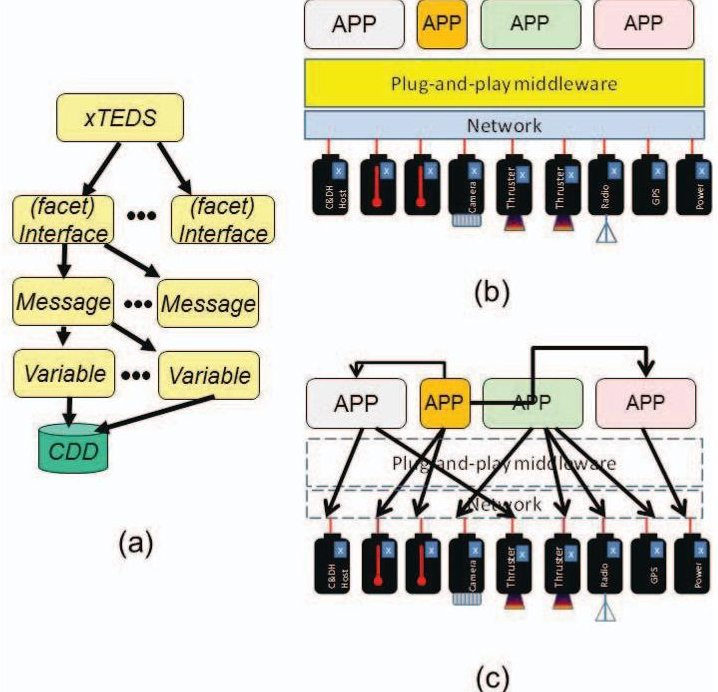

Figure 5. Key elements of plug-and-play. (a) Extensible transducer electronic datasheet data structure (xTEDS). (b) Plug-and-play vertical model. (c) Auto-organization.

self-description and the automatic organization of applications and components to form systems. These mechanisms are depicted in Figure 5. The electronic data sheet concept in SPA is referred to as the extensible transducer electronic data sheet (xTEDS). xTEDS is a description of the "knobology" of components, the features that can be set, commands it can be given, quantities that can be extracted and measured. They exist in the tree-like hierarchy suggested in Figure 5a. In the original concept, which was inspired by the TEDS concept used in IEEE 1451 smart sensor standards [], xTEDS descriptions are embedded, literally stored in components (hardware and software) as XML representations. These descriptions were usually "served" by components during initialization. Middleware (Figure 1b) becomes the essential binder that normally drives this initialization and manages the connections between components. The two key functions of middleware for plug-and-play include facilitating some type of "discovery and join" mechanism (part of which includes finding components and extracting their xTEDS descriptions) and implementing a lookup service, that facilitates publish and subscribe

<!-- PDF_PAGE: 9 -->

linkages between the elements. The linkage, depicted in Figure 5c, suggests the blurring of boundaries between hardware and software, since software applications also have xTEDS in most of the middleware concepts that have evolved around the SPA concept.

A New Interpretation for SPA-“Lightswitch PnP”

- In room D, implement a three-way switch in which the light changes states when either switch changes states.

To implement a solution, it would appear the normal approach would be to create an application (in the manner suggested in Figure 5) that triggers connections to the various plug-and-play components to implement the solution to the

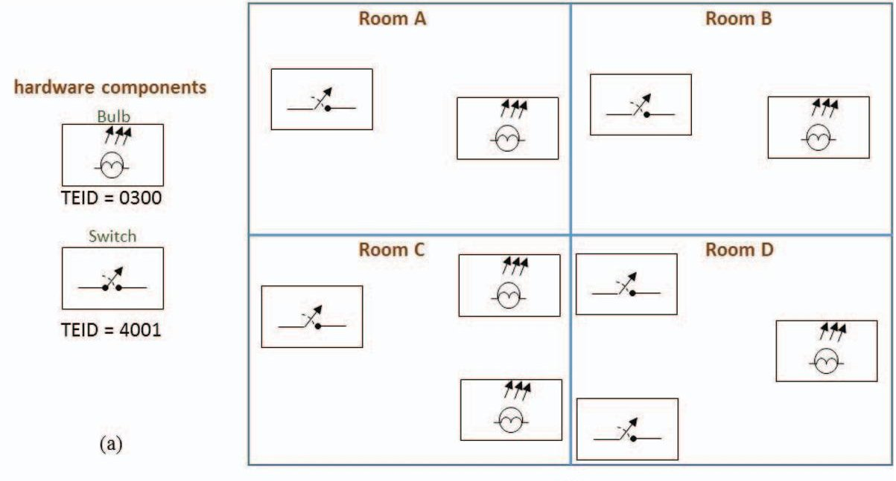

Figure 6. A simple benchmark for "lightswitch plug-and-play". (a) Hardware devices. (b) A four room benchmark problem with light bulbs and light switches.

We introduce a new interpretation for SPA by considering a simple benchmark example (Figure 6) that demonstrates some of the "last mile" issues. We call this "lightswitch PnP", as it focuses on one the simplest possible study domains, one involving single bit devices. A light bulb represents a "simple as possible" actuator, as the state can be set with a single bit command ("0" or "1", "off" or "on"). Similarly, a light switch represents the simplest possible sensor, with a state that can only take on to values (open being "0" or "off", closed being "1" or "on"). The switches and bulbs are plug-and-play devices (Figure 6a). Each is typified is having a template identification (TEID) number. The TEID number maps uniquely to a particular xTEDS description, and can be a substitute for the full embedded description.

Our benchmark is a building lighting problem, in which it is necessary to design the lighting for four rooms (Figure 6a) with the following specification:

- In Room A, turn the light bulb on when the switch is turned on.

- In Room B,turn the lightbulb off when the switch is turned on

- In Room C, turn both light bulbs on when the switch is turned on

lighting problem. However, the simple benchmark exposes one significant "last mile" issue with SPA. Since all switches have the same TEID (4001), and all bulbs have the same TEID (0300), any plug-and-play function implemented in the simple way would have an undefined behavior. Even a simpler benchmark, such as having each of the four rooms implement the "Room A" specification (a single switch controlling a single light, turning the light on when the switch is turned on), would lead to the situation where flipping the switch in any room could turn on all lights in the four rooms. Or, flipping the switch in Room A turns on the lightbulb in Room D. It is in fact unclear how to implement any solution with the concepts and SPA discussed so far without adding some other concept(s). We call this the "assignment problem". In the practical embodiments of SPA today, the problem has been solved by some ad hoc auxiliary mechanism that deals with this problem by somehow mapping application code with particular components. Unfortunately, "ad hoc" has not so far produced the portability implicit in the idea of a pure PnP approach.

Figure 7 introduces the concepts that we believe solves the association problem. We first introduce additional nonhardware components (Figure 7a). These are elementary (software) functions, in particular the three primary functions necessary to implement the lighting problem. These functions, like hardware components, have a distinguishing TEID (consistent with the aforementioned middleware

<!-- PDF_PAGE: 10 -->

framework). While not shown, it is furthermore necessary that the functions be "keyed" (as in a type definition) to work with specific devices at particular interfaces. For example, the input of the software functions shown must be connected only to a specific type of switches. Although it may be overly restrictive to say that the switches must be those only belonging to a specific TEID (e.g. TEID = 4001), the restriction is nonetheless a safe one. We should be concerned with unnecessarily restricting interface types (and not permitting overloading) since it would result in a larger explosion of function types. The "explosion" would be because we cannot in this case perform elementary composition of functions (such as, composing XOR/9032 with NOT/9002). Instead, with the type restriction a new function would have to be created that accepts the outputs of other functions). For the purposes of the present PBTF approach, however, these restrictions do not appear to pose an essential problem, as we are concerned with achieving a viable PBTF, not necessarily the most efficient one. We concede that there is possibly room for significant improvement with this typing approach.

We next consider the concept of "recipe" as it pertains to systems designed under perspective platform-level PBTF. The recipe constitutes a full and portable specification of a system design. By portable, we mean that the design can be replicated an arbitrary number of times. Portability is an important consideration in addressing the assignment problem, which is concerned about targeting specific instances of part types. For example, how do we differentiate

between 50 light bulbs having the identical template specifications (TEID)? We indicate that it is necessary to assign a globally unique identification (GUID) to every component, and that the GUID not be hardcoded into the template description (e.g., the xTEDS). Hence, we can distinguish two light bulbs (TEID 0300) based on their GUIDs. It would appear we can now solve the association, since we can map the GUIDs for specific components to particular positions in the room diagrams, as done in Figure 7b. We can clearly developed a recipe, and map the dependencies between components. However, if we wish to use this solution a second time, we would have to rework the GUIDs to correspond to other unique components to implement the second copy. To solve this problem, we introduce the project recipe identification (PRID) number to indicate particular instances of the same components within a recipe. By doing this, we now have a portable recipe, as it is only necessary to develop a single data structure that maps GUIDs to PRIDs, one for each implementation of a recipe. Hence, we know that GUID 314123 is a light switch, and in Figure 7b it is mapped into PRID 2, which is encoded as the switch controlling a lightbulb in room A. If we make make a second copy of the recipe, some other light switch would implement the corresponding switch for the room A belonging to that second copy.

These concepts, in combination, provide a solution for the association problem using plug-and-play components. We can define mappings, these now constituting a portable description (recipe), which can be represented is a directed

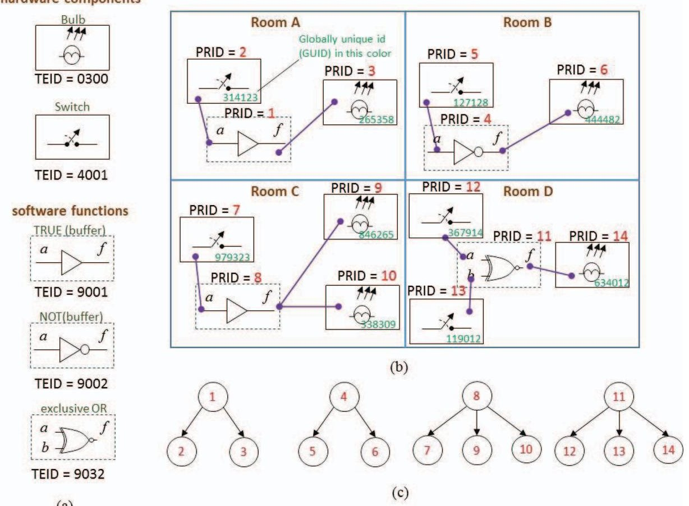

Figure 7. Benchmark solution. (a) Hardware and software devices. (b) Details of mapping "project recipe IDs" (PRIDs) and mapping dependencies. (c) Resulting "recipe" graph structure.

<!-- PDF_PAGE: 11 -->

acyclic graph (DAG), as shown in Figure 7c, where the node numbers correspond to PRIDs.

## Extension of "Lightswitch PnP" more complex systems

Abstractly, the lightswitch PnP concepts addressed the problems of establishing portable recipes for platforms, tracking dependencies within these recipes, and for differentiating specific instances of components of the same type that appear within a given recipe for a platform. We believe that interface description of arbitrary complexity can be used in place of the simple two-state examples that make up the light switch benchmarks. In fact, most run-time systems do not really benefit from embedding a full electronic data sheet, since they are not generally equipped with sufficient introspection to take advantage of the additional semantic information. Applications, at least as we currently understand the state-of-the-art, must work with some notion of expected interfaces. If we have that notion, we can then encoded in the form of dependencies, whether these dependencies are primitive Boolean constructs (as in the light switch and light bulb), or far more sophisticated ones (such as a camera, radio, or weather instrument).

We indicate, but will not formally elaborate in this paper, the need to extend the lightswitch model to support other features helpful in the creation of arbitrarily complex systems using the PBTF/PnP concepts. The first of these is the standardization of functional domains contained within template descriptions. We refer to this concept as the standard component template library (SCTL), which is described further in [30]. A SCTL concept is one of curation of the much-discussed ontology of PnP. SCTL at one level is nothing more than the disciplining of interface structure, for example, to always count on a thermometer being described in consistent way amongst many thermometers. It is analogous to the disciplines in personal computer driver definitions (e.g., "a mouse is always a mouse"). While xTEDS can define even a simple device in a seemingly infinite number of ways, it is not advisable to permit freewheeling variation, and this was a problem we saw in earlier work involving SPA, resulting in non-portability of components between (ostensibly PnP) systems. The notion of SCTL and engineering of particular sub-domains (e.g., such as power, configuration control, OEM extensions) helps in clarity and economy of implementation in the connection of components having extensive electronic datasheets. If a component, for example, has a data sheet with hundreds of semantic elements, and only a handful are needed, it would be useful to isolate only the subset necessary in a particular recipe.

A second important feature needed in the lightswitch PnP construct is the support of set theoretical expressions for component dependency. For example, we can create applications that need to work with a single component instance, which is the principal used in the Figure 7 benchmark solution. However, there are cases when it is necessary to support conditional dependencies, when the existence of component is optional. In the current concept,

we would interpret DAGs having missing nodes to be "broken", and conditional dependencies would accommodate cases where it is not necessary for all nodes to exist for a recipe to work properly. There are also circumstances where a variable number of instances is acceptable (for purposes of scalability or fault tolerance), and there are cases where GUIDs might be ignorable (and not need to be statically mapped in a PRID $ \rightarrow $ GUID assignment table).

## 4. MODULARITY CONCEPTS FOR RAPID SYSTEMS

Modularity is important, as is open architecture. Neither guarantee a particular result, such as the ability to form systems rapidly, but it is hard to envision how one would build complex systems rapidly without modularity. In this section, we discuss how to build an approach for creating rapid systems that takes advantage of modular concepts

## Functional modularity

A system design can be thought of as a composition of elements, and modularity provides affordances for easier separation, replacement, and composition of systems. We can represent the elements as nodes (Figure 8a), whose connections represent functional relationships (electrical signals, light, heat, fluid, mechanisms, software dependencies, etc.). Optimized designs tend to be tightly coupled, with connections being made as necessary in order to achieve performance objectives. In modular design, we seek to reduce these couplings through careful engineering, which often takes the form of various methods of design refactoring so as to consolidate and reduce dependencies to facilitate partitioning. This notion is depicted in Figure 8b, in which through re-factoring, the tight coupling (cut size) is reduced to permit partitioning and separation of the design into two sections. While depicted in an abstract form in Figure 8b, the partitions yield a recognizable structure, such as that suggested in Figure 8c (where the partitions correspond to a computer and a guidance subsystem). These

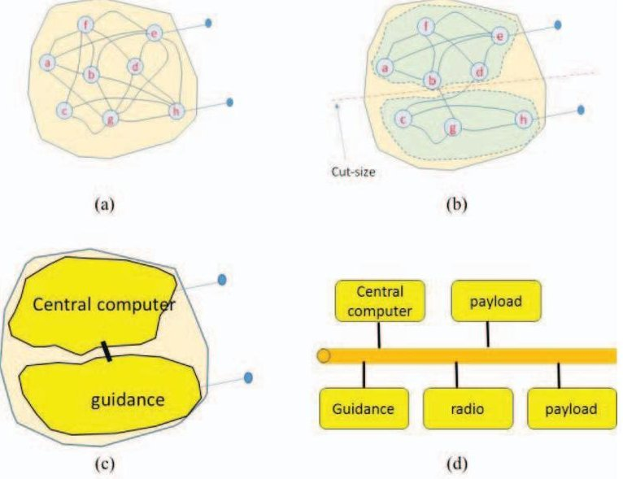

Figure 8. Abstract functional modularity. (a) Tightly coupled. (b) Refactored design. (c) Basic modularity. (d) Modular system.

<!-- PDF_PAGE: 12 -->

modules are sometimes referred to as black boxes, since all necessary functionalities exposed at interfaces, making the detailed arrangement within partitions unimportant (e.g., it is not important whether the partitioned diagram below the cutline in Figure 8b contains three nodes or ten nodes). When such re-factoring is done on a larger scale, it is often possible to create modular architectures, where the partitions correspond to familiar components, such as the notional spacecraft example (Figure 8d) in which the modular components connect through a common bus.

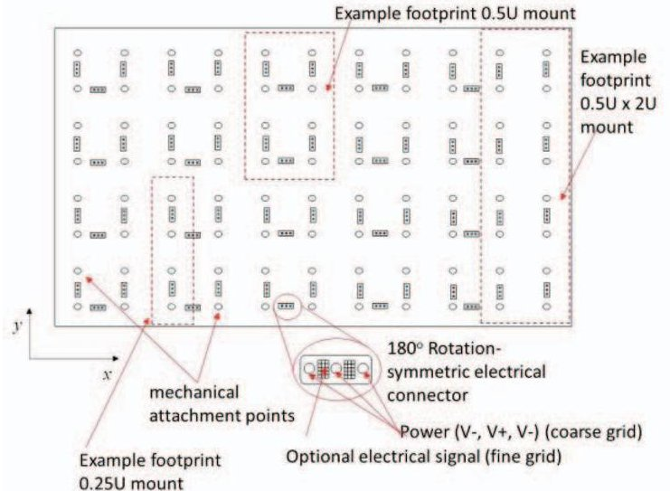

Figure 9. Pegboard substrate for mechanical and electrical connections.

Modular designs are sometimes criticized as being nonoptimal. In some cases, the manipulations that transform a tightly coupled design into a more modular one introduces compromises. When the compromises affect key performance parameters, some judge modularity as being "wrong". It is sometimes only necessary to reconsider how modularity principles are being applied (for example, avoiding modularity in performance-critical sections of an overall design). When modularity can be applied, there can be considerable benefits, including the ability to interchange components, permitting competitive implementations of modular elements. We believe modular approaches can be built more rapidly, particularly if the design re-factoring hello groups adequately includes the right "hooks" or "affordances" necessary to power, configure, control, and exchange electrical, thermal, and other phenomenologies across the modular interfaces.

In this section we describe a "wiring minimal" implementation of a plug-and-play framework inspired by PBTF that adapts the concepts of SPA and structural modularity to create an intelligent building block system involving wireless methods for the processes of "discovery and join". We believe such a framework can be used to quickly specify complete designs for a wide class of systems, and our primary applications are to study the kinetics of rapid mission formation, the concept in the NAPA program we referred to as "iMissions". It can also be used to rapidly assemble suites of components with noncritical performance, such as scalable and extensible data logging networks. It can also be extended to accommodate others by using wireless

mechanisms to provision other resource types and suitable for using wireless communication channels (e.g., copper wire,

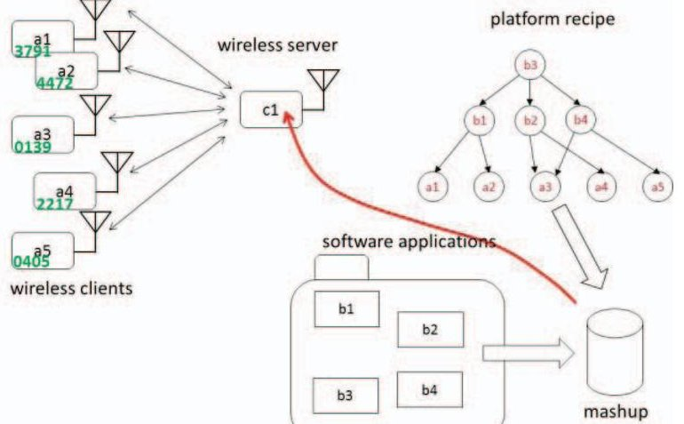

Figure 10. The "ingredients" of platform recipe for wireless (spacecraft) implementation.

optical fibers, fluidic channels, etc) through the use of mechanisms found in reconfigurable systems (e.g., FPGAs).

## Summary of Mechanical and Power Features

We describe an approach based on the Figure 3a base plate concept, where conventions are as shown in Figure 9. A pegboard-style mechanical grid is defined to allow the attachment of modules following an x-y scheme in increments of 0.25U （ $ U=100\mathrm{mm} $ ）. The building block components have a size nomenclature that specifies a x b x 100mm convention (so that a "0.5x2 U" implies a module that is nominally 50mm x 200mm x 100mm in size) or a x 100mm x 100mm (so that "0.25U" implies a module nominally 25mm x 100mm x 100mm in size). Modules may be mounted in any 90o rotation that covers the base plate in the lines to mechanical mounting locations.

Figure 9 suggests a symmetric （180 $ ^{\circ} $ within the connector) blind mating convention for the delivery of power. Signal delivery grids are optional, and we do not employ them in the primary implementation. This is because in our initial implementation we intend to exploit wireless signaling within the spacecraft for all data-related functions (e.g., command, configuration, and data) to include the "discovery and join" mechanisms for plug-and-play self-organization. The simplest implementation is a passive copper wiring embedded in the base plate, analogous to the wiring approaches to in residential power wiring. More sophisticated versions of course can be considered, but for our purposes this method is simple and effective.

## Description of the wireless protocol

The work in this paper will center on the use of the ubiquitous 802.11 ("wifi") approach, along with TCP over Internet protocol (IP) using a "closed cloud" model. Many of the elements of the stock can be replaced with other elements (such as replacing TCP/IP with another transport concept, or using a different physical layer technology, such as Bluetooth, Zigbee, or a custom "cognitive radio" concept). Our choice takes advantage of the tremendous cumulative

<!-- PDF_PAGE: 13 -->

investment in web service concepts, to include application

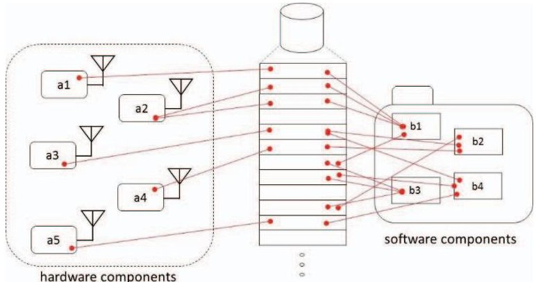

Figure 11. The "ingredients" of platform recipe for wireless (spacecraft) implementation.

programming interface (API) design, representational state transfer (REST) concepts, and the vast collection of concepts universally found in web enterprise architectures. In the description here, we identify a number of adaptations which make these concepts amenable to the concepts discussed in this paper for plug-and-play modularity.

The model consists of clients and servers that are interconnected with a wireless technology "stack" (combination of defined radiofrequency carrier, waveform/modulation, datalink, network layer, and transport). Figure 10 identifies the key concepts. A platform recipe is described as a graph structure (DAG) consisting of six hardware nodes (five clients, a1-a5, and a server, c1) and four software nodes (b1-b4) with dependencies identified as edges (lines) between nodes. As before, the node labels correspond to PRIDs, and the hardware client nodes have GUIDs (the four-digit numbers in each block). We depict the software nodes as black box modules, possibly represented as code "objects". In this case, we use the metaphor of files within a folder, which is a convenient approach, as the PRIDs can be directly used to establish a unique but transportable naming convention (if additional copies of the platform are created). We suggest that an overall consolidated binary load (mashup) containing all necessary compiled code and supporting data is formed and loaded into the Web server. Is important to indicate that there are many ways the same concept can be implemented, and are conventions are not intended to a imply the best approach (nor one that can meet the highest performance constraints in an actual embedded system, but serve well the purposes of our iMissions studies).

Figure 11 demonstrates further details supporting our intended iMissions implementation that heavily leverage RESTful principles in commodity web technologies, such as relational databases (e.g., SQL). In the embedded system, the Web server is a central computer (such as the onboard computer/data handling system of the spacecraft). The diagram depicts a central database, implemented within a Web server, which implements the "middleware" functions in Figure 5b.

At the simplest level, the web server "middleware" provides: (1) component registration, (2) a scheduling function, and (3) a message board to service dependencies

Component registration- Components, which can be thought of as web clients (acting roughly as mechanized "machine to machine" equivalents of humans on web browsers) are preconfigured with a home address, which can be standardized as a "factory setting" (e.g., http://host.pnp) that can be overridden for particular recipes (this is convenient when a number of platforms are intermingled within the same cloud infrastructure). In the registration procedure, components "surf" to find the server. The server has two broad responses, depending on whether the component is recognized as belonging to its recipe. It is expected that components will use a standard URL format, such as http://host.pnp/teid/guid/, which signifies that a component having a particular TEID (corresponding to an xTEDS template) and serial number (GUID) is attempting to join a system. If the GUID is recognized, the server will return the associated PRID, which then dictates the form of URL for future interactions (e.g., http://host.pnp/prid/...) . At this initial point of interaction, many other features can be implemented, to include component specific configuration, provisioning, security keys, etc. If the GUID is not recognized, the compound it is not "allowed" to join the network. A broad range of implementation possibilities can be established for "nonrecognized" components. The simplest one is to simply return nothing, at which point the client can attempt to reconnect periodically. This allows for nonrecognized compilers to exist in some sort of background/idle state, to allow for the possibility of adding them to the network in the future (in the case of dynamic recipes, or richer semantics which allow for redundant backup components that are not in the initial recipe DAG).

Scheduling function - Scheduling in the simplest form in this web-like model refers to a mechanism to ensure components interchange information at the appropriate revisit rate on in response to appropriate events. Components may be factory configured with a nominal revisit rate, and the Web server may override the defaults to assign shorter or longer revisits. For example, a component that is not recognized may be assigned of prolonged revisit, consistent with an idling protocol. Performance intensive components and applications may be given a very short revisit rate. It is here where determinism and latency may break down this model. There are broadly two ways of dealing with the case where the web-like approach fails. The first of these is to restrict the protocol to use cases in which latency/determinism is not problematic. It would mean relegating some components to implement all time critical functionality within a loosely coupled modular boundary (such as keeping tight control loops hidden from the abstraction altogether). For example, we might treat a guidance system as an appliance for which only broad navigation commands are given, instead of attempting to close loops around a set of high-performance

<!-- PDF_PAGE: 14 -->

sub-components. The second strategy involves establishing

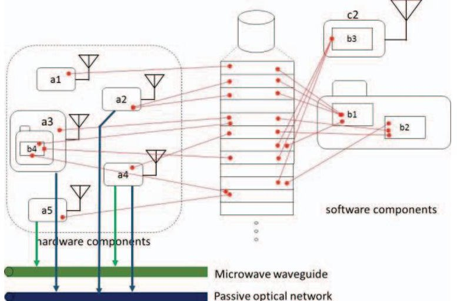

Figure 12. Variations of the Figure 11 concept (provisioned resources and distributed software).

high determinism resources, such as a deterministic wirebased, wireless, or optical bus that is in effect "out of band" from the web traffic associated with this approach. The web approach, rather than breaking down altogether, becomes a concept for provisioning and configuring other kinds of resources. This becomes a natural scheme for handling many other provisioning concepts, such as allocating microwave channels in a cognitive radio approach, allocating fluidic channels, managing configurable thermal switches and heat pipes, etc. In this manner, the scheduling is extended to provisioning in the broadest sense of the term. Components can still rely on the web service infrastructure to handle exceptional occurrences, such as failures, reset, or some mode changes consistent with different phases of platform operation.

Message board -- The web service can implement an elementary publish and subscribe concept, in which case the DAG dependencies are implemented through a relational database. In this scheme, clients are able to (in the RESTful paradigm) place or extract information into a global database table using traditional web methods as defined under the HTTP protocol (such as GET and POST methods). In this case, the database can be thought of as a large strip chart, accessed through queries. It is an effective approach, albeit not necessarily the most efficient one, for coordinating the independent actions of many interdependent components. Many other experimental and "industrial" publish/subscribe frameworks exist that undoubtedly have better performance characteristics. The advantage of this approach is that it can be implemented directly on a broad variety of platforms, components, and permits many ubiquitous tools and methods to be applied to creating systems.

Figure 12 illustrates the provisioning concept, as well as variations to the basic approach. In this example, we have added two additional "resources", a microwave waveguide and a passive optical network. Assume that two components (a4 and a5) implement different pieces of a radiofrequency (RF) function, requiring a connecting waveguide. In the present state-of-the-art, we do not have "plug-and-play microwave", and obviously we cannot manipulate arbitrary

electromagnetic waves over the standard 802.11 protocol. Consistent with the concepts discussed in this paper, we would present existence of a PBTF scheme that would make note of the dependencies, such as the need for a waveguide to connect a4 and a5.

As part of the resulting specification for the recipe, the need for a waveguide would be identified, which would need to be manually added to the system in the ensuing build process. While not a plug-and-play feature directly, it is possible through the modular conventions to make provisions for the placement of this component and identify in a checklist assembly instruction set the need to ensure that the placement is completed for platform implementation.

We also identify the existence of a PON to implement extremely high-bandwidth connections involving three components (a2, a3, and a5), possibly with tight determinism requirements. These also exceed the capacities of the 802.11 wireless PnP system. As in the case of a waveguide, we identify the explicit need for these components to connect to a particular PON. This PON, like the baseplate power wiring, could be preplaced within the baseplate (of a future, more advanced baseplate concept, identified as a different part number to differentiate from baseplates not equipped with PONs). In this case, the 802.11 network can implement a scheduling procedure that lays out the time and (if necessary) wave length plan governing the various transactions that will be conducted between three components. These examples show the various considerations that might be in play in extending the PnP concepts to accommodate access to preplaced and manually added elements, and furthermore to suggest how the plug-and-play mechanisms can be used to support provisioning and configuring the use of these resources.

We also depict in Figure 12 that is not necessary for all of the software applications to reside on the central web server, or even to all reside on the same server. We depict, for example, the presence of a second Web server (c2) which houses one of the software applications (b3). In traditional LAMP (Linux/Apache/MySQL/PHP) systems, it is possible to use straightforwardly simple approaches, like CURL methods and PHP scripts, to implement these functions within the closed cloud or even over the open Internet in the case of the system not restricted within a limited geographic footprint. In such cases, c2 could be "anywhere" so long as sufficient determinism can be ensured. Whereas a show the possibility that some the clients may also carry pieces of the software applications, as in the case where component a3 also houses software application b4.

## 5. PROGRESS TO DATE

The international NAPA team has begun initial exploration of the ideas described in this paper. The work includes use of scripting tools to promote the automatic generation of modular shells, which can be created using 3-D printing. In some of these modules, we plan to integrate simple components, using simple, microcontroller enabled wireless

<!-- PDF_PAGE: 15 -->

modules (such as the Expressif ESP 8266 NodeMCU) to act as clients. Many simple controller boards can operate in the role of the closed cloud web server, and we are exploring the use of Raspberry Pi and Beagle Bone boards in this role. We have studied in simple exercises, the feasibility of using a remote cloud-based server as a host, performing page requests at 10 Hz rate under non-stressing conditions. We may do significantly better within a closed cloud, although we do not expect the performance to be good enough for critical work. For simple data loggers, we do believe a flight system is adequate using the ideas described here with no additional modification (and no additional provisioning concepts, such as the one suggested in Figure 12). We also examining PBTF concepts. We recently explored the synthetic catalog of components and using off-the-shelf optimization software (e.g., the IBM CPLEX tool) we were able to produce some initial results that suggest utility in negotiating complex vendor catalogs that might exist in the future to find component selections that are optimized based on minimum time, minimum cost, or other criteria. We have not explored more extensive rule sets that might require constraint satisfaction problem (CSP) algorithms, though we believe any production quality PBTF would require methods of both representing complex rule sets (governing the "business logic" of spacecraft construction) and negotiating these rule sets to find feasible solutions (if they exist). We developed simple approaches for "placeholder components", which we refer to as "unobtanium", by manually encoding subject matter expert estimates for cost and schedule. These can be used as proxies to accommodate components that do not exist in any vendor catalog, but can condition the estimate of resources necessary to create a spacecraft. The hooks for "unobtainium" will be important, since the economies of scale in spacecraft do not exist in the forms that are present in other platform types. We believe it is possible to discipline vendor communities using freelancing concepts, in which bids can be collected through the PBTF framework.

It amounts at one level to mechanizing processes that we traditionally have done through disjoint and manual acquisition processes, such as a request for proposal (RFP). Source selections can be conducted through pushbutton actions, whether by individuals or by teams. The advantage of using PBTF to automate RFPs is that we have the hope of programmatically embedding this information (responses from bidders) within traditional program management tools, to include the infamous Gantt charts, and meticulously detailed work breakdown schedules. Another far more powerful benefit is that we can rigorously specify interfaces and compliance criteria as a byproduct of the PBTF framework. We can, for example, request the development of an instrument that complies with a specific API, wellcharacterized physical layer technology stack, and a well-established board footprint, ensuring the component will plug directly into the base plate of the spacecraft. We are not aware of any comparable concepts that could potentially go as far to eliminate the guesswork and uncertainty of routine acquisitions, albeit within the confines of those acquisitions

to develop hardware and software components in this new twist on a building block universe

We can possibly develop simplified compliance testing to verify components conform to the intended specifications. Within the NAPA program, we have explored the creation of compliance testing tools that work with SPA and standard interface concepts, referred to as Virtual Systems Integration (VSI), a tool under development by AAC Microtec (Uppsala) that permits the remote testing of components. We believe with some additional study, we will be able to more completely integrate such tools into the PBTF to give even more powerful effect in the rapid development of spacecraft

## 6. SUMMARY

In this paper, we have outlined a number of concepts relating to what we believe is a practical form of pushbutton tool flow, and adapted ideas in the previous plug-and-play work that complement it. We believe the framework is sufficiently complete for further experimentation a demonstration on actual platforms in the laboratory and in the flight environment. While we have used notional, fictional examples, we believe enough groundwork has been accomplished to move these ideas into a more practical embodiment. We intend to study these more in our "iMissions" work, and hope to be able to show more of this work in the NAPA program.

## REFERENCES

[1] Nanosatellite and Plug-and-play Architecture II (NAPA), Bi-lateral Project Agreement between US and Sweden (US-SW-AF-13-01), April 2013.

[2] Wegner, P. and Kiziah, R. "Pulling the Pieces Together at AFRL - Space Vehicles Directorate", Proceedings of the 4th AIAA Responsive Space Conference, Los Angeles, CA, 24-27 April 2006.

[3] "Cannisterized Satellite Dispenser", Data Sheet, August 32015, Planetary Systems Corporation, Silver Spring MD.

[4] Latta, Robert C., "Structural Analysis of a 6U Cubesat Chassis," M.S. thesis, Dept. Aeronautics & Astronautics, AFIT, Wright-Patterson Air Force Base, OH, 2014.

[5] Lyke, James; Young, Quinn; Christensen, Jacob; Anderson, David. "Lessons Learned: Our Decade in Plugand-play for Spacecraft", Proceedings of the 28th Annual AIAA Conference on Small Satellites, Logan, UT, 2014.

[6] Christensen, J., Cannon, S., and B. Hansen, "Automatic Software Generation of ASIM Program Code from an xTEDS", Proceedings of the 2010 AIAA Infotech Conference, 20-22 Apr 2010 Atlanta, GA.

[7] Gordon E. Moore, "Cramming more components onto integrated circuits," Electronics, pp. 114-117, April 19, 1965

<!-- PDF_PAGE: 16 -->

[8] "WISHBONE System-on-Chip (SoC) Interconnection Architecture for Portable IP Cores", Specification, Revision: B.3, Released: September 7, 2002 (available at http://opencores.org).

[9] "Advanced Microcontroller Bus Architecture (AMBA)”, Wikipedia article, https://en.wikipedia.org/.

[10] Available from the Eclipse foundation (http://www.eclipse.org).

[11] "App Invertor for Android, Wikipedia article, available online, https://en.wikipedia.org/wiki/App_Inventor_for Android.

[12] Wang, Yue; Tseng, Mitchell (2011). "Adaptive Attribute Selection for Configurator Design via Shapley Value". Artificial Intelligence for Engineering Design, Analysis and Manufacturing 25 (1): 189-199.

[13] Lego corporation website: http://lego.com.

[14] E. MacDonald, R. Salas, D. Espalin, M. Perez, E. Aguilera, D. Muse, et al., "3D printing for the rapid prototyping of structural electronics," IEEE Access, vol.2, pp.234-242, Dec. 2014.

[15] Lyke, J.C. "Plug-and-play satellites", IEEE Spectrum, vol 49, No. 8, August 2012:36-42. [16] "OpenSCAD: The Programmers Solid 3D CAD Modeller", available online, http://www.openscad.org.

[17] Bilton, Nick. "With Help From Shapeways, You Can Print Your Dishes", New York Times, May 12, 2011.

[18] Ramos, A.L.; Ferreira, J.V.; Barcelo, J., "Model-Based Systems Engineering: An Emerging Approach for Modern Systems," in Systems, Man, and Cybernetics, Part C: Applications and Reviews, IEEE Transactions on , vol.42, no.1, pp.101-111, Jan. 2012.

[35] Kaslow, D.; Anderson, L.; Asundi, S.; Ayres, B.; Iwata, C.; Shiotani, B.; Thompson, R., "Developing a CubeSat Model-Based System Engineering (MBSE) Reference Model - interim status," in Aerospace Conference, 2015 IEEE , vol., no., pp.1-16, 7-14 March 2015.

[20]Jobredeaux, Romain; Wang, T.E.; Feron, E.M., "Autocoding control software with proofs I: Annotation translation," in Digital Avionics Systems Conference (DASC), 2011 IEEE/AIAA 30th , vol., no., pp.7C1-1- 7C1-13, 16-20 Oct. 2011

[21] Hanson, J.; Hansen, L.J., "Development of attitude control systems for modular spacecraft," in Aerospace Conference, 2014 IEEE , vol., no., pp.1-9, 1-8 March 2014.

[22] Phonebloks project,(http://www.phonebloks.com).

[23] "History of Project Ara and modular phones. Market pilot in Puerto Rico. Project Ara Developers Conference (January 2015, Singapore).".February 1, 2015, http://modularphonesforum.com.

[24] "Cubesat Kit System Development Chart", available

from http://www.cubesatkit.com.

[25] S. Cannon, "Responsive Space Plug & Play with the Satellite Data Model", Proceedings of the AIAA Infotech Conference, 7-9 May 2007, Rohnert Park, CA.

[26] Space Plug and Play Architecture. AIAA Standards available from http://arc.aiaa.org/series/aiaastandards (accessed June 1, 2014).

[27] R. Strunce, F. Eckert, C. Eddy, "Responsive Space's Spacecraft Design Tool (SDT)", Proceedings of the AIAA Fourth Responsive Space Conference, 2006.

[28] A. Santangelo, "OpenSAT(TM), a framework for satellite design automation for responsive space", Proceedings of the AIAA Infotech Conference, 7- 9 May 2007, Rohnert Park, CA.

[29] Lanza, D., Vick, R. and Lyke, J., "The Space Plug- and Play Avionics Common Data Dictionary - - Constructing the Language of SPA ", Proceedings of the 2010 AIAA Infotech Conference, 20-22 Apr 2010 Atlanta, GA.

## BIOGRAPHY

[30] James C. Lyke. "Empowering open systems through cross-platform interoperability ", Proc. SPIE 9096, Open Architecture/Open Business Model Net-Centric Systems and Defense Transformation 2014, 90960I (June 17, 2014)

James C. Lyke (Senior Member, IEEE) received the B.S. degree in electrical engineering at the University of Tennessee, Knoxville, TN, USA in 1984, the M.S. degree in electrical engineering at the Air Force Institute of Technology, Wright-Patterson Air Force Base, OH, USA in 1989, and the Ph.D. degree in electrical engineering

from University of New Mexico, Albuquerque, NM, USA in 2004. He was in active duty military service with the U.S. Air Force from 1984 through 1995. Since 1990, he has supported the Air Force Research Laboratory (AFRL), Space Vehicles Directorate (AFRL/RV), Kirtland Air Force Base, NM, USA, including its precursor organizations (Weapons Laboratory, 1990-1991, and Phillips Laboratory, 1991-1998), in a number of capacities. He is currently technical advisor to the AFRL Space Electronics Branch (Space Vehicles Directorate) and an AFRL Fellow since 2008. He has authored over 100 publications (journal and conference papers, book chapters, and technical reports), and 11 U.S. patents. Dr. Lyke is an Associate Fellow of the American Institute of Aeronautics and Astronautics (AIAA) and serves on the AIAA Computer Systems Technical Committee. He was selected as recipient of the Federal Laboratory Consortium award for Excellence in Technology Transfer in 1992 and twice for the U.S. Air Force Science and Engineering Award in Exploratory and Advanced Technology Development (1997 and 2000).

<!-- PDF_PAGE: 17 -->

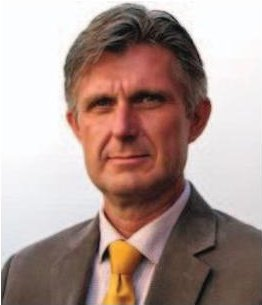

Jerker Freden received his bachelor of Engineering with postgraduate studies in Mathematics, Analog and Digital Electronics and Microwave Theory from the University of Örebro. Grade in Industrial Project Management 2002, KTH Royal Institute of Technology with a PMP

in Project Management 2004. He has managed Radar and EW projects for the Swedish Air Force Fighter Aircrafts JA 37 Viggen and JAS 39 Gripen. Maintaining his PMP certificate he has volunteered at NASA's Project Management Conferences. Since 2011 he is the Swedish Project Manager for the NAPA 3 project.

Mikael Ahlberg received his B.Sc. in Electrical Engineering from the University of Gävle, Sweden in 1998. He has been with the Swedish Defence Material Administration since 2014 as Project Manager for space activities and as Systems Engineer in the NAPA 3 Project. He has also worked for the Swedish Space Corporation and OHB

Sweden as Project Manager, Radio System designer and responsible for all radio systems on the Swedish Prisma Satellites Program. He has over a decade of experience in the field of Radio Wave Propagation, sub-mm and L/S/Xband Antenna Design, Phased Arrays, Radio Systems Design, Protocol Design and Embedded Systems. He has authored over 15 conference papers and two U.S. patents.

Fredrik Bruhn received a Ph.D. in Microsystems Technologies from Uppsala University, Uppsala, Sweden in 2005 and a Masters of Science in Atomic and Molecular Physics from Uppsala University in 2000. He has been with Mälardalen University since 2013 as adjunct Professor in Robotics & Avionics.

He has been a guest researcher at JPL and entrepreneur starting several high technology companies in robotics and space applications. He has been involved as senior designer in bi-lateral small satellite programs between NASA and the Swedish National Space Board and US Air Force Research Laboratory and the Swedish Defence Material Administration (FMV).

Jeffrey C. Preble received a B.A. degree with concentrations in chemistry and economics at Brown University, Providence, RI, USA in 1979 and a M.S. degree in aeronautics and astronautics at the Massachusetts Institute of Technology, Cambridge, MA, USA in 1991. He has worked for American Cyanamid, Rockwell

International, Boeing, and Spectrum Astro in various technical and management capacities including spacecraft subsystem design lead and spacecraft bus manager. In 1999, he and a colleague started a small company, SpaceWorks, Inc., that remains focused on designing and producing small spacecraft and spacecraft components.