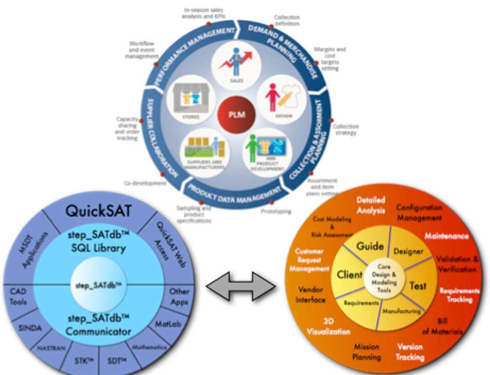
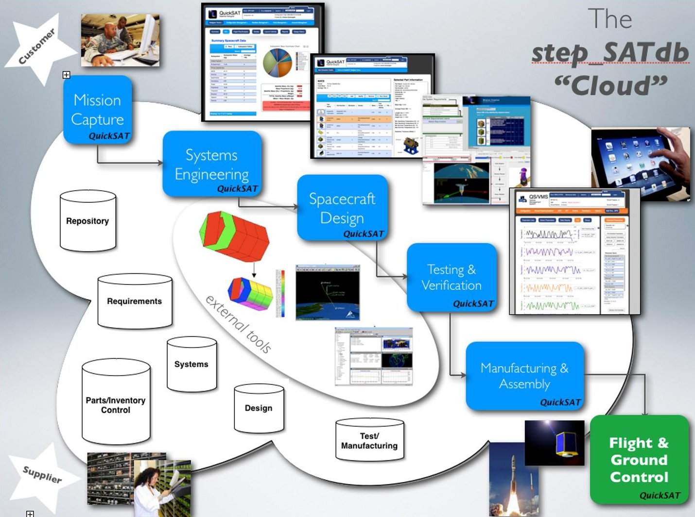
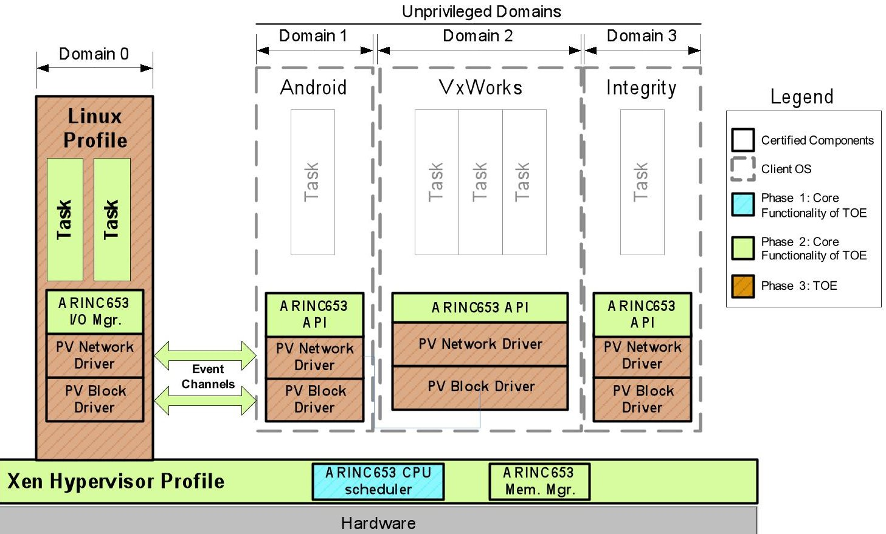
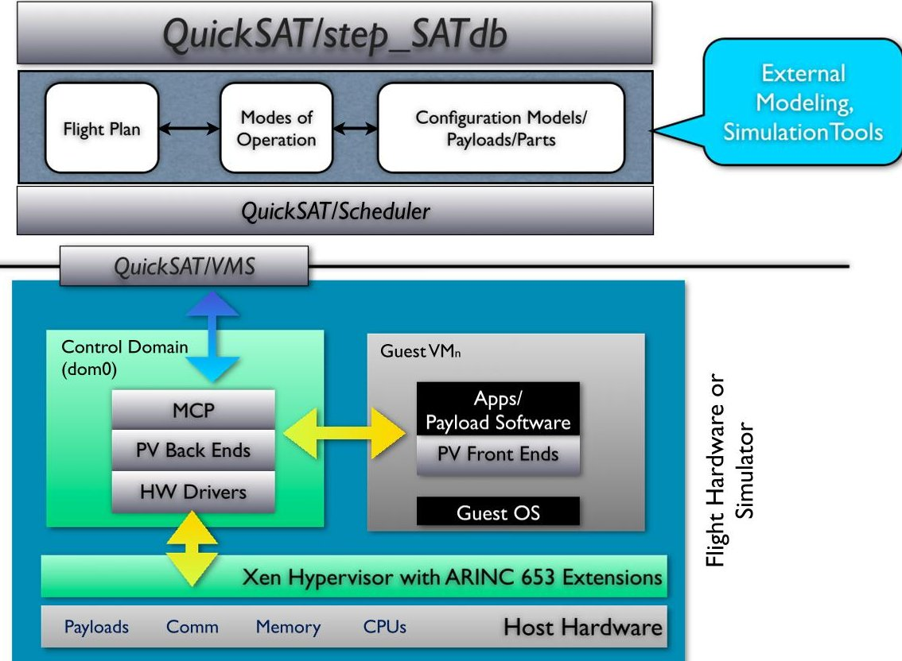
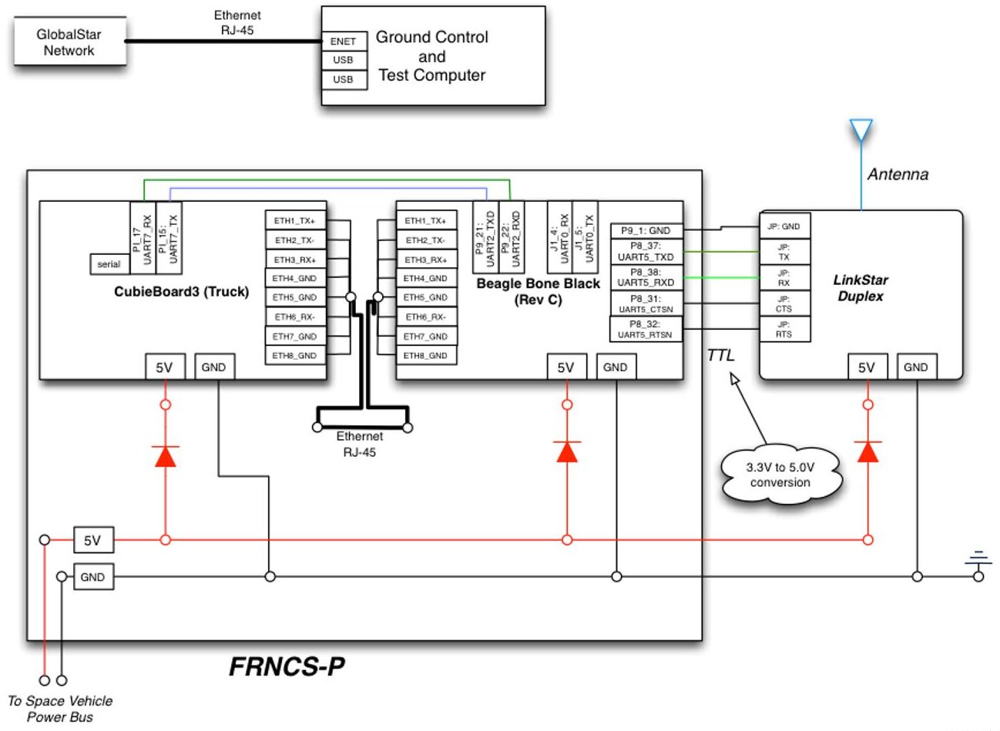
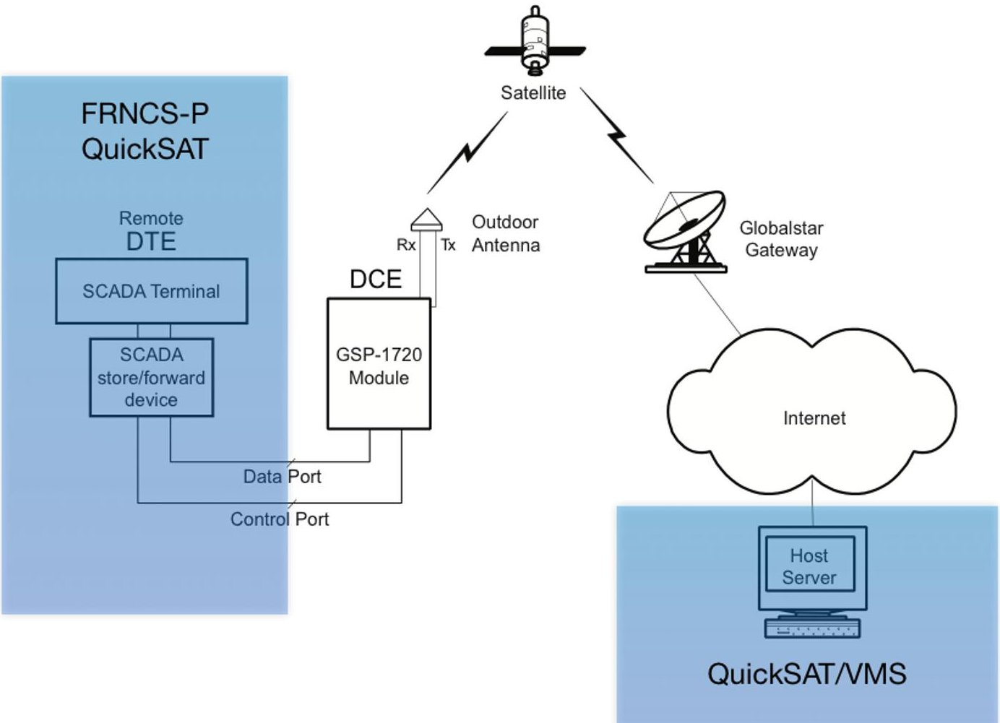
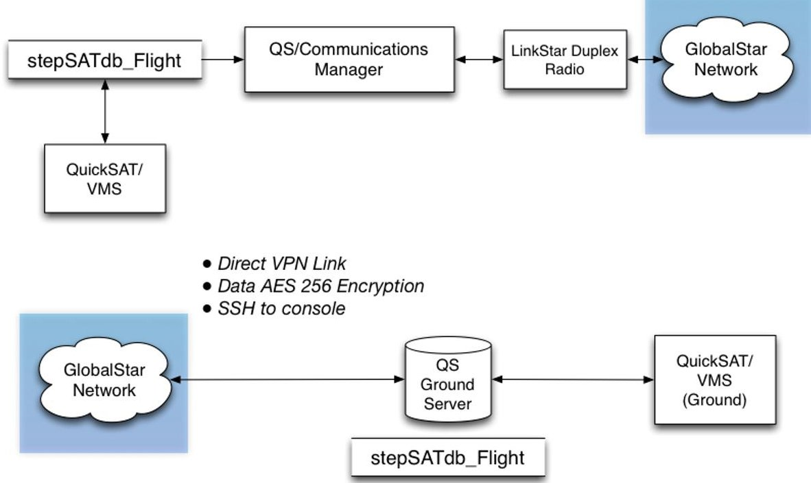
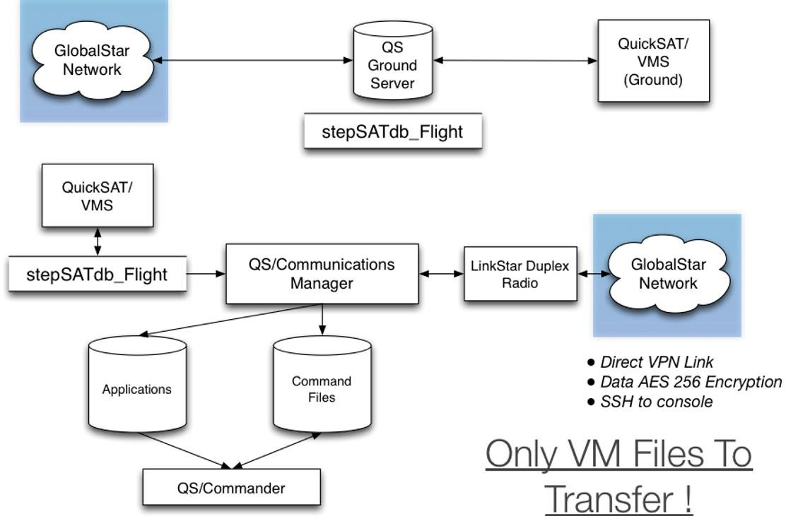

<!-- PDF_PAGE: 1 -->

# Flight of FRNCS-P and QuickSAT/Xen on the

SHARC CubeSat Mission

Andrew D. Santangelo $ ^{1} $ sci_Zone, Rio Rancho, New Mexico, 87144

## Abstract

This fall in 2015 sci Zone will be flight testing the QuickSAT/Xen Space Hypervisor and the prototype of the FRNCS-P Flight Computer as a hosted payload on the AFRL based SHARC Satellite. The SHARC Satellite is a 5U CubeSAT that will be deployed from the International Space Station via the NanoRacks Program. The first element of this project we will be to test the FRNCS-P flight computer, an ARM based computer which supports single and multi-core processors and multiple boards. On board the FRNCS-P flight computer we will be testing the QuickSAT/XEN Space Hypervisor, an open source space hypervisor that supports the virtualization of satellite payloads, systems and software modules on a range of satellites including CubeSATs and MicroSATs. A hypervisor allows for virtual processes and payloads to run on one or more processors simultaneously. Virtual processes and payloads can communicate between one another and operate independently of one another. The advantage of a hypervisor is that if one of the processes "crashes", experiences SEUs, or experiences malicious code attacks, it will not impact the performance and operation of the other processes. The QuickSAT/Xen Space Hypervisor is an extended version of the open source Xen that includes unique space vehicle support tools and elements of the ARINC 653 partitioning standard, isolating applications running on the same platform providing high levels of security and stability. For the SHARC mission, we will be testing three virtualized processes and payloads in orbit. QuickSAT $ ^{\mathrm{TM}} $ with the open source stepSATdb data architecture is a satellite design, mission planning, and product lifecycle management framework and environment. Key new features include in the QuickSAT environment include: assignment of virtual machines to processor cores, defining virtual machine parameters, mapping parameters between the satellite bus and the hypervisor, vehicle management and configuration control specific to the unique features of the space hypervisor, and Xen monitoring and control tools via an on board web interface. In this briefing we will discuss and demonstrate QuickSAT and the QuickSAT/Xen Space Hypervisor, briefly discuss the FRNCS-P flight computer, and then cover the mission itself including mission operations, mission goals and how the FRNCS-P flight computer with the QuickSAT/Xen Space Hypervisor will be integrated as a hosted payload on the SHARC satellite.

## I. Introduction $ ^{1} $

For the past several years the sci Zone team has been developing a range of technologies to support the development of satellites and the tools to support them. This has culminated on the following key technologies: the QuickSAT product life cycle management architecture, the QuickSAT/Xen space hypervisor, the FRNCS high speed flight computer and now the LinkStar radio providing 24/7 radio communications for small satellite on up. QuickSAT/Xen Space Hypervisor, is a space qualified hypervisor, that will support the virtualization of satellite payloads, systems and software modules on a full range of satellites. The Xen Space Hypervisor is an extended version of the open source Xen that includes elements of the ARINC 653 partitioning standard, isolating applications running on the same platform providing high levels of security. The results of this research is coming together in the SHARC mission using the

<!-- PDF_PAGE: 2 -->

ARM based FRNCS flight computer to test and flight qualify the developed technologies. In this paper we will cover QuickSAT, QuickSAT/Xen, FRNCS-P and the SHARC Mission.

## II. QuickSAT Environment

The QuickSAT environment is an architecture that encapsulates the space vehicle development and utilization process from concept capture through flight management. Currently a host of tools is available from systems engineering and design, system testing, software definition, vehicle health and management and ground control.

One element of of QuickSAT is QuickSAT/Designer, is a collaborative, "push button" design environment. The design, payload definition and manufacturing process requires currently a wide range of design and management tools that have limited consistency, data interchange capability, and a lack of coherency within the aerospace industry and particularly the satellite development community. QuickSAT/Designer was developed based on a need to detail the relationships between the satellite configuration (components, payloads and interrelationships), manage inventories, provide for life cycle management, design, analysis and test data, and to automate the design and manufacturing process. Based on current existing processes this is extremely difficult to do at best, and currently no integrated tool exists that meets these needs. Sci_Zone began development in 2006 of the innovative satellite design Automation and architecture QuickSAT, in conjunction with the step_SATdb open source database architecture to meet this need. step_SATdb seamlessly integrates existing detail design tools with QuickSAT, as well as databases tracking requirements, hardware and software components and parts in inventory, along with the final configuration of the satellite. QuickSAT provides for rapid design and coherency between a range of applications and data sets. step_SATdb stores and distributes supporting satellite design, configuration, mission, support and test data from a centralized database and can distribute the data across multiple platforms and via the internet and proprietary networks. Figure 1 presents the layers of the QuickSAT/step_SATdb environment and how it maps the Product Lifecycle Management process. $ ^{ii} $ $ ^{iii} $

Current features available in the QuickSAT/Designer environment include:

- Parts & Payload Management including subcomponent definition. Parts include hardware and software, which can be virtualized.

- Subsystem definition, including mass, volume, moments of inertia and part orientation.

- Mission planning including mission phase, flight legs and modes of operation for each flight leg.

- Modes of operation can define which systems and payloads are in use for a given mode.

- Launch vehicle integration

- Propulsion modeling including propellant used for each flight leg.

- Power modeling - both systems level and detail based on modes of flight for each flight leg.

- Link analysis

- Attitude Control and Determination Modeling

- Command and Data Handling tool

- Systems level Thermal Modeler

- Integration with external tools including Matlab, Mathematica, SOAP and STK.

- Satellite test and health monitoring

<!-- PDF_PAGE: 3 -->

Figure 1. The step_SATdb interfaces with the QuickSAT universe and shares a complete range of "satellite" related information between a range of applications across a host of platforms to capture the Product Lifecycle Management Process.

With QuickSAT/Designer you can save multiple configurations of a given satellite model and flight plan and compare the models, design and analytics results. Designs are fully traceable and you can baseline a mission or alternative flight plans from prior projects. Payloads and their software can be modified, however prior versions are stored to maintain fully traceable models and designs. Payloads can be easily swapped out in QuickSAT.

Figure 2 presents QuickSAT and its interface to the stepSATdb cloud environment. Currently, several clouds are active, one of which, www.quick-sat.com, serves NASA, Leidos, government subcontractors and the University Nanosat Community, plus others who support satellite development.

## III. QuickSAT/Xen

The Xen hypervisor is an open-source, type-1hypervisor, that makes it possible to run many instances of an operating system or different operating systems in parallel on a single machine. The Xen hypervisor runs right on the bare metal of the processor. In the case of the SHARC mission, it runs right on the bare metal, or circuit chip, of the FRNCS-P flight computer. It is used as the basis for a number of different commercial and open source applications, such as: server virtualization, Infrastructure as a Service (IaaS), desktop virtualization, security applications, embedded and hardware appliances. The sci_Zone team is adapting the Xen hypervisor support virtual payloads and space flight systems.

Key features of Xen include:

- "Small footprint and interface. Because it uses a microkernel design, with a small memory footprint and limited interface to the guest, it is more robust and secure than other hypervisors.

- Operating system agnostic: Most installations run with Linux as the main control stack (aka "domain 0"). But a number of other operating systems can be used instead, including NetBSD

<!-- PDF_PAGE: 4 -->

and OpenSolaris.

Driver Isolation: The Xen Project hypervisor has the capability to allow the main device driver for a system to run inside of a virtual machine. If the driver crashes, or is compromised, the VM containing the driver can be rebooted and the driver restarted without affecting the rest of the system."iv

Figure 3 presents a schematic of our implementation of Xen and its implementation schedule for our current development program.

Figure 2. The step_SATdb serves as a cloud for the QuickSAT environment bringing payload suppliers, program planners, engineers and technicians together through flight.

The goal of our research is to provide isolation between the untrusted software and other applications executing upon the host computing platform." Because modern computing hardware integrates multiple functions and capabilities on one platform (even devices as small as smartphones can now provide multiple functions), our customers need techniques for a range of applications that provide Multiple Independent Levels of Security (MILS) while not sacrificing safety or performance. Figure 3 presents a schematic of our implementation of Xen. $ ^{v} $

Many commercial avionics systems have a similar need the ability to host multiple flight applications on a common processing platform while maintaining separation between each function resources such as memory and I/O. Maintaining a brick wall partition between applications has been a mainstay for safety certified systems for some time. With the advent of multicore processors, maintaining this separation becomes much more complex. Utilizing hypervisor capabilities is one method to help maintain separation in a safety environment. An available open source hypervisor could potentially be leveraged for many of the industry's Integrated Modular Avionics (IMA) systems as they move toward multicore processing implementations. This can provide the ability to provide Air Transport level of functionality on smaller

<!-- PDF_PAGE: 5 -->

platforms such as rotary wing or smaller business and regional jets where size, weight, and power constraints have prevented their inclusion previously. In larger platforms, the ability to host functionality already available but in smaller size, weight and power implementation can provide a great benefit to avionics Original Equipment Manufacturers (OEMs) as the industry strives to provide safer, lighter and feature-rich commercial aircraft. The weight and power saving also benefit the carriers by decreasing fuel consumption on the airframe. A properly architected certifiable hypervisor is a key component enabling the industry to benefit from the integration provided by multicore System on a Chip (SoC) devices. vi, vii

Figure 3. The Xen/ARINC 653 Hypervisor environment for the Navy JTNC SBIR program.

Until now, industry has given customers an unspoken choice between either robust safety or robust security or performance - but not all three. Standards like ARINC 653 are designed to provide an assurance of safety, should part of a system fail. Efforts such as those by the Trusted Computing Group are focused on providing security, but often lag in safety features, forcing the customer to buy additional tools to cover the gap. Our adaptation of Xen bridges the gap between these two choices, providing one solution that richly handles both safety and security issues without sacrificing performance.

With the SHARC Mission we going to take Xen to the next level: a space qualified hypervisor to support the virtualization of satellite payloads on both RAD hardened and non-RAD hardened CPUs.

The goal of current research is to combine the security, robustness and performance of the Xen with ARINC 653 modules open source hypervisor with the proven QuickSAT/step_SATdb architecture to create the QuickSAT/Xen Space Hypervisor environment. As shown in Figure 4, the user will be able to define their mission, including satellite subsystems and payloads. Through QuickSAT, the user can then define the mission flight plan and modes of operation, defining which elements of the satellite are operational for each mode of flight, covering mass, power and volume. Using the flight plan and mode information, the user can define a schedule of which modes are operational based on conditions, or events, for a given flight leg through the QuickSAT/Scheduler. For example defining the conditions to turn on an imager, when to transmit data or when to go into a safe hold mode. Using this knowledge we can define an event driven schedule and model and simulate other factors such as power utilization throughout a mission or propellants used. This schedule of conditions along with payload software models and applications are downloaded from QuickSAT to the vehicle on board processor and the Xen Space Hypervisor including the

<!-- PDF_PAGE: 6 -->

Master Control Program. The Xen Space Hypervisor will then create and operate the virtualized payloads, providing all the security, robustness and performance expected from an ARINC 653 based hypervisor. The benefit of course is if a virtual machine fails, it will not impact the other processes.

Figure 4. The QuickSAT-Xen Space Hypervisor Environment

Utilizing QuickSAT's flight planning tools along with its payload and satellite definition and modeling tools will allow for the creation Virtualized payloads which will increase the beneficial mission utility and life of space platforms while decreasing acquisition time and cost, as will be demonstrated throughout the SBIR effort. In addition, a space qualified hypervisor or virtual machine monitor (VMM), has the potential to reduce the cost-to-entry barrier to space thereby expanding the space industrial base while providing an environment for commercially developed plug-and-play applications.

## IV. The SHARC Mission

To test and verify sci_Zone technologies, AFRL has invited sci_Zone to participate in the SHARC mission, a 5U cube sat to be launched via the Nanoracks deployer from the International Space Station. sci_Zone has been given 1.5U to host our payload, principally the FRNCS-P flight computer running QuickSAT/Xen $ ^{viii} $ and our flight management system QuickSAT/VMS (Vehicle Management System). In addition we will be testing our LinkStar radio which provides 24/7 radio communications between the payload and ground. The key objective of our mission is to demonstrate the functionality of a hypervisor computer system for space applications. Secondary objectives include: FRNCS-P, QuickSAT/VMS, and LinkStar space flight qualification.

The FRNCS-P flight computer is comprised of two separate computer boards, connected via both Ethernet and serial line links. The Host, running QuickSAT/Xen and the virtual machines/payloads (VM) uses the AllWinnerTech A20/ARM Cortex-A7 Dual Core chip with 16GB of RAM. Each VM will be running Ubuntu (14.04). The gateway computer runs the primary flight management system, QuickSAT/VMS, including providing command and control, backup storage and is the link to the LinkStar radio and the ground communications system. The gateway computer runs an ARM8 processor at 1Ghz, 4GB RAM and Debian Linux (7.6). Figure 5 show the wiring diagram for the FRNCS-P flight computer.

<!-- PDF_PAGE: 7 -->

Figure 5. Wiring diagram for the FRNCS-P flight computer and links to the LinkStar radio.

The LinkStar radio will be providing 24/7 radio communications between the FRNCS-P and our ground stations in Holland, Michigan and Rio Rancho, New Mexico via the internet. LinkStar is a space qualified Radio utilizing the advanced GlobalStar $ ^{\mathrm{TM}} $ satellite network that can be used on a full range of satellites including 1U CubeSATs and MicroSATs to large satellites and launch vehicles. LinkStar provides both simplex and duplex based communications, using as little as 200mW of power! When used with the QuickSAT envrionment you can not only define the operations of your radio, you will be insured your data is secure from your satellite to ground station. When LinkStar is tied in with the QuickSAT/VMS environment you will have added flexibility in visualizing your data on your ground control station, all through a secure VPN link.

LinkStar is a radio designed for use in space that interfaces with the GlobalStar $ ^{\mathrm{TM}} $ satellite network. Typically radios that use the GlobalStar $ ^{\mathrm{TM}} $ network are found in use on oil rigs, shipping containers, gas pipelines and even endangered animals. In addition, they are used for voice communications from urban to remote locations, at sea or in the mountains. We have taken the radio design a step further and developed a radio for use in near-space and in low Earth orbit. The GlobalStar $ ^{\mathrm{TM}} $ network utilizes 32 satellites orbiting 1400 km above the Earth. As a result, there is always at least one GlobalStar $ ^{\mathrm{TM}} $ satellite in the line of sight of the EyeStar radio up to 1200 km, which means your satellite will always be talking to the ground via the GlobalStar $ ^{\mathrm{TM}} $ network to our secure servers. Figure 6 shows a conceptual schematic of how FRNCS-P communicates to the QuickSAT/VMS ground station software via the GlobalStar network.

<!-- PDF_PAGE: 8 -->

Figure 6. Schematic showing conceptually how FRNCS-P communicates to the QuickSAT/VMS ground station software via the GlobalStar network. The LinkStar Radio utilizes the GSP-1720 modem.

Figures 7 and 8 show a baseline flow chart on how FRNCS-P will transmit and receive data to and from the QuickSAT/Xen experiment and flight certification data. QuickSAT/VMS will operate on the FRNCS-P gateway, storing all data in the stepSATdb_Flight on board database. The QS/Communications Manager packages and sends the data to the LinkStar radio, where the information is moved through the GlobalStar Network via TCP/IP link. The LinkStar radio allows FRNCS-P to be a node on the internet providing a direct VPN link to and from the QuickSAT/VMS Ground Station/Server. This provides AES 256 Encryption and SSH to the console on the satellite. This internet connection allows us to also send data from the ground to the stepSATdb_Flight database on FRNCS-P. With this connection we will also be able to upload Virtual Machines (VM) and virtual payloads to FRNCS-P.

<!-- PDF_PAGE: 9 -->

## Receiving Data

Figure 7. Flow chart showing data being transferred from the stepSATdb_Flight database on board FRNCS-P to the QS Ground Server via the GlobalStar Network.

Transmitting Data

Figure 8. Flow chart showing data being transferred from the stepSATdb_Flight database on the QS Ground Server to the FRNCS-P via the GlobalStar Network

<!-- PDF_PAGE: 10 -->

## V. Conclusion

The QuickSAT/Xen Space Hypervisor is a system that will support the virtualization of satellite payloads, systems and software modules on a full range of satellites. This will allow isolating applications running on the same platform and providing high levels of certified safety and security. QuickSAT $ ^{\mathrm{TM}} $ with the open source stepSATdb data architecture is a satellite design, mission planning, and product lifecycle management framework and environment. The SHARC mission represents a remarkable opportunity to test, demonstrate and flight certify the entire QuickSAT architecture, the FRNCS-P flight computer QuickSAT will run on and the LinkStar radio providing 24/7 ground communications.

## References

$ ^{i} $ Santangelo, Andrew, "An Open Source Space Hypervisor For Small Satellites", AIAA 2013-5512, Space 2013 Conference, September 10-12, 2013, San Diego, California, 2013

$ ^{1 1} $ ISO, "ISO10303 - Automation systems and integration — Product data representation and exchange"

$ ^{m1} $ Santangelo, Andrew, "QuickSAT/step_SATdb: A Satellite Concurrent Design Automation and Design for Manufacturability cloud based environment for Responsive Space", AIAA-2426, September 28, 2011.

$ ^{1 Ⅳ} $ http://wiki.xenproject.org, "Overview", http://wiki.xenproject.org/wiki/Xen_Overview, Xen.org 2014.

$ ^{v} $ Steven H. VanderLeest, "ARINC 653 Hypervisor," Proceedings of the 29th Digital Avionics Systems Conference (DASC), Salt Lake City, UT, October 2010.