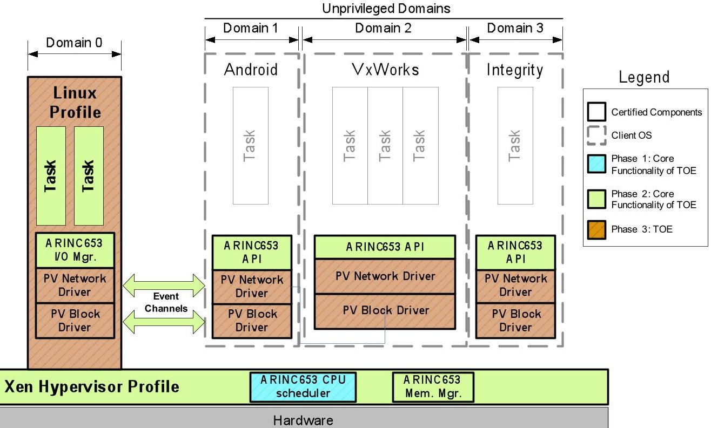
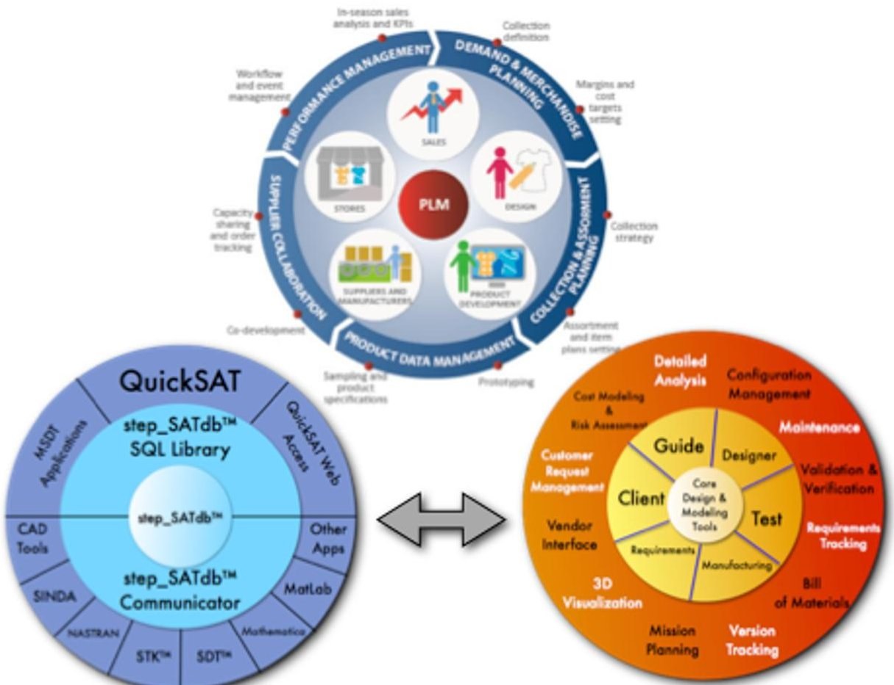
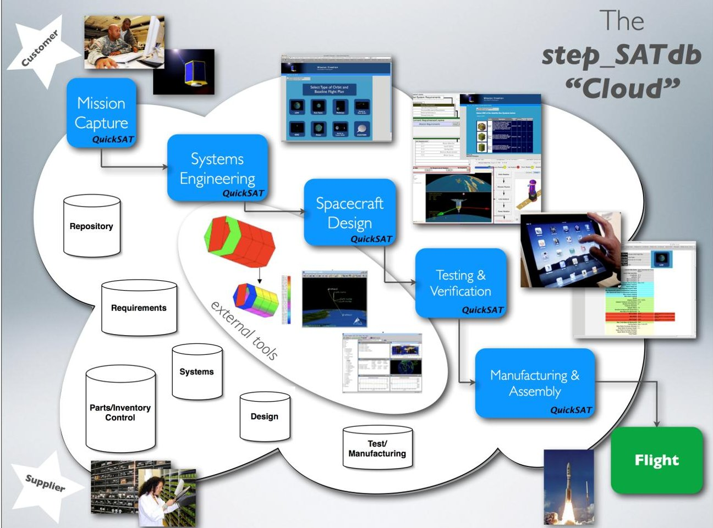
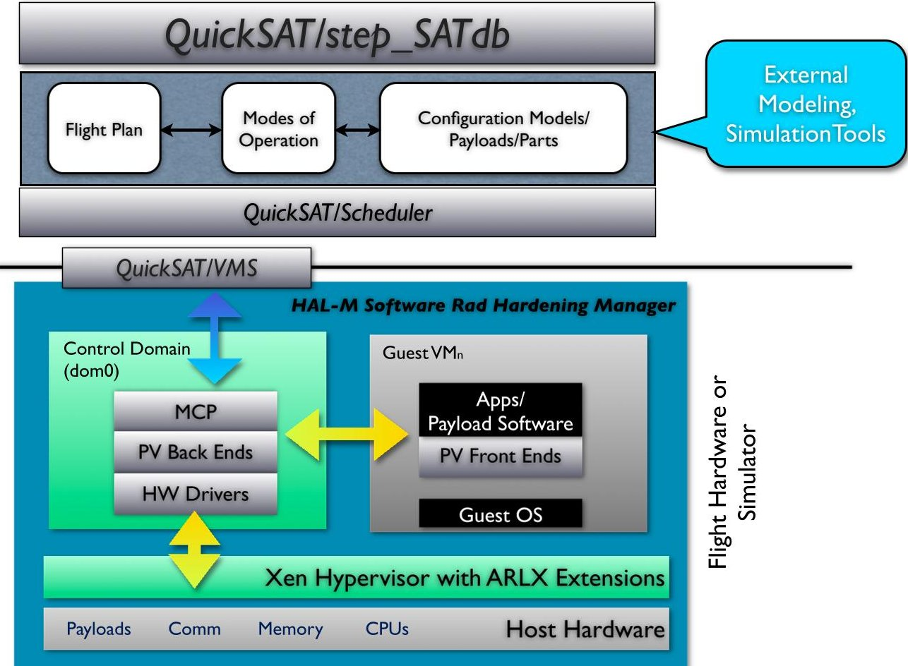
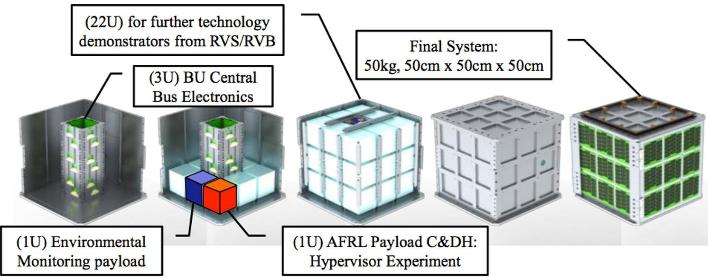
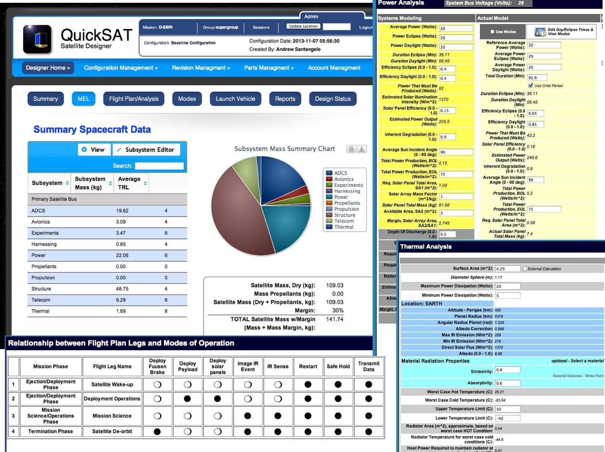
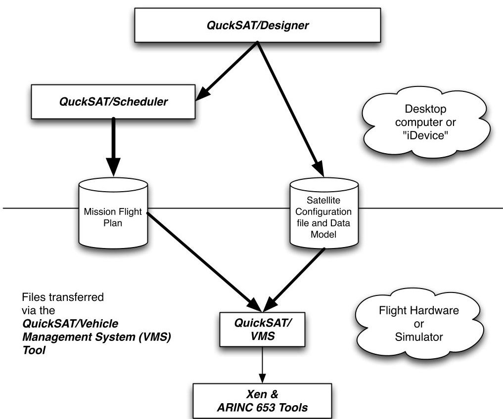
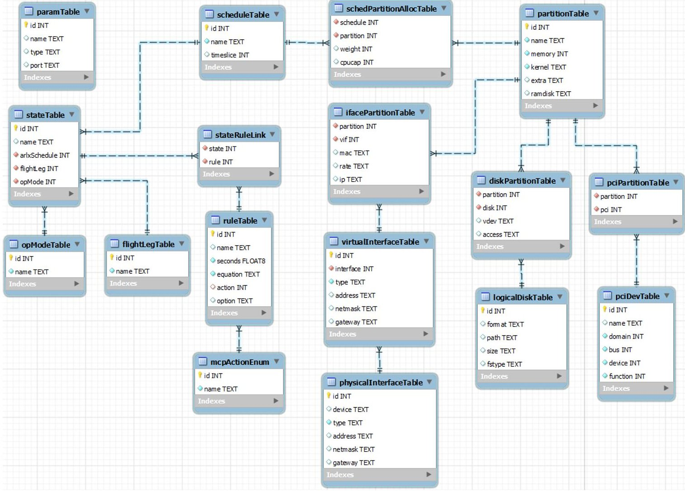
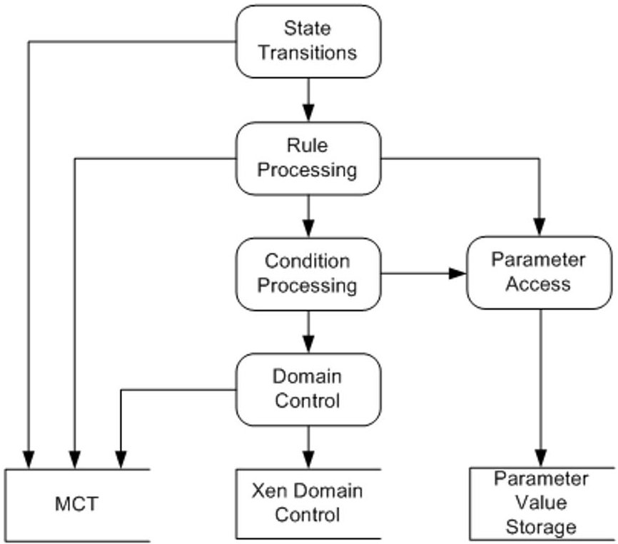

<!-- PDF_PAGE: 1 -->

# QuickSAT/Xen: An Open Source Space Hypervisor

Andrew D. Santangelo $ ^{1} $

sci Zone, Rio Rancho, New Mexico, 87144

## Abstract

The QuickSAT/Xen Space Hypervisor, is an open source space hypervisor that supports the virtualization of satellite payloads, systems and software modules on a range of satellites including CubeSATs and MicroSATs to satellites over 1000 kg. A hypervisor allows for virtual processes and payloads to run on one or more processors simultaneously. Virtual processes and payloads can communicate between one another and operate independently of one another. The advantage of a hypervisor is that if one of the processes "crashes", experiences SEUs, or experiences malicious code attacks, it will not impact the performance and operation of the other processes. The Xen Space Hypervisor is an extended version of the open source Xen that includes elements of the ARINC 653 partitioning standard, isolating applications running on the same platform providing high levels of security. QuickSAT $ ^{\mathrm{TM}} $ with the open source stepSATdb data architecture is a satellite design, mission planning, and product lifecycle management framework and environment. It is currently in use on the University NanoSat Program, at AFRL, the Eagle program and projects with NASA research centers. In this paper we will discuss the QuickSAT and the QuickSAT/Xen environment, and planned implementation on the ARM based Architectures. We will also discuss the ARINC 653 environment implemented in QuickSAT/Xen and the supported security environment.

## I. Introduction $ ^{i} $

The QuickSAT/Xen Space Hypervisor is an hypervisor environment for space vehicles with initial implementation targeted at BUSAT (part of the University Nanosat Program), Eagle and EarthScan CubeSAT $ ^{ii} $ missions due to the open source nature of the software. A hypervisor allows for virtual processes and payloads to run on one or more processors simultaneously. Virtual processes and payloads can communicate between one another and operate independently of one another. The advantage of a hypervisor is that if one of the processes "crashes", experiences SEUs, or experiences malicious code attacks, it will not impact the performance and operation of the other processes. In order to understand the QuickSAT/Xen Space Hypervisor with the ARINC 653 extensions, let's review what each of these core components are, and how they work together.

## Xen and ARINC 653

ARINC 653 Real-time Linux on a Xen Hypervisor provides simultaneous safety, security and performance all in one package. Our partner Dornerwork's first, and current, customer is the Joint Tactical Networking Center (JTNC) program managed by the Navy's Space and Naval Warfare Systems Command (SPAWAR). The Navy needs technology to protect critical functionality on computing platforms used by the warfighter. In modern systems, commercial and open source software is often introduced into military computing systems, but this software is untrusted (the Navy considers trustworthiness to include "security, privacy, reliability, and safety"). Malicious software, malware, can be accidentally introduced (or intentionally by an enemy) that subverts the capabilities provided by the computing system. Its "impact can range from denial of service of the application and other users of computing platform to covert transmissions and receptions of the network connected to the computing platform. The more malicious malware can jeopardize the integrity of users and any applications on the computing platform or possibly even those

<!-- PDF_PAGE: 2 -->

connected via the network." Dornerwork's goal is "to provide isolation between the untrusted software and other applications executing upon the host computing platform." Because modern computing hardware integrates multiple functions and capabilities on one platform (even devices as small as smartphones can now provide multiple functions), the Navy needs techniques that provide Multiple Independent Levels of Security (MILS) while not sacrificing safety or performance. Figure 1 presents a schematic of the ARINC 653 implementation of Xen and its implementation schedule for the SBIR based JTNC program currently under development. $ ^{iii} $

Many commercial avionics systems have a similar need the ability to host multiple flight applications on a common processing platform while maintaining separation between each function resources such as memory and I/O. Maintaining a brick wall partition between applications has been a mainstay for safety certified systems for some time. With the advent of multicore processors, maintaining this separation becomes much more complex. Utilizing hypervisor capabilities is one method to help maintain separation in a safety environment. An available open source hypervisor could potentially be leveraged for many of the industry's Integrated Modular Avionics (IMA) systems as they move toward multicore processing implementations. This can provide the ability to provide Air Transport level of functionality on smaller platforms such as rotary wing or smaller business and regional jets where size, weight, and power constraints have prevented their inclusion previously. In larger platforms, the ability to host functionality already available but in smaller size, weight and power implementation can provide a great benefit to avionics Original Equipment Manufacturers (OEMs) as the industry strives to provide safer, lighter and feature-rich commercial aircraft. The weight and power saving also benefit the carriers by decreasing fuel consumption on the airframe. A properly architected certifiable hypervisor is a key component enabling the industry to benefit from the integration provided by multicore System on a Chip (SoC) devices. $ ^{iv,v} $

Figure 1. The Xen/ARINC 653 Hypervisor environment for the Navy JTNC SBIR program.

Until now, industry has given customers an unspoken choice between either robust safety or robust security or performance - but not all three. Standards like ARINC 653 are designed to provide an assurance of safety, should part of a system fail. Efforts such as those by the Trusted Computing Group are focused on providing security, but often lag in safety features, forcing the customer to buy additional tools to cover the gap. Our adaptation of Xen bridges the gap between these two choices, providing one solution that richly handles both safety and security issues without sacrificing performance. Based on our team's work with the Navy and our commercial aviation customers, such as Rockwell Collins and GE Aviation, sci Zone is prepared to take the Xen hypervisor to the next level development - a space qualified hypervisor to support the virtualization of satellite payloads on both RAD hardened and non-RAD hardened CPUs.

<!-- PDF_PAGE: 3 -->

## QuickSAT/step SATdb

QuickSAT/step_SATdb, is a collaborative, "push button" design and manufacturing environment for satellite manufacturers, government agencies and universities. The design, payload definition and manufacturing process requires currently a wide range of design and management tools that have limited consistency, data interchange capability, and a lack of coherency within the aerospace industry and particularly the satellite development community. Beginning in the late 1990's the Space Industry began an effort to streamline this process to pursue the capability to assemble, test and launch a satellite within months and sometimes days, versus years, of a customer's request. The effort began with defining a standard for "Plug and Play" parts, and a method for attaching components, cables and networks in a satellite for ease of design, assembly and manufacturing. A need existed however to detail the relationships between the satellite configuration (components, payloads and interrelationships), manage inventories, provide for life cycle management, design, analysis and test data, and to automate the design and manufacturing process. This is extremely difficult to do at best, and currently no integrated tool exists that meets these needs. Sci_Zone began development in 2006 of the innovative Satellite Design Automation and manufacturing architecture QuickSAT, in conjunction with the step_SATdb open source database architecture to meet this need. step_SATdb seamlessly integrates existing detail design tools with QuickSAT, as well as databases tracking requirements, hardware and software components and parts in inventory, along with the final configuration of the satellite. QuickSAT provides for rapid design and coherency between a range of applications and data sets. step_SATdb stores and distributes supporting satellite design, configuration, mission, support and test data from a centralized database and can distribute the data across multiple platforms and via the internet and proprietary networks. Figure 2 presents the layers of the QuickSAT/step_SATdb environment and how it maps the Product Lifecycle Management process. vivii

Current features available in the QuickSAT/step_SATdb environment include:

- Parts & Payload Management including subcomponent definition. Parts include hardware and software, which can be virtualized.

- Subsystem definition, including mass, volume, moments of inertia and part orientation.

- Mission planning including mission phase, flight legs and modes of operation for each flight leg.

- Modes of operation can define which systems and payloads are in use for a given mode.

- Launch vehicle integration

- Propulsion modeling including propellant used for each flight leg.

- Power modeling - both systems level and detail based on modes of flight for each flight leg.

- Link analysis

- Attitude Control and Determination Modeling

- Command and Data Handling tool

- Systems level Thermal Modeler

- Integration with external tools including Matlab, Mathematica, SOAP and STK.

- Satellite test and health monitoring

With QuickSAT/step_SATdb you can save multiple configurations of a given satellite model and flight plan and compare the models, design and analytics results. Designs are fully traceable and you can baseline a mission or alternative flight plans from prior projects. Payloads and their software can be modified, however prior versions are stored to maintain fully traceable models and designs. Payloads can be easily swapped out in QuickSAT.

Figure 3 presents QuickSAT and its interface to the stepSATdb cloud environment. Currently, several clouds are active, one of which, www.quick-sat.com, serves NASA, SAIC, government subcontractors and the University Nanosat Community, plus others who support satellite development.

## QuickSAT/Xen

Our research program is combining the security, robustness and performance of the Xen open source hypervisor with ARINC 653 extensions with the proven QuickSAT/step_SATdb satellite PLM and plugand-play environment to create the QuickSAT/Xen Space Hypervisor environment. As shown in Figure 4,

<!-- PDF_PAGE: 4 -->

the can define their mission, including satellite subsystems and payloads. Through QuickSAT, the user can then define the mission flight plan and modes of operation, defining which elements of the satellite are operational for each mode of flight, covering mass, power and volume. Using the flight plan and mode information, the user can define a schedule of which modes are operational based on conditions, or events, for a given flight leg through the QuickSAT/Scheduler. For example defining the conditions to turn on an imager, when to transmit data or when to go into a safe hold mode. Using this knowledge we can define an event driven schedule and model and simulate other factors such as power utilization throughout a mission or propellants used. This schedule of conditions along with payload software models and applications are downloaded from QuickSAT to the vehicle on board processor and the Xen Space Hypervisor including the Master Control Program. The Xen Space Hypervisor will then create and operate the virtualized payloads, providing all the security, robustness and performance expected from an ARINC 653 based hypervisor. (Note, the MCP Scheduler that manages modes and events to operate the modes is not to be confused with the Xen CPU Scheduler). The benefit of course is if a virtual machine fails, it will not impact the other processes.

Figure 2. The step_SATdb interfaces with the QuickSAT universe and shares a complete range of "satellite" related information between a range of applications across a host of platforms to capture the Product Lifecycle Management Process.

Utilizing QuickSAT's flight planning tools along with its payload and satellite definition and modeling tools will allow for the creation Virtualized payloads which will increase the beneficial mission utility and life of space platforms while decreasing acquisition time and cost, as will be demonstrated throughout the SBIR effort. In addition, a space qualified hypervisor or virtual machine monitor (VMM), has the potential to reduce the cost-to-entry barrier to space thereby expanding the space industrial base while providing an environment for commercially developed plug-and-play applications. This will be demonstrated by applying the QuickSAT/Xen Space Hypervisor environment to the AFRL's University Nanosat Program (UNP) where clearly university budgets are limited. In addition, the QuickSAT-Xen Space Hypervisor has been selected to fly on the BUSat CubeSat mission in early 2016. Figure 5 shows the BUSat configuration. The primary objective of BUSat is to demonstrate radiation resiliency through on-orbit validation using a

<!-- PDF_PAGE: 5 -->

hypervisor architecture supporting virtualization of satellite software applications. A secondary objective is to discriminate natural threats to spacecraft operability.

Figure 3. The step_SATdb serves as a cloud for the QuickSAT environment bringing payload suppliers, program planners, engineers and technicians together through flight.

The QuickSAT-Xen Space Hypervisor Environment has broad applications over a wide range of commercial, defense and research based space vehicles. The QuickSAT-Xen Space Hypervisor provides a "total" solution - satellite modeling, definition, testing and manufacturing, flight planning, payload definition, scheduling use of virtualized payloads, and of course the space qualified hypervisor and all within a "plug-and-play" environment. Testing the QuickSAT-Xen Space Hypervisor Environment during both Phase II and Phase III commercialization under AFRL's UNP effort, BUSat and Eagle Mission will allow us to achieve TRL 9. This can be done since both programs have contracted sci Zone to utilize the QuickSAT/step_SATdb and its future releases. Once the successful flight programs are completed we will have a fully space qualified version (TRL 9). Due to the scope of the Xen environment and its implementation on ARM and Intel i5/i7 Core processors, we anticipate an expanded and wide ranging customer base including the DARPA, the Navy, AFRL, GE Aviation, Rockwell Collins, NASA, Leidos, partner subcontractors and the university community.

## II. Summary Research Completed $ ^{viii} $

Current research has focused on demonstrating and documented the feasibility of the QuickSAT/Xen Space Hypervisor for a baseline mission concept similar to the BUSat Mission. This included quantifying system estimates for mass, volume, power requirements, and duty cycles, plus definition of a baseline flight plan/phases of flight with cross referenced modes of operation. From this process we can virtualize satellite payloads and transfer this information to the flight computer or flight simulator. Figure 6 presents a summary of the screen shots covering the functionality of QuickSAT/Designer and the work done.

<!-- PDF_PAGE: 6 -->

Figure 4. The QuickSAT-ARLX Space Hypervisor Environment

Figure 5. The BUSat Configuration.

Research also resulted release of version 0.5 of the Xen Space Hypervisor Master Control Program (MCP) and the Master Control Table (MCT), which included integration with QuickSAT/Designer and the QuickSAT/Vehicle Management System (VMS). Figure 7 shows the relationship between QuickSAT/Designer, QuickSAT/VMS and Xen with the MCT and MCP. MCT is the database that contains a snapshot of the QuickSAT configuration. It contains the information necessary to configure and operate the system. For version 0.5 the MCT contains the following configuration information:

1. Valid flight legs

2. Valid operating modes

<!-- PDF_PAGE: 7 -->

3. Valid flight leg/mode combinations (MCP states)

4. Domain schedule for each MCP state

5. DomU configurations (kernel images, ramdisk images, other hardware resources)

6. Rule configurations: conditions to check, period that the rule should be checked in, and the MCP state that the rule is active in

7. Hardware configurations: network interfaces, disk images, PCI devices

In the next phase of research the MCT structures will be updated as required. Testing and integration will likely show that some of MCT's tables would need to be expanded to be able to provide more flexibility.

The MCP is the central process that manages the domains running on the Xen Space Hypervisor system. When MCP starts it performs the following tasks:

1. Opens the MCT database

2. Creates the shared memory region to allow other processes to read and write parameter values

3. Creates all domains configured in MCT

4. Sets the system to the initial MCP state (initial flight leg and mode)

The last step causes the domains that are configured to run in the initial MCP state to be started, and the conditions configured to be monitored in the initial MCP state to start running. After the MCP has started the domains and started monitoring conditions, rest of MCP's operation is automatic. When the periodic condition check timers expire, the condition is evaluated. If the condition is met then the configured action is taken. As of phase I the possible actions are:

- Change the MCP state (indirectly changes the flight leg and operating mode)

- Change the flight leg (indirectly changes the MCP state)

- Change the operating mode (indirectly changes the MCP state)

- Log a message

- Reset a domain

- Pause a domain

- Resume a domain

- Set a parameter value (allows compound conditions)

The MCP library, developed for version 0.5 of the software release, is a set of functions that can be used by any process to be able to read and write parameter values through the shared memory region created by MCP. For version 1.0 the MCP library will need to be updated to access parameter data through the updated parameter sharing mechanism that allows applications in different domains to access parameter values.

The MCP CLI (command line interface) was implemented as a means to test the MCPlib mechanisms for reading and writing parameter values between separate processes. For version 1.0 the MCP CLI will be reused and integrated with QuickSAT/VMS as a means for testing the MCP. While the MCP library will need to be updated in Phase II to be able to read and write parameter values across domains, as long as the MCP library APIs can remain unchanged the MCP CLI should not need to be modified.

Lessons learned from development of the Xen Space Hypervisor MCP and the MCT:

- Xen is an easy platform to develop with and integrate for because it can be run natively on a development PC or virtual machine (VM). As a result, it is easy to develop applications and test them.

- Currently MCP (or the mcpprep script) does not fully validate conditions prior to the condition being evaluated by MCP during operation. Validation should be performed during an installation phase prior to the system being altered, so that the operator can know there is a problem immediately, and the target system will still be in an operational state.

<!-- PDF_PAGE: 8 -->

- For version 0.5 parameters values are exchanged through standard POSIX shared memory. For version 1.0 the parameter values will need to be exchanged through a system that can safely and securely work between multiple domains.

Figure 6. Screen shots from QuickSAT/Designer covering the modeling and analysis of the baseline mission concept to be used for the QuickSAT/Xen Space Hypervisor. The satellite subsystems and mass analysis is presented on the upper left; the upper right presents the Power Analysis of the test concept; the lower left shows a mapping of the flight legs/mission phases to the satellite modes of operation which maps to the MCT; the lower right shows the Thermal Analysis module.

## III. The MCP and MCT

The Master Control Table (MCT) is a database stored on the Xen hypervisor that contains rules, various flight parameters, hardware configurations, etc. The Master Control Program (MCP) uses this database to control domains and log the state and health of the satellite. This database is a smaller version of the database found on the ground in the QuickSat system.

In version 0.5, the MCT specifies the allocation of hardware resources to each domain; this includes any hardware devices as well as memory and CPU allocation. Schedules can be configured for each valid flight phase and mode combination where different domains can be allowed or disallowed from running in each state. Rules and parameters are defined for MCP to evaluate periodically and determine if an action should be taken. The valid actions that can be configured in the MCT are: pause a Xen domain, unpause a Xen domain, reset a Xen domain, log a message, change a parameter value, change the flight leg, change the operating mode or change the MCP state. Figure 8 represents the tables managed in the MCT for version 0.5 of the database.

<!-- PDF_PAGE: 9 -->

Figure 7. Files generated by QuickSAT and the relationships between QuickSAT/VMS, Xen and the ARINC 653 tools which the MCP and MCT are a part of.

Figure 8. The current structure of the MCT.

<!-- PDF_PAGE: 10 -->

The tables will continue to evolve the development of the MCT so that health logging and rule complexity can be implemented and improved in version 1.0 of the MCT. The system and hardware configuration values are expected to change in version 1.0 as more integration on the target is performed. Since the database will contain information that could be of various classification levels, software development will also address security of the database and secure writing and reading of the database.

Version 0.5 of the Master Control Program (MCP) has been developed to work on the Intel platform and has been demonstrated and tested on Intel based laptops running the Xen hypervisor. The MCP has been developed in order to control the creation or destruction of virtual machines or domains in the Xen lexicon. The logic that the MCP follows is detailed in the MCT rules. Again, the MCT database contains rules, flight parameters, hardware configurations, etc. Rules are the states that the hypervisor verifies and validates throughout a flight. The MCP and the MCT work in tandem, in the hypervisor, to ensure reliability, safety, and proper operation of the space vehicle (Figure 8).

The preliminary work showed very rudimentary proof of concept for the capability access the MCT database, manipulate domains, and to display this information on the Xen terminal. For version 1.0 of the software release we will complete the development of the MCP.

Figure 9 presents a simplified flow diagram showing how the MCP works. For the purposes of this project, the MCP will run in the background as a Unix daemon and will evaluate rules in the MCT that pertain to the current satellite mission. Rules are defined in the MCT that specify actions that MCP should perform when certain conditions occur. MCP will evaluated these rules periodically, and execute the actions when the conditions specified in the rule are met. MCT also specifies the resources allocated to each domain, and the domains that are allowed to run in the configured flight legs and modes. Version 0.5 of the MCP can pause a Xen domain, unpause a Xen domain, reset a Xen domain, log a message, change a parameter value, change the flight leg, change the operating mode or change the MCP state. These actions allow the MCP to automatically set the state of the system according to the monitored system parameters. For example, the system might pause an experiment in one domain and start another domain when the orientation of the satellite is specific for another piece of hardware.

The MCP will be a component of the Xen hypervisor and will run in the Dom0 domain. Dom0 is the first domain that the Xen starts up and is normally the privileged domain that controls information flow with the other non-privileged domains.

Version 1.0 will further develop the MCP so that it will run on the ARM platform. Continued evolution of the MCP will include the ability of other domains to send configuration information to the MCP. We will explore the various security ramifications of information passing that Xen has built into it. This capability becomes important on missions where the satellite has various classifications levels of information passing between the systems. Version 1.0 will also improve the start mechanism for the MCP which is currently a manual process; a proper start up sequence for the MCP so that it is started in Dom0 when Xen starts that domain. Additionally, version 1.0 will implement a logging capability into the MCP so that in the event of resets or other failures in the system, domains can be started at the point in which the system failed. This capability becomes important in the event of detecting failures early and in detecting misuse of the system in such cases as a cyber-attack. The MCP will be developed for use on the ARM-15 processor, hardware meant for an actual flight and will be tested and developed on the platform with the same hardware as that used for the BUSat Mission.

## IV. HAL-M Manager $ ^{i x} $

The Xen Space hypervisor with ARINC 653 allows for virtual machines or domains in the Xen nomenclature and payloads to run on one or more processor cores simultaneously. Virtual machines and their payloads can communicate between one another and operate independently of one another. The advantage of a hypervisor or virtual machine monitor (VMM) is that if one of the processes "crashes", experiences a SEU, or experiences malicious code attacks, it will not impact the performance and operation of the other domains. However if DOM0 (the master domain) experiences a failure from an SEU, the system will still fail. To alleviate this problem the sci_Zone team is also developing the HAL-M manager

<!-- PDF_PAGE: 11 -->

(Figure 4), an application that will manage multiple "DOM0s" and maintain consistency between them and restart any failed DOM0. If the HAL-M manager goes down for any reason, it can either be restarted by an active DOM0 or hardware based monitor such as a watchdog timer.

Testing will be done utilizing a ARM-15 based board, the same processor used for the BUSat Mission. Once developed, the software rad-hardening tools will be tested using real applications running on virtual machines on the BUSat Mission including the C&DH module, the communications module, and the ADCS module. Testing will be conducted in a lab setting, through ground based testing, high altitude balloon flights and the BUSat Mission in low Earth orbit. At the conclusion of this program software based radhardening system will be flight qualified.

MCP

Figure 9. The MCP environment.

## V. Conclusion

The QuickSAT/Xen Space Hypervisor is a system that will support the virtualization of satellite payloads, systems and software modules on a full range of satellites. The Xen ARINC 653 set of extensions being implemented with version 4.3 of the open source Xen hypervisor, including the MCP and MCT, will add to the security of the environment. This will allow isolating applications running on the same platform and providing high levels of certified safety and security. QuickSAT $ ^{TM} $ with the open source stepSATdb data architecture is a satellite design, mission planning, and product lifecycle management framework and environment. With the HAL-M software based rad-hardening system used exclusively within the open source QuickSAT/Xen environment, the core, we remove the need for outdated, costly rad-hardened boards and processors. Also, delays in flight opportunities associated with obtaining the rad-hardened boards and processors are eliminated or reduced, which normally can take a year or more to obtain.

<!-- PDF_PAGE: 12 -->

## References

Santangelo, Andrew, "An Open Source Space Hypervisor For Small Satellites", AIAA 2013-5512, Space 2013 Conference, September 10-12, 2013, San Diego, California, 2013

$ ^{11} $ Toorian, Armen, Emily Blundell, Jordi Puig Suari, and Robert Twiggs, "Cubesats As Responsive Satellites," Proceedings from 2005 Responsive Space Conference, Los Angeles, CA, 2005.

$ ^{111} $ Steven H. VanderLeest, "ARINC 653 Hypervisor," Proceedings of the 29th Digital Avionics Systems Conference (DASC), Salt Lake City, UT, October 2010.

$ ^{1 Ⅳ} $ Prisaznuk, Paul J., "ARINC 653 Role in Integrated Modular Avionics (IMA)," Proceedings of the IEEE/AIAA 27th Digital Avionics Systems Conference (DASC 2008), Oct 26-30, 2008, St. Paul, MN, USA, pp. 1.E.5-1 - 1.E.5-10.

$ ^{v} $ RTCA, Inc., RTCA/DO-178B, Software Considerations in Airborne Systems and Equipment Certification, dated December 1, 1992.

ISO, "ISO10303 - Automation systems and integration — Product data representation and exchange"

vii Santangelo, Andrew, "QuickSAT/step_SATdb: A Satellite Concurrent Design Automation and Design for Manufacturability cloud based environment for Responsive Space", AIAA-2426, September 28, 2011. viii Ibid

$ ^{1X} $ Santangelo, Andrew, "An Open Source Space Hypervisor For Small Satellites", AIAA 2013-5512, Space 2013 Conference, September 10-12, 2013, San Diego, California, 2013