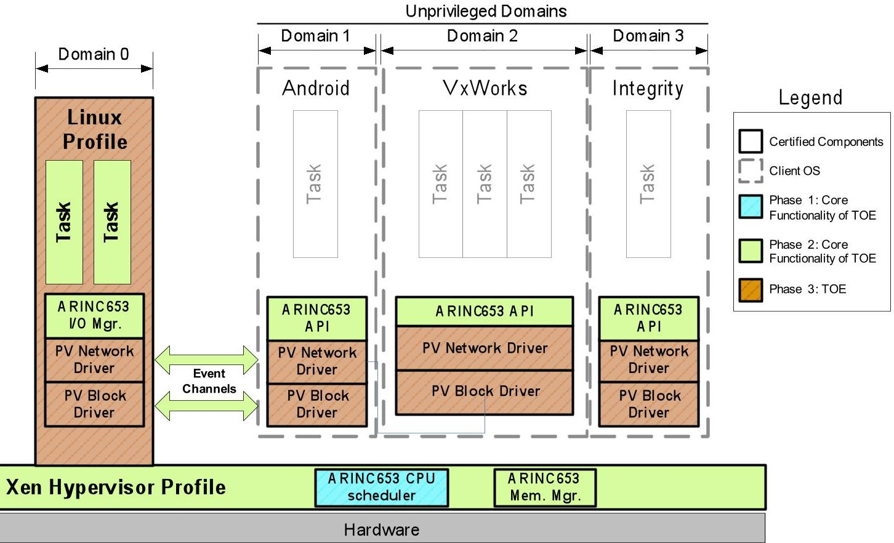
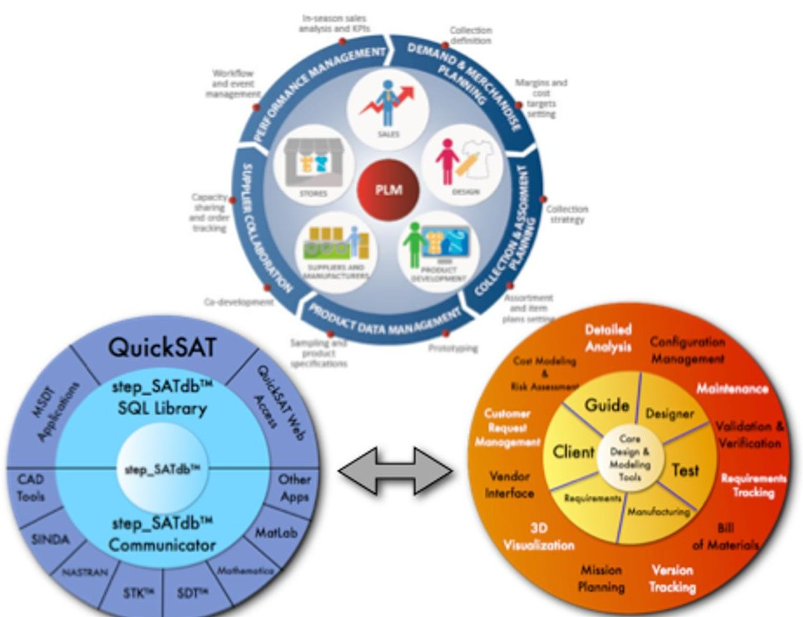
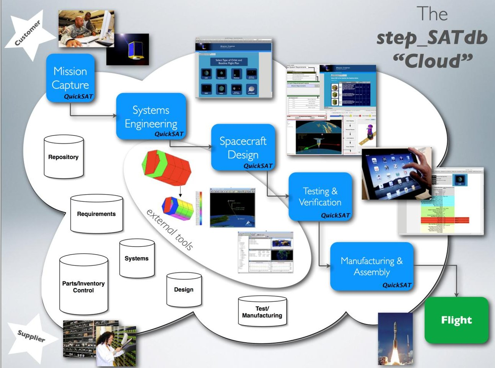
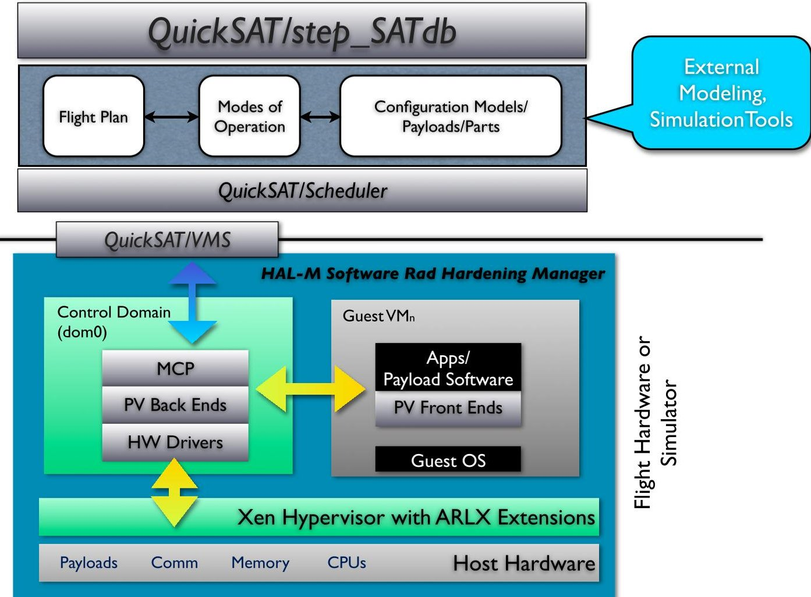
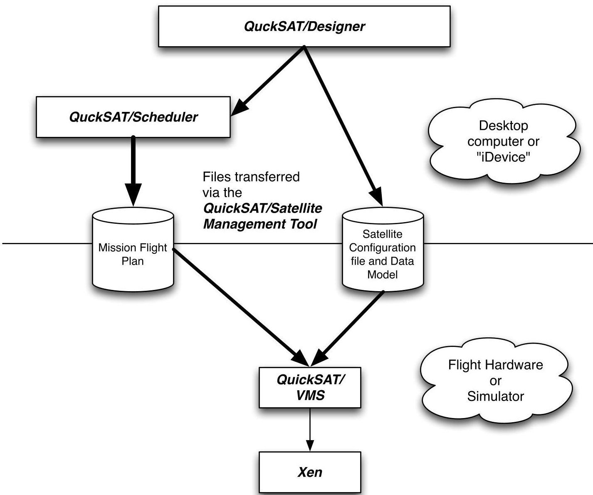
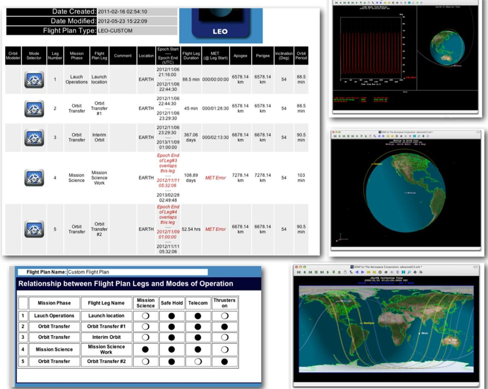

<!-- PDF_PAGE: 1 -->

# An Open Source Space Hypervisor For Small Satellites

Andrew D. Santangelo $ ^{1} $

sci Zone, Rio Rancho, New Mexico, 87144

## Abstract

The QuickSAT/Xen using the ARLX extensions is a space hypervisor that will support the virtualization of satellite payloads, systems and software modules on a full range of small satellites including CubeSATs and MicroSATs. ARLX is a set of extensions implemented in version 4.3 of the open source Xen hypervisor utilizing robust automation tools to test and validate the security and related safety of this environment. ARLX implements the ARINC 653 partitioning standard, isolating applications running on the same platform and providing high levels of certified safety and security. QuickSAT $ ^{\mathrm{TM}} $ with the open source stepSATdb data architecture is a satellite design, mission planning, and product lifecycle management framework and environment. It is currently in use on the University NanoSat Program, at AFRL and at NASA research centers. In this paper we will discuss QuickSAT, Xen and ARLX and how they are integrated to create a space based hypervisor with virtual payload definition tools and event scheduler.

## I. Introduction

The QuickSAT/Xen Space Hypervisor is a hypervisor environment for space vehicles with initial implementation targeted at BUSAT and EarthScan CubeSAT $ ^{i} $ missions due to the open source nature of the software. A hypervisor allows for virtual processes and payloads to run on one or more processors simultaneously. Virtual processes and payloads can communicate between one another and operate independently of one another. The advantage of a hypervisor is that if one of the processes "crashes", experiences SEUs, or experiences malicious code attacks, it will not impact the performance and operation of the other processes. In order to understand the QuickSAT/Xen Space Hypervisor with the ARLX extensions, let's review what each of these core components are, and how they work together.

## ARLX

The ARINC 653 Real-time Linux on a Xen Hypervisor, or ARLX, provides simultaneous safety, security and performance. The first, and current, user of ARLX is the Joint Tactical Networking Center (JTNC) program managed by the Navy's Space and Naval Warfare Systems Command (SPAWAR). The Navy needs technology to protect critical functionality on computing platforms used by the warfighter. In modern systems, commercial and open source software is often introduced into military computing systems, but this software is untrusted (the Navy considers trustworthiness to include "security, privacy, reliability, and safety"). Malicious software, malware, can be accidentally introduced (or intentionally by an enemy) that subverts the capabilities provided by the computing system. Its "impact can range from denial of service of the application and other users of computing platform to covert transmissions and receptions of the network connected to the computing platform. The more malicious malware can jeopardize the integrity of users and any applications on the computing platform or possibly even those connected via the network." The goal of ARLX is "to provide isolation between the untrusted software and other applications executing upon the host computing platform." Because modern computing hardware integrates multiple functions and capabilities on one platform (even devices as small as smartphones can now provide multiple functions), the Navy needs techniques that provide Multiple Independent Levels of

<!-- PDF_PAGE: 2 -->

Security (MILS) while not sacrificing safety or performance. Figure 1 presents a schematic of ARLX and its implementation schedule. $ ^{ii} $

Many commercial avionics systems have a similar need the ability to host multiple flight applications on a common processing platform while maintaining separation between each function resources such as memory and I/O. Maintaining a brick wall partition between applications has been a mainstay for safety certified systems for some time. With the advent of multicore processors, maintaining this separation becomes much more complex. Utilizing hypervisor capabilities is one method to help maintain separation in a safety environment. An available open source hypervisor can potentially be leveraged for many of the industry's Integrated Modular Avionics (IMA) systems as they move toward multicore processing implementations. This can provide the ability to provide Air Transport level of functionality on smaller platforms such as rotary wing or smaller business and regional jets where size, weight, and power constraints have prevented their inclusion previously. In larger platforms, the ability to host functionality already available but in smaller size, weight and power implementation can provide a great benefit to avionics Original Equipment Manufacturers (OEMs) as the industry strives to provide safer, lighter and feature-rich commercial aircraft. The weight and power saving also benefit the carriers by decreasing fuel consumption on the airframe. A properly architected certifiable hypervisor is a key component enabling the industry to benefit from the integration provided by multicore System on a Chip (SoC) devices. $ ^{iii} $ $ ^{iv} $

Figure 1. Prototype of the ARLX Hypervisor environment for the Navy JTNC program.

Until now, the industry has given customers an unspoken choice between either robust safety or robust security or performance - but not all three. Standards like ARINC 653 are designed to provide an assurance of safety, should part of a system fail. Efforts such as those by the Trusted Computing Group are focused on providing security, but often lag in safety features, forcing the customer to buy additional tools to cover the gap. ARLX bridges the gap between these two choices, providing one solution that richly handles both safety and security issues without sacrificing performance.

Using this core work as a foundation the ARLX hypervisor is being taken to the next level development - a space qualified hypervisor to support the virtualization of satellite payloads on both RAD hardened and non-RAD hardened CPUs.

<!-- PDF_PAGE: 3 -->

## QuickSAT/step_SATdb

QuickSAT/step_SATdb, is a collaborative, "push button" design and manufacturing environment for satellite manufacturers, government agencies and universities. The design, payload definition and manufacturing process requires currently a wide range of design and management tools that have limited consistency, data interchange capability, and a lack of coherency within the aerospace industry and particularly the satellite development community. Beginning in the late 1990's the Space Industry began an effort to streamline this process to pursue the capability to assemble, test and launch a satellite within months and sometimes days, versus years, of a customer's request. The effort began with defining a standard for "Plug and Play" parts, and a method for attaching components, cables and networks in a satellite for ease of design, assembly and manufacturing. A need existed however to detail the relationships between the satellite configuration (components, payloads and interrelationships), manage inventories, provide for life cycle management, design, analysis and test data, and to automate the design and manufacturing process. This is extremely difficult to do at best, and currently no integrated tool exists that meets these needs. Sci_Zone began development in 2006 of the innovative Satellite Design Automation and manufacturing architecture QuickSAT, in conjunction with the step_SATdb open source database architecture to meet this need. step_SATdb seamlessly integrates existing detail design tools with QuickSAT, as well as databases tracking requirements, hardware and software components and parts in inventory, along with the final configuration of the satellite. QuickSAT provides for rapid design and coherency between a range of applications and data sets. step_SATdb stores and distributes supporting satellite design, configuration, mission, support and test data from a centralized database and can distribute the data across multiple platforms and via the internet and proprietary networks. Figure 2 presents the layers of the QuickSAT/step_SATdb environment and how it maps the Product Lifecycle Management process. $ ^{vvi} $

Current features available in the QuickSAT/step_SATdb environment include:

- Parts & Payload Management including subcomponent definition. Parts include hardware and software, which can be virtualized.

- Subsystem definition, including mass, volume, moments of inertia and part orientation.

- Mission planning including mission phase, flight legs and modes of operation for each flight leg.

- Modes of operation can define which systems and payloads are in use for a given mode.

- Launch vehicle integration

- Propulsion modeling including propellant used for each flight leg.

- Power modeling - both systems level and detail based on modes of flight for each flight leg.

- Link analysis

- Attitude Control and Determination Modeling

- Command and Data Handling tool

- Systems level Thermal Modeler

- Integration with external tools including Matlab, Mathematica, SOAP and STK.

- Satellite test and health monitoring

With QuickSAT/step_SATdb you can save multiple configurations of a given satellite model and flight plan and compare the models, design and analytics results. Designs are fully traceable and you can baseline a mission or alternative flight plans from prior projects. Payloads and their software can be modified, however prior versions are stored to maintain fully traceable models and designs. Payloads can be easily swapped out in QuickSAT.

Figure 3 presents QuickSAT and its interface to the stepSATdb cloud environment. Currently, several clouds are active, one of which, www.quick-sat.com, serves NASA, SAIC, government subcontractors and the University Nanosat Community, plus others who support satellite development.

<!-- PDF_PAGE: 4 -->

Figure 2. The step_SATdb interfaces with the QuickSAT universe and shares a complete range of "satellite" related information between a range of applications across a host of platforms to capture the Product Lifecycle Management Process.

## QuickSAT/Xen with ARLX

Our research program is combining the security, robustness and performance of the Xen open source hypervisor with ARLX extensions with the proven QuickSAT/step_SATdb satellite PLM and plug-and-play environment to create the QuickSAT-ARLX Space Hypervisor environment. As shown in Figure 4, the can define their mission, including satellite subsystems and payloads. Through QuickSAT, the user can then define the mission flight plan and modes of operation, defining which elements of the satellite are operational for each mode of flight, covering mass, power and volume. Using the flight plan and mode information, the user can define a schedule of which modes are operational based on conditions, or events, for a given flight leg through the QuickSAT/Scheduler. For example defining the conditions to turn on an imager, when to transmit data or when to go into a safe hold mode. Using this knowledge we can define an event driven schedule and model and simulate other factors such as power utilization throughout a mission or propellants used. This schedule of conditions along with payload software models and applications are downloaded from QuickSAT to the vehicle on board processor and the Xen Hypervisor including. The hypervisor then creates and operates the virtualized payloads, providing all the security, robustness and performance expected from an ARINC 653 based hypervisor. (Note, the QuickSAT/Scheduler which manages modes and events to operate the modes is not to be confused with the Xen CPU Scheduler). The benefit of course is if a virtual machine fails, it will not impact the other processes.

<!-- PDF_PAGE: 5 -->

Figure 3. The step_SATdb serves as a cloud for the QuickSAT environment bringing payload suppliers, program planners, engineers and technicians together through flight.

Utilizing QuickSAT's flight planning tools along with its payload and satellite definition and modeling tools allows for the creation Virtualized payloads which will increase the beneficial mission utility and life of space platforms while decreasing acquisition time and cost by providing an on-demand, flexible control schedule environment. In addition, a space qualified hypervisor (virtual machine monitor, VMM) has the potential to reduce the cost-to-entry barrier to space thereby expanding the space industrial base while providing an environment for commercially developed plug-and-play applications. Now, small satellite programs, such as nanosat and cubesat projects, have an open source hypervisor and software environment to define virtual processes and payloads, define their application, and rapidly define conditions for their use without the need of a large size software staff. The virtualization of satellite payloads in QuickSAT-ARLX Space Hypervisor will increase the capability and flexibility of a new category of spacecraft, allowing them to adapt their mission and processing to meet the evolving needs of the Defense and Intelligence community, NASA, commercial launch vendors, and universities.

The QuickSAT-ARLX Space Hypervisor Environment has broad applications over a wide range of commercial, defense and research based space vehicles. The QuickSAT-ARLX Space Hypervisor provides a "total" solution - satellite modeling, definition, testing and manufacturing, flight planning, payload definition, scheduling use of virtualized payloads, and of course the space qualified hypervisor and all within a "plug-and-play" environment. Testing the QuickSAT-ARLX Space Hypervisor Environment during will be done under AFRL's University NanoSAT effort and other programs to reach a TRL of 9

<!-- PDF_PAGE: 6 -->

Figure 4. The QuickSAT-ARLX Space Hypervisor Environment

## II. QuickSAT/VMS & QuickSAT/Xen-Scheduler Development vii, viii, ix

Current research has focused on the development of the QuickSAT/Xen-Scheduler and QuickSAT/VMS (Vehicle Management System). The core of the hypervisor is the database from QuickSAT and the control program (MCP) which manages the processes and schedule from QuickSAT. This comprises the QuickSAT/Xen-Scheduler layer on top of Xen. Its purpose is:

- Start up and shut down virtualized payloads based on a given flight condition.

- Start up and shut down applications supporting virtualized payloads and other functions based on a given flight condition.

- Manage the operation and control of the virtualized payload and supporting functions based on the defined modes.

- Manage communications unique to the virtualized payloads and supporting functions.

The QuickSAT/Xen-Scheduler resides in the control domain and communicates with the balance of the Hypervisor environment (see Figure 4) including the guest virtual machines, and the ARINC 653 I/O manager. CPU scheduling is managed separately by Xen (see Figure 1).

In order to manage the start/stop/operation of various virtualized payloads and related processes, the SQL database, called the Mission Flight Plan and populated by QuickSAT/VMS, is read by the QuickSAT/Xen- Scheduler. The Mission Flight Plan file defines all available flight conditions, and the functions to be acted once the condition has been met. All conditions are monitored via the Condition Handler. For example, when over a specified target an imager is activated. If there is an overall system fault the scheduler activates a safe hold mode.

The second element of the QuickSAT/Xen-Scheduler is the System Controller that acts on the conditions once they occur per the Condition Handler. The functions of the System Controller, an SQL database

<!-- PDF_PAGE: 7 -->

populated by QuickSAT/VMS, are also defined in the Mission Flight Plan. For example, in a safe hold mode the System Controller might restart a virtualized payload, or have a virtualized payload go into a dormant mode. Actual control algorithms would actually be contained in the process started up by the System Controller. The System Controller uses the Mission Flight Plan to also determine how devices, applications and payloads are assigned to a virtual machine, however alternative applications will be considered for optimal load balancing, and every element on the space vehicle can be treated as an individual virtual machine.

The third key element of the QuickSAT/Xen-Scheduler is the Satellite Data Model, or SDM, Manager. This tells the QuickSAT/Xen-Scheduler where to find the data for the conditions, and where to send the data to in hardware. Through QuickSAT/Designer the user defines: the satellite configuration, parameter information - the parameter ID and name, parameter type, conversion factor, and units - and where the parameter can be found and how the data is sent and received (Ethernet, space wire, serial bus ID, etc). All of this is referred to as the Satellite Data Model (SDM). The SDM is then transferred from a local device (computer or laptop) to the flight hardware via the QuickSAT/Satellite Management Tool. Once loaded on the flight hardware QuickSAT/Xen-Scheduler knows where to find and send the data. Figure 5 shows schematically the relationship between QuickSAT/Xen-Scheduler and QuickSAT/Designer.

Figure 5. Files generated by QuickSAT and used by QuickSAT/Xen-Scheduler

<!-- PDF_PAGE: 8 -->

## III. QuickSAT/Scheduler Development $ ^{x} $ , $ ^{xi} $ , $ ^{xii} $

QuickSAT $ ^{\mathrm{TM}} $ along with the open source database step_SATdb, is a key element of the QuickSAT-ARLX Space Hypervisor. Research has also focused on the development of QuickSAT/Scheduler and version 4.0 of QuickSAT/step_SATdb. Using the flight plan and mode information, the user can define a schedule of which modes are operational based on conditions, or events, for a given flight leg through the QuickSAT/Scheduler. Figure 6 shows a typical flight plan and flight leg-modes of operation matrix that QuickSAT/Scheduler will work from. For example, QuickSAT/Scheduler will assist in defining the conditions to turn on an imager, when to transmit data or when to go into a safe hold mode. Modes of operation define what systems and payloads are to be used for a give mode; this also defines which related software modules are used and in turn defines the operation of a virtualized payload. Figure 8 shows the Mode Modeling Screen used within QuickSAT. Using this knowledge we can define an event driven schedule and model and simulate other factors such as power utilization throughout a mission or propellants used. As shown in Figure 5, the QuickSAT/scheduler will generate a file called the Mission Plan File that captures the defined mission schedule.

Figure 6. The QuickSAT flight planning environment

QuickSAT/Designer is not only a satellite modeling and definition tool, but also defines all components used within a satellite - hardware, mechanical components and software. From this we can define a complete satellite configuration (including location, mass, volume, moments of inertia, and orientation), the software parameters for a given component, and how it is networked to the data architecture. This complete model defines the Satellite Data Model.

Combining QuickSAT with the space hypervisor environment we can rapidly model our virtualized payloads and supporting mission plan. Definitions can be reconfigured and new models generated. Most importantly, QuickSAT retains all prior models and configurations - designs can be traced and prior models can be used, plus comparative studies can be done.

<!-- PDF_PAGE: 9 -->

## IV. HAL-M Manager

The Xen hypervisor with ARINC 653 allows for virtual machines or domains in the Xen nomenclature and payloads to run on one or more processor cores simultaneously. Virtual machines and their payloads can communicate between one another and operate independently of one another. The advantage of a hypervisor or virtual machine monitor (VMM) is that if one of the processes "crashes", experiences a SEU, or experiences malicious code attacks, it will not impact the performance and operation of the other domains. However if DOM0 (the master domain) experiences a failure from an SEU, the system will still fail. To alleviate this problem the sci Zone team is also developing the HAL-M manager (Figure 4), an application that will manage multiple "DOM0s" and maintain consistency between them and restart any failed DOM0. If the HAL-M manager goes down for any reason, it can either be restarted by an active DOM0 or hardware based monitor such as a watchdog timer.

Testing will be done utilizing a BeagleBone Black board, the same system used for the BUSAT Mission. Once developed, the software rad-hardening tools will be tested using real applications running on virtual machines on the BUSAT Mission including the C&CH module, the communications module, and the ADCS module. Testing will be conducted in a lab setting, through ground based testing, high altitude balloon flights and the BUSAT Mission in low Earth orbit. At the conclusion of this program software based rad-hardening system will be flight qualified.

Once implemented the QuickSAT, HAL-M and the Xen technologies combined set will reduce the customer's time to flight, mission cost reduction and SEU reliability on a scale similar to rad-hardened processors and boards. Utilizing QuickSAT's flight planning tools along with its payload and satellite definition and modeling tools allows for creation of the virtual machines and payloads which will beneficially increase the mission utility and life of space platforms while decreasing acquisition time and cost by providing an on-demand, flexible control-schedule environment. Now, satellite programs, will have an open source hypervisor and software environment to define virtual machines and payloads, define their application, and rapidly define conditions for their use without the need of a large size software staff or expensive and relatively out of date hardware. The virtualization of satellite payloads in the QuickSAT/Xen Space Hypervisor will increase the capability and flexibility of a new category of spacecraft, allowing system designers to adapt their mission and processing to meet the evolving needs of the Defense and Intelligence community.

## IV. Conclusion

The QuickSAT/Xen using the ARLX extensions space hypervisor is a system that will support the virtualization of satellite payloads, systems and software modules on a full range of satellites. The ARLX set of extensions implemented in version 4.3 of the open source Xen hypervisor will add to the security of the environment since the ARINC 653 partitioning standard is implemented in the current revision of the Xen. This will allow isolating applications running on the same platform and providing high levels of certified safety and security. QuickSAT $ ^{TM} $ with the open source stepSATdb data architecture is a satellite design, mission planning, and product lifecycle management framework and environment. With the HALM software based rad-hardening system used exclusively within the open source QuickSAT/Xen environment, the core, we remove the need for outdated, costly rad-hardened boards and processors. Also, delays in flight opportunities associated with obtaining the rad-hardened boards and processors are eliminated or reduced, which normally can take a year or more to obtain.

## References

<!-- PDF_PAGE: 10 -->

$ ^{i v} $ RTCA, Inc., RTCA/DO-178B, Software Considerations in Airborne Systems and Equipment Certification, dated December 1, 1992.

$ ^{v} $ ISO, "ISO10303 - Automation systems and integration — Product data representation and exchange"

$ ^{vi} $ Santangelo, Andrew, "QuickSAT/step_SATdb: A Satellite Concurrent Design Automation and Design for Manufacturability cloud based environment for Responsive Space", AIAA-2426, September 28, 2011.

$ ^{VIII} $ S. Peir'o, A. Crespo, I. Ripoll, M. Masmano, Partitioned Embedded Architecture based on Hypervisor: the XtratuM approach, Eighth European Dependable Computing Conference, EDCC-8 2010, Valencia, Spain, 28-30 April 2010. IEEE Computer Society 2010, ISBN 978-0-7695-4007-8.

$ ^{1 x} $ J. Windsor and K. Hjortnaes. Time and space partitioning in spacecraft avionics. In IEEE Conferenceon Space Mission Challenges for Information Technology, July 19-23. Pasadena (USA) 2009.