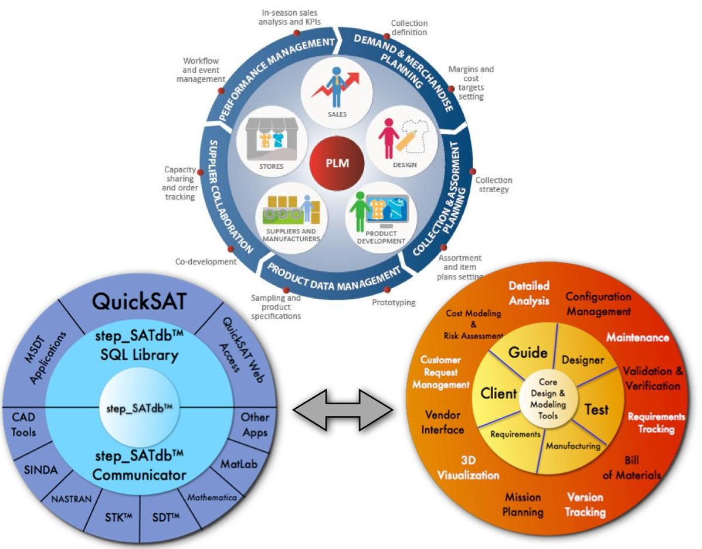
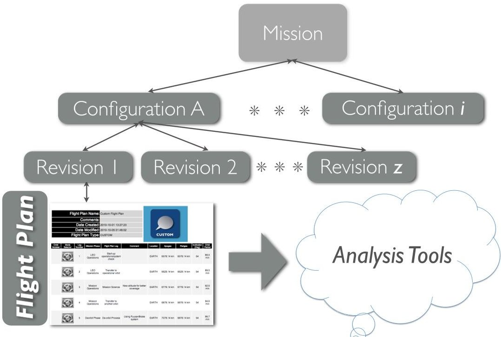
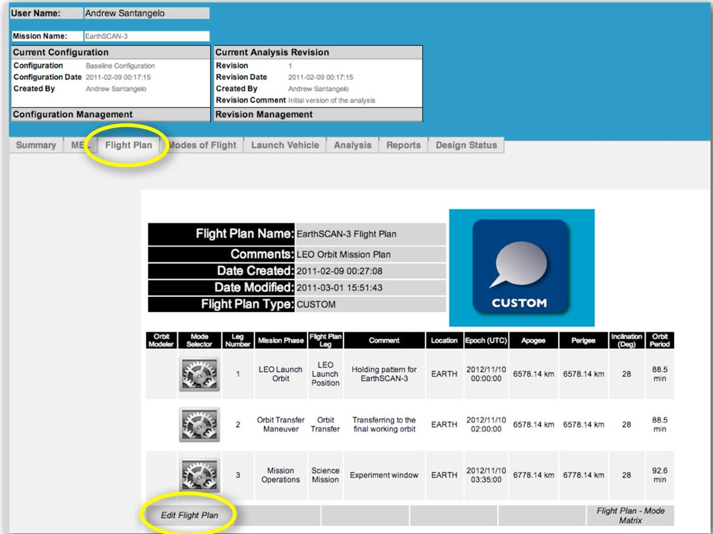
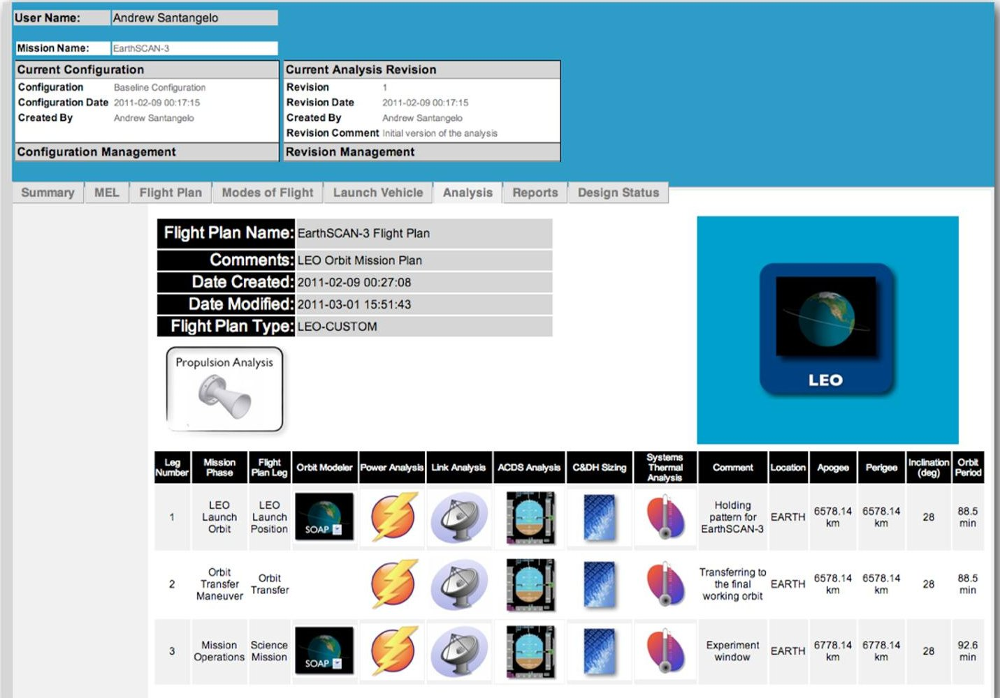
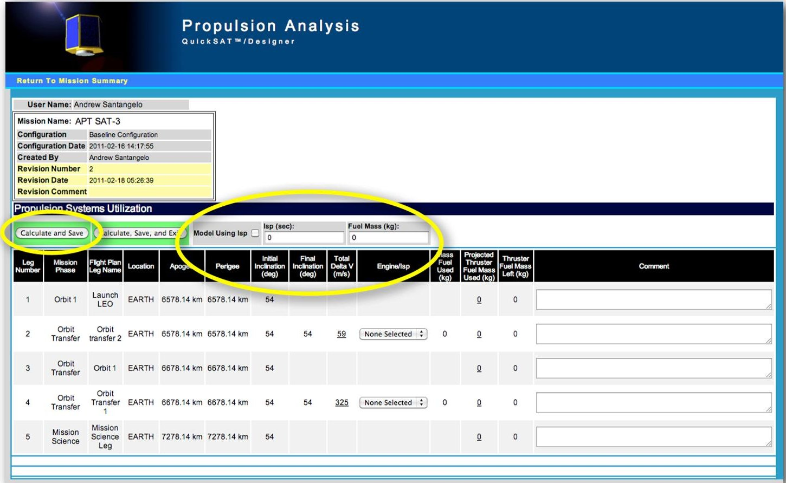
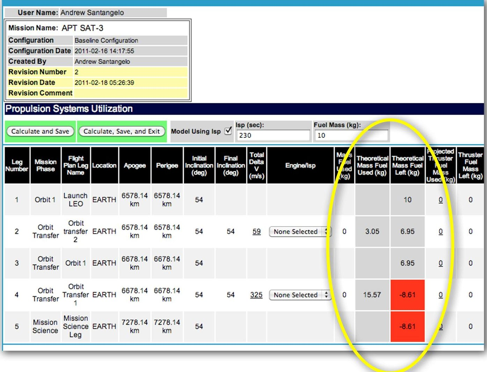
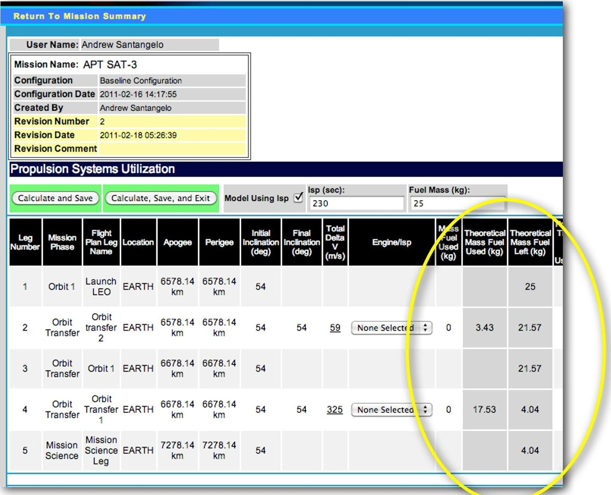
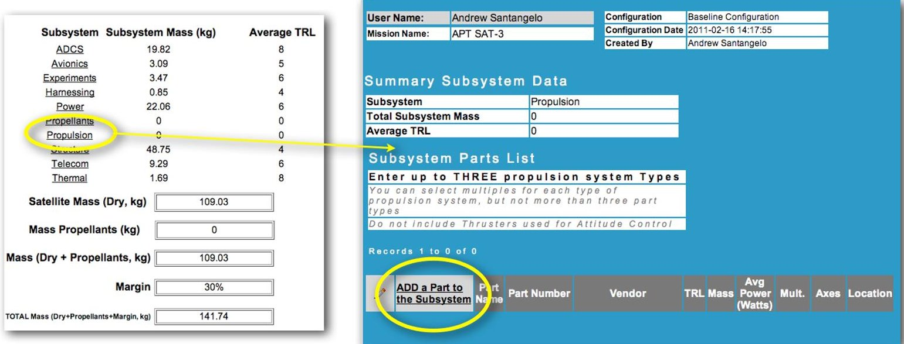
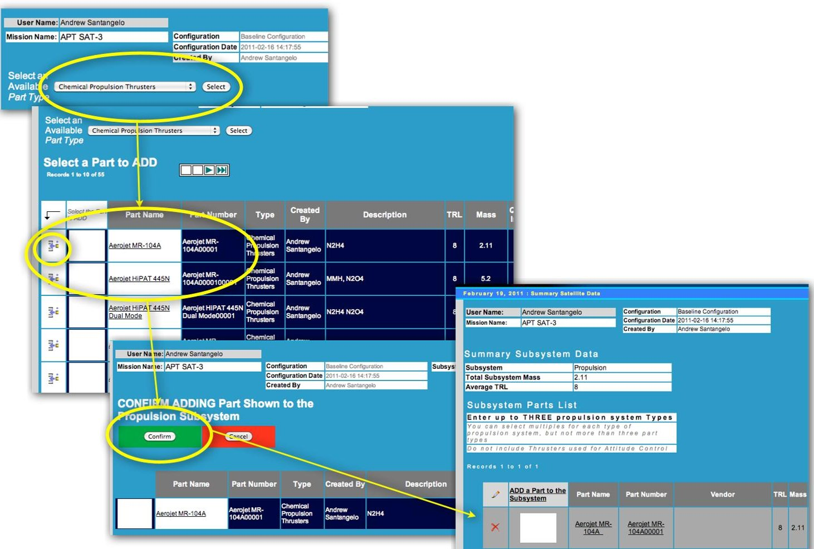
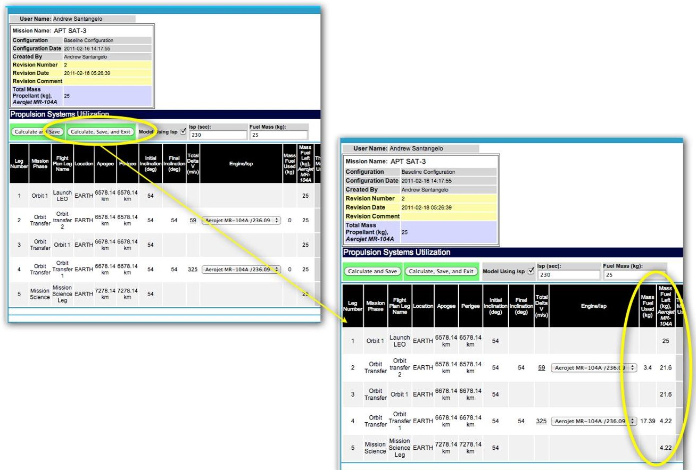

<!-- PDF_PAGE: 1 -->

# The University NanoSAT Program And Its Use Of QuickSAT As An End To End Design Tool

Andrew D. Santangelo $ ^{*} $ sci_Zone, Rio Rancho, New Mexico, 87144

The University NanoSAT Program, or UNP, a program funded by the Air Force Research Labs and AIAA, is an exciting program that provides a chance for students in college to create a satellite from concept to flight. It represents a remarkable opportunity for students to learn want is involved in the process including lab training, guest lectures, expert advice, a flight opportunity for their satellite and of course providing the tools to the job. QuickSAT, and the supporting database environment step_SATdb, is a collaborative Product Lifecycle Management (PLM) environment for application in a range of space vehicles including CubeSATs through 1000+ kg class satellites for orbits in Earth and missions throughout the solar system. In this paper we will present what QuickSAT/step_SATdb is and how the AFRL and university participants used this software environment, and present the Propulsion Module used by some of the student participants.

## Nomenclature

3U = 30 cm x 10 cm x 10 cm CubeSAT

ADCS = Attitude Determination and Control System

$ \Delta \mathrm{V} $ change in velocity, m/s

$ I_{sp} $ = Specific Impulse

PLM = Product Lifecycle Management

UNP = University NanoSAT Program

## I. Introduction

The University NanoSAT Program (UNP) is a joint program between the Air Force Research Laboratory's Space Vehicles Directorate (AFRL/RV), the Air Force Office of Scientific Research (AFOSR) and the American Institute of Aeronautics and Astronautics (AIAA), collectively referred to as the Program Office (PO). The objectives of UNP are to educate and train the future workforce through a national student satellite design and fabrication competition and to enable small satellite R&D, payload development, integration and flight test, Air Force related technologies.

The current program, NS-7, has two distinct stages. The first part is a nanosat design and protoflight build phase, which lasts approximately two years and culminates in the AIAA Student Satellite Flight Competition Review (FCR). All universities participate in the first stage of the NS-7 program by constructing a protoflight (protoqualification) nanosat and participating in various design reviews and activities. Protoflight implies that the Flight Competition nanosat deliverable is a fully designed, built, and tested engineering unit that could be used as a flight spare.

The second stage of the NS-7 program begins after a nanosat is selected for flight via the FCR in the spring of 2013. This second phase consists of integration with the Lightband/P-POD and environmental testing of the flight Nanosat at AFRL in the summer of 2014 in preparation for a potential flight made available through STP, per the outcome of the DoD Space Experiments Review Board (SERB) flight request process. The Program Office will assist the winning university in testing, any necessary

<!-- PDF_PAGE: 2 -->

modifications of the flight unit(s), and in negotiating the launch process, including manifest, safety review, and integration. The duration of the second phase is contingent upon launch opportunities available through STP. However, the university- built flight nanosat(s) are expected to be completely integrated (including flight software and all interfaces and documentation), ready for environmental testing, and delivered to AFRL by June of 2014. $ ^{1} $

For the past 5 years Sci Zone in conjunction with AFRL Kirtland and NASA Ames Research Center developed its innovative Satellite Design Automation - Product Lifecycle Management (PLM) environment QuickSAT $ ^{\mathrm{TM}} $ , in conjunction with our step_SATdb open source database architecture. step_SATdb allows for the exchange of data between existing design tools such as MATLAB, SINDA, SOAP and QuickSAT $ ^{\mathrm{TM}} $ , and provides a data architecture tracking requirements, hardware and software components in inventory, and tracks the variations of satellite configurations and supporting revisions to the analysis done for each configuration. QuickSAT $ ^{\mathrm{TM}} $ is a web based environment supporting the design process via its integrated analysis and information management tools and integration to existing design tools. QuickSAT also provides coherency between a range of applications and data sets. step_SATdb stores and distributes the supporting satellite design, configuration, mission, support and test data from a centralized database server and can distribute the data across multiple platforms and via the internet. QuickSAT/step_SATdb supports DO178B $ ^{2} $ , DO254 $ ^{3} $ and ISO 10303 $ ^{4} $ standards. $ ^{5} $

The key advantage of the step_SATdb for the U.S. Government, universities and the aerospace industry is that the data architecture is open source and can be implemented using a range of database environments including MySQL, Oracle or MS SQL to name a few. This provides for a low cost standard mechanism for data exchange between a wide range of applications on a local computer or networked systems. This represents a real savings to the government through the use of free environments and providing a common foundation to share information. Figure 1 shows the relationship between

QuickSAT/step_SAT db and the PLM universe. $ ^{6} $ One of the inherent powers of the step_SATdb is that you can create custom taxonomies and view schemas to allow legacy applications to interface with the step_SATdb.

"Satellite knowledge" is organized on several levels in the QuickSAT/step_SAT db environment as shown in Figure 2. It starts with organizing the entire project in a mission. A mission stores everything related

Figure 1. The step_SATdb interfaces with the QuickSAT universe and shares a complete range of "satellite" related information between a range of applications across a host of platforms tQ capture the Product Lifecycle Management Process $ ^{*} $

<!-- PDF_PAGE: 3 -->

to the project - this starts with the satellite configuration. You can have as many satellite configurations within a mission. A configuration stores the physical configuration of a satellite - system components and subsystems, component location and orientation within a satellite, launch vehicle information and power and propulsion elements at the satellite level. Within QuickSAT/step_SATdb you can view all variations of the satellite configuration and trace the evolution of the design including who assembled it and revised a configuration and when the configuration was generated. You can compare configurations and study trends and changes. Figure 3 shows how you can compare configurations within a mission to see trends, note changes and detect errors in the design. All historical data from each configuration is maintained through out the project lifetime and beyond - hence for the controls in QuickSAT/step_SATdb to prevent changes to parts that are in use. For each configuration there can be several revisions to the analysis. You can modify analytical models several times for a given configuration and save each one for comparison. Each revision maintains a flight plan that defines all flight legs and phases of flight plus the modes of operation and the active modes of operation for each flight leg. Each flight leg then tracks to a set of analysis tools - internal and external. This includes link analysis, power analysis, thermal analysis, ACDS, and orbit modeling to name a few. As a flight plan is modified all related analytical data is modified and tracked with the flight plan changes.

Figure 2. Satellite knowledge organization in QuickSAT

## II. Application of the QuickSAT in the NS-7

Currently, eleven teams in the UNP-7 are using the QuickSAT/step_SATdb environment. NS-7 participants are shown in Table 1. Key required uses for the student teams include:

- Master Equipment List development and tracking

- Flight planning

- Flight mode definition

- Part definition

- Launch vehicle selection

Students were optionally allowed to use other tools within the QuickSAT environment including the following modules: Link Analysis, Propulsion Analysis, Thermal Analysis, Attitude Control and Determination, Orbit Modeling (via the SOAP interface tool), Power Analysis and the report functions.

<!-- PDF_PAGE: 4 -->

In addition to the UNP student teams, several reviewers, monitors and AFRL and UNP program managers had access to QuickSAT/step_SATdb to review each student team's data, design and progress.

Table 1. NS-7 Participants.

<table border="1"><tr><td>University</td><td>Mission Name</td></tr><tr><td>MIT</td><td>TERSat</td></tr><tr><td>University of Texas</td><td>Armadillo UNP</td></tr><tr><td>Georgia Tech</td><td>Prox-1</td></tr><tr><td>University of Maryland</td><td>DYMAFLEX</td></tr><tr><td>Boston University</td><td>BUSAT</td></tr><tr><td>University of New York at Buffalo</td><td>GLADOS</td></tr><tr><td>Saint Louis University</td><td>Argus High</td></tr><tr><td>Montana State University</td><td>Space Buoy</td></tr><tr><td>Missouri S&amp;T</td><td>M-SAT Test</td></tr><tr><td>University of Michigan</td><td>CADRE</td></tr><tr><td>University of Colorado-Boulder</td><td>DANDE</td></tr></table>

Figure 3. The flight plan gateway screen in QuickSAT.

## III. Propulsion Analysis

The Propulsion Module of QuickSAT $ ^{\mathrm{TM}} $ Designer-Systems is designed to assist the technician and engineer in the overall process of the selection of a thruster for orbit change and attitude control, and track supporting components and systems. It also maps a host of parameters including $ \Delta\mathrm{V} $ budget, mass propellant used and $ \mathrm{I}_{\mathrm{sp}} $ . The Propulsion Module allows the user to manually determine likely and optimal first order solutions based on requirements and choices available. The Propulsion Module will also let

<!-- PDF_PAGE: 5 -->

the user know if there is insufficient propellant for the engines selected for a given orbit and trajectory for all flight legs in a flight plan, and hence an inadequate and non-optimal solution (equations and underlying models can be found in the book Space Mission Analysis and Design) $ ^{8} $

The user will have the option in the Propulsion Module to work from existing requirements and parameters defined in the step_SATdb database for a specified mission. Alternatively, the user can also define the $ \mathrm{I_{sp}} $ and Mass parameters within the module for later use in the definition for the mission, or as a guide in selecting a set of engine options.

As always in QuickSAT, the engineer can select thruster and supporting components via the MEL (Master Equipment List) tab in QuickSAT. These components are then mapped to all the revisions within a configuration for the propulsion module. Thrusters can be real or a reference design entered via the Parts Management System. The user selects which engine to use for each leg of the flight. From this point, the Propulsion Module will calculate the mass of the propellant used for the calculated $ \Delta\mathrm{V} $ budget, determined in the Flight Plan tab, the mass of the fuel left in the vehicle, and highlight if there is no fuel left for the orbit or maneuver. The engineer, alternatively, can select a value for the Isp and propellant mass, and the Propulsion Module will determine if the amount of propellant is sufficient for the maneuver, which then serves as a guide to selecting parts and propellant mass. For EP systems, the user would separately track the power bounds within the power module. Figure 4 shows the QuickSAT Analysis gateway screen where one would find access to the Propulsion Analysis module.

Figure 4. The Analysis gateway screen in QuickSAT.

The Propulsion Analysis screen shows all of the mission flight legs (Figure 5). From here we can select the engine - and related propellant - for our flight. The screen shows the mass of fuel used, mass of fuel left and propellants used for ADCS thrusters for each corresponding flight leg in the flight plan. The

<!-- PDF_PAGE: 6 -->

term "Propellants" and "Fuel" are used interchangeably in QuickSAT. For example, before we add an actual engine to our configuration, lets add a "model" engine to gauge how much propellant we will need for our given flight plan. For this example we will check the "Model Using Isp" box, enter 230 sec for Isp, enter 10 kg for Fuel Mass, and select Calculate and Save.

Figure 5. The Propulsion Analysis screen in QuickSAT.

Note in Figure 6, two more columns are now displayed that were not there before. Both are highlighted in grey. One column shows the Theoretical Mass Fuel Used (kg). This is based on the "model" $ I_{sp} $ and the Total Delta V for a given flight leg.

The next column shows the Theoretical Mass Fuel Left (kg). This is based on the "model" Fuel Mass. Note, the amount of fuel is reduced based on the fuel used in Flight Leg 2. In Flight Leg 4 more fuel is used than is available. A negative number is displayed and the column from that point on is highlighted in red. Obviously this value is meaningless since we cannot have a negative value for fuel mass. It does tell us though that additional fuel is required to make this maneuver happen.

Let us now in this example increase the "model" fuel mass to 25 kg. This involves replacing the 10 kg with 25 kg for the "model" Fuel Mass and selecting Calculate and Save. Looking at the Theoretical Mass Fuel Left column we can now see we have not only sufficient propellant for both maneuvers, but also propellant left over (Figure 7). Now, let us add an engine to our example satellite. Figures 8 and 9 shows the steps in adding a thruster, in this case a chemical propellant thruster. In subsystem parts we can add rocket engines and their supporting parts, like we can other parts for other subsystems. However, there are differences on how we add a part in the Propulsion Subsystem and how it is handled. These are:

- You can only enter up to THREE propulsion system types based on part number. It can be any combination of Solid, liquid or electric propulsion systems.

- You can have as many of the same engine model, identified by Part Number, as you want in your design.

<!-- PDF_PAGE: 7 -->

- Propellants associated with the selected engine are automatically added to the propellants table. The propellant mass is set to zero.

- Thrusters/engines used for attitude control should not be entered here. You add these under the ADCS Subsystem.

Figure 6. Setting the Model Using $ I_{sp} $ to a fuel mass of 10 kg.

Note in our example the engine is now tracked in the Propulsion module. Engines for orbit change and maintenance are highlighted in the header in purple. Columns are also added to track the fuel used and the mass of the fuel left based on the $ \Delta\mathrm{V} $ for each flight leg. In this example the mass of the propellant, or fuel, is zero. Fuel needs to be added to the model. When the engine was added to the parts list, the associated propellant was added also - with no mass assigned to the propellant. Adding propellant mass is done through the propellants subsystem access.

Note in Figure 10 the total mass for the Aerojet MR-104A propellant shows as 25 kg, however on the flight legs it only shows up as mass fuel left, not under mass fuel used. This is because we now need to select the engine through each pull down menu under Engine/Isp for each flight leg. For this example for flight leg numbers 2 and 4 we will select Aerojet MR-104A/236.09 under the Engine/Isp column and then select Calculate and Save. Now the Mass Fuel Used (kg) for each flight leg is shown. Also, the Mass Fuel Left (kg) is shown for each flight leg. This process can also be applied to calculating the propellant required for maintenance $ \Delta V $ . The QuickSAT Flight Management module directly links with the Propulsion Module. The same is true for thruster and propellant modeling when conducting Attitude Determination and Control analysis.

<!-- PDF_PAGE: 8 -->

Figure 7. Setting the Model Using $ I_{sp} $ to a fuel mass of 25 kg

Figure 8. Adding a thruster to the satellite configuration via the MEL configuration management system.

<!-- PDF_PAGE: 9 -->

Figure 9. The steps in sdding a thruster to the satellite configuration in QuickSAT

Figure 10. Selecting the engine in the Propulsion Module

<!-- PDF_PAGE: 10 -->

## IV. Conclusion

The QuickSAT/step_SATdb PLM environment stores and distributes the supporting satellite design, configuration, mission, manufacturing and test data from a centralized database/cloud environment and can distribute the data across multiple platforms and via the internet. The QuickSAT $ ^{\mathrm{TM}} $ web based environment supports the design process via its integrated analysis and information management tools and integration to existing design tools - QuickSAT provides a coherency between a range of applications and data sets. NanoSat-7 (NS-7) student teams put this product to use to cover a wide range of functions including parts tracking, definition of the Master Equipment List, flight planning and defining the modes of operation of the their respective missions. This exercise by the student teams also served to help the developer of QuickSAT-sciZone to understand how QuickSAT is being utilized, find any bugs missed in the testing process and to determine areas of improvement. In addition to the NS-7 student teams, several reviewers, monitors and AFRL and UNP program managers had access to QuickSAT/step_SATdb to review each student team's data, design and progress. The Flight Planning module used by the student teams is the hub for flight information and related analytical data. One example demonstrated was the Propulsion module, where all legs of flight are covered including orbit change, maintenance $ \Delta $ V and attitude control. QuickSAT/step_SATdb is an open source data environment that is extensible, multiplatform and allows for internal and external analytical modules to be added. It can be used for systems analysis, CONOPS, and end-to-end modeling, design and manufacturing for a range of satellites including NanoSATs.

## References