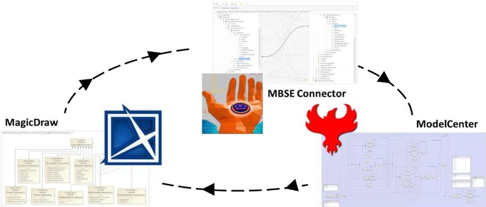
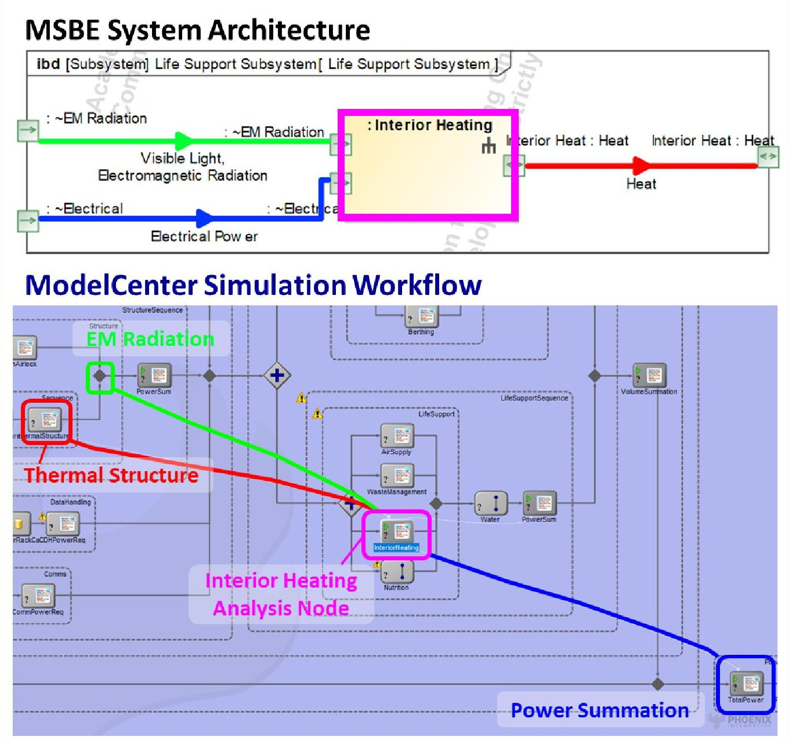
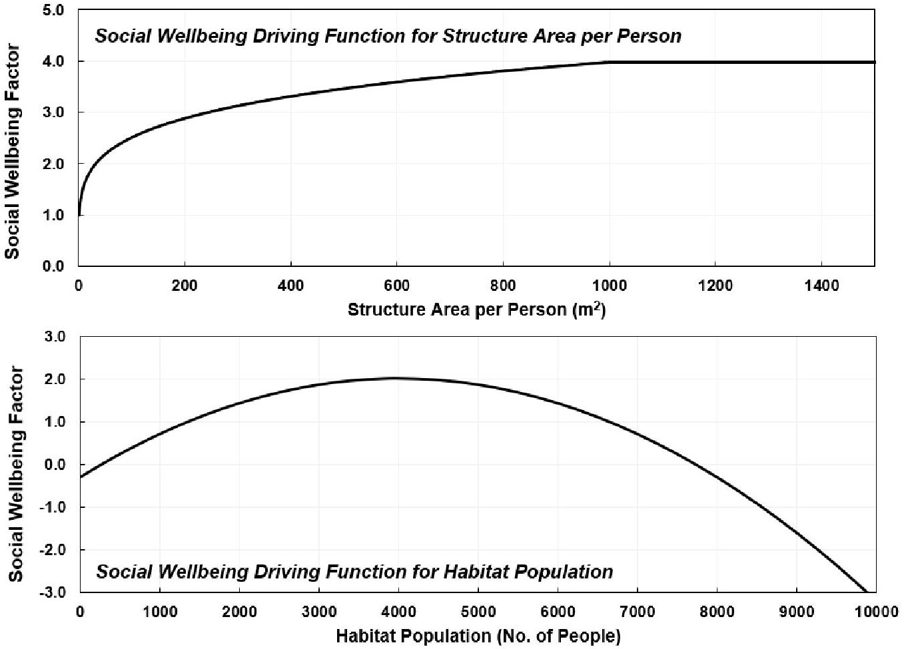
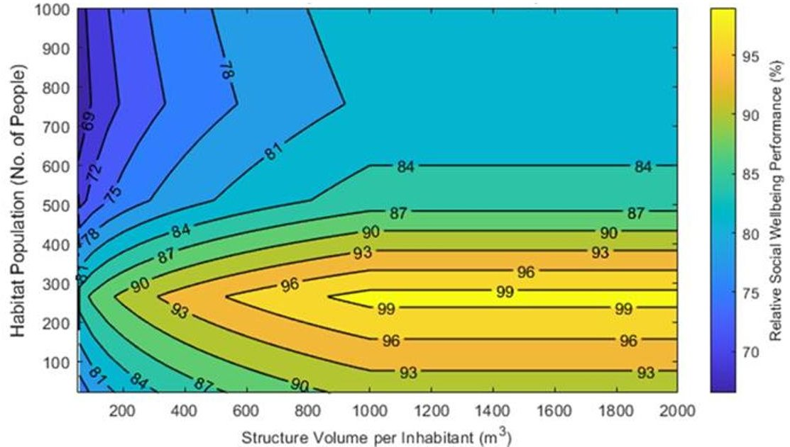
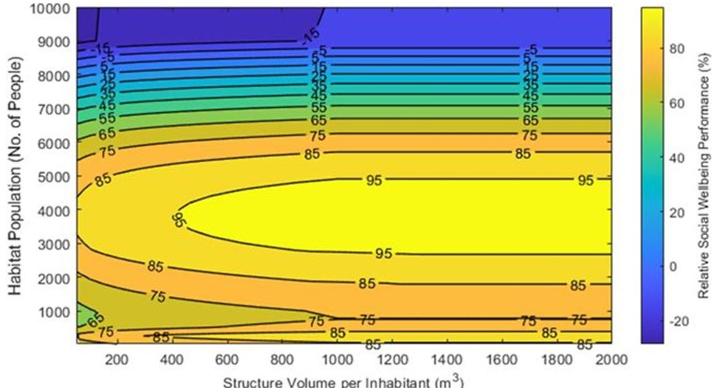
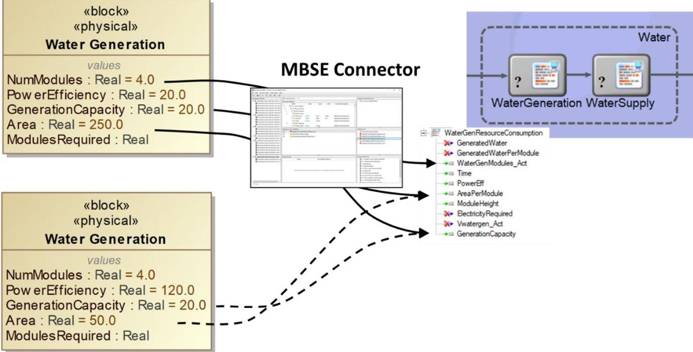
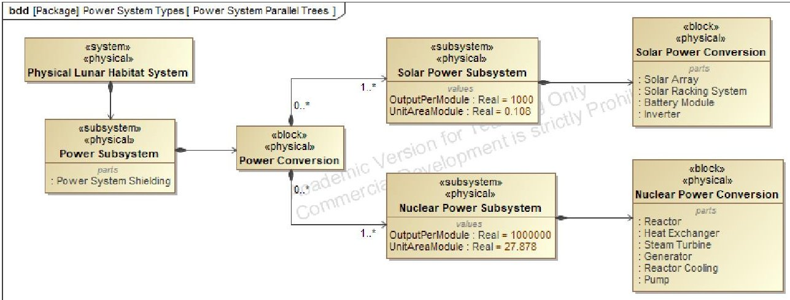
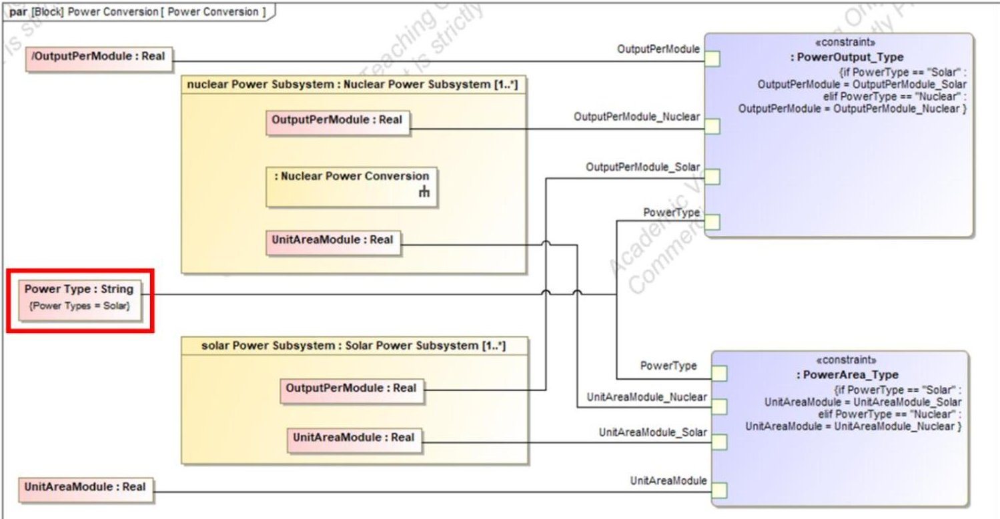
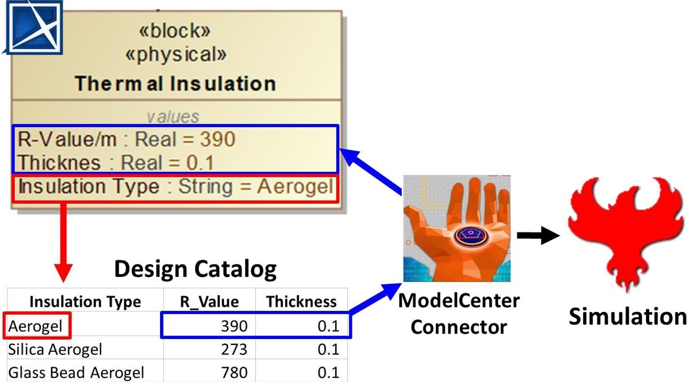

<!-- PDF_PAGE: 1 -->

hybrid event

Detroit, MI, USA June 25-30, 2022

# Applying Model-Based Systems Engineering Methods to a Novel Shared Systems Simulation Methodology

Jeremy Ross Ford Motor Company Dearborn, MI USA jross117@ford.com

Michael Vinarcik University of Detroit Mercy Detroit, MI USA vinarcmi@udmercy.edu

Christopher Caron Ford Motor Company Dearborn, MI USA ccaron2@ford.com

Christopher Craft

Ford Motor Company

Dearborn, MI USA

ccraft8@ford.com

Stephen Pien

Ford Motor Company

Dearborn, MI USA

spien@ford.com

Ashishkumar Prajapati Ford Motor Company Dearborn, MI USA apraja13@ford.com

Copyright 2022 by Ross, Vinarcik, Caron, Craft, Pien, Prajapati. Permission granted to INCOSE to publish and use.

Abstract. The need to develop increasingly complex, integrated systems and multi-domain systems-of-systems is initiating a transformation within the discipline of systems engineering. The critical trends of increasing interconnectivity, compressed development times, growing cybersecurity concerns, and a rapidly changing workforce are driving current systems engineering practices into obsolescence. Model-Based Systems Engineering (MBSE) is a formalized approach to systems engineering that uses models as an integral component of a system's technical definition with the objective of enhancing communication through rigor and precision and managing system complexity. This paper discusses the application of MBSE methods to the definition of a shared systems architecture and the development of novel methodologies for extending the model-based approach from the system definition space into the system simulation and analysis domain. Approaches for interface management of design properties between a model-based architecture and system simulation will be reviewed, with the effectiveness of each approach discussed.

## Introduction

Rapid growth in technical and organizational complexity across the engineering discipline threatens the utility of systems engineering and systems architecture in their traditional forms (Weilkiens, et al. 2016). The traditional approach to these activities applies a document-centric methodology, in which text-based specifications are considered the primary source of the system definition and integrated system models are viewed as secondary and descriptive only (Weilkiens, et al. 2016, pp. 125-127). In contrast, the emerging trends of Model-Based Systems Engineering (MBSE) and Model-Based Systems Architecture (MBSA) use an approach where the models

<!-- PDF_PAGE: 2 -->

become an integral and authoritative part of the technical baseline (NDIA 2011). MBSE and MBSA, referred to collectively as MBSE throughout this paper, offer two comprehensive advantages to traditional systems engineering: the addition of rigor and improvement of complexity management (NAWCAD 2018).

This paper documents the application of MBSE principles to the architecting and preliminary system analysis of a theoretical lunar human habitat, selected as the system of interest on account of its novelty and technical complexity. Using digital model-based toolsets and MBSE methodologies, a system architecture was developed from initial needs elicitation through to a fully realized system architecture. The architecture was integrated with a coupled, software-based system analysis to predict system performance. This paper will discuss the numerous advantages afforded by the application of a model-based approach to system simulation, as well as identify challenges and shortcomings encountered with the toolsets and methodologies applied during the process. Various methods for interface management of design properties between the model-based architecture and system simulation will be reviewed, with the effectiveness of each approach discussed.

## Model-Based Shared Systems Architecture Development

Prior to the emergence of model-based systems engineering methodologies supported by modeling languages such as SysML, systems architecting (SA) and systems engineering (SE) activities were performed using a traditional, document-intensive approach. The enterprise-level products of document-intensive SA and SE were isolated, disjointed representations of system design intent that failed to support effective cross-functional communication and collaboration unless significant effort were expended to keep them synchronized (and even then, errors could grow undetected). The shortcomings of traditional systems engineering methodologies are exacerbated by the rise of increasingly complex, integrated systems with a growing fraction of functionality provided by emergent behaviors and software, and multi-domain systems-of-systems (Delligatti 2014).

The creation, development, and sustainment of a shared systems model are the primary goals of any MBSE methodology. An enabler of greater efficiency and effectiveness within the systems engineering discipline, the shared systems model allows details of a system to be captured and made available in a variety of views for the benefit of all concerned stakeholders (Noguchi 2016). To support the model-based simulation of the lunar habitat system, a detailed shared system architecture was developed in SysML using the CATIA Magic/Cameo MagicDraw software application published by Dassault Systèmes (Dassault Systèmes 2021). Real-time collaboration on modeling efforts was enabled using a Teamwork Cloud server hosted by the University of Detroit Mercy, which provided a central repository for model storage and version control (Dassault Systèmes 2021a). Supplementing the software application infrastructure were the SAIC Digital Engineering (DE) Profile and University of Detroit Mercy SysML Advanced Modeling Class libraries. The DE Profile, made publicly available by Science Applications International Corporation (Science Applications International Corporation 2021), contained validation rule sets to ensure stylistic and model integrity; the University of Detroit Mercy SysML Advanced Modeling Class library contained customizations relevant to this project.

Through the use of the MagicDraw and Teamwork Cloud applications and supported by the SysML language and these profiles and libraries, a rigorous shared systems model was developed

<!-- PDF_PAGE: 3 -->

describing a lunar habitat system architecture. A lunar habitat was selected as the system of interest as it provided the technical challenges of complexity, novelty, and diverse stakeholder interests. Development and validation of the shared systems simulation methodology with a complex system of interest such as a lunar human habitat supports the extension of the approach to other complex system and system-of-systems instances.

The system architecture definition process comprised three levels of abstraction and began with a functional decomposition identifying the behaviors, actors, and requirements associated with the system. Refinement occurred via a logical decomposition defining the generic structure, activities, and states of the system elements, their interfaces, and the material, energy, and information flows at the interfaces. At the physical decomposition level, the highest level of specificity was obtained. Unique instances of the system elements were defined and characterized by value properties typing specific attributes of their performance. These physical elements were then connected to a simulation workflow created in the software tool ModelCenter by Phoenix Integration and used in trade study analyses to assess the performance of various lunar habitat architecture design options and system configurations. Through partitioning of the system architecture into three layers of decomposition, specificity and rigor were efficiently obtained, with each subsequent modeling effort building upon and iterating with the prior activities.

## Lunar Habitat System Trade Study Analyses

The system modeling language, SysML, and the model-based architecture definition process offered a methodology for rigorously and efficiently scoping and defining a system architecture. However, Dr. Azad Madni notes the current form of this method offers limited support to the facilitation of system simulations in the latter phases of architecture analysis and in the subsequent systems engineering phase (Madni 2018). SysML and current shared systems methods, supported by toolchains such as MagicDraw, are deficient in addressing the need for complex, yet efficiently facilitated simulations to assist in engineering tomorrow's complex systems.

To address this, a trade study analysis was developed using the ModelCenter software suite by Phoenix Integration, an Ansys Company. ModelCenter integrates simulation and analysis models from various sources, including CAE tools and coded scripts onto a common and executable workflow. The tool enables the linkage of variables across the disparate analysis packages usually found in a cross-organizational systems engineering effort. These connections facilitate in-depth trade study and design-of-experiment (DOE) analyses.

Toolchains, such as ModelCenter, fulfilling the simulation integration role are important enablers in the expansion of MBSE. They provide an integrated, holistic, and quantitative viewpoint of a system and allow for a workflow comprised of multiple analyses from disparate sources, rather than forcing a single analysis method onto a development team. The ability to link ModelCenter to a shared systems model in SysML is a directional step to an integrated MBSE simulation space, further progressing towards fully integrated and executable shared systems models.

Analysis Objectives. To explore and demonstrate the utility of ModelCenter, several trade study topics pertaining to the lunar habitat system were considered. Using the logical and physical architectures developed in SysML as a framework, system design decisions which would be of importance to an organization developing a lunar human habitat were considered. Additionally, the NASA Artemis Program goals (National Aeronautics and Space Administration 2020) were

<!-- PDF_PAGE: 4 -->

reviewed as another method of scoping potential trade-off analyses. An analysis workflow was created in the software, and input and output variables were linked from elements in the workflow to value properties stored in the physical architecture in MagicDraw (see Figure 1). By integrating the efforts in this way, the toolchains demonstrated their flexibility to adapt to new design instantiations and quickly analyze the impact to system-level attributes.

Figure 1. Illustration of the flow of input variables from the MagicDraw physical architecture to the ModelCenter analysis workflow via the MBSE Connector plugin. Image source (Dassault Systèmes 2021) and (Altair Engineering, Inc. 2021).

Methodology and Tools. The primary aspect of a ModelCenter simulation is the process workflow, which represents the analysis path being studied and maps the sequence and interrelation of simulation elements. Analysis nodes identify individual analysis or simulation elements, which are then integrated into the overall workflow. Examples of script nodes utilized in the lunar habitat physical architecture trade study are Python executable code, Excel databases, MATLAB scripts, and links to other discrete simulations based in standalone software packages.

Supplementing the primary workflow in ModelCenter is the MBSE Connector plugin, which integrates the ModelCenter simulation with a MBSE model, such as the system architecture developed in MagicDraw. The plugin allows for several expanded features, including importing value properties from the architecture for linkage to variables within the ModelCenter workflow and the establishment of multiple execution plans for linking unique items from the architecture model to the workflow. Additionally, ModelCenter possesses a DOE tool capable of analyzing the system in multiple design of experiment configurations.

Workflow Setup. The primary ModelCenter trade study developed to assess the lunar habitat system simulated the effect of physical architecture configuration decisions on system attributes including the habitat's resource usage, power consumption, and ability to provide social wellness to its crew. Physical system blocks in the MBSE architecture were represented as analysis nodes in the ModelCenter workflow, with each element's performance being defined in terms of general classifying functions incorporated into analysis elements. The example analysis subset of Figure 2 represents the translation of the model-based definition of the life support subsystem into simulation elements. Within the workflow, analysis scripts and calculations, utilizing MATLAB and Python languages in discrete packages, were added. The number of unique analysis elements in the workflow followed the shared systems model structure, with an analysis element generally being created for each architecture subsystem. Distributing the simulation content across numerous

<!-- PDF_PAGE: 5 -->

analysis elements interfaced in ModelCenter and MagicDraw demonstrated the ability of model-based simulation tools like ModelCenter to integrate analysis efforts typically spread across many layers within an engineering organization.

Figure 2. The model-based, block representation (top) and ModelCenter simulation workflow configuration (bottom) for the Lunar Habitat's Life Support Subsystem.

To support the system simulation, physical elements in the shared systems model were assigned value properties to represent performance attributes. The magnitude of each value could be varied to represent different designs or technologies for each physical system, which were then linked to the ModelCenter workflow using the MBSE Connector plugin. Interfacing the MagicDraw system model and the ModelCenter simulation workflow using the plugin enabled value properties to be fed from the shared system architecture directly into the analysis workflow. This dynamic linkage enabled numerous trade study assessments to be completed by altering values at the architecture level and observing the output responses at the simulation level. Additionally, the MBSE Connector afforded the capability to write the output variable responses back to value properties in the MBSE model, thereby enabling response sets generated in the process workflow to be saved as architectural configurations.

<!-- PDF_PAGE: 6 -->

## Habitat Social Wellbeing Trade Study

When developing complex socio-technical systems such as a human lunar habitat, it is necessary to consider both technical challenges and social aspects pertaining to the architecture's human activity systems. During functional decomposition, the system requirement to provide social wellbeing to the habitat's population was identified. This requirement was elicited from the stakeholder need for system significance and permanence: two attributes necessary to realize a successful lunar architecture (Icarus Interstellar 2017). In the logical decomposition phase, provisions for system elements capable of providing social wellbeing - morale, happiness, or other forms of positive psychological reinforcement - were made, such as the Entertainment subsystem. Extending the decomposition into the physical architecture, subsystem attributes affecting social wellbeing were identified and defined, including the structure space attributed to each inhabitant (i.e., the "roominess" of the shared spaces within the habitat) and overall habitat population size (i.e., the presence of interpersonal social networks).

Trade Study Setup: Quantifying Social Wellbeing. Utilizing the model-based architecture as a foundation, the ModelCenter simulation workflow was employed to quantify the performance of architecture configurations relative to the social wellbeing requirement. This was accomplished with the addition of a 'SocialWellbeing' analysis node within the workflow consisting of a script component containing numerical functions defining the impact of system element attributes on social wellbeing. Each driving function returned a unitless social wellbeing factor, with the function responses for the structure area per person and overall habitat population shown in Figure 3.

Figure 3. Social wellbeing transfer functions for structure "roominess" (area per person, top) and habitat population size (bottom).

<!-- PDF_PAGE: 7 -->

Using the habitat population response of Figure 3 as an example, one can see that small population sizes, below 250 inhabitants, return a negative social wellbeing factor. This indicates small habitat sizes lack the necessary social interactions to form healthy communities. However, as population increases towards 4,000 total inhabitants, population returns an increasingly positive factor, as larger communities provide positive wellbeing through healthy interpersonal networks. When population exceeds 4,000 inhabitants, the function reverses its gradient as crowding of population overpowers the positive social dynamics of population size.

While the response curve for the social wellbeing and population response was artificially generated to demonstrate the interaction and not based on measured dynamics, the methodology illustrates how an otherwise qualitative aspect of inhabitant morale can be quantified and simulated using the shared systems model. In a practical development effort, detailed systems engineering activities would elicit stakeholder groups such as social scientists and psychologists to rigorously characterize the social wellbeing-based interrelations of community groups, habitat amenities, and other social factors. The 'SocialWellbeing' analysis node would then be updated with the revised and expanded functions to reduce uncertainty and accurately represent the social wellbeing influences within the lunar human habitat.

Trade Study Execution and Results. The habitat's social wellbeing response was characterized as a function of population size and structure volume per person. The objective was to understand the interplay between the habitat attributes to inform architecture decisions regarding population and habitat size. The design space ranges are shown in Table 1. Two discrete intervals were used for the Population variable to capture the system behavior at low population sizes, such as when the habitat is initially constructed, and then at larger population sizes to represent the growth of the habitat system. Trade study results were output in the ModelCenter results table and then exported to .csv file format, which were plotted using a MATLAB post-processing script.

Table 1: Design Variables for the Social Wellbeing Trade Study DOE

<table border="1"><tr><td>Design Variable</td><td>Lower Bound</td><td>Upper Bound</td><td>Interval</td></tr><tr><td>Structure Volume per Person</td><td>50</td><td>2000</td><td>50</td></tr><tr><td rowspan="2">Population</td><td>10</td><td>100</td><td>10</td></tr><tr><td>200</td><td>10,000</td><td>200</td></tr></table>

To verify the social wellbeing calculation was returning the anticipated wellbeing factor results, the system response with a fixed population was first assessed. Once the individual subsystem responses were verified, the additional analysis dimension of varying population size was added to the simulation. This allowed characterization of the two-factor social wellbeing response surface to project the influence of early-program architecture decisions on down-stream system response. With the results presented as a contour plot for population sizes of 10 to 1,000 in Figure 4, the unitless social wellbeing factor was normalized into a relative social wellbeing performance, with a value of 100% representing the maximum wellbeing provided by any architecture analyzed.

This trade study's results support system assessments of the optimal architecture configuration and population to maximize social wellbeing. As shown in Figure 4, the most space-efficient solution returning maximum wellbeing (represented by the 99% contour) occurs at 862 m $ ^{3} $ of structure

<!-- PDF_PAGE: 8 -->

volume per person and a population of 265 individuals. Similarly, if design constraints limit the structure volume, the results show how alternative design decisions would impact system-level attributes. For instance, reducing structure volume per person by $ 3 0 0 \mathrm{~ m}^{3} $ , or 35%, would, with the assumptions analyzed in this study, result in a trade-off of only 3% social wellbeing.

Figure 4. Contour plot showing the response surface for social wellbeing as a function of structure volume per person and population size.

The trade study and DOE tool can also be implemented to project the performance of architecture configurations into the future. Continuing with the prior structure volume and population example, greater population sizes can be simulated to understand how social wellbeing in the habitat would change as the system grew over time to support greater populations. This was accomplished by extending the DOE space up to 10,000 inhabitants. Assessing system performance considering the optimum volume per person from the first study (with fewer than 1,000 inhabitants) of approximately 800 m $ ^{3} $ , Figure 5 demonstrates how the system performance would begin to rapidly deteriorate at populations larger than 6,000. In order to prevent social discontent from overcrowding due to the negative effect of the large population size, other architecture elements would need to be scaled as population grew to contribute increased social wellbeing to the lunar habitat.

Figure 5. Social wellbeing response of the system simulated to a population size of 10,000.

<!-- PDF_PAGE: 9 -->

# Shared Systems Model and Simulation Coupling

A key challenge encountered during the system trade study analysis was effective and accurate management of system properties between design configurations. As discussed in prior sections, the properties describing key performance and design characteristics of each model element were represented as value properties owned by blocks in the MagicDraw lunar habitat model. Each distinct set of value property values represented a physical instantiation, or specific element configuration of a system element. In order for a trade study analysis to compare system configurations, each block's value property must be appropriately set during a trade study simulation run. This simulation sequence is shown in Figure 6. For the coupled MagicDraw-ModelCenter system model to rigorously apply the shared systems model approach, all design details must be managed by the MagicDraw model in order to have a single-source defining all system design aspects. However, the current integration capabilities between ModelCenter and MagicDraw lack a clear capability to accomplish this task. Therefore, five methods for management of this interface were trialed and the advantages and disadvantages of each will be discussed in the following sections.

Design Configuration #1: Passive Filtration

Design Configuration #2: Active Chemical Filtering

Figure 6. Diagram showing the application of distinct value properties to define Water Generation subsystem design configurations within a trade study analysis.

The key difference between each interface methodology is characterized by how interface complexity was allocated either internally or externally. Internal complexity involves allocating complexity within the boundary of a system or subsystem element, resulting in a simplified interface definition and reduced perceived system complexity to external actors (Maier & Rechtin 2000). Internal complexity allocation reduces interface management burden during systems integration, while increasing the requirement of complexity management during systems engineering of each system element. Conversely, external complexity allocation maintains interface complexity at the system boundary, resulting in an internally simpler system but increasing the need for interface management during systems architecting and integration.

<!-- PDF_PAGE: 10 -->

Of the five methods utilized for interface management, two allocated complexity internally to the MagicDraw model, another moved complexity internally to the ModelCenter analysis, one maintained complexity at the interface of the simulations, and a fifth created a new simulation system element integrated with both MagicDraw and ModelCenter. The methods tested were the following:

1. Manual Update of Value Properties: Manual adjustment of value properties by the user within MagicDraw prior to each simulation.

2. Parallel Physical Trees: Unique system blocks created in MagicDraw for each design configuration and linked to the simulation environment via the MBSE Connector.

3. Parametric Setting of Value Properties: Creation of parametric functions within MagicDraw to set value properties based on an input enumeration trigger.

4. Standalone ModelCenter Design Catalogs: Excel-based parameter design catalogs managed within the ModelCenter workflow.

5. Coupled Design Catalogs: Excel-based parameter design catalogs located externally to the ModelCenter simulation and used to set the MagicDraw value properties using a coupled, multi-step MBSE Connector simulation.

Manual Update of Value Properties. As part of the iterative system modeling process, value properties were created for physical blocks in MagicDraw and linked to ModelCenter using the MBSE Connector plugin. The value properties owned by the blocks could be updated individually by the modeler within MagicDraw to describe any physical instantiation of a component. Once the MagicDraw updates were complete, changes were automatically propagated to the ModelCenter simulation upon reopening and execution of the analysis workflow.

The manual update methodology internalized complexity, with all simulation changes occurring within the shared systems model; however, it precluded iterative simulation of design configurations, as only one set of value properties could be assigned to the system blocks at a time. This method also detracted from model rigor, as each combination of value property sets would be stored outside of the shared systems model, such as in an Excel matrix defining each design configuration. A rigorous application of the shared systems methodology would, instead, locate all design details within the model architecture to result in a single-source system definition free of external document-based sources requiring tracking and management.

Parallel Physical Trees. To minimize the risk of generating and analyzing invalid configurations of physical instantiations possible with the previous manual update method, the utilization of discrete physical block trees within MagicDraw was explored. Each tree represented a valid, testable configuration of physical instantiations, which could be linked to the ModelCenter analysis. This model management method limited the possibility of providing erroneous combinations of value properties as each instantiation's attributes were stored within a dedicated system block.

While the parallel physical trees method, depicted in Figure 7, provided improved analysis input management, it suffered from reduced model development efficiency on account of the duplicity in physical block creation. Each of the multiple physical trees must align with the higher-level logical architecture and comply with validation rules, including redefinition of interfaces at the system and subsystem level. This resulted in multiple ibd configurations and associated growth in object to item flow realizations, among other aspects. The additional model resource consumption

<!-- PDF_PAGE: 11 -->

was also reflected in ModelCenter, as selection of different instantiations in the model required manual re-linking of value properties to simulation inputs in the MBSE Connector.

Figure 7. Parallel Physical Trees method with two instantiations for the Power subsystem shown.

Parametric Setting of Value Properties. To address the shortcomings associated with manually updating the value properties owned by blocks, a methodology to automatically set the properties using MagicDraw parametric functions was developed. Utilizing a single enumerated value property for each system element as the driver, constraint equations were created within MagicDraw to output a set of values based on the input enumeration. Blocks' parametric driving functions could then be executed within MagicDraw, which recalculated each property value. The new property values could then be saved to the design instance using MagicDraw's "Save to Default Value(s)" capability in the parametric tool set. This approach internalized system complexity to the MagicDraw side of the interface. Additionally, it enabled easy linkage of ModelCenter to MagicDraw as the value properties linked to the simulation variables remained unchanged between design instantiations.

While the parametric value-setting approach resulted in a simplified interface connection and allocation of complexity internally to the shared systems model, the methodology also drove significant back-end model development, as shown in Figure 8. In addition to the parametric diagrams and functions, customizations to control the enumerations and intermediate value properties to facilitate the parametric functions were needed. Even a model the scale of the lunar system habitat presented challenges in developing and maintaining the increased element count. Additionally, execution of the parametric equation and resaving of the new values within the model remained a manual task of the system modeler, creating risk for errors or omissions in the process. Finally, the methodology did not support real-time trade study iteration, as the ModelCenter tool does not possess the capability to trigger a parametric simulation and save the new output values through the Cameo interface. The parametric value-setting method offered significant efficiency over manually updating each value property, but its inability to effectively support real-time trade study iteration limited its usability in this system architecting investigation.

<!-- PDF_PAGE: 12 -->

Figure 8. Parametric diagram displaying parametric functions created to update value properties for a MagicDraw system element based on an enumeration input. Selections for the Power Type string (highlighted) are controlled by a <<power type>> customization.

Standalone ModelCenter Design Catalogs. The standalone design catalog was a ModelCenter-centric approach, where system design details were stored in Excel-based design catalogs integrated within the ModelCenter workflow as analysis elements. The catalog outputs for each analysis iteration were controlled by a value property input linked from the MagicDraw model. This input defined the table row of parameter values to be referenced as outputs by each simulation iteration (see Figure 9).

Figure 9. Example of an Excel-based design catalog integrated with the simulation workflow. The ModelCenter Component Tree with catalog choice Server_Type is shown (right).

This approach most closely followed how a standard ModelCenter simulation without connection to a MagicDraw systems model would consider design variations in a trade study. The design details are stored internally within the ModelCenter application, requiring a stakeholder to access the analysis workflow to review the parameter combinations represented in the catalog table. This internalizes complexity to the ModelCenter side of the interface while maintaining a simple interface definition between the ModelCenter and MagicDraw applications (the single input enu-

<!-- PDF_PAGE: 13 -->

merated value to define which design table row to use). However, the storage of key design details outside of the model-based architecture does not fulfill the principles of a shared systems model approach, as the model-based architecture should function as a single-source for architecture definition. Instead, critical design information was stored in the externally-managed catalog tables, which are not directly linked or owned by the MagicDraw system model.

This limitation presents multiple disadvantages to effective systems architecture development, which can hinder system analysis or even result in inaccurate results. Storing critical architecture information outside of the system model forces maintenance burden on the systems architecting and engineering teams to manually manage, version control, and package and send the design tables along with any transmittal of the system analysis workflow. Updates to the system representation in MagicDraw require parallel alterations to the design tables for instance, the addition of an incremental subsystem value property to capture a new system requirement results in updates to both the MagicDraw block and the design table utilized by ModelCenter. Failure to update the former results in an architecture that is no longer fully-representative of design intent while failure in the latter case results in a simulation missing a design detail. Despite the simplification of the interface between the software applications with this methodology, the possible failure modes resulting from design variables not directly accessible to the user indicate the standalone ModelCenter design catalog method is not an optimal method of managing physical design instantiation details.

Coupled Design Catalogs. The fifth method for implementing a more robust design instantiation approach is similar to the standalone ModelCenter design catalog method but, instead, treats the Excel catalogs as unique simulation elements within the MBSE Connector analysis path. This enables a single enumerated value property from the MagicDraw architecture to control the catalog output, as shown in Figure 10, while having the catalog and its design variables more accessible to the user. This improved accessibility is resultant from the Excel catalogs no longer being sequestered within the ModelCenter simulation, unlike the standalone design catalog method.

Figure 10. The value property for Insulation Type defines the output values for R-Value and Insulation Thickness via the Excel design catalog.

<!-- PDF_PAGE: 14 -->

The example shown in Figure 10 demonstrates how the Insulation Type value owned by the Thermal Insulation system model block is passed to the design catalog. The Insulation Type string specifies the output configuration and associated value properties from the catalog. The updated values for the R-Value and Thickness design properties are returned to the MagicDraw block via the MBSE Connector and are also passed to the ModelCenter simulation workflow. This methodology addresses many of the deficiencies of coupling the shared systems model to the workflow simulation. Once the link between the MagicDraw value properties and the catalog is established, the values in the physical blocks for each configuration can be updated without affecting the link between models. Furthermore, the design enumeration property efficiently controls all of the associated output values, and the enumeration value can be varied via the MBSE DOE tool, allowing different configurations to be iterated in a trade study analysis. However, the methodology still requires key design details to be stored outside of the shared systems model. To improve the model-based rigor of the approach, additional lifecycle management toolsets could be employed to manage the external catalogs in a central repository. The improved coupling this method provides enabled a more holistic and interconnected analysis of the MagicDraw architecture with the ModelCenter simulation and is better aligned with the core tenets of MBSE.

## Conclusion

Systems engineering is a rapidly evolving discipline, with increasing interconnectivity and complexity driving a need for model-based systems engineering methodologies. Through extension of the MBSE approach to the simulation of a human lunar habitat model-based system definition, rigorous and efficient methodologies for assessing system architecture decisions and predicting system performance attributes were realized. Demonstrated through trade study analyses, the coupled shared systems simulation integrated the descriptive model-based architecture decompositions in MagicDraw with system simulations contained within Phoenix ModelCenter. This enabled the assessment of trade-off decisions as well as the quantification of traditionally qualitative elements of complex socio-technical systems, such as the impact of architecture decisions on the social wellbeing of the human system actors.

Approaches to interface management between the shared systems architecture and system simulation were provided, with the advantages and shortcomings of each method identified. Of the five approaches assessed, the coupled design catalog method was found to best manage the complexity of system design variables through the use of design catalogs as unique simulation elements, integrated between the MagicDraw architecture and ModelCenter simulation via the MBSE Connector plugin. Through the trade study analyses and system coupling methods discussed, MBSE shared systems model principles were shown to be applicable to the simulation and analysis domain. In true distributed systems engineering fashion, the lunar habitat analysis chain is poised for future iteration, expansion, and refinement to inform and inspire future shared systems model development efforts.

<!-- PDF_PAGE: 15 -->

## References

Altair Engineering, Inc. 2021, ModelCenter $ ^{\circ} $ by Phoenix Integration, viewed 13 November 2021, <https://www.altair.com/modelcenter/>.

Dassault Systèmes 2021, MagicDraw, viewed 18 October 2021

<https://www.3ds.com/products-services/catia/products/no-magic/magicdraw/>.

Dassault Systèmes 2021a, Teamwork Cloud, viewed 18 October 2021,

<https://www.3ds.com/products-services/catia/products/no-magic/teamwork-cloud/>.

Delligatti, L 2014, SysML Distilled: A Brief Guide to the Systems Modeling Language, Addison-Wesley, Upper Saddle River.

Icarus Interstellar 2017, Starship Congress 2017: Damien Turchi, "On the Development of a Permanent Lunar Settlement", 2 September, viewed 3 September 2021. <https://www.youtube.com/watch?v=nGE3wWzbamg>.

Madni, A 2018, Transdisciplinary Systems Engineering, Springer International Publishing AG, Cham.

Maier, M & Rechtin, E 2000, The Art of Systems Architecting, 2nd edn, CRC Press, LLC, Boca Raton.

National Aeronautics and Space Administration 2020, Artemis Plan: NASA's Lunar Exploration Program Overview, viewed 19 September 2021. <https://www.nasa.gov/sites/default/files/atoms/files/artemis_plan-20200921.pdf >.

Naval Air Warfare Center Aircraft Division (NAWCAD) 2018, Systems Engineering Transformation, 30 January, viewed 24 August 2020, <https://www.youtube.com/watch?v=171b1NCgpCo>.

NDIA 2011, Final Report of the Model Based Engineering (MBE) Subcommittee, M&S Committee, NDIA Systems Engineering Division.

Noguchi, R 2016, Lessons Learned and Recommended Best Practices from Model-Based Systems Engineering (MBSE) Pilot Projects, The Aerospace Corporation, ATR-2016-02309.

Science Applications International Corporation 2021. Digital Engineering Validation Tool viewed 16 October 2021, <https://www.saic.com/digital-engineering-validation-tool>.

Weilkiens, T, Lamm, J, Roth, S, & Walker, M 2016, Model-Based System Architecture, 1st edn, John Wiley & Sons, Inc., Hoboken.

<!-- PDF_PAGE: 16 -->

## Biography

Christopher Caron. Christopher Caron, ASEP, is currently lead Electrical Benchmark Engineer at Ford Motor Company. Prior to this role he held positions in vehicle body systems engineering and systems integration. A Maine native, Christopher followed his passion for Automotive to Michigan, completing his MBSE from Kettering University and most recently acquired a Master of Product Development degree and Systems Engineering Graduate Certificate from the University of Detroit Mercy.

Christopher Craft. Chris Craft is an Optical Systems Engineer at Ford Motor Company, specializing in iterative, physics-based CAE lighting simulation methodologies. Having previously obtained his Bachelor of Science in Mechanical Engineering from Kettering University, Chris recently completed his Master of Science in Product Development at the University of Detroit Mercy. His thesis work on linking model-based systems engineering practices with shared system simulations demonstrates growth opportunities for iterative CAE practices.

Stephen Pien. Stephen Pien is a Vehicle Architect at Ford Motor Company, focusing on total vehicle systems strategies for mechanical and occupant package, along with product lifecycle management. Prior to Ford, he worked as a Systems Engineer at Collins Aerospace in Cedar Rapids, IA, integrating sensor systems for military rotary wing platforms. Stephen has recently received his Master of Science in Product Development and Systems Engineering Graduate Certificate from the University of Detroit Mercy. He also has a Bachelor of Science in Aerospace Engineering from the University of Michigan, Ann Arbor.

Ashishkumar Prajapati. Ashishkumar Prajapati is a Research Engineer at Ford Motor Company, currently working on hardware-in-the-loop development and test automation for electric and autonomous vehicle powertrain software. Prior to this role, he worked as a Controls and Systems Engineer in the areas of diesel engine aftertreatment, OBD validation, and hybrid electric vehicle controls. He recently acquired a Master of Science in Product Development and Systems Engineering Graduate Certificate from the University of Detroit Mercy. He also holds a Master of Science from Michigan Technological University and a Bachelor of Engineering in Mechanical Engineering from Gujarat University, India.

<!-- PDF_PAGE: 17 -->

Jeremy Ross. Jeremy Ross is a Vehicle Propulsion Systems Engineer at Ford Motor Company in Dearborn, MI. A recent alumnus of the University of Detroit Mercy's Master of Product Development program, his thesis investigated the application of model-based systems engineering methods in the shared systems simulation realm. Prior to joining Ford, he attended the University of Michigan, Ann Arbor, where he obtained Bachelor and Master of Science degrees in Mechanical Engineering.

Michael Vinarcik. Michael J. Vinarcik, P.E., ESEP-Acq is a Chief Digital Engineer in SAIC's Engineering Innovation Factory and an adjunct professor at the University of Detroit Mercy and CIDESI (Mexico). He has over thirty years of automotive and defense engineering experience and presents regularly at national and regional conferences. Michael has contributed to several books, most notably Taguchi's Quality Engineering Handbook and the MBSE chapter for the third edition of Systems Engineering: Principles and Practice. He is a Fellow of the Engineering Society of Detroit, the President and Founder of Sigma Theta Mu, the systems honor society, and the current Treasurer of INCOSE.