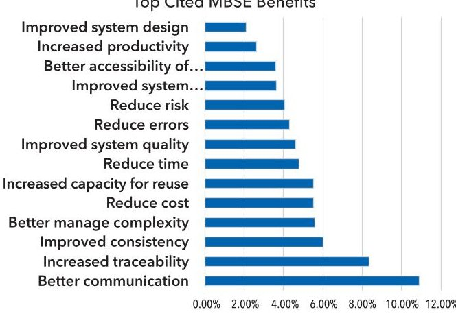
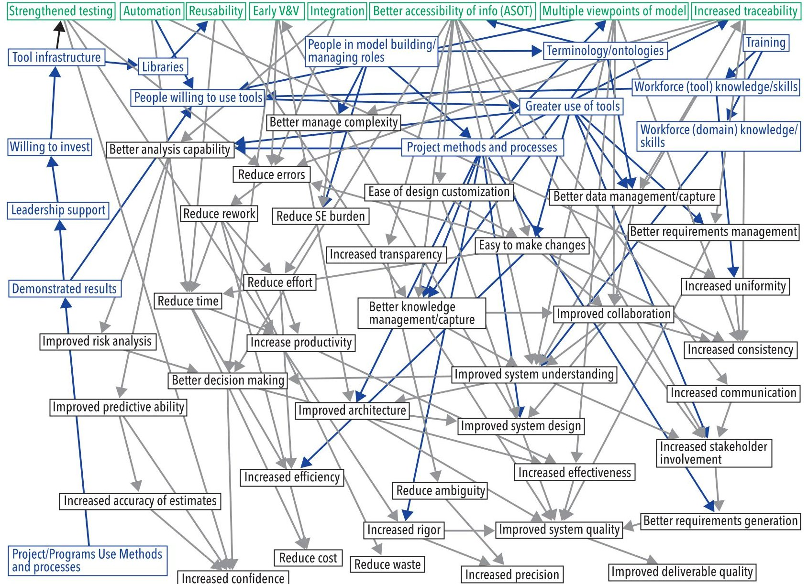
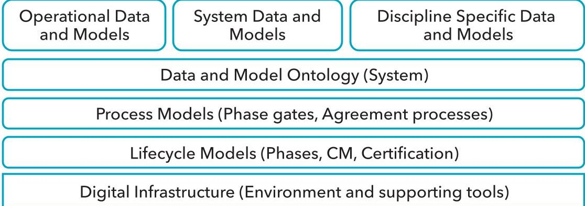

<!-- PDF_PAGE: 1 -->

# Digital Engineering Measures: Research and Guidance

Tom McDermott, tmcdermott@stevens.edu; Kaitlin Henderson, karj1@vt.edu; Alejandro Salado, alejandrosalado@arizona. edu; and Joseph Bradley, josephbradley@leading-change.org

Copyright 2022 by Tom McDermott, Kaitlin Henderson, Alejandro Salado, and Joseph Bradley. Published by INCOSE with permission.

## ABSTRACT

Digital Engineering and Model-Based Engineering continue to grow in adoption across the systems engineering community. However, programs and enterprises still struggle to quantify the value of this digital transformation. Research conducted by the Systems Engineering Research Center in collaboration with a government/industry Digital Engineering Measures Working Group is creating the first formal measurement framework for this transformation. This article describes the research, formation of a causal measurement model, and initial specification of candidate measures.

Systems continue to grow in complexity, and with that growth comes greater difficulty in managing the development of these systems (DiMario, Cloutier, Verma 2008). The use of models to design systems is increasingly considered a principle of good system design (Bahill and Botta 2008). Model-Based Systems Engineering (MBSE) is "the formalized application of modeling" to the systems engineering process (Friedenthal, Griego, Sampson 2007). As an emerging field, the MBSE literature and earlier SERC research activities cite many benefits organizations can expect to achieve if the approach is implemented properly. However, evidence shows little attention to formally measure these benefits (Henderson and Salado 2021). Systems engineering as a discipline has difficulty providing quantifiable evidence of its value, although those familiar with the systems engineering process attest to intuitively understanding its benefits (Honour 2004). Transitioning from a document-based to a model-based approach to systems engineering represents a substantial financial investment, and organizations want to know if the effort and cost to adopt MBSE is worth it. Transitioning from a document-based to a model-based approach to systems engineering also provides additional opportunity to

measure the value of the systems engineering process in ways that were difficult in previous practices.

Digital Engineering (DE) and model-based approaches are two components of enterprise digital transformation that have great promise to improve the efficiency and productivity of engineering activities, particularly for complex engineered systems. Core to this transformation is the integration of data and models across disciplines, often called the Authoritative Source of Truth (ASOT). Also critical to this transformation is a shift from document-based activities to model-based activities as a basis for information flow across disciplines and stakeholders. The core concept in DE transformation is the use of evolving models and associated data as the primary source of knowledge about a system and its life cycle, continually managed across all the development and management teams. Systems engineering use of DE is rapidly maturing the "digital system model" as a central resource to manage data and models in the ASOT, supplying integration across discipline-specific data and models. This is a change from simple engineering with models (a standard practice today) to the use of a central set of architectural models that inform and manage all engineering decisions. An emerging international standard codifies this relationship: ISO/IEC/IEEE DIS 24641 Systems and Software engineering — Methods and tools for model-based systems and software engineering (MBSSE).

The Systems Engineering Research Center (SERC) engaged with government and industry subject matter experts (SMEs) to fill the value measurement gap by proposing a set of metrics that should be employed to best show the value of DE and MBSSE. Since there are many potential benefits, we developed a causal model based on performance measurement literature to systematically decide on which metrics should be prioritized, then worked with the community of SMEs to refine that model into a set of potential measurement specifications. In the process, we evaluated the causal model using both literature reviews on DE measurement and discussions with selected enterprises and program offices. The primary contribution of this research is the measurement model, as actual quantitative measurement of DE and MBSSE remains at an early stage, and few concrete examples exist. At this point the research indicates 1) DE and MBSSE have measurable benefits, 2) DE/ MBSSE measures can be defined and tracked, and are extensions to well-known software measures, and 3) DE/MBSSE measures primarily support the systems

<!-- PDF_PAGE: 2 -->

Table 1. Direct Benefits of DE/MBSSE

<table border="1"><tr><td>Direct Benefits</td><td>Definition</td></tr><tr><td>Higher level support for automation</td><td>Use of tools and methods that automate previously manual tasks and decisions</td></tr><tr><td>Early Verification and Validation(V&amp;V)</td><td>Moving tasks into earlier development phases that would have required effort in later phases</td></tr><tr><td>Reusability</td><td>Reusing existing data, models,and knowledge in new development</td></tr><tr><td>Increased traceability</td><td>Formally linking requirements,design,test,etc.through models</td></tr><tr><td>Strengthened Testing</td><td>Using data and models to increase test coverage in any phase</td></tr><tr><td>Better Accessibility of Information(ASOT)</td><td>Increasing access to digital data and models to more people involved in program decisions</td></tr><tr><td>Higher level support for automation</td><td>Using data and models to support both the integration of information and system integration tasks</td></tr><tr><td>Multiple viewpoints of model</td><td>Presentation of data and models in the language and context of those that need access</td></tr></table>

engineering process and can provide data-driven quantitative assessment of systems engineering benefits, given an appropriate measurement framework. This article describes the development and maturation of that measurement framework.

DE and MBSSE have measurable benefits: Previous research on benefits and metrics in DE surveyed both literature and the MBSE community to broadly collect potential measures associated with benefits and adoption indicators (SERC SR-001 2020; SERC TR-002 2020). The survey results and initial DE Metrics report remain available on the SERC website: https:// sercuarc.org/results-of-the-serc-incose-ndiambse-maturity-survey-are-in. An eventual DE measurement framework should focus on measurement of the primary benefits of DE and MBSSE as well as adoption factors which often serve as leading indicators to these benefits. The most highly cited benefits, enablers, and obstacles are in Figure 1.

The earlier surveys were used to narrow down a set of eight direct benefits associated with DE measurement, as described in Table 1. These benefits were developed into a causal measurement model that found the causal relationships and secondary benefits associated with these primary benefits. These direct benefits form the roots of the causal model, considered as core activities in DE and MBSSE that lead to measurable benefit. From these direct benefits stem the secondary benefits which are the effects/ result of these, including those potential metrics that are typically of interest to managers and other stakeholders such as reduced cost, improved quality, or reduced cycle time. The causal analysis informed DE metrics design.

Figure 2 (next page) contains the full causal model. One can visualize the complexity of the measurement challenge from this map. The eight primary benefits are in the top of the map in green boxes and font. All secondary benefits stem from these. In the map the black nodes relate to benefits and the blue nodes relate to adoption factors. Note that the adoption factors form

a causal loop beginning with "Projects/Programs use methods and processes" in the bottom left of the figure.

There are three primary factors related to increased stakeholder involvement that are central to adoption. These are in blue boxes and font at the top-center of the map: greater use of tools, project methods and processes, and people willing to use the tools. Many of the other benefits of a digital transformation will be lost if artifacts must be produced and activities must be conducted outside of the digital environment and related models. Enterprise and program terminologies/ontologies and associated digital libraries are essential to creating the ASOT and adopting a model-centric approach. Both "number of people willing to use DE/MBSSE tools" and "number or percentage of models/data sets in the ASOT" are critical leading indicators of successful DE transformation.

The causal model found a set of base measures in the DE/MBSSE domain that are common to most digital transformation

Top Cited MBSE Benefits

Figure 1. Top Benefits and adoption factors from previous research

<table border="1"><tr><td>Top Enablers</td><td>Top Obstacles</td></tr><tr><td>Leadership Support</td><td>Organizational Culture</td></tr><tr><td>People willing to use MBSE tools</td><td>Workforce Knowledge/ Skills</td></tr><tr><td>Workforce Knowledge/ Skills</td><td>Leadership Support</td></tr><tr><td>Demonstrating Benefits/ Results</td><td>Awareness of MBSE Benefits</td></tr></table>

activities and well described in the software community. These include reduced errors/ defects, reduced effort, and reduced time. The causal model also shows that reduced rework and reduced cost will be important secondary measures associated with these base measures. The causal linkages between these stand out down the center left of the map. Reduced cost which is the ultimate measure

of return, is a lagging indicator dependent on all these other indicators. Reduced cost is an important measure, particularly

<!-- PDF_PAGE: 3 -->

Figure 2. Full causal model

across programs in the enterprise, but more leading indicators such as defects and effort also require tracking within a program or project.

In reviews with the SME community, a key aspect of DE/MBSSE is to improve functional completeness and correctness of the underlying description of the design. The ability to quantify and analyze functions in a digital systems model is causally related to the direct benefits of Early VetV, Strengthened Testing, Better Support for Integration, and Increased Traceability. All these again decompose to base measures of reduced errors/defects, reduced effort, and reduced rework. The DE community should put more effort in defining models associated with decomposition of capabilities, functions, and requirements, then measuring the peer review, simulation, and test of those models.

Another area of interest in the SME community is the efficiency gained in model-based review artifacts. Causally, these relate to the Better Accessibility of Information and Multiple Viewpoints of Model primary benefits. In this case, improved collaboration

is the most central secondary benefit. Improved collaboration is difficult to measure directly but is an important user experience metric to assess via surveys of other means in the transformation process. Key related quantitative measures include reduced errors/defects and reduced rework, and how one tracks these measures from phase to phase of the review and decision process. The core product-related measures are defect resolution by phase and rework that must be done or travelled to later phases. Leading indicators associate with number of review discrepancies/actions and decision signoffs or approvals at the review.

Another primary benefit area is Higher Level of Support for Automation. Central to automation are number of people willing to use DE/MBSSE tools (automation should increase this), easy to make changes, reduced effort, and reduced time. Reusability is a final primary benefit and is most causally related to better knowledge management/capture. Knowledge management is traditionally a difficult area to measure. In DE/MBSSE the causal linkage is from program terminologies/ontologies and

associated digital libraries, to reuse of data and models, to better knowledge management/capture.

DE and MBSSE measurement framework: The causal model supported the development of a framework and measurement information model for the specific work performed in the domain of DE and MBSSE. The framework describes the DE/MBSSE unique work one is to measure, and the model describes both the information needs and measures that would allow the performance of that work to undergo evaluation. DE and MBSSE have three interrelated goals: the transformation of engineering activities to fully digital infrastructure, artifacts, and processes; the use of data and models to improve the efficiency and productivity of engineering practice; and the use of MBSSE to fully integrate systems data and models with engineering, program management, and other domains and disciplines. DE/MBSSE work activities are a set of methods, processes, and tools for the life cycle definition, development, and sustainment of complex engineered systems. DE creates not only the product itself, but

<!-- PDF_PAGE: 4 -->

Figure 3. DE/MBSSE measurement framework

also the digital data and models that define and then support the product over its life cycle. Because DE and MBSSE processes help to define the capabilities of the eventual system, the measures can serve as useful leading indicators for other product related measures. DE/MBSSE can also produce independent products in support of delivered data, hardware, and software products such as digital twins or other model- or simulation-based executable systems. For DE/MBSSE, stakeholder concerns include actual users of the systems and software, as well as the development teams, support teams, customer, and enterprise managers. Decomposition of the DE process flow associates with models and underlying data, and the digital infrastructure supporting them.

Figure 3 describes the measurement framework. Data and models are the core products undergoing measurement. These require a system data and modeling ontology to be created, used, and maintained in the ASOT. Process models and associated system life cycle models describe the work process flow, which can also be measured. The digital infrastructure provides the underlying methods and tools for performing the work.

Operational, System, and Discipline Specific Models: DE and MBSSE are primarily concerned with the development and support of models and the data used by the models to support life cycle decisions. There is not a single model, but a set of models used to define the operational use of the system, analyze discipline specific concerns, and manage the relationships between individual models. In MBSSE, the System Model is the result of a unique work activity used as the central repository for design decisions that span multiple engineering and business concerns; design decisions are captured as model elements in that System Model (Delligati 2013).

Data and Model Ontology: Engineers maintain DE and MBSSE artifacts in a repository, referred to as the ASOT, and stakeholders work from the same data and models. For work to proceed efficiently, all

users of the repository must be able to work from a common taxonomy and underlying set of ontological relationships maintained by the DE toolsets. User experience is an important measurement attribute.

Process Models: Engineers plan and implement work through a set of defined processes that evolve and produce a set of life cycle artifacts in digital form designed to integrate across the products, people, and processes involved in the project.

Life-cycle Models: DE and MBSSE metrics associate with life cycle phases, decision points, and information needs. These are in turn linked to internal product iterations and external releases. A primary goal of DE/MBSSE is to measure the systems engineering process and product attributes as they progress through these phases.

Digital Infrastructure: The infrastructure includes the establishment of a set of computing assets and tools that support the other DE work in an efficient and productive manner, as well as the training and organizational capabilities to support this infrastructure. Because of the size and complexity of many digital models, the performance of the digital infrastructure is a measurement concern.

DE and MBSSE measurement information model: The benefits of DE and MBSSE are associated with intangible products, defined in software, even though much of the purpose of DE/MBSSE is to improve tangible products. Thus, measurement of DE and MBSSE is primarily a software measurement activity. Because of this, the authors selected the Practical Software and Systems Measurement (PSM) framework as a baseline measurement specification approach. This supported transition of previous research on DE/ MBSSE benefits into specifiable measurement constructs and approaches. PSM defines an information-driven measurement process focused on the technical and business goals of any organization, and allows specification of measurement goals, information, and indicators (Jones, et al. 2001). In addition, the PSM initiative [www.psmsc.com] provides a foundation for publication, training, and

support of this work. In this research, the eight primary benefits were translated into measurement specifications using the PSM methodology. This is a community effort sponsored by the SERC, the Aerospace Industries Association (AIA), the International Council on Systems Engineering (INCOSE), the National Defense Industrial Association (NDIA), and PSM. Direct transition of this research informed the development of a draft DE Measurement Framework and Specification which was released for comment in January 2022 on the PSM website.

The original PSM guide published in 2001. In 2020, an extension to the guidance published covering additional measurement concepts associated with software and system continuous iterative development (CID). The CID framework directly applies to DE and MBSSE in the use of evolving models as the primary source of knowledge about a system and its life cycle. The DE measurement framework further extends the PSM base framework to cover DE/MBSSE measurement concepts.

The PSM methodology encourages development of a measurement information model using Information needs, measurable Concepts, and Measurement constructs. The authors capture these constructs in an "ICM" table. The authors used the causal model to target the ICM table to measures that were specific to DE/MBSSE. The final ICM table will publish with the framework document. The integration of the causal model and the SME-generated ICM table supported the definition of both direct measures of the primary benefits listed in Table 1, as well as the secondary measures of the secondary benefits in the causal model in Figure 2. These come together as the initial measurement framework and measurement model shown in Table 2 on the next page.

A brief description of the measures follows:

- Product automation: automated generation of artifacts, including model test activities; digitalization should reduce manual steps in DE processes; programs should measure elimination of manual steps in processes

- Deployment lead time: DE and MBSSE should reduce the amount of time from when a capability team identifies a capability to when it is delivered; overall process time and critical steps should be measured

- Model traceability: modeling tools support analyses related to the relationships between model elements in a model, such as errors or missing elements, leading to increased completeness and quality

<!-- PDF_PAGE: 5 -->

Table 2. Primary Benefits, Direct and Secondary Measures

<table border="1"><tr><td>Primary Benefits</td><td>Direct Measure</td><td>Example Secondary Measures</td></tr><tr><td>Higher level support for automation</td><td>Product Automation</td><td>Deployment Lead Time, Efficiency, Effort, Cost</td></tr><tr><td>Early V&amp;V</td><td>Model Review Item Discrepancies</td><td>Defect Resolution, Rework, Deployment Lead Time</td></tr><tr><td>Strengthened Testing</td><td>Defect Detection, Defect Resolution (by phase)</td><td>Rework, Deployment Lead Time</td></tr><tr><td>Better Accessibility of Information(ASOT)</td><td>ASOT Frequency of Access</td><td>Deployment Lead Time, Runtime Performance, Number of Consumers of the ASOT</td></tr><tr><td>Increased Traceability</td><td>Model Traceability</td><td>Functional Architecture Completeness and Volatility, Functional Correctness, Product Size and Stability</td></tr><tr><td>Multiple Model Viewpoints</td><td>Number of Model Views/Artifacts</td><td>Efficiency, Runtime Performance, Model Review Item Discrepancies</td></tr><tr><td>Reusability</td><td>Model Reuse</td><td>Automation, Model Traceability</td></tr><tr><td>Higher Level of Support for Integration</td><td>Deployment Lead Time</td><td>Functional Correctness, Efficiency</td></tr></table>

- Product size and stability: modeling tools support analyses related to the number of relevant model elements in a model, supporting comparative analysis of complexity and effort as well as progress to completion of the modeling effort

- Functional architecture completeness and correctness: analyses related to the consistency and correctness of the system definition and related artifacts as captured digitally in data and models; may also support analysis of the fidelity of the system description

- Defect detection and resolution by phase: detection and resolution of errors and defects by development and product release phase, DE/MBSSE should improve early detection of defects and reduce overall defects in deployed system releases

- Efficiency: benchmark measures of process workflows integrating other measures such as effort, lead time, automation, and more

- Rework: measures (effort, time, and cost) associated with redoing tasks and products; DE and MBSSE should reduce rework via the knowledge capture inherent in data and models

- Runtime performance: amount of time to execute model-related activities necessary to measure due to the size and complexity of many models

- Model reuse: measures such as reduced time and effort arising from different forms of model reuse, such as standard reference architectures

- ASOT access: a series of measures associated with different stakeholders and disciplines accessing and updating data

and models in the ASOT; a leading indicator of collaboration around models

- Model view artifacts and review items: a primary aspect of DE and MBSSE is to improve the development quality and lead time of complex systems via creation, review, and use of models; the effectiveness of those reviews is a key leading performance indicator

DE and MBSSE support systems engineering: The focus on data and models as a foundation to deployed products and services, and the means to instrument and measure the workflow, provide an opportunity to strengthen the systems engineering process. The Systems Engineering Leading Indicators (SELI) Guide, published by INCOSE, identified a set of measures to assess the effectiveness of the systems engineering process (INCOSE 2010). Despite the maturity of these indicators, few complete examples of actual measurement exist, primarily due to the lack of tools that can quantitatively track these measures. With DE and MBSSE much of the systems engineering process moves from standalone documents to integrated software tools. The causal model and related measures offer the opportunity to define a digital infrastructure to quantitatively measure the effectiveness of systems engineering. Important quantitative measures supporting selected leading indicators from the SELI guide include:

- Requirements Trends: Model Traceability, Functional Architecture Completeness, and Volatility

- System Definition Change Backlog Trends: Rework, Effort, Efficiency

- Interface Trends: Model Traceability, Functional Architecture Completeness and Volatility

- Requirements Verification & Validation Trends: Deployment Lead Time, Efficiency

- Work Product Approval Trends: Number of Model Views/Artifacts, Deployment Lead Time

- Review Action Closure Trends: Model Review Item Discrepancies

- Defect and Error Trends: Defect Detection, Defect Resolution, Rework

- Technical Measurement Trends: ASOT Frequency of Access

- Architecture Trends: Functional Architecture Completeness and Volatility, Functional Correctness, Product Size

- Cost and Schedule Pressure: Efficiency, Rework, Deployment Lead Time

Validation of DE and MBSSE measures: At this point there are very few developmental and sustainment programs that are implementing a DE/MBSSE formal measurement program, and fewer that are publishing results to the community on their measurement results. Most of the benefits of DE/MBSSE remain perceived not measured, and the Working Group's efforts to define measurement specifications remain a consensus view of "where do I start" not yet "what are the most valuable."

One publicly reported effort to quantitatively measure the benefits of DE and MBSSE comes from the U.S. Navy Submarine Warfare Federated Tactical Systems (SWFTS) program, published in 2021 (Rogers and Mitchell 2021). The SWFTS

<!-- PDF_PAGE: 6 -->

program has been transitioning from a document-centric systems engineering process to a model-based process over the past decade. The publication quantified a positive return on investment from this transition based on several quantitative measurement activities. The authors make several conclusions about DE/MBSSE based on the metrics they took/calculated. First, the MBSSE process was more efficient than the legacy process, specifically about the effort needed to modify and configuration-manage interface requirements. Second, MBSSE enabled interface defects discovery earlier when it is typically less expensive to fix. Third, MBSSE produced a higher quality product, in terms of total number of defects found. Finally, the authors determined that a positive project cost ROI was achieved from the investment to use MBSE, as compared to previous product releases. The authors also note additional qualitative and observed benefits throughout. Since moving to the MBSSE process, the paper reported a 37% decrease in fielded product trouble reports, a 9% decrease in overall problem reports, an 18% increase in "saves" or problems discovered in earlier phases, and an 18% decrease in total systems engineering effort hours.

SWFTS quantified these primary benefits: Increased Traceability, Early V&V and Strengthened Testing, Support for Integration, and Automation. The work demonstrated measurement approaches related to Product Automation, Efficiency, Model Traceability, Functional Completeness, Functional Correctness, Defect Detection and Defect Resolution, Product Size (of baseline changes), and Effort. The program coupled these measures to the organizations financial (effort, cost, and schedule) tracking systems to establish the comparative benefits. A primary aspect of this work

is its consistency with the causal model and related measures and measurement framework.

In discussions with other programs that are developing a DE/MBSSE measurement approach, the link from DE/MBSSE benefits to fielded product timeliness quality, and effort remain strong. The focus on product quality, as measured in defects per phase and elimination of rework, stays front and center. One program was primarily interested in the ability of a DE/ MBSSE process to improve both cycle times of internal and deployed releases, as well as cycle time consistency.

However, most organizations and programs surveyed to date are just beginning to define a DE/MBSSE measurement activity. These are helping to define the core measures as reflected in the DE Measurement Framework but not at the point where full validation of the causal model is possible. The community needs continuing efforts to mature the practice of DE/MBSSE measurement.

Maturing DE/MBSSE measures: In summary, the community is gaining a much greater understanding of the opportunity to quantify DE/MBSSE measures, but actual implementation, lessons learned, and experience remain in preliminary stages of practice. The DE/MBSSE community continues to search for a starting point for measures. This research to categorize MBSSE benefits and the resultant causal model, as well as the first draft DE measurement framework, will provide a baseline for programs to begin focused efforts on measurement and quantification of benefits. The digital transformation and shift from document-based to model-based artifacts offer a wonderful opportunity to quantify and expand the application of systems engineering to complex projects.

DE/MBSSE tools support the quantitative data needed to collect and analyze these measures. For example, a core focus of current MBSE tools is traceability, and most offer the means to measure Model Traceability directly. From this, the community can derive Functional Completeness and Volatility as well as Functional Correctness. Also, modeling tools all define model elements which can be directly converted to Product Size, although the definition of elements varies from tool to tool, and additional experience is needed on the most valuable model element relationships to measure. Most of the MBSSE tools surveyed provide configuration management support but do not directly support quality measures such as Defect Resolution and Rework. However, programs can today build the digital infrastructure to support tracking of these measures through tool integration standards and features.

As the maturity of DE/MBSSE measurement practice increases, this initial baseline measurement framework and underlying causal measurement model will continue to inform the community.

## ACKNOWLEDGEMENTS

This material is based upon work conducted by the SERC and supported, in whole or in part, by the U.S. Department of Defense through the Office of the Assistant Secretary of Defense for Research and Engineering (ASD(R&E)) under Contract [HQ0034-19-D-0003, TO#0011. Thank you to our sponsors as well as the members of the DE Measurement Working Group and lead authors Joseph Bradley, Tom McDermott, Geoff Draper, and Cheryl Jones.

## REFERENCES

- Bahill, A.T., and R. Botta. 2008. "Fundamental Principles of Good System Design." Engineering Management Journal 20(4): 9-17.

- Delligati, L. 2013. SysML Distilled: A Brief Guide to the Systems Modeling Language. Upper Saddle River, US-NJ: Addison-Wesley.

DiMario, M., R. Cloutier, and D. Verma. 2008. "Applying Frameworks to Manage SoS Architecture." Engineering Management Journal 20(4): 18-23.

- Friedenthal, S., R. Griego, and M. Sampson. 2007. "INCOSE Model-Based Systems Engineering (MBSE) Initiative." Paper presented at the 17th Annual International Symposium of INCOSE, San Diego, US-CA, 24-28 June.

- Henderson, K., and A. Salado. 2021. "Value and Benefits of Model-Based Systems Engineering (MBSE): Evidence from the Literature." Systems Engineering 24(1): 51-66.

- Honour, E. C. 2004. "Understanding the Value of Systems Engineering." Paper presented at the 14th Annual International Symposium of INCOSE, Toulouse, FR, 20-24 June.

- ISO (International Organization for Standardization/ IEC (International Electrotechnical Commission)/IEEE (Institute of Electrical and Electronics Engineers) DIS (Draft International Standard) 24641:2021(E), Systems and Software Engineering — Methods and Tools for Model-Based Systems and Software Engineering. Geneva, CH: ISO, IEC, IEEE.

- International Council on Systems Engineering (INCOSE). 2010. Systems Engineering Leading Indicators Guide, v. 2.0. San Diego, US-CA: INCOSE Press. https://connect.incose.org/Pages/Product-Details.aspx?ProductCode=TechGuideLeadInSoft

McGarry, J., et al. 2001. Practical Software Measurement: Objective Information for Decision Makers. Upper Saddle River, US-NJ: Addison-Wesley Professional. www.psmsc.com

<!-- PDF_PAGE: 7 -->

- Rogers, E., and S. Mitchell. 2021. MBSE Delivers Significant Return on Investment in Evolutionary Development of Complex SoS." Systems Engineering 24 (6): 385-408. https://doi.org/10.1002/sys.21592

- SERC (Systems Engineering Research Center) Technical Report SERC-2020-SR-001.2020. Benchmarking the Benefits and Current Maturity of Model-Based Systems Engineering across the Enterprise. Hoboken, US-NJ: Stevens Institute of Technology.

- Technical Report SERC-2020-TR-002.2020. Digital Engineering Metrics. Hoboken, US-NJ: Stevens Institute of Technology.

## ABOUT THE AUTHORS:

Tom McDermott serves as the Deputy Director and Chief Technology Officer of the SERC at Stevens Institute of Technology in Hoboken, NJ. He develops new research strategies and is leading research on Digital Engineering transformation, education, security, and artificial intelligence applications. Mr. McDermott also teaches system architecture concepts, systems thinking and decision making, and engineering leadership. He consults with several organizations on enterprise modeling for transformational change, and often serves as a systems engineering expert on government major program reviews. He current serves on the INCOSE Board of Directors as Director of Strategic Integration.

her BS and her MS degrees in industrial and systems engineering from Virginia Tech. Her research interests include model-based systems engineering, organizational design, and performance measurement.

Kaitlin Henderson is a PhD candidate in the Grado Department of Industrial and Systems Engineering at Virginia Tech with a concentration in management systems. She received

Alejandro Salado has over 15 years of experience as a systems engineer, consultant, researcher, and instructor. He is currently an associate professor of systems engineering with the Department of Systems and Industrial Engineering at the University of Arizona. In addition, he supplies part-time consulting in areas related to enterprise transformation, cultural change of technical teams, systems engineering, and engineering strategy. Alejandro conducts research in problem formulation, design of verification and validation strategies, model-based systems engineering, and engineering education. Before joining academia, he held positions as systems engineer, chief architect, and chief systems engineer in manned and unmanned space systems of up to $1B in development cost. Alejandro is a member of INCOSE and a senior member of IEEE and AIAA.

Joseph Bradley is President of Leading Change, LLC, and an Adjunct Associate Professor at Old Dominion University (ODU). He is currently engaged as an advisor on the Navy's efforts to build digital twins of the four naval shipyards. Since retiring as a Captain in the Engineering Duty Officer community, he has served in various consulting roles, including Program Manager's Representative for the SSGN conversion of the USS OHIO and USS MICHIGAN, as well as supporting sustainability for the COLUMBIA SSBN acquisition program. His research interests include complex system governance, digital twins and decisionmaking using modeling and simulation.

INCOSE Certification

See why the top companies are seeking out INCOSE Certified Systems Engineering Professionals.

Are you ready to advance your career in systems engineering? Then look into INCOSE certification and set yourself apart. We offer three levels of certification for professionals who are ready to take charge of their career success.

Apply for INCOSE Certification Today!

Visit www.INCOSE.ORG or call 800.366.1164

