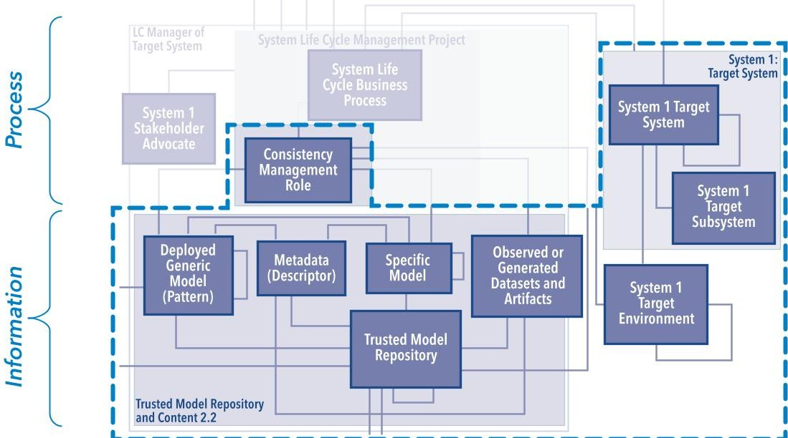
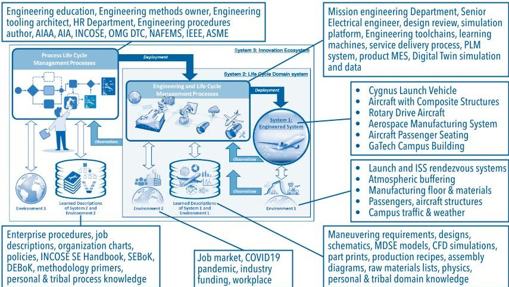
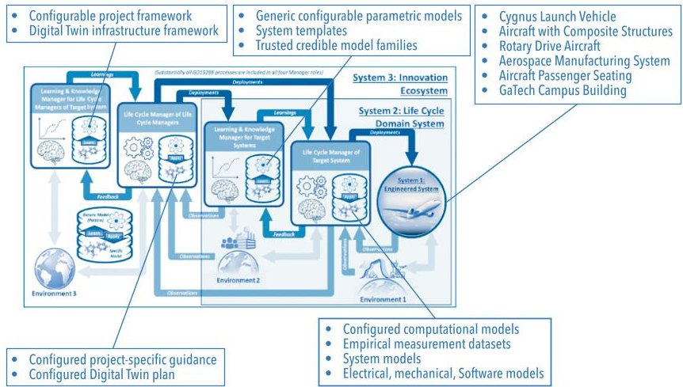
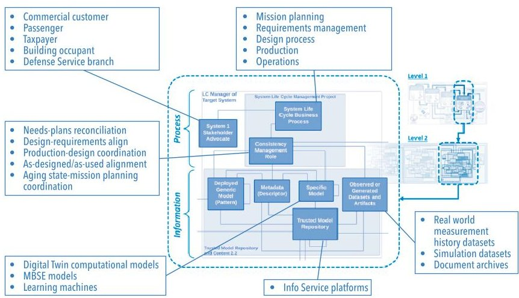

<!-- PDF_PAGE: 1 -->

# Digital Twin: Reference Model, Realizations, and Recommendations

Olivia J. Pinon Fischer, PhD, Olivia.pinon@asdl.gatech.edu; John F. Matlik, PhD, John.F.Matlik@Rolls-Royce.com; William D. Schindel, schindel@ictt.com; Mathew O. French, Mathew.French@ngc.com; Mohammed H. Kabir, Mohammed.h.kabir@boeing.com; Jayendra S. Ganguli, Jayendra.Ganguli@rtx.com; Martin Hardwick, PhD, hardwick@steptools.com; Steven M. Arnold, PhD, Steven.M.Arnold@nasa.gov; Alan D. Byar, PhD, alan.d.byar@boeing.com; Jung-Ho Lewe, PhD, j.lewe@gatech.edu; Sankara Mahadevan, PhD, Sankara.mahadevan@vanderbilt.edu; Scott Duncan, PhD, duncan@gatech.edu; John J. Dong, PhD, john.j.dong@boeing.com; Don A. Kinard, PhD, Don.A.Kinard@lmco.com; and Marianna Maiaru, PhD, Marianna_maiaru@uml.edu Authors are members from the American Institute of Aeronautics & Astronautics Digital Engineering Integration Committee (DEIC) Copyright 2022 AIAA. Published by INCOSE with permission.

## ABSTRACT

Organizations continuously develop Digital Twins across a wide number of applications and industries. While this represents a testimony to the benefits and opportunities Digital Twins provide (AIAA 2022), their development, maintenance and evolution still face major challenges (Bordeleau et al. 2020). Most past and current efforts focusing on the development of Digital Twins have relied on ad-hoc approaches, where most of the efforts start with building models without properly framing the problem (Martin 2019, Lu et al. 2020). More importantly it has led to the development of models that provide a solution to the wrong problem and consequently fail to address the core questions and needs of the stakeholders (Martin 2019]). The development and implementation of Digital Twins also lack standardization (Shao 2021), instead relying on bespoke methods and technologies (Niederer et al. 2021), which in turns leads to a lack of consistency in their description and implementation, as well as limited interoperability across applications, tools and disciplines (Niederer et al. 2021, Piroumian 2021). The development of Digital Twins has been plagued by a lack of scalable approaches, leading to implementations that are highly specialized and require considerable resources in terms of subject matter expertise (Niederer et al. 2021).

The development of standardized methodologies has been identified as a means to unleash the full potential of Digital Twins (Shao 2021, Piroumian 2021) and increase their adoption across a wider range of disciplines and applications (Niederer et al. 2021). To that end, this paper presents a domain agnostic and descriptive reference model, which builds on recognized industry practices and guidelines, to support the planning, description, and analysis of Digital Twins. It also introduces real-world examples of aerospace Digital Twin use cases and discusses how the generic reference model supports the various use case applications. Finally, this paper briefly discusses recommendations and next steps on how to realize value from Digital Twins more broadly.

KEYWORDS: digital twin, digital engineering, ASELCM, generic reference model

## 1 DESCRIPTIVE REFERENCE MODEL FOR DIGITAL TWINS

This paper configures the ASELCM reference model, presented in the previous INCOSE INSIGHT article, to describe real-world

examples of aerospace Digital Twin use cases provided by an AIAA industry and academic team. This article also provides common views on how the generic reference model supports the various use case applications. Finally, this article provides recommendations for a coordinating body to help secure and further benefits, and later discusses next steps on how to realize value from Digital Twins more broadly.

The reference model chosen is a configurable Model-Based Systems Engineering (MBSE) "pattern" used by the International Council on Systems Engineering (INCOSE) MBSE Patterns Working Group to describe innovation ecosystems. Its purpose is to aid in understanding their agility, adaptability, use of underlying information demonstration of ecosystem-level learning, and overall performance, including obstacles and challenges. The reference model has been called the Agile Systems Engineering Life Cycle Management (ASELCM) Pattern, and was used in an award-winning study series of INCOSE

publications to improve understanding of patterns of ecosystem agility in a systems engineering context (Schindel and Dove 2016; Dove, Schindel, and Scrapper 2016; Dove and Schindel 2017; Dove, Schindel, and Hartney 2017; Dove, Schindel, and Garlington 2018). Another AIAA position paper, currently going through peer-reviews, to describe the broader Digital Thread uses the same reference model. The ASELCM Pattern addresses the set of system life cycle management challenges inherent to innovation and engineering of systems, as described in (INCOSE 2014) and (ISO 2015).

<!-- PDF_PAGE: 2 -->

Figure 1. Managed digital twin system boundary

A full description of the ASELCM Pattern is discussed in the earlier article of this INSIGHT edition entitled "Realizing the Value Promise of Digital Engineering: Planning, Implementing, and Evolving the Ecosystem." As described in the earlier article, and of particular importance to understanding disparate Digital Twins, is consistency management as a paradigm for Digital Twin's contribution to Engineering and Life Cycle Management. By illustrating the system boundary of the Managed Digital Twin, Figure 1 summarizes the emphasis on the credibility of the Digital Twin simulation, and other forms of Consistency Management across the Digital Thread in general.

## 2 SUMMARY OF REALIZATION CASE STUDIES Cygnus Orbital Ferry Vehicle Digital Twin

The Cygnus Spacecraft is a flight proven design incorporating elements drawn from Northrop Grumman and its partners' existing, flight-proven spacecraft technologies. Cygnus carries NASA cargo to the ISS and provides all spacecraft functions necessary for safe rendezvous, berthing, unberthing, final descent and reentry. Digital Twins predict mission operations and vehicle performance with actual performance during a mission updating future predictions.

From an ASELCM reference model perspective, with the orbital vehicle viewed as System 1, this System 2 digital twin is simulating System 1 performance, during the mission planning, engineering, and operations stages. Relevant ASELCM System 2 features therefore extend to include Mission Planning, along with Requirements Definition, Digital Twin Feature, and Decision Making (Hutchinson 2017; Huchinson and Bocam 2009; https:// www.northropgrumman.com/space/cygnus- spacecraft/).

## ICME Optimization of Advanced Composite Components of the Aurora D8 Aircraft

The objective of this activity is to develop an integrated approach to design and optimize the composite Y-joints and composite acreage panels used in the Aurora D8 aircraft. To achieve this objective users will link material models, structural models, and experiments at multiple length scales. This aeronautical relevant benchmark problem serves to demonstrate the benefits of an Integrated Computational Materials Engineering (ICME) approach. Digital representative models will generate at every scale, with some or all rising to the level of twin(s) depending upon consistency with scale specific measures of merit. With respect to the ASELCM reference pattern, this digital twin study is active in both System 2 (where teams generate and use models of the different scales) and System 3 (where teams use models to describe, deploy, and study new paradigms of the System 2 work processes). Relevant System 2 features include Digital Twin Feature, Consistency Management, Decision Management Feature, and Verification by Analysis and Simulation Feature. Relevant System 3 features include (as description of the System 2 ecosystem) Business or Mission Analysis, Architecture Definition, and System Transition.

## Rotorcraft Component Digital Twin

Rotorcraft components experience different stress levels based on the flight parameters and intensity of the mission, which in turn dictates the maintenance schedule as well as remaining useful life of the component. Here users develop a component stress-aware rotorcraft flight parameter optimization methodology by building a digital twin for the component of interest. The digital twin fuses the information from

sensor data, probabilistic diagnosis, probabilistic prognosis, and enables selection of maneuvers that minimize the stress in the critical component (Sisson, Karve, and Mahadevan 2021).

From an ASELCM perspective, with the rotorcraft component viewed as System 1, the System 2 digital twin is simulating System 1 performance. Relevant ASELCM System 2 features therefore extend to include Business or Mission Analysis, Stakeholder Needs and Requirements Analysis, Design Definition, MBE Capability, and Digital Twin.

## Manufacturing Digital Twin Framework

Digital twins can enable more accurate and timely modeling of manufacturing results. Modeling digital twins during manufacturing is challenging because the processes one must measure developed over many years. Adding digital twins is only beneficial if organizations can achieve further savings without reducing quality or slowing production. In the summer of 2020, the AIAA industry and academic team implemented three case studies to validate the digital twin framework. They developed all three test cases to show how digital twinning can make manufacturing more flexible and accurate (ISO 2021).

Viewed from the perspective of the generic ASELCM reference model, System 1 represents the manufactured product and System 2 the product engineering and manufacturing system, the current use case focuses on System 3, where the digital twin and manufacturing engineering system exists. The relevant System 3 features therefore include System, Requirements Definition, Architecture Definition, and Design Definition, where the "system" here is the Managed Digital Twin. The relevant System 2 functional roles, to be allocated to design components (hardware, software, people, facilities, and more), therefore include Consistency Management, the Configured System Model, Empirical Datasets, Descriptive Model Metadata, accumulated simulation Patterns, and the Trusted Model Repository.

## Smarter Seat Certification Testing Digital Twins

Passenger safety is a critical priority for Boeing commercial airplanes, and seat installations are a key aspect of passenger safety. While certification testing historically assured seat structural integrity and occupant safety, models can achieve the same level of passenger safety by analytical methods due to recent advancement of "Digital Twin" computer modeling and simulation technology. The airplane seat digital twin utilized simulation of seats as a

<!-- PDF_PAGE: 3 -->

means of regulator (FAA and EASA) compliance. As such, the airplane seat digital twin effort developed and demonstrated the capability to build validated simulation models for Certification by Analysis (CbA) (Boeing Commercial Airplanes 2017). The development of the digital twin of the airplane seat and its implementation focused on safety (SAE 2012) of the developed physical product. The program focus was not to fully eliminate product testing, but instead to significantly reduce testing by leveraging insight gained through the digital twin.

From an ASELCM reference model perspective, with the airplane seat viewed as System 1, this System 2 digital twin is simulating System 1 performance during the mission planning, engineering, and operations stages. Relevant ASELCM System 2 features extend to include Stakeholder needs and requirements analysis, along with Implementation, Verification by analysis and simulation, MBE capability, and Acquisition.

## Georgia Tech's Kendeda Building Digital Twin

The Aerospace Systems Design Laboratory (ASDL) at Georgia Tech (GT) in support of GT's Kendeda Building for Innovative Sustainable Design (KBISD) created a Digital Twin. The use of the Digital Twin made it possible for KBISD to receive certification in 2021 as a "Living Building" from the International Living Futures Institute (ILFI) (Post 2021). The Digital Twin needed to experience the to the same conditions weather, occupancy, control schemes-as its real counterpart to serve as a baseline for quickly detecting faults that would jeopardize certification. During the 12-month certification period, use of the Digital Twin also enabled GT to forecast the net "budget" of water and energy through remaining months to gage whether the building might be "programmed" (planned) for more intensive use by occupants and visitors.

With respect to the ASELCM reference pattern, this digital twin study is active in both System 2 (where teams generate and use models of different scales ) and System 3 (where teams use models for to describe, deploy, and study new paradigms of the System 2 work processes). Relevant System 2 features include Business or Mission Analysis, Stakeholder Needs and Requirements Analysis, Design Definition, Verification by Analysis and Simulation, System Transition, and System Performance Management Capability. Relevant System 3 features include Acquisition, Human Resources Management, Business or Mission Analysis, Stakeholder Needs and Requirements Analysis, Design Definition, Implementation, and Transition. This case study is a good example to highlight differences between System 2 and 3 features of the same type; both Systems 2 and 3 have four features that are of the same type but apply to different ASELCM systems (system 2 or 3).

The diagrams below synthesize how the generic reference model supports the various use case applications presented in the previous Section. In particular, Figure 2 through Figure 4 summarize how the use case applications fit together into the different roles necessary for any system.

## 3 SUMMARY OF ASELCM APPLICATIONS

In Table 1 the significant role of consistency management is highlighted for each case study. Please refer to Figure 6 of the earlier article of this INSIGHT magazine for more detailed description of the roots of consistency management. However, for the configuration of these case studies, the left two columns with shaded blocks of the Modeled System depict relevance to either system 1 or 2. Likewise, the colored in blocks for each case study correlate distinct types of managed consistencies to each case study. These correlations are important to case study success.

Figure 2. ASELCM logical architecture, level 0 view across the use case applications considered

Figure 3. ASELCM logical architecture, level 1 view across the use case applications considered

Figure 4. ASELCM logical architecture, level 2 view across the use case applications considered

## 4 RECOMMENDATIONS

This document has presented configurations of a generic reference model for describing how Digital Twins integrate with the broader digital enterprise. Furthermore, this paper describes a subset of Aerospace Industry use cases and case studies which demonstrate the relevance and utility of this reference model. This work provides the needed context for collaboration and consistency management so the Aerospace Industry can move out toward realizing the greatest value from digital twin implementation.

## Recommendations on ASELCM Methodology

Methodology recommendations for planning and implementing Digital Twins include:

<!-- PDF_PAGE: 4 -->

Table 1. Consistency Management Applied to the Case Studies

<table border="1"><tr><td></td><td colspan="2">Model System</td><td rowspan="2">Consistency Type Managed</td><td rowspan="2">Example Aerospace Application</td><td colspan="6">Example Case Studies</td></tr><tr><td></td><td>System 2 Life Cycle Manager</td><td>System 1 Target System</td><td>Cygnus Launch Vehicle</td><td>Aircraft with Composite Structures</td><td>Rotary Drive Aircraft</td><td>Aerospace Manufacturing System</td><td>Aircraft Passenger Seating</td><td>GaTech Campus Bldg</td></tr><tr><td>1</td><td></td><td></td><td>Product Design versus Requirements Consistency</td><td>Certification or Pre-certification Verification</td><td></td><td></td><td></td><td></td><td></td><td></td><td></td></tr><tr><td>2</td><td></td><td></td><td>Product Design versus Requirements Consistency</td><td>Multi-Physics Design Concept Verification</td><td></td><td></td><td></td><td></td><td></td><td></td><td></td></tr><tr><td>3</td><td></td><td></td><td>Requirements versus Stakeholder Needs and Mission Consistency</td><td>Market Coverage Optimization</td><td></td><td></td><td></td><td></td><td></td><td></td><td></td></tr><tr><td>4</td><td></td><td></td><td>In Service Product Use versus Mission Requirements Consistency</td><td>Mission Planning: Product or Use</td><td></td><td></td><td></td><td></td><td></td><td></td><td></td></tr><tr><td>5</td><td></td><td></td><td>Product Requirements and Design versus Supplier Product</td><td>Initial Acquisition and Subsequent Inspections</td><td></td><td></td><td></td><td></td><td></td><td></td><td></td></tr><tr><td>6</td><td></td><td></td><td>In Service Product Maintainability versus Requirements</td><td>Improve Service Process or Product</td><td></td><td></td><td></td><td></td><td></td><td></td><td></td></tr><tr><td>7</td><td></td><td></td><td>Production Consistent with Product Design Specification</td><td>Production Quality Control and Yield</td><td></td><td></td><td></td><td></td><td></td><td></td><td></td></tr><tr><td>8</td><td></td><td></td><td>Production Consistent with Product Design Specification</td><td>Production Throughput, Efficiency</td><td></td><td></td><td></td><td></td><td></td><td></td><td></td></tr><tr><td>9</td><td></td><td></td><td>Requirements for Digital Twin Capability, versus Twin Plans</td><td>Acquiring Digital Twin Capability</td><td></td><td></td><td></td><td></td><td></td><td></td><td></td></tr><tr><td>10</td><td></td><td></td><td>Requirements for Digital Thread Capability, versus Twin Plans</td><td>Acquiring Digital Thread Capability</td><td></td><td></td><td></td><td></td><td></td><td></td><td></td></tr></table>

- Implementing Digital Twin(s) demands enterprise level systems engineering. Understanding the benefits targeted by the Digital Twin requires understanding aspects of the enterprise system in which one Digital Twin.

- Alignment with related enterprise efforts can impact success. The current period finds aviation and aerospace enterprises mid-stream in many programs of change, and Digital Twin implementation should be considered during program planning.

- Managed trust in the ongoing fidelity of the Digital Twin for purpose and over time is essential. The Digital Twin must be a trusted source of information in a way that fits the intended application of the Digital Twin.

- Ongoing multi-level group learning is central to the Digital Twin. The underlying computational models of Digital Twins represent a key form of learning about the real-world systems and system environments that they describe.

## Recommendations on Digital Twin Implementation Future Steps

Consistent with the recommendation from the seminal AIAA/AIA Digital Twin Position Paper (AIAA Digital Engineering Integration Committee 2020) and validated from the foundational work here, the Aerospace Industry recommends creating and/

or leveraging one or more existing Aerospace Digital Transformation Consortia (ADTC) that will champion and coordinate implementation and consistency management efforts across Industry, Academia and Government in accordance with the following five objectives:

- Provide Focus (Tactical) - Working closely with Industry, the ADTC will need to prioritize how, when, and where to 'focus on value' for the greatest impact while accounting for risk and cost.

- Ensure Scalability (Strategic) - Leveraging enterprise frameworks and models, the ADTC owns development of a joint grand strategy and scalable framework to coordinate Aerospace Industry efforts toward value realization from Digital Twin implementation.

- Promote Awareness (Marketing) Through liaising with existing consortiums and professional networks,the ADTC will champion the development of a communication plan and realization of dissemination mechanisms to educate the broader community about the opportunity for value realization going forward.

- Influence Policy and Regulation (Political) - To accelerate realization from published "Digital Engineering" vision and strategy documents, an ADTC will work with Government establishing

appropriate policy, regulation, and incentives for transformation.

- Workforce Development (Education) To promote awareness of tools and technology availability, an ADTC will work with Universities, Trade Schools, Community Colleges, and other professional societies.

To offer more context on each of the above specific activities and next steps should happen as part of a potential ADTC effort. The forthcoming Digital Twin Implementation Position Paper by AIAA DEIC explains descriptions of potential future efforts.

## 5 TOWARD IMPLEMENTATION OF RECOMMENDATIONS

The above recommendations highlight current gap areas that the establishment of an Aerospace Digital Transformation Consortium (ADTC) could help address. However, to take the first step on the journey to realizing an appropriate ADTC, it is necessary to identify an appropriate grand challenge big enough that no one organization can deliver it, but focused enough to allow Industry alignment around the problem. Industry has identified Joint All Domain Command & Control (JADC2) as an ideal candidate to take forward as an initial grand challenge or "North Star" effort. The need exists to develop a generic reference model for

<!-- PDF_PAGE: 5 -->

multi-domain C2 serving as input for a 'Grand Strategy' to visualize multi-domain battle operations (Zadalis 2021). An ADTC, using a generic reference model, will enable joint C2 for a common mission thread to demonstrate digitally. In addition, a generic reference model spans a consistent set of multiple configurations and viewpoints in the form of information models, logical

models, standardized frameworks, and meta-models. An ADTC can help provide focus and influence a resulting roadmap to accelerate benefit realization from joint C2 in an appropriately phased approach.

## 6 CONCLUDING REMARKS

Individual organizations are realizing targeted benefits from Digital Twins

and Digital Engineering capability. Broader benefit realization through integration across the broader enterprise will not happen without the purposeful creation of a new, trusted, and multidomain entity that serves the function of consistency manager across the Aerospace Enterprise.

## REFERENCES

- AIAA Digital Engineering Integration Committee. 2022. Digital Thread: Definition and Value - An AIAA and AIA Position Paper. American Institute of Aeronautics and Astronautics (AIAA), in press.

- AIAA Digital Engineering Integration Committee. 2020. "Digital Twin: Definition & Value." https://www.aiaa.org/docs/default-source/uploadedfiles/issues-and-advocacy/policy-papers/digital-twin-institute-position-paper-(december-2020).pdf

- Boeing Commercial Airplanes. 2017. "Smarter Testing Through Dynamic Simulation-Boeing Seat System Certification by Analysis Initiative." The Boeing Magazine BM_ Apr_17_4.

- Bordeleau, F., B. Combemale, R. Eramo, M. van den Brand, and M. Wimmer. 2020. "Towards Model-Driven Digital Twin Engineering: Current Opportunities and Future Challenges." Proceedings of the International Conference on Systems Modelling and Management. 1: 43-54.

- Dove, R., and B. Schindel. 2017 "Case Study: Agile SE Process for Centralized SoS Sustainment at Northrop Grumman." Proceedings of the 27th Annual International Symposium of INCOSE 27 (1): 115-135.

- Dove, R., B. Schindel, and C. Scrapper. 2016. "Agile Systems Engineering Process Features Collective Culture, Consciousness, and Conscience at SSC Pacific Unmanned Systems Group," Proceedings of the 26th Annual International Symposium of INCOSE 26 (1): 982-1001.

- Dove, R., W. Schindel, and K. Garlington, K. 2018. "Case Study: Agile Systems Engineering at Lockheed Martin Aeronautics Integrated Fighter Group. " Proceedings of the 28th Annual International Symposium of INCOSE 28 (1):303- 320.

- Dove, R., W. Schindel, and R.W. Hartney. 2017. "Case Study: Agile Hardware/Firmware/Software Product Line Engineering at Rockwell Collins." Paper presented at the 11th Annual IEEE International Systems Conference Montréal, CA-Québec, 24-27, April.

- Hutchinson, V. 2017. A Multidisciplinary Analysis Approach for the Cygnus Cargo Resupply to ISS. Unlocking the Potential of MBSE with ModelCenter. Dulles, US-VA: Orbital ATK. https://www.phoenix-int.com/wp-content/uploads/2017/08/A-Multidisciplinary-Analysis-Approach-for-the-Cygnus-Cargo-Resupply-to-ISS.pdf

- Hutchinson, V., K. and Bocam. 2009. "Space Tug: An Alternative Solution to ISS Cargo Delivery." Proceedings from the AIAA SPACE 2009 Conference & Exposition 1: 6519.

- INCOSE (International Council on Systems Engineering).2014. INCOSE Systems Engineering Handbook: A Guide or System Life Cycle Processes and Activities, Version 4. San Diego, US-CA: INCOSE.

ISO (International Standards Organization). 2021. ISO 23247-1:2021 Automation Systems and Integration — Digital Twin Framework for Manufacturing — Part 1: Overview and General Principles.Geneva, CH: ISO.

ISO (International Standards Organization) /IEC (International Electrotechnical Commission)/IEEE (Institute of Electrical and Electronics Engineers). 2015. ISO/IEC/IEEE 15288:2015 Systems and software engineering — System life cycle processes. Geneva, CH: ISO, IEC, IEEE.

- Lu, Q., A. K. Parlikad, P. Woodall, G. Don Ranasinghe, X. Xie, Z. Liang, E. Konstantinou, J.Heaton, and J. Schooling. 2020. "Developing a Digital Twin at Building and City Levels: Case study of West Cambridge campus." Journal of Management in Engineering 36 (3): 05020004.

- Martin, J. N. 2019. "Problem Framing: Identifying the Right Models for the Job" Proceedings of the 29th Annual International Symposium of INCOSE. 29 (1): 1-21.

- Niederer, S. A., M.S. Sacks, M. Girolami, and K. Willcox. 2021."Scaling Digital Twins From the Artisanal to the Industrial," Nature Computational Science 1 (5): 313-320.

- Piroumian, V. 2021. "Digital Twins: Universal Interoperability for the Digital Age," Computer 54 (1): 61-69.

- Post, N. M. 2021."Georgia Tech's Kendeda Is a Model for 'Living Buildings' in the Humid Southeast." Engineering News Record. https://www.enr.com/articles/51639-georgia-techskendeda-is-a-model-for-living-buildings-in-the-humid-southeast

- SAE (Society of Automotive Engineers). 2012. Analytical Methods for Aircraft Seat Design and Evaluation ARP5765. Warrendale, US-PA: SAE.

- Schindel, B., and R. Dove. 2016."Introduction to the agile Systems Engineering Life Cycle MBSE Pattern." Proceedings of the 26th Annual International Symposium of INCOSE 26 (1): 725-742.

- Shao, G. 2021. "Use Case Scenarios for Digital Twin Implementation Based on ISO 23247." Advanced Manufacturing Series (NIST AMS), National Institute of Standards. https://doi.org/10.6028/NIST.AMS.400-2

- Sisson, W., P. M. Karve, and S. Mahadevan. 2021. "A digital twin approach for rotorcraft flight parameter optimization to enhance component life." Paper presented at the AIAA Scitech 2021 Forum, Virtual Event, 11-15 & 19-21 JanuaryISO (International Standards Organization). 2021.

Zadalis, T. M. 2021"Multi-Domain Command and Control: Maintaining Our Asymmetric Advantage." JAPCC Journal, 26.

## AIAA DEIC CONTRIBUTING MEMBER BIOS:

Dr. Steven M. Arnold is currently the Technical Lead for Multiscale Modeling within the Materials and Structures Division at NASA Glenn Research Center with over 35 years of experience. He also is the Technical Lead for the Materials and Structures Discipline within the Transformative Tools and Technology (TTT) project. Dr. Arnold conducts research involving theoretical and experimental investigations of structural material behavior of advanced aircraft propulsion systems and spacecraft structures. He has over 440 technical publications, 111 of which are journal publications and is a co-author of two books on micromechan-

<!-- PDF_PAGE: 6 -->

ics of composites, "Micromechanics of Composite Materials: A Generalized Multiscale Analysis Approach" 2013 and "Practical Micromechanics of Composite Materials" 2021.

Dr. Alan Byar has thirty years of experience with Boeing, performing a wide variety of structural analyses, including extensive experience with non-linear dynamic finite element analysis on both composite and metallic structures. His current research focus is virtual testing of large-scale structural components, including crashworthiness and impact simulations. Dr. Byar is also currently involved in the evaluation of methods for analyzing composite damage propagation. Dr. Byar previously performed numerical simulations of crashworthiness tests that he conducted at the FAA Technical Center, Pomona, New Jersey. Test articles were sections of a Boeing 737. Simulations characterized impact response of both primary and secondary structures. He has presented several papers on research concerning numerical simulations of aircraft crashworthiness.

Dr. John J Dong is a Boeing Engineering Executive and Senior Technical Fellow with current responsibilities of providing enterprise technical leadership in Digital Engineering focusing on engineering modeling, simulation, and digital twin. He has been with Boeing for 25 years and worked on products such as space shuttles, space stations, launch vehicles, satellites, and 737/787/777X airplanes, and more.

Dr. Scott J. Duncan is a Research Engineer in the Aerospace Systems Design Laboratory (ASDL) at Georgia Tech (GT). As a member of ASDL's Digital Engineering Division, his work primarily focuses on terrestrial infrastructure. He serves as the programmatic lead for the ASDL's Smart Campus collaboration with GT's Division of Administration and Finance, which has in recent years expanded to involve external partners including Southern Company and the US National Renewable Energy Laboratory. Dr. Duncan's principal research interests include the development of "digital twins," systems architecting, use of systems engineering and data- and model-driven techniques to improve the sustainability of the built environment, and the use of large-scale infrastructure systems as living laboratories. Dr. Duncan received his PhD in Mechanical Engineering at GT.

Mathew French is a Staff Engineer Systems/Architect with Northrop Grumman. Mr. French is part of the Enterprise Open Architecture team where he provides systems engineering and architecting leadership for future aerospace system capabilities. Mr. French has over twenty-two years of industry experience in systems and electrical engineering and is retired from the US Army. Mr. French has a Bachelor's degree in Electrical Engineering and holds M. Sc degrees in Systems Engineering and Architecting. Mr. French is an INCOSE CSEP, emeritus chair of AIAA DEIC, and AIAA Associate Fellow.

Jayendra Ganguli, Associate Director Pratt and Whitney, A Raytheon company, is responsible for the Digital thread and Digital Twin architecture for Manufacturing, and Enterprise Interoperability and Standards. Previously he was with The Boeing Company, leading the Digital Thread architecture in the Enterprise Architecture group. He has over 25 years of experience in the PLM and CAD/CAM/CAE space spanning automotive and aerospace sectors. He has a degree in Mechanical Engineering.

Dr. Martin Hardwick is the Chief architect of the STEP-NC standards for digital twin manufacturing, Convenor of the Digital Manufacturing Working Group of ISO TC184/SC4, PI or CO-PI on 6 NSF Grants, 6 DARPA grants, and 34 total grants, Author CAD translation software used in millions of CAD, CAE and CAM stations, and Supervisor for more than 10 Ph.D. students. Dr. Hardwick is the author of more than sixty refereed papers on digital manufacturing, and former Professor and Head of Computer Science, Rensselaer Polytechnic Institute.

Mohammed Kabir has over twenty-five years of experience in Computer Aided Engineering (CAE) and Design, product development, crashworthiness, occupant safety, biomechanics Research and Development (R&D). His area of interests is airworthiness safety, application of advance finite element analysis and AI/Machine Learning technology for airframe and interiors structure design and Certification by Analysis.

Dr. Don Kinard is a Senior Fellow for Lockheed Martin Aeronautics Production Operations and has been with LM for 36 years. Don supports Digital Transformation as well as programs such as F-35. Prior to his current assignment, he was lead for F-35 production rate transition and earlier the Director of F-35 Production Engineering responsible for Joint Strike Fighter Tooling, Planning, Manufacturing Engineering, and Aircraft Systems Testing. Before joining F-35 in 2004 Dr. Kinard held various positions in both Engineering and Manufacturing during his 18 years on the F-22.

Dr. Jung-Ho Lewe is a member of the research faculty at Georgia Tech and Chief Engineer for Georgia Tech Smart Campus Initiative. Since 2018 he has served as the principal "architect" of the Digital Twin of the Kendeda Building, one of the most sustainable buildings in the world. The Digital Twin use includes real-time benchmarking and fault detection and it was instrumental in earning the prestigious Living Building Certificate.

Dr. Sankaran Mahadevan is Professor of Civil and Environmental Engineering at Vanderbilt University, Nashville, Tennessee, where he has served since 1988. He also has a joint appointment as Professor of Mechanical Engineering. He is founder-director of the Master of Engineering program in Risk, Reliability and Resilience Engineering at Vanderbilt University, and Co-director of Vanderbilt's Laboratory for Systems Integrity and Reliability (LASIR).

Dr. Marianna Maiaru joined the Department of Mechanical Engineering at UMass Lowell in the fall of 2016. Her doctoral work, performed as a collaboration between the Turin Polytechnic Institute and the University of Michigan, resulted in the development of computationally light multi-scale approaches for the progressive failure analysis of fiber-reinforced composite structures using higher-order FEM. Before joining the faculty at UMass Lowell, Maiaru was a Research Associate in the William E. Boeing Department of Aeronautics & Astronautics at the University of Washington and, before that, a Research Associate in the Department of Aerospace Engineering at the University of Michigan. Her post-doctoral research, sponsored by AFRL, was in collaboration with many aerospace industries and focused on the development of physics-based models of the manufacturing induced effect on polymer matrix composites (PMCs).

Dr. John F. Matlik is the Engineering Digital Transformation Lead for Rolls-Royce and leads a collaborative, multi-functional IPT responsible for developing, verifying, validating, and implementing new digital engineering capabilities in response to Customer and Business prioritized needs. He serves as the Engineering interface for broader Digital Enterprise activities underway to deliver digital transformation of Rolls-Royce Defense. Dr. Matlik received his doctorate in Aeronautical Engineering at Purdue University and is an Associate Fellow of AIAA.

> continued on page 64