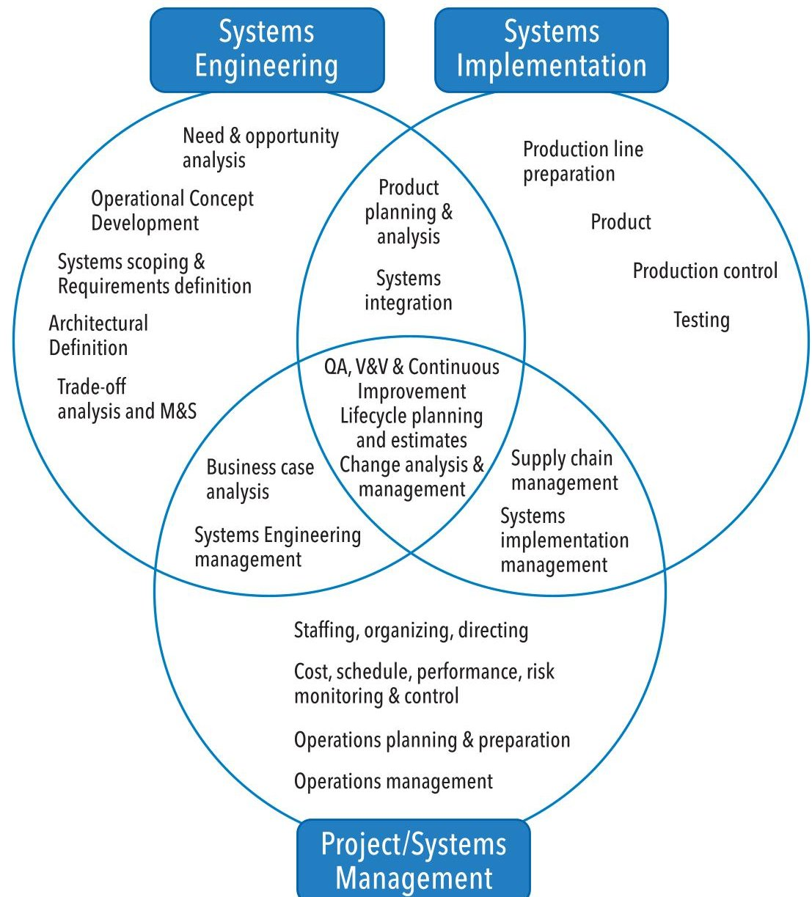
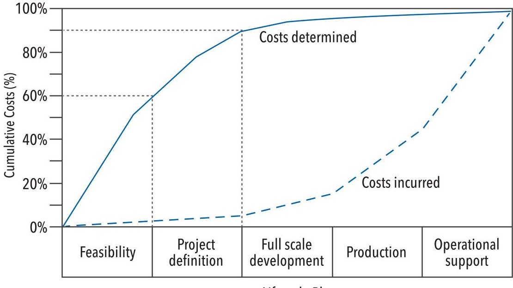
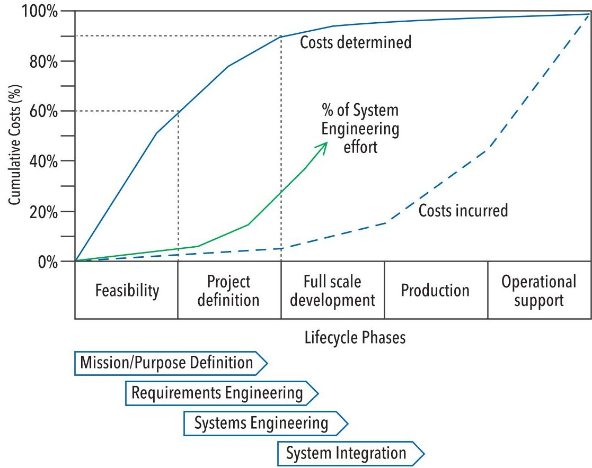

<!-- PDF_PAGE: 1 -->

# Acquirer Driven Digital Engineering Transformation

Kevin Robinson, kevin.robinson@shoalgroup.com and Tommie Liddy, tommie.liddy@shoalgroup.com Copyright 2022 Shoal Group. Published by INCOSE with permission.

## ABSTRACT

Digital Engineering, like any initiative, should have a clear purpose and direction. For organisations that sit as Acquirers/Clients the Digital Transformation may not seem immediately valuable. However, for this group Digital Engineering can provide opportunities to tightly engage with their supplier network, understand trade-offs through design and upgraded lifecycles and enhanced supplier outcomes.

This paper discusses the benefits and challenges of adopting Digital Engineering in the Concept Phase, where most of the project costs are committed. It highlights that the greatest return on investment for Digital Engineering is during Concept Phase as the flow of authoritative information permeates the remainder of the lifecycle. This presents the case for acquisition agencies to both drive the application of Digital Engineering within their industry and lead by example, through Digital Engineering adoption.

KEYWORDS: digital engineering, model-based systems engineering, acquisition

## INTRODUCTION

Digital Engineering, like any initiative, should have a clear purpose and direction. For organisations that sit as Acquirers/

Clients the Digital Transformation may not seem immediately valuable. However, for this group implementing Digital Engineering can provide opportunities to tightly engage with their supplier network, understand trade-offs throughout design and upgrade lifecycles and support enhanced/ immersive reviews.

The broad adoption of Digital Engineering is accelerating as industry sees the commercial advantages; however, this adoption is still relatively slow. Acquisition agencies, such as Government, have influenced this adoption through policy and related strategies (e.g., USA DoD 2018), but have also been slow to adopt the practice themselves. In Australia, agencies such as the Department of Defence and Transport for New South Wales have employed Model-Based Systems Engineering (MBSE) practices on a project-by-project basis, and where stakeholders have identified that a rigorous, data-centric approach can help mitigate risk. This level of adoption across

multiple organisations show an initial step towards Digital Engineering but is far from an industry level Digital Transformation.

This paper makes the case that for industry to be more successfully in adopting Digital Engineering, acquisition agencies must both adopt and drive the application of Digital Engineering. It explores the literature and provides an argument for a more comprehensive adoption of Digital Engineering by acquisition agencies.

## SCOPE OF DIGITAL ENGINEERING

The United States of America Department of Defence defines Digital Engineering as "an integrated digital approach that uses authoritative sources of system data and models as a continuum across disciplines" (USA DoD 2018). Digital Engineering spans the system life cycle, this includes the initial concept phase, through design cycles, production, ongoing support, and monitoring, and onto disposal or upcycle of the system. This scope remains the same for a production line systems or one-off designs. For organisations that conduct their engineering across the entire span of the

system's life cycle it is possible to exercise control over the implementation of Digital Engineering. For acquisition agencies, whose focus is on the initial concept phase and ongoing support and maintenance (or operation of the system) there poses a significant challenge in implementing Digital Engineering.

## Systems Engineering as part of Digital Engineering

The scope of systems engineering (described in the SEBoK (SEBoK 2021) as shown in Figure 1) spans the conception, design, development, production, and operation of physical systems. systems engineering holistically integrates the engineering disciplines being utilised to design a 'System' and interrelates with areas such as Project Management and Product Implementation to realise this system. As such systems engineering forms the backbone of the engineering undertaken in relation to the System, throughout its life cycle. In this context, MBSE (which is a data-centric approach to systems engineering), is a key element of Digital Engineering.

<!-- PDF_PAGE: 2 -->

Figure 1. System boundaries of systems engineering, systems implementation, and project/systems management. Redrawn from SEBoK (SEBoK 2021)

In an acquisition agency context, the scope of systems engineering is no different, though part of that scope will lie within supplier agency or agencies. Within the acquisition context, systems engineering provides the comprehensive approach to analyse and combine contributions and balance trade-offs among cost, schedule, and performance while maintaining an acceptable level of risk covering the entire life cycle of a system (paraphrased from DAU 2021).

Systems engineering is making the transformation to MBSE, INCOSE Vision 2025 (Friedenthal et al 2014) states that "Model-Based systems engineering will become the "norm" for systems engineering execution, with specific focus placed on integrated modelling environments". Systems engineers adopt digital technologies that are becoming more readily available, supported by the training and education needed. This brings the discipline of systems engineering in line with other areas of engineering and design such as civil and electronic engineering that employ their

model-based tools such as Computer Aided Design (CAD) and circuit board design tools, respectively.

This drive towards digital technologies, and more broadly Digital Engineering, is starting to make a real difference to complex and cross discipline projects that require a "...fully integrated engineering environment..." that provides the Systems Engineer with the "...data integration, search, and reasoning, and communication technologies to support collaboration." (Friedenthal et al 2014). The creation of digital models, both analytical and descriptive, and the integration of these models, provides more efficient and effective support to all the systems engineering activities for the design, development, manufacture, and operation of systems and as a result, mistakes are minimised, design decisions are more effective, and this increases the long-term success of the project.

## Benefits of Digital Engineering

Much has been written in the literature

on the benefits of Digital Engineering including those attributed to MBSE. Unfortunately, the published benefits of Digital Engineering are based on non-empirical data, gathered through a 'lessons learned' process following project completion. The decision for employing MBSE in a project is based on the perceived benefits it offers (Henderson & Salado 2020). Once a project is complete, whether deemed a success or failure, one elicits the effectiveness of MBSE \via interview with the people involved in the projects and is therefore subjective nature. Henderson & Salado (Henderson & Salado 2020) do summarise a list of potential benefits, with better communication and information increased traceability, reduced errors improved consistency, better accessibility of information and others consistent across the measured, observed, perceived, and referenced categories of benefits.

So, what for the acquirer? Successful projects spend a much higher proportion of their budget on mission definition (Why do we need it? How will we use it?) and requirements engineering than less successful projects (Cook & Wilson 2018). If Digital Engineering, and specifically MBSE is to undergo adoption by the systems engineering profession, then surely the greatest return will be realised in the initial stages of the project lifecycle where MBSE can be implemented to capture systems engineering information in the form of a digital model. Undertaking the Concept Definition, through a Digital Engineering approach, should lead to better communication and information, increased traceability, reduced errors, improved consistency, and better accessibility of information. Whilst this will provide immediate benefits to the acquirer, these benefits should flow downstream to the supplier. Communicating the problem space, the needs, and the requirements of the stakeholders, through a model-based approach, will benefit the supplier before any design of the systems begins.

In 1992 the UK's National Audit Office (NAO, 1992) published their findings of an examination of the Ministry of Defence's past and future initiatives on life-cycle costing. They concluded that "as much as 90% of lifecycle costs may be determined by the decisions made before production of a new weapon system begins..." This obviously places a high importance on improving the quality of the outputs from the Concept Definition phase (Figure 2) and places a high degree of responsibility for a successful project on the acquirer agency. Decisions made by the acquirer commit up to 90% of the lifecycle costs, so reducing the risk of poor decisions by

<!-- PDF_PAGE: 3 -->

Figure 2. Lifecycle costs - commitment and expenditure. Redrawn from National Audit Office report (NAO 1992)

realising the benefits of Digital Engineering in acquisition agencies, will offer the greatest return of invest in improving systems engineering through a Digital Transformation.

Developing the artefacts from the Concept Phase is an acquirer responsibility. If the acquirer employs an integrated data-centric modelling approach, that provides traceability from strategic guidance to operational scenarios to user needs and system requirements, the acquirer can provide this data to the supplier. This MBSE concept definition will aid the systems designer to better understand the operational and environmental context in which the system is situated and enhance design decision making (supplier responsibility). A Digital Engineering approach allows the supplier to have a clearer and richer understanding of the complex problem, as well as having a more consistent understanding with the acquirer.

Within the INCOSE community there have been several initiatives to improve Digital Engineering, and specifically MBSE, in acquisition agencies. This includes the Model-Based Conceptual Design (MBCD) Working Group, who published an INCOSE INSIGHT Special Edition on Model-Based Conceptual Design (Robinson et al 2014) that argued the case that the aim of MBCD is "not to directly improve the quality of the individual artefacts, such as stakeholder requirements, but to enhance the design of the system concept through improving the means to derive, elicit, analyse, and record the design information as a whole. Ultimately, this aims to increase project successes, with greater overall outcomes achieved for the engineering effort invested." This, and other initiatives, have

provided the knowledge base for acquisition agencies to adopt Digital Engineering, however there is a great deal of effort required to improve the maturity of Digital Engineering within acquisition agencies.

## THE MATURITY OF DIGITAL ENGINEERING WITHIN ACQUIRER ORGANISATIONS

The Australian Department of Defence used MBCD on various acquisition projects. In 2008 Robinson et al (Robinson et al 2010) applied MBSE to the GroundBased Air and Missile Defence (GBAMD) acquisition project (LAND 19/7). This project showed that an MBCD approach was "completely compatible with current mandated (document-centric) capability development processes". The approach applied MBCD in employing operational analysis to elicit user needs and derive the system requirements, producing critical acquisition documents such as the Functional and Performance Specification directly, and only from (no word processing text editing), the MBCD Model. This research demonstrated a number of benefits to the acquisition project such as enhanced access to, and communication of information, increased traceability from the project's strategic guidance to systems requirements and improved ability to identify errors and inconsistencies. The Defence Acquisition Project Lead identified that the "...approach produced a valuable project knowledge repository that will ensure continuity during future staff rotations and will allow the [document] suite to seamlessly evolve with the capability definition process" (Robinson et al 2010).

In a 2018 paper Hallett et. al (Hallet et al 2018) found, through surveying Australian Defence personnel, that there was general

agreement that while there is a marginal use of information models generated by Defence for acquisition, their development (and increased use) is not directed by the Australian Defence Organisation. Hallett also commented that those information models were only in use for acquisition, and not throughout the evaluation process or later in the system life cycle. Importantly, those interviewed agreed that the state of information model sharing across the contract boundary is non-existent.

More recently, the Systems Engineering Research Center led a collaborative research project the National Defense Industrial Association (NDIA) Systems Engineering Division, and the International Council on Systems Engineering (INCOSE) to benchmark the current state of Digital Engineering (DE) across practicing organisations (McDermott et al 2020). The survey across a broader range of industry, government and academia validated the early finding from Hallett et al (Hallett 2018) finding that most respondents scoring their level of Digital Engineering maturity as low, and specifically that "government lagged industry and academia". Decomposed survey results across survey categories of model usage and management also reflected comparable results. However, with government as the primary acquirer, the survey did note that "...government customers are mandating MBSE on programs, which is driving our digital engineering transformation," suggesting that government understands the benefits that Digital Engineering bring to an acquisition project.

## ACQUIRER LED DIGITAL ENGINEERING TRANSFORMATION

For industry in general to be more successful in adopting Digital Engineering as standard practice, acquisition agencies must both adopt and drive the use of Digital Engineering within their industry. In adopting Digital Engineering approaches acquisition agencies provide two key enablers to industry: Firstly, the data-centric artefacts needed for Digital Engineering across the full life cycle of a system. Secondly, the overarching governance and control for the use and acceptance of system data developed and delivered alongside the system as well as the standards and data structures to apply.

Acquisition agencies are responsible for the early definition of the system they wish to acquire, particularly the Mission Definition. As described previously (NAO 1992), concept and system definition activities commit approximately 90% of the cost of a project prior to detailed definition and full-scale production. In

<!-- PDF_PAGE: 4 -->

Figure 3. Systems engineering expenditure (Honour 2011) overlaid on lifecycle costs -commitment and expenditure (Redrawn from National Audit Office report (NAO 1992))

discussing the return on investment for systems engineering Honour (Honour 2011) showed that a 15% spend of project budget on systems engineering provides the best result on project outcomes (budget, schedule and quality) and that 40% of that spend should occur during activities such as Mission Definition, Requirements Engineering and Systems Architecting, depicted in Figure 3. During an acquisition project these activities, early in a systems life cycle, need sharing between the acquirer and supplier. In a typical project an acquirer would perform the majority of the Mission Definition, a significant amount of the Requirements Engineering and have some level of input into the System Architecture with the supplier executing the rest. To realise the benefits of Digital Engineering the acquirer agency needs to implement data centric approached to these early life cycle activities. This includes capturing system data in the form of integrated models, simulations, and other structured repositories and most importantly, sharing those models, simulations, and repositories with supplier agencies. In doing so, supplier agencies will make more informed design decisions, and therefore increase the chance of project success. From experience working with acquisition agencies (e.g., Robinson et al 2010), the authors estimate that once the acquirer establishes a capability in MBSE, there is minimal difference in the initial

level of systems engineering effort between document-centric and data-centric approaches. The only difference being that the longer-term systems engineering rework is minimised and the likelihood of projects success increased.

In addition to adopting Digital Engineering approaches within their own organisation, acquisition agencies have a role to play in driving Digital Engineering transformation within supplier organisations (potentially affecting industry wide change). Market surveys have shown that industry are late adopters of new technologies including advances in Digital Engineering technologies such as Building Information Modelling (BIM) (Walasek and Barszcz 2018). This conservative approach leads to gradual shifts across an industry. A key impact that acquisition agencies can have is in providing the leadership and governance of Digital Engineering across the system life cycle and incentivising its application. Hallett et al (Hallett et al 2018) states that supplier organisations see that "There is currently little incentive for suppliers to share models unless contractually obligated", citing a lack of appreciation of cost and management of Intellectual Property (especially with multiple suppliers involved at various stages of a systems development and sustainment) as key issues in acquisition agencies. Mandating Digital Engineering, providing a framework for controlling how data share happens between supplier

organisations, defining standards and templates, appropriate data structures and interfaces, and even toolsets to use, is a role that the acquisition agency can take that will promote the adoption of Digital Engineering in supplier organisations.

## Benefits to the supplier

When discussing benefits to the supplier it is worth noting that adopting a Digital Engineering approach for system design benefits the supplier organisation regardless of the approach taken by the acquisition agency. Here, benefits to the supplier organisations occurs in the context of acquisition agencies adopting Digital Engineering, providing a level of governance and direction on its use, and sharing their Digital Engineering artefacts, namely models.

Supplier organisations will see potential benefits as early as the tendering phase of a project. Cook et al (Cook et al 2014) explored an approach to model-centric information exchange across the contractual boundary for the purpose of tendering. This paper demonstrated that a tender response that utilised Digital Engineering (in this case specifically MBSE), where all system data passing between acquisition agency and supplier organisation was in the form of compatible models, allowed for the effective evaluation of the tender response. This approach, when coupled with the benefits of increased traceability, reduced errors, and improved consistency (Henderson & Salado 2020) indicates that tender responses will communicate more clearly how the response meets the tender (and importantly how it does not). This clarity should mean better alignment of stakeholder expectations at the commencement of a project and reduce the likelihood (and magnitude) of early project scope change.

Supplier organisations will also see benefits throughout the system life cycle. One of the key root causes for acquisition project failures is a lack of shared understanding between the acquirer and the supplier (Hallett et al 2018). By adopting a Digital Engineering approach that includes the acquisition agencies system data supplier organisations can generate a common understanding. The design and other engineering activities happening are directly traceable to the requirements, mission definition and other key system data. This traceability provides context to the design, opportunities to share information in forms tailored to meet specific stakeholder needs and can provide opportunities for early Verification and Validation (McDermott et al 2020). All of which aim to reduce project risk and improve the relationship between supplier and acquirer.

<!-- PDF_PAGE: 5 -->

Challenges for the Acquirer

As discussed above, Digital Engineering is "an integrated digital approach that uses authoritative sources of system data and models as a continuum across disciplines" (DoD Strategy 2018). This is a valid goal; however, it brings its challenges for the acquirer, and even for an acquisition agency with a mature Digital Engineering capability. The "authoritative sources of system data and models" asks for a single source of system data and models that would be shared across suppliers from different organisations. This raises three key challenges; data protection; data standards and the maturity of the data-centric tools.

Cook et al (Cook et al 2014) identifies that a key challenge for acquisition agencies is information management and controlling the flow of that information between organisations. The acquisition of a capability is a competitive environment, which mandates careful control of information flow in both directions: the acquisition agency is required to adhere to strict probity requirements and the supplying organisations need to contain proliferation of their differentiating intellectual property that provides them their competitive edge" (Cook et al 2014). More recently, the Aerospace Industries Association white paper provided recommendations that "revise(d) regulations required to provide the government appropriate data rights" and that "intellectual property rights where

early phases of mission planning and CONOPs development between industry and government still allow for protection of competing solutions" (AIA 2016). Both papers argue for data protection, whichever direction the data flows, in a digitally enabled authoritative source of system data and models.

Realising the seamless flow of authoritative sources of system data requires standards for that system data and models. As highlighted by Williams, Nallon, and Mendo, (Williams et al 2020) there are many different data interoperability standards from many different standard bodies and consortia that need to evolve and aligning across the industry. Williams, Nallon and Mendo predict that there is a four-year time horizon for that evolution and alignment, but even that seems optimistic to the authors.

Complementing the challenges with data standards is the maturity of the tools. Digital Engineering requires a diversity of tools across the various lifecycle phases and disciplines that can share the data and deliver an authoritative sources of system data and models. For the acquirer, having the right tool, to deliver the Digital Engineering environment is a challenge. There are a significant variety in MBSE tools, with different approaches to the modelling and the environment to deliver it. Despite the age of the Aerospace Industries Association white paper

their recommendation to provide "...a government-industry collaborative, secure MBSE framework to support diverse tool sets and controlled data exchange to develop stable, clear, affordable, nonconflicting program requirements" (AIA 2016) is still true today.

## SUMMARY

Digital Engineering delivers the opportunity for tremendous benefits especially when applied early in the life cycle of the engineered system. Adopting Digital Engineering in the Concept Phase enhances that phase and provides benefits to the rest of the life cycle as the flow of authoritative sources of system data from the Concept Phase permeates through the latter phases. The greatest return on investment for Digital Engineering is in the hands of acquisition agencies, as most project costs are committed under the responsibility of the acquirer. Both the acquirer and the supplier have a personal stake ensuring that those committed costs have been robustly determined before any solution design decisions by the supplier.

Acquisition agencies have two roles to play in driving Digital Transformation, leadership, and adoption. Digital transformation influence by the leadership and governance of acquisition agencies must occur, and they must lead by example, through the adoption of Digital Engineering.

## REFERENCES

- AIA (Aerospace Industries Association) 2016. "Lifecycle Benefits of Collaborative MBSE Use for Early Requirements Development." White Paper, AIA. https://www.aia-aerospace.org/report-type/report/#:~:text=Life%20Cycle%20 Benefits%20of%20Collaborative%20MBSE%20Use%20 for,%28MBSE%29%2C%20especially%20during%20the%20 early%20requirements%20definition%20phase.

- Blackburn M. et al 2019. "Transforming Systems Engineering through Model-Centric Engineering, A013 Final Technical Report SERC-2019-TR-005. Hoboken, US-NJ: Systems Engineering Research Center (SERC).

- Cook S. C., Q. Do, K. Robinson, M. Lay, and M. Neidbala. 2014. "Progress on using MBSE Models as Key Information Artifacts in Project Tendering." Paper presented at the Systems Engineering Test and Evaluation Conference, Adelaide, AU, 28-30 April.

- Cook S., and S. Wilson. 2018. "The Case for Investment in Systems Engineering in the Initial Stages of Projects and Programs. Paper presented at the Systems Engineering Test and Evaluation Conference, Sydney, AU, 30 April - 2 May. https://www.shoalgroup.com/wp-content/uploads/2018/05/Cook-Wilson-2018-Case-for-early-stage-investment-in-SE-SETE-2018.pdf

DAU (Defense Acquisition University). 2021. Defense Acquisition Guidebook. Fort Belvoir, US-VA: DAU. https:// www.dau.edu/tools/dag

- Hallet J., B. Hocking, and M. Vella. 2018. "Modelling Across the Contractual Boundary." Paper presented at the Systems Engineering Test and Evaluation Conference, Sydney, AU, 30 April - 2 May. https://www.shoalgroup.com/wp-content/uploads/2018/05/Hallett-Hocking-Vella-2018-Modelling-across-the-contractual-boundary-SETE-2018.pdf

- Henderson K., and A. Salado. 2020. "Value and Benefits of Model-Based Systems Engineering (MBSE): Evidence from the Literature." Systems Engineering 24 (1): 51-66.

- Honour, E. 2011. "Sizing Systems Engineering Activities to Optimize Return on Investment." Paper presented at the 21st Annual International Symposium of INCOSE, Denver, USCO, 20-23 June.

- INCOSE (International Council on Systems Engineering). 2014. A World in Motion Systems Engineering Vision 2025. San Diego, US-CA: INCOSE.

- INCOSE Requirements Working Group. 2018. "Integrated Data as a Foundation of Systems Engineering." White Paper, INCOSE Requirements Working Group. https://www.omgwiki.org/MBSE/lib/exe/fetch.php?media=mbse:rwg_data_as_a_foundation_of_se_draft_5_050218_review_copy.pdf

McDermott T.A., N. Hutchison, M. Clifford, E. Van Aken, A. Salado, and K. Henderson. 2020. Benchmarking the Benefits and Current Maturity of Model-Based Systems Engineering across the Enterprise. Results of the MBSE Maturity Survey

<!-- PDF_PAGE: 6 -->

Part 1: Executive Summary. Technical Report SERC-2020 SR-00. Hoboken, US-NJ: Systems Engineering Research Center (SERC). https://sercuarc.org/wp-content/uploads/2020/03/SERCSR-2020-001-Benchmarking-the-Benefits-and-Current-Maturity-ofMBSE-3-2020.pdf

McDermott et al. 2020. Application of Digital Engineering Measures. WRT-1040, Systems Engineering Research Center. 12th Annual SERC Sponsor Research Review, virtual event, November 18.

NAO (National Audit Office (UK)). 1992. "Ministry of Defence: Planning for Lifecycle Costs." White Paper, House of Commons.

Robinson K., D. Tramoundanis, D. Harvey, M. Jones, and S. Wilson. 2010. "Demonstrating Model-Based Systems Engineering for Specifying Complex Capability." Paper presented at the Systems Engineering Test and Evaluation Conference, Adelaide, AU, 9-11 March. https://www.shoalgroup.com/wp-content/uploads/2017/06/Robinson-et-al-2010-Demonstrating-Model-Based-Systems-Engineering-for-Specifying-Complex-Capability-SETE-2010.pdf

- Robinson K, M. Waite, and Q. Do. 2014. Introduction to the Model-Based Conceptual Design Special Issue. INSIGHT 17 (4).

- SEBoK, www.sebokwiki.org, accessed 11 Dec 2021

- US DoD (United States Department of Defense). 2018. Digital Engineering Strategy. White Paper, Office of the Deputy Assistant Secretary of Defense for Systems Engineering Department of Defense. Washington, US-DC: US DoD.

- Walasek D., and A. Barszcz. 2017. Analysis of the Adoption Rate of Building Information Modeling [BIM] and its Return on Investment [ROI]. Procedia Engineering 172 (2017): 1227- 1234. https://doi.org/10.1016/j.proeng.2017.02.144

Williams M., J. Nallon, and W.C. Mendo. 2021. "Where is your Roadmap for implementing MBSE Data Standards?" Paper presented by the INCOSE Tools Integration & Model Lifecycle Management Working Group at the 2021INCOSE International Workshop, Virtual, 29-31 January.

## ABOUT THE AUTHORS

Kevin Robinson is the Head of Innovation and Chief Engineer at Shoal Group, with a distinguished career in the field of Guided Weapons in both the UK's Ministry of Defence and Australia's Department of Defence. He has made significant contributions to the development of advanced guided weapons through modelling and analysis, research, and leadership of large cross discipline teams. Throughout his career, Kevin has taken a leadership role in advancing the field of ModelBased systems engineering (MBSE) via his publications and contributions to the systems engineering community. He initiated and chaired Australia's first annual MBSE Symposium, formed and chaired INCOSE's Model-Based Conceptual Design Working Group, delivered a keynote address to INCOSE's international symposium in 2016, and has made contributions to INCOSE's Systems Engineering Handbook and related standards.

Tommie Liddy is a Senior Systems Engineer who specialises in Model-Based Systems Engineering (MBSE) techniques on a wide range of large and complex capability design projects. He is currently employed by Shoal Engineering as the systems engineering Practice Lead and is also a member of the Engineering Leadership Team. Tommie has been the technical and project lead for defence and transport capability design projects, run teams of engineering specialists conducting detailed technical studies and worked on Systems of Systems (SoS) problems to understanding program-level capability. He holds bachelor's degrees in Mechatronic Engineering as well as Mathematical and Computer Science, is an INCOSE CSEP and an Adjunct Lecturer at The University of Adelaide.