<!-- PDF_PAGE: 1 -->

# Digital Engineering Enablers for Systems Engineering in Early-Stage Research and Development

Arno Granados, agranados@strattechnologies.com; and Celia Tseng, Celia.Tseng@3ds.com Copyright 2023 by Arno Granados and Celia Tseng. Published and used by INCOSE with permission.

## ABSTRACT

Robust systems engineering is perceived as an unnecessary cost and schedule burden when the goal is proof of concept in an early-stage project (TRL 1-5). In reality the majority of industry, as opposed to academic, early-stage research and development (ESR&D) efforts are generally not "pure research", but instead focus on technology development for the purpose of technology transition to applied development and technology insertion into new or existing products. To overcome the barriers, an early and active end-user focused system engineering approach is needed to build the use cases to support the transition from fundamental research to applied development. Digital engineering (DE) enablers can lower the transition investment cost through the use of agile methodologies, reference architectures, and model-based design and manufacturing capabilities. End-to-end digital continuity from ESR&D to manufacturing and sustainment facilitates early discoveries of transition risks, which enable informed decision-making to mitigate pitfalls leading to the "valley of death."

This article leverages efforts associated with Industry 4.0, digital engineering transformation and INCOSE working group efforts to illustrate how a systems engineering approach based on DE concepts facilitates rapid instantiation of key systems engineering process and elements in ESR&D projects. This approach is both enabling to foundational ESR&D efforts, and transformational in building a bridge across the valley of death to foster success in technology transition to product. An agnostic tool, standards-based framework is presented, and specific tools are used to illustrate ESR&D transformation.

## INTRODUCTION

Systems engineers are versed in the Vee model, architecture, traceability, writing good requirements, and other systems engineering principles. If you're reading this article, hopefully you also know something about digital engineering tools and process enablers such as model-based systems engineering (MBSE), end-to-end digital traceability, and agile methods.

Before digital tools, scientists and system engineers working in ESR&D relied on paper and spreadsheets to document their research, record experiments, and track their results. This approach is no longer sufficient as research topics become more complex, generating an exponential volume of data for analysis. Additionally, complex research topics often involve a large

multidisciplinary team across locations and organization boundaries, which introduce communication and data sharing challenges with using document-centric methods. A model-based and data-driven approach to ESR&D reduces the risk of human error, enabling a distributed team to collaborate experiments and share results. Model-based design of experiments enables researchers to automate workflows and processes for rapid simulated results, supporting decision making and bringing new solutions to market faster.

The focus of this article lies not in the use of specific tools, but rather in the value add of using these concepts and tools in an integrated digital ecosystem. While each tool or concept can add value on their own, the connectivity of a digital

ecosystem generates emergent value: the connected whole is greater than the sum of the parts. These digital enablers possess applicability beyond aerospace or highvolume production programs; they are equally applicable to small to medium programs as well. This article illustrates how systems engineering and agile enabled teams working in early-stage R&D can readily leverage these concepts. This article is divided into sections that address the following: agile methodologies, architectures enablers, and model-based design and manufacturing. The benefits of end-to-end digital continuity in a digital ecosystem are illustrated throughout the article.

## AGILE METHODOLOGIES

In today's complex and dynamic markets,

<!-- PDF_PAGE: 2 -->

companies must increase their ability to sense and respond to the changing customer needs. To address complex research topics, researchers realized the need to conduct research and experiments with a set of digitally connected partners and collaborators across distributed locations. To respond to these challenges, 32% of R&D organizations have reported to have adopted agile practices (Digital. ai 2022). Adopting agile methodologies for R&D projects can help organizations become more efficient, effective, and responsive to customer needs, leading to greater innovation and competitive advantage. It helps organizations mitigate the risk of "valley of death," which refers to the challenges in transitioning a product or solution from R&D phase to production phase of the systems engineering lifecycle.

Agile methodology is based on a set of principles outlined in the Agile Manifesto (Beck, et al. 2001), which values individuals and interactions, working software, customer collaboration, and responding to change over following a strict plan or process. It involves breaking down development into small, manageable iterations or sprints, each of which delivers a working product or solution. The development process is typically collaborative, with team members from different functional areas, such as development, testing, and design, working together to deliver the solution.

Agile methodologies can help mitigate the "valley of death" in several ways:

1. Collaboration and communication: Agile methodologies prioritize collaboration and communication

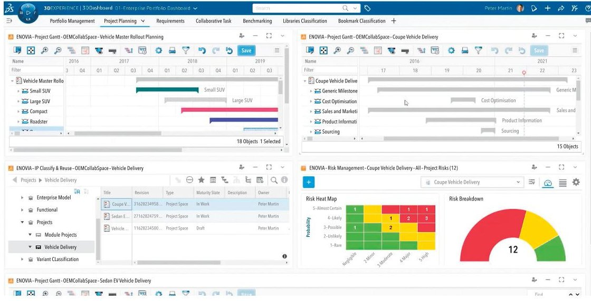

Figure 1. 3DEXPERIENCE program excellence for collaborative program planning and development

between R&D,production,and end users: feedback on the usability feasibility, and manufacturability of new products or solutions is obtained early. This can help identify potential issues early on, reducing the risk of costly mistakes during production or user deployment.

Use of collaboration tools can help geographically distributed teams work together effectively, which may include project management software, social communication tools, and shared modelling environments. An example is the Dassault System's 3DEXPERIENCE platform program excellence solutions in Figure 1, which provide comprehensive enterprise program management,

social collaboration, and a common environment for managing digital artifacts in real time.

2. Early testing and validation: Agile methodologies emphasize early and continuous testing and validation by emphasizing the importance of developing a minimum viable product (MVP) early and iteratively. This means that each iteration of the agile development process should produce a working solution that can be tested and validated. By validating the feasibility and marketability of new products or solutions early in the development process, R&D can reduce the risk of investing in solutions that may not meet customer needs or be successful in the market.

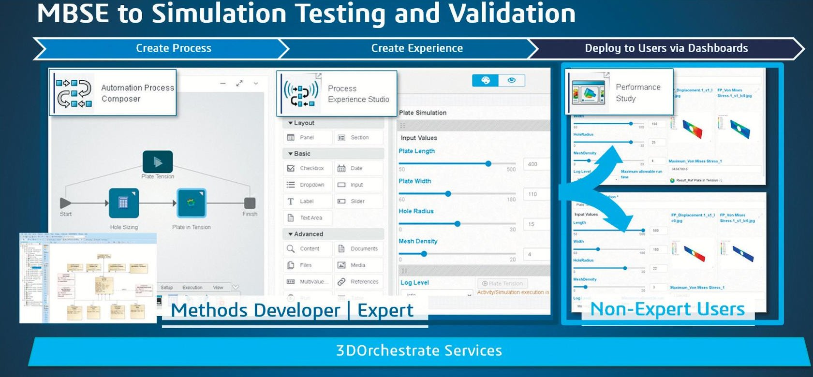

Figure 2. MBSE model as part of integrated MDAO

<!-- PDF_PAGE: 3 -->

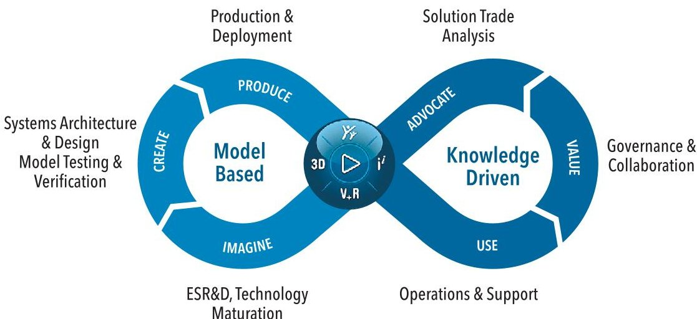

Figure 3. 3DExperience "IFWE"" loop for continuous improvement

This can help ensure that products or solutions are aligned with customer needs and have a better chance of success in the market.

There are several tools available to support continuous integration and continuous testing. These tools typically help automate the testing and validation process, provide real-time feedback on design change impacts on requirements, and improve overall test management and efficiency. An example of an integrated tool suite in 3DEXPERIENCE platform is using Cameo Systems Modeler with SIMULIA Process Composer to conduct multi-domain analysis and optimization (MDAO) illustrated as Figure 2.

3. Continuous improvement: Agile methodologies encourage a culture of continuous improvement. By delivering validated working solutions early and often, teams can gather feedback from customers and stakeholders and make adjustments as needed. By regularly reflecting on project outcomes and processes, teams can identify opportunities for improvement and make adjustments to reduce waste, increase efficiency, and improve product or solution quality.

Agile project management tools and retrospective tools can help teams visualize the development process, identify bottlenecks and gather feedback for improvement. An example is the 3DEXPERIENCE IFWE loop in Figure 3, which is a collaboration framework and tool to enable everyone involved in an innovation project - from the research lab to the factory to the consumer - to interact and work together. As a result, it empowers innovators to design and test consumer experiences, from the idea

to market delivery and usage, before actually producing them.

Agile methodology is a customer-focused, collaborative approach to development that prioritizes flexibility, responsiveness, and delivering working solutions quickly and frequently. Although agile methodology originated in the software development industry, it can be applied to ESR&D to increase speed to market while decreasing the risk of "valley of death".

## ARCHITECTURE ENABLERS

cal/solution as shown in Figure 4:

Systems engineering typically defines and uses three primary types of system architectures: functional, logical, and physi-

Functional architecture is a definition of all the functions necessary to complete the requirements needed for the system to perform. A typical example of this would be through development of use cases and functional requirements.

Logical architecture (LA) comprises system functions that support customer needs, encompassing requirements desired capabilities and high-level operational activities. It ensure design solution flexibility and adaptability by existing independently of and without imposing design decisions. This would typically be allocation of activities within use cases to system logical groupings; the LA shows which logical element performs which functional activity.

Physical/solution architecture is a definition of the physical makeup of the system and align with an engineering or manufacturing bill of materials (EBOM/ MBOM).

While digital enablers can generally expedite aspects of developing and capturing this classical trio of architecture, two key concepts that are digital enablers which can create emergent value are reuse through establishment of a reference architecture (RA), and connected traceability (CT).

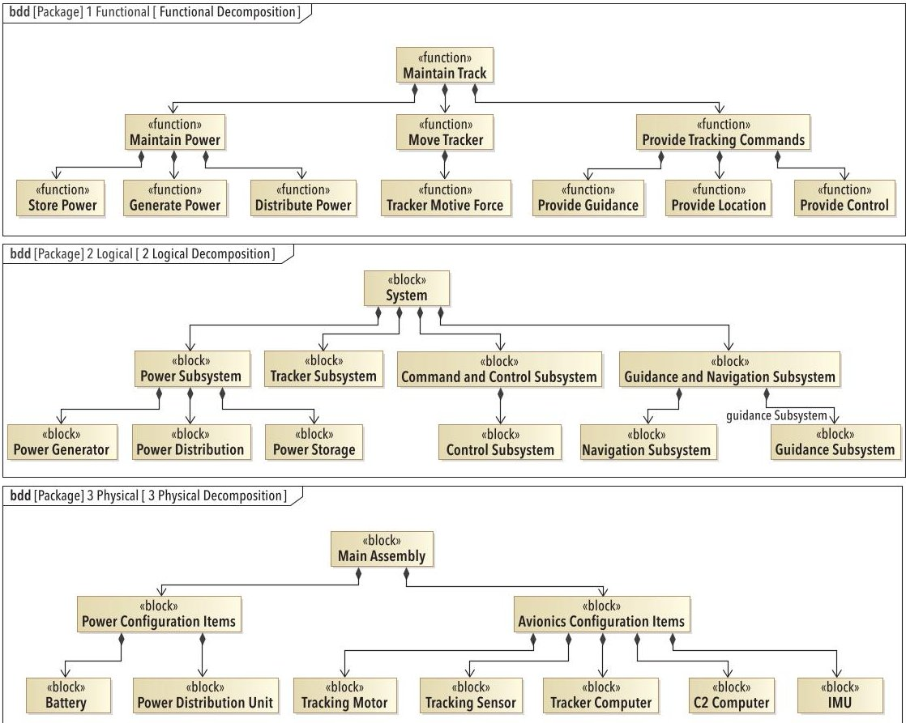

Figure 4. Simple example (top to bottom) of functional, logical, and physical/solution architecture

<!-- PDF_PAGE: 4 -->

## THE REFERENCE ARCHITECTURE

An RA is more commonly known in software; however, the concept is equally applicable to hardware-based or software intensive systems. The key aspect of an RA is that it provides a solution template for an architecture for a particular domain at a particular level of abstraction functional, logical, or physical. The RA is in effect a "previous solution", which generalizes and extracts from previous successful implementations.

RA can be defined at different levels of abstraction. A highly abstract RA might align with functional architecture and a collection of use cases or functions. A mid-level RA might align with a logical architecture and demonstrate the interactions of procedures or methods within a system defined to perform a very specific task. This is effectively using the logical architecture for execution of a use case.

Reference architecture can act as a digital enabler by:

1. Accelerate solution development: A reference architecture provides a starting point for solution development. This can help organizations to accelerate their solution development timelines and reduce time-to-market.

2. Improve solution quality: A reference architecture provides a standardized set of guidelines and best practices for solution development. This can help to improve solution quality and consistency, reducing the risk of errors, and ensuring that solutions are more reliable and maintainable over time.

3. Support interoperability: A reference architecture helps to establish a common language and set of standards for solution development, which can facilitate interoperability and integration between different systems. This can help organizations to avoid the development of siloed solutions and achieve greater efficiency and effectiveness across their technology landscape.

4. Enable scalability and flexibility: A reference architecture can help organizations to build solutions that are more scalable and flexible, enabling them to adapt to changing business needs and technology trends over time. This can help organizations to avoid the need for costly and time-consuming re-architecture efforts down the line.

The value for ESR&D is the cost and schedule savings associated with reuse An appropriate reference architecture accelerates delivery through the reuse of an

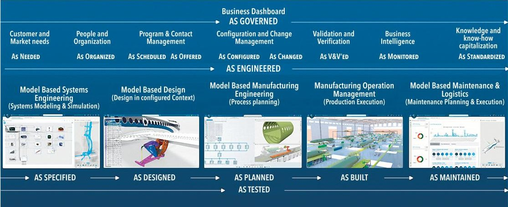

Figure 5. End-to-end digital traceability across system life cycle

effective domain space, and can also enable consistent application of technology use within an organization. For organizations that are new to the idea of adopting DE and MBSE, the challenge usually referenced is that there is significant effort to create the original architecture in the first place; one cannot reuse what one does not have. What is often overlooked, especially in ESR&D environments, is that spending the time to capture information provides the same return on investment (ROI) benefit as doing systems engineering in the first place, with the additional value of refactorable reuse.

There are a variety of tools that can support reference architecture development. These include model-based system architecture tools, which provide a platform for developing and visualizing reference architectures. These tools can be supported by collaboration tools to facilitate joint development with multiple stakeholders and organization, which ensure all parties are aligned to the architecture goals and objectives. Simulation tools can also be used with system architecture tools to simulate

the behavior of the reference architecture and test different use case scenarios. This provides early validation of the reference architecture and identify potential issues before implementation. Lastly, integration of a requirement tool with the system architecture tool helps ensure that the reference architecture aligns with stakeholder requirements.

## END-TO-END DIGITAL TRACEABILITY

Digital engineering implementation is characterized by the use of data and models throughout the system engineering lifecycle. As an organization increases its adoption of models and digital technologies, 72% of companies reported that data volumes are growing faster than their ability to manage them (MarketPulse Research by Foundry Research Services 2023). As a result, 64% of companies rank implementation of a data governance program their top objectives to achieve business value from data. There is also cultural resistance to data sharing, with more than 50% of companies indicating their functional departments are hesitant to

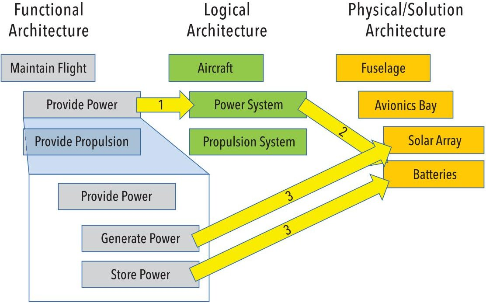

Figure 6. Architecture relationships

<!-- PDF_PAGE: 5 -->

<table border="1"><tr><td rowspan="2">Legend
Allocate
Allocate (Implied)</td><td colspan="10">3 Physical</td></tr><tr><td colspan="10">Solution Architecture</td></tr><tr><td>2 Logical</td><td></td><td>7</td><td>4</td><td>4</td><td>5</td><td>11</td><td>5</td><td>3</td><td>2</td><td>2</td><td>2</td></tr><tr><td>Commmand and Control Subsystem</td><td>4</td><td></td><td></td><td></td><td></td><td></td><td></td><td></td><td></td><td></td><td></td></tr><tr><td>Control Subsystem</td><td>3</td><td></td><td></td><td></td><td></td><td></td><td></td><td></td><td></td><td></td><td></td></tr><tr><td>Guidance and Navigation Subsystem</td><td>4</td><td></td><td></td><td></td><td></td><td></td><td></td><td></td><td></td><td></td><td></td></tr><tr><td>Guidance Subsystem</td><td>3</td><td></td><td></td><td></td><td></td><td></td><td></td><td></td><td></td><td></td><td></td></tr><tr><td>Navigation Subsystem</td><td>3</td><td></td><td></td><td></td><td></td><td></td><td></td><td></td><td></td><td></td><td></td></tr><tr><td>Power Distribution</td><td>3</td><td></td><td></td><td></td><td></td><td></td><td></td><td></td><td></td><td></td><td></td></tr><tr><td>Power Generator</td><td>3</td><td></td><td></td><td></td><td></td><td></td><td></td><td></td><td></td><td></td><td></td></tr><tr><td>Power Storage</td><td>3</td><td></td><td></td><td></td><td></td><td></td><td></td><td></td><td></td><td></td><td></td></tr><tr><td>Power Subsystem</td><td>4</td><td></td><td></td><td></td><td></td><td></td><td></td><td></td><td></td><td></td><td></td></tr><tr><td>System</td><td>10</td><td></td><td></td><td></td><td></td><td></td><td></td><td></td><td></td><td></td><td></td></tr><tr><td>Tracker Subsystem</td><td>5</td><td></td><td></td><td></td><td></td><td></td><td></td><td></td><td></td><td></td><td></td></tr></table>

Figure 7. Logical to physical allocation

break down silos and share data across the enterprise. The causes of cultural resistance can be attributed to conventional practices that values individual achievement and fosters the reporting of work after it is finished. This cultural practice limits the realization of the full value of digital engineering, as it encourages functional teams to manage pieces of information from their engineering domain without considering its logical interdependencies until late in its development.

End-to-end digital traceability, as illustrated in Figure 5, seeks to eliminate siloed development by integrating models and data across functional domains and system development lifecycle. Digital traceability formalizes the link between business needs and product development, allowing companies to evaluate promising research with potential market-fit. The connected data model assists stakeholders in exploring and qualifying options, leading to informed actionable decisions. Moreover, end-to-end digital traceability is a key enabler for effective agile execution according to 58% of respondents in the 2022 State of Agile Survey (Digital.ai.2022). Digital traceability enable efficient information and knowledge management, by increasing the visibility of data and facilitate multi-disciplinary collaboration and innovation.

## ARCHITECTURAL RELATIONSHIPS

Consider the common approach of "document centric engineering" to determine and convey traceability between levels of architecture as illustrated on Figure 6.

Engineering effort is made to allocate

function to logical architecture to solution, and eventually to procurement items. In document-centric engineering, the effort is made but is only usable when processed visually by an engineer as a "human-in-the-

loop." In a digital ecosystem utilizing MBSE and other tools, these tools not only guide a methodology, but also capture relevant metadata. This metadata supports model-based analytical metrics, enabling an understanding of the complete context for the solution space and establishing a definition of done. Once the logical architecture is established, allocations captured in digital enablers, shown in Figure 7, represent the design implementation of the logical architecture element. This also enables early identification of commonality as well as solution gaps.

## DESIGN AND TRADE SPACE

The transition from logical to solution architecture is the node point for trade space exploration, enabling a key system engineering capability of basing design decisions on data for cost implications. The same nodes shown on Figure 8 also enable identification of trades for future proofing and impacted/ allocated systems. This is a critical consideration for ESR&D, particularly when future capability growth considerations are critical to advance beyond an MVP without necessitating a complete redesign.

## EARLY DESIGN CONCEPT VALIDATION

A digitally enabled engineering space provides a linked and traced solution

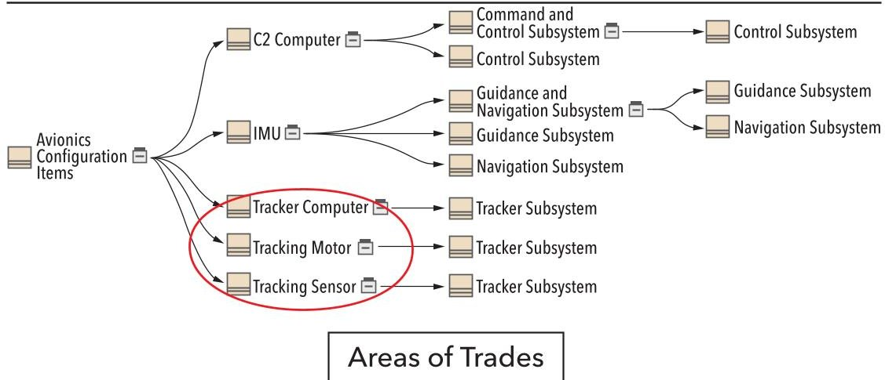

Figure 8. Logical to solution architecture allocation

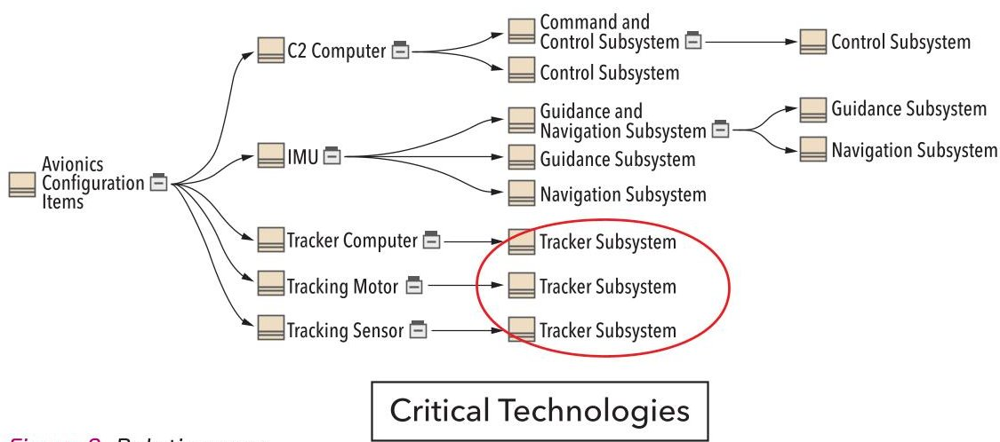

Figure 9. Relation map

<!-- PDF_PAGE: 6 -->

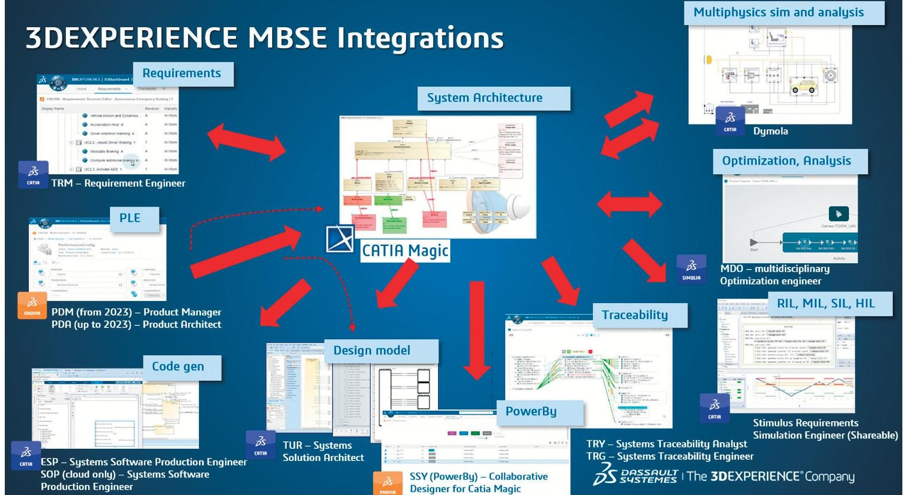

Figure 10. MBSE integration and traceability within DE ecosystem

architecture, which can be used to assess technology and business risk areas for the design. The digital model simultaneously contains both the broad logical architecture and the key design aspects of the solution architecture enabling one to "deep dive into the detailed design while maintaining connectivity to the higher-level architecture. Critical technologies and vertical cuts through the design space are visible and the aforementioned model reuse enables architecture maturation across programs, including early assessments of critical elements and reuse (Figure 9). The human-in-the-loop is required to assign criticality where additional information or elaboration in engineering/design space is required, for example, an architecture risk reduction prototype, or a safety critical item.

## ECOSYSTEM CONNECTIONS: TRACEABILITY

Traceability is the formal identification of the relations between engineering artifacts, rationale for design choices and constraints, or provenance of information associated with engineering artifacts, and is a primary method used to tame the complexity of modern systems. End-to-end digital traceability is becoming increasingly important in engineering, particularly in industries such as aerospace, automotive, and medical devices, where safety and regulatory compliance are critical. Traceability is mandated for compliance in all safety-related processes: DO-178,

DO-254, ISO 26262, IEC 61508, and derivatives.

By providing a complete digital record of the product lifecycle, end-to-end digital traceability can help organizations to:

1. Ensure product quality: By capturing and linking all data and information generated throughout the product lifecycle, end-to-end digital traceability can help to ensure that products meet quality standards and regulatory requirements.

2. Improve efficiency and reduce costs: End-to-end digital traceability can help to identify inefficiencies and bottlenecks in the product lifecycle, allowing organizations to streamline their processes and reduce costs. By analyzing data trends throughout the product lifecycle, end-to-end digital traceability can identify patterns and correlations that may indicate inefficiencies. For example, if a particular test phase consistently takes longer than expected, this may indicate a problem that can be addressed. End-to-end digital traceability can provide valuable insights for continuous improvement efforts, helping organizations to identify areas for optimization and innovation.

digital traceability can help to facilitate collaboration between different teams and stakeholders, improving communication, facilitate knowledge management and reducing the risk of errors from having different records in disconnected systems.

3. Shared authoritative source of truth: By providing a shared digital record of the product lifecycle, end-to-end

The ecosystem connections of traceability enable our understanding of complex system relationships, and thereby increase the speed and improve the quality when a project needs to respond to change. An impact analysis conducted in a connected engineering ecosystem identifies the parts of the engineering effort that may need to be changed in order to respond to a requested or mandated change. This is above and beyond a simple "where used" in a product lifecycle management (PLM) repository where product design models are stored and managed, as seen in Figure 10.

Traceability between systems modeling lanuage (SysML) model elements is illustrated on Figure 11. Note that stereotypes are used in the model for common systems engineering artifacts of: risks, technical performance measures (TPM), and hardware configuration items (HWCI).

The real emergent value of a digital approach is when we extend relationships to elements that are outside of the SysML model repository. Most SysML tools available today provide an application programming interface (API) which

<!-- PDF_PAGE: 7 -->

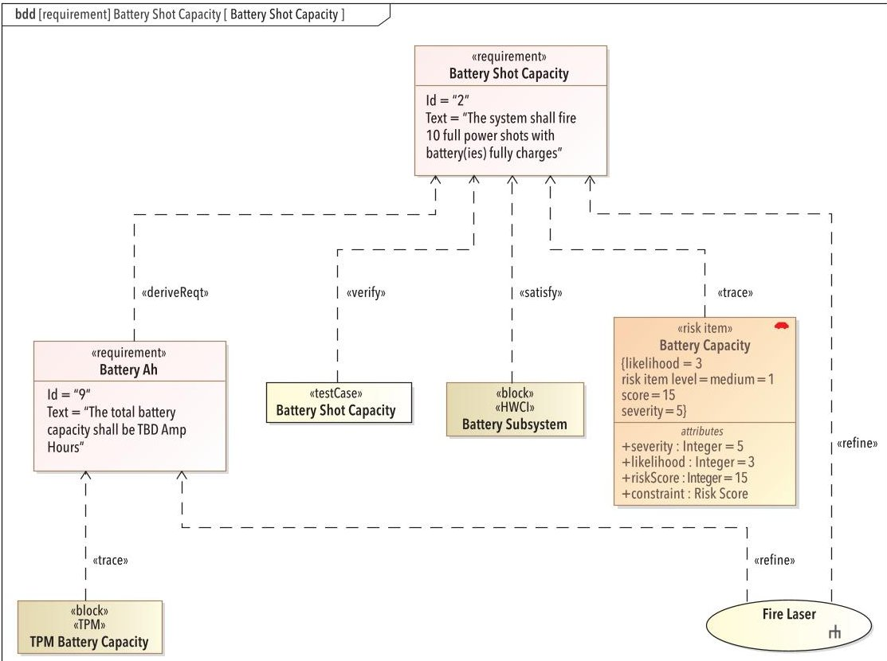

Figure 11. Example of requirement-centric traceability

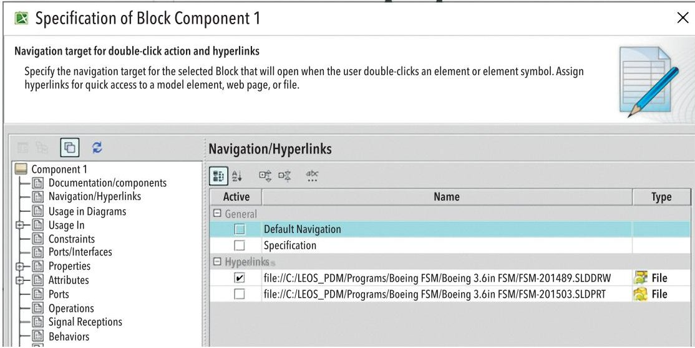

Figure 12. Built-in hyperlink navigation

can be used for connectivity to external repositories. Some tools provide specific tool extensions or interfaces to other tools. For ESR&D, a relatively simple and low-cost approach could even leverage for example, a basic URL hyperlink provided interface that connects model elements with files, documents, or other tool elements through an API such as URLs or JavaScript. The example shown on Figure 12 is from Dassault Systems' Cameo System Modeler, where a model element specification can include a URL to connect the element to an external item. The URL can be a file location, web address, or in the case illustrated, a file URL from a SOLIDWORKS PDM installation.

Traceability can be achieved in both directions with our current tool example

because the Cameo tool also provides a model element URL which can be used in an external repository. If ESR&D is equated to a lower level of rigor, then an overly elaborate engineering tool environment is not required. If primary tools are chosen which at minimum enable/provide URL information both into and out of the respective repositories, then traceability can be established and maintained relatively easily. There is a need for an appropriate level of rigor from a configuration management perspective, which is supported and enabled by the traceability of the previously discussed impact analysis of connected artifacts.

specific needs of the organization and the system being developed. End-to-end digital traceability can be achieved by utilizing a platform to connect and integrate various applications that collect and store data throughout the product's lifecycle. Here are some steps to connect the tools to enable end-to-end digital traceability:

There are a wide variety of tools that can support end to end digital traceability. The use of specific tools will depend on the

1. Identify the enabling capabilities needed to support the development of the system of interest, then identify tools and systems that are involved in the system's lifecycle. This may include tools for product design, development, testing, manufacturing, supply chain management, and customer support.

2. Determine the data that needs to be collected and stored in each tool and system. This may include data such as product specifications, requirements, test results, manufacturing parameters, and customer feedback. Developing a data reference architecture enables digital traceability by providing a blueprint for organizing and managing data across the system lifecycle. A data reference architecture defines the data requirements, data flows, data models, and data management processes needed to ensure that data is accurate, complete, and consistent.

3. Create data integration points between the different tools and systems. This may involve setting up a central integration platform such as 3DEXPERIENCE, or leveraging APIs and other methods of exchanging and transforming data between systems. Using a data reference architecture provide a standard framework for data interoperability requirements between different systems and tools, reducing the risk of large data integration between systems.

4. Establish data governance policies to ensure the accuracy, completeness, and consistency of the data across all the tools and systems. This may include continuous testing and monitoring of data quality requirements and standards, ensuring that data is accurate, complete, and consistent. It includes considerations for security requirements and standards, ensuring that data is protected from unauthorized access or tampering. Integrated analytics and visualization tools can enable stakeholders to analyze and understand the data throughout the product lifecycle. This ensures that data can be trusted and relied upon.

<!-- PDF_PAGE: 8 -->

Traceability from SysML Model Elements to Physical Components & Artifacts, Visualization of EBOM and Models

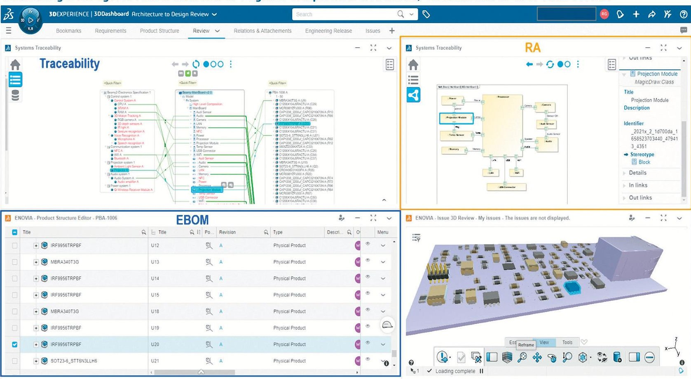

Figure 13. RA model traceability to design and EBOM

## MODEL-BASED DESIGN AND MANUFACTURING

The emergent value of digital enablers for ESR&D for model-based design and manufacturing is an extension of traceability. When ESR&D and systems engineering is disconnected from manufacturing, it results in a siloed work environment that exacerbates quality issues such as compromised product manufacturability, increased defects and rework cycles, and escalated cost. This is often a consequence of designing the system before fully understanding the requirements, driving engineering to a "procurement architecture" approach. A procurement item, in this context, refers to a tangible object that is either procured or manufactured. From an ESR&D perspective, what is needed for effective use of any architecture is connection with traceability from the procurement architecture, through a logical architecture, to the functional architecture, and vice-verse. The benefits of digital traceability continue into use of a procurement and manufacturing architecture. With a model-based approach, a model, or an RA that has been extended, can be mapped from system engineering to physical design models, and to engineering bill of materials (EBOM) for procurement, as illustrated in Figure 13.

Additive manufacturing (AM) programs are an example of pioneering the establishment of agile/digital supply chains in the US Air Force (USAF). AM, or 3D printing, uses computer-generated designs to create 3D objects layer-by-layer, making it an additive process. It has the unique value of generating physical components directly from design models without special tooling requirements, which reduces the need for spare-part inventories by enabling on-demand product of items from digital models in operation environments (Mckinsey 2022). ESR&D were the early adopters of AM due to its potential for rapid prototyping and experimentation opportunities. At the implementation level, lingering perceptions around cost and speed limitations have slowed adoption beyond prototyping applications. Digital enablers can be used to leverage domain expertise to identify,

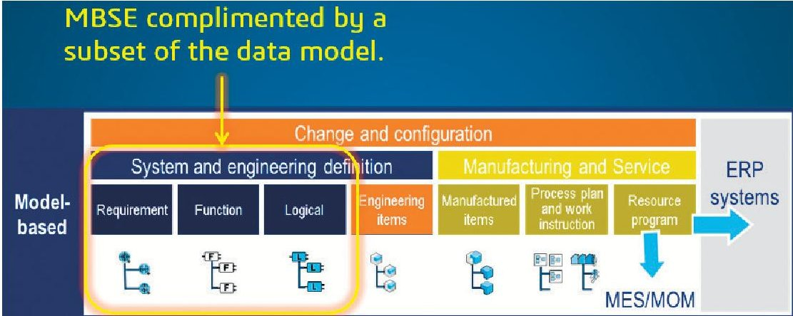

Figure 14. MBSE data model traceability to manufacturing data model

analyze, and prototype components suitable for AM. As an integrated approach with model-based design, digital techniques drive innovative and rigorous process including data mining, 3D model-based technical data creation, engineering analysis, and digital sustainment.

To enable successful implementation of AM, an end-to-end digital approach, shown in Figure 14, is required to implement a modernized supply chain, through the digitalization of previously mechanical processes. From developing digital twins with model-based engineering to integrating artificial intelligence and machine learning, methods can inject model-based verification early in the process, expediting ESR&D through more complete testing and qualification from the outset. Components

<!-- PDF_PAGE: 9 -->

entering the supply chain as prototype or production parts do so with the necessary standards and certifications to ensure their suitability against requirements and measures of effectiveness (MOE).

## SUMMARY RECOMMENDATIONS

Digital engineering can enable ESR&D by providing tools and techniques to model, simulate, and analyze complex systems and phenomena, and by enabling more efficient and effective collaboration between researchers and developers. From startups to large enterprise, digital ecosystem brings previously siloed organizations together and create emergent value by leveraging the network effects of collaboration and knowledge sharing. Metcalfe's law,

popularized by Ethernet pioneer Robert Metcalfe, states that the value of a network to its users grows as the square of the total number of its connected users $ \mathrm{n^{2}} $ (Wikipedia). Therefore, each member of the digital ecosystem adds emergent value to the business. When fully implemented, the digital ecosystem enables a positive virtuous cycle where each additional model connection enables more sophisticated analytics, which generates more value for all participants in the ecosystem.

When system engineering extends its architecture models outside of the SysML model repository, it creates linked connections that generates emergent value. The end-to-end digital ecosystem traceability enable our understanding of

complex system relationships, and thereby increase the speed and improve the quality when a project needs to respond to change. This framework for digital engineering emphasizes the use of models and digital enablers across the lifecycle, facilitating the development of solutions to problems associated with complexity, uncertainty, and rapid change in deploying and using concepts and products. It provides a more agile and responsive development environment, better informed decision making, enhanced communication, increased understanding of and confidence in the system design, and a more efficient engineering process.

## REFERENCES

- Beck, K., et al. 2001. The Agile Manifesto. Agile Alliance. Viewed 14 April 2023, https://www.agilealliance.org/agile101/the-agile-manifesto/.

- MarketPulse Research by Foundry Research Services. 2023. The Path to Digital Transformation: Where Leaders Stand in 2023. Viewed 14 April 2023 https://solutions.insight.com/ StateofInnovation.

- Digital.ai. 2022. 16th State of Agile Report. Viewed 14 April 2023. https://info.digital.ai/rs/981-LQX-968/images/AR-SA-2022- 16th-Annual-State-Of-Agile-Report.pdf.

- Mckinsey. 2022 The mainstreaming of additive manufacturing. Viewed 23 May 2023. Future now: 3D printing moves from prototyping to production | McKinsey.

- Wikipedia. Metcalfe's Law. Viewed 19 May 2023. https:// en.wikipedia.org/wiki/Metcalfe%27s_law.

## ABOUT THE AUTHORS

Arno Granados is a senior principal model-based systems engineer with Strategic Technologies Consulting (STC). Arno's career has included roles in scientific research, software engineering, systems engineering, and engineering management. His domain experience includes research astronomy; ground based, airborne, and space-based imaging systems; and UAS,

missile systems, directed energy weapon systems, autonomy, and system-of-systems. His systems engineering perspective has been developed through hands-on work in R&D and production environments, across defense, commercial, and academic domains. Arno was a user of SDL and OML variants before UML and later SysML were established. He is an evangelist for "digital engineering" and participates in the NDIA/INCOSE Digital Engineering Information Exchange working group (DEIX-WG). While his career has morphed from science, to engineering, to management, he is fundamentally driven by a desire to explore and discover.

Celia Tseng is the director of transformation accounts at Dassault Systems, with 19 years of systems engineering experience in aerospace and defense from Raytheon Technologies, Lockheed Martin, and SAIC. Celia is a deputy chair of the joint INCOSE/ NDIA/OMG Digital Engineering Information Exchange Working Group and INCOSE standards convener in ISO/IEC JC 7/AHG 6 Digital Engineering standardization. She has a Master's degree in systems engineering from Cornell University and is a certified systems engineering professional (INCOSE CSEP), certified system modeling professional (OMG OCSMP), and certified agile scrum master (SAFe).