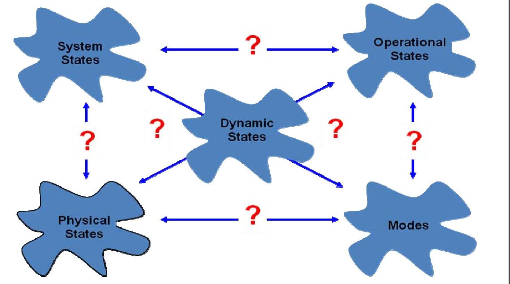
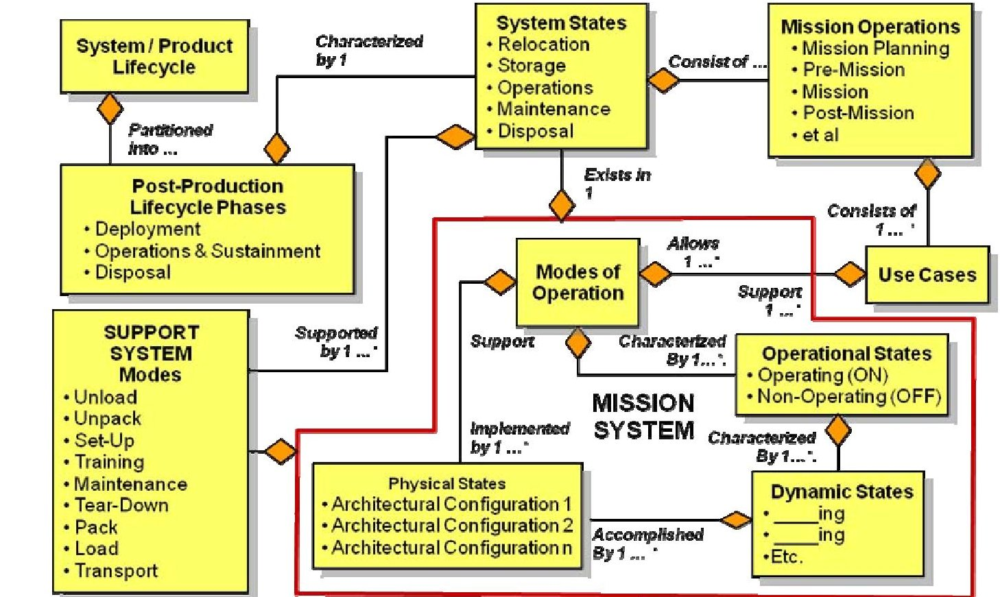
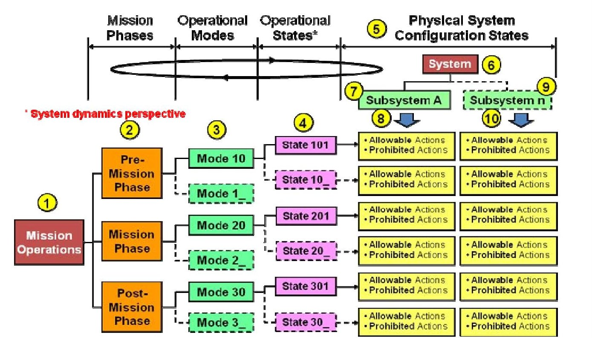
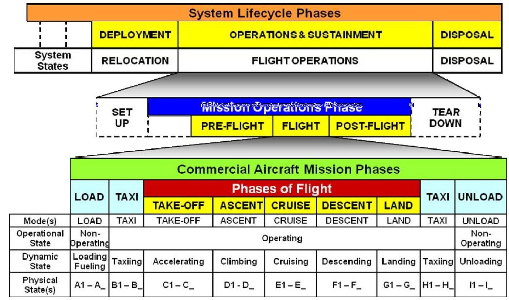
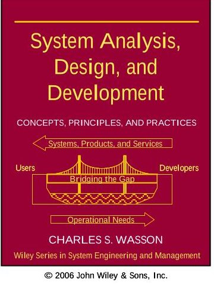

<!-- PDF_PAGE: 1 -->

# System Phases, Modes, and States Solutions to Controversial Issues

Charles S. Wasson

Wasson Strategics, LLC

wslse@cpws.net

http://www.wassonstrategics.com

Copyright © 2010 by Charles S. Wasson, Wasson Strategics, LLC All Rights Reserved

Published and used by INCOSE with permission.

Abstract. System phases, modes, and states are often one of the most controversial concepts in System Engineering due to a lack of standards for implementation. Yet, the topic serves as one of the most critical guiding principles of System Engineering: Decompose system complexity into manageable levels and entities with acceptable risk that lead to optimal system design solutions.

Four issues contribute to the challenges of implementing system phases, modes, and states:

- Issue #1- Definitions of "mode(s)" and a "state(s)"

- Issue #2 - Do "modes" contain "states" or do "states" contain "modes"?

- Issue #3 - Should specifications specify "modes and states"?

- Issue #4 - Should specifications flow down "modes and states"?

To address these four issues, this paper provides a statement of the problem, identifies sources of the problem, provides clarifying definitions, and provides illustrative examples of "modes" and "states". Building on the foundational definitions, the paper explores the entity relationships (ERs) between phases, modes, and states and how they can be employed as a problem solving-solution development framework to identify and link system phases of operation, modes, use cases, various types of states to the system architecture.

This paper proposes that due to the abstractness and understanding of the term "state", communications among engineers becomes confusing and conflicting. Investigation and analysis of this reveals that "states" have at least four contexts of usage: 1) organizational or logistical employment of a system as an asset-i.e., System States, 2) the operating condition of a system-i.e. Operational States, 3) the time and operating environment-dependent dynamics of a system-i.e., Dynamic States, and 4) the physical arrangement of architectural capabilities to achieve performance-based outcomes-i.e., Physical Configuration States.

Based on a solution to Issues #1 and #2 that fuel the controversy, the paper addresses the final two issues-i.e., Issues #3 and #4 - concerning specifying and flowing down "modes and states" in specifications. We conclude with a summary of recommendations concerning the four issues and provide suggestions for effective SE leadership to lead, apply, and orchestrate the concept of system phases, modes, and states.

<!-- PDF_PAGE: 2 -->

## 1. Introduction

System developers and engineers often have the misperception that the System Engineering (SE) paradigm consists of: 1) identification and decomposition of capabilities (function-based performance), 2) selection an optimal architecture from a set of viable candidates, and 3) derivation and allocation of capability-based performance requirements to architectural elements. Conceptually, this is true; however, these steps ignore critical decisions concerning the development of the system's architecture. Specifically, how the capabilities will be configured architecturally to enable the User to safely employ integrated sets of capabilities constrained by allowable and prohibited actions to safely perform mission tasks to achieve performance-based outcomes.

Due to a lack of professional standards guidance concerning solutions to the four issues, controversies emerge when acquirers and developers take positions concerning two primary issues: 1) what is the difference between a "mode" and a "state" and 2) do "states contain modes" and or do "modes contain states." As a result, developers tend to avoid the controversies by ignoring application of the concept or treat it as a perfunctory activity to satisfy visual presentations and operator manuals. The reality is system phases, modes, and states are a critical activity in translating the user's vision into the physical realization of the system.

Organizationally, engineers, managers, and others often incorrectly interchange Modes with States without understanding their true meaning and proper application. System engineering standards often fail to address the topic or simply provide token references to the terms. The problem is exacerbated by untrained engineers who attempt to specify Modes & States .. "because a specification outline suggested it."

When definitive guidance via standards and education are missing, humans naturally learn "buzzwords" and sometimes improperly interchange them without understanding their true meaning or application. To illustrate this point, the Internet reveals that numerous web sites and postings use "mode" or "state" to define the other term-i.e., circular references. In one example, the web site noted that a system had "... X States ..." and the first two states contained Mode within the label.

When System Engineering education, training, leadership, and organizational guidance are missing or weak, system development activities are often ad hoc and inefficiently waste critical project resources and time. Project teams and team members become mired in controversy due to misguided / inexperienced leadership concerning how to conceptualize, structure, and employ system phases, modes, and states to identify a system's performance-based capability requirements. Modes & States are often determined by the dominance of personalities who may or may not be qualified to address the topic.

This leads to the need to identify a Statement of the Problem that INCOSE as a professional organization needs to address and solve.

## 1.1 Statement of the Problem

System development activities often inefficiently waste critical project resources and ineffectively architect systems due to a lack of knowledge in how to properly apply system phases, modes, and states of operation.

<!-- PDF_PAGE: 3 -->

## 1.2 Central Issues

Investigation of the problem space above and analysis the condition, we discover there are four central issues that contribute to the problem:

- Issue #1 - What is the difference between a "mode" and a "state"?

- Issue #2 - Do "modes" contain "states" or do "states" contain "modes"?

- Issue #3 - Should specifications specify "modes and states" requirements?

- Issue #4 - Should specifications flow down "modes and states"?

Figure 1: The Phases, Modes, and States conundrum

## 1.3 Sources of the Problem

Root cause analysis of these issues reveals deficiencies in organizational and individual knowledge about phases, modes, & states is influenced by several factors:

- Lack of explicit definitions by standards.

- Lack of organizational standard processes (OSPs).

- Inadequate SE education and training in academic and corporate domains.

- Weak organizational management, technical leadership, and team leaders who can efficiently and effectively lead system development teams through the challenges of defining system phases, modes, and states.

To illustrate these contributions, consider the following example. Due to a lack of standards, organizational viewpoints evolved from early guidance about Modes & States via US Department of Defense (DoD) military standards, handbooks, and Data Item Descriptions (DIDs); trial and error, et al methods. Unfortunately, policy guidance, which was often vague, failed to provide explicit definitions and directions. MIL-STD-498B (Cancelled) Data Item Description DI-IPSC-81431A [1] provided the following guidance:

<!-- PDF_PAGE: 4 -->

"The distinction between states and modes is arbitrary. A system may be described in terms of states only, modes only, states within modes, modes within states, or any other scheme that is useful."

As a result, differences and inconsistencies in viewpoints about Modes & States occurred among system developers and subcontractors, projects across system developer organizations, as well as teams and team members within system developer projects.

## 1.4 Definitions of Key Terms

Mode - An abstract label applied to a user (UML $ ^{\mathrm{TM}} $ Actor) selectable option that enables a set of use case-based system capabilities to be employed in conjunction with organizational processes and procedures to command and control (C2) a system, product, or service to achieve a specified set of mission objectives, outcomes, and levels of performance. Triggering events serve as entry and exit criteria for transitioning into and out of a mode. Modes can have sub-modes.

Phase - A designation applied to segments of the System / Product Life Cycle or Mission Lifecycle of a system, product-e.g., Pre-Mission, Mission, or Post-Mission. Phases may consist of sub-phases-e.g., an aircraft's Mission Phase of operations may be partitioned into Phases of Flight (subphases) such as take-off, ascent, cruise, or land.

State - An attribute used to characterize the current logistical status or performance-based condition of a system, product, or service or system components at the element, subsystem, assembly, subassembly, etc. levels of abstraction. In general, "states" are observable, measurable, verifiable, and have four contexts:

- System State - An attribute that indicates the logistical employment, availability, or status of an organizational asset such as a system, product, or service. For example: (in) Storage; (in) Relocation; (in) Distribution, (in) Operation or (in) Service - e.g., In Flight; (in) Maintenance, (in) Disposal.

- Operational State - An attribute that indicates if a system or product is active or inactive - e.g., operational / operating (ON) or non-operating (OFF).

- Dynamic State - An attribute that characterizes the time-dependent rate of change - e.g., attitude, motion, or performance - of a system or product relative to a frame of reference and prescribed operating environment and conditions. Dynamic States typically end in "ing" suffix - e.g., initializing, melting, landing, accelerating, etc.

- Physical State - An attribute that characterizes the physical arrangement i.e., configuration - of a system, product, or service's architecture that provides the essential, use case-based capabilities required to support achievement of one or more Mode-based objectives and level of performance.

System - An integrated set of interoperable elements, each with explicitly specified and bounded capabilities, working synergistically to perform value-added processing to enable a User to satisfy mission-oriented operational needs in a prescribed operating environment with a specified outcome and probability of success. [2]

<!-- PDF_PAGE: 5 -->

## Published and used by INCOSE with permission

System Element - A label applied to classes of entities that comprise the System of Interest (SOI) architectural framework. For example, an SOI MISSION SYSTEM may be comprised of the following EQUIPMENT Element - e.g., hardware, software, and/or courseware; PERSONNEL Element; MISSION RESOURCES Element - e.g., mission data; PROCEDURAL DATA Element; and SYSTEM RESPONSES Element. The SOI's SUPPORT SYSTEM typically includes these five System Elements plus a FACILITIES Element. Refer to Wasson [3] Chapter 10 for a description.

## 2. Issue #1- What is the Difference Between a "Mode" and a "State"

One of the challenging ambiguities SEs face is addressing the issue: Do Modes contain States or do States contain Modes? Contextually, as we shall illustrate, both responses are correct? You may ask: How can this be the case ... it is either one of the other. How can this answer be rationalized? By inspection, the way the question is worded, only one of these statements appears to be TRUE. However, as we shall discover in Figure 2, Modes support and have entity relationships (ERs) with higher level System States; Operational, Dynamic, and Physical States support and have ERs with higher level Modes. To address this issue, let's explore the definition and relationships of "States" and "Modes".

## What is a "State" of Operation?

We often hear abstract references such as state of operation(s), state of affairs, safe state, failed state, physical state. However, what identifiable characteristics enable us to apply the label "state" to what we observe? To better understand the definition of "state", let's survey definitions from various technical and reference sources as shown in Table 1.

Table 1: Survey of References Definitions for "State"

<table border="1"><tr><td>Source</td><td>Definition</td></tr><tr><td>INCOSE Handbook v3.2[4]</td><td>No definition provided.</td></tr><tr><td>Wasson[5]</td><td>State-The operational or operating condition of a SYSTEM OF INTEREST(SOI)required to safely conduct or continue its mission.</td></tr><tr><td>IEEE 610.12-1990[6]</td><td>State-“A condition or mode of existence that a system, component,or simulation may be in;for example,the pre-flight state of an aircraft navigation program or the input state of given channel.”</td></tr><tr><td>SMC System Engineering Primer &amp; Handbook[7]</td><td>State-“The condition of a system or subsystem when specific modes or capabilities (or functions) are valid.The document provides the following examples:“Off,Start-up,Ready On, Deployed,Stored,In-Flight,etc.”</td></tr></table>

<!-- PDF_PAGE: 6 -->

Published and used by INCOSE with permission

<table border="1"><tr><td>Source</td><td>Definition</td></tr><tr><td>Buede[8]</td><td>State-“The state of a system is commonly defined to be a static snapshot of the set of metrics needed to describe fully the system&#x27;s capabilities to perform the system&#x27;s functions.The system is progressing through a constantly changing series of state as time progresses.”</td></tr><tr><td>Unmanned Systems Safety Guide[9]</td><td>State-States identify conditions in which a system or subsystem can exist...A system or subsystem may be in only one state at a time.States are unique and may be binary(i.e.,they are either true or not true)...A state is a subset of a mode.”</td></tr></table>

Observe that the: 1) IEEE 610.12-1990 [6] definition of "state" incorporates "mode" into its definition of "state-i.e., a circular reference - and 2) the Unmanned Systems Safety Guide [9] defines "state" as a "subset of a mode."

Analysis of the set of definitions above indicate one term that is common to all-i.e., "condition." Thus, the operative term "condition" serves as a cornerstone for formulating and developing a general "state" definition defined in Section 1.4 Definitions of Key Terms. "States" also have another distinguishable characteristic; they are observable, measurable, and verifiable.

In summary, this paper defines a "state" as an attribute used to characterize the current logistical status or performance-based condition of a system, product, or service or system components at the element, subsystem, assembly, subassembly, etc. levels of abstraction.

## What Is a "Mode" of Operation?

In casual conversation, we often hear abstract references phrases such as: Mode of Transportation, Print Mode, Autonomous Operations Mode, Manual Operations Mode, Maintenance Mode, Calibration Mode, Failure Mode, Training Mode, etc. The root question is: what are the unique characteristics of a system that enable us to apply the term "mode"? Let's first investigate how various sources view definition of a "mode." Table 2 provides a survey of "mode" definitions from various sources.

Table 2: Survey of Definitions for "Mode"

<table border="1"><tr><td>Source</td><td>Definition</td></tr><tr><td>INCOSE Handbook v3.2[4]</td><td>Mode-No definition provided.</td></tr><tr><td>Wasson[10,11]</td><td>Mode of Operation-“An abstract label applied to a collection of system operational capabilities and activities focused on satisfying a specific phase objective.[10]...A Mode of Operation represents a User(Actor) selectable option that requires the integrated HUMAN-MACHINE performance of a set of task sequences that accomplish the phase/sub phase objectives.”[11]</td></tr></table>

<!-- PDF_PAGE: 7 -->

Published and used by INCOSE with permission

<table border="1"><tr><td>Source</td><td>Definition</td></tr><tr><td>SMC System Engineering Primer &amp; Handbook[12]</td><td>Mode-The condition of a system or subsystem in a certain state when specific capabilities (or functions) are valid. Each mode may have different capabilities defined. ...“modes” within the READY state: Normal, Emergency, Surge, Degraded, Reset, etc.</td></tr><tr><td>Unmanned Systems Safety Guide[13]</td><td>Mode-“Modes identify operational segments within the system lifecycle generally defined in the Concept of Operations. ...Modes consist of one or more sub-modes. ...A system may be in only one mode, but may be in more than one sub-mode, at any given time.”</td></tr><tr><td>IEEE 1220 610.12-1990[14]</td><td>Mode-“An operating condition of a function or sub-function or physical element of the system.”</td></tr><tr><td>Buede[15]</td><td>Mode-“A system mode is a distinct operational capability of the system; this capability may use either the full or partial set of the system&#x27;s functions.”</td></tr></table>

Observe that the: 1) SMC System Engineering Primer & Handbook [12] uses "state" as the context to define "mode" and 2) IEEE 1220 610.12-1990 [14] uses "condition", which was the operative term in its "state" definition (Table 1) to define "mode.

In contrast to "states", "modes" are characterized as abstract labels applied to collections of use case capabilities that allow a system or its operators to perform specific tasks accomplish performance-based objectives and outcomes. The abstract collections of capabilities establish boundary conditions for Allowable and Prohibited Actions related to the usage of the system. Whereas "states" are observable, measurable, and verifiable, "modes" are abstract labels. This leads to a question: If "modes" are abstract labels applied to collections of capabilities, which are observable, measurable, and verifiable and characterize "states", then "states" also enable modal outcomes to be achieved. Based on this premise, this paper proposes the "Mode" definition listed in Section 1.4 "Definitions of Key Terms."

In summary, this paper defines a "mode" as an abstract label applied to a user (Actor) selectable option that enables a set of use case-based system capabilities to be employed in conjunction with organizational processes and procedures to command and control (C2) a system, product, or service to achieve a specified set of mission objectives, outcomes, and levels of performance. Triggering events serve as entry and exit criteria for transitioning into and out of a mode. Modes can have submodes.

Given an understanding of the differences between Modes and States, we can proceed with answering Issue #2: Do Modes contain States or do States contain Modes?

## 3. Issue #2: Do Modes contain States or Do States contain Modes?

Based on the preceding discussion that defined and differentiated "mode(s)" and "state(s)", we proceed to Issue #2: Do Modes contain States or do States contain Modes? Contextually, as we shall illustrate, both responses are correct? You may

<!-- PDF_PAGE: 8 -->

ask: How can this be the case ... the correct answer is either one of the other. By inspection, the way the question is worded, only one of these statements appears to be true. How can a "both" answer be rationalized?

As stated in our discussion of sources of the problem, a lack of action by standards and professional organization guidance to define and clarify Modes and States has contributed to the misusage, circular references, and intermixing of the terms. Solving Issue #2 requires establishing an entity relationship (ER) framework to express these relationships. Figure 2 provides an ER framework for understanding and navigating these relationships.

Figure 2: The system developer's modes & states conundrum.

## Understanding the Context of "States" of Operation

When organizations and individuals communicate about "states" of operation and fail to provide their frame of reference, we discover they often intermix "modes" and "states." If we analyze the spectrum of terms used by many people to characterize "states", we can categorize them from four contexts of usage:

- System State Context - System owners, administrators, and maintainers often employ and track the "state" of an organizational asset-e.g., a system, product, or service - in terms of its logistical employment-i.e., deployment, distribution, or relocation; storage; operation and support; and disposal. For example: a system can be: in Storage; in Distribution, in Deployment or Relocation; in Operation or Maintenance; in Disposal, etc. We designate this context of usage as System States.

- Operational State Context - Engineers and physicists often communicate about "state(s)" relative to the system's operating or non-operating status, availability, and condition in a prescribed operating environment. For example,

<!-- PDF_PAGE: 9 -->

a system is operational (ON) or non-operational (OFF). Since this context concerns system operations, we designate this context of usage as Operational States.

- Dynamic State Context - Engineers and physicists employ engineering statics and dynamics - e.g., 6 Degrees of Freedom (6DOF) - to describe the time-dependent attitude, motion, and performance of a free body in space or fixed body relative to a position or sequential frame of reference, prescribed operating environment, and conditions. Since this context concerns the dynamics of a system, we designate this context of usage as Dynamic States. For example: a battery is charging or discharging; an aircraft is taking off, cruising, landing, etc.; or a car is accelerating, decelerating, stopping; etc. Dynamic States end in "ing" suffix.

- Physical State Context - Engineers and physicists also communicate about "state(s)" with terms that characterize the physical arrangement-i.e., configuration - of multi-level architectural elements of a system, product, or service at a specific instance of time. For example, an aircraft's: landing gear is Up or Down and locked; flaps extended $ 1 5^{\circ} $; cabin doors are Open or Closed and Locked. Since this context concerns the physical configuration of the system and its components, we designate this context of usage as Physical States.

To better understand each of these types of states, let's briefly expand on some of the nuances of the Physical and Operational States.

## Physical States

Physical States characterize the physical architectural configuration of the System of Interest (SOI) or any of its entities at every level of abstraction. Analysis of Physical States reveals that they range from simple to complex.

- Simple Physical States are typically digital. For example: a switch is either in the ON or OFF position, a light is ON or OFF, a door is OPEN or CLOSED, a back-up system is ON or OFF, etc.

- Complex Physical States are typically infinitely variable. For example: a motor shaft rotates at variable speed settings that range from 0 to X revolutions per minute (RPM), the state of charge remaining on a battery varies depending on its load and operating environment conditions, a fuel tank has an infinite number of physical states during fuel consumption or storage.

## Operational States

Operational States are often contentious due to opposing viewpoints based on two (2) perspectives, which are actually interrelated:

- ON / OFF Perspective - Some organizations and individuals view Operational States as simply: On or Off.

- Operating / Non-Operating Perspective - Some organizations and individuals view Operational States as simply: 1) Operating - i.e., operational, 2) Degraded, or 3) non-operating - i.e., non-operational.

<!-- PDF_PAGE: 10 -->

We must also recognize that when the SOI is "Non-Operating", it may be OFF, Inactive or on Standby or Failed. Given that a system failure is defined as being out of tolerance relative to its specified performance, it may actually have Degraded performance and awaiting repairs, calibration, or alignment.

It is important to note that engineers often unknowingly intermix organizational MISSION SYSTEM Modes & States with SUPPORT SYSTEM Modes & States. Wasson [16] Chapter 13 defines and provides a description of the SOI's MISSION SYSTEM and its SUPPORT SYSTEM. He notes that every system performs two contextual roles: 1) a MISSION SYSTEM role - e.g., perform a mission to deliver performance-based products, services, or results - and 2) a SUPPORT SYSTEM role to other systems - e.g., receivers of those products and services.

Referring to the lower left corner of Figure 2, the organization's SUPPORT SYSTEM performs its mission-i.e., Support Operations - to prepare the MISSION SYSTEM to perform its missions. We identify and establish SUPPORT SYSTEM Modes-e.g., Unload, Unpack, Set-Up, Training, Maintenance, Tear-Down, Pack, Load, and Transport operations - that enable the MISSION SYSTEM to perform its missions via its own set of Modes.

Based on the preceding discussions, let's apply system phases, modes, and states to an automobile example and a commercial aircraft example to illustrate application of the Figure 2 entity relationship [ER] framework to resolve Issue #2.

## Automobile Example

Based on the preceding discussion, let's illustrate the Modes and States relationships using a car as an example. Figure 3 [17] provides a framework for our discussion. For simplicity, the car's user (Actor) selectable Modes consist of: PARK, NEUTRAL, REVERSE, and FORWARD.

Figure 3: Reference framework illustrating decomposing mission-based operations into phases, modes, and states.

<!-- PDF_PAGE: 11 -->

Since we defined a "mode" as an abstract label representing a collection of use case-based capabilities, we can state that the FORWARD Mode represents forward motion of the vehicle and consists of Drive, Low 1, and Low 2 representing use casebased capabilities, each of which has Allowable and Prohibited Actions such as speed limitations, power constraints, velocity dependent door locks, etc.

- Vehicle Pre-Mission Operations - Prior to traveling in the car, the driver conducts a Pre-Mission vehicle checkout of the vehicle. This includes visual inspection of tires, identification of leaking fluids, obstacles, etc. On completion of the visual checkout, the driver (Actor) cranks the engine, which enters the Operational State. With the vehicle in the PARK Mode, the driver (actor) monitors the vehicle's status and performance. We can say the vehicle is in the Idling Dynamic State. While the vehicle is idling, the vehicle's Physical State has been designed to constrain Allowable Actions - e.g., capability to increase engine speed, turn the radio ON, etc. - and Prohibited Actions - e.g., capability to preclude moving forward or backward, etc.

- Vehicle Mission Operations - When ready to travel in reverse to leave the parking garage or space, the driver (Actor) shifts (Triggering Event) the vehicle from the PARK Mode to the REVERSE Mode. On entering the REVERSE Mode, the vehicle responds by reconfiguring its architectural configuration - i.e., Physical State - to enable motion in the reverse direction. While in the REVERSE Mode, the driver is constrained by: 1) Allowable Actions - to perform mission tasks such as accelerating, decelerating, or stopping (Operational States) and 2) Prohibited Actions such as forward motion, etc.

- When the driver (Actor) decides to shift (Triggering Event) from the REVERSE Mode to the FORWARD Mode, several use case-based capability options are available: Drive, Low 1, and Low 2. Depending on the option selected, the vehicle responds and reconfigures its architectural configuration - i.e., Physical State - to enable forward motion. While in the FORWARD Mode, the driver is constrained by: 1) Allowable Actions - via the specified Physical State to perform mission tasks such as such as accelerating, decelerating, braking, or stopping - e.g., Operational States and 2) Prohibited Actions such as reverse motion, etc. When the vehicle reaches a threshold velocity (Dynamic State), the vehicle's architectural configuration LOCKS the doors as a safety precaution, an Allowable Action, to prevent passengers from exiting the vehicle, a Prohibited Action.

- Vehicle Post-Mission Operations - On arrival at its destination, the driver (Actor) shifts (Triggering Event) the vehicle from the FORWARD Mode to the PARK Mode, an ALLOWABLE action. The vehicle responds and reconfigures its physical architecture - e.g., engine, gear train, wheels, brakes, door locks, etc. - for the PARK Mode. The driver then turns of the ignition causing the vehicle to be in the Non-Operational State.

In this example, we have illustrated that a MISSION SYSTEM-i.e., car and driver - has mission objectives-i.e., move forward, move backward, stop, etc.- that are accomplished by user (Actor) selectable Modes: PARK, NEUTRAL, REVERSE, or FORWARD. Driver (Actor) selectable triggering events cause modal changes to reconfigure the vehicle's physical architecture configuration - e.g., Physical States-

<!-- PDF_PAGE: 12 -->

Figure 4: Commercial airline phases, modes, and states example

that enable the vehicle to respond to driver inputs - e.g., Allowable and Prohibited actions. As the vehicle's Modes are changed, the vehicle enables the driver (Actor) to perform tasks such as accelerating, decelerating, stopping, etc. (Dynamic States).

## Aircraft Example

To illustrate the overall concept of system phases, modes, and states relationships, consider the aircraft example shown in Figure 4.

The aircraft's system life cycle has been partitioned into Deployment, Operations & Sustainment (O&S), and Disposal Phases. From an organizational perspective, the aircraft may be in the Relocation, Flight Operations, or Disposal System States. During the Flight Operations System State, the airline may configure the aircraft for passenger or cargo missions symbolized by the dashed box. On completion of those activities, the aircraft is placed into active duty service.

On entry into active duty service, the aircraft performs Flight Operations, which are partitioned into Pre-Flight, Flight, and Post-Flight Phases, which are then partitioned into Modes of Operation such as Load, Taxi, Take-Off, etc. each representing sets of use case-based capabilities.

- The Pre-Flight (Pre-Mission) Phase is partitioned into Load and Taxi (to runway) Modes of operation,

- The Flight (Mission) Phase is partitioned into Phases of Flight that provide the basis for Take-Off, Ascent, Cruise, Descent, and Land Modes of operation.

- The Post- Flight (Post-Mission) Phase is partitioned into Taxi (to terminal) and Unload Modes of operation.

<!-- PDF_PAGE: 13 -->

Across the set of Modes of Operation, we characterize the aircraft's Operational States as: Loading, Taxiing, Accelerating, Climbing, Cruising, Descending, Landing, Taxiing, and Unloading. Each Mode is accomplished via the aircraft's various physical architecture configurations, which enable accomplishment of the Operational States performance-based outcomes.

Note: One of the challenges SEs face is establishing when mission operations begin. As indicated by Figure 4, the project has defined the "mission" as encompassing the Flight Phase of Operations. Some projects argue that the "mission" encompasses Pre-Flight, Flight, and Post- Flight operations. Other projects argue that the "mission" begins when the aircraft leaves the terminal and ends when it returns to the terminal. Develop a consensus decision, document it, and communicate it to your team(s).

Based on this framework, we now proceed to address Issue #3. Should specifications include Modes and States?

## 4. Issue #3 - Should specifications specify Modes & States?

As a result of a lack of formal education and training, SEs and others are often drawn into specifying Modes and States in specifications ... "because the outline included the topic" or ... "it helps the customer perceive the developer knows what they are doing." As a cardinal principle of System Engineering, specifications should address WHAT is to be accomplished and HOW WELL, not HOW to design the system.

When a System Acquirer develops Modes and States-centric specifications, they have crossed the line from specifying WHAT is to be accomplished to specifying HOW to design the system. Specifying Modes & States may unnecessarily restrict the range of candidate architectures to select from and may preclude consideration of an architecture that may have been optimal for the system. Please note, however, that every system, product, or service is unique and there may be exceptions that require consideration of Modes and States-centric specifications.

When you specify Modes and States in a specification, one of the risks is duplication of requirements. For example, as discussed earlier, a Mode of Operation provides the capabilities that enable the user to accomplish one or more use casebased capabilities, which should be traceable to mission objectives. Some use cases may and often are common to more than one mode of operation. As a result, if you specify use case-based capability and performance requirements for each Mode, there may be duplication of requirements.

If you choose to develop a Modes and States-centric specification, you MUST document ALL of the performance requirements associated with a specific STATE & MODE. Why? The SMC System Engineering Primer and Handbook [18] provides the following guidance .. "Remember that once states and modes are introduced, all the performance requirements must be included within the states/modes structure; there cannot be any performance requirements that are not associated with at least one state/mode combination ... If the states / modes defined cannot include all the performance requirements, there is something fundamentally wrong with that set of states and modes, and they should be revised."

<!-- PDF_PAGE: 14 -->

When specifiers are aware that requirements can be duplicated, their tendency is to list only a few requirements relevant to the topic. Then, when the system is verified, verification for a specific Mode or State is incomplete. As a result, System Integration and Test personnel will need to see ALL of the requirements documented in the specification to serve as the basis for compliance verification. If you feel compelled to specify Modes & States in a specification, SMC System Engineering Primer and Handbook [18] provides suggestions for a specification Modes & Statescentric outline.

## 5. Issue #4 - Should Specifications Flow Down Modes & States?

The final issue SEs must address is whether Modes & States should be flowed down to lower level specifications.

In our discussion of Issue #3, we recommended that specification developers avoid specifying Modes & States requirements unless there is a compelling reason coupled with an a clear understanding of how to develop a complete specification. The SMC System Engineering Primer and Handbook [19] provides the following guidance: "Often, while states and modes may make sense for a subsystem or element of a system, they would be difficult to apply (or meaningless) to the entire system. "

Best practices suggest that system performance specifications should be written to specify WHAT the system, product, or service is to accomplish and HOW WELL by allocating and flowing down "leaf" level requirements to lower level specifications. Since systems often integrate various subsystems, assemblies, etc. that have their own unique modes and states - e.g., communications, propulsion, radar, optics, power, et al, it is absolutely essential to synchronize the modes and states of these lower level entities with the parent system's overarching modes and states. This will require some form of supervisory level control triggering events to change the entity modes, where applicable.

## 6. Summary and Recommendations

In summary, we have addressed each of the four key modes & states issues. We proposed solutions to these controversial issues to enable confronting organizations and professionals to understand what modes and states are and their entity relationships (ERs). This understanding should enable engineers to become more effective and efficient in their implementation and convergence concerning system phases, modes, and states and avoid wasting valuable time and resources on controversy.

To solve this challenge and minimize wasteful squandering of valuable project time and resources, Functional Engineering Managers, Project Engineers, Lead System Engineers, et al need to understand and clearly communicate HOW TO properly define, communicate, and implement Modes & States. This process begins with establishing organizational standard processes (OSPs), organizational personnel training, and facilitation of a project-user consensus concerning Modes & States definitions. The outcome of this activity should result in Modes & States definitions that comply with the following criteria:

- Well-communicated and understood by project personnel and functional management.

<!-- PDF_PAGE: 15 -->

- Adequate - e.g., necessary and sufficient - for system development to minimize inefficient and ineffective usage of limited project resources.

- Unambiguous and not subject to misinterpretation.

- Documented via project glossary, approved, baselined, and controlled.

- Consistently applied throughout all project documentation.

Finally, systems are often elements of higher order systems - e.g., Systems of Systems (SoS). Systems throughout this hierarchy may be in various states of System States, Phases of Operation, Modes of Operation, Dynamic States, and Physical Configurations, etc. Therefore, the whole system can be characterized similarly in its readiness to conduct missions consisting of integrated sets of systems.

As MISSION SYSTEMS, some may be fully operational conducting missions, some may be undergoing maintenance, others may have degraded performance, and others may have failed and are awaiting repairs. Likewise, the various SUPPORT SYSTEMS that provide maintenance and sustainment may also have these same attributes. Therefore, please recognize that this paper focused on single system instances - e.g., car and commercial aircraft - to illustrate the concept of phases, modes, and states. System architects for higher order systems - e.g., airline, military, et al - must deal with higher level systems that have their own modes and states.

## 7. References

[1] DI-IPSC-81431A, MIL-STD-498B (Cancelled) Data Item Description (DID) System / Subsystem Specification, p. 3.

[2] Wasson, Charles S., System Analysis, Design, and Development, John Wiley & Sons, New York, 2006, p. 18.

[2] Wasson, Chapter 10, pp. 86-96.

[4] INCOSE-TP-2003-002-03.2, Systems Engineering Handbook v. 3.2, Appendix D: Terms and definitions, International Council on System Engineering (INCOSE), January 2010, p. 359.

[5] Wasson, p. 190.

[6] IEEE 610.12-1990, IEEE Standard Glossary of Software Engineering Terminology, 1990.

[7] SMC System Engineering Primer & Handbook, Space & Missile Systems Center - U. S. Air Force, $ 2^{\mathrm{nd}} $ Edition, Appendix C10 - States & Modes, 15 January 2004, p. 219.

[8] Buede, Dennis M., The Engineering Design of Systems: Models and Methods, John Wiley & Sons, Inc., New York, 2009, p. 214.

[9] Unmanned Systems Safety Guide for DoD Acquisition, First Edition (v.96), 27 June 2007, p. 48.

[10] Wasson, pp. 190.

[11] Wasson, pp. 189.

<!-- PDF_PAGE: 16 -->

System Phases, Modes, and States: Solutions to Controversial Issues

$ \textcircled{c} $ 2010 Charles S. Wasson All Rights Reserved

Published and used by INCOSE with permission

[12] SMC System Engineering Primer & Handbook, p. 229.

[13] Unmanned Systems Safety Guide for DoD Acquisition, p. 40.

[14] IEEE Std $ 1 2 2 0 ^{ \mathrm{T M}} $ -2005, IEEE Standard for Application and Management of the Systems Engineering Process, 9 September 2005, p.

[15] Buede, pp. 211-212.

[16] Wasson, Chapter 13, pp. 122-134.

[17] Wasson, p. 202.

[18] SMC System Engineering Primer & Handbook, Appendix C10 - States & Modes, Appendix C-10, p. 219

[19] SMC Handbook, p. 220.

## 8. Biography

Mr. Wasson is President of Wasson Strategics, LLC and serves as a member of the International Council on System Engineering (INCOSE) and the American Society for Engineering Education (ASEE). His professional career experience includes over 38 years of proven leadership in program/project management; system, hardware, and software design, development, integration, and test; and organizational development with Lockheed Martin Corporation, Loral Corporation, Teledyne Brown Engineering, US Army Missile Research & Development Center, et al. As an internationally recognized author and instructor in system engineering and its organizational application, Charles is an invited guest speaker and panelist at professional meetings, conferences, and symposia.

Charles is the of author of numerous technical papers and papers including System Analysis, Design, and Development, a System Engineering textbook published by John Wiley & Sons, Inc. as part of its highly acclaimed System Engineering and Management Series. The textbook was selected by the International Academy of Astronautics (IAA) in Paris for its most prestigious of four book awards, the Engineering Sciences Book of the Year Award. The text was written for general application to any domain such as aerospace and defense, medical, financial, transportation, education, et al systems.

