<!-- PDF_PAGE: 1 -->

# Efficient and Effective Systems Integration and Verification Planning Using a Model-Centric Environment

Alejandro Salado

Kayser-Threde GmbH

Perchtinger Str. 5

81379 Munich (Germany)

alejandro.salado@kayser-threde.com

Copyright © 2013 by Alejandro Salado. Published and used by INCOSE with permission.

Abstract. There is an increasing interest in Model-Based Systems Engineering (MBSE) practices in academia and industry. The majority of research and adoption in industry is relevant to the early phases of the system life-cycle, where model-based design is expected to provide improved results during system development. However, little attention has been paid to the application of such methodology to later phases of the development, and in particular to system integration and verification of the actual manufactured system, which continues to be done in the traditional document-centric environment. This paper proposes a model-centric environment for system integration and verification activities at the end of the development cycle and presents benefits in effectiveness and efficiency in planning system integration and verification activities for a system under a model-centric environment.

## Introduction

Model-Based Systems Engineering (MBSE) is increasingly gaining ground to traditional document-based approaches (Korfiatis, Cloutier, and Zigh 2012; Muth, Herzberg, and Larsen 2001; and Robinson et al. 2010). A significant amount of research has addressed using MBSE during the early definitions of a system (Estefan 2008). However, little attention has been paid to its use on later stages of the system's development life-cycle, where mainly system integration occurs and verification is completed, although it may start as early as the design begins (INCOSE 2011). Consequently, the traditional document-based approach dominates the playground.

It can be argued though that systems engineering is naturally model-based (Crisp 2007). The difference then between MBSE and traditional systems engineering does not lay on the representation of a system, but on what drives its development. Whereas in traditional systems engineering the development is driven by information contained in stand-alone documents, although the model is probably on the systems engineers' minds (Harvey et al. 2012), in MBSE models elevate "in the engineering process to a central and governing role in the specification, design, integration, validation, and operation of a system" (Estefan 2008). Under this scope the benefits of using MBSE have been presented by several authors and are mainly related to gains in productivity, which can be understood as a combination of gains in effectiveness and efficiency (Brown 2011; and Maurandy et al. 2012). The question this paper addresses is the following: could system integration and verification planning benefit from the capabilities of

<!-- PDF_PAGE: 2 -->

## MBSE?

The present paper is organized as follows. First a taxonomy sets definitions for specific terms used along the paper such as efficiency, effectiveness, model-based systems engineering (MBSE), or model-centricity. Then the paper presents the traditional approach to system integration and verification, followed by an identification of improvement opportunities. The paper continues with a description of the proposed methodology to carry out integration and verification activities under a model-centric environment and discusses how project efficiency and effectiveness could be improved. Finally, a short summary of the conclusions and a proposal for future work are given.

## Literature Review

(Oxford 2012a) defines efficiency as a measure of being efficient, which is defined as "achieving maximum productivity with minimum wasted effort or expense". Therefore the present research uses the metric efficiency to refer to the amount of effort required to perform a particular task. Respectively, effectiveness is defined as a measure of being effective, which is defined as being "successful in producing a desired or intended result" (Oxford 2012b). Therefore the present research uses the metric effective to refer to the amount of failure cycles required until a task is successful.

Following (Martin 1996) the following definitions are used:

- A process "is a logical sequence of tasks performed to achieve a particular objective", i.e. it defines the what.

- A method "consists of techniques for performing a task", i.e. it defines the how.

- A tool "is an instrument that, when applied to a particular method, can enhance the efficiency of the task", i.e. it "facilitates the accomplishment of the how".

A methodology is a combination of processes, methods, and tools (Estefan 2008). Consequently, MBSE is not a methodology, but several MBSE methodologies exist (Estefan 2008). Therefore, the present research extends MBSE methodologies by incorporating system integration and verification planning, since processes, methods and tools differ from those used in a document-centric environment.

What is the root of MBSE? Model-based engineering is based on information models (Baker et al. 2000). An information model represents how information, artifacts, or even elements relate to each other, such as for example the model depicted in Figure 1.

It is important then to distinguish between model-based and model-centricity (Harvey et al. 2012). Model-based refers to how the system is constructed, whereas model-centricity refers to how the different system artifacts are handled. In other words, model-centricity consists in developing "models of and about the system" (Harvey et al. 2012). Consequently this research presents a model-based systems engineering approach for integration and verification activities under a model-centric environment. This means in summary that integration and verification activities can be modeled and executed (model-based) and that their related artifacts form part of the model (model-centricity).

<!-- PDF_PAGE: 3 -->

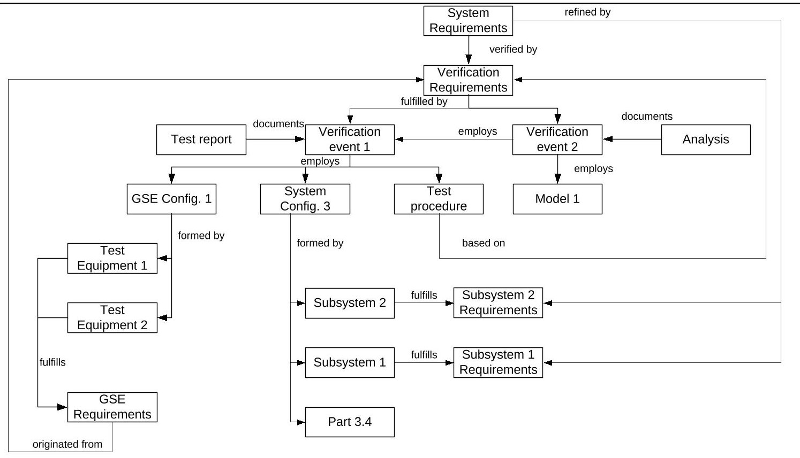

Figure 1. An example of a data model

Although increasingly mixed MBSE or model-centricity should not be confused with SysML (Systems Modeling Language). SysML is a tool (language) that is used to define and represent models, while MBSE is the methodology itself (Friedenthal, Moore, and Steiner 2011). SysML provides several pre-defined diagrams that serve the purpose of representing models and foster mutual understanding in communications; they include among others activity diagrams, sequence diagrams, requirements diagrams, or use case diagrams. As introduced earlier, current practices in MBSE focus on early system definition due to its efficiency in early validation of solution concepts and of requirement elicitation.

(Montgomery 2012) proposes the concept of Model-Based Systems Integration, which expands model-based beyond the early definition phases of a system and uses its capabilities to explore the implications of the architectural design on the future integration and test of a system, as depicted in the Figure 2. The author uses for example an N2 diagram to detect integration complexity due to high coupling.

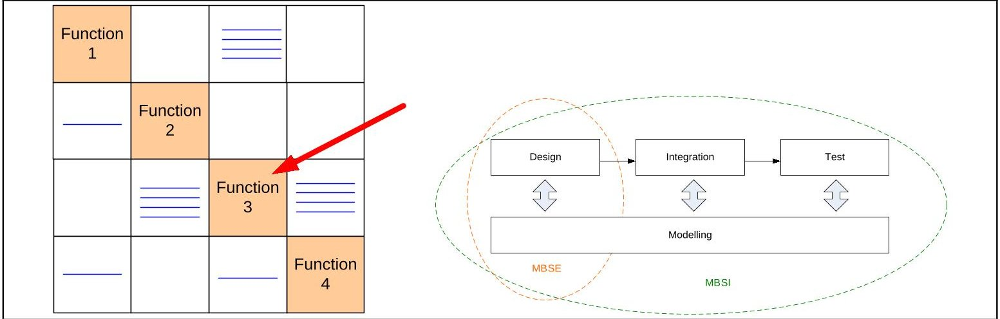

Figure 2. The concept of Model-Based System Integration (adapted from (Montgomery 2012))

However, (Montgomery 2012) maintains the vision of using model-based for evaluating

<!-- PDF_PAGE: 4 -->

architectures and designs and therefore he does not propose additional artifacts or uses for the actual integration and test of a system.

The present research tries to fill that gap and proposes an information model to use model-based systems engineering to actually plan integration and test activities of a system.

Traditional Planning of Systems Integration and Verification

Needs, content, and tools

Planning of system integration and verification often requires the production of several artifacts. Some of them include verification requirements, integration and verification flows, test instrumentation, test plans and predictions, integration and test procedures, or personnel allocation (ECSS 2009; ECSS 2012; and NASA 2007). Actual execution of such activities often require maintenance of configuration logs, production of integration and test reports, and maintenance of verification control documents among others (ECSS 2009). Furthermore, such activities are usually immersed in a perpetual documentation activity of decision tracking, open issues, and action items. Schedule development and resource allocation takes also a significant amount of effort at this stage.

Traditionally all those artifacts are generated or controlled by a combination of independent or stand-alone methods and tools, which are listed in Table 1.

Table 1: Traditional methods and tools to generate system integration and verification artifacts

<table border="1"><tr><td>Element</td><td>Tool/Method</td></tr><tr><td>Requirement tracking</td><td>Requirements database or dedicated spreadsheets.</td></tr><tr><td>Verification tracking</td><td>Requirements database or dedicated spreadsheets.</td></tr><tr><td>Allocation of requirements (system, verification, or test) to integration and test steps</td><td>Manually from requirements database or dedicated spreadsheets to verification flows and integration and test specifications.</td></tr><tr><td>Integrated verification fishbone diagrams</td><td>Diagram tools or mind-mapping tools.</td></tr><tr><td>Integration and test procedures</td><td>Text processors, spreadsheets, or dedicated integration tools.</td></tr><tr><td>Integration and test specifications</td><td>Text processors; in few cases directly in requirements databases.</td></tr><tr><td>Verification requirements</td><td>Text processors, requirements database, or dedicated spreadsheets.</td></tr><tr><td>Description of configuration</td><td>Drawings, word processor, spreadsheets.</td></tr><tr><td>Configuration maintenance</td><td>Drawings, word processor, spreadsheets.</td></tr><tr><td>Open issues</td><td>Spreadsheets.</td></tr><tr><td>Action items</td><td>Spreadsheets.</td></tr><tr><td>Integration and verification flows</td><td>Diagram tool.</td></tr><tr><td>Decision tracking</td><td>Text processor, spreadsheet.</td></tr><tr><td>Schedule</td><td>Scheduling tools, spreadsheet.</td></tr><tr><td>Workpackage (activities) inputs and outputs</td><td>Text processor, spreadsheet, databases.</td></tr></table>

<!-- PDF_PAGE: 5 -->

## Improvement opportunities

The use of several tools and methods to control and generate information results in several risks, which can be seen as opportunities for improvement where model-centricity could play a beneficial role, as will be discussed later:

- Multiple sources of information, which could easily lead to inconsistent information and need for recurring updates and task repetition.

- Multiple sources of information, which could easily lead to outdated information and need for recurring updates and task repetition.

- Since the model is on documents, information has to be reproduced manually in several artifacts and formats, which increases the required effort to accomplish a particular task.

- Since the model is on documents a significant effort is needed to produce text, even though the model exists.

- Lacking information linkage between artifacts enforces manual propagation of changes.

- Lacking information linkage favors the loss of attention to open issues, decision history, and action items needed to start or finish a given activity.

- Using several tools requires a significant effort by IT and configuration management to keep consistency, correctness, and relevance.

## Model-Centric Environment for Systems Integration and Verification

## Envisaging a solution

The idea of information model forms the basis to envisage hierarchical representations of integration and test activities (that could be seen as functions) that use or employ plans, requirements, or test equipment (resources) to transform components (inputs) into a system (output).

Having such information as part of a model would eventually allow to direct flow down of information into lower level elements, thus inheriting information (top-down) and identifying at a high level needs of lower level elements (bottom-up). Furthermore, the hierarchical capability of the model allows direct sharing of information, such as for example from integration specifications to integration procedures. To show this Figure 3 describes how an integration step defined as INT-001 that needs to put some components together (Part 2 and Part 7) and test various requirements is further decomposed in the actual planning. Interestingly enough, such artifacts are then distributed internally among the different activities. At the low level test equipment (GSE x) is identified and flowed up to the high level, ensuring consistency of information and needs between the various levels of the system integration and verification activities. Another interesting aspect of such a model description is the realistic representation of dependencies between activities, which is often hard to see when

<!-- PDF_PAGE: 6 -->

producing line by line procedures. Finally, the modeled sequence enables automatic simulation of schedule constraints and resource allocation and usage, which enforces again use of consistent information.

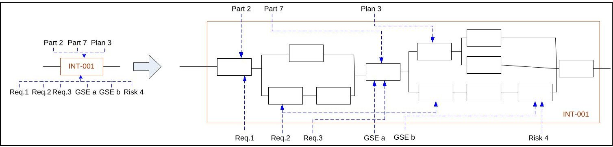

Figure 3. MBSI potential

The present work has developed an information model to support an integration and test campaign of a system. A partial schema is depicted in Figure 4. The majority of terms are self-explanatory. For those that could be problematic a discussion follows. Components refer to conceptual physical elements of a design or architecture. Products are instantiations of those components, i.e. the actual built and existing element that instantiates the conceptual component. For example, subsystem A could be eventually manufactured (instantiated) as software model Y, prototypes B2, B3, and C1; and then multiple end-items with corresponding serial numbers. GSE stands for Ground Support Equipment and represents all external hardware and software elements and tools that are needed during integration and test of the system. Test items are inputs and outputs of the integration and test activity, e.g., data, raw materials, processed materials, etc. Finally, workforce represents human resources that carry out the activities defined as I&T activities.

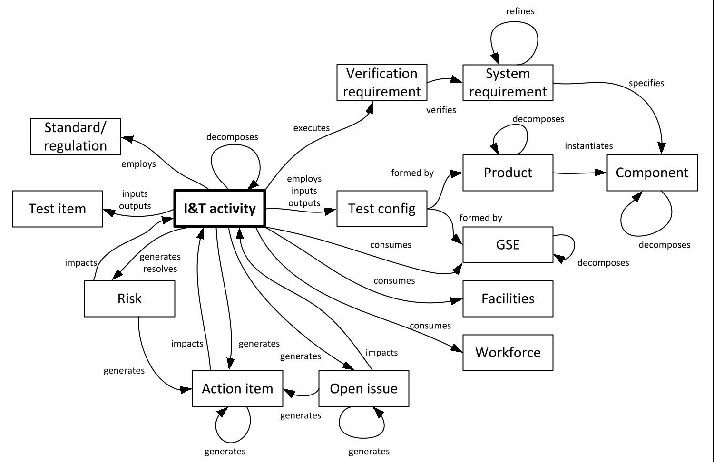

Figure 4. Information model for system integration and test

<!-- PDF_PAGE: 7 -->

Relationships of types inputs, outputs, and consumes enable simulation capabilities, which are of particular importance to define deployment of hardware, software, and human resources. Consequently they facilitate the optimization of integration and test sequences.

Differentiating between components and products allows for documenting and evaluating the levels of similarity between tested configurations and end-items, thus facilitating assessment of verification coverage and effectively dealing with resulting decision needs.

Finally, it shall be noted that I&T activities may relate differently to Test configurations depending on the type of I&T activity: when the activity involves modifying the product (usually during integration activities), Test configurations change during the activity and therefore are used as inputs and outputs in order to define entry and exit criteria for the activity; during activities in which the product remains unchanged (usually during test activities) the necessary Test configurations that must be employed are defined.

## Leveraging SysML diagrams and other capabilities

As previously discussed, model-based systems engineering or, more generally, model-centricity is more than SysML. However, existing SysML diagrams can be leveraged to prove useful in modeling integration and test activities. The approach is grounded on the idea presented earlier that integration and test activities can be seen as functions or states and components and other artifacts as inputs, outputs, and resources.

For example, Figure 5 and Figure 6 show two SysML diagrams adapted to an integration and test program of a system. In this case both the activity diagram and the sequence diagram provide similar information, mainly how activities occur and what dependencies exist between them, but activity diagrams provide richer content.

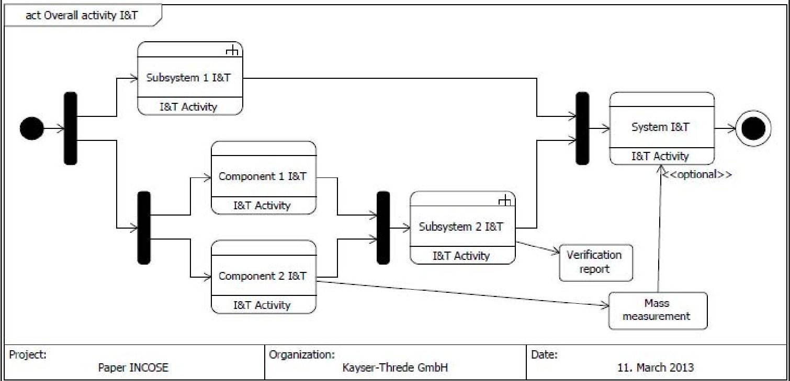

Figure 5. Activity diagram

<!-- PDF_PAGE: 8 -->

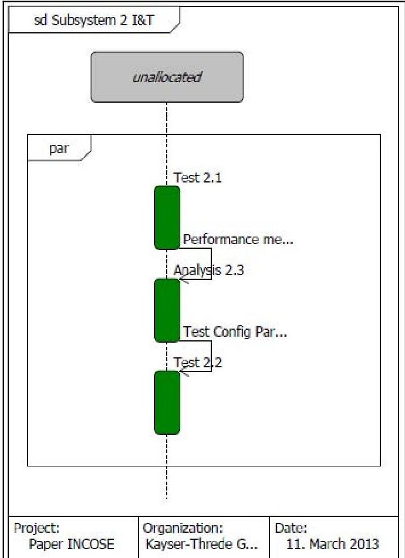

Figure 6. Sequence diagram

One key aspect of model-centricity for industry is that graphical representation is an outcome and not a product that needs to be developed. This basically implies that once the information model is fed with data any diagram can be seamlessly generated. Following with the same example, integration and test activities of Subsystem 1 can be further decomposed in more detailed activities. Figure 7 depicts the different hierarchical decomposition for all activities that ultimately form the integration and test of Subsystem 1.

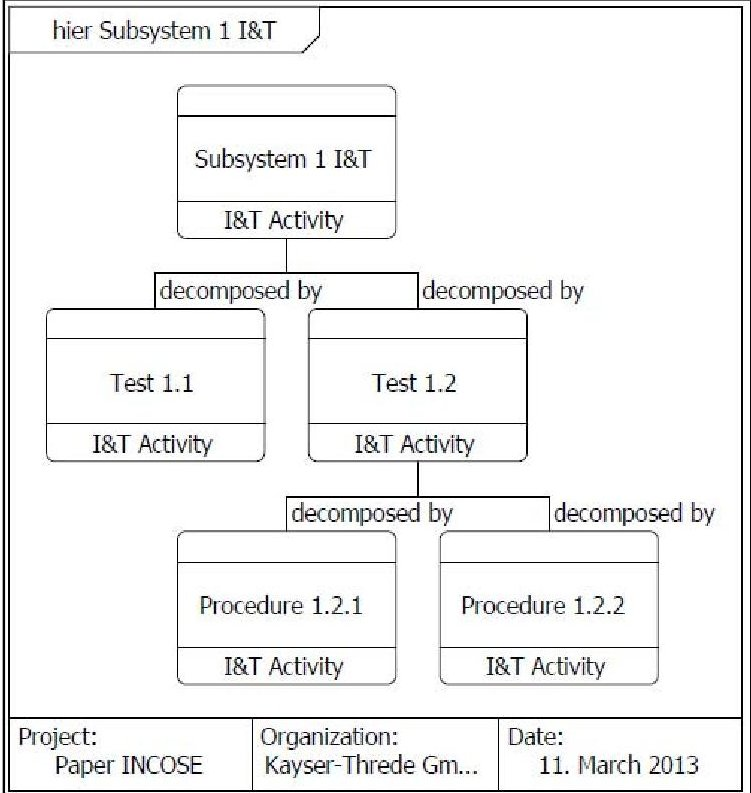

Figure 7. Hierarchy diagram

Hierarchical relations between two levels are also provided in activity diagrams. As can be

<!-- PDF_PAGE: 9 -->

seen in Figure 8 the amount of information that is shown is also adaptable, i.e. the information exists in the model and it can be displayed as needed. The example shown in Figure 7 represents the detailed integration and test activities for Component 2 with a description of what is actually done in each activity. In addition, inputs and outputs are also shown. Furthermore, the diagram includes analysis activities (note that the paper addresses the entire verification, not only a test program). Therefore, model-centricity is also useful to plan analysis activities that depend on test data.

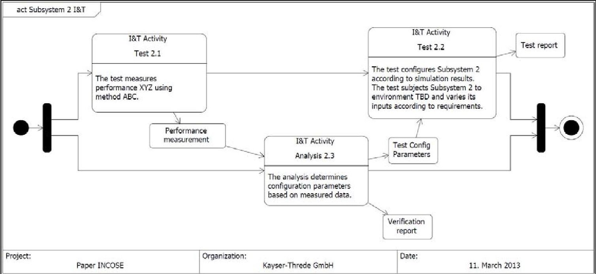

Figure 8. Detailed hierarchical activity diagram

Going further in the capability of the model, the information model directly enables simulation for relations that are executable. In this case, a behavioral diagram, as shown in Figure 8, would allow simulating the uncertainty to accomplish in a given time and with a given amount of resources the integration and test activities for Component 2, would describe how resources are utilized, e.g. in relation to personnel or ground support equipment, and would facilitate the identification of conflicts and constraints, promoting optimization of integration and test sequences.

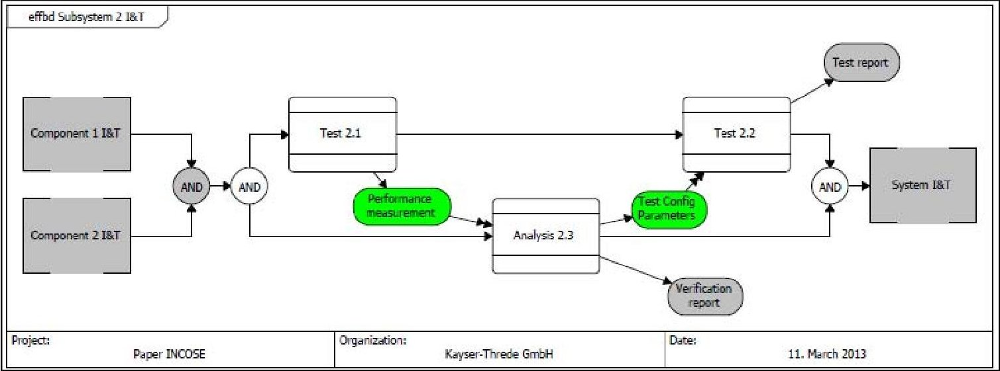

Figure 8. Behavioral diagram

Because of the functional paradigm to represent integration and verification activities N2 diagrams can be used to quickly identify interrelation of product needs between different activities, which would ease the identification of activities that may need good control of

<!-- PDF_PAGE: 10 -->

resources. This is exemplified in Figure 9.

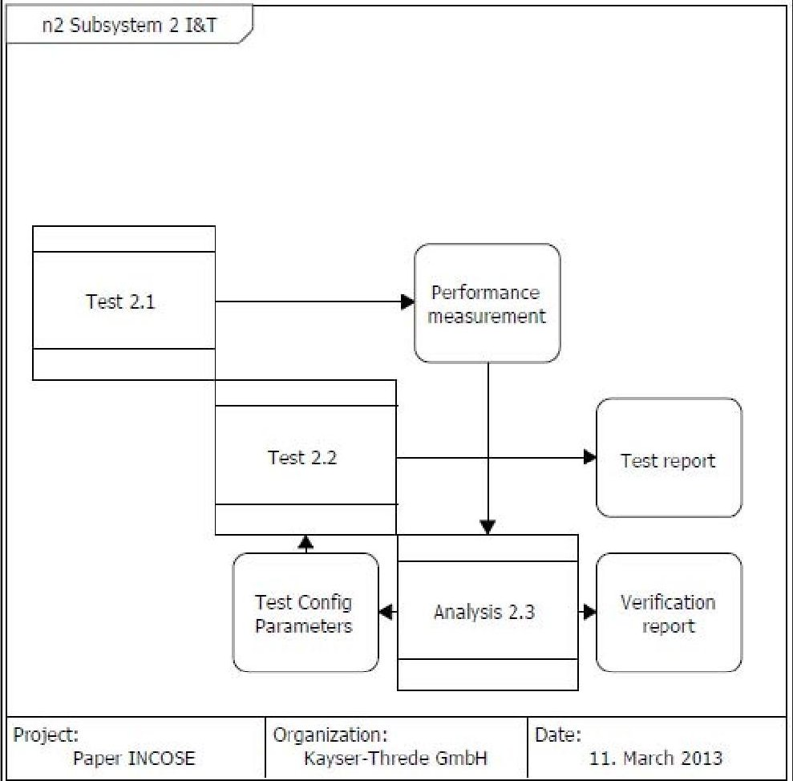

Figure 9. N2 diagram

Probably one of the most interesting capabilities of model-centricity for industry is the automatic or automated generation of documentation. Since all the information is in a centric, common, and controlled database and is structured according to a defined information model, report generation can be easily scripted. Due to the nature of the information model and information sharing in a database all information would be single source, which implies that a single change of an element or an artifact would be updated in all project documentation, in this case integration and verification planning, at the action of a click. Respectively, a team is always working with current data, reducing need for information update and minimizing repairs and reworks resulting from invalid data.

Figure 10 shows as an example the elements that would be used to generate an integration or test specification. As can be seen the document generator (script) would retrieve verification requirements that need to be executed as part of the test activity, entry and exist criteria for the activity, configuration to be achieved or used, special equipment or constraints to be used, decomposition of lower level activities if required, and very interestingly, open points or action items that need to be closed before the activity can start.

<!-- PDF_PAGE: 11 -->

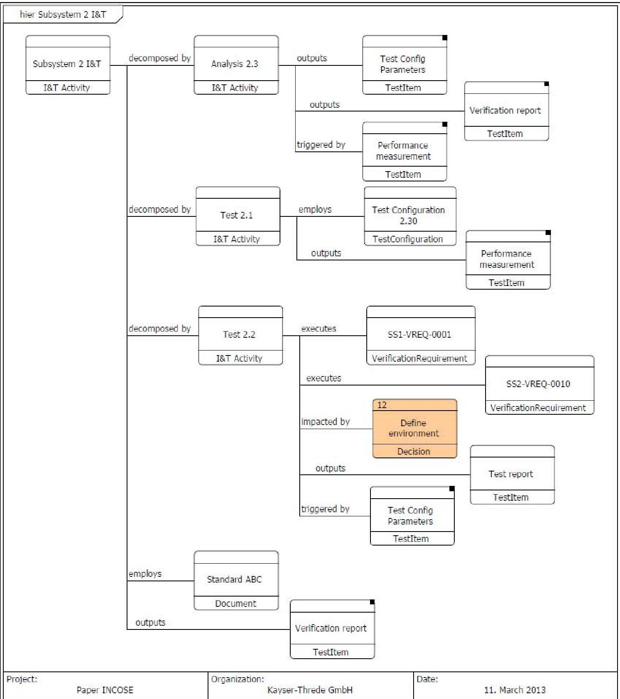

Figure 10. Generation of integration and test specification

This last point is again particularly interesting for integration and test activities in industry. Due to the nature of integration and test activities management of action items, open issues, and decisions can become extremely chaotic and out of control, resulting in severe cost and schedule impacts. Model-centricity can be used as the core to track such information and because of the linkage through the information model any related document that is linked to the activity could eventually report work to be done before the activity can be started or considered completed.

## Improving efficiency and effectiveness

Model-centricity enforces the use of single source information and information sharing. In

<!-- PDF_PAGE: 12 -->

addition, current information exists within the model and does not depend on particular release of documentation. Such characteristics results in the following benefits:

- Information usage is always current, thus the need for information update is reduced. Reduction of required time for given activity improves efficiency.

- Information lays within the model and therefore there is no need to rewrite pieces of information in several documents. $ \rightarrow $ Reduction of required time for given activity improves efficiency.

- Information is only in one place and therefore mistyping or confusion is reduced. Reduction of mistakes and corrections improves effectiveness.

- Many documents can be written by themselves; only the model has to be built, but this is nevertheless done in the engineers' brain. $ \rightarrow $ Reduction of required time for given activity improves efficiency.

- Decisions are constantly tracked and associated to an element of the system, thus there is no need to go back to previous decisions or reinvent multiple times the wheel. $ \rightarrow $ Reduction of required time for given improves efficiency.

- Open issues and action items are persistently present, thus it is difficult that they get forgotten or lost. $ \rightarrow $ Reduction in activity repetition improves efficiency and effectiveness.

- Systems engineering teams (verification) and assembly, integration and test teams work concurrently in a shared model, thus information exchanges and reviews occur in real-time. $ \rightarrow $ Real-time collaboration maximizes benefits of reviews while minimizes review cycles, which improves effectiveness and efficiency.

- Project management and engineering work concurrently in a shared model, thus reporting of elements such as open issues, action items, or risks occurs in real-time. $ \rightarrow $ Real-time reporting reduces the need to prepare stand-alone artifacts, which improves efficiency, and allows for quicker reaction by management and engineering teams, which improves effectiveness.

## Conclusions

The present research has used the capabilities of model-based systems engineering and model-centricity to plan final integration and verification activities for a system. A partial information model has been developed and presented. Several SysML diagrams have been leveraged to report integration and test planning information that are in current practice dispersed among documents generated by a variety of tools.

The paper has presented potential improvements on efficiency and effectiveness that could result from information sharing by means of a shared database where teams work concurrently. The proposed approach to integration and verification planning significantly reduces the need to convert data between various data formats and enforces working always with current information, thus limiting required repairs or reworks and reducing effort in seeking information. In addition, generating documentation can be automated by directly exporting the data from the database, which could significantly reduce effort in producing documents and

<!-- PDF_PAGE: 13 -->

therefore allowing to using engineering hours more effectively, i.e. on purely engineering activities rather than on documentation. Finally, modeling these activities enables effective simulation of sequencing and resource utilization, facilitating optimization of integration and test activities in terms of necessary time and resource capacities.

The present research has set the basis for continuing research in the following topics:

- Formalize the information model of system integration and verification for the entire life-cycle of a system. This paper has provided a partial information model, primarily reflecting elements associated to planning of integration and verification activities. Future research is promoted to expand such a model and integrated to other activities of system development such as conceptual design, enterprise or organizational architecture, or system modeling.

- Explore more deeply the usage of SysML for integration and verification. This paper has presented some uses of SysML diagrams for planning integration and verification activities. Future research is promoted to further explore potential uses of other types of diagrams, such as the Use-Case diagram, and expand uses of diagrams presented here for other purposes, with a different level of detail, or with a different information model.

- Integrate actual integration and test within the model. This paper has explored the use of MBSE for planning integration and verification activities. Future research is promoted to integration planning and actual execution within the same model.

- Measure actual gain in efficiency and effectiveness during integration and test of an actual system due to the use of model-centricity. This paper has conceptually described the benefits of using MBSE for planning system integration and verification activities. Future research is promoted to measure the level of improvement that could be expected in a variety of systems in monetary terms, which could support the adoption of such an approach in industry.

## References

Baker, L., Clemente, P., Cohen, B., Permenter, L., Purves, B., and Salmon, P. 2000. "Foundational Concepts for Model Driven System Design." White paper, INCOSE Model Driven System Design Interest Gourp, International Council on Systems Engineering, Jul. 15, 2000.

Brown, B. 2011. "Model-based systems engineering: Revolution or evolution?" IBM Software. Thought Leadership White Paper. December 2011.

Estefan, J. 2008. "Survey of Model-Based Systems Engineering MBSE Methodologies." INCOSE MBSE Initiative, 2008, (http://www.omgsysml.org/MBSE_Methodology_Survey_RevB.pdf) Retrieved 11.08.2012.

European Cooperation for Space Standardization (ECSS). 2009. Verification. ECSS-E-ST-10-02C Second issue, 06 March 2009.

European Cooperation for Space Standardization (ECSS). 2012. Testing. ECSS-E-ST-10-03C, Second issue, 01 June 2012.

Friedenthal, S., Moore, A., and Steiner, R. 2011. A Practical Guide to SysML: The System Modeling Language. 2 $ ^{nd} $ edition. Morgan Kaufmann, 31 October 2011.

Harvey, D., Waite, M., Logan, P., and Liddy, T. 2012. "Document the Model, Don't Model the Document." SETE APCOSE 2012.

INCOSE SE Handbook Working Group. INCOSE Systems Engineering Handbook v. 3.2.2. INCOSE-TP-2003-002-03.2.2. October 2011.

Kawahara, R., Hiroaki, N., Dotan, D., Kirshin, A., Sakairi, T., Hirose, S., Ono, K., and Ishikawa, H. 2009. "Verification of Embedded System's Specification Using Collaborative Simulation of

<!-- PDF_PAGE: 14 -->

SysML and Simulink models." Proceedings of Second International Conference on Model Based Systems Engineering (MBSE'09), Haifa, March 2-5, 2009, pp. 21-28.

Korfiatis, P., Cloutier, R., and Zigh, T. 2012. "Graphical CONOPS Development to Enhance Model-Based Systems Engineering." Third International Engineering Systems Symposium CESUN2012, Delft University of Technology, 18-20, June 2012.

Martin, J. N. Systems Engineering Guidebook: A Process for Developing Systems and Products, CRC Press, Inc.: Boca Raton, FL, 1996.

Maurandy, J., Gill, E., Helm, A., and Stalford, R. 2012. "Cost-Benefit Analysis of SysML Modelling for the Atomic Clock Ensemble in Space (ACES) Simulator." INCOSE International Symposium 2012.

Montgomery, P. 2012. "Model-Based Systems Integration (MBSI). An Instructional Approach." Systems Engineering Conference, Washington DC, May 15, 2012.

Muth, T., Herzberg, D., and Larsen, J. 2001. "A fresh view on model-based systems engineering: The processing paradigm." INCOSE International Symposium, 2001.

NASA. 2007. Systems Engineering Handbook. NASA/SP-2007-6105 Rev1.

Robinson, K., Tramoundanis, D., Harvey, D., Jones, M., and Wilson, S. 2010. "Demonstrating Model-Based Systems Engineering for Specifying Complex Capability." Systems Engineering / Test & Evaluation Conference, Adelaide, 2010.

<!-- PDF_PAGE: 15 -->

## Biography

Alejandro Salado is a systems engineer at Kayser-Threde GmbH (an OHB company). Experienced in the development of manned and unmanned space systems he is currently acting as verification manager for EnMAP's primary payload, actively contributes to the improvement of the company's systems engineering capability, and is leading an initiative to transform it into model-centricity. In addition to his job duties with Kayser-Threde GmbH, Alejandro is a doctoral candidate with the School of Systems and Enterprises at the Stevens Institute of Technology, for

which he was awarded the International Fulbright Science and Technology Award. His research interests include the generation and prioritization of requirements, the design of elegant systems, and the development of affordable space systems. Alejandro holds a MSc in Electrical Engineering from Polytechnic University of Valencia, a MSc in Electronics Engineering and a MSc in Project Management from Polytechnic University of Catalonia, and the SPACETECH Postgraduate Master in Space Systems Engineering from the Delft University of Technology.