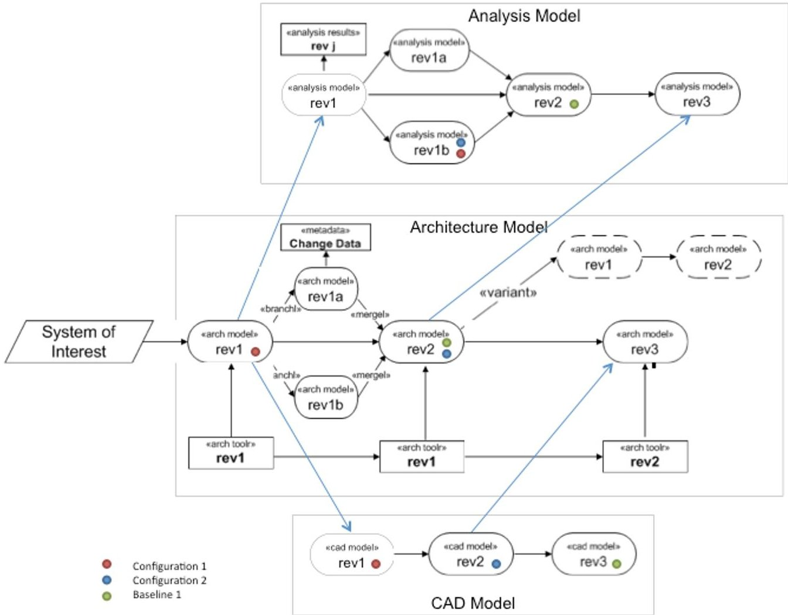
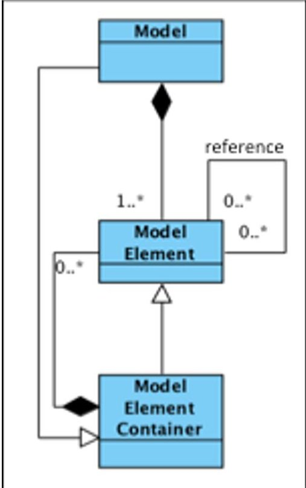

<!-- PDF_PAGE: 1 -->

# Model Lifecycle Management for MBSE

Amit Fisher

IBM Rational

amfisher@us.ibm.com

Mike Nolan Raytheon IDS MKNolan@raytheon.com

Sanford Friedenthal

SAF Consulting

safriedenthal@gmail.com

Michael Loeffler

General Motors

michael.loeffler@gm.com

Mark Sampson

Siemens PLM

mark.sampson@siemens.com

Manas Bajaj

InterCAX

manas.bajaj@intercax.com

Lonnie VanZandt

No Magic

lvanzandt@nomagic.com

Krista Hovey Configuration & Data Management Analytics kfhovey@cdmanalytics.com

John Palmer

Boeing

john.r.palmer2@boeing.com

Laura Hart

Lockheed Martin

laura.e.hart@lmco.com

Abstract Model Based Systems Engineering (MBSE) is an evolving practice in the early stages of adoption similar to the mechanical, electrical and software domains 20 to 30 years ago. Today there is increasing recognition of the potential MBSE brings to system life cycle processes with the increasing complexity of systems and the demands of the global marketplace. In order for the practice to realize this potential, system modeling and MBSE must be part of the larger model based engineering effort, and integrate with other engineering discipline models and modeling activities across the life cycle of a system. This is placing increasing demands on the need for Model Lifecycle Management (MLM) as an essential part of an MBSE infrastructure. This paper establishes the motivation for MLM, as well as laying the foundation for addressing challenges that lay ahead. The paper is focused on describing key concepts, requirements, current practices, and future directions of MLM, and setting the basis for more in depth overview of MLM solutions and vendor offering that are beyond the scope of this paper.

## 1. Motivation - Model Lifecycle Management as an Enabler of Model-Based Systems Engineering (MBSE)

Smarter and more complex products enter our lives every day. The modern society in the 21th century is more dependent than ever on such systems that serve our basic needs for health, communication, transportation, financial management, education, entertainment and much, much more. These smarter products today are not independent. They usually consist of collections of other constituent systems, and often dependent on the behavior of external systems. Products are more and more autonomous, capable of optimizing their operation and perform goal-seeking behaviors. Moreover, we witness the growing importance of smarter, cyber-physical systems that combine software, hardware, mechanical and electrical components. Ever increasing demands on system performance is driving tighter integration of the engineering disciplines to provide this performance. This convergence of engineering disciplines, as well as growing business challenges such as shorter time to market, strict safety requirements, higher product quality and stricter regulatory compliance increase the need for new and holistic system approaches and methodologies that support system design. These factors have led to the the engineering domain innovators to modeling, abstraction and multi-disciplinary

<!-- PDF_PAGE: 2 -->

analysis techniques during the design, and the increasing importance of model-based methodologies for product development.

Model Based System Engineering (MBSE) formalizes the application of systems engineering through the development and use of a unified model that is consistent with various domain-specific models of a product, and persists throughout the system life cycle. It is often contrasted with a Document Based Systems Engineering (DBSE), which is characterized by system design information captured and controlled through a variety of separate and distinct document artifacts that must be aligned and reconciled via manual processes. While models might be used in a DBSE approach, they are mostly standalone and not linked or connected via formal point-to-point relationships. Within organizations, system engineering teams have traditionally relied on documents—hard copies or electronic files—to coordinate system information between stakeholders (users, designers, testers, and suppliers). In the MBSE approach, a unified system model includes information about the specification, design, analysis, and verification of the system and its elements including their requirements, structure, behavior, and performance, and physical characteristics. MBSE helps to ensure a more complete, consistent and traceable system design, while at the same time enabling communication, and reuse of the system information.

Central to MBSE is the notion of a 'model'. While we provide a formal definition for this term we can think about a 'model' as a representation of a 'thing' using a modeling language that is well understood by the model creator and the model consumer. MBSE aims for cohesion and integration of models that support stakeholder information through the entire system lifecycle, and includes the model creation, modification, refinement, analysis, release, management and archival. Each model may represent different facets of the system, such as the system architecture, geometric design, and various analytical perspectives such as performance or reliability. The different types of models represent important facets of the system being developed which should collectively represent the best understanding of the system at a given point in time. Systems engineering focuses on ensuring that all these different facets of a system are addressed to meet the stakeholder needs.

Model Lifecycle Management (MLM) involves the synchronization of the modeling information over time to ensure a consistent representation of the system being modeled. The MLM challenges are multi-dimensional. MLM must account for different types of models being developed by different users that are often geographically distributed, and using different tools. The models are being updated by different users at different times. The tool revision may also change over time. In addition, other information that results from the model, such as analysis results and model queries must be synchronized with the models that produced them. In addition to maintaining consistency of all this information at a snapshot in time, the revision history (including what changed and why) must also be retained in order to fully understand and validate the design information. Finally, model management must account for models of product families and system variants, where substantial commonality combines with unique features to satisfy different customers and different requirements.

<!-- PDF_PAGE: 3 -->

Figure 1: A Representative Model Management Concept

Figure 1 is an illustration of a typical MLM concept. The 'system of interest' is represented by several different types of models including architecture, analysis, and geometric models of the system. The architecture model typically includes a high level representation of the product structure and behavior. The CAD models cover mechanical and geometric aspects of the system, and the analysis models include simulation and other engineering analysis models and the resulting data from their execution or computation. . As the figure shows, models evolve over time through different revisions, refer to each other to define dependency/traceability constraints/objectives. Moreover, the specific tool revision/version that was used to author the models is changing and must be linked to its associated model artifacts.

The paper is organized as follows: Section 2 provides a scope and comprehensive definitions for the main vocabulary used in this paper and in the Model Management community. Section 3 provides a list of requirements and use cases for effective Model Lifecycle Management, while section 4 highlights some of the current practices for Model Lifecycle Management and compares it with adjacent artifact management approaches such as Source Code Management (SCM) and Product Lifecycle Management (PLM). Finally, section 5 provides a suggested starting roadmap for the MBSE Model Management community.

<!-- PDF_PAGE: 4 -->

## 2. Definition and Scope of Model Management

## 2.1 Definitions and Scope

This section defines the main concepts and terms used in this paper, as a critical step to establish a common understanding needed for model lifecycle management. These terms are further used to help bound the scope of MLM. The glossary of the INCOSE Systems Engineering Body of Knowledge (SEBoK) as the main source for systems engineering terms used throughout this document. Moreover, some of these definitions are heavily influenced by similar concepts in more mature adjacent management domains such as Application Lifecycle Management (ALM) and Source Code Management (SCM) , Product Lifecycle Management (PLM) and Enterprise Content Management (ECM) . Lastly, several of these definitions are taken from common practices within MLM systems vendors such as IBM, Siemens and No Magic.

Let us start with the most basic concept, a Model:

A Model is an abstraction of something meaningful and relevant to the model stakeholder. In the context of Model Based Systems engineering, a model that represents a system and its environment is of particular importance to the system engineer who must analyze, specify, design, and verify systems, as well as share information with other stakeholders.

A variety of system models are used to represent different types of systems and different facets of systems such as its geometry, functions, and performance. Any specific model is described in a modeling language that has clear and well-defined representation rules, or abstract syntax and semantics. All models used throughout a systems life cycle to represent the system may be considered within the scope of MLM.. The scope of MLM includes formal models with well-defined syntax and semantics such as simulation and analysis models, architecture models such as S such as simulation and analysis models, architecture models such as SysML and AADL, and CAD/CAE models. The scope of MLM excludes informal documents where the syntax and semantics are not well defined via a modeling language, such as text documents, drawings, slides, and other less formal descriptions of a system, unless the information is derived directly from a more formal model, such as the result of a model query or model execution. For example, a free text requirement document will not be in scope, while a requirement stored in a DB with well defined schema is. This scope may change over time, but it was felt by the authors that this is a reasonable starting point. A specific and important model in the context of MBSE is the System Model:

A System Model contains the information about the system at any given stage during its lifecycle. It includes the system architecture model and model-based connections between the system architecture model to the various domain-specific models, such as CAD and CAE models that describe various aspects of the system and its sub-systems [2, 3]. The connections between the system architecture model (or model elements) and domain-specific models (or model elements) may have different behaviors [4], such as (1) reference connections for basic traceability, (2)

<!-- PDF_PAGE: 5 -->

data map connections for exchange for parameter values, (3) function wrap connections for wrapping executable code in system model elements, and (4) model transform connections for generating and synchronizing model structures bi-directionally. Also, the scope of the system model may vary. Sometimes, the system model is viewed as an abstract specification model of the system and its elements and other times, it may include the detailed element design information.

A wide variety of engineering methods, computer models, and software tools and databases are used throughout the lifecycle of a complex system, such as a satellite or an automobile. During the early phases of system development, system engineers develop requirements, concept sketches, block diagrams, flow charts, back-of-the-envelope calculations such as mass and cost roll-ups and performance parameter estimates, and architectural trade-off models. As the system definition matures, the focus shifts to developing high-fidelity design (structural and functional), analyses, and optimization models of various subsystems and components. This includes, but is not limited to, 3D geometric models of parts and assemblies (CAD), finite element analysis and computational fluid dynamics model to compute physics-based behavior, discrete event simulation models, and complex control algorithms. Although these models are developed by different teams, software tools, methodologies/workflows, and at different stages in the system lifecycle, they all represent different aspects of the same system. It is not the goal of this paper to come up with a common way to describe all models. However, in order to provide common definitions for MLM, a generic model structure is proposed as shown in Figure 2, using the UML notation.

A Model consists of one or more Model Elements. A Model Element may consist of other Model Elements, in which it becomes a Model Element Container. Model elements can relate to each other. These allowable relationships are specified by the modeling language abstract syntax.

Fig 2 - UML meta-model for generic model structure representation

<!-- PDF_PAGE: 6 -->

For example, all SysML Model Elements are part of a SysML Model, while some SysML Model Elements (such as Package and Blocks) can also be a Model Element Container. A SysML Package is a Model Element Container that contains Blocks that are also Model Elements. Blocks can be related to other Blocks through associations, generalizations, etc. A Simulink Model is constructed of Simulink blocks (basic Model Element) that can also contain additional Simulink blocks (and serve as Model Element Container). While this simplified model structure may not represent all possible model structures, it aids in understanding the problem and specifying the MLM requirements described in Section 3.

Models Elements can reference each other. A reference is a link between two Model Elements that allow users to navigate between them. Internal reference is a reference between two Model Elements that belong to the same Model. External reference is a reference between two model elements that belongs to different models.

During the model lifecycle, the models and model elements and references are being created, read, updated and deleted over time. A Model as well as any Model Element and its references can be part of a Model Configuration Item:

A Model Configuration Item is a logical part of the model that is maintained in a controlled fashion, i.e. have a trackable revision history. A Model Configuration Item satisfies an end-use function and is designated for independent configuration management by the product developer and by the customer. A Model Configuration Item can be defined in different granularities, from an individual fine grained Model Element, a set of model elements, to the entire Model. An increment update to an entire Model MCI is often called a Model baseline.

Model Configuration Items are managed to maintain the integrity of the models. The granularity of the MCI as well as the organization of the MCI's are an important decision for MLM .The organization is often influenced by the organization of the teams creating the model. Good organization of the model can minimize resource conflicts and the need for complicated merging of changes.

The following configuration management terms also apply to model lifecycle management:

Version - A version is a state associated with the lifetime of a Model Configuration Item at a given point in time. Versions can be managed by logical time index (most common use) or by other unique identifier that can distinctly differentiate between two versions.

Variant model - A variant model represents a model of a variant of the system being modeled. As opposed to Version that represents a change in state, a variant is usually used to reflect a change of a Model Configuration Item for a given context. Variants reflect a change in a parameter of Model Configuration Item, such as an automobile with an automatic or manual transmission or a SmartPhone for North America or Europe.

<!-- PDF_PAGE: 7 -->

Configuration - A configuration is a set of Model Configuration Items with their associated Versions and Variants. Within a specific Configuration, every Model Configuration Item has a single and unique Version/Variant. It is worth mentioning that configurations do not guarantee model consistency - configuration is a mechanism that that allow user to capture set of Model Configuration Items, with its respective version/variants, but do not guarantee that this set is semantically consistent ( i.e. a configuration can include inconsistent models, for examples models that were not synced after an update).

Baseline- a Baseline is an immutable Configuration. A Baseline uniquely defines an "unchanged over time" set of Model Configuration Items with its associated versions and variants. Model Baselines are often used to freeze Model Configuration Items at critical points in the model development life cycle.

The following terms relate to the capabilities used to create, edit, and store Models, also known as Model CRUD functionality:

Modeling Tool is a software application that is used to produce a model, and is part of a systems development environment that allow user to create, update, read and delete a model using its model language and by enforcing the model abstract syntax and semantics.

Model Repository is the logical location and/or physical storage space of the Model and its Model Elements. It is considered to be common that different disciplines using different modeling languages and modeling tools store them in different Model Repositories (such as file-based verus database).

Metadata is the information about the model, and may include information about who created or modified the model or model element, what was changed, when and why it was changed, as well as information about how the model is used in particular contexts.

Building on these terms, we can provide a comprehensive definition of Model Lifecycle Management:

Model Lifecycle Management (MLM) is a governance process synchronizing the create, read, update, and delete (CRUD) operations on heterogeneous models within the supporting modeling tools and model repositories, throughout the system development lifecycle. This is accomplished through the management of Model Configuration Items, including versions, variations, configurations and baselines of models, simulations, analysis results, and the tools that are used by multiple geographically dispersed users. In addition, MLM includes the management of all the metadata associated with the models, tools, and analysis results including who made the change, what changes were made, when and why, as well as information regarding the application of the model. A Model Lifecycle Management System (MLMS) is a set of elements that implement a model lifecycle management process, and may include people, hardware, software, data, and procedures.

<!-- PDF_PAGE: 8 -->

## 2.2 MLM and Related Configuration Management Approaches

Through its governance process, Model Lifecycle Management Systems need to address multiple aspects of controls and functionality. MLM solutions can gain and adopt current practices from adjacent management domains that have proven to be both robust and extremely valuable in its specific domains. This section provides a brief overview of these domains and practices as a basis for comparison with MLM systems. Section 3 extends these characterizations and provides further analysis of MLM solutions' requirements and use cases.

Source Code Management (SCM). In Application Lifecycle Management (ALM), Source Code Management (SCM) systems provide version and revision control of program source code and other text files. SCM systems are realized by tools that track the development of a source file to prevent it from being altered by more than one person at a time. It is commonly used for projects where multiple source files are used or where multiple people are working with the same source files. The most common pattern of use of SCM system is "Branch and Merge". When it is necessary to develop two versions of the software concurrently (for instance, where one version is used for testing, and the other version is where new features are worked on), a "branch" is created and allows users to work on independent "source code streams". When the first change is made after a branch, a new revision is created. Each revision is associated with a timestamp and/or revision number and the person making the change. Revisions can be compared, restored, and merged - a process that combines two or more source files from different branches back into a single source file.

In comparison to MLM, SCM systems are dealing with files as their sole configuration items, while MLM systems can and should support different Model Configuration Item granularities and their relationships. SCM is a well-established practice, and users of models in MBSE projects will expect similar functionality from their MLM system, especially when it comes to the Branch and Merge functions. The main challenge will be to support such functionality beyond "difference and compare" utilities on the text file level and to generalize this functionality to any Model Configuration Item ( such as Model, Model Element Container or Model element).

Product Lifecycle Management (PLM)/ Product Data Management (PDM) As computer-aided everything became pervasive, the problems of keeping up with the many models in product development lead to product data management systems (PDM) to manage Mechanical CAD, Manufacturing, Analysis, and other models. Typically these are associated with a structure of Bill of Materials (BOM) which includes version and release management. As products have begun to cross domain/design boundaries the PDM systems have morphed into Product Lifecycle Management (PLM) systems to include all possible information about the product's lifecycle (not just a design/CAD model) from initial needs, requirements, down through purchasing, suppliers, manufacturing, and even warranty and inservice information—providing as its goal the single source for all product information. PLM's perspective on model management is merely extending its philosophy to include all types of models associated with the product-cost, reliability, behaviors, and more can all be associated with the BOM structure—bringing all models under

<!-- PDF_PAGE: 9 -->

control with the rest of the product information does synchronize models at a more granular level than is being addressed by MLM.

Configuration Management (CM) is the engineering discipline which will provide the planning, oversight, reporting and validation of products and all supporting data sets for any given project. The CM effort begins with the management of validated requirements, linking to all products produced from those requirements, and providing control and stewardship of the data sets describing the products. As with Product Lifecycle Management, CM has evolved into a discipline which starts much earlier in the lifecycle, and extends into the fields of logistics and operations. While the details of Model Management methodology are still in the discussion stage within many organizations, the simplest forms of naming conventions (model numbers) and state identities (revisions, versions, variations) will provide the groundwork for CM to track, control and manage models effectively. Models that are identified per an organization's approved naming conventions and marked for CM control at the appropriate lifecycle states can be managed much as any other product format. Fluidity in the development of configuration control procedures for models

Enterprise Content Management (ECM). Enterprise Content Management (ECM) refers to the business management processes and tools required to manage all unstructured operational information created in the daily operation of any business. Business data such as electronic or paper operations documents and business forms, email messages or text messages have lifecycles and must be managed throughout those lifecycles in support of a business's operational needs. While ECM tool sets may include a Product Lifecycle Management system, management of models and their associative data are governed by configuration and data management processes created uniquely for the product in development.

Most of ECM considers the "document artifact" as the main configurable item. The "document artifact" is considered as a single resource that contains unstructured data that is not further analyzed by the ECM system. While basic revision control in MLM could be similar to ECM systems, MLM systems need to support a larger range of configuration item granularity.

Data Management. Data management is a process focused on ensuring the integrity of data generated for each operational area of a business and is a major part of the basic capabilities of Database Management Systems (DBMS). Data management teams work concurrently with other management teams at the enterprise and project levels to define appropriate control processes for identified data sets.

MLM systems should be able to leverage current Data Management practices. Data from each phase of model generation may be developed in independent databases or a single consolidated database operated as a collaborative workspace for remotely located teams of authors in independent enterprises. Models and supporting data should be identified with the level of control required according to the Configuration and Data Management plans governing the project. Data managers will continually oversee data security, assign access controls as defined by the identified project

<!-- PDF_PAGE: 10 -->

lifecycle controls, and ensure data integrity throughout the projected retention period of the completed data sets.

## 3. Model Lifecycle Management Requirements and Use Cases

As was discussed in section 2, the scope of MLM can encompass a broad range of models and artifacts. Therefore, it will be hard to formulate a precise list of requirement that will be inclusive and true for all MLM systems. Requirements for MLMS need to address different management, business, usability, functionality and performance aspects, regales of the technology being used to implement such a system This section and its supportive appendix is intended to provide the foundation for the requirement for a MLM system. It is expected that specific implementation of an MLM system may address those requirements that are relevant to their scope.

MLMS systems are expected to support variety of usage patterns and use cases. In item most basic form, MLMS should support the CRUD (Create, Read, Update, Delete) aspects for heterogynous modeling environments, provide basic configuration and data management services, collaboration and notifications, governance, control and security. Appendix A provides a detailed list of MLMS requirement that can serve as a starting point for industry benchmark when evaluating MLMS.

As indicated before, MLMS addresses a large scope of models. It is beyond the scope of this paper to provide a complete list of use cases, processes and best practices for MLMS usage. However, a set of representative use cases is provided below to complement the requirements in the previous subsection.

1. A stakeholder of a Model/Model Element who is not the editor of the entire set of information within the Model/Model Element needs curated information within the model in order to make decisions or present definitive information to other parties.

2. During an exchange of information between parties engaged in argumentation, one party challenges the veracity of Model/Model Element information and the other party must obtain the provenance of the curated information in order to provide a warrant for the claims made by the information.

3. A stakeholder responsible for contributing to or curating numerous models has too little spare time to poll each model in their scope of responsibility; this stakeholder needs to be notified when an area of interest within a particular model is subject to access or modification by selected individuals or communities of interest.

4. Two or more stakeholders are collaborating on a common model yet are not present in the same actual meeting place. Lacking body language clues, the stakeholders need to receive indication of their peer activities within the shared model.

5. A community of stakeholders with differing permissions to view, modify, and relate information form a joint venture that exploits their respective capabilities to solve a complex problem. Meanwhile, the providers of information retain their information confidentiality rights.

6. An organization is requested to describe, present, or instantiate a system that was created some past time even perhaps with different knowledge tools and by individuals no longer

<!-- PDF_PAGE: 11 -->

associated with the organization. During such a representation, the organization is requested to demonstrate the differences between the current systems and the legacy systems.

7. An enterprise-scale team which aggregates functional and domain teams from a variety of corporations works contemporaneously and serially on a common problem that requires access to different model elements in different lifecycle phases, different levels of abstraction, in different disciplines, and with different information access rights.

## 4. Current Practices

With the growing importance of Model Based System engineering, enterprises are looking for better ways to manage their heterogeneous modeling environments. The market is seeing growing demand for smarter MLMS, demands that results in the emergence of new technologies and approaches for Model Management. This section provides a brief overview of current and emerging directions in model management solutions, with emphasis on two important aspects of these technologies: Specifically, the model repository/storage mechanism and security model. Furthermore, this section also provides examples of product manufacturers approaches for their Model Management functions.

## 4.1 Model Repository Approaches

The following outlines different dimensions of storage and control as applied across industry, recognizing that any given project may have a mix of approaches, which may not be followed in an identical fashion across the multiple projects in work by a given enterprise. Moreover, it is important to notice that some of these approaches differentiate between physical and logical repositories as follows:

Physical Repository: A Physical Model Repository is a concrete location when the model artifacts are being stored. It is a representation of the physical storage place where the digital representation of Model and Model Elements are maintained.

Logical Repository: A logical model repository is the virtual location where model can be accessed. It is the location in which model are maintained from a MLMS user perspective. Different physical repositories that are used to store Models and Models Elements can be mapped to single logical repository, and multiple logical repositories can be mapped to a single physical repository. The association between physical and logical repositories is also called mapping.

Below are the three current approaches for model management repositories:

Multiple Local Repository Approach - This is the default and most common approach in organizations for model management. In this approach team members in a single team or teams within a group/organization use file systems on their individual computers or shared drives to store models that they develop. In many cases, the logical and physical repositories are the same, and are part of local storage area.

Often, there is no formal version control where the history of models can be tracked

<!-- PDF_PAGE: 12 -->

except for identifying changes in the timestamp on the model files; where formal version control is applied, the execution may be a highly manual process and subject to incomplete adherence. Sharing of models within and across teams is achieved by file transfers via emails or shared drives. Notification of updates to constituent models may be ad hoc or non-existent. There is limited to no tracking of design models to analysis models or to corresponding analysis results.

The multiple local repository approach may be combined with the other approaches for portions of the system models that have not been considered significant to the model management. For example, the design model may be fully controlled through a multiple version-controlled model repository, yet which may not encompass the analysis model (or more commonly the model analysis results).

Single Version-controlled Model Repository Approach - In this approach, a team or organization selects a single repository with formal version control (ability to track model history) to manage all of the different types of models - Requirement, architecture, CAD, CAE, software, part libraries and more. This implies a single physical model repository that might be mapped into multiple logical repositories serving multiple team, projects or engineering domains.

In most modern enterprises, this approach is not realistic due to the involvement of multi-disciplinary engineering artifact in the product development. Each repository type is often designed to manage specific categories of models - PLM system for CAD, CAE, and BOM; SCM systems for software code; Databases for large collections of instance data; ERP systems for supply chain information. Due to this complexity, consolidating all of this information into a single location is considered to be hard-to-impossible.

Multiple Version-controlled Model Repository Approach - This approach provides a better mechanism for model management than the single version-controlled repository approach. It allows different engineering teams to select the best tools and repositories suited for the types of models they are managing, e.g. a PLM system for CAD,CAE,BOM; SCM system for software code; and databases for libraries. Each repository provides formal version control. Most organizations have multiple version-controlled repositories.

While the management of individual system model is easier with this approach, the challenge of model synchronization, notification and traceability is becoming harder. As models are being manages independently, technology that will allow linking, tracing, monitoring and reporting on multiple distributed model resources is required. Some of the new promising technical directions are being discussed in Section 5 as part of the Emerging MLMS Technologies chapter.

## 4.2 Governance and Security of Models

Many of the modern product development environments require strict security considerations. While this is obvious requirement in military and defense application, this is also true in modern consumer electronic product, automotive, medical devices etc. when IP protection is major concern. While MLMS will typically resides within the enterprise intranet that is protected with the appropriate

<!-- PDF_PAGE: 13 -->

Authorization/Authentication mechanism ( e.g. LDAP) , this is usually not sufficient for effective MLM governance. MLMS needs to manage security and access rights in different level of granularity, and therefore requires further mechanism beyond the enterprise intranet security model.

When analyzing current MLMS, these are the current governance and security models observed:

1. None, A Single User Owns All Rights and Content - For small projects of short duration this may be acceptable, but otherwise the single owner becomes a bottleneck to the update and management of the constituent models or model configuration items.

2. OS Authentication, A Multi-User OS restricts Access but Content is Non-Attributable. For small and static teams this may be acceptable if procedural model governance mechanisms are established and followed, but otherwise the incomplete tracking of change invariably lead to the desire to question the rationale for a change, or some other query of the change author is needed that can not be accomplished. Absence of individually assigned access controls introduces challenges to the information assurance in the situation of changing team composition.

3. LDAP, An External Server manages Users and Access but Content is Non-Attributable this approach is only marginally better than the prior alternative, inasmuch as it provides a better mechanism to limit access to authorized users. However, the approach still requires procedural model governance mechanisms.

4. Change-Managed Content, A CM system tracks who made commits but atomic modifications are Non-Attributable - this approach improves on the prior methods by virtue of greater granularity of records of change of the model configuration items, and is essential for large multidisciplinary teams that change over time periods that are considered short with respect to the product lifecycle.

5. Authenticated, Role-Based-Access with Atomic-Level Attributability - Atomic-level access control, change control and attribution enable the most accurate and trackable Model management system that allow a complete security model in different level of model element granularities. This is considered to be the most advanced MLMS security model and very few current system support it in practice.

## 4.3 A Sampling of Approaches and Challenges in Various Industrial Settings

This section provides three current MLM examples from organizations that are applying MBSE techniques in their product development lifecycle.

4. 3.1 Manufacturers of Large, Complex Consumer Product Lines with Significant Optional Variability and Software Driven Features ("Mass Customizable" Mechatronic Products). In design and construction of complex product lines, models play an increasingly important role. System level models are becoming the "glue" that holds the software and hardware design artifacts together and provides the basis for the definition of the product line. In product line engineering, individual products can be more quickly designed and constructed from patterns that are composed of model elements and connections with variation settings, allowing them to meet a

<!-- PDF_PAGE: 14 -->

range of requirements and provide many "levels" of capability to individual products built from that product line. Models are used to describe the product lines themselves, their possible variation dimensions, the requirements they can satisfy and the rules governing their instantiation. Because the number of possible individual buildable product configurations can be huge, analysis of the models is increasingly important for verification. Deriving the correct configuration of all the models to perform large scale simulation of a particular individual variant, at a particular effective point during the life of the entire product line, is difficult without strong model management capabilities. Manual model variant configuration and effectivity methods have hit practical limits; by the time the analyst can get the models configured to do the simulation the design has already changed.

Increasingly, for building the software and hardware parts of these products the models are transformed directly into the actual product components through auto code generation or model driven manufacturing systems. Since the models must comprehend many dimensions of variability, including option-based variants, time-based, serialized or lot effectivities, model management systems must support these capabilities. In today's practice, most Product Lifecycle Management (PLM) systems contain these capabilities, but their integrations to modeling tools are limited, mainly due to lack of standards and defined modeling language support for those concepts. In the rare cases where models are used to handle this complex variability they have been integrated into PLM systems with significant effort and custom code.

Application Lifecycle Management (ALM) systems are beginning to gain product line capabilities, but take a software-centered view on the problem that does not always match the hardware or system design approach. The modeling of the mechanical Computer Aided Design (CAD) elements is supported in these variation dimensions better than the software or systems level models, owing to the history of PLM systems predecessors, the Product Data Management (PDM) systems that evolved to handle the CAD data in complex variable assemblies.

4. 3.2 Manufacturers of Large, Complex Defense System of Systems and Mission Systems Integration. A major industry challenge we are facing today in integrating modeling tools is in the choice of investment. In order to make a good modeling investment decision, it's important to accurately forecast future capability and future cost. As standards become more comprehensive and more widely accepted, industry members will be able to increase investment based on increased confidence of future usefulness. Standards supporting protection of intellectual property will help address the challenge of developing an agile environment with suppliers and other partners in a business environment where protection of intellectual property is important.

The second important aspect of MLM adoption is collaboration. Collaboration depends on some level of standardization and more the standardization, more the possibilities for collaboration. For example, internal standards on modeling practices, model schemas, model quality check rules, etc., are the first step to collaborate within an organization. As standards are adopted by a company, its customers and supply chain, it builds capability for further collaboration of the system data. Understanding that the standards are important we must constantly

<!-- PDF_PAGE: 15 -->

evaluate the value of adopting a new standard relative to the cost of working with incomplete standards. Vendors tend to promote the standards or parts of the standards that they adopt in order to capture a larger share of the market. They are not always ready for real world deployment. Model management depends on specifying the model types that will be managed, the scope of control, and the method of governance.

4. 3.3 Manufacture of Large Aerospace, Defense and Security Systems. A typical environment might include several modeling tools used to address different accepts of the System Model including, an UML or SysML tool, an analysis tool, a data management tool and other support tools such as a SCM tool, defect management tool, workflow tool and requirement management tool. For the creation of our System model we use a SysML modeling tool that stores the physical model as a set of files. The individual files represent a Configuration Item (CI). The granularity of the files is configurable through properties of the modeling tool. So the user can specify whether a CI's "physical file" represents a package or a block or some other model element. This particular modeling tool does not have an inherent version control mechanism built in but does provide an interface to various configuration management tools. This is possible since the model repository is a set of files.

Typically for system models we specify the CI granularity at the package level. When developing software we can work at a lower level such as an object class. Now that we have specified the CI level, we need to determine the physical file system structure. We have the option to specify a hierarchical file system to store the physical model to reflect the package hierarchy of the logical model or a flat file system where CIs are stored in one directory regardless of the logical model's package structure. This decision impacts the size of your namespace so it's important. Now we organize these CIs in a way to minimize the need for concurrent checkouts which minimize the need for merging.

Unlike software code merging where different software developers are making changes in different areas of a module, it is not obvious to the modeler how far reaching a model change can affect a CI. This makes model merging significantly more challenging. The creation of a relationship between two blocks can potentially change both blocks and their CI containers. What appears to be a simple model change can create changes across an entire model. Consider the creation of ports, a connector, an item flow and their corresponding element containers. We now specify the particular configuration management tool that we will be utilizing. We have tried and are currently using several different SVN tools each with their own challenges. There will be special configuration for each of these as well in order to integrate properly with our modeling tool. We often exploit features of a tool in unconventional ways to accomplish our objectives. We have combined both creative modeling techniques with unconventional software configuration management usage in an attempt to support variant modeling and composable construction.

We may create separate packages and branches to support major modifications prior to review and acceptance. Even for the day to day user checking out a part of the model for edit there is a certain level of understanding of the underlying physical representation of the model that is needed. Of course we want to show full traceability to our requirements which reside in a separate requirement management tool which must stay synchronized with the content of our model. Once you start

<!-- PDF_PAGE: 16 -->

supporting variants and composable models you probably have corresponding variant and composable requirements as well that need to be coordinated. We too consider the system model as the "glue" providing consistency across the various aspects of the product definition and being able to reach across the entire lifecycle product line in support of analysis, trades, change impact, and reuse through variant and composable architectures. There is lot of moving parts and we have not found silver bullet yet but with the advancements of standards and cooperation of industry and tool vendors, we are getting closer.

## 5. Model Lifecycle Management - Future Business and Technical Foundations

With the growing importance of MBSE in modern system design, MLMS will become a critical component of the end-to-end design and development tool chain. As with Databases, Source Code Configuration Management, Product Lifecycle Management and Enterprise Content Management - MLMS will be considered as a "must have" capability. This will require significant industry focus and investment, both on the business and technical side, as well as pushing the boundaries of current MLM state of the art into new realms.

## 5.1 Emerging Business Challenges and Opportunities

On the business track, enterprises are starting to realize the importance (and complexity) of managing heterogeneous models across the design and development lifecycle. These enterprises will challenge its vendors to come up with more mature end-to-end solutions that address MLMS requirements. Growing need for new integrations, collaborations and industry standards will emerge to allow multiple vendors to work together towards a common goal. New roles, such as "Model Management Administrator" will emerge in these organizations, roles that will be focusing on the lifecycle management aspect of models across the product design, development and supply chain. Topics like Model Intellectual Property management and abstractions will become increasingly important as companies will start to collaborate using model-based versus document-based artifacts. MLM will require much deeper evaluation of model integrity, risk and governance.

Moreover, one of the main challenges in adopting MBSE in large scale is the lack of supporting MLM capabilities. Organization who adopt MBSE usually do it on a project level, where individuals who are considered "modeling experts" work with current MLM systems to manage the complexity of such development process. As MLM systems mature, more organization will be willing to adopt MBSE as enterprise-level best practice which will result and better reuse, product analysis and overall ROI.

## 5.2 Technical Foundations

The increasing importance of MLMS will require leveraging a broad spectrum of technologies, both current and upcoming. It is beyond the scope of this paper to provide a broad survey of these technologies. In this section, we provide a simple classification of technologies from a model management perspective. We identify

<!-- PDF_PAGE: 17 -->

four different categories of technologies that are foundational to communicating between heterogeneous models.

(1) Languages and Data Representations - This category includes technologies that provide the basis for representing and communicating data across a heterogeneous set of tools and repositories. This includes (1) data representation languages, such as XML, JSON [5], RDF [6], EXPRESS [7]; (2) data manipulation/programming languages, such as Java, C++, and Python; and (3) data communication languages and protocols, such as SOAP [9], WSDL [10], and REST [11]. Modeling/simulation tools and model repositories typically support one or more of these languages for interfacing with the information/models being managed by them.

(2) Information Schemas and Ontologies - This category includes information schemas (or ontologies), both standards-based and tool-specific, that provide the semantics for the models managed in the tools. The ontologies could be used to represent: (1) a broad spectrum of systems/products, such as SysML/UPDM [12,13] standard for representing architecture of systems or system-of-systems, (2) a specific family of products, such as ISO 10303 (STEP) AP203 and AP210 standards [8] for representing mechanical and electromechanical product families respectively, or (3) a specific aspect of product information, such as Modelica for representing equation-based behavior models, STEP Part 42 for representing product geometry/topology, STEP AP233 and Requirement Interchange Format (RIF) for representing requirements [14], Functional Mockup Interface (FMI) for representing dynamic simulation models [15], and PLCS [16] and OSLC [17] for representing lifecycle information.

(3) Tool and Repository-specific Interfaces - This category includes application programming interfaces (APIs) available with modeling/simulation tools and repositories. The APIs provide services to connect to, query from, and transfer models and model elements to/from these tools and repositories. The APIs are built upon languages and approaches (as identified in category 1 above) and may support open standards (as identified in category 2 above) to varying levels of compliance. Examples of these API interfaces include SOA API for Teamcenter [18] and Info*Engine API [19] for Windchill PLM systems, Java and C++ SDAI [20, 21] bindings to communicate with STEP models.

One of the toughest challenges in model lifecycle management is the lack of complete and robust APIs or standard / custom meta-models to interface with commercial-off-the-shelf modeling and simulation tools and repositories.

## 5.3 Research Roadmap for the INCOSE MBSE Model Management Community

The authors of this paper strongly believe the MLM is a broad and wide research topic that is critical to the adoption of MBSE as mainstream Systems Engineering practice. This paper provides an overview of the MLM current opportunities, challenges, requirement and existing practices. The main opportunities and

<!-- PDF_PAGE: 18 -->

challenges are ahead of us and need to be addressed by coordinated community based effort. Specifically, we recommend pursuit of the following research/organization directions:

1. Creation of an INCOSE MLM Workgroup (Other INCOSE mechanisms?) to further advance the community and its related research topics. Tool vendors, practitioners, and researchers are encouraged to engage in this effort. This has been initiated as part of the INCOSE MBSE Initiative.

2. Publish follow up papers with more in depth analysis of MLMS requirements and potential technologies. Encourage the community to publish real life and detailed MLM case studies.

3. Publish follow up papers with analysis of the organizational aspects of Model Management within enterprises: risks, budget, schedule, quality, culture etc.

4. Leverage current practices and subject matter experts from adjacent areas such as Configuration Management, Product Lifecycle Management and Enterprise Content Management. Accelerate MLM practices adoption by embracing successful patterns and avoiding past mistakes.

5. Spread the word: initiate and facilitate new academic and industrial seminars workshops and conferences promoting an Model Lifecycle Management agenda.

6. Evaluate the need for new MLM standards and/or extensions to current standards efforts to address MLM requirements.

7. Create an agreed "challenge problem" to be use as benchmark for MLMS vendors.

## Appendix A - MLMS requirements

1. The MLM System (MLMS) shall provide services for managing the creation, review, update, and deletion of individual constituent models and model elements, their interfaces, and related artifacts.

2. MLMS shall keep a strict governance mechanism for any CRUD (Create, Read, Update, Delete) operation executed on the Model Configuration Item.

3. The MLMS services shall include:

i. Models of different kinds including geometric, analysis, and logical models (refer to model taxonomy in SEBoK Part 2 'Representing Systems with Models'

ii. Artifacts that result from the execution of models such as simulation and analysis results.

iii. Needed inputs to stimulate the models.

iv. Artifacts that are generated as views of the models including documents and reports.

v. The tools and environments used to create, review, update and delete the models and related artifacts.

vi. Metadata about the models, the related artifacts, the tools and environments, and the users of the models and related artifacts.

4. The MLMS shall not modify the model content (excluding its metadata).

5. The MLMS shall provide services to identify Model Configuration Item (MCI) and related artifacts to be managed. MCI related artifacts are any other MCIs that have direct or indirect dependency with the original MCI. Dependency can be defined as :

i. Direct or indirect model interface dependency

<!-- PDF_PAGE: 19 -->

ii. Direct or indirect model association

iii. Explicit dependency defined between the MCI and any other data source

6. The MLMS shall provide services to identify different versions of a MCI and related artifacts, and maintain a history of the versions

7. The MLMS shall provide services to identify different variations of an MCI and related artifacts, and maintain a lineage of the variations (e.g., their source and dependencies)

8. The MLMS shall provide services to generate reports of the differences between versions and variants of MCI's or collections of MCI's (include comparison of MCI's resulting from different tool versions)

9. The MLMS shall provide services to manage dependencies between versions and variants of MCI's that may be the same or different model kind. The management shall include:

i. Create and identify a dependency

ii. Delete a dependency

iii. Generate a query/report of the dependencies between an MCI and any other MCI's

10. The MLMS shall provide a service to identify and alert on model inconsistencies, for example models synchronizations after an update to one of the Model Elements.

11. The MLMS shall provide services to enable 2 or more users to collaborate on the creation, review, update, and deletion of the same and different MCI's within one or more models. This includes:

i. Multiple users reviewing the same or different MCI's at the same or different time

ii. Multiple users updating the same or different MCI's at the same or different time

iii. Updating a model that contains updated MCI's, newly created MCI's, or deleted MCI's

iv. Identifying and tracking the change log in such collaboration

v. The MLMS shall provide services to maintain information about the modeling tool/environment that was used to create, review, update or delete the MCI. This should include the tool name and version, release date and any other relevant tool metadata.

12. The MLMS shall provide services to create, review, update, and delete metadata for each revision and variant that includes:

i. Time of revision

ii. System identification (which system is being modeled)

iii. Model version identification

iv. Previous model version identification

v. Dependency information to other MCI's and modeling artifacts

vi. Author information

vii. Tool/Environment version information

viii. External sources

ix. Rationale and assumptions

13. The MLMS shall provide different metrics such as the number, type and frequency of changes for NCI over time. This may result from query and analysis of the metadata or MCI content over its evolution.

14. The MLMS shall provide services to assess the impact of changes in tool versions on an MCI, collection of MCI's, or models.

15. The MLMS shall provide policy-based security and access controls to the MCI's, models, and related artifacts. At minimum, the MLMS should enable authentication and authorization based security model in the MCI level.

<!-- PDF_PAGE: 20 -->

16. The MLMS shall not significantly degrade the performance and availability of the modeling environment as it relates to creating, reviewing, updating and deleting MCI's and Models

17. Once models are configured and executed, the MLMS shall support the identification, analysis and storage of the analysis results within the MLMS boundaries. The MLMS systems should provide analysis result visualization and summary information.

18. Search and Navigation:

i. The MLMS should allow a user to look search for Model Element

ii. The MLMS should allow a user to browse the models managed within the MLMS and to open a Model or Model Element when it was found.

iii. The MLMS should allow a user tag Model Elements and to use these tags in searching and browsing (private and public tags).

## References

1. http://www.sebokwiki.org/wiki/Guide_to_the_Systems_Engineering_Body_of_Knowledge_(SEBoK)

2. Satellites to Supply Chains, Energy to Finance SLIM for Model-Based Systems Engineering, Part 1: Motivation and Concept of SLIM. Manas Bajaj, Dirk Zwemer, Russell Peak, Alex Phung, Andy Scott, Miyako Wilson (2011). Presented at the 21st Annual INCOSE International Symposium, Denver, CO, June 20-23, 2011. PDF available at http://www.omgsysml.org/SLIM_for_MBSE_Bajaj_Part1.pdf

3. Satellites to Supply Chains, Energy to Finance — SLIM for Model-Based Systems Engineering, Part 2: Applications of SLIM. Manas Bajaj, Dirk Zwemer, Russell Peak, Alex Phung, Andy Scott, Miyako Wilson (2011). Presented at the 21st Annual INCOSE International Symposium, Denver, CO, June 20-23, 2011. PDF available at http://www.omgsysml.org/SLIM_for_MBSE_Bajaj_Part2.pdf

4. Introduction to SLIM - www.intercax.com/slim

5. JSON - http://www.json.org/

6. RDF - http://www.w3.org/RDF/

7. EXPRESS (ISO 10303-11) -

http://www.iso.org/iso/home/store/catalogue_tc/catalogue_tc_browse.htm?commid=5415 8&published=on

8. ISO 10303 (STEP) - See all standards in ISO 10303 family -

http://www.iso.org/iso/home/store/catalogue_tc/catalogue_tc_browse.htm?commid=5415 8&published=on

9. SOAP - http://www.w3.org/TR/soap/

10. WSDL - http://www.w3.org/TR/wsdl

11. REST - http://www.w3.org/2001/sw/wiki/REST

12. SysML - http://www.omgsysml.org/

13. UPDM - http://www.omg.org/spec/UPDM/

14. RIF - http://www.omg.org/spec/ReqIF/

15. FMI - https://www.fmi-standard.org/

16. PLCS - https://www.oasis-open.org/committees/tc_home.php?wg_abbrev=plcs

17. OSLC - http://open-services.net/

<!-- PDF_PAGE: 21 -->

18. Teamcenter SOA API -

http://www.plm.automation.siemens.com/pt_br/Images/Siemens-PLM-Teamcenter-Servic e-Oriented-Architecture-wp_tcm882-24383.pdf

19. Windchill Info*Engine API - http://www.ptc.com/product/windchill/info-engine

20. JSDAI (Java binding to STEP SDAI) - http://www.jsdai.net/overview/features

21. ST-Developer (C++ binding to STEP SDAI) -

http://www.steptools.com/products/stdev/

<!-- PDF_PAGE: 22 -->

## Biography

Amit Fisher is IBM Rational's Technical Client Relationship Manager for the Systems Industry, in charge of promoting and pushing forward new innovative Systems Engineering solutions in the Aerospace and Defense, Automotive Electronic Medical Devices and more. He is also a member of IBM Industry Academy, the most prestige IBM Industry forum. Prior to joining IBM Software Group, Amit was a senior manager at IBM Research, Haifa, where he worked closely with selective IBM clients in developing new approaches for complex systems design and analysis, optimization and transformation solutions. Prior to joining IBM, Amit served as Information Systems engineer officer at the Israeli Air Force.

Sanford Friedenthal is an independent consultant in model-based systems engineering (MBSE). Previously, at Lockheed Martin, he led the effort to enable Model-Based Systems Development (MBSD) and other advanced practices across the company. Mr. Friedenthal has been a leader of the Industry Standards effort through the Object Management Group (OMG) and INCOSE to develop the Systems Modeling Language (OMG SysML) that was adopted by the OMG in 2006. He is co-author of A Practical Guide to SysML.

Mark Sampson is the product manager/evangelist in charge of integrating systems engineering and requirements within the product-lifecycle management (PLM) business at Siemensenabling systems engineering and requirements to participate/influence all aspects of product development.

## Lonnie VanZandt

John Palmer's experience spans the design, analysis, verification, and operation of complex integrated hardware and software systems. He has worked at the level of detailed HW/SW integration in high integrity aviation electronics, through to the level of systems of systems mission critical communication. John's responsibilities aim at improving system engineering processes and tools, and planning for long range implications of disruptive technology.

Mike Nolan has been with Raytheon for 8 years and works on the SVTAD staff. He leads a modeling and simulation IRAD, works in the Design For Six Sigma area and is co-chair of the IV&V TIG. Mike is a retired USAF Test Pilot and Squadron Commander with experience in the F-15 and T-38. He is a graduate of MIT, RPI and NMSU with degrees in electrical engineering, industrial engineering and management.

Mike Loeffler is Systems Engineering IT specialist at GM. Mike is focused on application of PLM and ALM to support Systems Engineering across the entire vehicle development life cycle. Mike has vehicle engineering domain experience in both electrical hardware and embedded software development.

Manas Bajaj, PhD is the Co-Founder and Chief Systems Officer at InterCAX. He focuses on next-generation software and services for MBSE, and has over 14 years of experience in systems engineering, CAD/CAE, PLM, and SCM, working with leading organizations in aerospace, defense, automotive, energy, telecommunications, and transportation. He has authored several papers and won best paper awards. He is a contributor to ISO STEP and OMG SysML standard, and co-author of OCSMP certification program at OMG. He also conducts SysML/MBSE courses for the industry which have now been attended by over 2700 engineers since 2008.

Krista Hovey has been a Configuration Manager in the NASA aerospace environment for sixteen years, and a product designer/project lead in the DoD aerospace environment for 14 years prior. Krista's current focus as an independent consultant is to provide assessment and implementation expertise to companies in the beginning stages of developing CM processes

<!-- PDF_PAGE: 23 -->

for their unique environments, and training and mentoring the CM practitioners tasked with implementing those processes.

Laura Hart