<!-- PDF_PAGE: 1 -->

# Conceptual Modeling of System-Based Decision-Making

Yaniv Mordecai $ ^{1} $ and Dov Dori $ ^{1,2} $

1. Technion,Israel Institute of Technology

2. Massachusetts Institute of Technology

yanivmor@technion.ac.il, dori@mit.edu

Copyright © 2014 by Yaniv Mordecai and Dov Dori. Published and used by INCOSE with permission.

Abstract. System-based decision-making functionality has matured over the last decade due to the constant evolution of technological decision execution capabilities. Intelligent agents, cyber-physical systems employing automated and autonomous mechanisms and components, and recent breakthroughs of household robotics require standardized and formalized automated decision making (DM) process design. Employing an integrated systems thinking approach, we propose a model-based approach which integrates decision-support and decision-making mechanisms into system models. Our formal conceptual metamodel streamlines a standard, generic DM process, enabling the coordination and consolidation of local system-based decisions in a loosely coordinated system-of-systems or a complex system of autonomous agents into a coherent, environment-aware global decision. Our framework utilizes Object Process Methodology - OPM-a robust conceptual modeling framework for complex system and process modeling and design.

Keywords: System-Based Decision-Making, Decision Analysis, Decision Automation, Intelligent Agents, Agent-Oriented Architecture, Model-Based Systems Engineering, Object Process Methodology, Conceptual Modeling.

## Introduction

Decision making (DM) is inherent in any intelligent system. To perform necessary actions or set forth prescribed control signals, systems must be capable of making their own decisions in real-time. The responsibility to make decisions is usually assigned to specific intelligent agents human or machine. These agents are capable of acquiring and storing information, reasoning while relying on knowledge bases, and completing various tasks required for and related to the DM process. Eventually, each action of the system is triggered or directed by a decision. The more complex and meaningful the action, the more complex and insightful is the design or execution (runtime) DM.

The DM process consists of three main parts: a) decision problem definition, b) deciding, and c) decision execution. Many decision-based processes are iterative and repetitive, or consist of a series of smaller DM problems-e.g., motion planning and navigation, card and board game strategy and move selection, and business or diplomatic negotiations. A simple diagram of a decision-based process is illustrated in Figure 1, demonstrating the capability to return from

<!-- PDF_PAGE: 2 -->

each phase to each of the earlier phases. A more detailed description of the outline of the so-called canonical decision-making process is provided by (Zeleny 1982). DM often amounts to selecting a solution from a set of alternatives available to the decision maker in the situation or timing which is referred to as the decision point. The selection is made under multiple assumptions, criteria, objectives, attributes, constraints, and uncertain conditions.

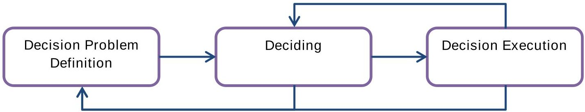

Figure 1. A Decision-Based Process

The tendency to enable systems to make autonomous decisions has grown over the last decade (Davenport and Harris 2005). The main challenges to the dissemination of decision automation, or automated decision making (ADM) has been the difficulty to facilitate effective and complete reasoning about actions and plans (Georgeff and Ingrand 1989) and to faithfully capture human preferences (Peters and Ketter 2013). The challenge is to incorporate human factors such as bounded rationality and preference sets into the DM automaton. Nonetheless, mechanisms for online and real-time DM are needed in various applications, e.g., aerospace & defense, health monitoring, safety-critical systems, and supply-chain management. Many systems with automated decision making and execution capabilities have been criticized due to failures in automation logic and safeguard design. Some of them indeed led to dire consequences and catastrophes (Leveson 2011). The parallel field of risk-oriented system design has also contributed to the transition from artificial, simplified models, to environmental and situational awareness as a fundamental condition to autonomous decision making (Haimes 2009a; Haimes 2009b; Redmill, Chudleigh, and Catmur 1997; Mordecai and Dori 2014).

Automated and autonomous decision making systems have the potential to solve challenging decision problems that cannot be solved by a single decision-maker or by the common user. Natural candidates for decision automation are well-structured problems, with a finite decision logic. Such problems require frequent, real-time choice and action, and rely on huge quantities of online, reliable information. Moreover, an external user may, and sometimes must, have the capability to control the decision making process. The operating user may need to manually override system decisions and actions, or to authorize critical decisions or actions. The user may need to interfere in case of failure, anomaly, inconsistency, irrationality, hazard, or any other reason for undesired continuation of the automated process by the system. More advanced users may need a certain degree of flexibility to reconfigure the decision logic and to enable or disable an escalating process.

Human DM, with or without the aid of decision-support systems, is an intensively studied field of science. In comparison, DA remains a marginal, esoteric extension of the field. The transition from decision support to decision automation has been an ongoing vision (Bucklin, Lehmann, and Little 1998; Shim et al. 2002). This transition would enhance system productivity, improve decision-making results, and meet the demands for flexibility and

<!-- PDF_PAGE: 3 -->

customization. While decision and execution automation technology and artificial intelligence have been a subject of scientific research for several decades, transition to implementation and utilization has begun only during the previous decade (Davenport and Harris 2005). In spite of ongoing development of these technologies, the adoption of decision automation is far from becoming common. Nevertheless, this branch is constantly moving forward with the increasing use of intelligent products, infrastructures, and agents, household robots, cyber-physical systems, e-commerce, big-data and cloud-computing environments (Mattia 2012). Our primary concern is that DM mechanisms are designed and implemented with insufficient decision theoretical foundations to substantiate and underpin the DM process (or parts of the process) carried out by the system.

In this paper we provide a model-based framework for integrating DM and decision-support mechanisms and processes into complex systems. Employing a systems thinking approach, we define the generic DM problem as a systemic, system-solvable and system-executable problem. We employ formal conceptual modeling semantics, making the system and its DM parts seamlessly interoperable. This approach has three benefits: a) A well-defined DM model, based on decision-analytic semantics, b) an integrated, unified model of core system functionality and DM/DS functionality, and c) facilitating decision making about decision making, answering such questions as where and with respect to what factors should decisions be made, who should make them (human or machine), and under what circumstances. Our underlying framework is OPM - Object-Process Methodology (Dori 2002) - a structured conceptual framework for modeling and design of multidisciplinary, complex, and dynamic systems and systems-of-systems.

The rest of this paper is organized as follows: In Section 0 we discuss the linkage between systems engineering and decision analysis and automation. Section 0 describes OPM and our proposed OPM model-based metamodeling decision making, support and automation framework, decision, . In the last section, Section 0, we discuss benefits, limitations, future extensions, and implementation of our DM framework to various problems.

## Systems Engineering and Decision Analysis

Taking a systems thinking approach to design and implementation of decision making processes, we define and elaborate on the following aspects: (1) Functional and technical requirements for decision making, (2) Pertinence, linkage, and service of the decision making process mechanism to other systemic processes, (3) Interfaces to external systems, repositories, and users, (4) Resources that the system must access in order to carry out the decision making process successfully, including decision-related data, information and knowledge, computing resources, user input, feedback, and preferences, (5) Real-world reaction and feedback, and (6) Monitoring and control of the decision making process and enabling resources.

Functional, procedural, and structural aspects of the problem and its domain are captured and analyzed in a model. Decision management aspects, e.g., decision recording, implementation tracking, execution monitoring, feedback collecting and storing, report generating, and debriefing are all part of our extended model. Non-functional aspects, e.g., reliability,

<!-- PDF_PAGE: 4 -->

availability, and performance, can be expressed as attributes of specific objects and/or processes in the same model, or articulated in complementary models (less desirable).

Decision analysis is rooted in both the social and exact sciences, giving rise to two approaches to DM: the behavioral, human-centered (Kahneman 2003) and the analytical, model-centered (Pratt, Raiffa, and Schlaifer 1964; Saaty 1990). The behavioral approach views DM as a human-based process, in which a person or group of people need to make a decision under various constraints and uncertainty. This approach deals with issues related to biases, heuristics, rationality and rationalization, analysis paralysis, and a host of other aspects and phenomena of human cognition. Managerial aspects, like decision tracking and assurance, can be considered part of the behavioral approach.

The scientific-axiomatic approach views decision making as an analytical problem; it includes definition of alternatives, evaluating them according to predefined criteria and objectives, and comparing them with each other in order to find the best alternative. Formal, well-structured analytical models are programmable and executable; a machine can implement the process, execute the selected action, and report the result. A major problem in this approach is that many parts of the system under design cannot interact with the analytical DM mechanism since it is not integrated into the model of the system-to-be. In (Yang and Wang 2012) for instance, an analytical multi-objective optimization model is proposed to control energy consumption in a smart building, but the analytical model is not coordinated with the building's systemic model. Thus, complex aspects, such as how to convey indicative measurements as state variables to the optimization model might be missed.

Complex systems design poses DM challenges that are both behavioral-managerial and analytical. Decision support capabilities range from decision documentation to artificial intelligence. Decision support terminology differences exist at the personal, organizational, technological, and cultural levels. We discern five categories of decision support tasks, summarized in Table 1: information management, formulation, recommendation, selection, and execution & learning. A system can be tasked with any subset of these tasks, at varying levels of complexity and compliance. The criticality of the decision making and its effective realization to achieving system objectives motivates a transition from simplistic information management and external alternative formulation to automated, multi-objective and temporally appropriate decision making. While information management and mechanical calculations can be easily achieved using electronic charts, higher levels of decision making and execution may require a host of advanced computational and technological capabilities.

The INCOSE Systems Engineering Handbook (INCOSE 2011) discusses decision management and analysis mostly as an engineering management process. The decisions the handbook refers to are mostly programmatic or architectural. Programmatic decisions are made in decision gates, which help alleviate managerial complexity and reduce risk in transition between phases. These decisions concern program continuity, resource allocation, and scope modification and adjustment. The Decision Tree technique is advocated for this type of decisions. The architectural design process includes decisions about architecture, design, technology, and vendor selection. These decisions refer to such aspects as system objectives,

<!-- PDF_PAGE: 5 -->

resource constraints, interface accommodation, economic and non-economic costs of implementation and operation, and side-effects associated with architecture selection.

Table 1. Decision support task categories

<table border="1"><tr><td>Task</td><td>Description</td></tr><tr><td>Information Management</td><td>Recording and displaying decision-related data and information, including descriptions and characterizations of alternative solutions, the selected solutions, the status of their execution, historical and archival data, and DM know-how (e.g., business rules, formalisms, and guidelines).</td></tr><tr><td>Formulation</td><td>Identification and analysis of decision points, alternative solutions, constraints, impacts, and utilities, as well as applicable and distinctive evaluation criteria, in order to formulate a decision problem.</td></tr><tr><td>Recommendation</td><td>Analysis, evaluation and comparison of alternatives based on decision criteria, and elicitation of the single or a limited set of best solutions or courses of action.</td></tr><tr><td>Selection</td><td>Automated consideration of the current state of affairs and the urgency of making a choice, and selecting the seemingly best single course of action, or a feasible combination of courses of action.</td></tr><tr><td>Execution &amp; learning</td><td>Translation of selected or designated courses of action into operational actions, communicating them, monitoring their implementation, controlling it, and learning to do better in future similar scenarios.</td></tr></table>

Trade study is the process of analysing various architectural design alternatives, whereby the characteristics of each option are traded against each other (INCOSE 2011). The analysis also accounts for the sensitivity of the selection to changes in the input. A trade study can be applied, for example, to requirements vs. constraints, architecture features vs. dictated equipment or interface requirements, or weighing alternative functional or performance choices. The primary phases of a trade study are (1) problem scoping, (2) communicating with stakeholders, (3) evaluation criteria and weight definition, (4) alternative definition and filtering, (5) candidate alternative evaluation based on measures of merit, (6) result analysis and best alternative selection, (7) review and re-evaluation of the selection, (8) implementation impact analysis, and (9) assumption testing and validation.

The decision analysis process (DAP) defined in the NASA Systems Engineering Handbook (NASA 2007) is also mostly directed to engineering management decision making regarding key issues and decision points in a program lifecycle, e.g., resource allocation, test method selection, design alternative selection, product vendor and technology selection, and mission-critical go/no-go authorizations. The process, illustrated in Figure 2, does not include several critical procedural aspects that are relevant to both managerial and system-based DM. Decision execution, implementation monitoring, control, and evaluation are missing. In many cases, the decision process is a serial, iterative process of repetitive decisions, whose results and impacts are fed back to the DM mechanism for the next decision iteration, such as autonomous vehicle navigation and motion planning, or automated investment portfolio management. The selection of a solution should be based on a pool of recommended solutions, not a single one, the current state of affairs (including a viable solution from previous decision iterations to account for), and the impact of solution changing. Alternative solution evaluation should take uncertainty and risk into consideration. This notion is discussed under the relevant sections describing each phase of the process in the NASA handbook, but the presence of uncertainty should be emphasized at the top-level process, as uncertainty is an inherent part of any DM problem. Lastly, the final selection of a solution should account for a set of

<!-- PDF_PAGE: 6 -->

decision-makers, with different views and interests, information availability, and understanding of the problem at hand.

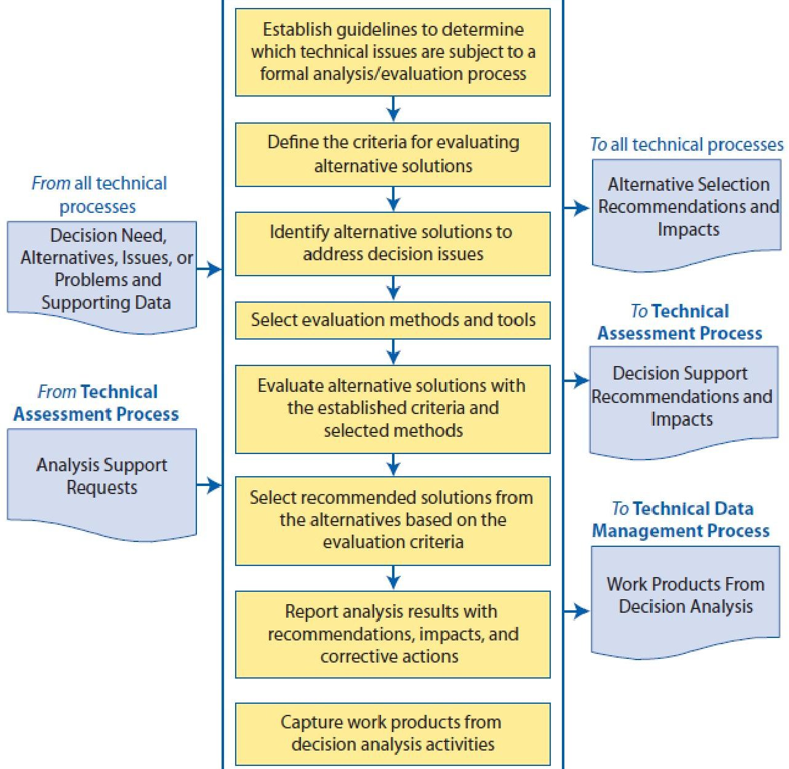

Figure 2. The Decision Analysis Process (NASA 2007)

Both the NASA and INCOSE handbooks ignore the potential application of decision making theory to the design of decision making functionality. The decision-making model according to which the system acts is a critical functional requirement. We believe that the responsibility to model and design DM mechanisms and processes, especially for central system decisions and critical operational controls, is an important role of the system engineer. The behavior of the entire system is affected by the decision and the utilities determining how decisions will be made and which courses of action will be chosen, and these are derived from preferences of the various system stakeholders. This approach differs from the classical control system approach, in which the control problem usually implements a physical control model which does not account for preferences in the presence of uncertainty, but mostly relies on feedback loops (Aström and Hagglund 2001). As an example, consider the difference between the selection of ballistic missile interceptor launcher dispersion for optimal coverage of critical assets, on one hand, and the interceptor's trajectory selection algorithm, which is strictly related to physical aerodynamic and atmospheric conditions, on the other.

<!-- PDF_PAGE: 7 -->

A well-defined DM functionality requirement should be placed when the following characteristics are manifested by system requirements: (1) Complex conditionality. (2) Dependency on various combinations of input and state indicators. (3) Rigid or flexible preference relations. (4) Adaptive selection from a set of alternatives. Good systems engineering practice would identify places where stakeholders intend to confide DM responsibility to human operators, analyze and understand the decision logic, and suggest automation alternatives, enhancements, utilities and controls, to replace or minimize fault-prone DM. Extending the applicability of the processes suggested by the NASA and INCOSE handbooks to system-based DM might require several modifications and adjustments, but the theoretical foundations of decision analysis apply to automated DM at least as well as they suit human DM.

Decision-centric systems engineering (Mendonza and Fitch 2013) builds the design effort around stakeholder decisions, being the driving forces behind the transformation of problems to solutions. The hierarchical decision model is integrated with the mathematical-physical model, the architectural model, the product lifecycle model, and the programmatic model.

While the literature clearly focuses on stakeholder and designer DM, it hardly deals with modelling and design of DM processes. While any decision making scheme is based on some model, a model-based approach requires using a problem-independent modelling language, constructed according to a global set of metamodel rules and conventions. As a benchmark, we expected to find such an approach in UML or SysML metamodels, but we could not identify a significant resource providing a framework for this problem (Estefan 2007; Sharon and Dori 2009). Integrating decision making mechanisms into software systems without a valid UML base model is possible, but this poses many challenges and issues that can be easily and elegantly solved when a model-based framework is employed.

## The Decision-Making Process Model

## Object-Process Methodology

Object-Process Methodology, or OPM (Dori 2002), is a holistic, integrated approach to the design and development of systems in general and complex dynamic systems in particular. OPM is an emerging ISO standard (ISO 19450) and the basis for a new generation of model-based ISO standards. It is a notable, leading modeling and design methodology (Estefan 2007) and the basis for various applications and system models in space missions, defense, medicine, biology, industry, safety, and software development.

OPM captures the functional, structural, and procedural aspects of the system in a single unified model. OPM models are bimodal—they are expressed by both a graphical modality and a textual modality. The graphical view consists of a set of hierarchically organized, interconnected, and cross-validated Object-Process Diagrams (OPDs) of a single diagram type. Each OPD extends the OPD above it and adds more details, providing for inherent complexity management and reduction. The same compact set of elements (entities and links) holds for all the levels of the OPD hierarchy. A subset of English, Object-Process Language (OPL) is a

<!-- PDF_PAGE: 8 -->

structured textual specification language. Each OPD is accompanied by an OPL clause, and each graphical OPD construct is described by a semantically equivalent textual OPL sentence.

OPM consists of a compact set of modeling elements and corresponding representing graphical symbols. The elements Process (ellipse), Object (rectangle), and state (ountangle), are shown in Figure 3. Processes and objects may comprise other processes and objects. States may only characterize objects. Relations between these elements are expressed by various links. Structural links, shown in Figure 4, support the description of static model aspects. Procedural links, shown in Figure 5, support procedural relations, dynamics, and causalities.

OPM copes with complexity via detail-level decomposition, in contrast to the aspect decomposition into structure, behavior, state transitions, activities, time flow, etc. that UML with its 14 diagram types and SysML with its nine diagram types advocate. The hierarchically-organized OPDs are derived from each other using one of the following refinement-abstraction mechanisms: (1) Unfolding and folding of structural hierarchies of things (primarily objects), (2) Zooming into or out of the inner details of things (primarily processes), and (3) Expressing additional information through dedicated views. Every model fact needs to be defined at least once, in any of the OPDs in the OPD set, in order for it to be true for the entire model. Any model fact can be replicated in any OPD, but it applies to any OPD even if it is not expressed in it explicitly.

OPM models can be constructed with a freely available CASE tool, OPCAT $ ^{1} $ (Dori, Linchevski, and Manor 2010). OPCAT provides a GUI for analysts to create, manage, and share their models; it supports most OPM concepts, and immediately validates model edits according to OPM syntax and rules; it automatically generates OPL sentences in response to graphical model edits, and provides a whole-model or per-diagram OPL description. OPCAT also provides a built-in qualitative simulation engine which supports model validation, verification, and testing, and is especially useful in visualizing the execution of multivariate scenarios. OPM's characteristics and capabilities enable clear and concise modeling of complex processes and structures, such as required for describing the DM process. OPM's static-dynamic and structural-procedural unified view has proven complexity management and alleviation capabilities that cater to complex system and process modeling (Dori, Reinhartz-berger, and Sturm 2003). Table 2 describes how each primary OPM feature or capability supports the rigor, robustness, and adoption of the proposed framework.

Figure 3. OPM Basic Concepts: Object, Process, and State

<!-- PDF_PAGE: 9 -->

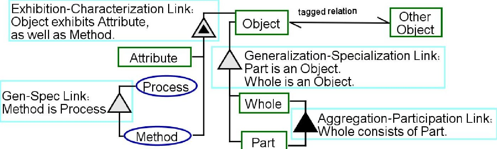

Figure 4. OPM Structural Relations

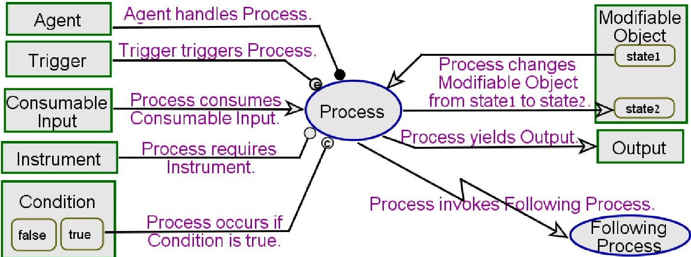

Figure 5. OPM Procedural Relations

Table 2. Benefits of OPM for Automated Decision Making Modeling

<table border="1"><tr><td>OPM characteristic</td><td>Utilization for DM and ADM modeling</td></tr><tr><td>Built-in hierarchical decomposition and complexity management</td><td>Facilitation of gradual development and extension of the DM model. The generic process can be described at a high level, while domain-specific evaluation and analysis can be defined at the lower ones.</td></tr><tr><td>Bimodal graphical-textual model representation</td><td>Conceptual appeal to both visualists and formalists, catering to the modal preferences of systems architects, domain experts, performance analysts, professionals, practitioners, operational stakeholders, and decision analysts.</td></tr><tr><td>Metamodeling capability</td><td>Smooth transition from the generic DM process-oriented level to the application-specific DM problem level; easy adoption of metamodel concepts.</td></tr><tr><td>ISO standardization as PAS-19450</td><td>Accelerated dissemination and adoption, especially by authorities, regulators, enterprises and corporates; Reinforcing existing design standards with system-based DM concepts.</td></tr><tr><td>CASE tool availability</td><td>Easy adoption and utilization of the framework, especially in conjunction with existing OPM models; quick migration from other model-based approaches.</td></tr></table>

## System-Based Decision-Making Metamodel

We now turn to present the primary contribution of this paper-a conceptual metamodel for a generic system-based DM process. This is a preliminary model which adheres to the high-level commonly acceptable DM process. It can and will be further extended in the future to accommodate various techniques and approaches to accomplish the objectives of each phase of the process, such as criteria weighing techniques and sensitivity analysis in the candidate solution marking. At the topmost level of the metamodel we define the Decision Making process, which is performed by an intelligent component of the system-the Decision Making

<!-- PDF_PAGE: 10 -->

Agent. The process affects a Decision Variable Set, based on a Decision Model, and a State Variable Set, which determines the specific conditions at the moment of making the decision, and can also manifest input variability and uncertainty. The entire process is handled, in the broadest sense, by a Decision Maker Group. This simple and clear description is captured in the object-process diagram (OPD) in Figure 6.

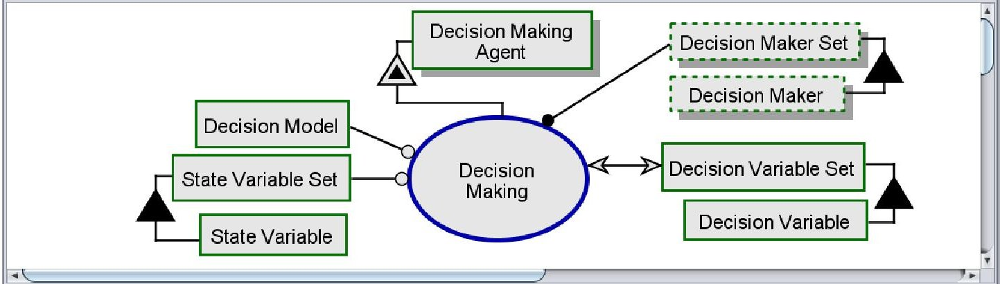

Figure 6. Top Level OPM Metamodel of Decision Making - OPD

Using OPM's in-zooming mechanism, we now zoom into the Decision Making process and decompose it into a series of subprocesses. The in-zoomed Decision Making process is illustrated in the OPD in Figure 7, and the corresponding OPL text follows in Figure 8. The in-zoomed view provides additional details about the underlying information model as well. It includes, for instance, a Utility Function, Criterion Set, Parameter Set, and Alternative Set, which are all outputs, resources, or affectees (affected objects, i.e., objects whose state change as a result of occurrence of the process or any of its subprocesses.

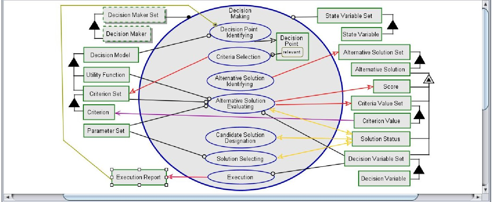

Figure 7. OPD of the in-zoomed Decision Making process

Each subprocess of Decision Making can be further in-zoomed through the same complexity management and detail decomposition mechanism. The Decision Point Identifying subprocess is an important trigger for the entire process. It is especially critical in system-based DM, since without necessary indications, the system will not recognize a decision point. The presence of this subprocess in the model is also in line with the physical-informatical essence duality (PIED) (Mordecai, Chapman, and Dori 2013): the system interacts with real-world entities based on their informatical manifestations that it holds. These manifestations must be constantly verified and refined in order to facilitate coherent system behavior. The analysis of

<!-- PDF_PAGE: 11 -->

the Execution Report, which is generated during decision Execution, is a real-world result indicator of the effect of the actions taken due to the decision that had been made previously. Unnecessary DM may result in redundant or unwanted state changes that might, for example, trigger wasteful resource consumption. After the criteria for a decision point have been met, execution report analysis aims to ascertain the need for DM according to what the Decision Making Agent perceives as the actual state of affairs. The Decision Point Identifying process is illustrated in Figure 9 (OPD) and Figure 10 (OPL).

Decision Model consists of Criterion Set and Utility Function.

Decision Maker Set handles Decision Making.

Alternative Solution exhibits Decision Variable Set, Score, Criteria Value Set, and Solution Status.

Criterion Value relates to Criterion.

Execution Report triggers Decision Point Identifying.

Decision Making exhibits Decision Point.

Decision Making consists of Alternative Solution Identifying, Criteria Selection, Alternative Solution Evaluating, Candidate Solution Designation, Solution Selecting, Execution, and Decision Point Identifying.

Decision Making requires State Variable Set.

Decision Point Identifying requires Decision Model and Execution Report.

Decision Point Identifying yields Decision Point.

Criteria Selection occurs if Decision Point is relevant.

Criteria Selection yields Criterion Set.

Alternative Solution Identifying yields Alternative Solution Set.

Alternative Solution Evaluating requires Decision Variable Set, Parameter Set, Criterion Set, and Utility Function.

Alternative Solution Evaluating affects Solution Status.

Alternative Solution Evaluating yields Criteria Value Set and Score.

Candidate Solution Designation affects Solution Status.

Solution Selecting requires Parameter Set.

Solution Selecting affects Solution Status.

Execution requires Decision Variable Set.

Execution yields Execution Report.

Figure 8. OPL of the in-zoomed Decision Making process

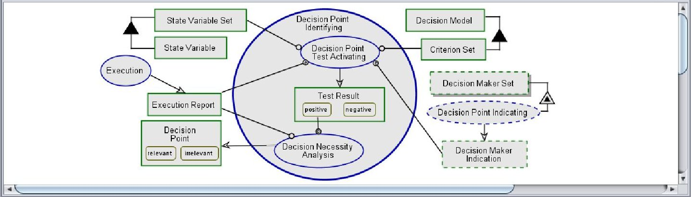

Figure 9. OPD of the in-zoomed Decision Point Identifying process

An interesting view displays the individual Alternative Solution's states and state transitions effected by the different subprocesses of Decision Making. This view is visualized as an OPD in Figure 11 and described textually by OPL in Figure 12. This view is not a part of the process decomposition hierarchy, but it is completely consistent with the model. Any additional model fact in this view applies to the entire model. State transitions defined in this view apply to the subprocesses of the process in the diagram and will take place during process execution even if not shown there. As another example, the Solution Replacing subprocess, a constituent process of Solution Selecting, will take place as part of its enveloping process wherever it occurs in the model. The order of subprocess execution, which is set in the in-zoomed process diagram, holds for this view as well, regardless of the actual positioning of the subprocesses in this view. The state transitions defined in this view apply to the process diagram, and will take place even if not described in the process OPD.

<!-- PDF_PAGE: 12 -->

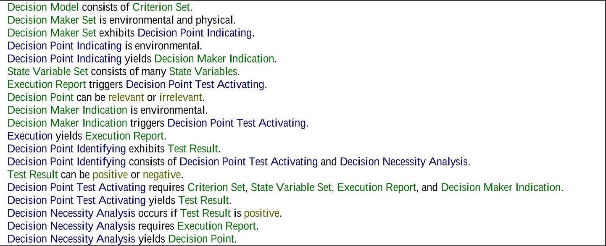

Figure 10. OPL of the in-zoomed Decision Point Identifying process

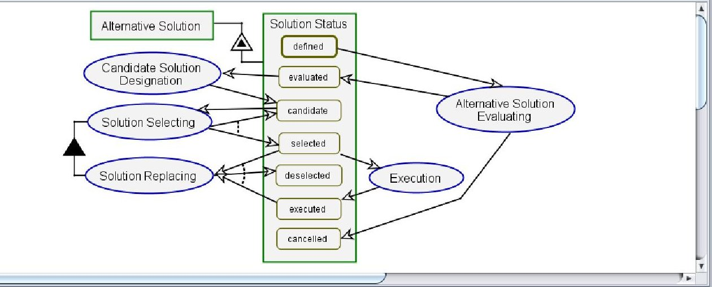

Figure 11. OPD of alternative solution's status during the decision-making process

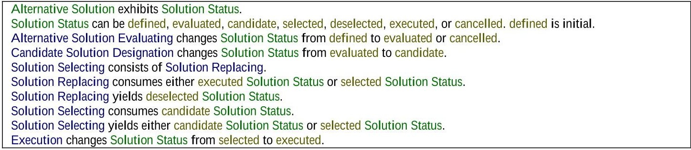

Figure 12. OPL of alternative solution's status during the decision-making process

The last view we present pertains to the Execution subprocess. We chose to focus on this phase for two reasons. First, this phase is often forgotten or neglected when modelling DM processes. Second, the control flow it consists of includes several important and critical notions we wish to elaborate on. The OPD is illustrated in Figure 13, while the textual OPL description follows in Figure 14. A configurable Auto-Execute enabler supports both manual and automatic execution modes. The Control Signal Issuing process causes a physical Actuator of the system to take some physical action, e.g., moving, while the PIED-aware Implementation Detecting & Representing process tracks the result of the Actuator's action. While a decision is resolved and set forth by the Decision Making Agent, its actual implementation may take place only partially or not take place at all, due to external factors. This notion must be understood, modelled, and accounted for as part of decision execution control.

<!-- PDF_PAGE: 13 -->

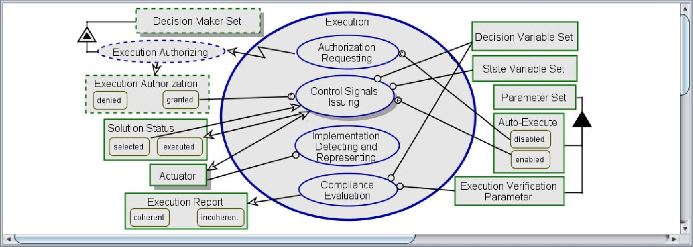

## Figure 13. OPD of the in-zoomed Execution process

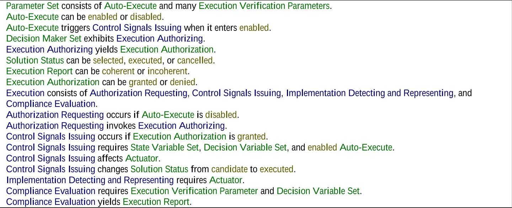

Figure 14. OPL of the in-zoomed Execution process

## Summary

Decision making processes made by humans and machines have several elements in common. This is probably since the way systems are designed to make decisions is ultimately dictated by a human designer. More importantly, disregarding human irrational decision making and bounded rationality, the decision made by the machine must make sense to the human who might be affected by the decision or its consequence. It might not appeal to the human, but it has to appear sufficiently rational for the human to accept it. Rationality in this sense includes both the well-structured, well-informed and well-executed nature of the decision making process, and consistency with the human's preferences and expectations. This dual index of rationality is often a challenge, as the two streams might contradict each other. This is so mainly becuase human stakeholders are irrational, and they have difficulties accepting the choices made by automated systems according to predefined stakeholder preferences.

In this paper, we have introduced a model-based framework for the design of system-based automated DM processes. The framework captures all the phases of a system-based DM process. It employs a systems thinking approach in order to bridge the gap between the behavioral-managerial approach and the scientific-axiomatic approach to DM and decision analysis. The framework enhances the standardization of DM process modeling and design. It

<!-- PDF_PAGE: 14 -->

promotes model completeness and contributes to the integration of the domains of systems engineering with decision making and analysis. Our framework reduces, and in some cases eliminates, modeling and implementation biases and failures that could have occurred due to lack of attention to details and critical modeling issues.

The preliminary metamodel can be instantiated, specified, and specialized for a wide variety of DM and DSS. Using OPM, we o capture the procedural, functional, and structural aspects of the decision problem within a single model, based on a hierarchically-organized set of object-process diagrams, accompanied by a formal machine-generated and human- and machine-readable textual description in OPL—a subset of natural English. We account for various control aspects preceding and following the DM process, e.g., decision point identifying prior to making the decision, and compliance evaluation thereafter.

Future research includes the completion of all the phases of the metamodel, in order to provide a holistic DM framework which accommodates the various specialized techniques used for the DM core activities: criteria definition, alternative solution identification, exploration, evaluation, solution pooling, and solution selection. In addition, we are currently studying several application domains in order to demonstrate and prove the generic applicability of the framework. Two of these domains are defense and health. In the defense domain, we study several complex, large-scale, multidisciplinary defense systems in the fields of network centric warfare, ballistic missile defense, and homeland security. In the health domain, we study the applicability of our framework to robot-assisted surgical procedures and to privacy and confidentiality assurance during medical and personal information exchange among health-related stakeholders and objects. These include organizations (health authorities, hospitals, healthcare services, insurance companies...), staff, medical devices (scanners, sensors, detectors, treatment devices...) and medical records. For these purposes we seek to integrate our conceptual modeling framework for System-of-system interoperability (Mordecai and Dori 2013) with the framework presented in this paper.

Acknowledgements. The authors would like to thank the Bernard M. Gordon Center for Systems Engineering at the Technion - Israel Institute of Technology, and the Israel Ministry of Science and Technology for funding this research. We would also like to thank the anonymous INCOSE IS referees and editors for their useful, constructive comments and suggestions which significantly helped in improving this paper.

## References

Aström, KJ, and T Hagglund. 2001. "The Future of PID Control." Control Engineering Practice 9: 1163-1175.

Bucklin, R, D Lehmann, and J Little. 1998. "From Decision Support to Decision Automation: A 2020 Vision." Marketing Letters 3: 235-246.

Davenport, TH, and JG Harris. 2005. "Automated Decision Making Comes of Age." MIT Sloan Management Review.

Dori, Dov. 2002. Object-Process Methodology: A Holistic Systems Approach. Object Process Methodology - a Holistic Systems Paradigm. Berlin, Heidelberg, New York: Springer.

<!-- PDF_PAGE: 15 -->

Dori, Dov, C Linchevski, and R Manor. 2010. "OPCAT - An Object-Process CASE Tool for OPM-Based Conceptual Modelling." In 1st International Conference on Modelling and Management of Engineering Processes, edited by S. Heisig, P., Clarkson, J., and Vajna, 1- 30. Cambridge, UK: University of Cambridge.

Dori, Dov, Iris Reinhartz-berger, and Arnon Sturm. 2003. "Developing Complex Systems with Object-Process Methodology Using OPCAT 1 The Basis : Object-Process Methodology": 570-572.

Estefan, JA. 2007. "Survey of Model-Based Systems Engineering (MBSE) Methodologies." INCOSE MBSE Focus Group. Vol. 25.

Georgeff, MP, and FF Ingrand. 1989. Decision-Making in an Embedded Reasoning System.

Haimes, Yacov Y. 2009a. Risk Modeling, Assessment, and Management. Risk Management 3rd ed. John Wiley & Sons. 2009b. "On the Definition of Resilience in Systems." Risk Analysis 29 (4) (April): 498-501. doi:10.1111/j.1539-6924.2009.01216.x.

INCOSE. 2011. Systems Engineering Handbook. Edited by Cecilia Haskins, Kevin Forsberg Michael Krueger, David Walden, and R Douglas Hamelin. v. 3.2.2. INCOSE.

Kahneman, Daniel. 2003. "A Perspective on Judgment and Choice: Mapping Bounded Rationality." The American Psychologist 58 (9) (September): 697-720. doi:10.1037/0003-066X.58.9.697.

Leveson, NG. 2011. Engineering a Safer World. MIT Press.

Mattia, Angela. 2012. "A Multi-Dimensional View of Agent-Based Decisions in Supply Chain Management." Communications of the IBIMA 2012. doi:10.5171/2012.658483.

Mendonza, Pradeep, and John Fitch. 2013. "Integrating System Models around Decisions." In 23rd International Symposium on Systems Engineering. Philadelphia, PA: INCOSE.

Mordecai, Yaniv, Craig Chapman, and Dov Dori. 2013. "Conceptual Modeling Semantics for the Physical-Informatical Essence Duality Problem." In IEEE International Conference on Systems, Man, and Cybernetics - SMC2013. Manchester, UK: IEEE.

Mordecai, Yaniv, and Dov Dori. 2013. "I 5: A Model - Based Framework for Architecting System - of - Systems Interoperability, Interconnectivity, Interfacing, Integration, and Interaction." In INCOSE Internaional Symposium, 1-22. Philadelphia, PA: INCOSE. 2014. "Model-Based Risk-Oriented Robust Systems Design with Object-Process Methodology." International Journal of Strategic Engineering Asset Management to appear.

NASA. 2007. Systems Engineering Handbook. NASA Special Publication.

Peters, Markus, and Wolfgang Ketter. 2013. "Towards Autonomous Decision-Making: A Probabilistic Model for Learning Multi-User Preferences" (May).

Pratt, Raiffa, and Schlaifer. 1964. "The Foundations of Decision Under Uncertainty" 59 (306): 353-375.

Redmill, F, MF Chudleigh, and JR Catmur. 1997. "Principles Underlying a Guideline for Applying HAZOP to Programmable Electronic Systems." Reliability Engineering & System ... 55: 283-293.

Saaty, Thomas L. 1990. "How to Make a Decision: The Analytic Hierarchy Process." European Journal of Operational Research 48 (1) (September): 9-26.

<!-- PDF_PAGE: 16 -->

doi:10.1016/0377-2217(90)90057-1.

http://linkinghub.elsevier.com/retrieve/pii/0377221790900571.

Sharon, Amira, and Dov Dori. 2009. "A Model-Based Approach for Planning Work Breakdown Structures of Complex Systems Projects." In Proc. 14th IFAC Symposium on Information Control Problems in Manufacturing.

Shim, J.P., Merrill Warkentin, James F. Courtney, Daniel J. Power, Ramesh Sharda, and Christer Carlsson. 2002. "Past, Present, and Future of Decision Support Technology." Decision Support Systems 33 (2) (June): 111-126. doi:10.1016/S0167-9236(01)00139-7.

Yang, Rui, and Lingfeng Wang. 2012. "Multi-Objective Optimization for Decision-Making of Energy and Comfort Management in Building Automation and Control." Sustainable Cities and Society 2 (1) (February): 1-7. doi:10.1016/j.scs.2011.09.001.

Zeleny, M. 1982. "The Decision Process and Its Stages." In Multiple Criteria Decision Making, edited by M Zeleny and JL Cochrane, 85-95. New York: McGraw-Hill, Inc.

## Biography

Yaniv Mordecai is a Ph.D. candidate at the Technion - Israel Institute of Technology and a system engineer with Elbit Systems, an Israeli international defense corporate. He holds M.Sc. (2010, cum laude) and B.Sc. (2002) degrees in Industrial Engineering from Tel-Aviv University. He has 12 years of experience in project management and systems engineering in large scale projects. His research interests include systems engineering, model-based systems engineering, risk analysis and decision analysis, interconnectivity and interoperability, and Operations Research.

Dov Dori is a Visiting Professor and Research Affiliate at the Engineering Systems Division, Massachusetts Institute of Technology; Information and Systems Engineering Professor and Head of the Enterprise System Modeling Laboratory at the Faculty of Industrial Engineering and Management, Technion - Israel Institute of Technology (on sabbatical); a fellow of INCOSE, a Senior Member of IEEE and ACM, and a Fellow of the IAPR. He invented and developed Object Process Methodology (OPM) and its CASE tool (OPCAT), and won the Technion Klein Research Award, the Hershel Rich Innovation Award, and the Dudi Ben Aharon Research Award for Document Image Understanding. He holds a Ph.D. in Computer Science from the Weizmann Institute of Science, Rehovot, Israel (1988), and has authored or co-authored over 200 publications. His research interests include conceptual modeling of complex systems, systems architecture and design, and software and systems engineering.