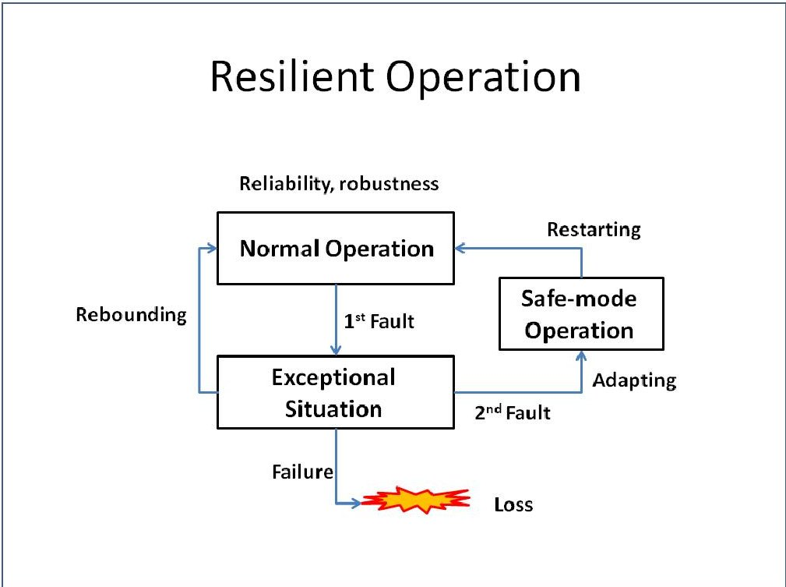
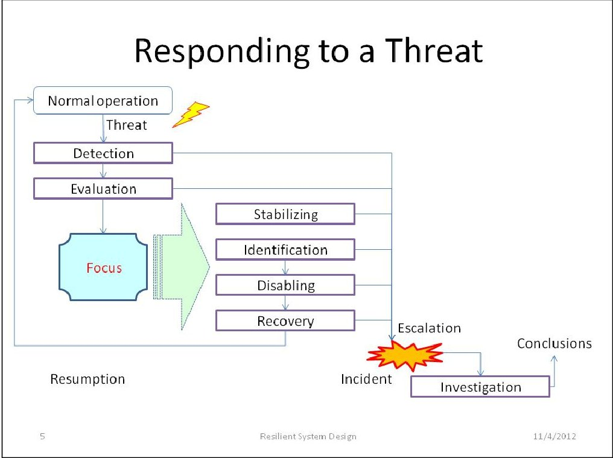
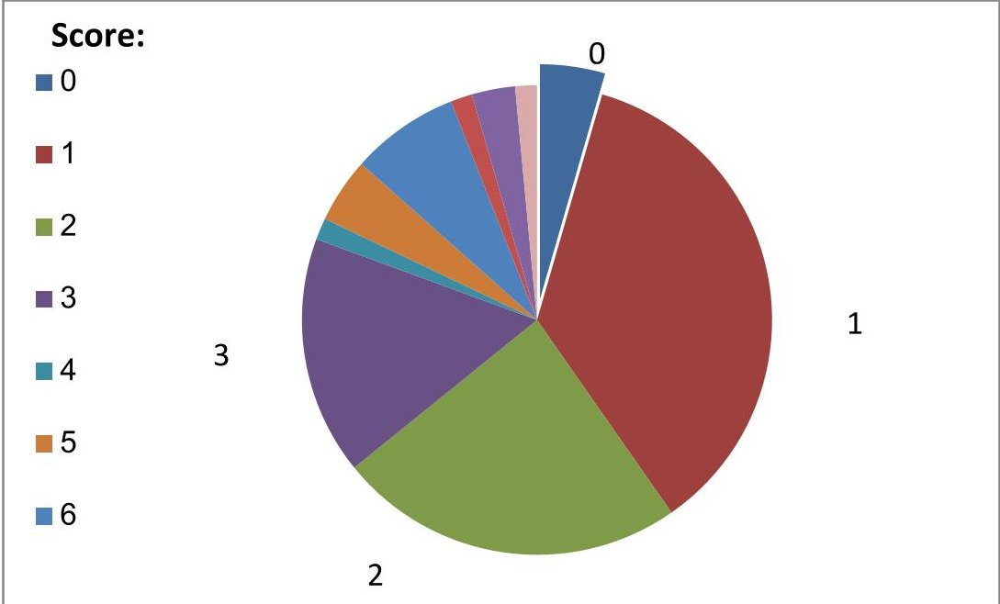

<!-- PDF_PAGE: 1 -->

# A practical guide to assuring the system resilience to operational errors

Dr. Avigdor Zonnenshain

Gordon Center for Systems Engineering, Technion Haifa, Israel

Avi Harel

Ergolight,

avigdorz100@gmail.com, +972 52 2891773

Haifa, Israel

ergolight@gmail.com, +972-54-453-4501

Copyright 2015 by Avigdor Zonnenshain & Avi Harel. Published and used by INCOSE with permission.

Abstract. Studies about the sources of critical accidents in operating human-made systems indicate that most of them are commonly attributed to errors made by the human operators. These findings motivated the development of a guide for designing and developing systems which are resilient to operational errors. This article reports on the development of such a guide by the Gordon Center for System Engineering at the Technion. Assuming the Human Factors variant of Murphy's Law, the guide applies the STAMP paradigm of self-control in scenario-based design, relying on a model of resilient operation. The guide suggests designing three firewalls, for preventing latent threats, preventing escalation and learning from incidents. The effectiveness of the guide was evaluated collaboratively in a special INCOSE_IL working group, by examination of its applicability to case studies. The guide was validated by scoring the guidelines applicability to failure modes observed in a special database of 67 mishaps.

## 1 Overview

This article documents an on-going project of the Gordon Center for Systems Engineering at the Technion. The goal of this project is to develop a guide for system engineers, with guidelines for assuring safe interaction between the operators and the machine.

Section 2 describes prior studies in safety analysis which motivated the need to conceptualize system resilience. Section 3 discusses topics in resilience analysis showing the need for resilience assurance. Section 4 presents various subjects in resilience assurance, demonstrating the need for this project. Section 5 presents the project, including reference to the current version of the guide, description of the history of the guide development, example of using the guide, description of the validation method and outcome, and discussion of limitations in employing the guide. Section 6 includes suggestions for subsequent studies.

This section presents references to topics in safety analysis with focus on the role of the human operator in the system failure.

There are many explanations for the source of system failures. Few of them are:

<!-- PDF_PAGE: 2 -->

- Organizational factors (e.g. Reason, 1997; Dekker, 2006).

- Interaction between inevitable failures (Interactive Complexity, by Perrow, 1984)

- Extreme operational conditions (e.g. Hollnagel et al., 2006; Weiler & Harel, 2011, download)

- Human errors (e.g. Norman, 1983)

- Quality of requirement specification (e.g. Robert et al., 1998; Leveson, 2012, download)

- Quality of the implementation (e.g., Weinberg, 1971; Norman, 1990)

- Mismatch with the operational context (e.g. Zonnenshain & Harel, 2009, download).

The guide does not tackle the various sources and explanations for failure. Rather, it focuses on setting defences against common failure modes, described in a model of resilient operation.

Triggers. An event that instigates an incident is called a trigger. Common types of triggers include (Zonnenshain & Harel, 2013, download):

- An external event, such as an obstacle on a road, or an enemy boat detected by radar

- A hardware unit or a component failure

- Power failure, such as due to battery change or weak connection

- Communication interference or failure

- Unsupported state transition due to missing specifications, design mistakes, software bugs or poor re-engineering

- Operator's error or mistake, such as inadvertent or deliberate activation of a control or a feature, not suited to the operational procedure

- Exceptional changes in production rate.

Beside common types of triggers as in the list, special triggers may be involved in the operation of specific systems.

Root-cause analysis. A common practice for predicting incidents is by applying various trigger-based methods of root-cause analysis, such as Fault Tree Analysis (FTA), Event Tree Analysis (ETA), Failure Mode and Effect Analysis (FMEA), and Hazard Operability studies (HAZOP). Definitions and a comparison of these methods are available in an article by Silvianita et al. (2011, download). Theoretically, such methods can reveal many kinds of failure modes. Practically, the effect of these methods is limited, for the following reasons:

- Perrow (1984) explained that accidents in operating risky systems, such as nuclear power plants, are due to their interactive complexity. Root-cause analysis conducted manually by human beings cannot handle all the combinations of concurrent faults. The incidents materialize mainly combinations that were skipped in the analysis.

- Hollnagel (1983) pointed out that the same sequence of events may lead to both success and failure. Therefore, root-cause analysis is useful only when going backward, by backtracking prior incidents, but is useless for predicting future incidents.

- Firesmith (2005, download) and Robert et al. (1998) explained that mishaps might be the result of incomplete system specification.

- Taleb (2007) argued that Black Swan accidents cannot possibly be predicted, because there is no data about prior events.

<!-- PDF_PAGE: 3 -->

- Zonnenshain and Harel (2009, download) demonstrated that often, operational errors are the result of inconsistency in the state of the extended system, and especially, of the machine-operator interaction.

Therefore, other kinds of techniques should be employed to predict risky situations.

Human errors. A primary source of critical system malfunction is often attributed to human errors. Human errors explain most accidents in the air (60% PlaneCrashInfo 2014, download) sea (80% Baker & Seah 2004, download), driving (90% AlertDriving 2014, download), and in the industry (60-80% Kariuki & Lowe 2014, download). Human errors are the primary source of operational loss: by accidents, damage to property, low productivity, or user dissatisfaction (Landauer, 1996). Many of the usability issues in operating consumer products, such as home TV, are due to use errors (Zonnenshain & Harel, 2009, download). Yet, the meaning of the term "human error" is ambiguous. In many cases the loss is attributed ad hoc to the person who happened to be on duty at the time of the event (Dekker, 2007). In attributing the incident to the trigger, instead of the situation, the system stakeholders typically become sloppy and careless about the design features that could have prevented the incident (Harel, 2010, download).

Operational errors. The term "human error" often refers to an unintentional action that triggered a failure. Such definition is commonly used in studies of organizational behavior (e.g. Frese & Keith, 2015). The problem with this definition is that in many cases, the loss cannot be attributed to any unintentional action, or even to a judgment error. In these cases, this term should rather be attributed to the interactive complexity (Perrow, 1984), namely, to operating the system in exceptional situations (Hollnagel et al., 2006).

Another problem in using the term "human error" is that it may apply to various people roles, such as system developers, operators or accident investigators, and to various situations, such as system design, operation or marketing. The reported guide is about preventing incidents commonly attributed to errors that occur during the operation. To avoid confusion, the guide and this article use the term "operational errors". In this article, the term "error" may also be used as a shortcut for "operational error".

System resilience. Resilience is a system property enabling safety assurance. The Oxford English Dictionary on Historical Principles (1973) defines Resilience as "the act of rebounding or springing back." This definition applies to materials which return to their original shape after deformation. The System Engineering Body of Knowledge (SEBoK) defines system resilience as "the ability of a system to recover from a disruption". The Resilient Systems Working Group (RSWG) defines Resilience as "the ability of organizational, hardware and software systems to mitigate the severity and likelihood of failures or losses, to adapt to changing conditions, and to respond appropriately after the fact". Harel and Weiss (2011, download) defined the term, adjusted to interactive systems, as the ability of systems to mitigate the risks of failures or losses, when operating in exceptional situations. Hollnagel (2015, download) describes the history of the term, highlighting the human factors. According to his new definition "A system is resilient if it can adjust its

<!-- PDF_PAGE: 4 -->

functioning prior to, during, or following events (changes, disturbances, and opportunities), and thereby sustain required operations under both expected and unexpected conditions".

These definitions apply also to the reported guide. In this guide, expected conditions are those that follow known triggers, and unexpected conditions are those due to interactive complexity (Perrow, 1984).

## 3 Resilience analysis

This section presents references to topics in resilience engineering with focus on the role of the human operator in the system failure.

Resilience engineering. Hollnagel (2015) explains the motivation and scope of Resilience engineering. The purpose of resilience engineering and architecting is to achieve full or partial recovery of a system following an encounter with a threat that disrupts the functionality of that system. It is "about the characteristics of resilient performance per se, how we can recognise it, how we can assess (or measure) it, how we can improve it. The discussions should therefore focus on what resilience (or rather, resilient performance) IS, rather than on what it IS NOT".

Operational threats. Zonnenshain & Harel (2013, download) argue that system failure is mostly due to operating in exceptional situations, because the operational procedures are specified with expectations about the operational context, which is often implicit. The authors defined predictable exceptional situations as those due to disturbances, namely, to predictable exceptional events. Examples of predictable exceptional situations include:

- Under risk of an external threat

- Extreme operational condition (such as slippery road)

- Hardware failure

- Power failure

- Communication failure

- State mismatch, due to improper event (such as an operator's action), generated or received in a wrong scenario (for which a response procedure was not defined).

The authors argue that exceptional situations are the result of budget and delivery time constraints, and therefore are error-prone. The results of operating in exceptional situations are often unpredictable.

The authors observed that unpredictable situations are due to missing or wrong specifications, to design mistakes, or to implementation errors (software bugs). Examples of unpredictable situations include:

- Exceptional machine state (which is irrelevant to a particular stage in a particular operational procedure)

- Exceptional context (not mentioned in the system requirement specification document).

<!-- PDF_PAGE: 5 -->

Because incidents are often associated with unpredictable situations, operational resilience may be redefined as a measure of the system persistent to unpredictable situations. Root-cause analysis of many case studies reveals two main key human-related sources of failure:

- Latent threats: the operators are not aware of an exceptional situation, such as a component failure or inconsistent system state, due to missing or wrong indication. In the Three Miles Island (TMI) nuclear power plant accident, the system did not provide indication about the wrong state of five components, and provided wrong indication about the state of the pilot operated relief valves (PORV), which was critical for handling the situation (Perrow, 1984). Related terms are latent failures and later conditions (Eurocontrol, 2006, download).

- Delay in the recovery procedure: the operators do not complete the troubleshooting and the recovery procedure in time (As in the TMI accident).

Both failure schemes result from the system being in an exceptional situation. The first scheme is about the operators being unaware of it, and the second scheme is about the operators' difficulties in handling the exceptional situation.

A model of resilient operation. A model of resilient operation proposed by Zonnenshain and Harel (2013, download) described typical cycles of system operation involving handling exceptional situations. According to this model, system resilience comprises three main features: reliability, troubleshooting and recovery. System failure may typically be the result of improper response to a disturbance, which changes the system state from normal operation to an exceptional situation. This guide proposes an enhanced version of the model, as depicted in the following chart:

Figure 1. A model of resilient operation.

According to the new model, resilient operation involves the following features:

- Relying on reliability and robustness, to retain normal operation

<!-- PDF_PAGE: 6 -->

- Responding to faults by operating in an exceptional situation. Successful operation then may ending up in either immediate recovery (rebounding) or through a session of safe mode operation (adapting). Failure in the operation is defined by loss.

It should be noted that the new model does not restrict the recovery to either rebounding (reverting to a previous state) or adapting (to a new state): rebounding is applicable to expected exceptional situations, while adapting is more relevant to unexpected situations.

Operating in exceptional situations. Responding to a threat is quite complicated as depicted in the following chart:

Figure 2. A model of the mental activities in threat management, reprint from Zonnenshain & Harel (2013, download)

This procedure is error-prone: Bainbridge (1983) argued that operators are typically trained to run the system in normal situations. Often, they are not familiar with the exceptional situation, and they do not know how to recognize and identify the threat. Yet, they need to capture and identify the threat and the particular circumstances in no time, and they need to respond accurately immediately. Often, they are expected to know and follow predefined procedures, which they never had any opportunity to learn and practice beforehand. Bainbridge concluded that the more reliable the automation is, the less the human operators have opportunities to learn how to handle exceptions. Therefore, in emergency, they follow the procedures that are adequate to normal operation, instead of those which are suited to the exceptional situation. The term she used to call this observation is "Irony of automation".

The control dilemma. Jackson (2007) assumes that the system resilience relies on the capabilities of the operators and the organization. However, Zonnenshain and Harel (2013, download) pointed out that because the behavior of the human operators is unpredictable, system engineers typically try to do their best to automate as much as they can. However, the

<!-- PDF_PAGE: 7 -->

results might often be even more risky, when the operators are not aware of the details of the solution. For example, Learmount (2011, download) mentioned that inadequate crew knowledge of automated aviation systems featured as a factor in more than 40 per cent of accidents between 2001 and 2009.

The coordination problem. Occasionally, one of the system units may receive an exceptional event (a slip). As a result, the operational scenario needs to change. For example, in case of a unit failure, the operational scenario may change to "Unit Replacement". If all the system units operate now according to the new scenario, then the system is scenario compliant. Otherwise, if a subset of the system units still operated according to the pervious scenario, then the system reaches a state of internal inconsistency (Zonnenshain & Harel, 2009, download; Harel & Weiss, 2011, download).

The inconsistency can occur in between the machine's units, as was the case with the Therac 25 accidents (Leveson and Turner, 1993), or between two sub systems, as was the case with the friendly-fire accident in Afghanistan, 2001 (Casey, 2006). However, more frequent is the case of inconsistency due to poor coordination between the machine and its operators regarding the active scenario, for example, when the human operator is not aware of a change in the machine situation (Norman, 1990). Inconsistent scenario assumptions are perceived as unpredictable. Unless the machine provides the operator with a reset feature, enabling seamless resumption to normal operation, the inconsistent state might end up in an incident (Zonnenshain and Harel, 2013, download).

## 4 Resilience Assurance

This section provides references to topics in resilience assurance, demonstrating the need for this project.

Proactive resilience assurance. The purpose of the guide is direct designers to assure resilient operation proactively. The proactive strategy directs the designers to identify hazards before they materialize into incidents or accidents and taking necessary actions to reduce the safety risks (Weiler & Harel, 2011, download). Mishaps should not be regarded as force majeure (Harel & Weiss, 2011, download). Rather, system engineers should be able to design and develop systems that can operate safely even when in unusual operational situations. Proactive resilience assurance is about facilitating the system operation, including when in exceptional situations, ensuring safe behavior in such situations, and facilitating the recovery (Zonnenshain & Harel, 2013, download). The guide proposes guidelines for identifying and preventing design mistakes, such as error-prone operational procedures.

Principles for assuring resilient operation. Jackson and Ferris (2013) examined the applicability of 14 principles to 10 case studies. They found that any of these principles can be effective, when combined with other principles. Principle number 5 in their list is about the human in the loop. Zonnenshain & Harel (2013, download) expanded the principle about the human factor, and proposed several sub principles. The reported guide proposes a hyper

<!-- PDF_PAGE: 8 -->

principle, which is about the designers' responsibility to prevent operational errors. It also proposes a set of sub principles, considering the unique properties of the human operators.

The Swiss-Cheese Metaphor. Accidents in complex systems often occur through the accumulation of multiple factors and failures. The Swiss Cheese Metaphor suggests that incidents are due to penetration of events through defenses, represented by cheese slices (Eurocontrol, 2006, download). This model is widely used to describe the cumulative effect of defences against failure. In the reported guide, it is used also to describe the cumulative effect of barriers to recovering from an exceptional situation.

Rule-based operation. The concept of rule-based operation was introduced by Colmerauer and Roussel (1993, download) and implemented in Prolog, a declarative programming language, based on first-order logic. The program logic is expressed in terms of relations, represented as facts and rules. This concept was used later also by Ergolight tools for usability testing, for detecting user errors by event tracking and checking compliance of the operation with special constraints call Usability Problem Indicators (UPI) (Harel, 1999, download).

In her pioneering work, Leveson (2004) introduced the Systems Theoretic Accident Model and Processes (STAMP) paradigm. This paradigm conceptualised the rules of Prolog, asserting that the system should constrain its own behaviour. According to this principle, safety issues are due to violations of (explicit or implicit) rules defining proper operation (opposed to Ergolight tools, which check compliance with indicators of user difficulties).

Harel and Weiss (2011, download) proposed to formalize the system design (for resilience assurance) and suggested that "the system design may include:

- An interaction protocol, defining the rules to control the event processing and the state changes, according to the operating scenario

- A scenario tracker, which may hold and update a record of the operating scenario

- An event interpreter, which may verify that the events received comply with the operating scenario"

The guidelines in this guide include instructions about designing a control unit in charge of handling the STAMP paradigm. The operational rules should be defined explicitly, and the system should constrain its operation according to these rules. Moreover, the guide recommends implementing the rules in a dedicated control unit, and specifying the system response in case of deviations from the constraints.

Choosing between design alternatives. Any solution to a safety problem is liable to introduce new safety problems. For example, if the design includes a means to indicate failure in a system component, then the system is liable to fail because the operators did not notice the indication, or due to failure in the indication. In the incident of 1977 of the Davis-Besse-1 nuclear reactor, after moments of confusion, the operators realized that the PORV was stuck open, and overcame the hazard. Following this and other similar incidents, the manufacturer added a special indicator, to show the state of the PORV in the control room. Unfortunately, this indicator was not reliable. In the TMI accident, which occurred 1.5 years later, this

<!-- PDF_PAGE: 9 -->

indicator did not show that the PORV was stuck open. Yet, the operators relied on the indication, and consequently they did not investigate the valve state in depth (Perrow, 1984).

Risk assessment and unexpected events. The additional components (sensors, algorithms, controls) required to implement the STAMP paradigm are not only costly, but also risky, because they are liable to fail, providing opportunities for new kinds of incidents. Zonnenshain and Harel (2013, download) termed faults in safety means as Secondary. It is challenging to identify the risks imposed by safety solutions, and to evaluate the marginal safety level obtained.

A theoretical method to decide on the means most suited to cope with a threat is by risk assessment, based on estimates of its probability and expected damage. This method was advocated in early versions of ISO 31000. It is applicable to threats that repeated in the past, so that we have estimates of their probability and potential damage. However, this method is not applicable to unexpected events, because the data required to get such estimates are unavailable (Taleb, 2007). When dealing with potential events that did not materialize yet, we have no other choice but to rely on models of system failure. This method was demonstrated by Weiler and Harel (2011, download).

Learning from mishaps: the accountability bias. Following an incident or an accident, the people involved typically focus on accountability issues rather than on improving the safety. In emotion-driven organizations, where the safety culture is biased by accountability, incident investigations often obey the "blame and punish" script. Emotion-driven response to incidents prohibits improving resilience, because the investigations do not focus on the design changes needed to improving the resilience. On the other hand, when the organization adopts safety culture, the investigations include recommendations for design changes, and the management promotes implementing these recommendations (Dekker, 2007). The guide proposes a procedure for continuous improvement of the system resilience by learning from mishaps, preventing this bias (Weiler & Harel, 2011, download).

## 5 The project

This section presents the project, including reference to the current version of the guide, description of the history of the guide development, example of using the guide, description of the validation method and outcome, and discussion of limitations in employing the guide.

The project focuses on achieving the following goals:

- Propose guidelines for preventing operational failures by design

- Propose a way for qualitative evaluation of design alternatives

- Propose means to trace the events preceding incidents, and a method for reporting and concluding about design changes that may prevent similar incidents.

<!-- PDF_PAGE: 10 -->

The guide. The reported guide is based on a paradigm about the system vulnerability to use errors, namely, the Human Factors version of Murphy's law (Harel, 2010, download):

## If the system enables the users to fail, eventually they will!

This paradigm implies that it should be the developer's responsibility to design the system such that use errors are impossible. Specifically, in order to facilitate the operators' intervention, the machine should provide them with information about its state, and the information should be presented in forms considering the limitations of the human perception.

The guide proposes guidelines for Resilience-oriented Design (ROD) which focuses on the unusual situations. The guidelines concerns requirements and methods for alarming the operators about changes in the machine state, of which the operator must be aware, and about exceptional situations, for which the operator's intervention may be required. A preliminary guide for ROD was introduced by Zonnenshain & Harel (2013, download).

A preliminary version of the guide was presented by Zonnenshain & Harel (2013, download). In the current version the guidelines are organized in three firewalls (Swiss-Cheese slices): threat prevention, escalation prevention and learning from incidents. The second firewall (escalation prevention) is further split to five thinner slices. In addition, the current version includes new guidelines (compared to those of the version of 2013) the most important are about:

- Explicit scenario setting, to ensure inter-unit coordination and operator-machine coordination

- Setting a scope for the operational rules (constraints), which is defined in terms of the active scenario

- Means for setting the active scenario and for coordinating the system units

- An resilience-oriented system architecture, with a block diagram, describing the various functions in resilience-oriented design, and the flow of activities in the various operational situations

- Separate, distinct user interfaces for normal, exceptional and unexpected situation

- Explicit modules (units) of the extended system for coordinating the units of the functional system, detecting exceptions in the functional unit and in the user interfaces, alarming and supervising

- A chapter on the control dilemma, namely, which of the functions are automated, and who decides on the level of automation. Different guidelines for normal and emergency operation about the control dilemma.

An overview of the current version of the guide is available on line, at

http://resilience.ergolight-sw.com/Seattle-Guide-Overview.pdf

The guide development. The guide is a descendent of project of developing a suite of software tools for usability testing (Harel, 1999, download). The current project is the outcome of a session of two meetings of the ILTAM/INCOSE-IL Risk Management Working Group in 2010, in which we discussed various risks of operational errors. By the end of the

<!-- PDF_PAGE: 11 -->

second meeting, we came up with a preliminary guide, classifying errors in six categories, and proposing means to prevent them (Zonnenshain and Harel, 2013, download). One of these categories was about the user awareness about risky situations. The guidelines developed for this kind of errors were implemented in a case study about the effectiveness of medical alarms designed according to IEC 60601-1-8. The conclusions were sent as comments to the standard working group (Harel, 2011, download).

Prior to this project we had two pilot projects, about the risks of unexpected events (Harel & Weiss, 2011, download) and about managing the risks of driving errors (Weiler and Harel, 2011, download). The current project started in 2012, with the aim of developing three deliverables:

- A model of resilient operation, describing the ways systems typically behave in exceptional operational situations

- A guide for avoiding failure modes described using the model.

- A database of case studies, to validate and evaluate the effectiveness of the guide.

The current version of the guide is interactive, and is available on-line. Our vision is that system engineers will share their experience, by commenting to the guidelines, and by adding their own recommendations. The current version covers many important issues in resilience assurance, yet we already have a long list of issues that we intend to include in subsequent versions.

## Example of using the guide.

The model of resilient operation describes the sources of latent failures in terms of deviations from rules defining normal system behaviour. For example, a latent failure may occur when a procedure intended for use during maintenance only, is performed during routine operation. This kind of deviation was identified as a key source of several famous disasters, such as the Three Miles Island (Wikipedia), the Torrey Canyon supertanker (Wikipedia), and Bhopal (Wikipedia). The availability of maintenance features in routine operation is also the source of many usability problems, such as mode errors, typical of many consumer products (such as TV systems). The guidelines about scenario-based design, and about constraining the system to operate according to rules applicable to specific scenarios, enable preventing this kind of failure.

Validation method. The validation plan targeted the variety of use errors, exemplified in case studies. The plan was to create a database of mishaps, and to ask system engineers of various backgrounds to contribute to the database from their own experience, and to help with the validation by providing feedback about the effectiveness of the guidelines. The validation methods employed are:

- By peer review, based on the ILTAM/INCOSE_IL working group. Members of the working group were encouraged to bring their own cases to the database, and help evaluate those presented in the sessions.

- By evaluating the benefits of applying the guidelines to each of the case studies in the database, and presenting statistics of these evaluations.

<!-- PDF_PAGE: 12 -->

The event database. A database of 67 case studies has been established, from two main sources:

- Published analyses of celebrated accidents, such as those described by Casey (1998, 2006)

- Reports by members of the ILTAM/ INCOSE_IL working group, organized for the sake of promoting resilience-oriented system design

- Each of the case studies includes:

- A description of a mishap

- Failure modes associated with the mishap

- Links to particular guidelines targeting the failure modes.

An example of a case study is about encouraging people to respond adequately to public alarms, reported by Zonnenshain & Harel (2013a, download).

Validation results. In a pilot study, supervised by the authors of this article, an M.Sc. student checked the applicability of the guidelines (of the July 2014 version of the guide) to a sample of 11 mishaps. The analysis indicated that on the average, 65% of the guidelines were applicable to the sampled mishaps (Segal, 2014).

In a subsequent study, we checked the applicability of the guidelines (of the January 2015 version of the guide) to a sample of 67 mishaps. The results of this analysis are depicted in the following figure:

Figure 3. Distribution of the resilience scores

The figure shows the percentage of database events with resilience score of 0,1,2,3,more. The resilience score of a mishap was defined as the number of guidelines in the guide that could hypothetically prevent the mishap (should the guideline have been applied at the time when the system was developed).

<!-- PDF_PAGE: 13 -->

The validation process has already led to some conclusions about changes required in the content and the format of the model and the guide.

Limitations of the current version

- The guide includes few recommendations that seem to conflict each other. We refer to these cases as design dilemmas. The guide includes general recommendations for resolving these dilemmas, but these recommendations were not validated yet.

- The guide was not tested yet on a whole project. We expect that new design dilemma will emerge when we get more experience in using the guide.

- It is understood that the precise rules constraining the operation are not easy to obtain at the requirement specification stage, and that they need to be examined and fine-tuned routinely, to avoid misses and to control the rate of missed alarms.

- A key item in using the guide is the development of operational rules. This is a challenging task: the rules might be too narrow, disabling or restricting effective operation, or they might be permissive, enabling exceptional situations, resulting in latent failures. In order to be able to apply the guide on a real project, we need to define a procedure for gradual development of the constraints, based on the operation experience, and means for implementing this procedure: tracking the operation, capturing and recording incidents, analyzing the incidents and evaluating and fine-tuning the rules.

- The method for evaluation and validation may be criticized for being subjective and biased, as the procedure for evaluation and validation is managed by the authors of this article. Further evaluation and validation is required, by system engineers not associated with the authors.

## 6 Conclusions

The resilience model and the guide were welcomed by the INCOSE_IL working group. Currently, we look for a partner in the industry to try using it on a real project. The work plan for this next project includes development of a procedure for tuning of the operational constrains.

## References

AlertDriving, 2011. "Human error accounts for 90% of road accidents", April.

Bainbridge, L. 1983. Increasing levels of automation can increase, rather than decrease, the problems of supporting the human operator. Automatica, 19, 775-779. Reprinted in: (1987) Rasmussen, J., Duncan, K. and Leplat, J. (eds.) New Technology and Human Error, Wiley, Chichester, pp. 276-283,

Baker, C.C. & Seah, A.K., 2004. "Maritime Accidents and Human Performance: the Statistical Trail" Paper presented at MARTECH 2004, Singapore, September 22-24,

Casey, S.M., 1998. Set Phasers on Stun: And Other True Tales of Design, Technology, and Human Error. Aegean Pub. Co.

, 2006. Death on Call; in S. Casey: The Atomic Chef, And Other True Tales of Design, Technology and Human Error, Aegean Publishing.

<!-- PDF_PAGE: 14 -->

Colmerauer, A. and Roussel, P. (1993). "The birth of Prolog". ACM SIGPLAN Notices 28 (3): 37

Dekker, S., 2006. The Field Guide to Understanding Human Error, Ashgate.

, 2007. Just Culture: Balancing Safety and Accountability. Ashgate.

Eurocontrol, 2006. "Revisiting the Swiss cheese model of accidents". October 2006

Firesmith, D.G., 2005. "Are Your Requirements Complete?", in Journal of Object Technology, vol. 4, no. 1, January-February pp. 27-43.

Frese, M., & Keith, N. 2015. Action errors, error management and learning in organizations. Annual Review of Psychology, 66: 21.1-21.27

Harel, A., 1999. "Automatic Operation Logging and Usability Validation" Proceedings of HCI International '99, Munich, Germany, Vol. 1, pp. 1128-1133. 2010. Whose Error is This? Standards for Preventing Use Errors, The 16th Conference of Industrial and Management Engineering, Tel-Aviv, Israel. 2011. "Comments on IEC 60601.1.8" Letter submitted to IEC/TC 62 working group

2011. "Comments on IEC 60601-1-8". Letter submitted to IEC/TC 62 working group.

Harel, A. & Weiss, M., 2011. "Mitigating the Risks of Unexpected Events by Systems Engineering". Paper presented at The Sixth Conference of INCOSE-IL, Hertzelia, Israel

Hollnagel, E. 1983. "Human error". Position Paper for NATO Conference on Human Error, August 1983, Bellagio, Italy 2015.

Hollnagel, E., Woods, D. and Leveson, N. 2006. Resilience Engineering: Concepts and Precepts. Aldershot, UK: Ashgate Publishing Limited.

Jackson S., 2007. "System resilience: Capabilities, culture and infrastructure". INCOSE 2007 - 17th Annual International Symposium Proceedings.

Jackson, S. and Ferris, T.L.J., 2013. "Resilience principles for engineered systems". Systems Engineering 16(2):152-164.

Kariuki, G. & Lowe, K., 2004. "Prism: incorporation of human factors in the design process".

Landauer, T.K., 1996. The Trouble with Computers: Usefulness, Usability, and Productivity. A Bradford Book.

Learmount, D., 2011. Global airline accident and safety review for 2010. FlightGlobal Aviation Connected.

Leveson, N., 2004. "A New Accident Model for Engineering Safer Systems". Safety Science, Vol. 42, No. 4.

2012. "Engineering a Safer World: Applying Systems Thinking to Safety". MIT Press.

Leveson, N., and Turner, C.S., 1993, "An Investigation of the Therac-25 Accidents." Computer, July: 18-41.

Meister, D., 1999. The History of Human Factors and Ergonomics, CRC Press

Norman, D.A. 1983. Design rules based on analyses of human error. Communications of the ACM, 4, 254-258.

———, 1990. "Commentary: Human Error and the Design of Computer Systems". Editorial published in Communications of the ACM, 33, 4-7.

Perrow, C., 1984. Normal Accidents, Princeton University Press

PlaneCrashInfo. 2014. "Causes of Fatal Accidents by Decade (percentage)".

Reason, J., 1997. Managing the Risks of Organizational Accidents, Ashgate.

<!-- PDF_PAGE: 15 -->

Robert, D., Berry, D., mullaly, J. and Insensee, S., 1998, Designing for the User with OVID Macmillan Technical Pub

Segal, G. 2014, "The validation of templates for designing resilient systems", M.Sc. Dissertation, Technion, Haifa.

Silvianita, M., Faris, K. and Kurian, V. J., 2011, Critical Review of a Risk Assessment Method and its Applications, Int. Conference on Financial Management and Economics, Singapore.

Taleb, N., 2007. The Black Swan: The Impact of the Highly Improbable, Random House Trade Paperbacks.

Weinberg, G., 1971. The Psychology of Computer Programming. Dorset House.

Weiler, M. & Harel, A., 2011. "Managing the Risks of Use Errors: The ITS Warning Systems Case Study". Paper presented at The Sixth Conference of INCOSE-IL, Hertzelia, Israel.

Zonnenshain, A. and Harel, A., 2009. "Task-oriented System Engineering". Paper presented at the INCOSE International Symposium, Singapore.

, 2013. "Resilience-oriented design". Paper presented at The Seventh Conference of INCOSE-IL, Hertzelia, Israel.

, 2013a, "Towards families of resilient systems". Paper presented at The Yossi Levin Conference, Technion, Haifa, Jan. 9th,

## Biography

Dr. A Zonnenshain is currently the Senior Researcher at The Gordon Center for Systems Engineering at the Technion, Haifa, Israel, and a Senior Research Fellow at the Samuel Neaman Institute/Technion. Dr. Zonnenshain has a Ph.D. in Systems Engineering from the University of Arizona, Tuscon. Formerly, Dr. Zonnenshain held several major positions in the quality and systems engineering area in RAFAEL, in the Prime Minister's Office, in the Israel Society for Quality (ISQ), the Standardization Institute of Israel and in INCOSE_IL.

Dr. Zonnenshain is the Chairman of the Standardization Committee for Management & Quality in the Standardization Institute of Israel. Dr. Zonnenshain is a Senior Adjunct Lecturer at the Technion-Israel Institute of Technology. He guides students for advanced degrees in Quality, Management and Systems Engineering.

Dr. Zonnenshain is a Fellow of INCOSE.

Avi Harel is the president and CEO of award-winning (Comdex/Israel 1999) Ergolight institute for assuring operational reliability. Avi is a mathematician (M.Sc., Landau's award). His work experience includes software engineering, system engineering and ergonomics in Rafael, Nortel, IBM, Attunity and Ergolight. Other positions include:

- Chair of the Technical Committee for Usability Assurance of the Israeli Institute of Standards

- Leading the INCOSE_IL-IItam working group on Assuring System Resilience

- Board member of the Israeli Ergonomics Association

- Leading standardization working groups on safety alarms in healthcare, war and the process industry