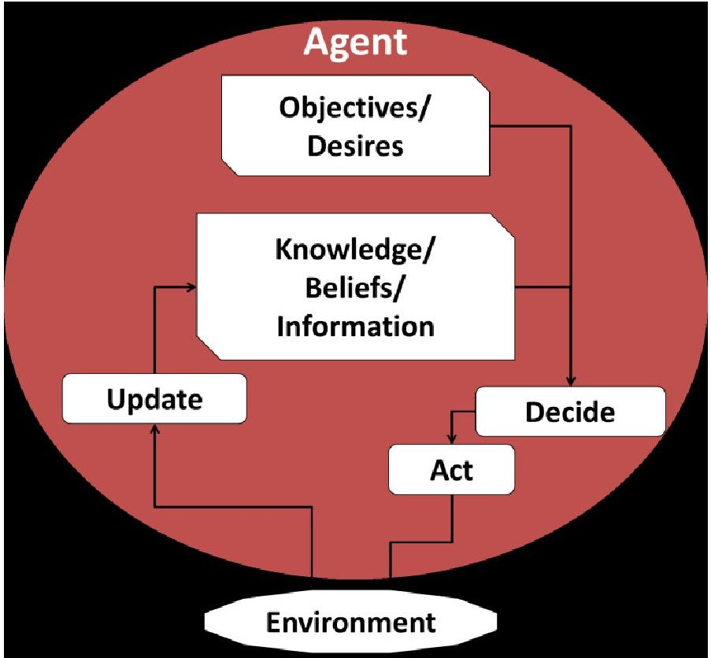
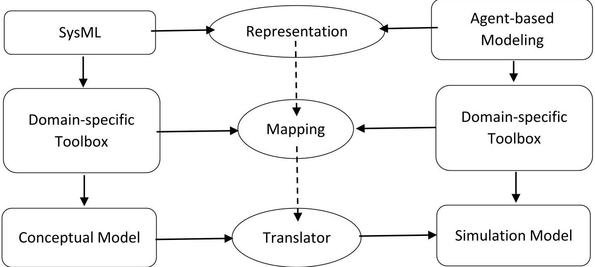
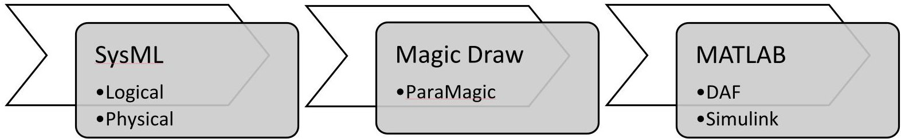
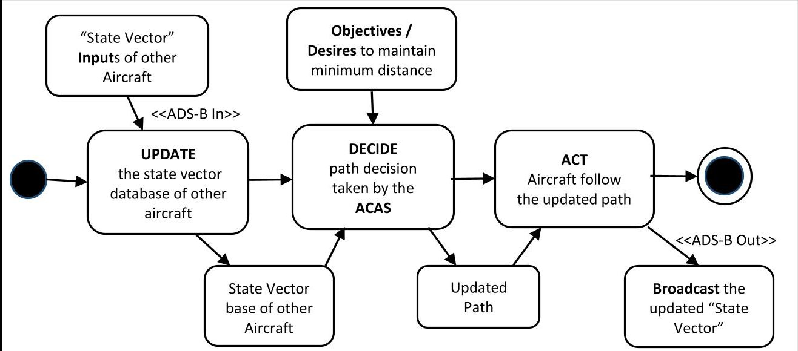
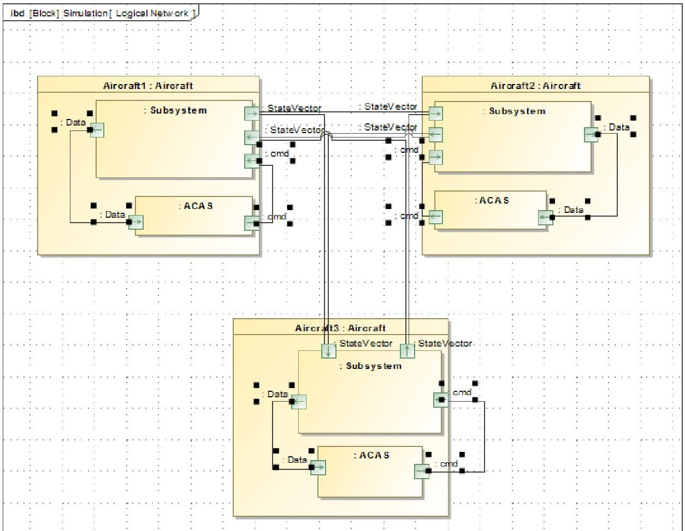
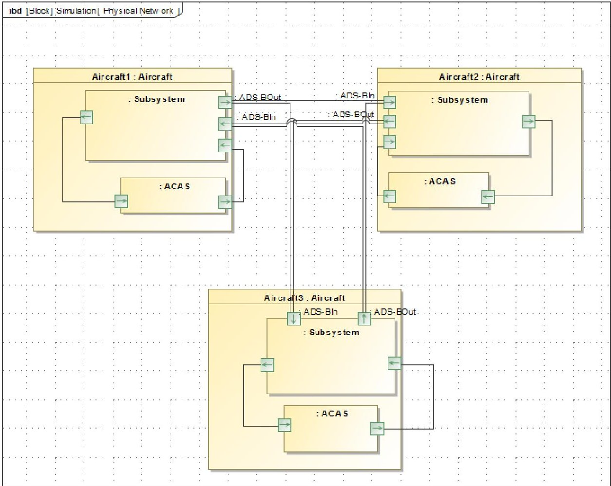
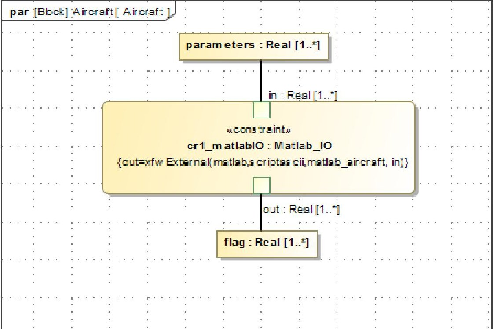

<!-- PDF_PAGE: 1 -->

# Creating Executable Agent-Based Models Using SysML

Apoorv Maheshwari, C. Robert Kenley, and Daniel A. DeLaurentis

Purdue University

Center for Integrated Systems in Aerospace

Neil Armstrong Hall of Engineering

701 W. Stadium Ave., West Lafayette, IN, 47907-2045

apoorv, kenley, and ddelaure@purdue.edu

Copyright © 2015 by Apoorv Maheshwari, C. Robert Kenley, and Daniel A. DeLaurentis. Published and used by INCOSE with permission.

Abstract. Simulation plays an important role in the analysis of alternatives during the early phases of systems engineering activities. This is especially true for endeavors in the system of systems realm where there is even more need for simulation to characterize interdependencies. In this paper, we develop a generic framework to translate a SysML conceptual model to an executable agent-based simulation model. We demonstrate the translation using a simplified air traffic management problem. Along with the potential advantages, we also identify major challenges and possible mismatches in accomplishing a suitable translation for real-world systems of systems.

## 1. Introduction

Kenley et al. (2014) reviewed agent-based simulation models for systems of systems and model-based systems engineering methods that are applicable to specifying a system of systems. Their agent-based models are built from executable MATLAB code that simulates an allocated system-of-systems architecture where each function is modeled as an agent operating in a network of multiple, independent interacting agents (DeLaurentis 2005). The models simulate their functionality and operational effects, such as computational and communications latency, that are a consequence of the physical properties of the allocated architecture. They used the intra-agent dynamics model of an agent (Figure 1) to develop a UML (and by extension SysML) activity diagram. The dynamics model defines functions that:

- update the knowledge, beliefs, and information of the agent using inputs from its environment;

- decide on actions that achieve its objectives and desires; and

- take action that produces outputs that affect its environment.

<!-- PDF_PAGE: 2 -->

Figure 1: Behavior model of an agent (adapted from Joslyn and Rocha (2000)).

This paper demonstrates a process for translating a system-of-systems architecture specified in SysML to an executable agent-based model and identifies future work needed to enhance the process and make it scalable. Similar work has been done by Sha et al. (2011) where they used SysML as a diagramming tool to represent agentbased models. The main aim of their work was to investigate the effectiveness of SysML in establishing a conceptual model for agent-based modeling. However, in our research, we use SysML models to define the system and we seek to "add a use"

Figure 2: Generic translation framework.

by extracting information useful for agent-based simulation. Designing for Adaptability and evolutioN in System of systems Engineering (DANSE) project which has been working on developing methodology to support evolutionary, adaptive, and iterative lifecycles for systems of systems is another example where

<!-- PDF_PAGE: 3 -->

SysML models are combined with tabular data to automatically generate architecture variants for system analysis.

The generic schematic for translation from SysML to a simulation model is shown in the Figure 2. This schematic is similar to the work of McGinnis et al. (2009) who apply a model-driven architecture approach to develop a discrete event simulation from a SysML model of semiconductor manufacturing. Two distinct domain-specific toolboxes are mentioned in the figure. The domain-specific toolbox on the left is dedicated to the description of conceptual models using SysML whereas the toolbox on the right is a language that can be used to create an agent-based model. The middle part consisting of three ovals represents the steps to achieve this translation. The first step is to understand the conceptual similarities and differences in how SysML and agent-based models represent the key aspects of a system of systems, namely, system definition and system interdependencies. These aspects are discussed in the Section 2. The next step is to understand mappings between the domain-specific toolboxes. To achieve this, we need to understand the interface between SysML specifications and the agent-based model. This interface is discussed in Section 3. Once the mapping between the domain-specific toolboxes is completely understood, the final step is to translate the conceptual model prepared using SysML to an executable agent-based model. This translation is explained using a simple example in the Section 4. The demonstration problem centers on a system of systems for air traffic control that was represented in SysML and interfaced with an executable agent-based modeling code written in MATLAB that simulates the operational activities of the system of systems.

## 2. Aspects of SysML and Agent-based Representations

The Systems Modeling Language, commonly known as SysML, has been specifically developed for model-based systems engineering to formalize the change from document-based to a model-based form of organization of information. It is a generalpurpose modeling language, supporting the specification, analysis, design, verification, and validation of systems.

Agent-based modeling is a modeling approach to simulate the simultaneous actions and interactions of multiple autonomous agents (individual or collective) and understand the effects of the combined actions and interactions on the system as a whole. By allowing a designer to visualize these effects, it becomes possible to understand the root causes of the effects and to improve the modeled system. With its bottom-up approach, agent-based modeling is flexible in adapting to new architectures by integrating or removing any physical component or functional capability from the system. These advantages make agent-based modeling a very useful modeling and simulation approach for systems of systems.

An agent-based model represents a system of systems using four basic elements:

1. Agents/Objects: Set of all simulated or passive heterogeneous entities that interact with the environment based on their interaction rules.

2. Space: The environment where agents and objects are located and signals propagate. The space can be both discrete and continuous.

3. Time: The system evolves over time. The system can evolve over both discrete and continuous time intervals. For most of engineering problems, time can be considered as one of the dimensions of the environment.

<!-- PDF_PAGE: 4 -->

4. Dynamics: The interaction rules and behaviors of all the agents that determine their actions and changes in state.

McGinnis et al. (2009) identifies a growing need of translating a conceptual model (such as the one created in SysML) directly to a simulation program to formalize and automate a substantial portion of the implementation side of the simulation process. Schonherr et al. (2011) tried to build SysML models after identifying and structuring the significant properties of discrete processes mainly for production systems. IBM's Haifa Research Lab uses a generic SysML-based methodology for improving the architectural design phase (Broodney et al. 2012). In this paper, we identify the key elements of SysML, viz. viewpoints and network representations, which can be used to map SysML models to agent-based simulations. We also demonstrate the translation with an agent-based simulation from the air traffic management domain (Section 4).

## 2.1 Viewpoints

SysML defines four set of viewpoints - structural, behavioral, requirements, and parametric. The structural viewpoint defines the elements (including the composition of systems, their properties, and organizational grouping) of the systems using the block definition diagram and the internal block diagram. The behavioral viewpoint explains the interaction and architecture of the system using activity, sequence, state machine, and use case diagrams. The requirements viewpoint functions as a requirements management tool keeping all the requirements in one place, making it easier for a systems engineer to create, relate, trace, and analyze them. Finally, the parametric viewpoint explains the constraints on the design via logical and mathematical expressions.

For agent-based modeling, structural viewpoints serve as the basis of defining various agents being simulated. Properties of the elements defined in the SysML can be directly mapped as the agent properties in the simulation. The behavioral viewpoint maps with the interaction and information flow between and within the agents in the simulation. The requirement viewpoint can be indirectly associated with verifying and analyzing the outcomes of the simulation but cannot be directly mapped with the functioning of the agent-based model. Finally, the parametric viewpoint defines the parameters of intra-agent dynamics for every agent. These similarities are summarized in the Table 1.

Though the congruence between the SysML viewpoints and the corresponding agent-based viewpoints seems significant, mismatches are possible. One of the major advantages of agent-based modeling is its ability to easily create multiple instances of an agent and analyze their interaction. In SysML, although it is possible to create multiple instances of the same element, it becomes relatively difficult to manage the links and the interactions once the number of instances becomes high. Another possible mismatch may occur in the ability to trigger a particular event at a specific point in time. Since SysML viewpoints are static representations of different components of the system, it is difficult to trigger events dynamically in the simulation using SysML. State machines can be used to represent various event triggers in SysML but proper extraction of the information relevant for agent-based simulation has not been achieved yet.

<!-- PDF_PAGE: 5 -->

## 2.2 SysML Networks

Another important feature of SysML is its representation of networks. SysML can represent two types of architectures (or networks) used in cyber-physical design: logical and physical (Liotine 2003). Logical network architectures describe the exchange of information between systems by explaining what information is

Table 1: Similarities between SysML and agent-based modeling.

<table border="1"><tr><td>Viewpoints</td><td>SysML</td><td>Agent-Based Modeling</td></tr><tr><td>Structural</td><td>Element definition</td><td>Agent definition</td></tr><tr><td>Behavioral</td><td>Interaction and architecture of the system</td><td>Information flow between the agents</td></tr><tr><td>Requirements</td><td>Requirement management tool</td><td>Verification of agent-based model (indirect)</td></tr><tr><td>Parametric</td><td>Logical/mathematical constraints on the design</td><td>Parameters of intra-agent dynamics</td></tr></table>

transferred between systems. The physical network architecture shows the connectivity of systems by explaining the physical paths over which the information is transferred. For example, a logical network connection may specify that when the driver presses the brake pedal, the information to slow down the car flows in the system; the related physical network would show the hydraulic configuration which is transferring the information from the brake pedal to the road-wheel brakes. The combination of these two types of links articulates that the brake pedal transfers information to slow down the car to the brakes using hydraulics, where both the action and medium may have differing properties. Keeping these two networks separate allows for changes to either network without necessarily altering the other. For example, both footbrake and parking brake have same logical networks but different physical networks. The driver just knows that the car will slow down by pressing the brake pedal and thus, the driver only knows about the logical network. The driver does not need to know about the underlying physical network to interact with the system. Similarly, in an agent-based model, this distinction between the path of interaction and the medium of the interaction can help in modeling the system in a more generic way. Moreover, it also presents an opportunity to analyze the effects of different logical and physical concepts separately.

In an agent-based model, an agent changes its state based on its internal logical relations and external stimuli. Thus, an agent-based model represents these networks by specifying the interaction rules and information flow for the agents. The distinction between a logical and a physical network surely helps in understanding the problem in a greater depth but this distinction might not be readily visible in an agent-based model at times. In those situations, direct translation of SysML networks to agentbased dynamics can be problematic (or, at worse, completely incorrect).

<!-- PDF_PAGE: 6 -->

## 3. Interfacing SysML Specifications to Agent-based Simulation

After understanding the system-of-systems representation from the perspectives of both SysML and agent-based modeling, the next step is to understand the mapping between the domain-specific toolboxes of each field. In this paper, we create the SysML model for the simulation in a SysML-enabled visual toolbox MagicDraw. MagicDraw is a visual SysML modeling tool that supports the latest OMG SysML Specification 1.3 version. The simulation for the generated SysML models is then

Figure 3: Translation mechanism.

translated to and executed in MATLAB by the Discrete Agent Framework (DAF), (Mour et al. 2013) developed at System-of-Systems Laboratory, Purdue University. DAF is a MATLAB-based framework that provides the underlying infrastructure for agent-based simulation that moves messages around and maintains the simulation environment (locations, time, etc.). The link between MagicDraw and DAF is facilitated by ParaMagic, a plugin for MagicDraw. The complete translation mechanism is summarized in the Figure 3.

Based on the system definition, the elements of the system are defined in MagicDraw using the block definition and internal block diagrams. While designing the elements, requirements and constraints are created for each element using the requirements and parametric viewpoint. Next, based on the architecture, logical and physical SysML networks of the system are created in MagicDraw. Once the SysML model is completed, the MagicDraw output artifacts are connected to the MATLAB using ParaMagic. ParaMagic helps in executing constraints relationships in SysML parametric diagrams through MATLAB and other math toolboxes. This MATLAB link is used to generate the files required for setting up the DAF simulation with the information from the SysML model. Once the required files are generated, an agentbased simulation is executed using DAF.

There are major challenges in achieving this translation from SysML model to an executable agent-based model. The primary challenge is to develop a mapping between the two domain-specific toolboxes (i.e. MagicDraw for SysML and DAF for agent-based modeling). The generic mapping has been developed in the previous section, but it is still difficult to find a publically available formal specification for all the toolboxes.

Another challenge, of course, is the development of the model translator, which uses the aforementioned mapping to translate a conceptual SysML model to an executable simulation model. This translator needs to be developed for each set of domain-specific toolboxes being used.

## 4. The NextGen Air Traffic Control System of Systems

The National Airspace System (NAS) comprises of all the components (such as airspace, facilities, equipment, and procedures) that enable the United States air

<!-- PDF_PAGE: 7 -->

transportation system. The Next Generation Air Transportation System (NextGen) initiative was created to transform the NAS to a safer, more reliable, more efficient and an environment-friendly system. It proposes, for example, a transformation in the surveillance function from a ground-based system to a satellite-based system. It plans to use precision navigation technology to shorten routes, save time and fuel, reduce traffic delays, increase capacity, and permit controllers to monitor and manage aircraft with greater safety margins.

Modeling and simulating any new concept is crucial, especially when both safety and cost-effectiveness are at play. NextGen is a prime example. Simulations of new concepts can not only save time compared to physical experiments, but can also create a coherent synthetic environment that allows for integration of simulated systems in the early analysis phase. In this paper, we demonstrate a simulation of the one of the most important NextGen elements, the Automatic Dependent Surveillance-Broadcast (ADS-B) technology. In Next Gen, ADS-B will provide air traffic controllers and pilots more accurate information, based on GPS and inter-aircraft communication, to keep aircraft safely separated in both airborne and ground settings. In the demonstration, we simulate a simplified air traffic management problem.

Air traffic management encompasses all systems that assist aircraft to depart from an airport, transit airspace, and land at the destination airport. EUROCONTROL (2014) states that air traffic management consists of mainly three distinct activities:

1. Air Traffic Control (ATC): This process is responsible for maintaining the appropriate separation between the aircraft to ensure the safety of the flying aircraft. Currently, the air separation is maintained by communication between pilots and air traffic control centers. In NextGen, ADS-B is meant to improve this communication link by broadcasting the aircraft information directly to its nearby aircraft.

2. Air Traffic Flow Management: This process deals with the planning of flight paths and timings. This is done before the flight takes place.

3. Aeronautical Information Services: These services are responsible for the compilation and distribution of all aeronautical information (including safety, navigation, technical, administrative, or legal) necessary to airspace users.

In our demonstration, we prepare a simplified model of the ATC section of the air traffic management, to illustrate the translation from SysML to DAF for a system of systems. Based upon the Mark Maier's (1999) description of the unique traits of systems of systems, there are two primary traits that are necessary for a group of systems to be considered as a system of systems: operational independence and managerial independence. Operational independence implies that each system is capable of performing a set of functions without any interactions from the other systems. Managerial independence implies that the systems manage themselves to a purpose separate from the ultimate purpose of the system of systems. For the Air Traffic Control system, aircraft can be considered operationally independent systems performing the task of travelling from origin to destination along with satisfying the overarching goal of fulfilling the demand of the air transportation network.

Our model consists of a group of aircraft, equipped with ADS-B as the only communication technology, approaching each other. ADS-B consists of two subsystems: ADS-B In (component responsible for receiving the other aircraft information) and ADS-B Out (component responsible for transmitting the aircraft

<!-- PDF_PAGE: 8 -->

information). All the aircraft are required to maintain a fixed minimum separation from other aircraft to reduce the risk of aircraft collision, as well as prevent accidents due to wake turbulence. Air traffic control enforces minimum separation rules to achieve this (FAA order 7110.65). A defined loss of separation between airborne aircraft occurs whenever specified separation minima in controlled airspace are breached. In such cases, a system known as the Airborne Collision Avoidance System (ACAS) comes into action to avoid collision. In simpler terms, if the separation bubble of two aircraft intersects at any time, both aircraft change direction per the collision avoidance algorithm. The ADS-B can broadcast and receive the aircraft information in a fixed distance. Thus, the aircraft can "see" other aircraft only if it is within the range of its ADS-B In. Fault is also introduced in the simulation by shutting off the ADS-B In system of an aircraft by a pre-defined trigger. With a faulty ADS-B In, the aircraft fails to see other aircraft in its ADS-B In range.

The 'Aircraft' agent can divided in mainly two parts:

1. Subsystem containing all the communicating sensors and the auto-pilot system responsible for driving the agent. To simplify the implementation, both communicating sensors and the auto-pilot system are considered under this single section.

2. ACAS, the collision avoidance system which makes decisions regarding the agent's flight path based on the information about other agents and the separation rules

The working of 'Aircraft' agent is defined in the Figure 4, which is consistent with Figure 1 and is patterned after the activity diagram of a generic agent from Kenley, et al (2014). The ADS-B In receives 'State Vector' (position and heading direction) of the aircraft that are within range of the ADS-B In. Based on this input, the subsystem updates the state vector database. This information is then transferred to the ACAS, which decides upon the flight path based upon this information and the objective to maintain minimum distance from other aircraft. This updated path is now sent to the subsystem as a command for the auto-pilot module. Simultaneously, the communication module broadcasts the updated state vector of the aircraft using ADS-B Out. In our demonstration, the logical network (Figure 5) consists of relevant information going to

Figure 4: Activity diagram for aircraft agent

<!-- PDF_PAGE: 9 -->

and from aircraft agents. The physical network (Figure 6) consists of the specific ADS-B In and ADS-B Out communication implementations.

Figure 5: Logical network.

Figure 6: Physical network.

<!-- PDF_PAGE: 10 -->

Figure 7: Parametric diagram for DAF agent file generation.

<table class="table table-bordered"><thead><tr><th>Name</th><th>Qualified Name</th><th>Type</th><th>Caus...</th><th>Values</th></tr></thead><tbody><tr><td>Aircraft</td><td>Aircraft_Example::Instance::ins...</td><td>Aircraft</td><td></td><td></td></tr><tr><td>flag</td><td></td><td>Real[1,?]</td><td></td><td></td></tr><tr><td>flag[0]</td><td></td><td>Real</td><td>target</td><td>?????</td></tr><tr><td>parameters</td><td></td><td>Real[1,?]</td><td></td><td></td></tr><tr><td>parameters[0]</td><td></td><td>Real</td><td>given</td><td>3</td></tr><tr><td>parameters[1]</td><td></td><td>Real</td><td>given</td><td>4</td></tr><tr><td>parameters[2]</td><td></td><td>Real</td><td>given</td><td>0</td></tr><tr><td>parameters[3]</td><td></td><td>Real</td><td>given</td><td>350</td></tr><tr><td>parameters[4]</td><td></td><td>Real</td><td>given</td><td>3</td></tr><tr><td>parameters[5]</td><td></td><td>Real</td><td>given</td><td>0</td></tr><tr><td>parameters[6]</td><td></td><td>Real</td><td>given</td><td>475</td></tr><tr><td>parameters[7]</td><td></td><td>Real</td><td>given</td><td>600</td></tr><tr><td>parameters[8]</td><td></td><td>Real</td><td>given</td><td>0</td></tr><tr><td>parameters[9]</td><td></td><td>Real</td><td>given</td><td>2.5</td></tr><tr><td>parameters[10]</td><td></td><td>Real</td><td>given</td><td>1,200</td></tr><tr><td>parameters[11]</td><td></td><td>Real</td><td>given</td><td>450</td></tr><tr><td>parameters[12]</td><td></td><td>Real</td><td>given</td><td>-2.5</td></tr><tr><td>parameters[13]</td><td></td><td>Real</td><td>given</td><td>0</td></tr></tbody></table>

Figure 8: Instance browser for agent file generation.

<!-- PDF_PAGE: 11 -->

For this example, after defining the block diagram of the aircraft agent, we create a parametric diagram for the agents which utilizes the ParaMagic plugin and MATLAB script to convert the parameters of each aircraft into agent files required for the DAF simulation. Since all the agents in our simulation are of same type, we convert their specifications (i.e., initial positions and initial velocities) directly from one parametric diagram. A screenshot of the parametric diagram is shown in Figure 7.

Note that the constraint block shown above uses the MATLAB script matlab_aircraft to generate the required DAF agent files. The parameters are input into this MATLAB script and it gives output flag a value (1, if file generation is successful and 0 otherwise). The DAF agent file is generated in the same folder as the MATLAB script. Figure 8 shows Instance browser for one such run. Note that all the parameter values are given, and the flag value is the target value of the run. The first two entries of parameters represent the number of aircraft and number of specifications for each aircraft respectively. Rest of the values represent initial position (x-component), initial position (y-component), initial velocity (x-component) and initial velocity (y-component) for each aircraft in that order.

## 5. Results of the Simulation

After creating the SysML networks and establishing the connection between SysML and DAF, the agent-based simulation was executed with a group of aircraft agents working based on the established rules and objectives. The simulation snapshots are tabulated in the Figure 9.

The range of ADS-B In is denoted by the blue circle in the simulation. The red circle denotes the critical separation zone for each aircraft. As soon as another aircraft comes in the ADS-B In range, aircraft receives the data (starts seeing the aircraft) and turns green. When the separation bubble of two aircraft intersects, both aircraft change their path based on collision avoidance algorithm to maintain the minimum separation. Right now, a very simplified collision avoidance algorithm is implemented where aircraft move in the direction perpendicular to the vector formed between the two aircraft. The faulty aircraft is denoted by turning its marker red. We can see in the simulation that the faulty aircraft does not change path because it cannot see the other aircraft in its ADS-B In range.

Thus, we can see that a proper translation from SysML to an executable agent-based simulation model can be achieved. But there are two major issues that remain to be settled:

1. Scalability: The example problem is a very simplified version of a real-world situation. We observed in the example with three same type of agents with four specification parameters for each, the number of parameters needed for each simulation is 14. A more comprehensive and detailed version could be very large and complex, with a numerous different agents involved and many instances of each. The construction and organization of such a large simulation is a major challenge of its own, but so may be the ability of this SysML-ABM mapping approach.

<!-- PDF_PAGE: 12 -->

2. Coarse-Graining: To achieve an efficient mapping, we should be able to first identify and then extract all the relevant information from the SysML model to create an executable agent-based simulation model. The identification, extraction and management of this information is a difficult task and depends heavily on knowledge about the internal functioning of both domain-specific toolboxes (of

<table border="1"><tr><td>a. Three aircraft approaching each other</td><td>b. Aircraft 1 &amp; 2 receiving information</td></tr><tr><td>c. Aircraft 2 changes direction to maintain separation</td><td>d. Aircraft 1 changes direction to maintain separation</td></tr><tr><td>e. Aircraft 1 cannot see Aircraft 3 because of fault in its ADS-B In</td><td>f. Only Aircraft 3 changes direction to maintain separation</td></tr></table>

Figure 9: DAF Simulation Results.

SysML and the agent-based simulation model). For example, in the demonstration problem, we assume the network of aircraft agents to be fully connected and thus, we were able to minimize the relevant information to the initial state characteristics of each aircraft. In real world complex system, our network might not be fully connected and we will have to transfer this information from SysML to agentbased modeling tool. This information can be really difficult to extract and manage.

## 6. Conclusions and Future Work

In this paper, we showed how we can use a conceptual system representation in SysML to get an executable agent-based simulation. We also identified major challenges in achieving this translation for a real-world system. We explained a

<!-- PDF_PAGE: 13 -->

generic translation framework with the help of simple air traffic management problem. The framework helped us automate the simulation process, to some extent directly from the SysML model. We were able to generate agent files required for the ADS-B simulation directly from the SysML element definition. The case study proves that this translation can be achieved, but we still have major challenges including scalability of the efficiency in the mapping process. While working on the translation, we also realized that automating the analysis process for a model-based system definition of complex real-world systems requires development of formal specifications for the domain-specific toolboxes involved.

In future, we will try to understand how we can use the automated analysis process to efficiently navigate through the design space based upon certain performance metrics. We will also be exploring the translation process in more detail to make the translation scalable.

## Acknowledgement

This publication was developed under work supported by an intramural grant from the Purdue University Product Lifecycle Management Center. The views and conclusions contained in this document are those of the authors and should not be interpreted as necessarily representing the official policies, either expressed or implied, of Purdue University, the Center, or the US Federal Aviation Administration, nor do these organizations endorse any products or commercial services mentioned in this publication.

## References

Broodney, Henry, Dolev Dotan, Lev Greenberg, and Michael Masin. "Generic Approach to Architecture Optimization in MBSE." In INCOSE International Symposium. 2012.

DeLaurentis, Daniel. "Understanding transportation as a system-of-systems design problem." In 43rd AIAA Aerospace Sciences Meeting and Exhibit, vol. 1. Reno, NV. New York: AIAA, 2005.

"Danse-ip.eu." About - DANSE. Accessed March 25, 2015. https://danse-ip.eu/home/index.php.

"DANSE - An Effective, Tool-Supported Methodology for Systems of Systems Engineering in Europe." Accessed March 25, 2015. https://www.acq.osd.mil/se/outreach/sosecollab.htm

"Eurocontrol - Driving Excellence in ATM Performance." What Is Air Traffic Management? Accessed November 6, 2014. https://www.eurocontrol.int/articles/what-airtraffic-management.

Joslyn, Cliff, and Luis Rocha. "Towards semiotic agent-based models of sociotechnical organizations." In Proc. AI, Simulation and Planning in High Autonomy Systems (AIS 2000) Conference, Tucson, Arizona, pp. 70-79. 2000.

Kenley, C. Robert, Timothy M. Dannenhoffer, Paul C. Wood, and Daniel A. DeLaurentis. "1.4. 2 Synthesizing and Specifying Architectures for System of Systems." In INCOSE International Symposium, vol. 24, no. 1, pp. 94-107. 2014.

Liotine, M. 2003. Mission-Critical Network Planning, Boston, MA-US: Artech House.

<!-- PDF_PAGE: 14 -->

Maier, Mark W. "Architecting Principles for Systems-of-Systems." In INCOSE International Symposium, vol. 6, no. 1, pp. 565-573. 1996.

McGinnis, Leon, and Volkan Ustun. "A simple example of SysML-driven simulation." In Simulation Conference (WSC), Proceedings of the 2009 Winter, pp. 1703-1710. IEEE, 2009.

Mour, Ankur, C. Robert Kenley, Navindran Davendralingam, and Daniel DeLaurentis. "Agent-Based Modeling for Systems of Systems." In INCOSE International Symposium, vol. 23, no. 1, pp. 973-987. 2013.

"NASA & The Next Generation Air Transportation System (NextGen)." Accessed November 6, 2014. https://www.aeronautics.nasa.gov/docs/nextgen_whitepaper 06 26 07.pdf.

"Next Generation Air Transportation System (NextGen)." Accessed November 10, 2014. https://www.faa.gov/nextgen/.

"OMG SysML." OMG SysML. Accessed November 6, 2014. https://www.omgsysml.org/

Order, F. A. A. "7110.65 V: Air Traffic Control." (2014).

"ParaMagic Plugin." ParaMagic Plugin. Accessed November 8, 2014. https://www.nomagic.com/products/magicdrawaddons/paramagic-plugin.html.

Sooyong, P. A. R. K., K. I. M. Jintae, and L. E. E. Seungyun. "Agent-oriented software modeling with UML approach." IEICE TRANSACTIONS on Information and Systems 83, no. 8 (2000): 1631-1641

Schonherr, O., and Oliver Rose. "A general model description for discrete processes." In Simulation Conference (WSC), Proceedings of the 2011 Winter, pp. 2201-2213. IEEE, 2011.

Sha, Zhenghui, Qize Le, and Jitesh H. Panchal. "Using SysML for Conceptual Representation of Agent-Based Models." In ASME 2011 International Design Engineering Technical Conferences and Computers and Information in Engineering Conference, pp. 39-50. American Society of Mechanical Engineers, 2011.

<!-- PDF_PAGE: 15 -->

## 25th Annual INCOSE International Symposium (IS2015) Bellevue, WA, July 13-July 16, 2015

## Biographies

Apoorv Maheshwari is a Graduate Research Assistant in Purdue's School of Aeronautics and Astronautics in West Lafayette, IN (US). He is a recent graduate from the Indian Institute of Technology, Mumbai (India) where he completed his Bachelor's in Aerospace Engineering. He is currently a member of the Purdue System-of-Systems Laboratory. His primary research interests are in the areas of agent-based modeling, design space exploration, network theory and multidisciplinary optimization.

C. Robert Kenley is an Associate Professor of Engineering Practice in Purdue's School of Industrial Engineering. He has over thirty years' experience in industry, academia, and government as a practitioner, consultant, and researcher in systems engineering. He has published papers on systems requirements, technology readiness assessment and forecasting, Bayes nets, applied meteorology, and the impacts of nuclear power plants on employment.

Daniel DeLaurentis is an Associate Professor in Purdue's School of Aeronautics and Astronautics. He leads Purdue's Center for Integrated Systems in Aerospace and its largest recent project with the Missile Defense Agency's Enhanced C2BMC program that is developing agent-based modeling and simulation for development of advanced battle management architectures. His primary research interests are in the areas of problem formulation, modeling and robust system design, and control methods for aerospace systems and systems of systems. This includes agent-based modeling, network theory, optimization, and aerospace vehicle modeling. His research is conducted under grants from NASA, FAA, Navy, the DoD Systems Engineering Research Center UARC, and the Missile Defense Agency.