<!-- PDF_PAGE: 1 -->

26th Annual INCOSE International Symposium (IS 2016) Edinburgh, Scotland, UK, July 18-21, 2016

# ESEM: Automated Systems Analysis using Executable SysML Modeling Patterns

Robert Karban Jet Propulsion Laboratory California Institute of Technology Pasadena, CA 91109, USA robert.karban@jpl.nasa.gov

No Magic, Inc.

Nerijus Jankevičius

Kaunas, LT-51480, Lithuania

nerijus@nomagic.com

Maged Elaasar

Jet Propulsion Laboratory

maged.e.elaasar@jpl.nasa.gov

California Institute of Technology

Pasadena, CA 91109, USA

Copyright © 2016 by Robert Karban, Nerijus Jankevičius, Maged Elaasar. Published and used by INCOSE with permission.

Abstract. SysML is a modeling language used for systems analysis and design. While some domain-specific analyses (e.g., finite element analysis) can only be specified in SysML when combined with other vocabulary, many common analyses can be modeled purely in SysML using its parametric and behavioral semantics. In this paper, we focus on one kind of analysis, which is requirements verification, and propose a new Executable System Engineering Method (ESEM) that automates it using executable SysML modeling patterns that involve structural, behavioral and parametric diagrams. The resulting analysis model becomes executable using a general purpose SysML execution engine. We present our method and demonstrate it on a running example derived from an industrial case study where we have verified the power requirements of a telescope system. It involves dynamic power roll-ups in different operational scenarios and shows the automation capabilities of this method.

## Introduction

Model-based systems engineering (MBSE) is the formalized application of modeling to support system requirements, design, analysis, verification, validation and documentation activities, beginning in the conceptual design phase and continuing throughout later life cycle phases. A system model is an abstraction of selected aspects of the structure and behavior of a system that is expressed using a modeling language. SysML (OMG 2014a) is a standard, visual, and generalpurpose system modeling language developed by the Object Management Group (OMG 2016) and often used in the context of MBSE. SysML is defined in terms of its syntax, semantics and notation. It is also organized into a collection of interrelated viewpoints that describe a system

<!-- PDF_PAGE: 2 -->

from different perspectives including: requirements, structure, behavior and parametrics. Many of SysML's viewpoints are graphical (e.g., block definition diagram, parametric diagram, activity diagram, etc.), while some take other forms (e.g., requirements table). SysML enjoys strong tool support, e.g., MagicDraw (NoMagic 2016a), Papyrus (Eclipse 2016), Rhapsody (IBM 2016), Enterprise Architect (Sparx 2016), and is actively used in various domains like aerospace, defense and automotive. For users in those domains, MBSE with SysML is becoming part of their day-to-day systems engineering practice.

Among the many activities of modeling with SysML, we focus in this paper on system analysis, which is about decomposing the system into its components for the purpose of studying how well those components work together and interact to meet some objectives or satisfy some constraints. Furthermore, we focus on one common kind of system analysis, which is requirement verification and validation as the customers are involved in validating their simulated operational use cases. In this analysis, the objective is to assess whether a system design meets the objectives and satisfies the constraints that are implied by the system requirements. Other kinds of analyses exist; such as trade study analysis, where the objective is to rank alternative designs in terms of their effectiveness vs. their cost, but they are out of scope of this paper.

Many approaches in the literature describe how to perform model-based system analysis by simply describing the use of each SysML viewpoint. However, there is no integrated story or method, which describes how to use SysML for system analysis. Also, many approaches augment the SysML syntax (with other UML profiles) and/or semantics and develop custom tools to analyze the models, where the SysML syntax and semantics are insufficient.

In this paper, we present an approach to model-based systems analysis with SysML that is both rigorous and automated. The approach supports the kind of system analysis we mentioned earlier, i.e., requirements verification. The approach's rigor is established with a modeling method that is an extension of INCOSE's (INCOSE 2016) Object Oriented Systems Engineering Method (OOSEM) (Friedenthal et al. 2011). The extension, dubbed Executable System Engineering Method (ESEM), proposes a set of analysis design patterns that are specified with various SysML structural, behavioral and parametric diagrams. The purpose of the patterns spans the formalization of requirements, traceability between requirements and design artifacts, expression of complex parametric equations, and specification of operational scenarios for testing requirements including design configurations and scenario drivers. Furthermore, the approach is automated in the sense that the analysis models can be executed. The execution of the parametric diagrams is done with a parametric solver, where the execution of the behavioral diagrams is done with a simulation engine based on standard execution semantics.

Furthermore, we introduce our system analysis method and demonstrate it on a running example derived from an industrial case study where we have applied the method to analyze one of the subsystems of the Thirty Meter Telescope (TMT) (TMT 2016) system that is currently being developed by the TMT Observatory Corporation. The main objective for the TMT related

<!-- PDF_PAGE: 3 -->

analysis is to provide state-dependent power roll-ups for different operational scenarios and demonstrate that requirements are satisfied by the design.

The SysML modeling tool we used is MagicDraw (NoMagic 2016a) and the parametric solver and simulation engine we used are part of its Cameo Simulation Toolkit (CST) (NoMagic 2016b).

The remainder of this paper is organized as follows: Section 2 provides some background on relevant technologies; an introduction to our running example is given in Section 3; Section 4 discusses our ESEM method and demonstrate it on the running example; a discussion of related work is given in Section 5; and finally, Section 6 provides conclusions and outlines future work.

## Background

## Executable Models

System modeling tools are becoming more popular thanks to the standard modeling languages they use (e.g., SysML) and their graphical notations. However, those tools are still mostly used as drawing tools, where the graphical notation rather than the abstract syntax and semantics matters. For example, one may use a SysML tool to author a block definition diagram (BDD) to represent an organization chart, where blocks represent employees and generalization relationships represent their reporting chains. Obviously in this case, the semantics of generalizations is not consistent with that of a reporting relationship. This situation is partially due to one or more of the following reasons: users' lack of understanding of the language semantics, the imprecise semantics of the language, and the permissiveness of tool itself (relaxing the language rules).

One way to alleviate this problem is to go beyond models as pretty pictures and make them executable. This approach lifts modeling to a whole new level, the model becomes "alive", and helps create a different experience for the modeler using those tools. The execution semantics are typically defined on a subset of the modeling language. Limiting the modeling to that subset, the tool can limit the vast options available to modelers to model the same thing in the complete language. Moreover, for execution to work, semantics have to be precisely defined, which also helps validate models for correctness. The executability of models also enables debugging them to see if it the behavior captured by the modeler is what the modeler actually expects. When unexpected behavior occurs, the problem typically falls in one of the following categories: a) user error in the model, b) misunderstanding of the semantics by the user, c) ambiguity or lack of formal semantics by the language specification, d) bug in the implementation of the tool, or e) a potential behavior of the system that had not been anticipated.

One obvious challenge with this approach is agreeing on and defining the execution semantics precisely, and not leaving it up to proprietary tool implementations. This is usually the role of standards. ESEM applies standards from different standards bodies (OMG, 2016; W3C, 2016). However, it's important for a tool to remain semantically consistent across the complete tool chain that may apply different standards.

<!-- PDF_PAGE: 4 -->

UML (OMG 2015a) was introduced in 1997, while SysML, defined as a profile of UML, was introduced in 2007. However, the lack of precise execution semantics was limiting the ability to use UML/SysML to analyze, specify, verify, and validate system requirements and design, for example provide executable activity diagrams and associated timelines, even though this was considered an important requirement for behavior diagrams in the UML for Systems Engineering RFP. Executable UML (xUML) augments UML with behavioral specifications that are precise enough to be effectively executed. A subset of xUML, called Foundational UML (fUML) (OMG 2014b), has been standardized by OMG to fill the gap in the standards. Since SysML is a profile of UML, it inherits these execution semantics.

## Model Execution Engine

Executable models are executed with the help of an execution or simulation engine. The purpose of a simulation is to gain system understanding, explore and validate desirable or undesirable behaviors of a system without manipulating the real system, which may not have yet been defined or available, or because it cannot be exercised directly due to cost, time, resources or risk constraints. Simulation is typically performed on a model of the system, by visualizing and identifying system defects in early development stages when changes are cheaper.

The execution of the models was performed using the Cameo Simulation Toolkit (CST), which is a plugin to MagicDraw enabling model execution for early system behavior simulation. The toolkit comes with a built-in parametric solver and integrations with popular analysis tools (e.g., MATLAB/Simulink, Maple, and Mathematica).

CST is a simulation platform based on OMG fUML standard, which defines precise model execution semantics and a virtual machine for UML, enabling compliant models to be transformed into various executable forms for verification. It supports instantiation and integration of structural and behavioral semantics of systems, mainly based on UML activity diagrams (inherited by SysML).

CST uses fUML as a foundation to plug in additional standard engines, such as W3C SCXML (State Chart XML) engine for state machines (W3C 2015), JSR223 for scripting-action languages, and a parametric solver based on PSCS (Precise Semantics of UML Composite Structures) (OMG 2015b). SCXML provides a generic state machine-based execution environment based on Harel state charts (Harel 1987) and is able to describe complex state machines, including sub-states, concurrency, history, and time. In this paper we make particular use of the parametric solver, and the behavior (fUML and SCXML) execution engines of CST.

The parametric solver uses the fUML standard to create objects (instance specifications) of blocks (UML classes stereotyped with SysML Block) and set their attribute (property) values. Also, as SysML's parametric diagram is based on UML's composite structure diagram, ports (properties at the boundary of classes) and connectors (between properties) are part of the execution model. One notable kind of connector is a binding connector which makes the values of properties at both ends of the connector equal. If one value changes, the change propagates to the opposite end. These semantics allow the "given" values (of pre-bound attributes) to

<!-- PDF_PAGE: 5 -->

immediately propagate after fUML Object instantiation and update any "target" values (of unbound attributes) after constraints evaluate. Initially, at instantiation of objects and attributes, CST analyzes the causality of attributes, i.e., determines which attributes are given and which are target in the parametric equation. Initial solving provides the given values and derives the target values.

Whenever the value of an attribute that is bound to constraint parameter changes, the constraint is re-evaluated and updates all related variables, creating a cascade effect, which may trigger more and more related constraints evaluations. If that happens during behaviors execution (state machine or activity), CST re-evaluates the parametrics and considers an entire cascade as part of the run-to-completion step (an atomic action which happens at the same instant of time). CST is quite flexible in dealing with underspecified models as it fills in automatically some gaps concerning initial conditions (e.g. not all parameters of activities value properties need to be fully specified). We rely on this feature of CST to do dynamic (behavior based) roll-ups using parametrics, as will be seen in a later section of this paper.

## Object Oriented System Engineering Method (OOSEM)

The Object Oriented Systems Engineering Method (OOSEM) (Friedenthal et al. 2011) integrates top-down system and functional decomposition with a model-based approach that uses SysML to support the specification, analysis, design, and verification of systems. OOSEM is intended to ease integration with object-oriented software development, hardware development, and test. It encourages use of object oriented models to capture system and component behavioral, performance, and physical characteristics that provide the basis for integrating other specialty engineering models. The adoption of OOSEM concepts provides a more systematic approach to properly use SysML, capture the required information, and organize the model. The application of appropriate MBSE methods for the problem domain (like OOSEM) is valuable in defining common concepts and procedures, and keeping the resulting artifacts consistent in a shared project model. A key benefit results from the proper management and evolution of multiple generations of functional and physical implementations. OOSEM defines the "black-box specification" as the system's externally observable behavior and physical characteristics. The system design defines how the system achieves the externally observable behavior. OOSEM distinguishes logical (aka conceptual) and physical (aka realization) system design. The logical design decomposes the system into components that are abstractions of the physical components without imposing implementation constraints.

## Running Example

In order to help the reader follow our proposed method for model-based system analysis, we introduce a running example that we will be referring to in the next section. The example is extracted from a large industrial case study that involves the modeling and analysis of the Alignment and Phasing System (APS) within the Thirty Meter Telescope (TMT) (TMT 2016), under development by the TMT International Observatory (TIO). The full case study is not presented here for brevity.

<!-- PDF_PAGE: 6 -->

Figure 1. Thirty meter telescope

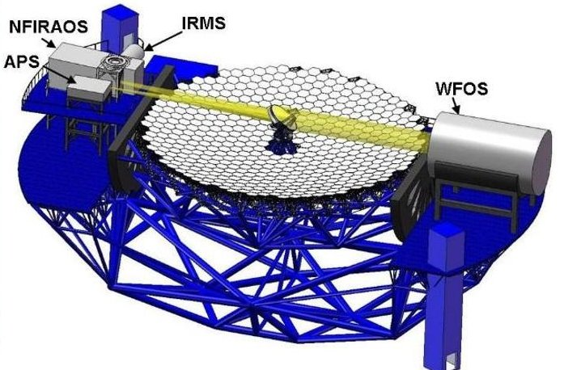

Figure 2. APS mounted on the elevation axis

The core of the system is a wide-field, altitude-azimuth Ritchey-Chretien telescope (Figure 1) with a 492 segment, 30 meter diameter primary mirror, a fully active secondary mirror and an articulated tertiary mirror. The Alignment and Phasing System (Figure 2) is a Shack-Hartmann (SH) wavefront sensor responsible for the overall pre-adaptive optics wavefront quality of the TMT.

The Jet Propulsion Lab (JPL), where the first and third authors work, participates in several subsystems of the TMT and delivers the complete APS. The TIO is the customer, which provides the APS requirements to JPL, and JPL delivers an operational system to the TIO. The APS team pursues an MBSE approach to analyze the requirements, come up with an architecture design and eventually an implementation. The APS team uses several modeling patterns to capture information such as the requirements, the operational scenarios (use cases), involved subsystems and their interaction points, the information exchanged, the estimated or required time durations, and the mass and power consumption.

The focus for this example is on defining executable SysML models to simulate scenarios based on fUML and SCXML semantics and to produce static mass and dynamic (state dependent) power roll-ups, and duration analysis. The goal is to use standard languages and tools as much as possible and to minimize custom software development.

Based on the customer supplied requirements and derived use cases, the goals are to a) identify participating subsystems, b) identify interfaces and interactions among subsystems, and c) analyze operation scenarios to ensure that power requirements are always met.

## Approach: Executable System Engineering Method (ESEM)

In this section, we present our approach to system analysis, called the Executable System Engineering Method (ESEM), which is guided by and extends OOSEM. We will use the running example, introduced in the previous section, to explain and demonstrate the steps of the method. The overall objective is to show how requirements are traced to design artifacts, how analysis is defined with a set of SysML patterns, and how this analysis explains that the design satisfies the requirements. We will refer to relevant aspects of OOSEM in the description.

<!-- PDF_PAGE: 7 -->

## Step 1: Formalize Requirements

The first step is to formalize the customer requirements that are often provided in textual form. For example, one requirement in our running example is that the power consumption of the APS within the dome of the telescope has to be under 8.5 kW, as shown in Figure 3. The requirements are captured in a pattern at two levels: customer and supplier. This is because suppliers may impose more rigid requirements on the design. The separation allows for testing both sets of requirements.

On the customer level, the requirement is first captured using a Requirement (named Peak Dome Load). Then, a design's black-box specification (named APS black box specification - customer) is specified with a Block. Recall that OOSEM requires systems to be designed first as a black box exposing only an interface and hiding all realization details. The customer can then choose to refine the requirement, using a <<refine>> relationship, by constructs such as a Constraint Block (which they do not do in this example) or attribute values on the black-box block (e.g., the pwrPeakLimit attribute of APS Blackbox Customer has a value of 8.5 kW).

On the supplier level, the Requirement is further refined by a Constraint Block (named Peak Power Load Constraint) if one is not provided by the customer. The constraint block provides a boolean expression that is a formalization (in some formal language) of the textual requirement (p<requiredPeakLimitLoad). Notice that the constraint may expose parameters (e.g., requiredPeakLimitLoad) that could be bound to information (e.g., pwrPeakLimit) from the supplier or customer black box specification. We will see this binding in an upcoming step. The supplier may also specify its own black box specification (named APS black box specification - supplier) inheriting from the customer's black-box and redefine some of its attributes (e.g., pwrPeakLimit is redefined to have a value of 8.1 kW, i.e., the supplier intends to support a lower peak power than requested by the customer).

<!-- PDF_PAGE: 8 -->

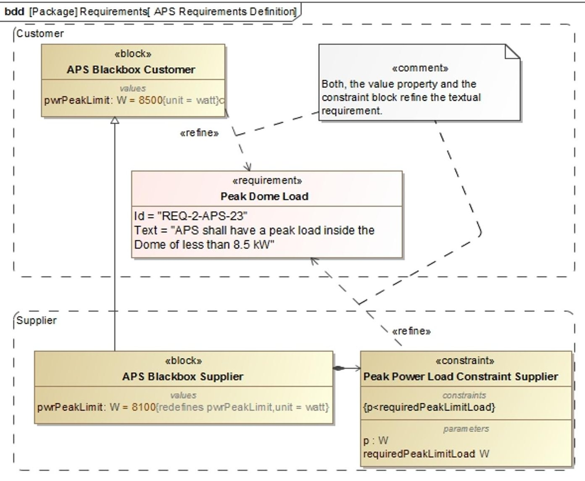

Figure 3. Requirements specification and refinement

## Step 2: Specify Design

The next step is to design the system decomposition according to OOSEM by specifying two white-box system blocks that inherit from the supplier's black box specification system: a conceptual system and a physical system (the latter realizes the former).

However, in our example, we do not show the conceptual system design for brevity and focus only on the physical system decomposition. In this case, the APS Physical Node consists of several opto-mechanical components, which have to be controlled with motors using several local and remote computers. The node is installed in two locations: the Dome and the Summit Facilities Building. The relevant parts are specified in the decomposition tree representing the installation (the block definition diagram in Figure 4). We do not elaborate on the detailed design of these parts for brevity and chose to focus only on the aspects that are relevant to the problem at hand.

<!-- PDF_PAGE: 9 -->

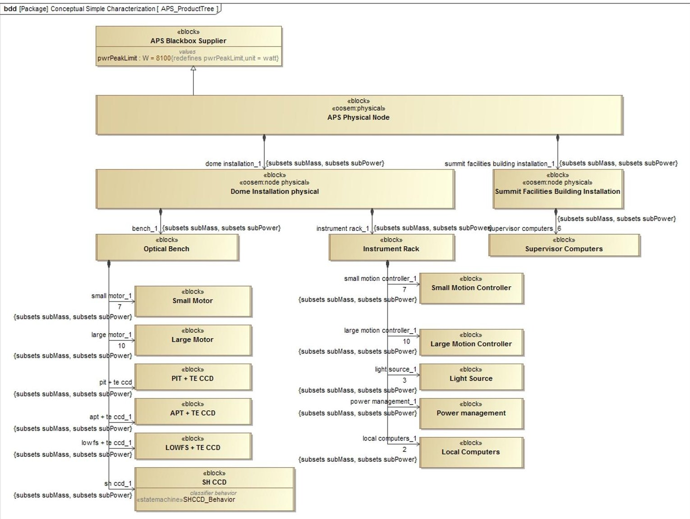

Figure 4. APS product breakdown

## Step 3: Characterize Components

Once the design is specified, the next step is to augment it with analysis patterns. Recall that the requirement in the running example specifies the power consumption peak for the Dome Installation. The analysis needs to explain (by simulation) that the power consumption according to the design always satisfies this requirement for every defined operational scenarios (more on this later on). In other words, the constraint block we defined in the first step needs to be satisfied in every scenario.

When inspecting the constraint, we find that the interesting value is the power of the APS node. This value represents the aggregate (roll-up) of the power values of all the subcomponents of the node. The question that arises is how to model this roll-up (a common requirement in system analysis). For this, we propose a reusable roll-up modeling pattern that is able to capture this roll-up efficiently. The pattern can recursively propagate the particular value up a hierarchy of components characterized by this value. When the values being propagated are static (e.g., mass), we call this a static roll-up. However, when the values are dynamically changing based on the behavior of the system, we call this a dynamic roll-up. In our example, since power (unlike mass) varies depending on the state of every component, we are dealing with a dynamic roll-up

<!-- PDF_PAGE: 10 -->

requirement. However, for simplicity, we first describe how the pattern supports static roll-up, then describe how it can be modified to support dynamic roll-up.

The pattern (e.g., PowerRollupPattern) is modeled (Figure 5) with a Block that is extended by all the components participating in the roll-up. The block adds several properties to each component: a) a value property (e.g., lPower) representing the local value to be propagated, b) a part property (e.g., subPower) typed by the pattern and representing all the subcomponents of this component, and c) a value property (e.g., totalPower) representing the total value for the subcomponents. Notice that the subcomponent property is defined as a "derived union", meaning that its value is computed as the union of the values of all properties that subset it (i.e., defined as its subset). In this case, all components participating in the roll-up (e.g., Dome Installation Physical, from Figure 4) need to have their subcomponent properties (e.g., bench_1 and instrument rack_1) subset this property. While configuring this pattern may seem daunting to do, the analysis tool can automate this process.

A static roll-up pattern needs to define a parametric diagram that describes how the total value property equals the sum of all the subcomponent value properties. Since all component blocks inherit from the Pattern block, they also inherit its parametric diagram. Solving this system of parametrics with a solver makes the total value calculation roll up the component hierarchy, culminating in the calculation of the total value at the top level component (APS Physical Node).

A dynamic roll-up pattern adds a behavior diagram (e.g., a state machine diagram) to specify how the local value changes based on behavior. This typically involves the behavior diagram changing the local value at certain points. For example, in our running example, the local power value of a component is a function of its operational mode. Therefore, we added a state machine diagram in the pattern (called PRBehavior in Figure 5) with states (On, Off, Standby) that represent the modes. Each state changes the local value (power) in its entry action. This allows the roll-up algorithm to aggregate different values for each component depending on its state. If an event caused a component to transition to a different state that changes its local value, this would trigger the roll-up of the total value again to the top.

The pattern also allows for some variability by each component in the design. By representing some values as value properties on the Pattern block, each component inheriting the pattern can change those values by redefining the corresponding properties. In our running example, the pattern defines two constant power values: operatingPower and standbyPower, representing the power values in the On and Standby states, respectively (the power has a value of zero in the Off state). The entry actions of the corresponding states simply assign those values to the local value.

<!-- PDF_PAGE: 11 -->

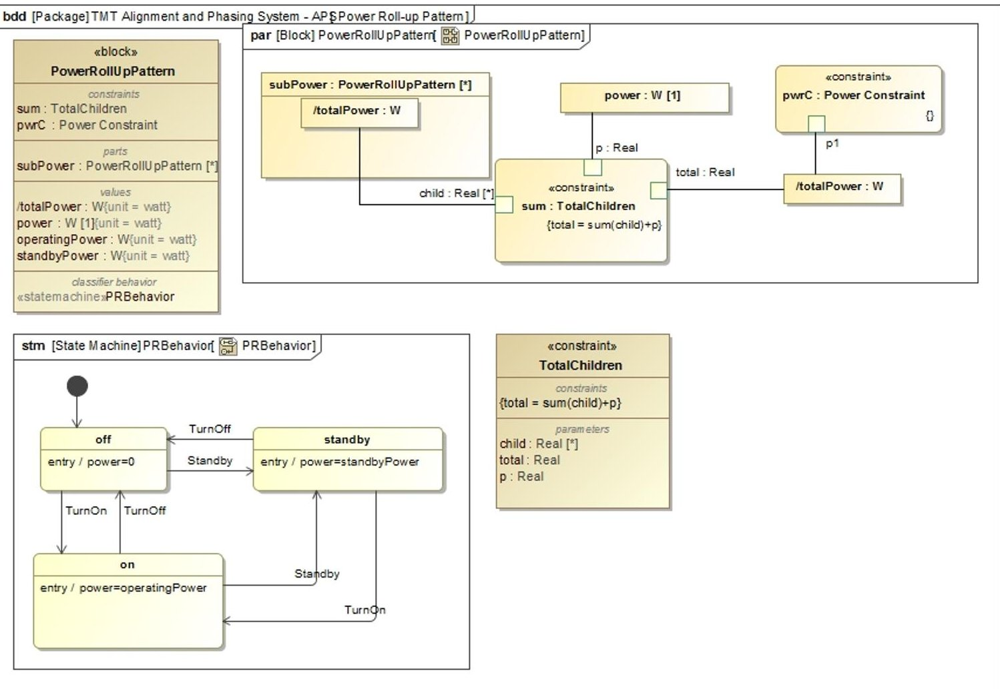

Figure 5. Definition of Power Roll-up Pattern

This works fine for simple variability. However, some components may have more complex behavior (than the one inherited from the pattern) affecting their local values. In this case, those components need to redefine the inherited behavior diagram. For example, component SH CCD redefines its state machine to redefine the entry actions using different activities (Figure 6), i.e behavior. Those activities change the local values consistently with the inherited pattern. However, they also change the value of a constraint property (pwrC typed by Power Constrained block), defined on the pattern, by another value (an instance of subtype block SH CCD - ON or SH CCD - STANDBY), resulting in dynamic constraint checking. Other changes in the state machine could be other states and/or transitions.

Alternatively, a specialized roll-up could be created (where the specific behavior is owned) which is inherited by the component instead of modifying the component itself and make it own the specific behavior.

<!-- PDF_PAGE: 12 -->

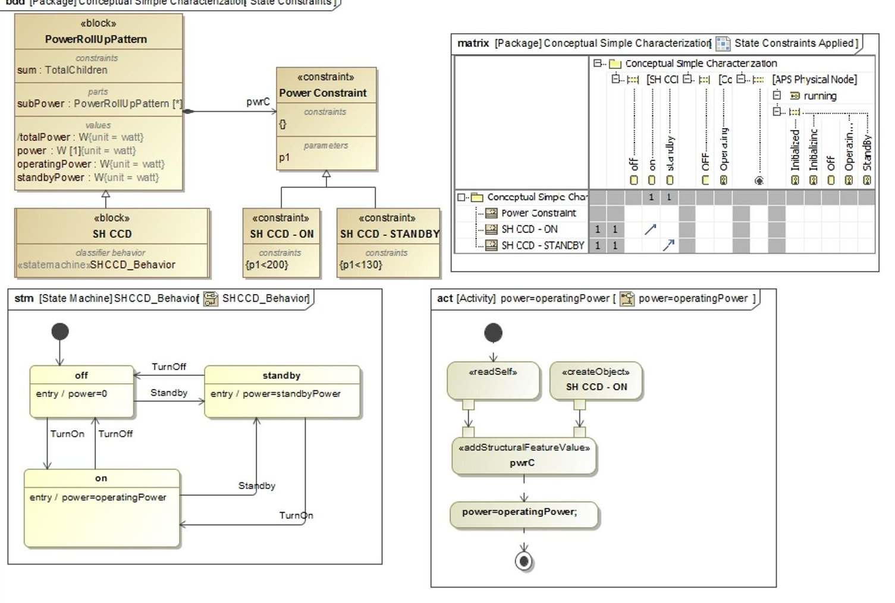

Figure 6. Component specific behavior and constraints

## Step 4: Specify Analysis Context

The next step after adding the analysis patterns is to specify the analysis context. In this case, we use the analysis pattern from (Friedenthal et al. 2011) to model that context (Figure 7). Specifically, we define a block representing the analysis context (Dome Peak Power Limit Margin Analysis) that composes both the black-box block (ABS Blackbox Supplier) and the design block that should satisfy the requirement (Dome Installation Physical). Note, that the analysis is done using the supplier black box specification. The compliance with the original customer requirement is analyzed in a separate step. The analysis uses the constraint block which refines the textual requirement (Figure 3) and adds other constraints to compute also the margin (with respect to the internally specified peak power limit) and store the maximum power during a simulation. The corresponding parametric model is shown in Figure 8.

<!-- PDF_PAGE: 13 -->

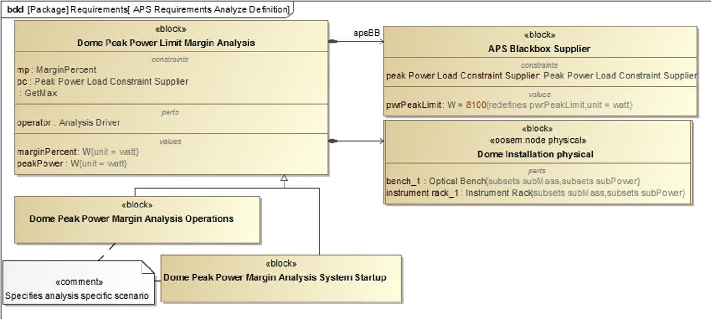

Figure 7. Definition Peak Power Limit Analysis

The analysis context is actually defined with an abstract block and is used only to specify a parametric model. However, concrete analysis blocks corresponding to operational scenarios (use cases) need to be defined as well.

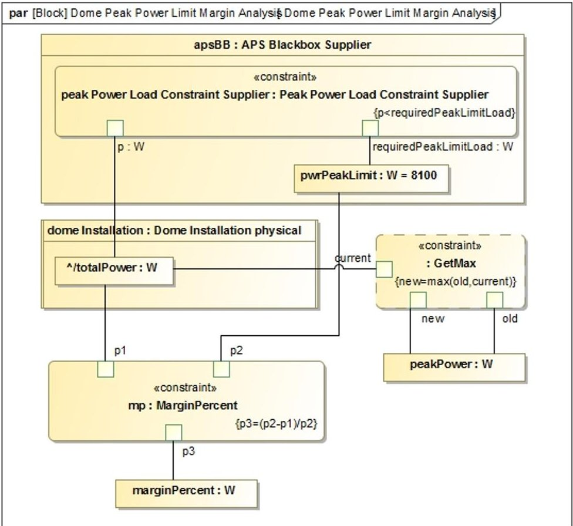

Figure 8. Parametric model of peak power limit analysis

<!-- PDF_PAGE: 14 -->

Each concrete analysis block specializes the abstract analysis block, inheriting its parametric model, and defining a behavioral diagram (we use sequence diagrams) that acts as a scenario driver. Figure 9 shows a simplified scenario for a subset of components in the running example.

## Step 5: Specify Operational Scenarios

Once the analysis details are added, the next step would be to define a set of operational scenarios corresponding to the use cases specified by the customer (we skipped this step since it does not differ from the usual definition of use cases in OOSEM). The scenarios can be either specified with sequence or activity diagrams. Sequence diagrams have the advantage to more easily define duration constraints and state invariants. Each scenario becomes a use case that can be analyzed using a simulation engine. In the running example, those operational scenarios exercise different power consumption configurations.

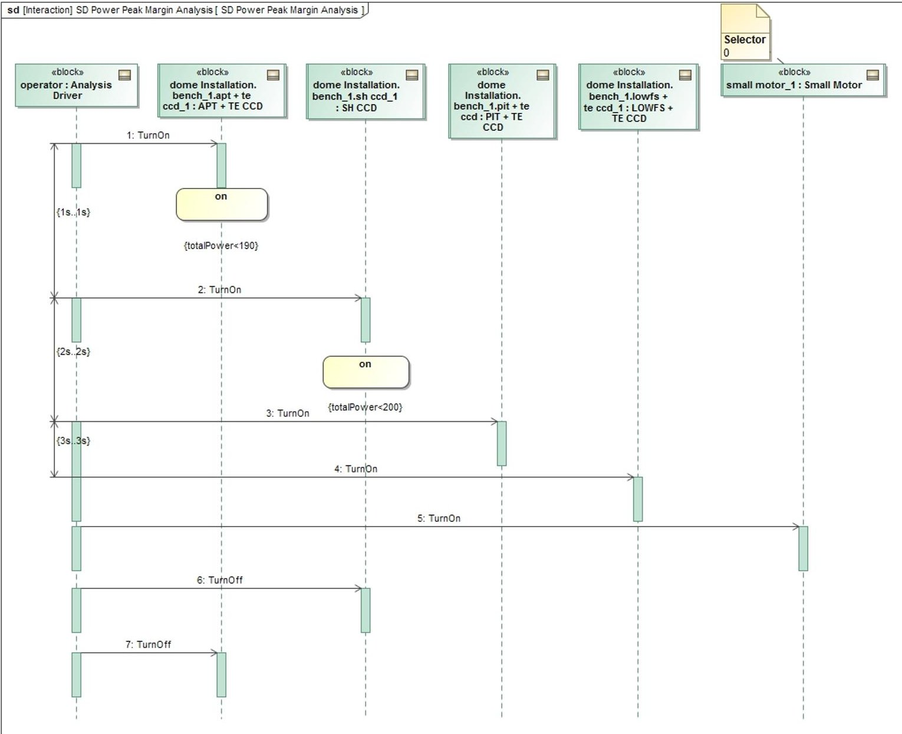

Figure 9. Simplified Scenario for the Dome Peak Power Margin Analysis

The sequence diagram changes the states of the different components, by sending them signals, causing the rolling-up to occur automatically when the state changes. It can also specify duration

<!-- PDF_PAGE: 15 -->

constraints to time the injection of signals and therefore specify how long a component shall remain in a certain state. Moreover, using state constraints (on components) also allows verification during execution if a component is actually in some state (e.g. "On") in its state machine, or if a value property satisfies some constraint (e.g. "totalPower<190"). In addition, a special Analysis Driver component injects the signals to bring the system component into the right state expected for the scenario. Alternatively "Found Messages" could be used. A separate block allows you to define additional properties on the analysis driver if needed.

## Step 6: Specify Configurations

We propose to specify the initial state of the operational scenarios (in this case, the initial power consumption configurations) using different decomposition trees of instance specifications, as shown in the table in Figure 10. The rows correspond to the instance specifications in the decomposition trees and the columns correspond to the values (in this case, the power), that is consumed in particular states (in this case, Operating and Standby). Such tables facilitate the configuration data entry.

This instance specification approach suffers from two problems: a) keeping the block decomposition tree and the instance specification decomposition tree in sync may be tedious (however, tool support may mitigate this problem), and b) instance specifications cannot be displayed on internal block diagrams (a SysML limitation), as often desired to visualize the scenarios. A workaround for the latter is to create a full specialization tree of blocks for every scenario, essentially treating every block in the new tree as a singleton instance (specifying the scenario's values as default values for the block's value properties rather than slot values on an instance specification). Nevertheless those hierarchies (the original block decomposition tree and the specialization trees) must be kept in sync which is a non-trivial problem as complex inheritance and redefinition semantics are used and there are cases where it is not possible to specify default values (e.g., for complex types or vectors). This problem does not exist for an instance specification tree since you can reference one tree (representing the value of a complex type) as a slot (value) for another instance specification, which allows you to comfortably combine trees for different scenarios and configurations. This is a much more manageable approach to dealing with multiple scenarios than specializing blocks. Also, results of one analysis (also a tree of instances) can easily be used for further analysis by simply referencing them as initial state (shown later in the paper).

<!-- PDF_PAGE: 16 -->

<table border="1"><tr><td colspan="4">Criteria
Classifier: TE CCD, Instrument Rack, Coordinator
Scope (optional): Mass and Power Configuration</td></tr><tr><td>#</td><td>Name</td><td>Operating Power:W</td><td>Standby Power:W</td></tr><tr><td>1</td><td>aps.dome installation_1.bench_1</td><td>0.0</td><td>0.0</td></tr><tr><td>2</td><td>aps</td><td>0.0</td><td>0.0</td></tr><tr><td>3</td><td>aps.coordinator_1</td><td>0.0</td><td>0.0</td></tr><tr><td>4</td><td>aps.dome installation_1</td><td>0.0</td><td>0.0</td></tr><tr><td>5</td><td>aps.dome installation_1.bench_1.apt+te ccd_1</td><td>300.0</td><td>100.0</td></tr><tr><td>6</td><td>aps.dome installation_1.bench_1.large motor_1[1]</td><td>10.0</td><td>10.0</td></tr><tr><td>7</td><td>aps.dome installation_1.bench_1.large motor_1[2]</td><td>10.0</td><td>10.0</td></tr><tr><td>8</td><td>aps.dome installation_1.bench_1.large motor_1[3]</td><td>10.0</td><td>10.0</td></tr><tr><td>9</td><td>aps.dome installation_1.bench_1.large motor_1[4]</td><td>10.0</td><td>10.0</td></tr><tr><td>10</td><td>aps.dome installation_1.bench_1.large motor_1[5]</td><td>10.0</td><td>10.0</td></tr><tr><td>11</td><td>aps.dome installation_1.bench_1.large motor_1[6]</td><td>10.0</td><td>10.0</td></tr><tr><td>12</td><td>aps.dome installation_1.bench_1.large motor_1[7]</td><td>10.0</td><td>10.0</td></tr><tr><td>13</td><td>aps.dome installation_1.bench_1.large motor_1[8]</td><td>10.0</td><td>10.0</td></tr><tr><td>14</td><td>aps.dome installation_1.bench_1.large motor_1[9]</td><td>10.0</td><td>10.0</td></tr><tr><td>15</td><td>aps.dome installation_1.bench_1.large motor_1[10]</td><td>10.0</td><td>10.0</td></tr><tr><td>16</td><td>aps.dome installation_1.bench_1.lowfs+te ccd_1</td><td>150.0</td><td>100.0</td></tr></table>

Figure 10. Data configuration table

Also, as shown in Figure 11, each concrete analysis instance specification needs to reference (with an <<analyzes>> relationship) a specific instance specification from the analysis configuration (step 4) as its initial condition. In addition, it needs to reference (with an <<explains>> relationship) another instance specification from the analysis configuration to hold the final result of the execution. We define the new stereotypes, <<analyzes>> and <<explains>>, on a Dependency relationship to capture this pattern.

<!-- PDF_PAGE: 17 -->

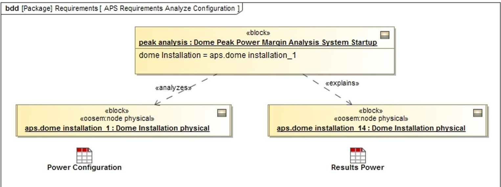

Figure 11. Instance specifications for specific analysis configuration

## Step 7: Run Analysis

In this step, we run the configured analysis using a simulation engine, such as CST. This provides several outputs such as: a) timeline of the states of the individual components (Figure 13), which shows state changes of individual components during the simulation, b) rolled up power and margin (Figure 12), and c) value profiles (Figure 14), which show the total value over time of the rolled up value (total power of dome installation part of the APS). These products represent different views that can be used by the engineer to analyze the results.

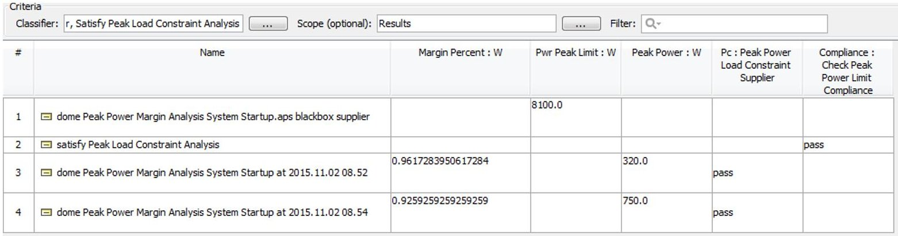

Figure 12. Rolled up power and margin

<!-- PDF_PAGE: 18 -->

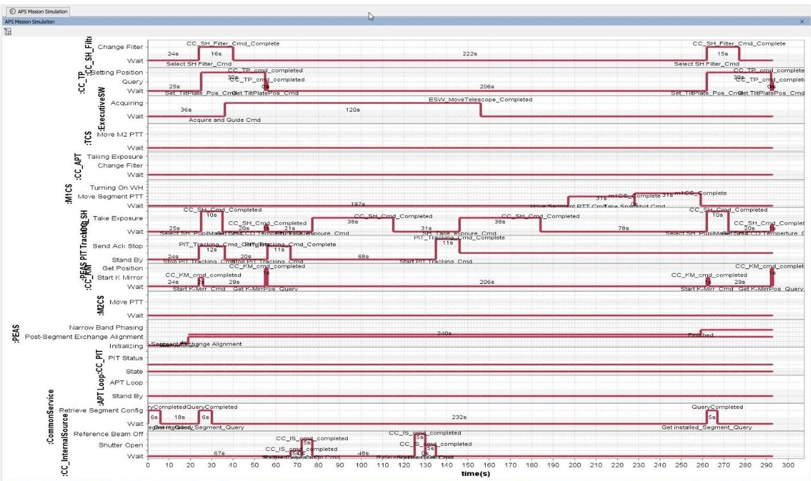

Figure 13. Timeline of component states

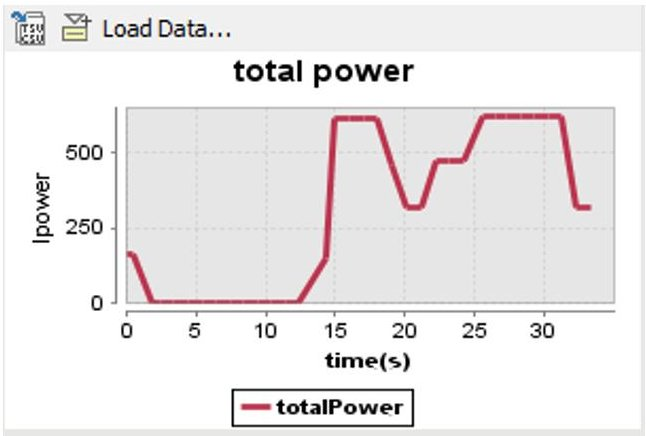

Figure 14. Power profile of the dome installation

## Step 8: Evaluate Requirement Satisfaction

As soon as the results of the different scenarios are available, the satisfaction of the original customer requirement has to be demonstrated. This is done with a separate analysis context (Satisfy Peak Load Constraint Analysis), this time using the customer's (rather than the supplier's) black box, as shown in Figure 15.

<!-- PDF_PAGE: 19 -->

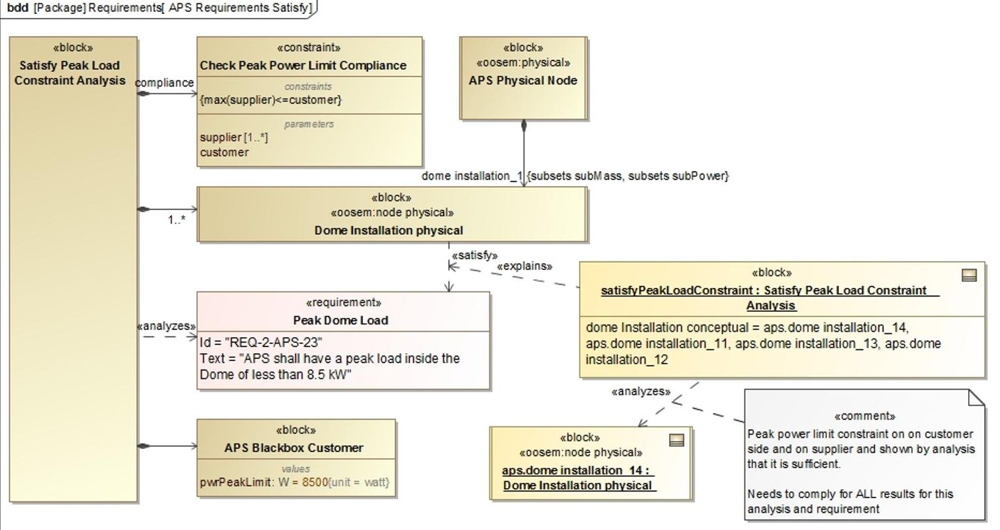

Figure 15. Requirements satisfaction analysis

The analysis has to show that the design (of the dome installation) satisfies the requirement for the results of all specified scenarios. The instance specification of this analysis (Satisfy Peak Load Constraint Analysis) references all available results (e.g. aps.dome installation_14) and verifies that all supplier results also satisfy the customer requirement (max(supplier)<=customer).

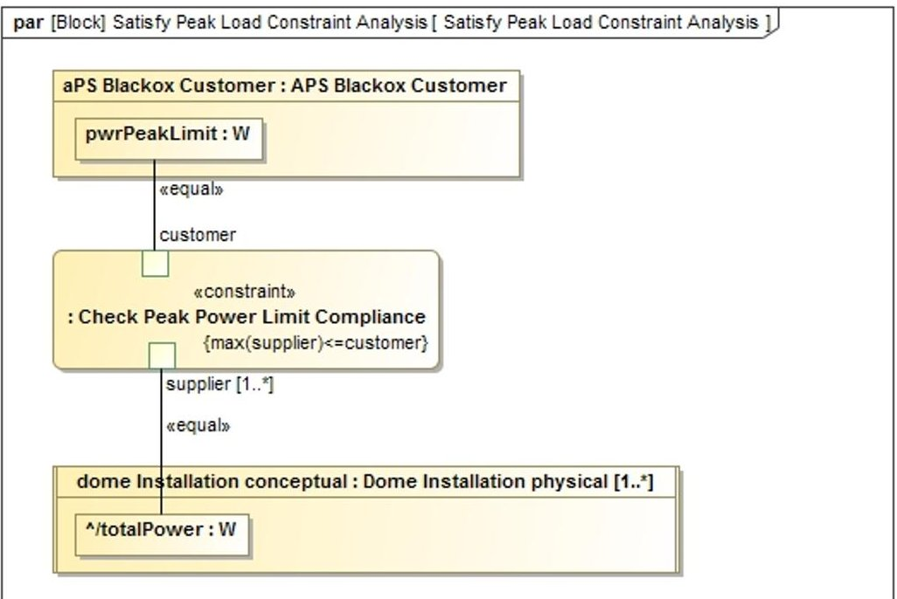

Figure 16. Load Constraint Analysis

<!-- PDF_PAGE: 20 -->

The result of this analysis explains the satisfy relationship between the design and the requirement. The parametric diagram of such analysis in the running example is shown in Figure 16. The results of the analysis (Figure 12 - Figure 14) show that for two runs, the load constraint of the supplier is satisfied (i.e. pass) and the customer requirement is satisfied as well, because the results of all analyses are below the required peak power limit.

## Discussion and Limitations

ESEM allows for the automation of system analysis using the system model. By driving the analysis directly from data in the model, we eliminate the inconsistency that often arises when data is also maintained by analysis tools (e.g., Excel). In addition, performing the analysis by simulating the system design captured in the model has the added benefit of having all the necessary information (e.g., the state of the system at relevant time points) readily available to check. This makes the development of analysis patterns (e.g., rollups) to check the satisfaction of requirements reasonably straightforward.

Different rollups can be applied to different characteristics of a system like power and mass. They basically all follow the same pattern. Originally the mass and power roll-ups for the APS were maintained and calculated in Excel spreadsheets for different (simplified) scenarios and updated whenever a requirement or the system design changed. However it, was completely disconnected from the SysML system model which captures the different operational scenarios, the system design, and the requirements. Integrating the roll-ups simplified the maintenance and consistency of the data (change was only in one place: the system model) and helped automate the checking of requirement satisfaction; both advantages were huge time savers. Another added benefit is that performing the analysis on the system model directly allows the analysis result to stay in the model, which makes the engineering document that would be generated from the model stay up to date and consistent.

Obviously, not all kinds of system analysis (e.g., finite element analysis) can be performed using the semantics of SysML alone. These analyses would require the augmentation of SysML with other profiles that captures the missing information. Also, the reliability of the analyses that can be performed using this method relies on the reliability of the SysML simulation tools, which may be less mature than their general-purpose counterparts. However, this is often mitigated by integrating the former with the latter.

## Related work

The area of model-based system analysis has previously been investigated in the literature.

One notable work (Zwemer 2015) in this area discusses how to model static rollups in SysML using four different strategies with increasing complexity and versatility: a) quantity-specific constraints (each part has its own rollup constraint), b) complex aggregates (same as in a but the rollup constraint is defined once on a supertype of the parts and inherited in every part), c) complex aggregates and recursion (same as in b except that the constraint of the supertype is not inherited but rather recurses down the hierarchy of parts), and d) multiple-inheritance (same as in c but supports different rollups on different kinds of parts by having different supertypes for

<!-- PDF_PAGE: 21 -->

them). Our approach to static rollup described in this paper is similar to strategy d, with one difference. The referenced approach describes how the subpart properties on the subtypes are only related to their counterpart in the supertype at the instance model, by assigning the slot values of the subtype properties also to the supertype property. However, in our approach, the supertype property is specified as a derived union of all its subsetting subtype properties. This avoids the duplicate slot assignment and makes the creation of the instance model much easier. Moreover, unlike our approach, the referenced approach does not describe how to perform a dynamic rollup.

Another related work (Paredis 2011) discusses how to use SysML parametrics for requirement verification analysis. The work argues how analysis parametrics are better captured in their own context outside the system design itself. This allows a design to have multiple kinds of parametric analysis, and makes the analysis models themselves reusable across designs. The focus is on static parametric analysis (and rollup) but does not describe how to perform a dynamic one where the parametrics are behavior dependent.

Another work (Morkevicius and Jankevicius 2015) introduces an approach to automated requirements verification by analysis with SysML, which consists of formalization of text-based requirements, definition of analysis context and binding system properties to constrain parameters. Our approach extends it by adding customer/supplier relationship and formalizing the satisfy relationship by analysis between design and requirement for a given number of scenarios.

System level simulation environments have been around since the late 1980s. One prominent example is Geode (Python Software Foundation 2016). It provides many features also available in today's tools but it is not adhering to standard modeling languages nor well-defined execution semantics. Also, its software architecture is not open enough to be extended and customized. Another example is Matlab StateFlow (Mathworks 2016), a widely used tool which is very well documented. However, it is proprietary and does not support defining different views of the same design. One more example is SCADE (Esterel Technologies 2016), which is expensive and uses a proprietary technology that is focused on certified code generation for safety critical systems.

## Conclusions and future work

Requirement verification is an important kind of analysis that is often performed in the context of MBSE. In this paper, we described a new Executable System Engineering Method (ESEM) that can be used to automate requirements verification with a set of executable SysML modeling patterns. These patterns integrate parametrics with the execution semantics of behavioral diagrams. This enables one, for example, to specify the relevant system behavior using state machines and the scenarios for a requirement using sequence diagrams in order to execute simulations whose results can be assessed for satisfaction of the requirements.

The proposed method integrates the standard pattern of an analysis context with the behavior execution pattern by specifying a scenario as the behavior of the analysis context's classifier. The instance of the analysis context contains the current state of the scenario, and the parametrics

<!-- PDF_PAGE: 22 -->

compute the values of selected properties as the scenario runs. The initial state for the analysis context comes from a tree of instance specifications and their property values (a configuration), and the output is another tree that displays the computed values of the analysis.

We have demonstrated our method on a running example, where we analyzed the power requirements of the Alignment and Phasing System (APS) of the Thirty Meter Telescope (TMT) system. We used the MagicDraw tool to create the analysis model, and the Cameo Simulation Toolkit to execute it. We showed that our method is able to tackle various analysis needs (e.g., power rollups) of the APS.

In the future, we plan to improve some of the patterns related to behavior modeling (Castet et al. 2015) to support executability. For example, we need to find a more formal way to tie constraints on value properties for each power mode (e.g. standby, on) to the state. We also have to better capture interactions among system components at different levels of composition (e.g. motor controller and motor). This also involves the semantic distinction between (discrete and continuous) state variables and parameters of the system and those introduced for analysis only (e.g. constraint maximums or minimums). It is also desirable to improve the roll-up pattern that deals with state specific constraints, by avoiding hard coding constraint values in state invariant or other constraints. Furthermore, running simulations generates a large amount of results which are currently stored in instance specifications, which make the design model grow unnecessarily. Those results (sequence diagram recording, instance snapshots, simulation logs) should be stored outside of the system model in dedicated data repository. Also, the usage of the Action Language for Foundational UML (ALF) (OMG 2013) shall be investigated as alternative to specify behaviors. The synchronization of instance specification trees to run the analysis with the design model is a challenge is the decomposition structure changes. Alternative approaches will be investigated.

We plan to tackle other kinds of model-based analysis activities, such as trade studies. This may require us to extend our method to handle those kinds of analyses.

## Acknowledgements

This research was carried out at the Jet Propulsion Laboratory (JPL), California Institute of Technology, under a contract with the National Aeronautics and Space Administration (NASA), and at No Magic Inc.

## References

Castet JF., et al. 2015. "Ontology and Modeling Patterns for State-Based Behavior Representation", AIAA Infotech.

Eclipse. 2016. "Papyrus." http://eclipse.org/papyrus/

Esterel Technologies. 2016. "SCADE." http://www.esterel-technologies.com/products/scade-suite/

<!-- PDF_PAGE: 23 -->

Friedenthal S, Moore A., and Steiner R. 2011. A Practical Guide to SysML 2nd Ed. Morgan Kaufmann OMG Press.

Harel D. 1987. "Statecharts: A visual formalism for complex systems", Science of Computer Programming. Volume 8, Issue 3, pp. 231-274.

IBM. 2016. "Rhapsody." http://www-03.ibm.com/software/products/en/ratirhapdesiforsystengi INCOSE. 2016. "International Council on Systems Engineering." http://www.incose.org

Mathworks. 2016. "Matlab StateFlow."

http://www.mathworks.com/products/

stateflow/?requestedDomain=www.mathworks.com

Morkevicius A. and Jankevicius N. 2015. "An Approach: SysML-based Automated Requirements Verification", Proceedings of ISSE, pp. 92-97.

No Magic Inc. 2016a. "MagicDraw." http://ww.magicdraw.com

. 2016b. "Cameo Simulation Toolkit." http://www.nomagic.com/products/magicdraw-addons/cameo-simulation-toolkit.html

OMG. 2013. Concrete Syntax for a UML Action Language: Action Language for Foundational UML (ALF), 1.0.1.

___. 2014a. Systems Modeling Language (SysML) Version 1.4.

___. 2014b. Semantics of a Foundational Subset for Executable UML Models (FUML), 1.1.

___. 2015a. Unified Modeling Language (UML) 2.5.

. 2015b. Precise Semantics of UML Composite Structures (PSCS), v1.0.

___. 2016. "Object Management Group." http://www.omg.org

Paredis C. 2011. "System Analysis using SysML Parametrics: Current Tools and Best Practices."

Python Software Foundation. 2016. "OpenGeode." https://pypi.python.org/pypi/opengeode/1.3.7

Sparx. 2016. "Enterprise Architect." http://www.sparxsystems.com/products/ea/

TMT. 2016. "Thirty Meter Telescope." http://www.tmt.org

W3C. 2015. State Chart XML (SCXML): State Machine Notation for Control Abstraction. W3C Recommendation 1.

___. 2016. "World Wide Web Consortium." http://www.w3.org

Zwemer D. 2015. "Technote: SysML Parametrics for Roll-up Calculations", Intercax LLC

<!-- PDF_PAGE: 24 -->

# Biography

Robert Karban is a senior systems architect at the Jet Propulsion lab in the Systems Engineering and Formulation Division. Robert works in the domain of Model Based Systems Engineering (MBSE) as the task lead on providing a Model Based Engineering Environment (MBEE) for projects and applies modeling in the Thirty Meter Telescope project. Prior to that, he developed control and instrumentation systems for large telescopes at the European Southern Observatory applying model driven technology, and for particle accelerators at the European Organization for Nuclear Research (CERN). Robert is a Challenge team lead of INCOSE's MBSE

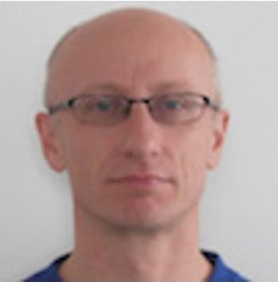

Initiative, an OMG certified SysML professional and an active member in OMG's revision task force for SysML. He started his career at Siemens Medical Devices developing System Software and received his M.S. in Computer Science from the Technical University of Vienna/Austria.

Nerijus Jankevičius is a senior analyst and product manager at No Magic Europe, a vendor of a worldwide popular modeling platform MagicDraw. He has been a MagicDraw UML team member since the very beginning of tool development in 1997. Since 2006, Nerijus has been actively working on SysML implementation and MBSE solutions model-based systems engineering, analysis and simulation tools and customers technical mentoring in this specific domain. Nerijus is an active and influential participant in OMG UML and OMG SysML Revision Task Forces (RTF) and has been the official No Magic representative for these and others OMG standards since 2004. Nerijus is one of the first OMG Certified Advanced UML 2.0 Professionals in Europe

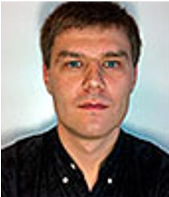

Maged Elaasar is a senior software architect at the Jet Propulsion Laboratory in the Systems Engineering and Formulation Division. During his career in the software industry, Maged has consulted many companies around the world, and has become a known leader in the field of ModelDriven Engineering, where he holds several patents. Maged has also managed development teams and technically lead software products that are in widespread use today. In addition, he has been a leader of and an active contributor to open-source projects at Eclipse (e.g., Papyrus) and open-standards at OMG (e.g., UML and SysML) for many years. Maged

has taught several university and corporate courses. He has received his Ph.D. in Electrical and Computer Engineering from Carleton University in 2012, his Master of Computer Science from Carleton University in 2003, and his Bachelor of Computer Science from the American University in Cairo in 1996. Maged is also actively engaged in applied research, and has published in top-tier conferences and journals.