<!-- PDF_PAGE: 1 -->

# MBSE++ — Foundations for Extended Model-Based Systems Engineering Across System Lifecycle

Manas Bajaj $ ^{1} $ , PhD manas@intercax.com

Dirk Zwemer, PhD dirk@intercax.com

Alex Phung Amit Kumar alex@intercax.com amit@intercax.com

Rose Yntema rose@intercax.com

Anshu Dwivedi Manoj Waikar anshu@intercax.com manoj@intercax.com

Intercax 75 $ 5^{\mathrm{th}} $ Street NW, Suite 312, Atlanta, GA 30308, USA www.intercax.com | info@intercax.com

Copyright 2016 by Intercax LLC. Published and used by INCOSE with permission.

## Abstract

This paper presents an approach for next-generation model-based systems engineering across the system lifecycle, labelled MBSE++. This approach is based on the idea of a Total System Model that serves and evolves as the digital blueprint of a system through its lifecycle. The fundamental principles of MBSE++ are presented in this paper, including the use of decentralized and heterogeneous engineering models and repositories, spectrum of fine-grained model-based connections, unified representation of the system independent of the location of models, model transformations, comparisons, and synchronization to communicate between disciplines, and visualization and analytics for effective decision making. The motivation for each of the MBSE++ principles is presented, followed by a description of use cases. The use cases are exemplified using Syndeia, a MBE/MBSE platform developed by Intercax.

## Model-Based Systems Engineering (MBSE)

The transition from Document-Based Systems Engineering (DBSE) to Model-Based Systems Engineering (MBSE) is well underway. Rather than capturing system architecture and requirements in a series of static, disconnected documents, a computer model evolves with the system, providing a single source of truth from which standard systems engineering (SE) documents, views and artifacts can be generated at need. OMG System Modeling Language (SysML) has become the consensus mechanism for building this model and is supported by multiple software vendors.

But implementing MBSE in the real world has faced challenges. Modern system development uses many models; CAD models, simulation models, PLM part structures, software code, and others. The concept of a single source of truth becomes nebulous. Many contributors in the field have recognized the need to connect these models in some fashion to provide consistency across the system specification [Bajaj, Zwemer, Peak et al. 2011; Fisher, Friedenthal, Bajaj et

<!-- PDF_PAGE: 2 -->

al. 2014]. Their collective work is creating a third generation of systems engineering approaches, which we will call Extended Model-Based Systems Engineering Across System Lifecycle (MBSE++ in short).

Intercax has pursued its vision of MBSE++ with a software platform called Syndeia $ ^{2} $ , formerly known as SLIM [Bajaj, Zwemer et al. 2011], which links a system architecture model in SysML with multiple engineering models and repositories (Figure 1) to create a Total System Model, elaborated later in section 0. We have had the opportunity to work with several of the leading edge practitioners of MBSE, using working software to address real use cases. From this work, we have formulated certain principles of MBSE++. In this paper, we will briefly describe some of these principles and offer examples of use cases illustrated by commercial and prototype features of Syndeia software. The examples are intended to be illustrative of capabilities in use or under development, but not exhaustive. We present these principles in the following section. For every principle, we present the overall challenge followed by the specific use cases and illustrations using Syndeia.

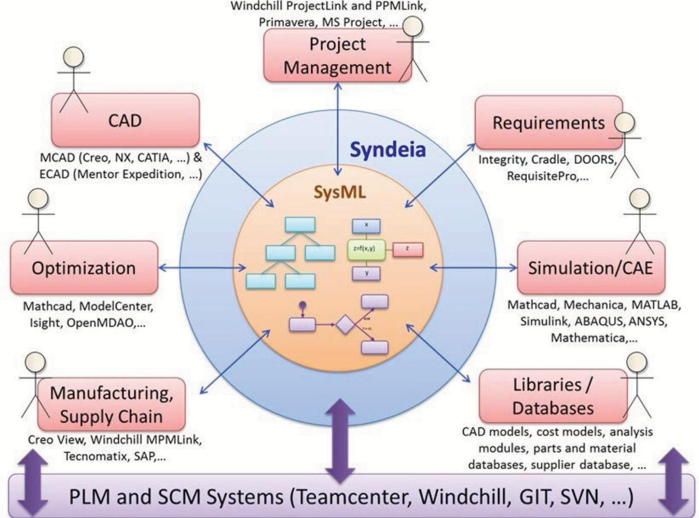

Figure 1: Syndeia provides a platform for connecting system architecture models in SysML to a variety of other engineering models, enabling transformation, comparison and synchronization of information across disciplines

We now present the six principles of MBSE++.

<!-- PDF_PAGE: 3 -->

# Working with Heterogeneous and Decentralized Data

Challenge

Engineering organizations deal with diversity:

- They use a wide variety of engineering software tools.

- No single vendor can supply all these tools, and most users want the ability to choose best-in-class tools independent of vendor.

- Extended supply chains require interfacing with customer and vendor toolsets.

As a result, system data is spread across multiple repositories $ ^{3} $ , such as PLM systems (Teamcenter, Windchill, Envoia), ALM systems (Git, Subversion), databases (Oracle, MySQL, MongoDB), and cloud-based file systems (Dropbox, Google Drive, Egnyte). System data may be in the form of models, such as CAD models and MATLAB / Mathematica code, or database objects, such as parts in a PLM system. Repositories may provide different levels of version and configuration control capabilities, and hence system data is spread across multiple version-control repositories. Software tools and repositories may provide different levels of interoperability, ranging from file-based import/export to scalable web services built using modern web standards, such as REST and JSON.

Users want their system engineering software to work together with this heterogeneous mix of domain modeling tools and repositories, and to recognize and address inconsistencies across these repositories, while respecting negotiated agreements on access and ownership of data.

## Use Case

Figure 2 and Figure 3 illustrate a common use case. A system integrator pulls existing product information and requirements from a variety of library sources, including PLM and database repositories, and composes them to define a new system architecture in SysML. Following conceptual design and analyses, the system integrator uses the SysML-based architecture model to seed hardware bill-of-materials in a PLM system and interfaces for software subsystems in an ALM system.

A key feature shown in Figure 2 using the Syndeia Dashboard is the ability to access multiple repositories from a single system architecture project (SysML model). System integrators can connect to multiple enterprise PLM and ALM systems, and search and view domain-specific model structures, such as part structures in a PLM system, and tables/rows in a relational database. The next stage is to use that access to transform/generate models using simple dragn-drop operations, such as generating architectural elements from a part library in a PLM system (or vice versa), or to simply connect existing models elements in different disciplines. Model transformation operations not only generate models but also create persistent modelbased connections between source and target model elements, retaining version information. In this way, the integrity of the Total System Model is maintained as information in the distributed and heterogeneous repositories evolves.

<!-- PDF_PAGE: 4 -->

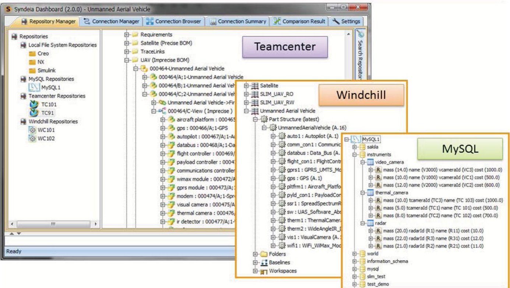

Figure 2: Syndeia allows one SysML model (system architecture) to be connected to elements in multiple PLM/ALM repositories, databases, and models

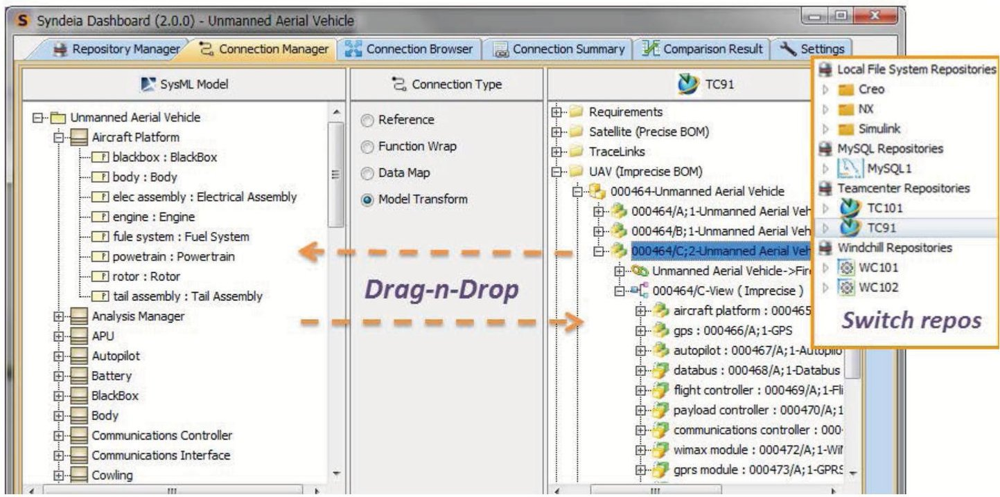

Figure 3: Syndeia provides drag-n-drop actions to perform data and model transformations across tool/repository boundaries, and creates connections for downstream compare/synchronization operations

## Capturing and Maintaining the High-level System Architecture

## Challenge

Despite the diversity of data, toolsets, and repositories, users still need a high-level architecture model of the system that is independent of a specific domain, or tool / vendor / repository. SysML has been a successful facilitator of this need, because it allows structure, behavior,

<!-- PDF_PAGE: 5 -->

requirements and analysis to interact in the same view. It serves as an open-standard to represent such a system architecture model and fulfills the following objectives:

- Organizations need to communicate the system specification to multiple audiences.

- Organizations need a clearinghouse where unexpected system effects emerge from the interaction of individual efforts.

- Organizations need a place to connect the system model with project management.

The combination of a standards-based system architecture model that can connect to a heterogeneous set of models and data sources in various tools and repositories is potent Google map of the system. System engineers can then perform semantic zoom operations that will take them from a concept in the architecture model to its detailed implementation in hardware, such as mechanical/electrical CAD model, or software code in software configuration management system, such as Git. Similarly, mechanical engineers can explore system requirements and analyses from which the hardware part specifications were created. In MBSE++, we call this unified model the Total System Model, referred to as TSM hereafter in this paper and shown in Figure 4 below.

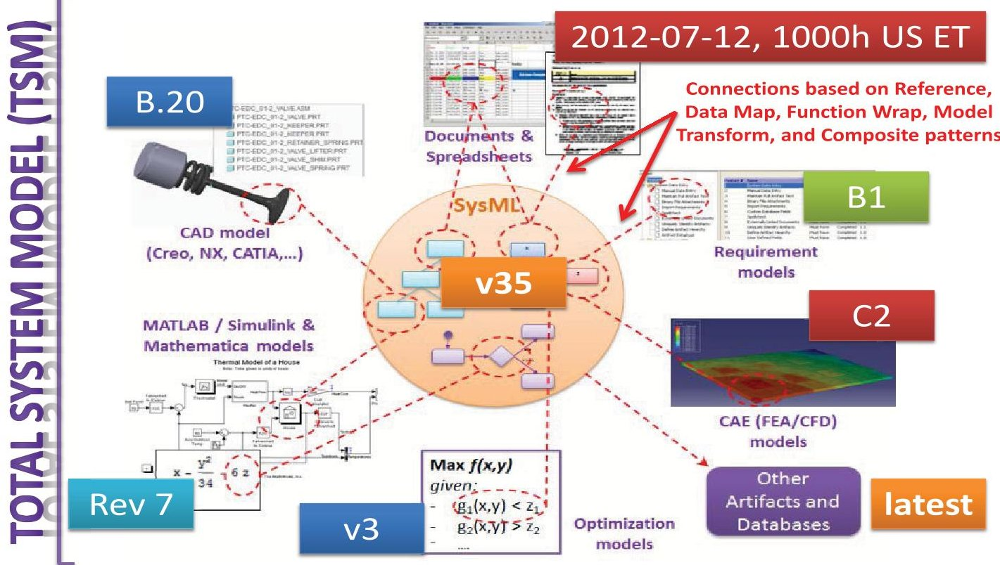

Figure 4: Total System Model (TSM) combines SysML-based architecture model with models in various enterprise tools, repositories, and datasets using fine-grained model connections

<!-- PDF_PAGE: 6 -->

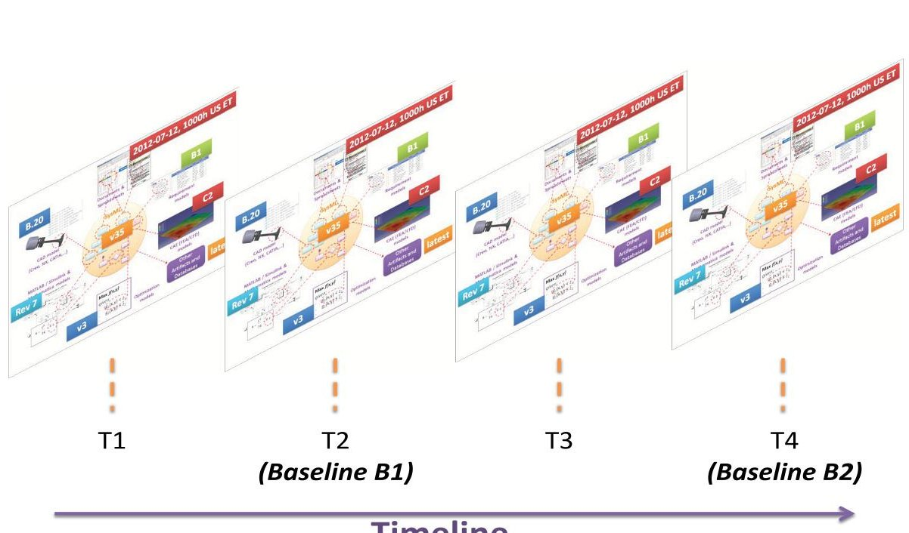

Figure 5: TSM evolves over time as each of the individual models evolve. Snapshots of the TSM can be base lined for reviews and released.

The TSM is a federation of models, connecting the system architecture model in SysML to various discipline-specific models. The connections can be fine-grained, connecting specific model elements, and are cognizant of the versions of the models (or model elements) connected, as shown in Figure 4. The TSM evolves over time, as individual models in various enterprise repositories evolve, as shown in Figure 5. Snapshots of the TSM along the system lifecycle can be base lined for reviews and released.

The ability to combine the development of the TSM with engineering workflows is of high importance. System engineers and architects would greatly benefit from a capability that allowed them to flowchart and execute system engineering workflows, and link the workflow to deliverables/models. An example workflow would include tasks, such as checking out input models/data from a repository, analyzing models/data for consistency, executing parametric simulations, verifying requirements against simulation results, and publishing reports automatically each time a major revision of the system model is checked-in.

As shown in Figure 6, the project management tool will continue to track schedule, budget and manpower, as before; the SysML model will include both the system engineering workflow and the system architecture model; and the Syndeia framework will enable model-based connections between project management tool and system engineering workflow in SysML, and between system architecture model in SysML and domain-specific models in enterprise PLM/ALM/requirements management repositories and databases. Project managers will be able to track status by continuously checking percentage completion of tasks. Model-based connections make it easy to verify if the models/documents associated with the checklist for a given task have been checked-in into PLM/ALM repositories. Similarly, mechanical/electrical/system engineers can lookup how a given part/function affects the overall system engineering workflow and project-level tasks.

<!-- PDF_PAGE: 7 -->

# Total System Model

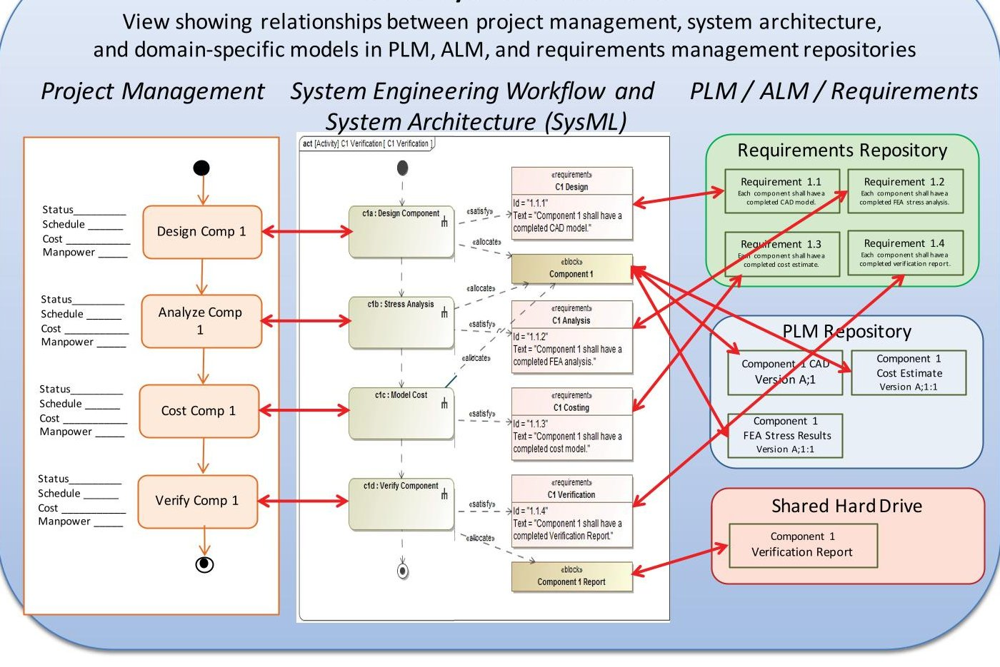

Figure 6 TSM - Alternate view showing relationships between project management, system engineering workflow and system architecture (SysML), and domain-specific models in PLM/ALM/Requirements management repositories

## Use Case

Systems engineers have traditionally been concerned with requirements, structure and behavior; project managers with cost, schedule and issue tracking. Toolsets did not really integrate the two areas of concern. Figure 7 shows how Syndeia connects issues tracked in JIRA to requirements managed in DOORS, enabling the project manager to query all the requirements related to the JIRA issue and, beyond that, any structural elements in PLM or hardware elements in ALM impacted by those requirements.

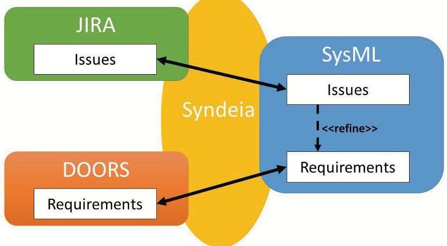

Figure 7 Syndeia connects system architecture element to requirements in DOORS and issues/tasks in JIRA

<!-- PDF_PAGE: 8 -->

Figure 7 illustrates one approach to connecting issues, requirements, and system architecture using Syndeia where an issue element connected to the JIRA issue and a requirement element connected to the DOORS requirement exist in the SysML model for system engineers to create explicit allocation relationships to architecture elements (blocks, activities, state machines) in the SysML model. An alternative approach using Syndeia could be a direct reference connection between a JIRA issue and an architectural element (such as a block) in SysML.

## A Spectrum of Model-Based Connections

## Challenge

Each customer and each application we have worked on has had different use cases. When we speak of connecting models, no one type of connection meets all needs. Early work in the field has tended to focus on two polar extremes

- Connections that simply point from an element in one model to an element in another

- One-time transformations of a model from one domain into another

Many use cases we have faced are best served with a hybrid approach, a persistent connection between equivalent or related objects in both models. This can be created between two existing elements, or using an element (or hierarchy of elements) in one model to generate a corresponding element structure in another model, with the elements in source and target models connected going forward. Such connections are known as inter-model connections (Figure 8). This approach allows each element to participate fully and normally within its own domain/model using intra-model connections (e.g. dependency or constraint relationships with other elements in the same model), while the inter-model connections can be used to compare and synchronize models as the TSM evolves. Such an approach presents practical issues:

- Which element represents the "master" copy?

- Which properties or attributes are linked between elements?

- How many levels of structure are maintained on both sides?

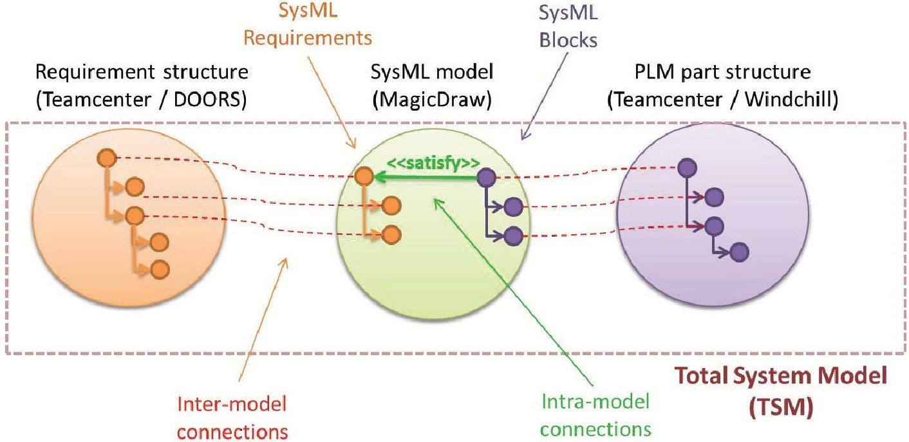

Figure 8 Unified presentation of inter-model and intra-model connections

It is not sufficient to have only one type of inter-model connection a reference or a link from an element in a model to an element in another model. Fine grained interoperability requires

<!-- PDF_PAGE: 9 -->

the ability to support many use cases between source and target models, ranging from a simple reference to compare and synchronization of full model structures and attribute values. Based on this need, we have abstracted five different types of connection patterns, as elaborated below.

Domain-specific models, such as PLM part structures; CAD/CAE models; Simulink and Modelica models; math models—MATLAB/Mathematica; Excel spreadsheets; and relational and object-oriented database elements can be connected to the SysML model by instantiating connection patterns of varying fidelities, such as:

- Reference connection pattern for basic traceability

- Data Map connection pattern for attribute-level comparison and bi-directional sync

- Model Transform connection pattern for full model structure-level comparison and bidirectional sync

- Custom / Hybrid connection pattern as a combination of the fundamental patterns above

The inter-model connections managed by Syndeia can be granular to the individual model element/attribute-level and are cognizant of the versions of individual models/elements. In addition to algorithms for executing connections (compare and bi-directional sync), Syndeia also provides comprehensive capabilities to automatically seed/generate domain models, such as PLM part structures, Simulink models, or CAD models from the system architecture model (SysML), and vice versa. Generation also establishes the inter-model connections between the models for downstream consistency verification and resolution.

## Use Case

Many different possible use cases have arisen around connecting SysML with CAD models through Syndeia. A reference connection between a SysML model element (e.g. a block) and the CAD assembly/part (Figure 9) allows the CAD model to be opened and viewed in the native CAD tool from the SysML model. A data map connection, as in Figure 10, allows the parametric information in a CAD model to be mapped to the value properties of a SysML block, where the systemic impact of size and mass can be evaluated. In the third use case (Figure 11), structural requirements (e.g. bounding box, center of gravity) in SysML seed a starter CAD model and create a model transform connection, or elements of an existing CAD model are transformed to create a hardware representation at the system level (SysML). The objective of the use case dictates the nature and capabilities of the connector patterns.

<!-- PDF_PAGE: 10 -->

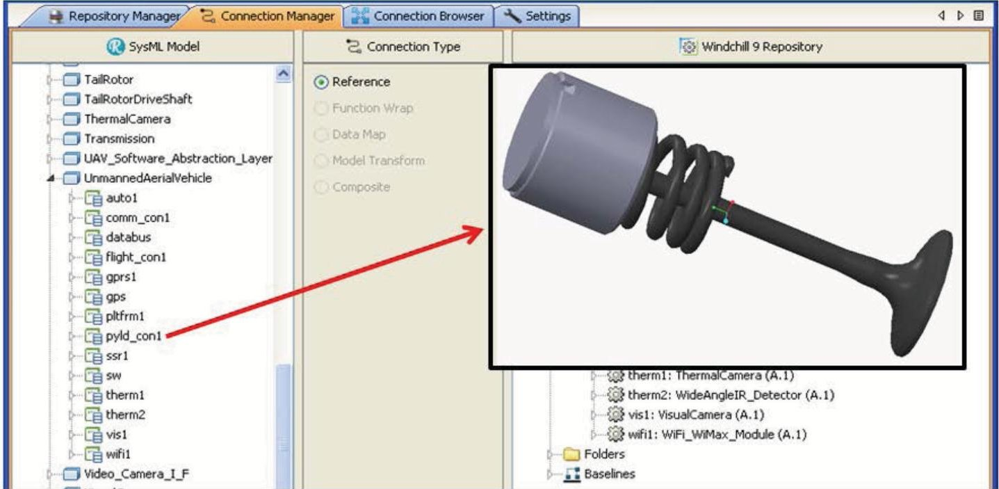

Figure 9 Use Case 1, accessing CAD objects in the CAD tool from the SysML model

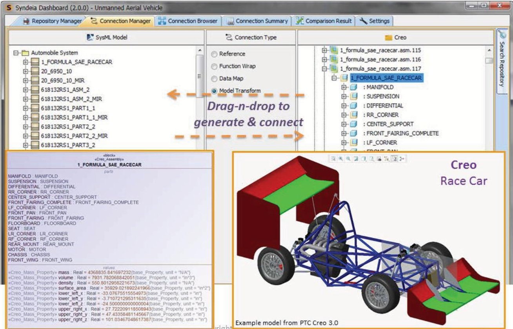

Figure 10 Use Case 2, bringing over parameters values and assembly structures

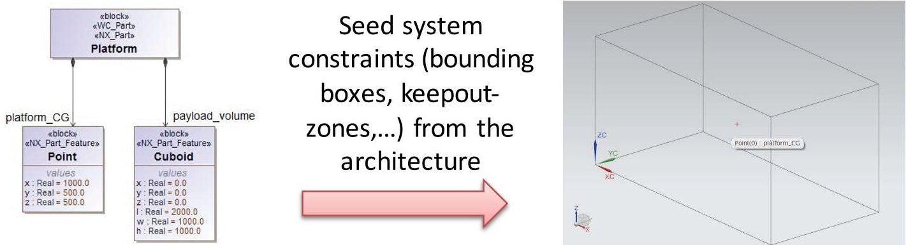

Figure 11 Use Case 3, transferring requirements as geometry

<!-- PDF_PAGE: 11 -->

# A Unified Framework for Model-Based Connections

# Challenge

A major benefit of MBSE++ is to use the TSM to answer questions about the system. This requires the use of both (1) intra-model connections—relationships between model elements in a given model/repository, and (2) inter-model connections—relationships between elements in different models/repositories. Figure 12 shows two common scenarios.

A design engineer working in the CAD/PLM environment needs to access the complete set of requirements governing a component design. In order to do so, he/she must navigate:

- from the PLM model to the SysML model using an inter-model connection,

- from a SysML block to a SysML requirement via the satisfy relationship (intra-model), and

- from the SysML requirement to the master requirement and related information in a requirements management tool (e.g. DOORS) via an inter-model connection

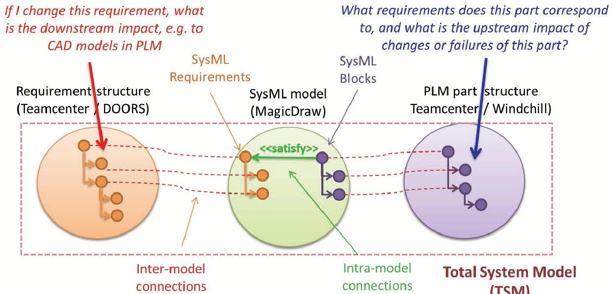

SLIM artifacts that wrap versioned objects in repositories and models, such as SysML, PLM / CAD parts, database tables, SysML, Simulink, and Modelica

Figure 12 Use of the TSM with inter- and intra-model connections to answer system engineering queries

A system engineer who needs to assess the impact of a requirement change in a requirements management system, such as DOORS or Teamcenter, can use the TSM using both inter- and intra-model connections, such as DOORS requirement to SysML requirement, SysML requirement to SysML block, and then SysML block to CAD part in Teamcenter, as shown in Figure 12.

Key lessons learnt from the current state of MBSE++ are:

- Creating connections is not enough. The MBSE++ platform must also provide easy-to-use methods to query, visualize, and apply information available across these connections, such

<!-- PDF_PAGE: 12 -->

as allowing an engineer to visualize the impact of requirement changes during a project, or the impact/causes of function/part failures during mission anomaly resolutions.

- The user needs to be able to efficiently traverse both inter- and intra-model connections without switching tools or interfaces. The navigation tool must also be able to manage the complexity of the TSM graph, filtering the connections traversed by proximity, type and impact, assisting the user with efficient and even intelligent graph tracing algorithms.

## Use Case

Before connections can be made, the target must be located. A key capability in creating real, large-scale TSMs is Syndeia's ability to search and filter elements in enterprise repositories. In Figure 13, the Syndeia search windows for Teamcenter, Windchill and MySQL allow the user to search each repository. Note that the windows are differentiated by the searchable characteristics unique to that repository type. Simple drag-n-drop operations make it possible to create inter-model connections between existing model elements, or by generating models in a domain from a model in another domain. Depending on the use case, a variety of connection patterns are available for inter-model connections, as elaborated in the previous section.

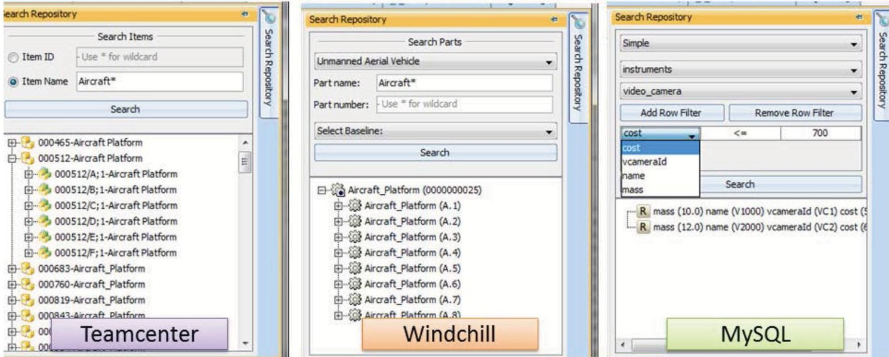

Figure 13 Syndeia search capabilities

## From Traceability to Impact

Challenge

Traceability is not enough. As system models grow to the millions of elements, full traces quickly become unmanageable. MBSE++ must address this challenge by helping the user evaluate the impact of each connection, prioritizing the connections for further exploration. The integration and execution of simulation, analysis and costing calculations as part of the TSM is available through multiple channels, including parametric solvers $ ^{4} $ linking SysML with

<!-- PDF_PAGE: 13 -->

mathematical solver engines, and Syndeia to connect to or generate analysis models in tools such as Simulink based on SysML model structure.

Large network graphs also require effective graph traversal algorithms, such as shortest path, Dijkstra, and depth/breadth-first searches that are best suited for impact and connectivity assessments. Traversal algorithms can use semantic information, such as the types and attributes of nodes (artifacts) and inter- and intra-model connections for accurate results. The results of the traversal can be highlighted in the TSM graph so that system and domain engineers can visualize the impact of changes or connectedness.

Use Case

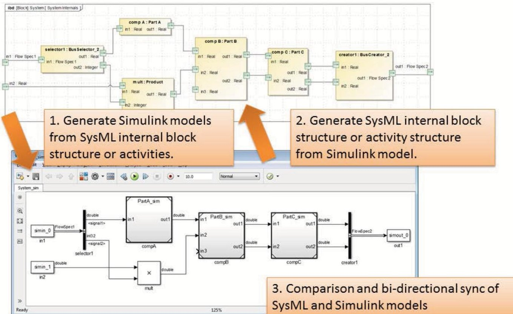

Figure 14 Use cases for SysML-Simulink connection using Syndeia

The creation of useful simulation and analysis models as part of a system development effort represents several difficulties. A correct representation of the system must be reflected in the simulation model and it must be updated in a correct and timely fashion as the system model evolves. In the first use case shown in Figure 14, Syndeia uses the structure of a SysML internal block or activity diagram to generate a Simulink block structure, which the simulation specialist can populate with MATLAB code. A key differentiator in our approach with Syndeia compared to previous capabilities to generate simulation models from SysML models is that this is not a one-time model transformation. Inter-model connections are created between SysML and Simulink model elements during the transformation. These inter-model connections aid traceability between architecture and simulation domains, and are used for comparison and bi-directional synchronization as either models evolve over time—illustrated as the third use case in Figure 14. The second use case enables organizations adopting MBSE to use existing simulation models—which may be the best representation of the system in their project—to generate a system architecture model (SysML) that can participate in the TSM. The SysML-based system architecture model can then be used to generate and connect to models

<!-- PDF_PAGE: 14 -->

in various other disciplines, such as PLM/CAD part structures, requirements, and interfaces for software sub-systems.

# Many Users, Many Views

Challenge

MBSE++ capabilities must be available to the entire project team, not just the systems engineers. While SysML and other standards may be important components of the underlying infrastructure, the navigation tools must present more familiar interfaces (e.g. tables, dynamic and interactive charts, and videos) that do not rely on SysML knowledge, and are accessible across multiple platforms and devices (laptops/desktops, tablets, and smart phones).

Although commercially-available visualization libraries provide a wide range of templates and layouts for rendering connected data (and graphs in general), specific layouts must be selected that are most relevant to system engineers, domain engineers and project managers. Dynamic forms of visualization and layout can play the changes in the TSM graph or any of its nodes and edges across a timeline. Search and filtering techniques can highlight nodes and edges with specific criteria, such as showing only nodes from a specific model repository, or showing only certain types of connections between system architecture elements and other domain model elements.

## Use Case

Useful visualization patterns must allow all members of the project team, not just systems engineers, to formulate and answer certain standard queries across domain and tool boundaries:

- What system functions are planned/designed to satisfy a given a requirement?

- What system structure elements implement a given function X?

- What test cases are planned / designed to verify a given requirement?

- What system functions would be affected if an assembly/part fails?

- If a given system function has failed, what parts/component could have failed?

<!-- PDF_PAGE: 15 -->

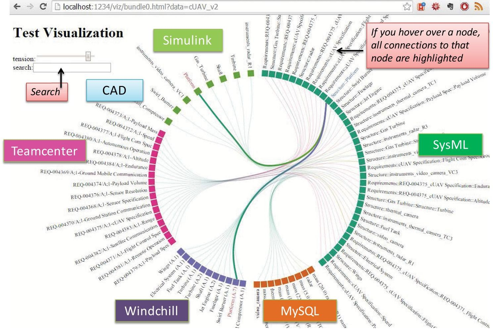

Figure 15: Dynamic visualization of inter-model connections using Syndeia

To the extent inter-model and intra-model connections are available to Syndeia, a variety of possible visualization patterns are available. Figure 15 displays the inter-model connections for the TSM of a UAV system using a SysML model with links to Teamcenter and Windchill PLM repositories, a MySQL database, a Simulink model, and a NX CAD model. Interactive features in a web browser allow connections to be searched, filtered, and highlighted at the user's direction.

## Conclusions

The tenets of MBSE++ outlined in this paper reflect some internal tensions.

- We want a distributed data structure and a diverse toolset, but we also need a unified model of the system that is transparent across tool boundaries.

- We need many different kinds of connections to support the breadth of engineering use cases, but we want a unified framework for creating, visualizing and using those connections.

- We want complete traceability, but we also need the ability to prioritize and explore conenctions by potential impact.

In this paper, we have described several use cases where our current solution, Syndeia, attempts to resolve these contradictions. Future work will enhance these capabilities in terms of scalability, ease of use and visualization options.

<!-- PDF_PAGE: 16 -->

## References

- Bajaj, M., Zwemer, D., Peak, R., Phung, A., Scott, A. and Wilson, M. (2011). Satellites to Supply Chains, Energy to Finance — SLIM for Model-Based Systems Engineering, Part 1: Motivation and Concept of SLIM. 21st Annual INCOSE International Symposium, Denver, CO, June 20-23, 2011 - http://goo.gl/ga5kG

- Bajaj, M., Zwemer, D., Peak, R., Phung, A., Scott, A. and Wilson, M. (2011). Satellites to Supply Chains, Energy to Finance — SLIM for Model-Based Systems Engineering, Part 2: Applications of SLIM. 21st Annual INCOSE International Symposium, Denver, CO, June 20-23, 2011 http://goo.gl/C1awN

- CATIA (Dassault Systèmes) - http://www.3ds.com/products-services/catia, as accessed on Mar 30, 2016

- Creo (PTC) - http://www.ptc.com/cad/creo, as accessed on Mar 30, 2016

- Dropbox - https://www.dropbox.com/, as accessed on Mar 30, 2016

- Egnyte - https://www.egnyte.com, as accessed on Mar 30, 2016

- Enterprise Architect (Sparx Systems) - http://www.sparxsystems.com/products/ea/, as accessed on Mar 30, 2016

- Enovia (Dassault Systèmes) - http://www.3ds.com/products-services/enovia, as accessed on Mar 30, 2016

- Fisher, A., Nolan, M., Friedenthal, S., Loeffler, M., Sampson, M., Bajaj, M., VanZandt, L., Hovey, K., Palmer, J. and Hart, L. (2014), Model Lifecycle Management for MBSE. INCOSE International Symposium, 24: 207-229. doi: 10.1002/j.2334-5837.2014.tb03145.x (PDF available at http://goo.gl/ZWywBH)

- FMI - https://www.fmi-standard.org/, as accessed on Mar 30, 2016

- Git - https://git-scm.com, as accessed on Mar 30, 2016

- GitHub - https://github.com/, as accessed on Mar 30, 2016

- Google Drive - https://www.google.com/drive/, as accessed on Mar 30, 2016

- ISO 10303 (STEP) - http://goo.gl/qH7Rdw, as accessed on Mar 30, 2016

- JIRA (Atlassian) - https://www.atlassian.com/software/jira/, accessed on Mar 30, 2016

- JSON - http://www.json.org/, accessed on Mar 30, 2016

- MagicDraw (No Magic) - http://www.nomagic.com/products/magicdraw.html, as accessed on Mar 30, 2016

- MATLAB/Simulink (MathWorks) - http://in.mathworks.com/products/simulink/, as accessed on Mar 30, 2016

- Mathematica (Wolfram Research) - http://www.wolfram.com/mathematica/, as accessed on Mar 30, 2016

- Melody (Intercax) - http://intercax.com/products/melody/, as accessed on Mar 30, 2016

- NX (Siemens) - http://www.plm.automation.siemens.com/en_us/products/nx/, as accessed on Mar 30, 2016

- OSLC - http://open-services.net/, as accessed on Mar 30, 2016

- ParaMagic (Intercax) - http://intercax.com/products/paramagic/, as accessed on Mar 30, 2016

- ParaSolver (Intercax) - http://intercax.com/products/parasolver/, as accessed on Mar 30, 2016

- PLCS - https://www.oasis-open.org/committees/tc_home.php?wg_abbrev=plcs, as accessed on Mar 30, 2016

- PTC Integrity Modeler (formerly Artisan Studio from Atego) - http://www.ptc.com/model-based systems-engineering/integrity-modeler, as accessed on Mar 30, 2016

- RDF - http://www.w3.org/RDF/, as accessed on Mar 30, 2016

- REST - http://www.w3.org/2001/sw/wiki/REST, as accessed on Mar 30, 2016

- Rhapsody (IBM) - http://goo.gl/qMXwn6, as accessed on Mar 30, 2016

- ReqIF - http://www.omg.org/spec/ReqIF/, as accessed on Mar 30, 2016

- SOAP - http://www.w3.org/TR/soap/, as accessed on Mar 30, 2016

- Solvea (Intercax) - http://intercax.com/products/solvea/, as accessed on Mar 30, 2016

<!-- PDF_PAGE: 17 -->

- Subversion (Apache) - https://subversion.apache.org, as accessed on Mar 30, 2016

- Syndeia (Intercax) - http://intercax.com/products/syndeia/, as accessed on Mar 30, 2016

- Systems Modeling Language (SysML, OMG) - http://www.omgsysml.org/, as accessed on Mar 30, 2016

- Teamcenter (Siemens PLM) - http://goo.gl/bv7iEB, as accessed on Mar 30, 2016

- UPDM - http://www.omg.org/spec/UPDM/, as accessed on Mar 30, 2016

- Windchill (PTC) - http://www.ptc.com/product-lifecycle-management/windchill, as accessed on Mar 30, 2016

- WSDL - http://www.w3.org/TR/wsdl, as accessed on Mar 30, 2016

## Biography

Manas Bajaj, PhD is the Co-Founder and Chief Systems Officers at Intercax. He has led multiple government and corporate sponsored R&D projects over last 15 years, including SBIR Phase 1 & 2 awards. He has led the development of several commercial software applications, including the Syndeia application referenced in this paper. Dr. Bajaj earned his PhD (2008) and MS (2003) in Mechanical Engineering from Georgia Tech, and BTech (2001) from Indian Institute of Technology (IIT), Kharagpur, India. He has been actively involved in the development of the OMG SysML standard and the ISO STEP standards, and is a Content Developer for the OCSMP certification program. Dr. Bajaj is the author of numerous technical papers and articles. He is a co-developer of a widely popular SysML and MBSE training program with over 3500 participants since 2008.

Dirk Zwemer, PhD is Co-Founder and President/CEO of Intercax, directing business development and providing strategic consulting for customers adopting model-based systems engineering practices. He is a certified systems modeling professional (OCSMP Level 4 —Model Builder Advanced). He has over 30 years of experience, and is the author of numerous patents, technical papers, trade journal articles, and market research reports. He received a PhD in Chemical Physics from UC Berkeley and an MBA from Santa Clara University.

Rose Yntema is the Applications Engineer at Intercax where she applies MBSE techniques to complex systems in areas such as aerospace, energy, defense, and telecommunications. She is actively involved in the development of SysML parametric modeling and simulation software, and Syndeia application for MBE. Rose earned her M.S. (2012) in Electrical and Computer Engineering from the Georgia Institute of Technology, and Sc.B. (2010) in Electrical Engineering from Brown University.

Alex Phung is Senior Software R&D Engineer at Intercax and is a core contributor to the Syndeia platform for MBE/MBSE, and SysML parametric solver applications.

Amit Kumar is a Senior Software R&D Engineer at Intercax and is a core contributor to the Syndeia platform for MBE/MBSE. He has a rich background in enterprise PLM systems.

Anshu Dwivedi is a Senior Software Engineer at Intercax and is a core contributor to the Syndeia platform for MBE/MBSE. He has a rich background in CAD and PLM systems.

Manoj Kumar is a Senior Software R&D Engineer at Intercax and is a core contributor to the Syndeia platform for MBE/MBSE. He has a rich background in next-generation web-based applications and technologies.