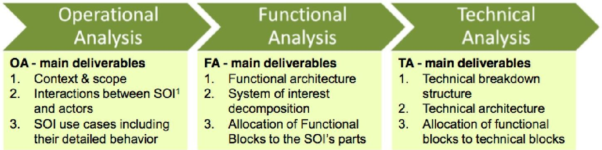
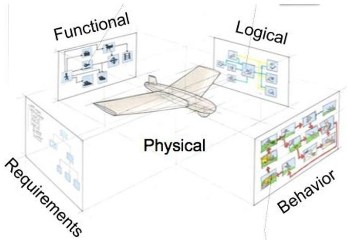
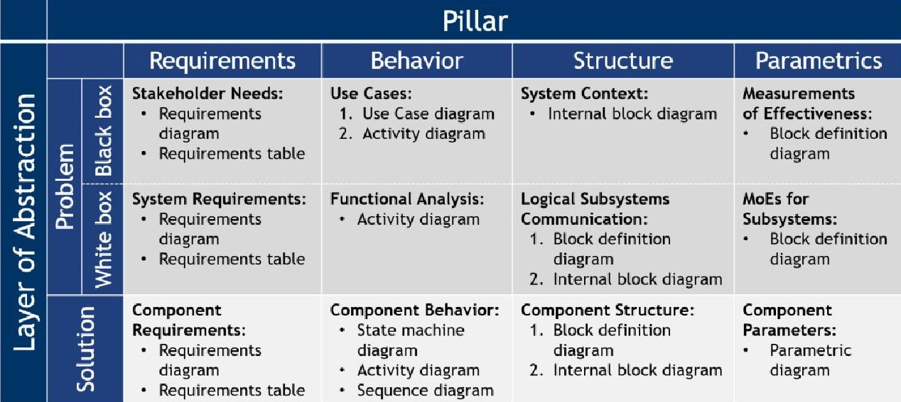
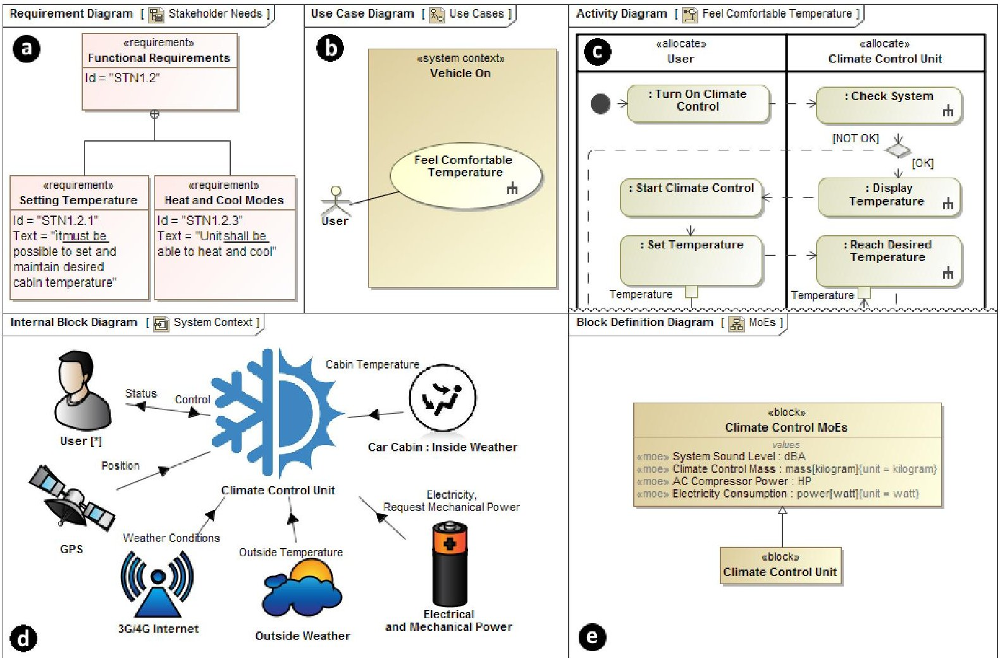
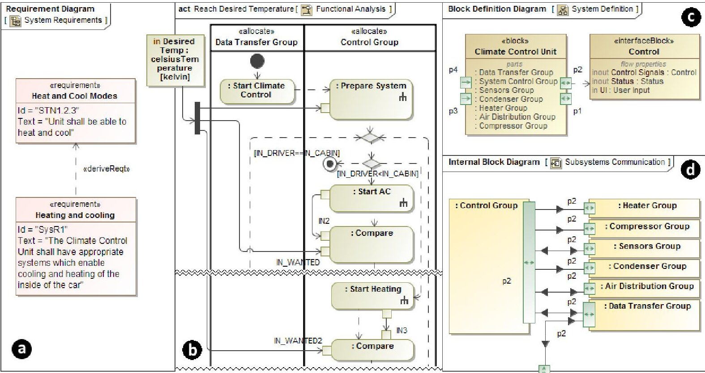
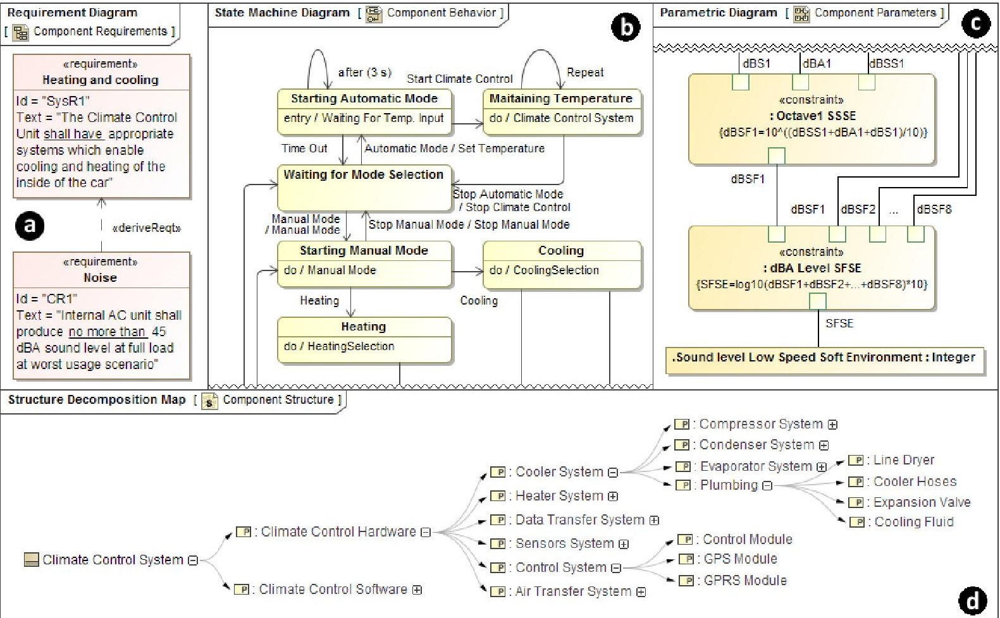
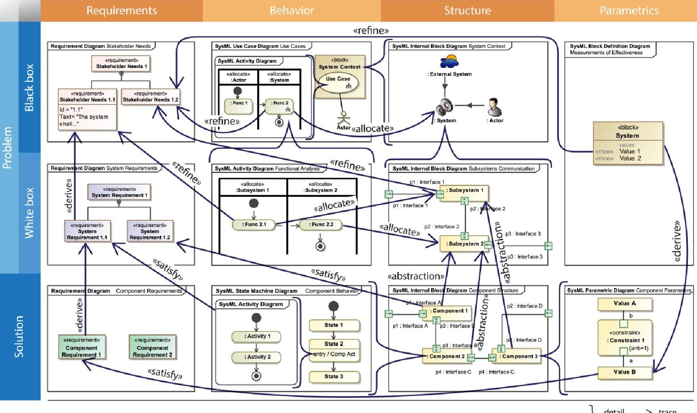

<!-- PDF_PAGE: 1 -->

# MBSE Grid: A Simplified SysML-Based Approach for Modeling Complex Systems

Aurelijus Morkevicius No Magic Europe and Kaunas University of Technology Kaunas, LT-51480, Lithuania aurelijus.morkevicius@nomagic.com

Aiste Aleksandraviciene

No Magic Europe

Kaunas, LT-51480, Lithuania

aiste.aleksandraviciene@nomagic.com

Donatas Mazeika No Magic Europe and Kaunas University of Technology Kaunas, LT-51480, Lithuania donatas.mazeika@nomagic.com

Lina Bisikirskiene No Magic Europe and Kaunas University of Technology Kaunas, LT-51480, Lithuania lina.bisikirskiene@nomagic.com

Zilvinas Strolia

No Magic Europe

Kaunas, LT-51480, Lithuania

zilvinas.strolia@nomagic.com

Copyright © 2017 by Aurelijus Morkevicius, Aiste Aleksandraviciene, Donatas Mazeika, Lina Bisikirskiene, Zilvinas Strolia. Published and used by INCOSE with permission.

Abstract. After an organization makes the decision to adopt model-based systems engineering (MBSE), it must go a long way before this decision proves right. There are many obstacles in this way, like stories about unsuccessful MBSE applications, insufficient information on how to proceed, and employee resistance to the cultural change to name a few. Neither of them is a true issue, if suitable enablers for MBSE adoption are chosen. Nowadays, MBSE is enabled by Systems Modeling Language (SysML). However, SysML is neither a framework nor a method: it provides no information about the modeling process and thus must be combined with some methodology to become truly applicable. This paper summarizes the experience of various MBSE adoption projects in the form of a new approach for MBSE. The approach is based on the framework organized in a matrix view and is designated to guide system engineers through the modeling process and help them answer the questions, like how to start, how to structure the model, what views to build, which artefacts to deliver, and in what sequence.

## Introduction

MBSE promises to alleviate communication across different engineering disciplines (Delp et al., 2013). To reach this promise in practice, support of different architecture views for a single system model is required. In many cases, these views are not compatible and completely disintegrated to each other. To deal with this challenge, the organization is obliged to implement proper practices, where language, method and framework as well as tool are the vital constructs.

<!-- PDF_PAGE: 2 -->

## Language

MBSE movement was reinforced with successful adoption of Unified Modeling Language (UML) (OMG, 2007) and Model-Driven Architecture (MDA) (OMG, 2003). Before this, numerous attempts to apply UML for MBSE haven't succeeded (Silingas and Butleris, 2009): UML was found too complicated and non-natural for solving systems engineering (SE) domain-specific problems (Morkevicius and Gudas, 2011). Therefore, Object Management Group (OMG) has initiated the creation of the domain-specific language and in 2007 released the first version of SysML (OMG, 2012a). As SysML is a profile of UML, it has been easily adopted by most UML tool vendors. UML versatility and compatibility with its profiles enables SysML integration with other OMG standards based on UML, such as Unified Profile for MODAF and DoDAF (UPDM), Service Oriented Architecture Modeling Language (SoaML), and Object Constraint Language (OCL).

It is common misunderstanding in SE, that SysML as modeling language is enough to successfully apply MBSE in the organization. It is clearly stated in (Silingas and Butleris, 2009), that the modeling language is just the language, and must be combined with a methodology to be useful.

## Method and Framework

A number of methods available for MBSE is not significant (Nikolaidou et al., 2009). Most of them provide no architecture framework to organize modeling effort and thus are too abstract for solving a real-world problem. In systems and software engineering, the notion of architecture framework dates to the 1970s (Dave and Jim, 2005). The motivation for the term definition is to promote sharing the information about systems, architectures, and techniques for architecture description, inter-working to enable improved understanding, and interoperability between architecture communities who are using different conceptual foundations (Aurum and Wohlin, 2005).

## Tool

It is important to understand that there is no way to adopt MBSE without having a specific software tool. The strength of MBSE relies on the tools. The market nowadays offers a broad selection of tools for systems modeling, each with its strengths and weaknesses. The following research is carried out using the MagicDraw toolset. It was chosen because of several published studies, e.g., (Cloutier and Bone, 2010), and multiple papers, e.g., (Delp et al., 2013), (Spangelo et al., 2012).

## Outline of the Paper

In this paper, a new approach for MBSE is proposed. The framework of this approach consists of architecture viewpoints (further called domains) and aspects (further called pillars) organized in a Zachman style matrix. Each cell is this matrix represents the architecture of the system-of-interest (Sol) in accordance with certain architecture viewpoint and pillar (further called view specification).

This paper is structured as follows: in Section 2, the related works are analyzed; in Section 3, the proposed approach is presented; in Section 4, application of the proposed approach is described; in Section 5, the achieved results, conclusions, and future work directions are indicated.

## Related Works

## MBSE methodologies

Systems engineering community all over the world has acknowledged and currently use numerous MBSE methodologies. This paper describes and analyzes the most popular ones.

IBM Rational Harmony for SE. The process for integrated systems development by Harmony can be represented by the classic "V" diagram. The left leg of the "V" describes the top-down design

<!-- PDF_PAGE: 3 -->

flow, while the right-hand side shows the bottom-up integration phases from unit test to the final system acceptance (Hoffmann, 2011). The workflow is iterative with incremental cycles through the phases of the requirements analysis, system functional analysis, and design synthesis. Models that support the requirements analysis phase are the requirement models and the system use cases model. In the system functional analysis phase, each use case is transformed into an executable model and the related system requirements are verified using model execution. The main executable models in the design synthesis phase are architectural analysis model and system architecture model. Harmony methodology is claimed to be compatible with SysML.

Object-Oriented Systems Engineering Methodology (OOSEM). This methodology is developed by INCOSE (INCOSE, 2010). It combines object-oriented techniques, a model-based design approach, and top-down waterfall-style system engineering practices. Analyze needs, define system requirements, define logical architecture, synthesize allocated architectures, optimize and evaluate alternatives, and verify & validate systems are the main activities of OOSEM. When designing a system-of-systems, these activities are performed for each system individually. OOSEM was integrated with ISO-15288 standard, which is dedicated to harmonize the processes used by any organization or project throughout the full lifecycle of a man-made system (Pearce and Hause, 2008). The integration allows identifying the sequence of the processes needed to deliver the essential products of the development. System Engineering processes are organized into five groups: agreement, enterprise, project, technical, and special.

Vitech MBSE Methodology. Source requirements, behavior, architecture, and verification and validation - these are the main domains of this methodology (Vitech). It uses MBSE System Definition Language (SDL) to manage the syntax (structure) and semantics (meaning) of model artefacts, which can be specified either in the form of schema or ontology. Vitech methodology also uses iterations, so called, levels. These levels help to detail system specification, but they don't solve the problem of information abstraction management (Estefan, 2008).

JPL State Analysis (SA). This methodology was created by the California Institute of Technology Jet Propulsion Laboratory (JPL). It is based on a state control architecture, where state is defined to be "a representation of the momentary condition of an evolving system," and models describe how state evolves (Ingham et al., 2006). SA methodology provides activities for state modeling (modeling behavior according to state variables and relationships between them); state-based software design (methods to achieve objectives); goal-directed operations engineering (preparing detailed scenarios for mission objectives). Together, state and models supply what is needed to operate a system, predict future state, control towards a desired state, and assess performance (Estefan, 2008).

SYSMOD. It is dedicated to model systems by using SysML as modeling language. These are the main phases of SYSMOD: project's context description; requirement's collection; system's context modeling; system's use case and process modeling; system's structure and state modeling; collect domain knowledge. Starting with the description of the project context, requirements of the system are captured and modeled. Use case specification allows clarifying requests and working scenarios. Processes of the system are created simultaneously. Finally, the internal structure of the system is created, parameters are defined, and behavior is modeled.

MBSE methodologies are solving different tasks of systems engineering process (Dickerson and Mavris, 2009), (Friedenthal et al., 2007). Not only identification and gathering of artefacts in proper sequence is challenging for them. They also need to deal with information complexity issue. Most of the described methodologies use iterations to collect information step by step. However, this doesn't help to identify different levels of abstraction, which may result in model incorrectness or even become a serious obstacle to allocate responsibilities to teams, stakeholders, or contractors.

<!-- PDF_PAGE: 4 -->

# Enterprise Architecture Frameworks

To manage different levels of abstraction, enterprise architecture frameworks (EAFs) can be used. (Bernard, 2004) describes EAF as "It is a structure for organizing information that defines the scope of the architecture and how the areas of the architecture relate to each other". A few categories of EAFs can be distinguished: defense-oriented and industry-oriented.

Department of Defense Architecture Framework (DoDAF) (US Department of Defense, 2009), Ministry of Defense Architecture Framework (MODAF), and NATO Architecture Framework (NAF) are standardized frameworks for defense architectures. Currently, all are very similar from the views and viewpoints point of view and different from the meta-model point of view. Despite this difference, there is a common modeling language for both, developed and maintained by OMG. It is called Unified Profile for DoDAF and MODAF (UPDM) (OMG, 2009). As UPDM is a profile of UML, the versatility of UML and its compatibility with its profiles allows integrating UPDM with other OMG standards based on UML, such as SysML (OMG, 2012a) and SoaML (OMG, 2012b). DoDAF/MODAF/NAF viewpoints allow modeling information in different levels of abstraction. The main viewpoints are all, capability/strategic, operational, data and information, systems, services/service oriented, project/acquisition, and standards/technical. These viewpoints define the different aspects of modeled information in different levels of abstraction.

TOGAF, FEAF, and Zachman are the most commonly cited in scientific researches and considered as "de facto" standards for industry architectures. TOGAF (The Open Group, 2009) is providing the structure, meta-model, and method for creating the enterprise architecture. It can be based on UML and Archimate modeling languages. Zachman framework is the first enterprise architecture framework defining the logical structure for classifying and organizing the descriptive representations of that enterprise (Lankhorst, 2009). The most common problem of industry EAFs is that there is no standardized way for storing and exchanging data, as opposed to defense EAFs, e.g., DoDAF provides a whole document describing data exchange, which is one of the biggest problems in defense domain (US Department of Defense, 2009).

Taking industry demand in account and addressing changing landscape of defense architecture frameworks (adoption of IDEAS ontology for DoDAF and MODAF), in September of 2013, a Request for Proposal (RFP) for UPDM 3.0 (later renamed to UAF) was created. For the reason to support civil engineering needs, domains that are beyond the scope of defense frameworks like human machine integration, security, etc., UPDM 3.0 was renamed to UAF 1.0. The Alpha version of UAF specification is accepted by OMG in June 2016. The final version of UAF 1.0 specification is very likely to be published in June 2017 (Hause et al., 2016). MBSE Grid proposed in this paper is strongly influenced by emerging UAF specification, that is, tabular representation, concepts of domain and view specification, etc.

EAFs bring up advantageous ideas on how to manage different layers of abstraction. However, they all consist of many different views, but none of them provides a simplified perspective that would address only subsets of each view. This is the reason why a new framework, which collects the best practices of existing frameworks and is dedicated particularly for systems modeling, would be very welcomed within systems engineering community.

## An approach: the MBSE Grid

The proposed framework is based on (Mazeika et al., 2016), the work done in this area, and on the experience working with several systems engineering companies worldwide. The main idea is represented in the form of the grid (Figure 3), where columns are aspects, originating from (Friedenthal, 2008), (OMG, 2012a), also known as four pillars of SysML, and rows are viewpoints, originating from (US Department of Defense, 2009), (ISO, 2011), (OMG, 2009). Such, Zachman style matrix (Zachman, 1987) serves as a canvas to integrate different concerns, issues, and methods

<!-- PDF_PAGE: 5 -->

towards successful application of MBSE, while specific methods may use parts of it as a reference point (Nikolaidou et al., 2009).

Originally, MBSE Grid was proposed in (Mazeika et al., 2016), where problem domain has been described. This paper adds slight modifications to the previously introduced problem domain, such as: (i) name change of the sub-domains, (ii) name change of some of the views, (iii) traceability updates, (iv) different, more mature case study, and (v) two examples from industry. (Mazeika et al., 2016) does not analyze solution domain and traceability among view specifications in the problem and solution domains. It also does not describe the idea behind separating architecture into problem and solution domains.

## Influencers

The MBSE Grid was strongly influenced by an expertise acquired working on real-world projects in transportation and defense industries.

Bombardier Transportation (BT). The BT System Modeling Method (SysMM) describes how BT engineers analyze, define, and represent their system of interest using a Model-Based Systems Engineering approach. The purpose of the method is to manage complexity and increase quality of the design artefacts to reduce development costs (Naas et al., 2015).

MBSE methodology applied in Bombardier Transportation consists of three main tasks. Each of the tasks are to analyze the system of interest on a different abstraction level (Figure 1). Operational Analysis task and its subtasks correspond to a black-box definition of the problem in the MBSE Grid. The missing peace in SysMM comparing to MBSE Grid is identification of MoEs. Functional Analysis task corresponds to a white-box definition of the problem and Technical Analysis task corresponds to the definition of solution (Naas et al., 2015).

Figure 1. BT System Modeling Method (Naas et al., 2015)

Kongsberg Defense and Aerospace (KDA). Another influencer for MBSE Grid is the MBSE methodology applied in Kongsberg Defense and Aerospace (KDA). KDA System Architecture Framework depicted in Figure 2 consists of two parts: specification and design, which correspond to the problem and solution layers in MBSE Grid. Furthermore, design consists of the Functional, Logical, and Physical views, where the last one is in the scope of CAD systems (Soegaard, 2016).

Both BT SysMM and KDA System Architecture Framework are defined having in mind three major MBSE components: language, methodology, and tool. This makes both methods applicable on real-world projects as opposed to theoretical methods where the third component-a modeling tool is missing.

<!-- PDF_PAGE: 6 -->

Figure 2. KDA System Architecture Framework

## MBSE Grid Structure

Pillars. Four pillars introduced in (Friedenthal, 2008) depict four main aspects of model-based systems engineering using SysML: requirements, system structure, system behavior, and parameters (parametric). They perfectly describe the main areas of the system model; however, it does not help to manage different levels of abstraction and control level of granularity at each of them. This is the rationale for having rows in the Grid.

Domains. (Nikolaidou et al., 2009) revealed that enterprise architecture frameworks may serve towards managing abstractions. A detailed comparison of existing EAFs is provided in (Franke et al., 2008). According to comparison and our research, EAFs, especially ones in harmony with MBSE, provide two main viewpoints: one to define problem in order to understand it, other to provide one or several alternative solutions to solve it, e.g., operational and systems viewpoints in DoDAF (US Department of Defense, 2009), logical and physical (Resources) in NAF, business and engineer in Zachman framework (Zachman, 1987). In accordance to the best practices, the MBSE Grid has two main rows: problem and solution. Besides these two, a need to provide the black-box perspective separated from the white-box perspective of the problem domain was identified.

<table border="1"><tr><td></td><td colspan="5">Pillar</td></tr><tr><td rowspan="4">Layer of Abstraction</td><td colspan="2"></td><td>Requirements</td><td>Behavior</td><td>Structure</td><td>Parametrics</td></tr><tr><td>Problem</td><td>Black Box</td><td>Stakeholder Needs</td><td>Use Cases</td><td>System Context</td><td>Measurements of Effectiveness</td></tr><tr><td>White Box</td><td>White Box</td><td>System Requirements</td><td>Functional Analysis</td><td>Logical Subsystems Communication</td><td>MoEs for Subsystems</td></tr><tr><td colspan="2">Solution</td><td>Component Requirements</td><td>Component Behavior</td><td>Component Assembly</td><td>Component Parameters</td></tr></table>

Figure 3. The MBSE Grid framework

Black-box perspective describes the SoI as a whole. In this perspective, stakeholder needs, functions expected from the system, user scenarios, SoI interaction with environment, and measurements of effectiveness are defined or in other words, the operational analysis of the system (INCOSE, 2010) is performed.

White-box perspective, as opposed to the black-box perspective, describes behaviors that are expected from subsystems of the Sol. In this perspective, environmental entities, including users of

<!-- PDF_PAGE: 7 -->

the SoI are no longer considered: inputs and outputs of the SoI are delegated to its subsystems. The result of the white-box analysis is system requirements specification, derived from the stakeholder needs.

View Specifications. Cells of the grid (Figure 3) represent different views of model-based systems engineering. View is a specific model, which can be visualized in a SysML diagram, IDEF diagram, etc. According to ISO42010, it is a view specification and the instance of it is a view. In (ISO, 2011), a view is defined as "work product expressing the architecture of a system from the perspective of specific system concerns".

- Stakeholder Needs. Represents information captured from various stakeholders of the system. This information includes primary user requirements, system-related government regulations, policies, procedures, and internal guidelines to name a few. Stakeholder needs can be elicited by interviewing various stakeholders, giving them questionnaires, discussing in focus groups, studying documents written in diverse formats. Though elicited information is raw, it does not need to be specially rewritten. Later refinements in the model make these stakeholder needs structured and formalized. SysML requirements diagram or table, or them both are used to capture stakeholder needs.

- Use Cases. Captures refinements of functional stakeholder needs in the form of SysML use case diagram. Each use case defines what primary or secondary (maintainer, external software, or hardware) users need to achieve by using the system. It also includes use case scenarios defining flows of actions or events, prerequisites, constraints, etc.

- System Context. Captures how the SoI interacts with its environment. Origins of such model can be found in DoDAF, known as High Level Operational Context (HLOC) (US Department of Defense, 2009). The purpose of the model is to depict high level interfaces needed for the system to communicate with its environment, e.g., GUI, UI, TCP/IP, etc. SysML internal block diagram is used to capture the view of the system context.

- Measurements of Effectiveness. Depicts non-functional, user set goals for the system, expressed in the numerical format. MoEs are captured in SysML block definition diagram. Methods for calculating MoEs are described using SysML parametric diagrams.

- System Requirements. An input for system requirements specification is stakeholder needs specification. By analyzing the stakeholder needs, system requirements are identified and specified. SysML requirements diagram or table, or them both are used to capture system requirements.

- Functional Analysis. It is the continuation of functional use case analysis, focusing on internal system functions in some of the techniques known as processes (Morkevicius and Gudas, 2012). Functional analysis also serves for identification of logical sub-systems, which are responsible for performing a group of functions. Functional analysis can be expressed in a form of multiple SysML activity diagrams.

- Logical Subsystems Communication. Used to identify how logical sub-systems, based on the control and resource flows captured in the functional analysis model, relate to each other. Logical interfaces are identified and defined. They serve as inputs to generate an interface control document (ICD). A combination of both SysML block definition diagram and SysML internal block diagram are used to capture this view.

- MoEs for Subsystems. Captures MoEs and Measurements of Performance (MoPs) identified for each logical sub-system. MoEs and MoPs are captured in SysML block definition diagram. Method for calculating MoEs are described using SysML parametric diagrams.

- Component Requirements. Captures detailed, usually formal, requirements, e.g., design constraints for every component identified. Component requirements are derived from system requirements. SysML requirements diagram or table, or them both are used to capture component requirements.

<!-- PDF_PAGE: 8 -->

- Component Behavior. Used to define a detailed behavior of every component by defining its states and actions, e.g., algorithm, operation call, signal handling, etc. Detailed behavior is a subject for simulation. A combination of SysML state machine, activity, and sequence diagrams can be used to capture the detailed behavior of a component.

- Component Structure. Shows physical connections based on physical interfaces between physical components. Physical components implement logical sub-systems created in a problem viewpoint. The detailed design of a physical component is not a subject of this view. A combination of both SysML block definition diagram and SysML internal block diagram are used to capture this view.

- Component Parameters. Captures physical characteristics of each component, dependencies between them, and specifies how these physical characteristics serve to achieve MoEs and MoPs defined in the problem definition layer. Parameters are captured in SysML block definition diagram. Method for calculating derived parameters are described using SysML parametric diagrams.

Figure 4. MBSE Grid mapping to SysML

Instantiation methods of every view specification by SysML diagrams are listed in Figure 4.Traceability between different view specifications is depicted in Figure 8.

Extensions. The idea of MBSE Grid is to provide foundation for a new systems' modeling framework. It acts like a 150% model in product line engineering, where all possible view specifications are in present. Users of the framework can produce a number of 100% models with different variations of view specifications. A very good example is BT SysMM approach, where parametrics pillar is not used (Naas et al., 2015). A very common example, especially in defense and automotive, is the one, where contracting authority defines problem domain only, and suppliers/contractors develop solution domain architectures (US Department of Defense, 2009). A trade-off analysis is performed later to decide which solution architecture is the best for the given problem architecture.

## Case Study

Due to non-disclosure agreements with industry partners, the case study provided in this paper is based neither on BT nor on KDA examples. It demonstrates an example of the climate control unit of the vehicle. In this chapter, problem and solution domains for the climate control unit are defined. The example model is based on SysML and is modeled in MagicDraw toolset.

<!-- PDF_PAGE: 9 -->

# Problem domain: black-box

Stakeholder needs for the project are acquired from the stakeholders, including the customer. Stakeholder needs can be captured directly in the SysML, or alternatively, they can be imported from other tools and formats, such as: requirements management tools (for example, IBM $ \textcircled{R} $ Rational $ \textcircled{R} $ DOORS $ \textcircled{R} $ ), spreadsheets (for example, Microsoft Excel file), ReqIF file (which contains requirements data exported from another tool).

In SysML format, a piece of stakeholder needs is specified as requirement, which has a unique identifier, name, and textual specification. The entire list of stakeholder needs can be displayed in a single view - SysML requirement table or alternatively in SysML requirements diagram. Stakeholder needs can be hierarchically related to each other by the containment relationships.

A fragment of stakeholder needs (SNs) for the climate control unit is depicted in SysML Requirements Diagram (Figure 5a). These SNs are further analyzed and refined. For example, the stakeholder need Heat and Cool Modes is refined by the use case Feel Comfortable Temperature (Figure 5b). It is important to note that the refinement is derived from a single step in the use case scenario (Figure 5c), called Reach Desired Temperature.

Use cases of the system can be defined by utilizing the infrastructure of SysML use case diagram (Figure 2b). Supposed users of the system (humans, organizations, external systems) that perform these use cases can be specified as actors or blocks and related to the use cases by using the standard association relationship.

In the MBSE Grid, use cases should be grouped into contexts, which define various situations of using the system. Thus, every SysML use case diagram should be created considering the context, wherein the use cases it represents are performed. The context can be stored in the model as SysML block. Figure 5b displays the use case Feel Comfortable Temperature in the Vehicle On context. A single use case can be performed in different contexts.

Use cases are commonly supplemented with additional information required, e.g., post condition, primary scenario, alternative scenario, etc. Each use case must have a primary scenario. Alternative scenarios are optional. A use case scenario can be captured in a form of SysML activity diagram and represented as flow of actions performed by the actor and the system. In Figure 5c, the primary scenario of the use case Feel Comfortable Temperature is shown. Both the actor and the Sol are represented as swimlanes. Activities performed are allocated to the actor and the system accordingly. Activities performed by the Climate Control Unit are the top-level functions of the Sol. Every top-level function is traced back to SN by using the refine relationship, e.g., the function Reach Desired Temperature refines the SN Heat and Cool Modes.

For system context definition, the SysML internal block diagram is used (Figure 5d). It shows how the system of interest interacts with its environment (actors, external systems, etc.) in a variety of contexts identified while modeling use cases. Here it is necessary to remember that every context defines the unique situation of using the system, thus the environment of the system may differ. In Figure 5d, you can see the interactions between the Climate Control Unit and its environment units within the Vehicle On context.

To define MoEs, SysML block definition diagram is used. MoEs captured in the diagram are refining non-functional SNs. To define reusable set of MoEs, a separate block is created called Climate Control MoEs (Figure 5e). The SoI inherits MoEs from the Climate Control MoEs. A mechanism of redefinition in SysML allows to define different default values and refine different requirements by every single MoE.

<!-- PDF_PAGE: 10 -->

Figure 5. Problem domain with Sol considered as a black box: a) Stakeholder Needs; b) Use Cases; c) Use Case Scenario; d) System Context; e) Measurements of Effectiveness

Problem domain: white-box

Once the black-box of SoI is defined or in other words operational analysis of SoI is completed, the next step is to open the black-box and define the white-box of the SoI including system requirements, functional analysis, and logical architecture. This layer helps to understand what is expected to be delivered instead of already providing a system design. For a single problem definition, there can be multiple alternative solutions provided.

System requirements are related to all the view specifications in the domain and are derived step-by-step from stakeholder needs while working on other view specifications. System requirements are related to all the view specifications in the domain and are derived step-by-step while working on functional analysis and logical sub-systems communication view specifications. Figure 6a depicts the SR Heating and cooling derived from the SN Heat and Cool Modes.

Functional analysis is a continuation of use case refinement using SysML activity diagrams. Once top level functions of the Sol are identified as black-boxes, they can be further refined. There are some rules for refinement in the MBSE Grid approach to make consistency among levels of granularity in different pillars, e.g., swimlanes displayed in SysML activity diagram created for the top-level function of the Sol shall represent logical sub-systems of the Sol. For every function allocated to Sol a new SysML activity diagram is created. Figure 6b. depicts a SysML activity diagram for the function Reach Desired Temperature. There are two swimlanes in the diagram: one represents the sub-system Data Transfer Group and another - the sub-system Control Group. Every function identified in the diagram can: i) be further refined by a new SysML activity diagram; ii) refine functional SR, e.g., the function Start Heating refines the SR Heating and cooling.

SysML activity diagram with swimlanes is very helpful for identifying logical sub-systems. When logical sub-systems are identified, connectors and interfaces among them needs to be defined.

<!-- PDF_PAGE: 11 -->

According to MBSE Grid, firstly, a SysML block definition diagram is created for SoI (Figure 6c), secondly, it is created for each logical sub-system. The purpose of this diagram is to define the sub-system of interest (SSoI) as a black-box. In this diagram, it is recommended to capture inputs and outputs of the SSoI. It is common practice to capture MoEs of the SSoI as well.

Next, a SysML internal block diagram is created for the Sol. The purpose of this is to connect usages of sub-systems via defined interfaces. Figure 6d depicts internal block diagram for the Climate Control Unit. The diagram shows how the sub-system Control Group communicates with other sub-systems, e.g., Data Transfer Group.

The last step is to specify MoEs for the sub-systems and define methods for evaluating them. Methods for evaluating MoEs are defined using constraint blocks. It is recommended that MoEs would have refine relationships to SRs.

The problem domain is all about requirements. Text-based requirements, including SNs and SRs in this domain are related to all the view specifications. Horizontal traceability among requirements and other model elements must be specified using refine relationships.

Figure 6. Problem domain with Sol considered as a White box: a) System Requirements; b) Functional Analysis; c) System Definition; d) Logical Subsystems Communication

Solution domain

After defining a problem, one or more solutions for the problem can be identified. The solution architecture according the proposed approach consists of component requirements, component behavior, component structure, and component parameters. The word "component" does not mean this level is a not talking about system and sub-system level of granularity. Solution architecture is the complete architecture starting from system and going down as deep as the complexity of the system requires. The purpose of the solution architecture is to provide a precise model or several variants of the model of the Sol, that meet the requirements defined in the problem domain.

In the solution architecture, more precise text-based requirements are specified. They are more concrete and directly related to some physical component and its physical characteristics, e.g., design constraints. It is recommended all requirements in the solution domain are automatically verifiable (Morkevicius and Jankevicius, 2015). Component requirements are derived from SRs. Figure 7a

<!-- PDF_PAGE: 12 -->

illustrates the component requirement (CR) Noise derived from the SR Heating and cooling. The CR Noise is very precise, where text fragment "no more than 45 dBA" is machine readable and automatically verifiable.

The Sol structure is modeled next or at the same time with CR. Structure is modeled using SysML block definition and SysML internal block diagrams. There are a few important differences from the problem domain logical sub-systems communication diagram: (i) parts in component structure diagrams represent physical parts of the system, (ii) interfaces modeled in component structure diagrams are physical as opposed to logical, (iii) according to the best practices, components and interfaces are categorized into categories, e.g., software, mechanical, electrical, optical, etc. It is very important for detailed design to be carried out on every of the components. Physical components implement logical components defined in the problem domain. Abstraction relationship is used to capture this vertical trace. Figure 7d depicts a graph view of the structural decomposition of the Climate Control System.

Figure 7. Solution domain: a) Component Requirements; b) Component Behavior; c) Component Parameters; d) Component Structure

Component of interest (Col) can have its behavior defined. In practice, this is done to simulate component or a group of components answering one or another question about its or their behavior or physical characteristics. For this reason, SysML state machine and SysML activity diagrams are used. Figure 7b depicts a fragment of SysML state machine diagram for the Climate Control Software.

According to the MoEs defined in the problem domain, parametric models are set-up on the physical Sol model. Parametrics can calculate derived physical characteristics of the component, e.g., sound level of the Compressor System as depicted in Figure 7c. The sound level is calculated for every component making noise, and finally the total noise level of the Sol is calculated and evaluated.

Not all characteristics of the physical components can be calculated statically. It is a common practice to run behavioral simulations in combination with SysML parametrics. It is very useful practice to perform trade-studies among different solution architectures trying to find the best alternative to solve the defined problem.

<!-- PDF_PAGE: 13 -->

## Traceability

Traceability among view specifications is very important aspect of the MBSE Grid approach. The approach helps to organize model while creating it. However, after the model is created, it needs to be maintained, e.g., changes need to be managed, impact analysis needs to be performed, etc. This is not possible without having specified traceability.

Figure 8. Traceability in the MBSE Grid

In the SysML, there are four different kinds of trace specifications: (i) direct relationship, e.g., derive, satisfy, allocation, refine; (ii) metaproperty, e.g., subject, owner; (iii) composition (part property for structure and call behavior action for activities); (iv) computational derivation. Trace kinds including relationship names recommended for use among different view specifications in the MBSE Grid are depicted in the Figure 8.

## Conclusions and Future Works

Analysis of MBSE methods and enterprise architecture frameworks discloses that majority of them are conceptual and thus can hardly be used in combination with systems modeling techniques, such as SysML, in practice. In contrast to them, the MBSE Grid approach proposed in this paper is fully compatible with SysML. Based on the transparent system architecture framework, it clearly defines the modeling process, reveals what model artifacts should be produced in each step of system specification and design, and explains how to manage traceability relationships (both horizontal and vertical). The case study later in this paper proves applicability of MBSE Grid in combination with MagicDraw toolset, which supports SysML.

Currently, the MBSE Grid approach is mainly oriented to the creation of a system model. Thus, it will be extended to include support of system variants, engineering analysis, and verification & validation. In the father future, the approach is considered to support a full model lifecycle management, including its creation, usage, and configuration management.

<!-- PDF_PAGE: 14 -->

## References

Aurum A., Wohlin C. 2005. Engineering and Managing Software Requirements. Springer.

Bernard, S. A. 2004. An Introduction to Enterprise Architecture. Bloomington, Indiana: Author House.

Cloutier, R., Bone, M. 2010. Compilation of SysML RFI- Final Report, Systems Modeling Language (SysML), from: http://www.omgwiki.org/ MBSE/ lib/exe/fetch php?media=mbse:omg_rfi_final_report_02_20_2010-1.pdf

lib/exe/fetch.php?media=mbse:omg_rfi_final_report_02_20_2010-1.pdf

Dave, D., Jim, D. 2005. The new, improved RUP SE Architecture Framework, IBM Rational Edge.

Delp, C., Lam, D., Fosse, E., Cin-Young Lee. 2013. Model based document and report generation for systems engineering, Aerospace Conference, 2013, IEEE.

Dickerson, C. E., Mavris, D. N. 2009. Architecture and Principles of Systems Engineering. Boca Raton, FL, USA: CRC Press Auerbach Publications.

Estefan, J. 2008. INCOSE Survey of MBSE Methodologies. INCOSE TD 2007-003-02, Seattle, WA, USA.

Franke, U., Hook, D., Konig, J., Lagerstrom, R., Narman, et. al. 2009. EAF2 Framework. 10th ACIS International Conference on Software Engineering.

Friedenthal, S. 2008. A Practical Guide to SysML, Amsterdam, The Netherlands: Morgan Kaufmann OMG Press.

Friedenthal, S., Griego, R., Sampson, M. 2007. INCOSE model based systems engineering (MBSE) initiative. INCOSE International Symposium, USA.

Hause, M., Bleakley, G., Morkevicius, A. 2016. Technology Update on the Unified Architecture Framework (UAF). INCOSE International Symposium, 26, pp. 1145-1160.

Hoffmann H. P. 2011. IBM Deskbook, from:

http://www-01.ibm.com/support/docview.wss?uid=swg27023356&aid=1

Ingham, M. D., Rasmussen, R. D., Bennett, M. B., Moncada, A. C. 2006. Generating Requirements for Complex Embedded Systems Using State Analysis. Acta Astronautica, 58, Iss. 12, pp. 648-661.

INCOSE. 2010. INCOSE Systems Engineering Handbook. v.3.2,Seattle, WA, USA.

ISO. 2011. ISO/IEC/IEEE 42010:2011. Systems and software engineering Architecture description. Geneva.

Lankhorst, M. 2009. Enterprise Architecture at Work. Berlin: Springer.

Mazeika, D., Morkevicius, A., Aleksandraviciene, A. 2016. MBSE driven approach for defining problem domain. 11th System of Systems Engineering Conference (SoSE), Kongsberg, pp. 1-6.

Morkevicius, A., Gudas, S. 2012. An Approach: A Service-Oriented Functional Business and IT Alignment. 18th International Conference, ICIST 2012.

Morkevicius, A., Gudas, S. 2011. Enterprise Knowledge Based Software Requirements Elicitation. Information Technology and Control vol. 40, no. 3, p. 181-190

Morkevicius, A., Jankevicius., N. 2015. An approach: SysML-based automated requirements verification. In Systems Engineering (ISSE), 2015 IEEE International Symposium on, pp. 92-97. IEEE.

Naas O., Chami M., Oggier P., Heinz M. 2015. Real World Application of MBSE at Bombardier Transportation. SWISSED 2015.

Nikolaidou, M., Tsadimas, A., Alexopoulou, N., Anagnostopoulos, D. 2009. Architecture Framework to Systematically Perform Model-Based System Engineering Activities. 42nd Hawaii International Conference.

OMG. 2003. MDA Guide Version 1.0.1. Object Management Group.

OMG. 2012a. Systems Modeling Language (OMG SysML) Version 1.3.

OMG. 2007. Unified Modeling Language (OMG UML) Infrastructure, V2.1.2. Object Management Group, Needham.

OMG. 2009. Unified Profile for the DoDAF and MODAF, Needham, MA.

<!-- PDF_PAGE: 15 -->

OMG. 2012b. Service Oriented Architecture Modeling Language $ ^{\mathrm{TM}} $ (SoaML $ ^{\circledR} $ ), Version 1.0.1, Needham, MA

Pearce P., Hause M. 2008. ISO-15288, OOSEM and Model-Based Submarine Design.

Silingas, D., Butleris, R. 2009. Towards customizing UML tools for enterprise architecture modeling. IADIS international conference, Barcelona.

Soegaard S. E. 2016 Adopting MBSE using SysML in System Development - Joint Strike Missile (JSM), No Magic World Symposium 2016. from https://vimeopro.com/user28256466/no-magic-world-symposium-2016-presentations/page/3

Spangelo, S. C. et al. 2012. Applying model based systems engineering (MBSE) to a standard CubeSat (2012) Aerospace Conference IEEE.

The Open Group. 2009. TOGAF Version 9. Zaltbommel: Van Haren Publishing.

US Department of Defense. 2009. DoD Architecture Framework Version 2.0 Volume 2:

Architectural Data and Models Architect's Guide.

Vitech. from http://www.vitechcorp.com/solutions/strata.shtml.

Zachman, J. A. 1987. A framework for information systems architecture. IBM Syst. J., vol. 26, no. 3, pp. 276-292.

## Biography

Aurelijus Morkevicius is OMG Certified UML, Systems Modeling and BPM professional. Currently he is a Head of Solutions Department at No Magic Europe. He has the expertise of model-based systems and software engineering, and defense architectures (DoDAF, NAF). Aurelijus works with companies such as BAE Systems, Bombardier Transportation, Deutsche Bahn, ZF, Ford, SIEMENS, BMW. He is also a chairman and one of the leading architects for the current OMG UAF standard development group. In addition, Aurelijus is actively involved in educational activities. He received a PhD in Informatics Engineering from the Kaunas University of Technology in 2013. Aurelijus is also a lecturer, author of multiple articles, and a speaker in multiple conferences.

Aiste Aleksandraviciene holds a Master of Information degree in Systems Engineering from Kaunas University of Technology and is an OMG certified systems modeling professional (OCSMP). Currently she is a Solution Architect at No Magic Europe and takes responsibility for producing training material, organizing webinars, writing papers and making presentations at systems engineering community events to promote the MBSE culture. Her expertise area is model-based systems engineering with special focus on managing system requirements.

Donatas Mazeika is a Systems Analyst and Solution Architect at No Magic Europe. He has more than 6 years of work experience in software development, business and systems analysis, and requirements engineering. While working with worldwide-known companies, like SKA Organization, Kongsberg Defence and Aerospace, he proved himself as UML and MBSE professional, which is also acknowledged by OMG Certification program (OCSMP). Also, Donatas is a PhD student and a lecturer at Kaunas University of Technology.

Lina Bisikirskiene is the Product Manager of the Cameo Enterprise Architecture software at No Magic Europe. Her major expertise areas are model-based enterprise architecture solutions and business process modeling techniques. Lina holds a PhD in Informatics Engineering from Kaunas University of Technology and is an OMG certified UML and systems modeling professional as well as an expert in BPM and ITIL V3. She actively participates in educational and consultancy activities, writes papers and presents them at conferences.

Zilvinas Strolia holds a Master degree in Economics, also a Bachelor degree in Electronics Engineering from Kaunas University of Technology and is an OMG certified systems modeling professional (OCSMP). Currently he is a Solution Architect at No Magic Europe and takes responsibility of delivering MBSE solutions and trainings to No Magic clients, such as Bombardier Transportation, Deutsche Bahn, Renault-Nissan, and Siemens.