<!-- PDF_PAGE: 1 -->

# An Exploration of MBSE Through the Modelling of the S2TEP Space System

Michael Kretzenbacher

Institut Supérieur de l'Aéronautique et de l'Espace

10 Avenue Edouard Belin

31400 Toulouse, France

m.kretzenbacher@gmail.com

Caroline Lange

German Aerospace Center (DLR)

Institute of Space Systems

Robert-Hooke-Strasse 7

28359 Bremen, Germany

Caroline.Lange@dlr.de

David Harvey

Shoal

309 Angas St,

Adelaide, SA 5000,

Australia

david.harvey@shoalgroup.com

Copyright © 2017 by Michael Kretzenbacher Published and used by INCOSE with permission.

Abstract. Model Based Systems Engineering (MBSE) has great potential for the development of spacecraft as it promises to provide a more effective way to handle complexity. As part of a student project, the application of MBSE in conceptual design was explored through the modelling with the GENESYS tool of a micro-satellite currently being developed at the German Aerospace Center (DLR). The project sought to find the value of utilising model-based techniques and explore useful modelling techniques and applications to inform future MBSE efforts at the DLR. A model of the spacecraft was created in parallel to the system development. This allowed for some key benefits of MBSE to be found. MBSE was explored through both descriptive and analytic modelling of the spacecraft.

## Introduction

The challenge of successfully deploying a system in the harsh and remote space environment results in space projects being inherently complex. Model Based Systems Engineering (MBSE) promises to be a more effective way to handle complexity, as well as facilitate, manage and communicate the progress of spacecraft development when compared to traditional systems engineering approaches. As part of a thesis project for a mastère spécialisé undertaken at the Institut Supérieur de l'Aéronautique et de l'Espace, the MBSE tool GENESYS was utilised to model a space system in the early stages of development. The initial aim of this thesis project was to provide an industry applicable study of practical MBSE application and to promote the active integration of MBSE into the spacecraft development process, particularly at the DLR.

Friedenthal et al. describe the purpose of MBSE as facilitating systems engineering activities that have traditionally been performed using the document-based approach. The MBSE approach results in enhanced communications, specification and design precision, system design integration and reuse of system artefacts. The output of these systems engineering activities is a system model, a coherent model of the system where the emphasis is placed on evolving and refining the model using modelbased methods and tools (Friedenthal, Moore und Steiner 2015). Required design artefacts can be generated directly from this system model, complete, coherent and consistent. In other words, the generated artefacts are ready for use as part of the system development.

<!-- PDF_PAGE: 2 -->

According to Long, two classes of models reside within MBSE: analytic and descriptive (Long 2016). Analytic models are discipline or domain specific models representing key performance characteristics and constraints that govern system effectiveness. Long describes descriptive models as models that span from concept of operation through requirements, behaviour, physical architecture, and verification & validation. These models are both model and specification for the system of interest (Long 2016). Both types of modelling were explored in this project.

The key research question outlined at the beginning of this project was "What value can be added by practically applying MBSE to the process of developing a space system at the DLR?" Due to the student project context of this work it was not feasible to place the model on the critical path of the satellite development and therefore accurately measure the improvement to the project development. As a result, value added in this case relates to the possible benefits provided to the project through the use of MBSE, rather than value in a financial or project performance sense.

This project was conducted in the context of the Small Satellite Technology Platform (S2TEP) Spacecraft project at the DLR. The S2TEP project seeks to build a cost effective micro-satellite platform for in-orbit technology demonstration and to serve small scientific payloads (Dannemann und Jetzschmann 2016). S2TEP was a particularly interesting system for MBSE applications as it is being developed to have multi-mission compatibility, where the focus is not on the optimal design for a specific mission, but rather as one of a series of scalable and adaptable satellites with various missions (Dannemann und Jetzschmann 2016). These characteristics made S2TEP particularly relevant for the exploration of model re-use and scalability planned for the research project. While the S2TEP model is not being used in the development of S2TEP itself, it was intended that the outcomes of this project influence and aid the development of the S2TEP MBSE process.

In attempting to answer the initial research question, this project found that the main value added to the development of a space system through the application of MBSE was the more robust system concept and preliminary design that can be created through the improved, structured systems engineering. However, MBSE is more than just the addition of a model parallel to existing systems engineering efforts. To fully gain the benefits of applied MBSE, the modelling must be inextricably linked with the systems engineering and be central to the ongoing design effort.

## Modelling Process

Two spacecraft system models were created during this project: a generic spacecraft template, and a system model of the S2TEP spacecraft. The generic spacecraft system was modelled first using common spacecraft features and functionalities as a basis. The utility of this generic systems model was then explored by using it to build a systems model of the S2TEP system after the preliminary system definition has taken place. This second model contained both descriptive and analytic aspects and sought to explore MBSE features and processes that could aid the implementation of MBSE at the DLR.

The fact that this work was undertaken as part of a student thesis project over a brief period of time meant that it was not feasible to integrate this application of MBSE into the development of the system being modelled. As a result, it was not possible to apply and explore MBSE in a straightforward fashion by utilising a pre-defined MBSE modelling method. Delligatti writes that a modelling method is one of the three pillars of MBSE, together with a modelling language and a modelling tool. Delligatti describes a modelling method as documented set of design tasks that a modelling team can perform to create a system model (Delligatti 2013). As the modelling effort and the design tasks for the S2TEP system were decoupled in this project, it was not possible to fully implement an existing modelling method. However, the Model-Based methodology to support Space System Engineering

<!-- PDF_PAGE: 3 -->

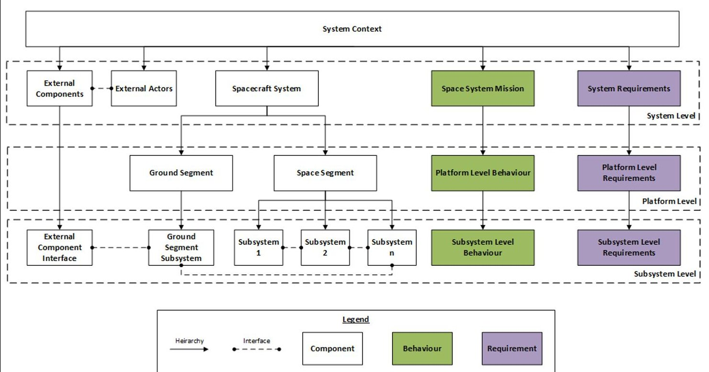

Figure 1. Planned generic spacecraft template model scope.

(MBSSE) modelling method, described in (Mazzini, et al. 2009), was consulted to guide the development of the generic template model and the modelling of some S2TEP system aspects.

Both models were created using the Vitech Corporation GENESYS Tool. GENESYS was chosen due to prior experience with the similar Vitech MBSE software CORE, which reduced risk in coping with the limited time available due to the constrained master's course structure, as less time had to be spent on tool training. Another advantage of the choice of GENESYS was the in-model simulation capabilities. It was possible to rapidly simulate operational scenarios modelled as functions within the model in order to create an analytic model as part of the systems model. The constrained timeline available for this project meant that programming and adding a simulation capability using a combination of tools as was done by the Jet Propulsion Laboratory in their modelling of the RAX CubeSat (see (Kaslow, Anderson, et al. 2015) and (Kaslow, Soremekun, et al. 2014)) was not possible. The fact that this feature was immediately ready for use allowed analytic modelling to be explored in this project and directly linked to the descriptive modelling effort.

The system was modelled using the information structure of the base schema provided by the GENESYS tool. This schema restricted the model to the system architecture domain of the DoDAF V2.0 schema (including components, functions, interfaces, requirements, links, items, resources, states and modes) (Vitech Corporation 2016).

## Modelling the Generic Spacecraft Template

Modelling Approach. The philosophy behind the generic spacecraft model was that, since space systems share common functionality, a basic model of a 'generic' spacecraft could be constructed to serve as a template upon which to build system models. As most spacecraft are deployed in relatively similar orbital environments, they share common functionality, such as 'control spacecraft attitude' and 'communicate.' These shared functional characteristics could be used to create a non-distinct 'generic' spacecraft model. This model could then theoretically serve as a template upon which a model of any common type of spacecraft could be built. A copy of this template model could be "cloned and owned," i.e. copied and further developed for a specific application. The scope of the template model was limited to subsystem level, with the functional architecture, behaviour and

<!-- PDF_PAGE: 4 -->

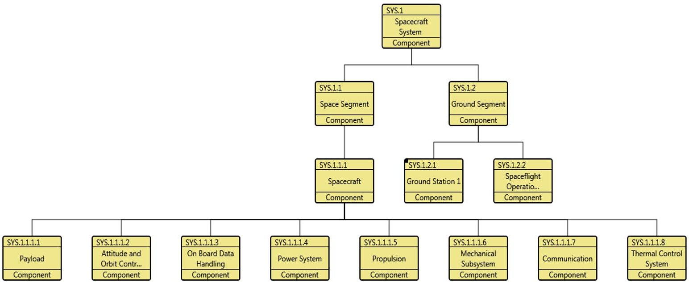

Figure 2. Hierarchy diagram of generic spacecraft model structure.

requirements modelled to this level. The planned scope is illustrated in Figure 1. The component hierarchy and interfaces were modelled to subsystem level as planned. Difficulties were encountered when attempting to model behaviour and requirements to subsystem level, as discussed below

Structuring the Generic Spacecraft Template Model. The generic spacecraft was modelled top down, split into a space segment and ground segment and then modelled along functional subsystem lines. This can be seen in Figure 2. Modelling in this fashion uncovered the first challenge to the model template approach. A continuing theme when attempting to create a 'generic' spacecraft, was that space system architecture was diverse enough to make the creation of a common model structure difficult. An example of this was the modelling of the space segment and the spacecraft, and whether there should be a distinction made between them.

Due to the ability for a space mission to consist of a constellation rather than a single satellite, it was necessary to differentiate between the space segment and the spacecraft in the sense of the orbital platform in the model, as the space segment could consist of multiple orbital platforms. This meant that models of single spacecraft systems like S2TEP, would be structured in a way that needlessly describes the space segment as distinct from the single satellite. If the satellites involved in the constellation are not identical, then further needless levels of abstraction would be added in the single spacecraft case, as the mission and requirements would also need to be split at platform level.

The system interfaces were modelled next. It was decided that three types of interfaces which represent the main functional interactions between system components could be useful in the model: power, data and mechanical interfaces. While from a functional standpoint this makes sense, it became apparent that it does not necessarily reflect the realities of spacecraft system architectures. In a space system, many interfaces between assemblies and subsystems exist as part of the collection of power and data connectors, referred to as the 'harness.' This situation was further complicated by the fact that the interfaces created using the harness could be split along functional lines into power and data architectures, referred to as a power or data 'bus.' It was ultimately decided that the harness should be treated as a subsystem in itself, as it represents an assembly in the physical system. This was the approach taken in the S2TEP model structure.

Modelling Generic Spacecraft Behaviour and Requirements.Modelling generic behaviour for the spacecraft template model was challenging, as the nominal missions of spacecraft vary greatly. The more the mission behaviour is modelled, the more constrained the model would be for application to systems with differing mission types. This would mean more work would be required to alter a copy of the generic model for use in a project with a different mission type. This was avoided by keeping the behaviour of the system intentionally vague. As a result, the system operational life and the spacecraft operations were modelled at a very basic level of detail.

<!-- PDF_PAGE: 5 -->

Creating 'generic' requirements was also found to be particularly challenging, as many requirements stem from the mission, which varies greatly between spacecraft. Initially, requirement template elements were created at each level which could be duplicated for any necessary requirements at that level. This was found to be counter-productive when this was applied during the modelling of S2TEP using the template. Creating a new requirement element does not take a particularly long time, while hunting down unused requirement template elements scattered throughout the system model was found to be tedious and counter-productive. Even much later in the S2TEP modelling efforts, template elements were found strewn throughout the system, creating a lot of 'clutter.' One piece of guidance from previous MBSE efforts was 'model only what you need' (Cole, Delp und Donahue 2010). This principle was later applied and the number of template requirement elements was vastly reduced.

Basic empty 'placeholder' requirements were created for each major subsystem, as well as for the interaction with system external components from the system context. Placeholder requirements were also created for higher level system structural components, such as the spacecraft mission requirement. As the generic spacecraft could not have specific requirements, the placeholder requirements were filled with guidance on the writing of requirements provided by the MBSSE methodology described in (Mazzini, et al. 2009).

Analysis of the Generic Spacecraft Template Modelling. During the modelling of the generic spacecraft template, it quickly became apparent how difficult it would be to create a template model that could be utilised for a large variety of systems. While various spacecraft shared some common functionality, the generic model content was limited due to the possible variations of system architecture, mission and orbital environment. It appears that a minimalist approach is most important to the creation of a generic spacecraft template. When the template was initially created, template assembly elements, for example an antenna element, were built with the intention that these could be useful when modelling a system using the template. These provided little benefit to the modelling of a system like S2TEP and created an unnecessary source of clutter that had to be scrubbed from the model.

In the end, it was found that a generic spacecraft model is somewhat useful as a training exercise and to guide the modelling of the functional architecture of a space system. While a 'one size fits all' model may be impractical for use across all spacecraft designs, a common template can provide a useful jumping off point when initiating a project model for common or serial designs, like that envisioned in the S2TEP program.

## Creating a Descriptive Model of the S2TEP Spacecraft

Modelling Approach. The S2TEP GENESYS model was constructed to contain two modelling approaches: descriptive and analytic modelling. The modelling of S2TEP initially focussed on descriptive modelling. The purpose of the descriptive aspects of the S2TEP model was to explore possible sources of added value experienced through an MBSE approach. These included the use of a model as a source of current common understanding of the system, the use of the model to manage internal component relationships and the reusability of the descriptive model.

The descriptive modelling of S2TEP included the modelling of the functional architecture, the modelling of system interfaces and other internal relationships, the modelling of use cases, the modelling of states and modes, the modelling of requirements and the modelling of system functions and operations.

To prepare for the S2TEP modelling and to better understand the engineering process at the DLR, the S2TEP feasibility study conducted at the DLR Concurrent Engineering Facility (CEF) was observed. The output of this study was then used as the source of information for the S2TEP descriptive model. Due to the limited time available and the fact that S2TEP was already in development when this

<!-- PDF_PAGE: 6 -->

project began, it was not possible to utilise the model as part of the design process, leading to the modelling being undertaken in parallel to the system development.

First, the S2TEP model was initialised by 'cloning and owning' a copy of the generic spacecraft template created earlier during the project. The initial area of focus was the functional architecture of S2TEP. The functional architecture of the template had to be altered to more accurately reflect the single space platform architecture of S2TEP. The system architecture was then modelled down to assembly level. The system behaviour was then captured in the model through the creation of functions, states, use cases and through the modelling of operational scenarios. To explore analytic modelling and simulate the system behaviour, these functional scenarios were then made executable. The system requirements created in the concurrent engineering study were then modelled as requirement elements and linked to the appropriate system components or behaviour. After the modelling work had been done, it was possible to export the model in HTML format to allow the model to be accessed in future without the requirement of a GENESYS licence.

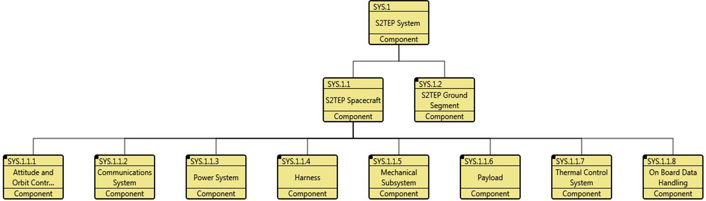

Figure 3. Hierarchy diagram of S2TEP model to subsystem level. Assembly blocks have been modelled but were kept suppressed to keep diagram readable.

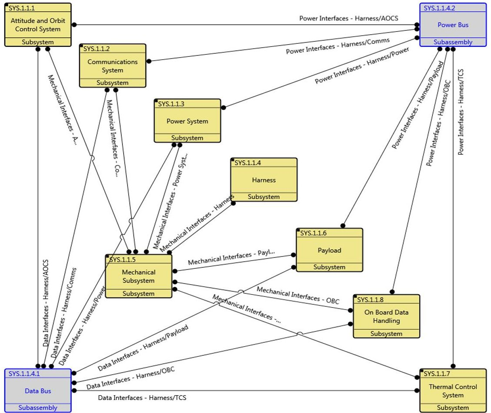

Figure 4. Interface block diagram of S2TEP subsystem interfaces. Note that the blocks representing the power and data bus are in an alternative colour to denote that they exist outside of this level of decomposition of the S2TEP system model.

<!-- PDF_PAGE: 7 -->

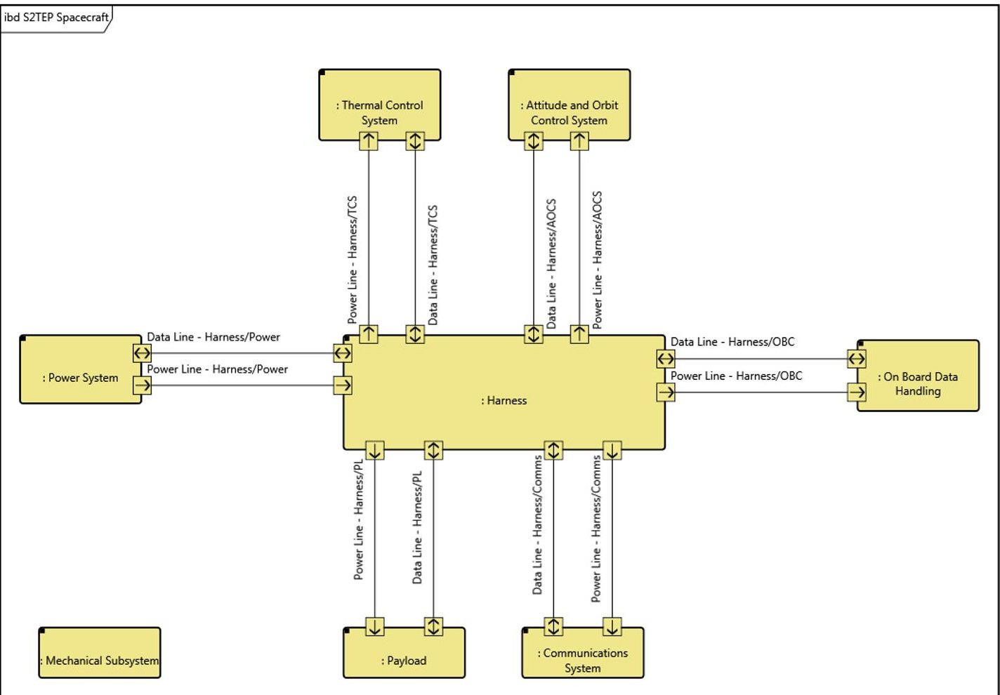

Figure 5. Flow internal block diagram representing flow interfaces between subsystems.

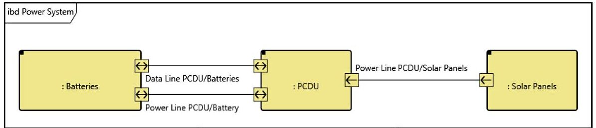

Figure 6. Flow internal block diagram representing flow interfaces within the power subsystem

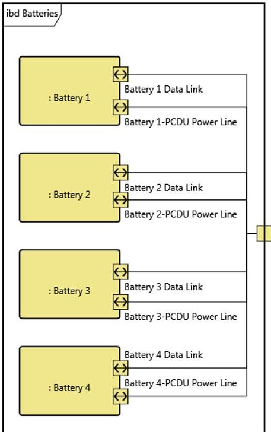

Figure 7. Flow internal block diagram representing flow interfaces between battery assemblies (in this case individual batteries).

<!-- PDF_PAGE: 8 -->

Structuring the S2TEP Model. The modelling of the functional structure of the S2TEP system model began by modifying the generic spacecraft template to reflect the single space platform architecture of S2TEP. S2TEP system components were then modelled down to assembly, and in a small number of cases, subassembly level. A hierarchy diagram of the S2TEP model down to subsystem level can be seen in Figure 3. Note the difference between the system architecture when compared to that of the generic spacecraft represented in Figure 2. Unlike the generic template, the space segment and the spacecraft are the same component since the S2TEP space segment is made up of a single spacecraft.

The payload was modelled as a single subsystem. Individual payload instruments were modelled as assembly components within this payload subsystem. This was done to simplify the functional architecture of the model at subsystem level. The system interfaces were modelled next. These were divided into power, data and mechanical interfaces, as was done in the generic template model. Collective parent interfaces such as the 'Harness to AOCS data interface,' were used for model structure and to provide collective views of all relevant interfaces between subsystems. All three types of interfaces between subsystems can be seen in Figure 4. These were then broken down into individual interfaces (i.e. PCDU-Harness) for the assembly level of system decomposition. To represent the physical 1 to 1 connections between assemblies in the system, the GENESYS link element was utilised. This way, data and power links at assembly level could be modelled, allowing for specific details such as link capacity, delay or protocol to be added in future when more detailed design of the system is conducted.

To demonstrate the structure of the model and the modelling of interfaces at each level, let us follow the decomposition of the power subsystem. The power system was modelled to demonstrate decomposition into component assemblies, which were in turn decomposed into subassemblies. Interfaces were modelled at each of these levels. Let us also look at flow type interfaces, such as data and power. The functional flow interfaces between subsystems can be seen in Figure 5. This figure shows how data and power are routed through the S2TEP spacecraft harness. Figure 6 shows the power and data flow between assemblies within the power system. Finally, Figure 7 represents the power and data flow of the battery subassemblies, in this case individual batteries that will make up the battery block.

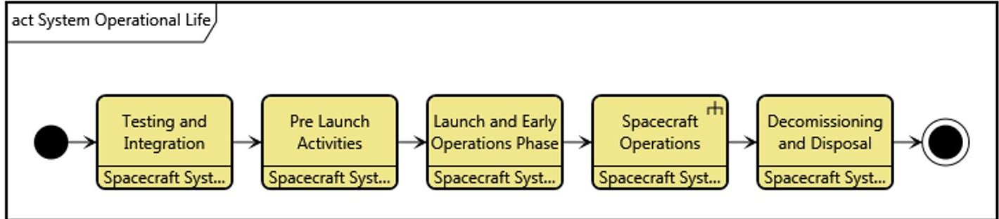

Figure 8. Activity diagram of the spacecraft operational life.

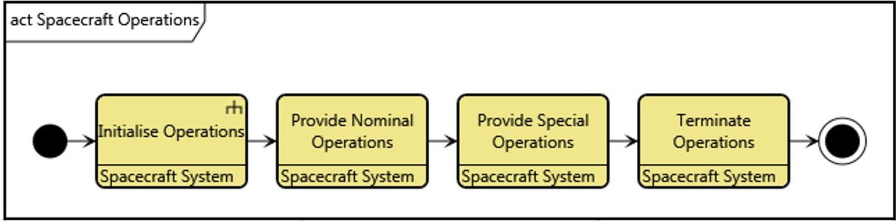

Figure 9. Activity diagram of spacecraft operations. This diagram represents the child functions of the block Spacecraft Operations in Figure 8.

<!-- PDF_PAGE: 9 -->

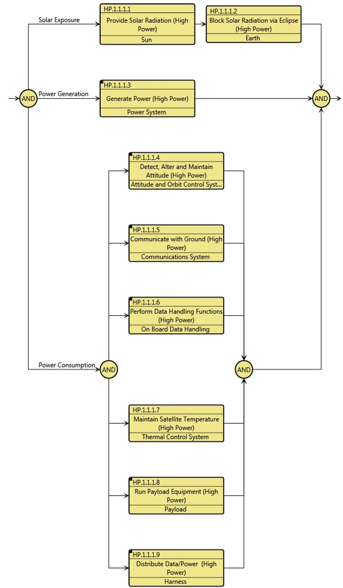

Figure 10. Enhanced Functional Flow Block Diagram (EFFBD) of a single orbit operational scenario of S2TEP

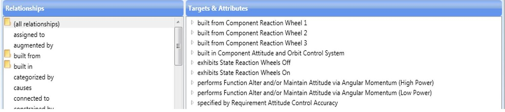

Figure 11. Relationships of the element representing the spacecraft reaction wheels as displayed in GENESYS.

<!-- PDF_PAGE: 10 -->

Modelling S2TEP System Behaviour. The functionality of the S2TEP System was also modelled. This was done in two ways. First the general functionality was modelled by allocating functions to each component in order to create a function tree. The function tree was created through the modelling of functions for each subsystem and major assembly. These were linked to create a logical system decomposition. In addition to this, an operational concept of the system was modelled. First the context of the operational concept was modelled by modelling the life phases of the system as seen in Figure 8 and Figure 9. The S2TEP Mission phases were only modelled at a high level to provide context for the operational concept. The modelled phases serve as placeholders for possible future expansion.

The operational concept focused on the nominal operations of the S2TEP spacecraft over the course of a single orbit. The idea was to represent how the entire satellite system acted during this operational scenario. This was later made executable, to create the analytic model discussed below. The orbit was modelled in such a way that it could easily be duplicated and adapted for alternative orbit choices, or system configurations for other orbits.

The operational scenario was created by modelling the function of each subsystem and major assembly over the course of one orbit. A subsystem view was created to show the function of each subsystem over the orbit. This view can be seen in Figure 10. Views for the behaviour of the assemblies within each subsystem were also modelled.

Modelling S2TEP Requirements and Traceability. The system requirements that had already been developed for S2TEP, including those generated through the concurrent engineering study, were modelled within the S2TEP system model. These could then be linked to the corresponding system components or functions using the 'specifies' relationship within GENESYS. This created requirements traceability, in the form of a rapid view of all requirements directly relevant to any assembly or subsystem of focus.

The traceability inherent in a systems model is of great use to the monitoring of change propagation. Within GENESYS, all relationships to any model element could be rapidly accessed and displayed, as can be seen in Figure 11. In this example, a set of reaction wheels has been modelled as a single element, which is built from the individual wheels.

Through this list of relationships, we can see the states utilised by the component, the functions performed by the component and the requirement within which the components are specified. If a design decision is made where this component must be altered or replaced, the relationships affected by this change can be readily accessed through this feature, allowing for the impact on all relevant parts of the system to be analysed in turn.

Analysis of the Descriptive Modelling of S2TEP. The descriptive model of S2TEP provided several potential ways to add value to the systems engineering process. The descriptive model can provide both an overview and a central source of information on the current system configuration. The modelling and graphical portrayal of subsystem and assembly interfaces provides a useful overview of the context of assemblies and subsystems within the greater system.

A key benefit of descriptive modelling is the ability to utilise traceability within the model. Through requirements traceability, it is possible to ensure that all requirements are being addressed by a component or function within the system, by inspecting the relationships of each requirement with other model elements. Constraint related requirements can similarly be linked to the relevant components. It is possible to record the origin of requirements within the system. For example, the descriptive model can illustrate how a requirement for maintenance access panels are the result of a pre-launch maintenance use case, where the maintainer needs to access parts of the satellite when it is being integrated into the launcher.

<!-- PDF_PAGE: 11 -->

The inclusion of operational aspects during phases 0 (mission analysis/needs identification) and A (feasibility) and leading into phase B (preliminary definition) can allow payload or spacecraft operations subject matter experts to provide input and influence a system design earlier. The operational concept outlined in the model can be shared with these domain experts by providing them with model outputs or by including them in early phase concurrent engineering studies utilising the system model. The descriptive modelling of spacecraft operations allows for this information to be effectively recorded and communicated, while the analytic modelling allows for the operational concept to be validated.

## Adding Analytic Features to the S2TEP Spacecraft Model

Analytic Modelling Approach. To broaden the scope of the analysis of a model-based approach, it was decided that the creation and analysis of an analytic model should also be included in this project. One possible form of analytic model is the System Concept Simulator (SCS) described in the European Cooperation for Space Standardisation (ECSS) Technical Memorandum (TM) on system modelling and simulation, ECSS-E-TM-10-21A (European Cooperation for Space Standardization 2010). The TM describes the simulator as supporting the trade-off for system concepts in an iterative process, by providing a quantitative assessment of the system performance for various mission and spacecraft concepts. The SCS is intended to support decisions on mission or system trades, especially where trades affect or connect the design of more than one or two disciplines. The SCS should aid in the efficient evaluation of all available alternative designs and measure their effectiveness against the requirements baseline to obtain an optimal system design.

Within the S2TEP model, a system concept simulator was created by combining the modelling of operational scenarios of the system with the built-in simulation capability of the GENESYS tool. This added an analytic component to the S2TEP model by introducing a model-based concept validation capability. The creation of the SCS within the S2TEP modelling required further development of the operational scenarios within the model. In order to provide some system performance feedback with the simulator, the resource consumption, in this case energy, was modelled for the duration of the operational scenario. The operation of the system was modelled over the period of a single orbit.

The power generation was then modelled, including the gap in generation due to the eclipse period of the orbit. The power consumption was modelled by using the average active and standby power values provided for assemblies from the S2TEP CE study. First, a resource element for energy was created in GENESYS. GENESYS allows for resources to be modelled, and for the consumption of resources to be simulated in the built-in simulation functionality. The operational modelling had been undertaken in such a way that function elements existed that represented the activity of each assembly conducted over the course of minute of the orbit. By utilising the 'consumed by' relationship, a value of the average power consumed in a minute by each assembly could be added. The power consumption of each assembly was then modelled by iterating the power consumption per minute over the course of the full orbit. This was done by adding iteration loops to the processes representing the number of minutes the assembly of focus should run. The time step of minutes was chosen to provide a good power consumption overview of the system. An arbitrary initial value for the energy available was required, so that power losses and gains could be distinguished, or the simulation would stop as there was not enough initial power to perform the activities. The value chosen represented an arbitrary value somewhere in the middle of the energy storage capacity, to simulate the satellite at an arbitrary mid-life and mid-mission point.

To maintain the fidelity of one minute simulation increments it was necessary to model the required energy in the unit milli-Watt-minute. This was due to the average power draw of many components being far too small when estimated over the course of a minute using Watt-hours, which could lead to truncation errors.

<!-- PDF_PAGE: 12 -->

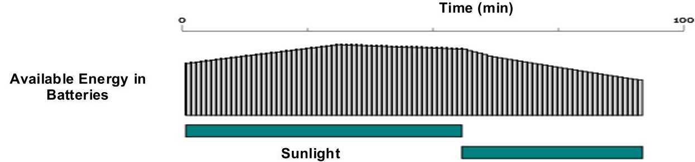

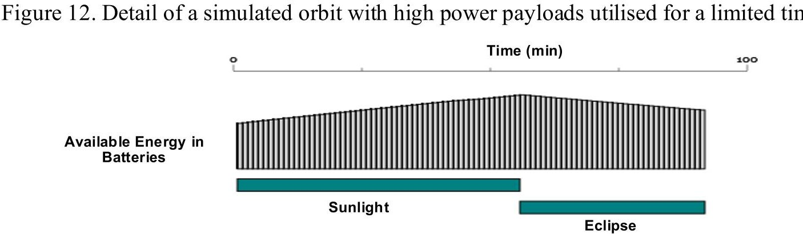

Figure 13. Detail of a simulated orbit with high power payloads kept on standby. Time (min) 100 200

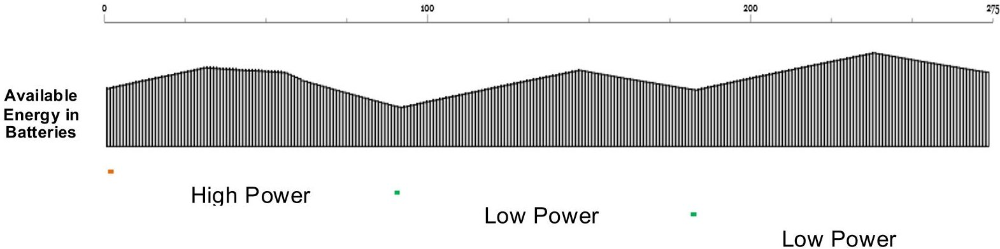

Figure 14. Detail of the power consumption when the system utilises the high power payloads in the initial orbit before spending a number of subsequent orbits in a lower power configuration.

Analytic Modelling Results. After the initial operational modelling, the utility of the SCS within the model became apparent, as the modelling of system operation provided an additional degree of freedom within the system design, as well as validation of the system concept. During the concurrent engineering feasibility study of the S2TEP system, several possible orbits were considered. The power analysis rejected some orbits as impractical, due to the lack of energy generated in the worst power case.

This outcome was mirrored by the SCS within the S2TEP model. This can be seen in Figure 12, where the amount of available energy at the end of a single orbital period is below that seen at the beginning of the orbit. After several orbits utilising this high-power case, this system will clearly no longer have sufficient energy available to conduct nominal operations.

A new, low power scenario was then modelled by duplicating and altering all the function elements within the first scenario so that there were now two complete scenarios comprised of their own function elements. This was done to provide a power scenario where the power usage was reduced compared to the original, high power scenario. In the low power scenario, the power draw was altered by reducing the time some payloads spent at a fully active level, while leaving particularly power hungry payloads on standby for the duration of the orbit. By altering the operation of the system, it was now possible to create a type of recharge orbital scenario, referred to as a low power case. This is an orbital scenario where the final energy supply was higher than at the beginning of the orbit, as can be seen in Figure 13.

<!-- PDF_PAGE: 13 -->

These two operational modes can then be combined in an operational scenario where the system conducts all measurements during one orbit, before spending two subsequent orbits replenishing the battery. The simulation of this can be seen in Figure 14. By introducing operational modelling, a previously rejected orbit could now remain in consideration. This is of course a very simplistic example, but nonetheless illustrates how the early inclusion and modelling of operational concepts can influence and benefit the design of a system by providing an additional degree of freedom to be considered.

Additionally, operational modelling can also be utilised to obtain and document operational aspects very early in the system development process, such as the required duration of measurements undertaken by payload instruments very early in the system development process. The operational model and the individual functions of which it is comprised may be allocated to system components, but do not have to be. It is possible to model an operational concept without a complete preliminary design of a system. It is thus possible to build an SCS before a preliminary design is developed, allowing the analytic modelling to influence the design by allowing an element of system level verification to be used during subsystem and assembly trade studies. Operational scenarios can also be modelled with alternative system configurations.

## Project Reflections

Exploration of Initial Research Question. The core research question was "what value can be added by practically applying MBSE to the process of developing a space system at the DLR?"

The main value added by an MBSE approach to space system development is from the more robust system concept and preliminary design that can be created through the improved systems engineering. MBSE can improve the communication and capture of system knowledge, assist in the monitoring of design change propagation, facilitate earlier inclusion of some domains such as operations and allow for earlier verification of the system concept.

By improving these aspects of the systems engineering process, MBSE could increase the robustness of the preliminary design. A preliminary design can be seen as robust once it is immune to change. A design can be made immune to change by anticipating possible future changes and factoring them in to the design in advance. These future changes are driven by the system design not yet meeting all requirements, whether explicit or implicit. Requirements can be explicit, where they are clearly outlined by the customer in the system specifications, or they can be implicit, where they are not explicitly mentioned but must be met for the system to meet the customer needs and requirements. MBSE aids the management of explicit needs through the ability to model requirements and link them to the system components or functions that fulfil these requirements. MBSE can also aid the elicitation and management of implicit requirements through the modelling of behaviour, such as the use cases and functions modelled in this project. Modelling the desired behaviour of the system and then allocating the behaviour to responsible system components can aid in the discovery of gaps, where no system aspect exists that can meet the needs of the behaviour. When these system needs have not yet been explicitly outlined, the requirement is implicit. When all implicit and explicit requirements of the system have been met by the design, further changes are not necessary and the design can be considered robust.

Project Limitations and Challenges. This project faced a few limitations and challenges. A core limitation was the inability to test the application of MBSE to the critical path of development of a system. This is essentially infeasible for a student project, as it would interrupt the development of an active project. It is also prevented by reasons of timeframe. The full development of a space system generally takes in the order of years. This time-period is well beyond the available time to complete any master's level project. As a result, the model created was a shadow model that was separate from the development path of S2TEP. Furthermore, the system model was essentially created backwards, as the modelling began at the system design, and the system behaviour and requirements were linked

<!-- PDF_PAGE: 14 -->

afterwards. In a truly model-based approach, the system should be designed using the model by beginning with the requirements.

Additionally, due to the intense nature of the advanced master's course, the timeline of this project was very constrained. There were only around 5 months available to create and analyse the two models. As a result, the scope of exploration was limited. Finally, estimating the added value of MBSE was particularly challenging, due to the difficulty in developing effective metrics. This was further complicated by the constrained timeline and by the fact that the model was not being utilised in the active development of the space system. Thus, all estimations of value added or of improvement to project cost or performance could only be speculative.

Lessons Learned and Future Guidance. A range of lessons were learned through this project which may provide guidance to future MBSE studies. A key lesson learned was that fully applied MBSE is not just a model tacked on to a project. The model must not only be used as part of the project (i.e. to capture knowledge), but must also be used to facilitate design decisions and shape the design from the beginning of development. Otherwise a model-based approach will be threatened with the charge of being nothing more than enhanced project documentation. Shadow model studies like this one will always be limited in their ability to fully and effectively analyse MBSE value.

Finally, the development of effective metrics for measuring MBSE value is important, not just for individual projects but for the promotion of MBSE as a whole. Without tangible metrics, MBSE analysis risks being too qualitative or speculative. Effective MBSE metrics facilitate more accurate analysis of value added, allowing for the case for MBSE application in larger projects to be more convincing.

## Conclusion

This thesis project sought to provide a useful exploration of practical MBSE application to promote the active integration of MBSE into the spacecraft development process and guide future MBSE efforts at the DLR. This exploration of the value of using model-based techniques to support development of a space system led to several key findings."

The main value added by an MBSE approach to space system development was found to be the possible increase in the robustness of the preliminary design caused by the improvements to systems engineering processes. A model-based approach can improve systems engineering processes through better communication and capture of system knowledge, enhanced monitoring of design change propagation, earlier inclusion of domains such as operations and earlier verification of the system concept.

It was found that a generic spacecraft template model for any spacecraft is difficult to create while maintaining usefulness. However, a template model or reference architecture built for more specific types of spacecraft can aid and guide the initial modelling of a space system. A descriptive model of a space system like the S2TEP system was found to add value by providing a single, central source of information on the current system configuration. A descriptive model is also an effective way to record the relationships between system components, functions and other elements such as requirements, and thus can greatly aid in the assessment of change propagation. Requirements traceability within the model can aid in the monitoring of system compliance to requirements. A descriptive model can also record the source of system needs through the inclusion of behavioural modelling, such as functions or use cases.

Inclusion of analytic modelling, such as that seen in the System Concept Simulator created in the S2TEP model allows for operational considerations to be considered earlier in the design process, while also providing an early source of model-based validation. Analytic aspects of system models can support trade studies and can be reused in future alterations and iterations of system designs to

<!-- PDF_PAGE: 15 -->

provide continued added value. The descriptive model is able to combine the results of analytic modelling into a holistic systems view.

The practical application of MBSE adds value to the early design of space systems by providing a central way to view and analyse the current configuration of the system, while also increasing the capacity for early design input from a variety of engineering disciplines and domains. As a result, the preliminary design can be more robust, reducing the need for late design changes and re-testing.

A range of possible benefits to space system development were found in this project, but the analysis of MBSE applied directly in the critical development path of a system will be necessary to make a truly convincing case for the widespread application of MBSE to spacecraft development. The future development of small scale spacecraft such as CubeSats or limited space projects, such as student projects or concept studies could provide appropriate test cases for the full integration of MBSE into the development process. It is hoped that the findings of this project can aide such future MBSE efforts.

## References

Cole, Bjorn, Chris Delp, and Kenny Donahue. 2010. "Piloting Model Based Engineering techniques for Spacecraft Concepts in Early Formulation." Accessed April 26, 2016. http://www.omgsysml.org/Piloting_Model_Based_Engineering_Techniques_for_Spacecraft Concepts_in_Early_Formulation-Cole_INCOSE_537.doc.

Dannemann, Frank, and Michael Jetzschmann. 2016. "Technology-Driven Design of a Scalable Small Satellite Platform." Small Satellites Systems & Services (4S) Symposium. Valletta, Malta.

Delligatti, Lenny. 2013. SysML Distilled: A Brief Guide to the Systems Modeling Language. Upper Saddle River, NJ: Addison-Wesley.

European Cooperation for Space Standardization. 2010. "ECSS-E-TM-10-21A - System modelling and simulation." 16 April. Accessed June 15, 2016. http://www.ecss.nl/.

Friedenthal, S, A Moore, and R Steiner. 2015. A Practical Guide to SysML: The Systems Modelling Language (Third Edition). Burlington, MA: Morgan Kaufmann OMG Press.

Kaslow, David, Grant Soremekun, Hongman Kim, and Sara Spangelo. 2014. "Integrated modelbased systems engineering (MBSE) applied to the Simulation of a CubeSat mission." 22 January. Accessed June 8, 2016. http://ieeexplore.ieee.org/stamp/stamp.jsp?arnumber=6836317.

Kaslow, David, Louise Anderson, Sharan Asundi, Bradley Ayres, Curtis Iwata, Bungo Shiotani, and Robert Thompson. 2015. "Developing a CubeSat Model-Based System Engineering (MBSE) Reference Model - Interim Status." Accessed May 06, 2016. http://ieeexplore.ieee.org/stamp/stamp.jsp?arnumber=7118965.

Long, David. 2016. "The Fool's Errand of Reuse in MBSE." 15 June. Accessed July 21, 2016. http://community.vitechcorp.com/home/post/The-Fools-Errand-of-Reuse-in-MBSE.aspx.

Mazzini, S, E Tronci, C Paccagnini, and X Olive. 2009. "A Model-Based methodology to support the Space System Engineering (MBSSE)." Accessed August 15, 2016. https://www.researchgate.net/publication/267963777.

Vitech Corporation. 2016. "GENESYS 4.0 Architecture Definition Guide." January. Accessed May 19, 2016. http://www.vitechcorp.com/support/documentation/genesys/400/ArchitectureDefinitionGuide.pdf.

<!-- PDF_PAGE: 16 -->

## Biographies

Michael Kretzenbacher is a graduate systems engineer specialising in Model Based Systems Engineering (MBSE). From 2014 to 2015, Michael was employed as a systems engineer at the Australian systems engineering company Shoal. In 2016, Michael graduated with a mastere specialisé in space systems engineering from the Institut Supérieur de l'Aéronautique et de l'Espace (ISAE). His studies included an internship at the German Aerospace Center (DLR), the subject of which is presented in this paper. Michael is currently employed as a young graduate trainee at the European Space Agency, where he has been working on the application of MBSE to spacecraft.

Caroline Lange is a research engineer in space systems engineering at the German Aerospace Center, Institute of Space Systems in Bremen, Germany, where she started working at the Department of Landing and Exploration Technologies in 2008. She has been working on the MASCOT asteroid lander currently on its way to its target asteroid, and is the lead systems engineer for the development of small surface science packages within the ROBEX (Robotic Exploration of Extreme Environments) project. She is also currently working towards a PhD in systems engineering dealing with the topic of reuse with special focus towards applying MBSE-like methods in the context of planetary exploration missions.

Dr David Harvey is a systems engineer with an interest in Model-Based Systems Engineering (MBSE). He holds a bachelor degree and a doctorate in the field of mechatronics. He is currently Chief Engineer at Shoal. Over the last decade, he has led work developing an MBSE approach to early lifecycle design. As well as developing this tool and approach, David has been involved in its application to major Defence projects, applying a model-focused approach which supports their existing capability development process. David has also extended focus beyond Defence, tailoring a similar approach in different domains for a range of clients.