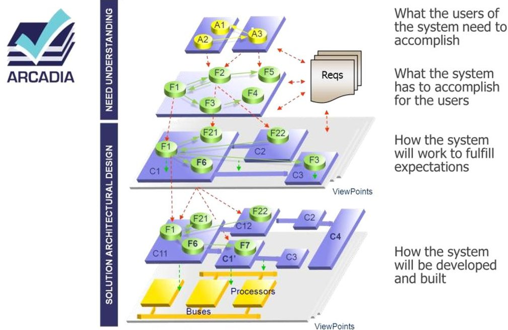
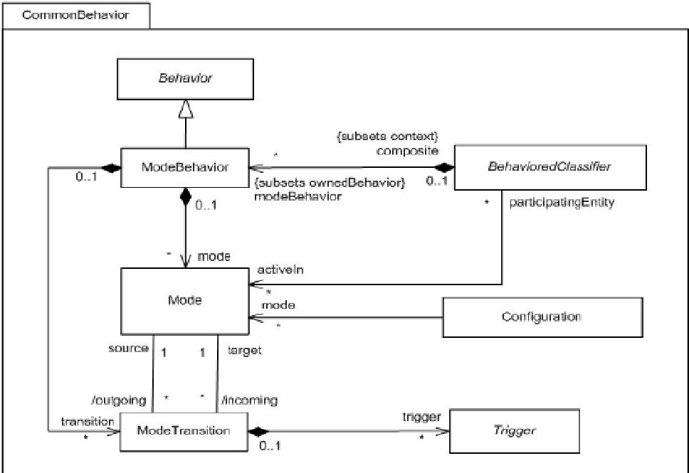
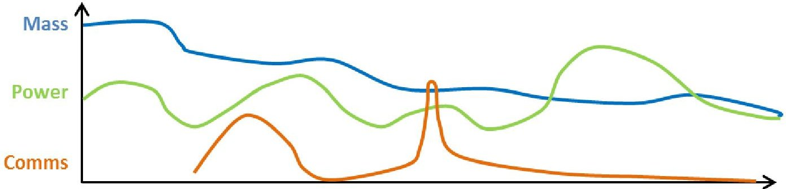
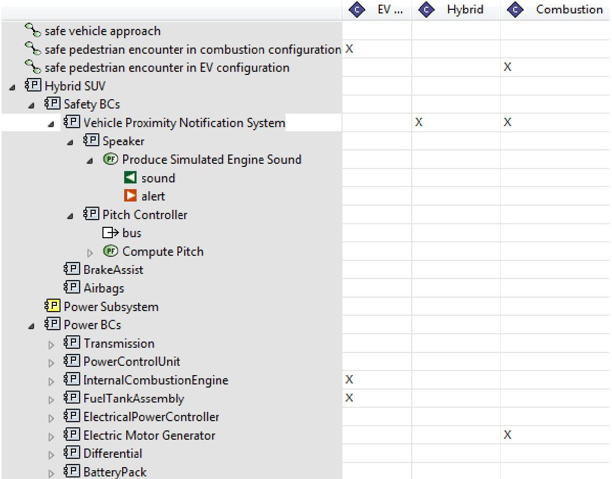
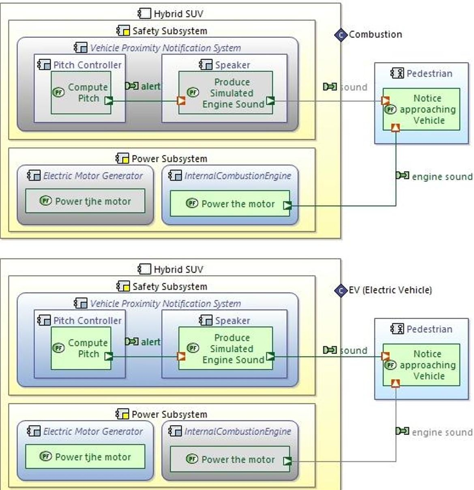
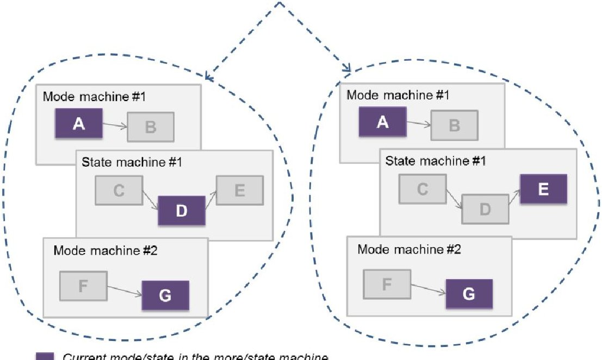
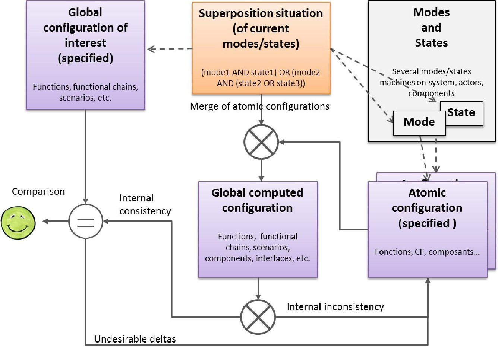

<!-- PDF_PAGE: 1 -->

# Modeling system modes, states, configurations with Arcadia and Capella: method and tool perspectives

Stéphane Bonnet Thales Corporate Engineering stephane.bonnet@thalesgroup.com

Jean-Luc Voirin

Thales Airborne Systems

Thales Technical Directorate

jean-luc.voirin@fr.thalesgroup.com

Daniel Exertier Thales Corporate Engineering daniel.exertier@thalesgroup.com

Véronique Normand Thales Technical Directorate veronique.normand@thalesgroup.com

Copyright © 2017 by Stéphane Bonnet, Jean-Luc Voirin, Véronique Normand, Daniel Exertier. Published and used by INCOSE with permission.

Abstract. Management of modes and states is a wide, complex, and often underestimated part of systems engineering. As systems and missions become more complex, the potential combination of modes and states across system, subsystem, and component levels becomes exponential and difficult to master. This paper proposes a methodological approach for studying and integrating the impact of modes and states on the architecture definition. It establishes the concepts of configuration and situation as keys to analyzing these impacts.

## Introduction

Most of systems development standards require that the system is described in its various phases, modes, and states. These concepts are however amongst the most ambiguous and the least understood ones in systems engineering. Several aspects have to be considered:

- The specification of the expected functional behavior of the system in different contexts

- The supervision of the expected functional behavior of the system and the detection of possible failures

- The combinatory of the modes and states of the system and of its components

- The possible dynamic reconfigurations to be performed during system operation, in particular in reaction to failures

- The startup and stopping of the system and its components

- Etc.

The ability to accurately relate modes and states to the definition of the expected system functional behavior, the required performance specification, and to any element contributing to the system architecture is essential for the mutual understanding between the customer, the supplier, and more generally all the stakeholders involved in the system development.

An extensive comparison between various pieces of literature in (Olver and Ryan, 2014) proves the various methodologies for states and modes do not provide a consistent understanding of what constitutes a state or a mode: definitions often contain circular references between "modes", "states",

<!-- PDF_PAGE: 2 -->

and "conditions". Not only is there no consensus as to whether modes include states or states include modes, but there is also little guidance on the relationships between them.

The mastering of modes and states is a very wide and complex topic, often underestimated. This paper only considers modes and states through the prism of their impacts on the definition of the system architecture. It does it in the context of the model-based engineering method Arcadia (Voirin, 2010; Arcadia, 2014) and of its supporting modeling workbench Capella (Capella, 2014).

Both Arcadia and Capella have been extensively used on various domains in all Thales Business Units worldwide for about ten years. Since both have been made open source in 2014, their usage outside Thales has significantly grown. The (intermediate) results presented in this paper are based on need capture and experimentations performed in the context of the Clarity collaborative project (Clarity Consortium, 2015). It thus reflects practices coming from a wide variety of domains such as avionics, radars, transportation, space, energy, etc.

This paper describes the Arcadia definitions for modes and states, but more importantly, it elaborates on the engineering objectives related to modeling of modes and states. It describes the different kinds of analyses that are likely to be performed, explains the corresponding methodological approaches, and illustrates the way Capella supports them.

## Arcadia and Capella, quick overview

Arcadia, the method. Arcadia (Voirin, 2010; Arcadia, 2014) is a comprehensive model-based engineering method devoted to systems, software, hardware architecture engineering. It describes the detailed reasoning to understand the real customer need, define and share the product architecture among all engineering stakeholders, early validate its design and justify it, ease and master integration, validation, and verification (IVV). Arcadia can be applied to complex system, equipment, software or hardware architecture definition, especially those dealing with strong constraints to be reconciled (cost, performance, safety, security, reuse, consumption, weight...). It is intended to be embraced by most stakeholders in system/product/software/hardware definition as well as by IVV actors, as their common engineering reference.

Figure 1: Arcadia engineering perspectives

<!-- PDF_PAGE: 3 -->

Arcadia is now partially published and a full publication is on its way. Its large adoption in many different engineering contexts both in Thales and in other organizations witnesses of an industry-proven comprehensive method for systems engineering, adapting to each context in a dedicated manner, and yet being tooled by the same powerful tools capitalizing knowledge.

Arcadia introduces several engineering perspectives and promotes a clear distinction between the expression of the need and the expression of the solution. It intensively relies on functional analysis, which is used in all perspectives (Figure 1). Table 2 summarizes the objectives of each major Arcadia perspective.

Table 2: Objectives of Arcadia engineering perspectives

<table border="1"><tr><td>Operational Need Analysis</td></tr><tr><td>The first step focuses on analyzing the customer needs and goals, expected missions and activities, far beyond system requirements. This analysis aims at ensuring adequate system definition with regard to its real operational use and IVVQ conditions.</td></tr><tr><td>Outputs of this engineering phase mainly consist of an “operational architecture” which describes and structures the need in terms of actors/users, their operational capabilities and activities (including operational use scenarios with dimensioning parameters, and operational constraints such as safety, security, lifecycle, etc.)</td></tr><tr><td>System Need Analysis</td></tr><tr><td>This perspective focuses on the system itself, in order to define how it can satisfy the former operational needs, along with its expected behavior and qualities. The main goal at that point is to check the feasibility of customer requirements (cost, schedule, technology readiness, etc.) and if necessary, to provide means to renegotiate their content.</td></tr><tr><td>Outputs of this engineering phase mainly consist of system functional need descriptions (functions, functional chains, and scenarios), interoperability and interaction with the users and external systems (functions, exchanges plus non-functional constraints).</td></tr><tr><td>Logical Architecture
(intermediate, conceptual solution)</td></tr><tr><td>This perspective aims at building a coarse-grained component breakdown of the system which is unlikely to be challenged later in the development process. Starting from previous functional and non-functional analysis refined results (functions, interfaces, functional exchanges, behaviors...), build one or several decompositions of the system into logical components. The building process has to take into account architectural drivers and priorities, viewpoints and associated design rules, etc.</td></tr><tr><td>All major (non-functional) constraints (safety, security, performance, IVV, cost, non-technical, Etc.) are taken into account and compared to each other so as to find the best trade-off. This approach is viewpoint-driven, where viewpoints formalize the way these constraints impact the system architecture.</td></tr><tr><td>Outputs of this engineering phase consist of the selected logical architecture which is described by components and justified interfaces definition, scenarios, modes and states, formalization of all viewpoints and the way they are taken into account in the components design. Since the architecture has to be validated against the need analysis, links with requirements and operational scenarios are also to be produced.</td></tr></table>

<!-- PDF_PAGE: 4 -->

The physical architecture has the same intent as the logical architecture building, except that it defines the "final" architecture of the system at this level of engineering. Therefore, it introduces rationalization, architectural patterns, new technical services and components, and makes the logical architecture evolve according to implementation, technical and technological constraints and choices.

The same viewpoint-driven approach as for logical architecture building is used. The model at that point is considered ready to develop by downstream engineering teams.

Outputs of this engineering phase consist of the selected physical architecture which includes components to be produced, formalization of all viewpoints and the way they are taken into account in the components design. Links with requirements and operational scenarios are also produced.

Capella, the associated modeling workbench. The open source, field-proven modeling workbench Capella has been developed both to guide users in applying the Arcadia method and to assist them in managing complexity of systems design with automated simplification mechanisms. A model is built for each Arcadia engineering perspective and end-users are guided by an embedded method explorer. All of these models are related by justification links and are processed as a whole for impact analysis.

While hundreds of Thales engineers have been using Capella as their main daily design workbench for a few years already, the Clarity consortium has been able to grow an ecosystem around Capella (Clarity Consortium, 2015). Several major industrial organizations, tool providers, and consulting organizations have already joined the consortium.

## Modes, states (and configurations) in the literature

As thoroughly explained in (Olver and Ryan, 2014) and (Wasson, 2011), the use of states and modes in formal systems engineering processes is wide, varied and inconsistent. The various methodologies for states and modes do not provide a consistent message or framework for what constitutes a state or a mode. Conflicting definitions in the literature prove that the distinction between modes and states is arbitrary. Two approaches closely related to architectural design are described hereunder.

Modes in AADL. AADL (Architecture Analysis & Design Language is an ADL (Architecture Description Language) standardized as the SAE Standard AS-5506 and dedicated to embedded real time systems. (Feiler et al., 2006) provide the following definition for modes:

"A mode is an explicitly defined configuration of contained components, connections, and property value associations. Modes represent alternative operational states of a system or component. For example, modes for a cruise control system may be {initialize, disengaged, engaged}, where each of these modes may involve different sets of processes, executing threads, or active connections (e.g., in the initialization mode there are no connections to sensors)."

Modes in AADL can be used to represent alternative system configuration in a variety of ways. Among others, they can establish:

- Alternative configurations of active components and connections and the transitions among these configurations. At the level of system and process, a mode represents possibly overlapping sets of active threads and port connections, and alternative configurations of

<!-- PDF_PAGE: 5 -->

execution platform components, as well as alternative bindings of application components to execution platform components. (Feiler et al., 2006)

- Mode-specific properties for software or hardware components. This is a light way to change the value of some property according to the active mode of the system. These properties can be of very different kinds like for instance the period of a task, the precision of an algorithm or the frequency of a CPU.

Modes and configurations in UML MARTE. The MARTE (Modeling and Analysis of Real-Time and Embedded Systems) UML profile (OMG, 2010) proposes an interesting definition of what a mode is:

"An operational mode can represent different things:

- An operational system (or subsystem) state that is managed by reconfiguration mechanisms (e.g., fault-tolerance management middleware) according to fault conditions.

- A state of system operation with a given level of QoS that can be handled by resource management infrastructures (e.g., middleware that assign resources at run time according to load demand, timing constraints, or resource usage).

- A phase of a system operation e.g., starting, stopping, launching, in a mission-critical aerospace system.

A mode identifies an operational segment within the system execution that is characterized by a given configuration. The system configuration may be defined by a set of active system elements (e.g., application components, platform components, hardware resources), and/or by a set of operation parameters (e.g., QoS parameters or functional parameters).”

Figure 3: Modes and configurations in MARTE UML Profile

The concept of configuration, as illustrated by figure 3 extracted from the OMG specification, is a strong inspiration for the approaches described later in this paper. However, it is important to note that specification of modes is a very minor part of the standard (less than 5 pages in the 754 pages of the whole specification) and does not provide any methodological guidance.

<!-- PDF_PAGE: 6 -->

# Modeling modes, states, configurations, and situations in Arcadia

## Definitions for modes and states

The objective here is not to establish a universal reference for what a mode or what a state is. Instead, definitions are provided in the scope of the Arcadia method and in the context of the methodological guidance it provides on this topic. In Arcadia, modes and states are defined separately. There is no "inclusion" of modes within states or of states within modes.

Mode. The definition of the expected behavior of the system (or of its actors, or of its components) in situations foreseen at design time is captured in the form of system modes. Each mode is mainly characterized by the expected functional content of the system in this mode. A mode can reflect various concepts, such as

- the phases of a mission or of a flight for example (taxiing, taking-off, cruising, landing, etc.)

- the specific required functioning of the system under certain conditions (connected, autonomous, etc.)

- the specific conditions in which the system is used: test, training, maintenance, etc.

The transition from one mode to another is in general the result of a decision, such as a change in the way the system operates, in order to adapt to new needs or new contexts. It is therefore conditioned by the choices of the system, of its users, or of external actors. In the model, the trigger of a transition is likely to be related to a functional event. The set of modes and the transitions between them are described in a "mode machine", which syntax is based on SysML state machines (OMG, 2012).

State. During its life and its use, the system passes through states that it undergoes. A state often directly reflects an operating condition or status on structural elements of the system: operational, failed, degraded, absent, etc. States are also likely to represent the physical condition of a component (full or empty fuel tank, charged or discharged battery, etc.). State can also be exploited to represent environment constraints (temperature, humidity, etc.).

The transition from one state to another is often not the result of a decision but rather corresponds to a change of physical properties. The formalization of these identified states is captured in a "state machine" that uses the same underlying syntax than the ones for the modes. The transitions carry the triggering change event but are not likely to be associated to functional events.

## Mastering modes and states: challenges

A typical situation articulating modes and states can be the following: the system is normally running, in operational mode; its state is nominal (all components are available). Then a failure occurs; this is formalized as a transition from nominal to degraded state. The system supervision should be able to detect this new state, and as a reaction, it should drive the transition from operational mode to a degraded mode, dealing with the loss of components.

As systems and missions become more complex, the potential combination of modes and states becomes exponential and difficult to master. For example,

- Several distinct modes machines can exist in parallel at system level (for example a drone can be taking off, cruising, on zone, returning, landing, and for each of these modes or phases, be independently in silent or communicating mode).

<!-- PDF_PAGE: 7 -->

- Each subsystem, equipment or component can have its own mode machine

- Each subsystem, equipment or component can have its own state machine

- The system level modes can be the result of a given combination of subsystem modes

- Modes and states are not hierarchically interlaced, but they can have impact on one another

<table border="1"><tr><td colspan="2">Mission</td><td colspan="2">Phase1</td><td colspan="2">Phase2</td><td colspan="2">Phase3</td><td colspan="2">Phase4</td><td colspan="2">Phase5</td><td colspan="2">Phase6</td></tr><tr><td colspan="14"></td></tr><tr><td colspan="2">System</td><td colspan="2">Mode1</td><td colspan="2">Mode2</td><td colspan="2">Mode3</td><td colspan="2">Mode4</td><td colspan="2">Mode2</td><td colspan="2">Mode3</td></tr><tr><td rowspan="3">Subsystems</td><td>1</td><td colspan="2">ModeA</td><td colspan="2">ModeB</td><td colspan="2">ModeC</td><td colspan="2">ModeA</td><td colspan="2">ModeC</td><td colspan="2">ModeA</td></tr><tr><td>2</td><td colspan="2">ModeX</td><td colspan="2">ModeY</td><td colspan="2">ModeZ</td><td colspan="2">ModeX</td><td colspan="2">ModeX</td><td colspan="2">ModeY</td></tr><tr><td>3</td><td colspan="2">ModeI</td><td colspan="2">ModeJ</td><td colspan="2">ModeI</td><td colspan="2">ModeJ</td><td colspan="2">ModeI</td><td colspan="2">ModeJ</td></tr></table>

Figure 4: An example of modes and states combinations

Challenges are numerous:

- Being able to prove that the system expected behavior can be reached in all possibly realizable combinations of modes, states, at system and subsystem level.

- Being able to study the reconfigurations of the system while it operates.

- Using modes and states as a support to perform analyses on the system. For example, in the domain of satellite launchers, the mass, power and communications profiles vary significantly according to the flying phases, and the modes of each subsystem. (Figure 4)

The remaining parts of this paper elaborate on the methodological approaches and concepts aiming at tackling these challenges. Note: the Capella tooling described in this paper is currently part of an incubation add-on and is not yet available in the default open source workbench (but will be at some point).

## Configurations and situations

Instead of directly relating modes and states to the functional behavior or structural elements in the model, two news concepts are introduced for methodological purposes: configurations and situations.

Configuration. The concept of configuration aims at providing the means to characterize the system when it is in a given context - a context being a mode, a state, or any combination of those. A configuration identifies a set of elements that are active or inactive in this context (functions, components, exchanges, ports, etc.):

- A configuration intended to describe what is expected in a mode is likely to have a functional dominance (capabilities, functions, exchanges, functional chains, scenarios, etc.) in order to describe the required functional behavior.

<!-- PDF_PAGE: 8 -->

- A configuration intended to describe a state is likely to have a structural dominance (components, component ports and links, etc.) but can also reference functional elements, depending on the nature of the described state. A typical example for such a configuration would be the expression of unavailable components (failure, absence, etc.).

Figure 5: Specification of configuration content

In Capella, a configuration can reference any kind of element and can be specified on any structural element (the system, its actors, its components, etc.). For the sake of ergonomics, configurations can be defined as being inclusive or exclusive. Depending on the kind of analyses the configuration will be exploited by, it might be more efficient to specify what is inactive in the configuration (exclusive definition) rather than specifying everything that is active (inclusive definition).

Figure 5 illustrates one way of specifying the content of configurations. Here, the sample model is the simplistic one of a hybrid vehicle, and three configurations are defined. When the vehicle moves with the sole electrical power, it is silent and a notification system is required to warn pedestrians the vehicle is approaching. In that example, checked elements are the ones that are excluded from the configuration.

Capella provides the means to preview configurations on any architecture diagrams. Displayed configurations are indicated with a lozenge shape on the border of the component it is defined for. Figure 6 shows two different configurations, greyed elements are the ones that are not active in the configuration.

<!-- PDF_PAGE: 9 -->

Figure 6: Preview of configurations in Capella

Situations. Different kinds of modes or states can be simultaneously active for a given element (system, component, etc.) at a given time. For instance, a system can be at the same moment

- in operational or training mode

- autonomous or coupled to an external system

- in one given phase of a mission

- in a configuration that is complete or incomplete (for example because some of its components undergo maintenance).

This means several modes machines and states machines can be relevant simultaneously. Therefore, it is necessary to study the consequences of the combination of these modes and states. This is done with the concept of superposition situation. A situation is defined as a logical combination of modes and states (for example, [mode1 AND state1] OR [mode2 AND [state2 OR state3]] that reflects the superposition of modes and states likely to occur at one given moment, either in different modes or states machines on the system itself either across its components. Reminder: at one given moment, there is only one current mode or state per mode or state machine. Figure 7 illustrate a context where a configuration covers two different possibilities.

<!-- PDF_PAGE: 10 -->

Current mode/state in the more/state machine

Figure 7: Concept of situation

Capella provides the means to specify a situation and to associate configurations to this situation. Developments are currently ongoing to take situations into account in all diagrams (and in particular in sequence diagrams).

Engineering of modes and states in Arcadia and Capella relies on these different concepts and their relationships, in order to confront them and check that what is expected from the system can be achieved in all reachable situations.

Purpose of modes and states in the different Arcadia perspectives While it is possible and useful to define modes and states in Operational Need Analysis, this section mainly focuses on the perspectives centered on the system itself.

System Need Analysis. The main modes and states at this level are the ones describing the expected behavior of the system, as requested by the customer. They are likely to be known, perceived, or exploited by the end-users of the system. Among others, they capture the required operating modes or employment conditions of the system in different situations. They can help specify the minimal required behavior of the system when facing feared situations.

External actors of the system can also have modes and states that can impact the expected behavior of the system. For example, an actor changing from one mode to another and interrupting its communication with the system can trigger a change of state of the system and then a transition to a degraded mode. It might therefore be useful to include in superposition situations the modes and states of the actors when they are likely to have consequences.

The functional verification consists in checking the feasibility and continuity of functional chains and scenarios in all superposition situations.

Logical Architecture. A similar approach is performed here. The consistency of logical modes and states (as well as the content of associated configurations) is ensured and traceability is established towards their sources in System Need Analysis.

<!-- PDF_PAGE: 11 -->

New system modes and states can appear as the result of design constraints or choices. In that case, they do not necessarily need to be traced towards the modes and states of System Need Analysis.

The articulation between system-level modes and states and component-level ones is to be managed (see "future work" section).

Physical Architecture. Again, a similar approach is performed, with the same consistency and traceability constraints. The addition of hosting components (providing implementation or execution resources to behavior components, etc.) in this perspective brings a new dimension, introducing for example the states and conditions of failure of these components.

The definition of the modes and states expected from each subsystem is performed here, most likely in a co-engineering dynamic (see "future work" section). Arcadia and Capella allow continuity between system and subsystem models. The modes, states, and configurations of one given subsystem in the Physical Architecture perspective at system level become the modes and states of this subsystem's own System Need Analysis perspective.

## Mastering modes and states: methodological approach

The engineering approach described here is generic; it is applicable in any Arcadia perspective, for system as well as for components. It covers the following activities: definition of expected behavior, analysis of situations of interests (superposition of current modes and states), and adaptation of the architecture following the results of the analysis. The design of the associated supervision is not covered here.

Figure 8: Synthesis of the methodological framework

Depending on the modeling objectives in a given project, the approach can either be fully or partly applied. It is to be taken as a guiding framework. Figure 8 provides a synthesis of the framework. What is presented here is an ongoing work, as the refinement of the method and the development of the associated tooling and algorithms in Capella are in progress.

<!-- PDF_PAGE: 12 -->

# Definition of the expected behavior

Modes. The first step consists in defining the expected behavior to face the different contexts the system will face. This includes all or parts of the following:

1. Identification of the different kinds of modes required simultaneously: for example, operational mission or training, fully operational or maintenance, autonomous or remotely piloted by an operator, etc.

2. For each kind of mode, formalization of one mode machine specifying all possible transitions between the modes of this kind

3. The content of each mode is then detailed in an atomic configuration that primarily describes the functional and non-functional content (required capabilities, functions, scenarios and functional chains to be played, etc.) but might also include some structural content (components, interfaces, physical connections, etc.). A same atomic configuration can be shared by several modes.

4. The triggers and conditions for all possible transitions between modes within a mode machine can then be specified, and if possible, related to elements such as functional exchanges or execution of functions.

States. The different simultaneous state machines that can impact the content and behavior of the system (presence or absence of components, health status of physical components, environmental conditions, etc.) can be defined following the same pattern. Atomic configurations are used to primarily describe the foreseen structural content and associated properties.

Identification of superposition situations. Once the expected behavior of the system is specified, it has to be confronted to the situations that can influence or harm it during its operating time. Each situation identifies the required superposition of modes (logical combination of modes in each mode machine) as well as the states likely to occur in this situation (typically feared states like attack, failure, external disturbance, etc.). A situation is a superposition of "current" modes and states, which means all active simultaneously at a given moment. Optionally, scenarios are used to place the situations in a timeline to capture the global evolution.

Definition of global configurations of interest. Unlike atomic configurations, global configurations are not directly associated to any specific mode or state. Instead, they are used to capture an expected system behavior of interest. There are multiple reasons why a specific system behavior (scenario, functional chain, etc.) can be of interest: because it corresponds to a particularly critical point of the system, because it is a customer specific request, because it is a minimal behavior to be preserved whatever the operating conditions, etc.

## Analysis of the superposition of modes and states

Computed global configuration for each situation of modes. Each superposition situation of several modes brings constraints coming from the atomic configurations associated to each mode. These atomic configurations have to be combined, which might bring contradictions (for example, a function can be required in a mode and rejected in another, a functional chain can become incomplete because of rejected functions, etc.).

The following step of the approach is therefore to build the global computed configuration, merging all atomic configurations associated to the modes involved in the considered situation. The merging rules have to be refined (this is the topic of an ongoing work), but a simple union is a good starting point. The internal consistency of this resulting global configuration can then be analyzed.

<!-- PDF_PAGE: 13 -->

Inconsistencies mean either the modes machines either the atomic configurations have to be reworked.

Confrontation with expected global configuration of interest. Optionally for each situation of several modes, if global configurations of interest have been defined, it is possible to compare them to the global computed configuration and detect missing elements in the latter one.

Analysis of the computed global configurations for situations mixing modes and states. From a technical or conceptual standpoint, situations involving states could be managed the same way as situations involving only modes. However, it is generally recommended to treat them incrementally, in a second step.

## Adaptation of the architecture

If the delta between the expected behavior and the result of the previous analysis are not acceptable, a compromise has to be sought, if possible by reworking the architecture to restore the expected behavior. This can take several forms, including:

- Functional reallocation (for example to move critical functions in a less vulnerable component)

- Introduction of degraded modes (for example triggering a dynamic reconfiguration of resources), introduction of redundancy

- Improvement of configurations associated to certain states (using for example more reliable components)

All this rework on the architecture implies a review or a modification of the modes and states, of the transitions between them, and of the associated configurations. Should this be the only solution, all this analysis work can be used as a support to renegotiate with the customer the original expected behavior.

## Conclusion and future work

Most significant evolutions in Arcadia and Capella undergo a few years of incubation covering methodological refinement and experimentation in real-world contexts. This work on modes and states management is no exception. The original version of the Arcadia method was relying on a single availability relationship between functions on one side and modes or states on the other side. Nearly two years after the first workshops on the topic and after a significant amount of iterations, the methodological approach described in this paper is a significant leap forward for Arcadia users.

While the concept of configuration was already present in the literature, its exploitation in the Arcadia context has not been straightforward. There are two keys enabling the approach described in this paper. The first and most important one is the introduction of the concept of situation, which provides a prism for analyses. The second one is the distinction between expected global configurations of interest, atomic configurations and computed global configurations.

From a methodological point of view, the following topics are currently experimented:

- Design of the supervision of the system and components modes and states. This first step of this design is to define the function(s) in charge of the global orchestration of the supervision. This function will typically be in charge of governing the starting and the stopping of the

<!-- PDF_PAGE: 14 -->

system, trigger the transitions between modes, monitor the operating states, detect the situations requiring reconfigurations, etc.

- Articulation between system and components: contribution to the supervision, relationships between mode or state machines at different level, required co-engineering, etc.

- Verification and validation of the dynamics of mode/state changes, through simulation techniques

- Analysis and verification of the system reconfiguration conditions, taking into account the initial and final situations, but also all intermediate ones to assess the feasibility of a reconfiguration.

From a tooling point of view, the current developments cover:

- Definition and implementation of checking and propagation rules for the definition of configurations (if a resource component is not present, then the deployed components are not available, the functions allocated to these deployed components are not available, etc.)

- Definition and implementation of merging algorithms for computed global configurations

- Better support for configuration-specific properties on elements

- Improved assistance to the specification of situations

## Acknowledgements

This work is the result of a collaborative effort in the context of the Clarity project (Clarity, 2015). We would like to thank the modeling experts and developers contributing to the methodological and tooling aspects (Thales Research and Technology, Altran, INRIA Aoste) as well as the systems engineers who provide use cases and extremely valuable feedback (Thales Alenia Space, Thales Airborne Systems, Airbus Safran Launchers, and Areva). In particular, we would like to thank our Thales colleagues Jérôme Le Noir, Laëtitia Saoud, Eric Maes, and Felix Dorner.

## References

Voirin, J.-L. 2010. "Method and tools to secure and support collaborative architecting of constrained systems" Paper presented at the 27th Congress of the International Council of the Aeronautical Science (ICAS 2010), Nice, France, 19-24 September.

. 2012. "Modelling languages for Functional Analysis put to the test of real life" Paper presented at $ 3^{\mathrm{rd}} $ International Conference on Complex Systems Design & Management (CSD&M 2012), 12 December

Olver, A. M. and Ryan, M.J. 2014. "On a useful taxonomy of Phases, Modes, and States in Systems Engineering". Paper presented in Systems Engineering / Test and Evaluation Conference, Adelaide, Australia

Wasson, C. S. (2011), 3.3.1 System Phases, Modes, and States: Solutions to Controversial Issues. INCOSE International Symposium, 21: 279-294. doi:10.1002/j.2334-5837.2011.tb01205.x

Feiler, P.H., Lewis, B.A., Vestal, S. 2006. "The SAE architecture analysis; design language (AADL) a standard for engineering performance critical systems". In Computer Aided Control System Design, 2006 IEEE International Conference on Control Applications, 2006 IEEE International Symposium on Intelligent Control, 2006 IEEE, pages 1206-1211, Oct 2006.

OMG (Object Management Group). 2010. UML profile for MARTE. Object Management Group, v1.1, October 2010.

<!-- PDF_PAGE: 15 -->

OMG (Object Management Group). 2012. Systems Modeling Language (SysML), Version 1.3

Capella. 2014. "Capella website" http://www.polarsys.org/capella

Arcadia. 2014. "Introduction to Arcadia" http://www.polarsys.org/capella/arcadia.html

Clarity Consortium. 2015. "Clarity website" http://www.clarity-se.org

## Biography

Stéphane Bonnet, Thales Corporate Engineering, is the Design Authority of the Thales MBSE workbench for systems, hardware and software architectural design. He holds a PhD in software engineering. From 2008 onwards, he has led the development of Capella. He dedicates most of his time to MBSE training and coaching activities worldwide, for Thales and other organizations. He helps systems engineering managers and systems architects implement MBSE approaches on operational projects. He is animating networks of experts from all Thales domains and business units to capture operational needs and orient the method and workbench evolutions and roadmaps.

Jean-Luc Voirin is Director, Engineering and Modeling, in Thales Defense Missions Systems business unit and Technical Directorate. He holds a MSc & Engineering Degree from ENST Bretagne, France. His fields of interests include architecture, computing and hardware design, algorithmic and software design on real-time image synthesis systems. He has been an architect of real-time and near real-time computing and mission systems on civil and mission aircraft and fighters. He is the principal author of the Arcadia method and an active contributor to the definition of methods and tools. He is involved in coaching activities across all Thales business units, in particular on flagship and critical projects.

Véronique Normand is a senior scientist working as a Manager and Design Authority for the Thales Technical Directorate, where she is responsible for the research and technology strategy in model-based engineering for systems and software since 2009. She holds a PhD in Computer Science and a degree from the ENSIMAG informatics and mathematics school in Grenoble, France. Her professional experience involves research in user-centric design, software architecture, collaborative environments, and model-based engineering; consultancy and coaching in engineering methods; software project management.

Daniel Exertier, Thales Corporate Engineering, is Model Driven Engineering Domain Manager, System and Software Technologies Manager. He holds a double MSc degree in Robotics from the Cranfield Institute of Technology (UK) and in Computer Science from the Compiègne University of Technology (France). In charge of the Model Driven Engineering (MDE) domain, he drives the definition of the MDE vision and strategy for the engineering workbenches and builds technical partnerships, collaborative projects and open innovation schemes. In parallel, he manages the MDE Open Source strategy and the relationship with the Eclipse and PolarSys Open Source Foundations and Communities.