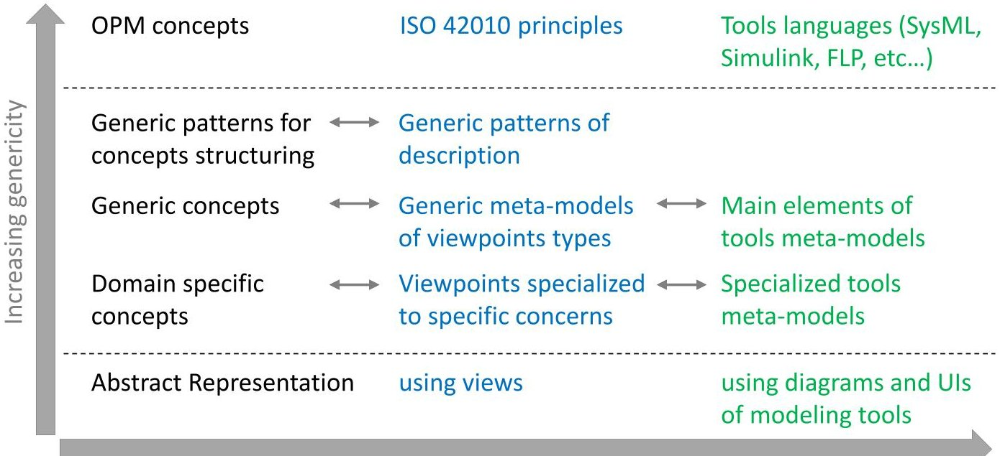
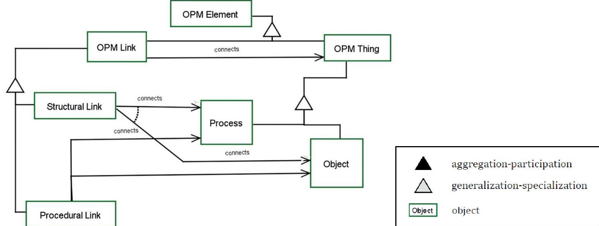
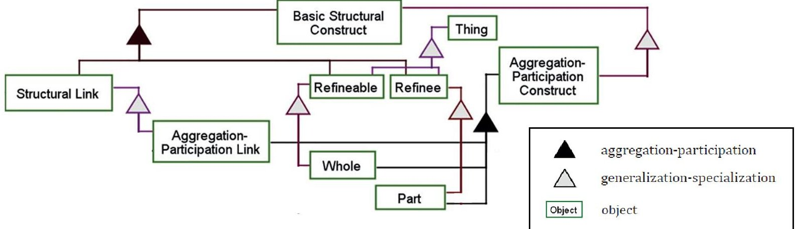
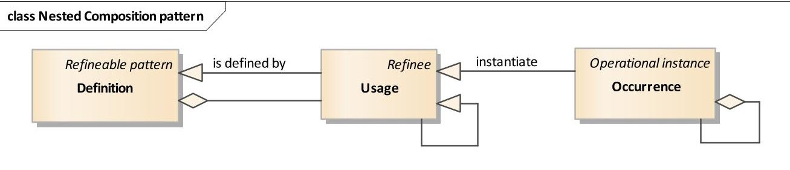
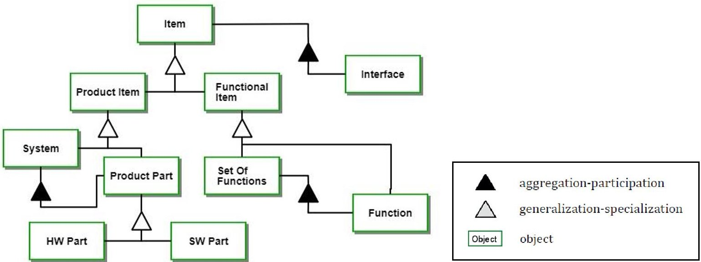
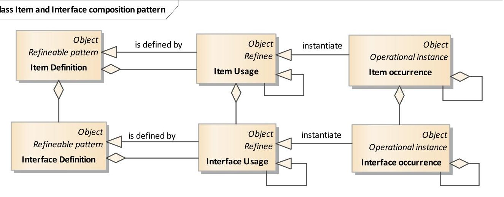
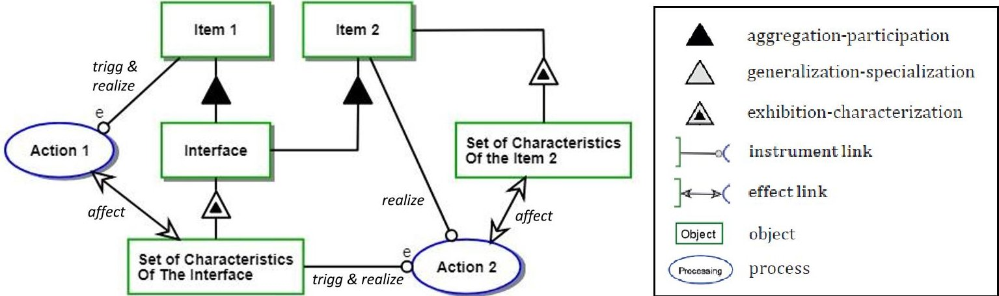
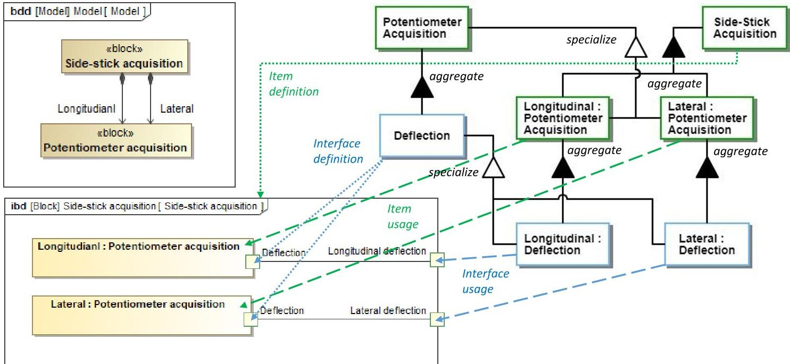
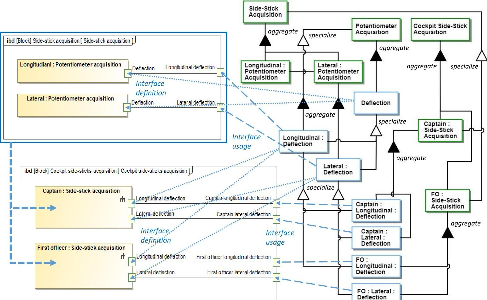
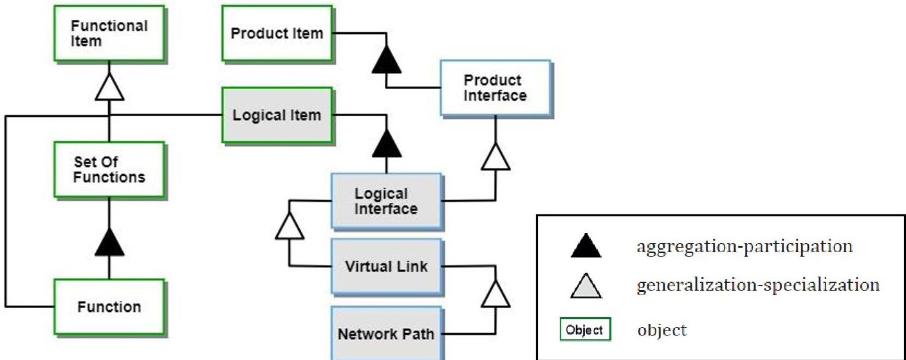

<!-- PDF_PAGE: 1 -->

# Approach to structure, formalize and map MBSE meta-models and semantic rules.

Jean Duprez

Airbus Operations SAS

316 route de Bayonne, B.P. M0151/0

31060 Toulouse Cedex, France

+33(0)567197218

jean.duprez@airbus.com

Copyright © 2019 by Jean Duprez. Permission granted to INCOSE to publish and use.

Abstract. For decades Airbus has largely used modeling and simulation techniques all along the development cycle. Models are nowadays key components of most advanced methods and tools, dealing with many different disciplines and addressing most of systems engineering processes and domain specific needs. As a result, models come from a large variety of modeling tools that use different diagrams, domain specific languages and features. This paper aims to present an approach used in Airbus to ensure the consistency of information that is formalized and shared through these models. It relies on the definition of a generic ontology and on the identification of how concepts are depicted in models and in each type of diagram used. Resulting correspondence rules are then used to ensure the overall semantic consistency of model elements and to support the propagation of modifications.

## Introduction

Modeling technics are key enablers to ease and make more efficient System Engineering workflows. The use of models, through diagrams and through the user interfaces (UI) of tools, allows to formally represent, to analyze and to better understand the different aspects of the systems of interest (Sol), of its context and of its elements. It allows to better capture, describe and formalize all associated aspects and characteristics. To do so, models need to be associated with clear and unambiguous meta-models. They need to rely on unequivocal modeling languages and semantics, and need to follow well-defined linguistic, syntactic and semantic rules.

Due to the large variety of processes and domain specific concerns to be addressed, many features are expected from modeling frameworks. It often leads to the use of several different tools, associated with different languages, semantics and domain specific ontologies. All these specificities result in the use of a large number of specialized meta-models, dealing with different aspects, at different levels of abstraction. Despite this inherent variety, the consistency of all the information scribed and shared in the different models need to be fully ensured. This is a key enabler to allow an efficient and correct use of models and to ensure proper models sharing between teams and tools.

The proposed approach aims to semantically link all the used meta-models, relying on the facts that all models are referring to the same underlying reality. To do so, a first step consists in structuring and formalizing a way to abstract reality, thanks to the use of concepts and patterns that aim to be as generic as possible (note that when talking about the notion of "formal" in this paper, we are referring to its meaning in natural language: "according to, or following established or prescribed forms, conventions, etc" - Collins dictionary). Goal is thus to allow the building of a reference ontology that

<!-- PDF_PAGE: 2 -->

can be used to consistently and efficiently address various levels of abstraction and domain specific concerns, from the most generic ones to the most specific ones.

Then, by identifying how captured concepts are depicted into models and diagrams, this ontology can be used to formally and unambiguously build semantic links between all elements of associated meta-models. The resulting semantic mapping can therefore be used as a reference to specify the modeling features needed to ensure the overall semantic consistency of used model elements, both in post treatment or during the models' edition, ensuring the proper propagation of model modifications.

In addition, to make this approach more scalable, generic and reusable, it can be applied step by step, starting by considering some simple meta-models, associated with generic patterns of description. These patterns can then be specialized, completed and refined. This is done by firstly taking into account meta-model elements common to several viewpoints of a same kind. It can then be refined by considering specificities of each viewpoint, and finally by taking into account how viewpoints are implement into models, through used tools and tool languages. Therefore, the resulting semantic mapping can allow to specify modeling features at different levels of abstraction and genericity; being more or less independent of viewpoints specificities and of how viewpoints are implemented across tools.

From SE information to formal modeling in tools

Figure 1: Approach used to structure the semantic mapping genericity.

## Building a generic ontology of systems

In most modeling tools, models are created, edited, visualized and analyzed thanks to the use of diagrams and of tool specific user interfaces (UIs). As a result, associated meta-models often consider both the way systems' aspects are captured and structured into the models, and the way they are represented and used into diagrams and tools UIs. The proposed approach aims at addressing meta-models by mapping them on pivot concepts that has to be as generic as possible, addressing all needed levels of abstraction and describing all aspects of the system of interest.

## Main principles and relationships used in models constructs.

The ARP 4754a (EUROCAE ED-79A/SAE ARP 4754A:2010) defines a model as "an abstract representation of a given set of aspects of a system...". (Kühne, T., 2006) describes the abstraction as a projection, a "homomorphic mapping..., using selection and reduction of information". It shows that, for most of models, this projection results in capturing aspects of reality by means of classifi-

<!-- PDF_PAGE: 3 -->

cation and generalization. Classification consists in considering as being part of one given type, all elements that are equivalent to each other with respect to certain properties. Generalization use equivalence relationships to map equivalent subject elements onto a common concept. Classification maps several elements to one concept and generalization maps several concepts to one (super-) concept. As a consequence, model elements based on the combination of classification and generalization can therefore represent several subject elements. The resulting model is called "type model" in (Kühne, T., 2006).

In addition to classification and generalization, the instantiation relationship allows to derive instances from elements of type models. Instances are one-to-one representations of each subject element. The resulting instantiated model is called "token model" in (Kuhne, T., 2006). By instantiating a token model from a type model, it allows to build a one-to-one description of the reality and, for example, can allow to simulate the behavior of each of these subject elements. Note that the instantiation can be seen as a specific case of specialization: specializing modeled concepts down to building a one-to-one mapping with the subject elements.

Furthermore, to cope with the inherent complexity of reality, most of models are built by decomposing model elements into sets of less complex sub-elements. This decomposition relationship allows to organize the model into structured levels of decomposition, and therefore, into structured levels of abstraction.

The combination of these 4 relationships, classification, instantiation, generalization (resp. specialization) and aggregation (resp. decomposition), represents the main foundations that drives the structuring of meta-models. In addition, these structural links are also often complemented by "informative" links that depict any specific relationship existing between the different subject elements.

## OPM Concepts

In addition to these main modeling principles, to structure our ontology on foundations that are standard and as generic as possible, we have used the Object-Process Methodology (OPM-ISO/PAS 19450:2015). The choice of the OPM was driven by its capability to "support the conceptual modelling of systems, with formal syntax and semantics", relying on "a compact conceptual approach, language, and methodology". "The application of OPM ranges from simple assemblies of elemental components to complex, multidisciplinary, dynamic systems." It only makes use of a limited number of concepts and its graphical representations (OPDs- Object-Process Diagrams) only rely on one single type of diagram. It proposes a clear and unambiguous splitting between structural and procedural descriptions, while fully formalizing dependencies and relations between them, in a compact form.

Figure 2: OPM meta-model overview (ISO 19450 - OPM, 2015 - Figure 1)

<!-- PDF_PAGE: 4 -->

As presented in figure 2, the OPM use "OPM elements" as the initial component that represent any concept. An OPM element can be a link or a thing; following the classical "entity/relationship" approach. Things can be objects or processes. Objects are things that exists (persistent) and processes are things that happen to one or more objects (i.e. transformation of objects, with a positive duration). Objects are associated with implicit or explicit state(s). Object states are objects that characterize possible situations in which an object may exist. A process can create, destroy or affect an object, leading to a change in the object's state.

Links between things can be structural or procedural. Structural links correspond to the previously described relationships that structure the modeling of things. They are called in the OPM: aggregation / participation, exhibition / characterization, generalization / specialization, classification / instantiation, tagged structural (for specific "tagged" informative links). Procedural links allow to describe links between a process and an object (that enables this process or that is affected by it), or describe the conditions associated with the starting, execution or completion of the process.

Nested composition patterns. Things associated with structural links are specialized as "refineable" and "refinee". A structural link refines a refineable thing into refinee(s). When applied to aggregation links, a refineable is called "whole" and a refinee "part". The whole represents a pattern of decomposition of the refineable thing, into refinee part(s) that represent the usage of sub-thing(s) into the context of their "parent" thing decomposition. An illustration of it is provided in figure 3.

Figure 3: Part of OPM model of basic structural construct. (Annex C of the OPM, in figure C.13)

In case of nested decompositions, a thing used as a refinee part can also be described as a refineable pattern, as a whole decomposed into refinees of sub-things. This relationship between the refineable and the refinee can be assimilated to a generalization link: the refinee being a specialization of the refineable in a parent context of use. A refineable pattern can thus be reused in the context of other refineable pattern. As a consequence, the associated refinees can represent several subject occurrences, one for each context of use, inherited from the different usages of their parents. These occurrences are called operational instance occurrences in the OPM. They are "actual, uniquely identifiable things that exists". When resulting from a chain of decompositions, they recursively inherit the context of use of their parents and of the parents of their parents.

For language simplification, when talking about aggregation links, we will use the terms "definition", "usage" and "occurrence" to respectively represent , "refineable", "refinee" and "operational instance occurrences". The figure 4 represents a "UML like" representation of the associated pattern of concepts.

This is illustrated in (Duprez, J., 2018) and (Malone, R. and al., 2017). Note that (Malone, R. and al., 2017) uses the term "occurrence" to depict the "refinee" usage and not the "operational instance" which is not explicitly identified in the presented meta-model.

<!-- PDF_PAGE: 5 -->

Figure 4: Nested composition pattern.

## Application to systems modeling

Basic construct description. The ISO 15288 (ISO/IEC/IEEE 15288:2015) defines a system as a "combination of interacting elements organized to achieve one or more stated purposes". The INCOSE Handbook (INCOSE, 2015) adds that "elements include products (hardware, software and firmware), processes, people, information, techniques, facilities, services, and other support elements". Elements can be systems by themselves. They can thus be defined as a set of interacting sub-system elements. To enable elements to interact, they need to share a common interface. The (ISECF, 2018) defines this interface as "a point where two or more entities interact".

In addition, the notion of "capability" can be introduced to represent the elements "ability to achieve a specific objective under stated conditions" (INCOSE 2015). A system can thus achieve its purpose(s) by the mean of the interacting capabilities of its elements. A capability is here considered as an inherent property of the associated element and thus, can be considered as an OPM object. We also add the notion of "action", to depict OPM processes performed by capabilities. Capabilities and actions can both be used to describe "functions", from respectively a structural point of view or a procedural point of view. The functional capability represents the ability of a function to achieve an objective, whereas the action represents what the function does to achieve this objective. Functions thus allow to depict the intended behavior of the system elements. It can both be used to elicit capabilities awaited from the system, the "need", or to describe its "as designed" expected behavior. In both cases, functions are associated with an intention and are thus associated with a causal representation of the system behavior.

In addition, the term "function" can also be used to describe the emerging behavior of a system "as implemented". It no more refers to the ideas of an intension or purpose, and can be represented by an acausal behavioral description. This is for example the case when a system element behavior is modeled by means of physical laws. The model that derives can thus be acausal and the resolution of associated interfaces' states will come from the solving of differential equations that depict each sub-part physical behavior.

For language simplification, we will not use the term "behavior" to depict an acausal behavioral description. The term "function" will be used to represent a functional capability and the term "actions" will be used to represent the functional actions performed by functions.

Resulting main concepts and pattern of concept. We have introduced the notion of "item" to regroup both "elements" and "functions" into a single concept that refer to common core generic patterns. Items are thus interacting through interfaces. Items can be product items or functional items. Functional items represent both functions and sets of functions. Functional items are realized by product items. Product items represent both systems and systems' parts. Systems' parts can be software (SW) parts or hardware (HW) parts. A HW part can host SW part(s).

Items and interfaces can be considered as specialization of the OPM object. 2 items can interact if they share (at least) a common interface. This interface object can be considered as a conceptual representation which depicts this shared part of both items. The resulting concepts specialization is illustrated in figure 5.

<!-- PDF_PAGE: 6 -->

Figure 5: Items specialization.

Nested items and interfaces decomposition. Applying the composition pattern described in figure 4, an item decomposition can be formalized through the use of 3 elements: "item definition", "item usage" and "item occurrence". An item definition is thus defined as the aggregation of interconnected usages of sub-items. An item usage is a specialization of its associated item definition, used in the context of its parent item definition. Its context of use derives from how it is interfaced with other items usages (in the frame of a parent item definition).

In parallel to items, the composition mechanism can also be very useful to deal with complex interfaces, regrouping sets of interfaces into more abstract composite interfaces. This is illustrated in (Duprez, J, 2018). Similarly to the nested composition of items, the composition of interfaces can be formalized using the pattern of figure 4; using "interface definition", "interface usage" and "interface occurrence". The interface definition aggregates usages of the sub-interfaces which all are specializations of their respective definitions, used in the context of their parent composition. The resulting meta-model is illustrated in figure 6.

Figure 6: Nested decomposition pattern of interfaced items.

System behavior modeling. In addition to structural representations of items, a system can be described by considering its behavior. As presented previously, this behavior is the result of actions performed by the system functions. By analogy with the OPM, an action can be seen as a process affecting object(s) state(s), affecting one or several states of item(s) and/or item interface(s). To avoid any misunderstanding between these OPM states and SysML states, we will use the term "characteristic" to deal with states that characterize items and interfaces.

<!-- PDF_PAGE: 7 -->

When 2 items interact, they realize actions that have mutual impacts. These impacts are propagated though one or several shared interface(s). These interactions propagation can be characterized by the modifications of the shared interfaces characteristics. The initial action, performed by the first item, affects one or several characteristics of the shared interface(s). This modification of the shared interface(s) then triggers action(s) in the second item, which then impacts his characteristics. The resulting concepts are illustrated in figure 7.

Figure 7: Item behavior modeling.

This set of concepts thus forms first foundations to abstract the system architecture ("system fundamental concepts or properties of a system in its environment embodied in its elements, relationships, and in the principles of its design and evolution" (ISO/IEC/IEEE 42010:2011)).

## System Architecture description

As presented in the ISO-42010 (ISO/IEC/IEEE 42010:2011), the goal of building system architecture descriptions is to describe some aspects of the system of interest, in views adapted to address users concerns in an optimized way (cf. ISO 42010 - Figure 2). To do so, architecture views are governed by architecture viewpoints, based on primitive constructs called architecture description elements (AD elements). AD elements are associated with correspondence relationships which express relations between them and which are governed by correspondence rules.

Thanks to the definition of our ontology, the proposed approach aims at unambiguously define how viewpoints address each aspect of the system of interest; how each concept of the ontology is depicted in associated AD elements. Then, thanks to the resulting semantic mapping, this approach aims to identify semantic correspondence rules between these AD elements, and thus, between the different used views.

Once identified how views are implemented into model diagrams and how AD elements are modeled through the associated model elements, the resulting semantic mapping can be extended to describe how concepts are formalized into tools meta-models and how they are instantiated into model elements. It can therefore be used to identify semantic modeling rules, in a way to ensure the semantic consistency of diagrams with regards to how model elements represent concepts of interest.

Note that the term "model", in this document, does not refer to the same meaning as in the ISO-42010, but more to the definition of the ARP 4754a (EUROCAE ED-79A/SAE ARP 4754A:2010): "an abstract representation of a given set of aspects of a system...". Here, the term "model" is associated with the global abstraction of all considered aspects of the system architecture, described through a set of views and viewpoints, and is not limited to the model of a single view.

In addition, to make the resulting mapping more scalable, generic and reusable, the approach can be applied step by step, addressing meta-models of viewpoints in a recursive way: from the most simple and generic ones to the most specialized ones.

<!-- PDF_PAGE: 8 -->

This is done by starting with identifying generic patterns of description of main types of viewpoints. These patterns are then specialized, completed and refined. To do so, we first take into account AD elements common to several viewpoints of a same kind. We then step by step consider more and more specific elements, which deal with more specific concerns and domain specific aspects.

We do not aim in this paper to exhaustively describe how to take into account all possible patterns, kinds of viewpoints and types of implementations into modeling tools. The following paragraphs aim rather to illustrate the approach focusing on some examples. In addition, for confidentiality reasons, we cannot precisely deal with Airbus domain specific implementations. Instead, we will consider the example of logical views modeling to illustrate how such concerns can be addressed.

## Patterns of description

Patterns of description can be used to identify principles driving common diagrams layouts. They can allow to elicit patterns that are common to several types of viewpoints. For example, one of the most common and basic pattern relies on the use of "boxes" and "connections" to formalize how modeled elements interact. Such a pattern can be used to describe various type of viewpoints: describing for example how an item can be decomposed into interfaced sub-items, or to describe the execution of a scenario made of sequences of interacting actions.

Then, such generic patterns can be enriched by considering various additional elements; for example:

- Ports, which can allow to formalize points of interaction (connected or not).

- Links, which can allow to formalize relationships between associated elements.

- Textual information, like the element name, type, description, properties, etc...

These elements can also be specialized using specific graphical layouts. Connections can be oriented using arrows. They can depict different concepts thanks to the use of different line shapes (e.g. for data flows or control flows). By differentiating their layout, boxes and ports can also be specialized, differentiating concepts they can represent (e.g. differentiating functions, parts, actions, etc...).

Thanks to such patterns of description we can address viewpoints at several levels of genericity identifying common layout principles. Nevertheless, as a given shaping can be used to represent several types of concepts, to relevantly identify mappings between graphical elements and considered concepts, patterns need to be sufficiently specialized. We propose to build this specialization thanks to the definition of types of viewpoints.

## Main types of viewpoints.

By analogy with the OPM elements, the architecture viewpoints can be split into 2 categories: structural viewpoints and procedural viewpoints. We call "structural viewpoints" viewpoints that are used to describe, structure and define objects (e.g. items and interfaces). We call "procedural viewpoints" viewpoints that are used to describe processes performed by objects (e.g. actions performed by items). Procedural viewpoints thus allow to describe objects behaviors in given conditions and contexts.

In each category, the different viewpoints can be typed depending on associated addressed concerns. Structural viewpoints can, for example, be used to:

- Describe objects decomposition and how sub-objects are interfaced.

- Describe objects states and transitions between states.

- Describe how objects are realized by other objects (through, for example, allocation relationships, implementation relationships, hosting relationships, etc.).

<!-- PDF_PAGE: 9 -->

Procedural viewpoints can also be associated with the formalization of:

- How processes (e.g. actions done by actors or system functions) can be sequenced into scenarios. Such scenarios can then, for example, allow to represent different cases of use, describing how the system can be operated by its users in order to perform a given mission in a given environment and context.

- What are the interactions and dependencies between processes and how these interactions are sequenced, considering a given example of system behavior (e.g. formalizing conditions for execution, conditions for completion, data flows between processes, etc...).

- What are the processes that an object is expected to realize to achieve its awaited purposes, what trig each of these processes and what are their impacts on the object's states (e.g. the impact of actions on the item and its interfaces characteristics).

Types of viewpoints can also be structured by referring to standard diagrams. For example, it can be done by referring to SysML diagrams. In this case, structural viewpoints can thus be organized by analogy with the Internal Block Diagrams (IBD), Block Definition Diagrams (BDD) and State-Machine Diagrams. Procedural viewpoints can also be split by referring to Sequence Diagrams, Activity Diagrams and Use Case Diagrams. Nevertheless, to optimize the level of genericity to address, a specific attention must be kept to ensure not to define viewpoints' types based on their implementation into modeling languages. For example, IBDs and Simulink diagrams can be considered as 2 implementations of a common type of viewpoint. They both make use of "boxes", "ports" and "connections" to describe how items are decomposed into interfaced sub-items. They both use similar diagrams layouts, based on similar patterns of description.

## Implementation into modeling languages.

Example of the Internal Block Diagrams. An IBD represents the decomposition of a block into parts that are interfaced through connectors. Parts are instantiations of other blocks. The ports of a part specify interaction points of this part. When the port is on the border of the IBD, it specifies an interaction point of the described block, allowing to build external connections. Connectors between 2 ports specify the interconnection between the 2 associated ports.

When used to describe the decomposition of an item, elements of an IBD can be mapped with concepts of our ontology. The item definition is therefore represented by a block and decomposed thanks to the associated IBD. Child items usages are represented by parts that compose this IBD. Ports of a part are representing interfaces usages of the associated child item usage. Ports on the external border of the IBD specifies the interface of the associated item definition. Connectors, when connecting 2 or more ports together, depict a dependency relationship between associated interfaces. The definition of this dependency depends on the chosen modeling strategy. In SysML models, this dependency often implies that linked interfaces share at least common characteristics. To make the interface sharing more graphically explicit, connectors can be used to elicit a full interface sharing: they thus depicts that all linked ports are representing the same shared interface. This type of IBD usage is illustrated in figure 8.

When a connector links together a port of a sub-part and a port on the border of the IBD, this connector depicts that the interface usage associated with the sub-item is externally shared by its parent item. This specific connection relationship is illustrated in (Malone, R. and al., 2017) and called "promotion" relationship.

When an interface usage is promoted into several contexts of use, associated with several usages of the parent item (i.e. in different IBDs), it is then associated with different derived interface usages. As illustrated in figure 9, these derived interface usages can be considered as specializations of the initial interface usage for each of its parent contexts of use. Note that the more an interface usage will be

<!-- PDF_PAGE: 10 -->

promoted and reused in different contexts, the more it will be generic and will represent several interface occurrences.

Figure 8: Illustration of decomposition diagrams implementation into SysML IBD.

Figure 9: Illustration of interface usages specialisation across nested reused decomposition levels.

Example of Simulink diagrams. "IBD like" diagrams can be built in a similar way in various tools and languages, like for example in Simulink. Simulink is one of most used tool to deal with Model Based Design (MBD) workflows. It is strongly relying on diagrams that can be assimilated to a kind of IBD. By analogy with previous IBDs, a similar mapping can be done to our ontology.

A Simulink model can thus be used to represent the decomposition of an item. In this case, a Simulink diagram describes an item definition, decomposed into sub-items usages that are represented by

<!-- PDF_PAGE: 11 -->

Simulink blocks. When a block is, for example, a sub-system block, a sub-system library block or a model block, this block refers to a sub-Simulink diagram. It therefore represents the specialization of an item definition into a given context of use. The decomposition of this item definition is similarly refined thanks to the associated sub-diagram. The way interfaces are modeled is also comparable to the way it is done in IBDs. Simulink inports and outports allow to represent interfaces definitions associated with the item definition (as ports on an IBD border). Inputs and outputs of a Simulink block allow to represent interfaces usages of the associated item usage (as ports of parts).

For other aspects, the implementation in different modeling tools can be significantly different. Nevertheless, whatever the implementation, as long as the related semantic is consistent, gateways between tools can be defined. For example, between Simulink diagrams and IBDs, the way interfaces composition and decomposition is modeled can be significantly different; for example, using nested ports in IBDs, and using bus creator blocks and bus selector blocks in Simulink. Nevertheless, despite these differences of implementation, both are similarly describing how interfaces are composed of sub-interfaces. They both have to fulfill the same type consistency rules.

## Specialization of Meta-Models

By mapping the meta-models of the used types of diagrams with the ontology, it is thus possible to build an unambiguous frame that can be used as a reference to map together all associated meta-model elements. It can therefore allow to link and transform models from different languages and tools. Nevertheless, in practice, used diagrams are often not as generic and simple as the ones presented previously. They are very often specialized to deal with specific concerns and domain specific aspects and languages. To apply such an approach to domain specific meta-models, both our ontology and the diagrams meta-models need to be specialized, taking into account all associated specific aspects and concerns.

Example of Logical views. The example of logical views can allow to illustrate such specialization, without using a too specific or complex example. Logical items and views are used in several MBSE methodologies as an intermediate mean to manage system architecture definition and to ease the functional allocation to product parts. As a result, logical items can be used to deal with 2 types of concepts:

- Group for functions, formalized as an intermediate artifact and used to map functions onto the expected system architecture. In this case, logical items can be assimilated to a specialization of a functional item.

- Conceptual description of system elements, used as a mean to ease the system architecture description and to improve the understanding and analysis of abstract aspects of the system. In this case, logical items can be assimilated to a specialization of a product item.

Logical views can also be used to address both concerns in parallel, and thus can mix both ways to use logical elements. For example, when dealing with functions implemented into a system using a communication network, logical items can be used to represent the allocated sets of functions and the logical interfaces can be used to describe how functional information is handle by the network. In this example, logical interfaces can be used to describe virtual links that goes through given paths into the network. These logical interfaces' elements thus represent an abstract description of how product parts interact through this network. Such logical interfaces can be relevantly used to perform, for example, safety analysis and network loads analysis. Even if, in this case, logical items can be considered as specializations of a functional item, the logical interfaces are abstract representations of product interfaces (and not of functional interfaces): They represent how the network implements the functional interfaces.

<!-- PDF_PAGE: 12 -->

Figure 10: Example of a logical view specialization.

By properly mapping elements of such a logical view to our ontology, we can then link the associated model to other models that use different types of logical views, or that does not use logical views at all. It can allow, for example, to derive from this logical view a Simulink design model. Such a model can then be used to design associated functions and to specify new functions that would be needed to implement the communication network. The resulting new functional architecture could then be used to update and refine logical views, specifying the communication network architecture.

## Modeling services derived from correspondence rules.

As shown previously, by formalizing correspondence rules, the mapping of meta-models to our ontology can allow to identify generic semantic correspondences. Thanks to them, we can then rely on generic theoretical foundations to ensure the overall consistency of models, and therefore to define and specify dedicated modeling features. These modeling features can be used in post-treatment (for model checking, for model transformation, sharing or updating), or used during the models' edition, ensuring the propagation of modifications (adding, deleting or modifying elements).

## Post-treatments features.

The formalization of semantic correspondences can be used as formal foundations to specify and build several post-treatment features.

For models consistency checking, these semantic correspondences can allow to check if model elements are consistent, with regards to given consistency targets, and towards the ontology and how associated concepts are linked. For example, as described previously, connections between ports can be used to depict a relationship between associated interfaces. Once identified all the interfaces represented by ports, and once identified ports that are linked, it then possible to check if interfaces (as modeled in the diagram) are consistent towards each of these connection relationships.

Model transformation. When such a checking results in the identification of conflicts, the model need to be corrected, solving all these consistency issues. To do so, modeling features can be developed in a way to ease and assist this conflict solving (based on user decision making). In addition, when the corrective solution is clear, these features can also directly apply the corrective action.

To complement such consistency checking and solving, the semantic mapping can also be used to identify how diagrams and model elements can be automatically generated from information already formalized into other diagrams, models or tools. This information can be explicitly formalized and managed in the models (or in a dedicated data base), or can be implicitly rebuild from an analysis of models. Once this data available, and once the scope of information to model well defined, dedicated

<!-- PDF_PAGE: 13 -->

modeling features can then be specified, to allow the automatic creation of all associated model elements. Thanks to the semantic mapping between concepts and the meta-model of viewpoints, these features can identify all AD elements that need to be added to the concerned view(s). Then, since the implementation of AD elements of views into the meta-model of the tool and diagrams was clearly formalized, model elements can be derived from associated AD elements, and thus added to the model.

Model updating. Such automatic model edition can be done "from scratch", creating new diagrams and models, or can be applied on existing models and diagrams. This is the case when the goal of the modeling features is to update a model or a diagram based on changes from another model or diagram that share common information. It can then allow to specify model transformation features that can be used to ensure an "off-line" models and diagrams synchronization.

## Automatic updating of diagrams and models.

An important added value of MBSE models is to ease the engineering, analysis and understanding of large and complex systems. To do so, they largely rely on their ability to address different aspects and scopes of the system. It allows to focus only on the relevant information and therefore to more efficiently and relevantly address each given concern. Nevertheless, it implies the use of several models and diagrams that need to be kept fully consistent. The manual updating of such diagrams represents a huge workload and is largely error prone. The development of modeling features allowing to automatically analyze and propagate changes into all other models and diagrams is a key enabler to make the use of modeling tools more efficient and easy to use. By automatically and continuously ensuring this consistency, it can allow to significantly improve the scalability of MBSE methods and tools.

Improving diagrams completeness. In addition, in several MBSE tools, diagrams are mainly used to illustrate the model. It allows to ease the model understanding, but not to master it. To fully master the model, modelers need to understand, manage or review the model's data and data structure; often displayed and managed in a dedicated model data browser (often in a side column of the modeling tool). Such management of model's data, directly into a model bowser, is very often complex and difficult to perform for non-expert users. It often implies a significant training, a deep understanding of the modeling language, the strict respect of ways and methods to structure and address the model, and finally, it often leads to many issues in term of usability.

A way to solve these difficulties, is to be able to exclusively rely on diagrams to master the model, without having to directly address the data and data structure. To do so, diagrams shall have a sufficient level of semantic consistency and completeness. This can be achieved by relying on correspondence rules. As for models, diagrams consistency can be ensured by analyzing and propagating to all other diagrams, all modifications and their impacts (adding, deleting or modifying elements). Furthermore, to gain the expected level of completeness, when instantiating an element into a diagram, all relationships with other model elements that can be displayed by this diagram need to be added. It allows to fully rely on the diagram reading to acknowledge what are the existing relationships and to identify the potentially missing links or elements, making modeling tools simpler, easier and more intuitive to use.

Composites interfaces management. In addition, to keep diagrams sufficiently simple while dealing with systems with a large number of interfaces, models need to make an extensive use of interfaces composition. By grouping, at several nested levels, interfaces into more abstract parent interfaces, it can allow to keep displaying a small number of ports and connections, while keeping into the model the full inherent complexity of the system. It allows to avoid having to use simplistic and not representative descriptions of interfaces, and thus to avoid all impacts links with the associated loss of relevancy. Nevertheless, such extensive use of interfaces composition is also complex

<!-- PDF_PAGE: 14 -->

and hard to manage, requesting a huge workload to build, edit and maintain the consistency of the resulting models and diagrams. It is often one of the major blocking point in the adoption of MBSE to address the complexity of systems, down to their detailed design (where the "evil" is). By easing the modeling of interfaces composition, by automatically managing modifications propagation and by automatically managing interfaces decompositions and connections across models and diagrams, such modeling features can represent a key breakthrough in term of usability and relevancy of modeling tools to address complex system, whatever the considered level of details.

Application to "IBD like" diagrams. To achieve a given level of completeness and consistency, the first step is to formalize the associated rules to follow. For example, considering diagrams that describes items decomposition and their internal interfacing, the expected level of diagram completeness can be driven by the fact that the diagram involves all sub-item usages and all associated interfaces (i.e. their ports). In addition, if connections are used to directly depict interfaces sharing, a semantic consistency rule can be formalized to ensure that, if 2 ports are representing the same interface usage, they should be connected in the diagrams. Likewise, if 2 ports are not connected they should not refer to the same interface usage.

Then, to continuously ensure the overall diagrams consistency, these rules need to be applied in parallel to the model edition. If any of the displayed element is modified or if a new element is added, all diagrams and models need to be updated in accordance. For example, when adding items into a new diagram (e.g. alternative view focusing on a given a functional chain or a sub-part of a system), all interfaces of these items need to be represented (e.g. all inputs and outputs) and all associated connections should be rebuilt. On the other hand, if the connection is deleted from a diagram, this connection deletion shall be propagated to all diagrams that display associated items (as they are no more sharing the same interface). Similarly, when the model involves composite interfaces, if an item is sharing a sub-interface with another item of the diagram, this sub-interface need to be displayed ("extracted" from its parent interface) and connected to the other item interface. Furthermore, when the diagram displays the composition of a composite interface, if the interface composition is modified (if a child interface is modified, deleted from its parent composition, or moved into this composition), all diagrams that represent the associated "decomposition" of the parent interface need to be updated in a way to stay consistent.

## Conclusion

The proposed approach relies on the definition of a generic ontology, structured through generic patterns and dealing with several levels of abstraction. Thanks to the identification of how concepts are depicted in each type of views and of how they are implemented in the different diagrams and tools, it allows to identify correspondence rules between diagrams and model elements. By refining these correspondence rules to map all used diagrams to specializations of the ontology, Airbus has been able to build modeling capabilities that unambiguously deal with the inherent variety of all the information formalized and shared in the different types of models used. These modeling capabilities can be developed as customizations of modeling tools. Such customizations allow to check models consistency, translate models or to propagate modifications made into a diagram to other diagrams and models. It allows to ensure the continuous consistency of all models and diagrams. Furthermore, thanks to the mapping of diagrams meta-models onto the specialized ontology, we have also been able to build additional modeling features that automatically fill in diagrams, improving their completeness. It represents a significant mean of improvement of modeling tools, in term of usability, efficiency of use and scalability, allowing to deal with the design and specification of large and complex systems, whatever the level of detail to be taken into account.

By publishing this paper, our expectation is to share this approach, in order to reuse it as a reference for potential future collaborations within the MBSE community. In this way, our goal is to build, with other companies and academics, a common ontology. Based in this reference, our goal is to identify

<!-- PDF_PAGE: 15 -->

and formalize common needs for modeling features that would support and scale up the efficiency and relevancy of future MBSE tools. These features could be additional modeling services provided by tool vendors to improve their tools (increasing the resulting added value for users), or could be modeling API (Application Programming Interfaces) allowing to ease the customization of tools. Furthermore, the clear formalizing of such common needs and features could also be a potential interesting input for the SysML v2 working group.

## References

EUROCAE ED-79A/SAE ARP 4754A:2010. Guidelines for Development of Civil Aircraft and Systems, December 2010.

Duprez, J., 2018, 'An MBSE modeling approach to efficiently address complex systems and scalability', 28th Annual INCOSE International Symposium, INCOSE IS 2018 proceedings Washington DC., USA, 7-12 July 2018.

INCOSE-TP-2003-002-04:2015. Systems Engineering Handbook - A Guide for System Life Cycle Processes and Activities, Fourth Edition, 2015, Wiley. (ISBN: 9781118999400)

ISECF:2018. INCOSE Systems Engineering Competency Framework, First Edition, 2018, INCOSE Technical Product. (INCOSE-TP-2018-002-01.0)

ISO/IEC/IEEE 15288:2015. Systems and Software Engineering - System Life Cycle Processes, First Edition, May 2015 (ISBN 978-0-7381-9532-2)

ISO/PAS 19450:2015. Automation Systems and Integration - Object-Process Methodology, First Edition, December 2015. (ICS 25.040.01)

ISO/IEC/IEEE 42010:2011, ISO/IEC/IEEE International Standard, Systems and software engineering - Architecture description, First edition, 01 December 2011.

Kühne, T., 2006. "Matters of (Meta-) Modeling", Journal on software and Systems Modeling volume 5, number4, pp. 369-385, December 2006.

Malone, R., Herrold, J., Friedland, B. and Green, G., 2017, 'Toward Systems Engineering Modeling Standards: Proposed System Architecture Core Model Elements and Composition', 27th Annual INCOSE International Symposium, INCOSE IS 2017 proceedings, Adelaide, Australia, 15-20 July 2017.

MathWorks, MBD, Simulation and Model-Based Design, viewed in November 2018, from https://www.mathworks.com/products/simulink.html.

OMG, 2017, System Modeling Language, Version 1.5, $ 1^{\mathrm{st}} $ May 2017. http://www.omg.org/spec/SysML/.

OMG, 2015, Unified Modeling Language, Version 2.5, $ 1^{\mathrm{st}} $ March 2015. http://www.omg.org/spec/UML/2.5.

# Biography

Jean Duprez has spent 18 years in Airbus, in the System Design Office and Test Laboratory, working on systems design, simulation, prototyping and testing. Until 7 years, he is in charge of developing future Airbus strategies about Modeling and Simulation of Aircraft Systems; studying various aspects of the MBSE (Model Based System Engineering) deployment across the overall Airbus Systems Design Office. He currently mainly focuses on the development of MBSE solutions to more efficiently address the design & specification of complex safety critical systems.