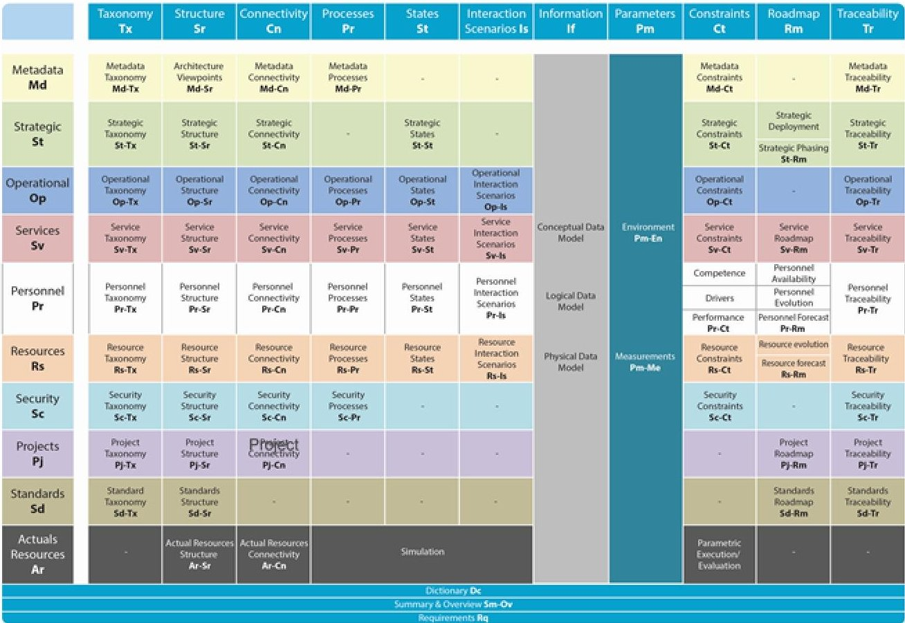
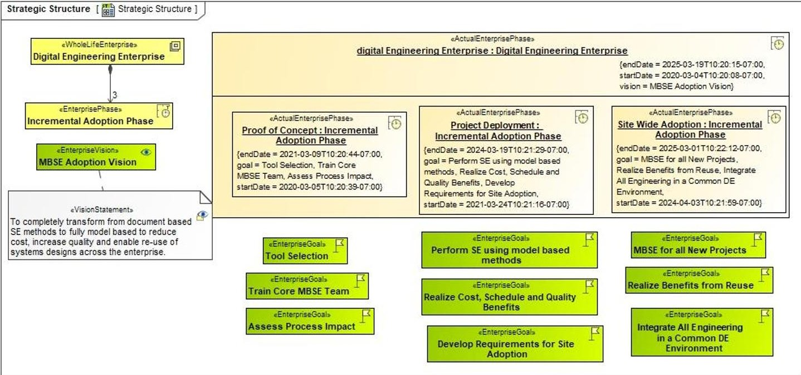
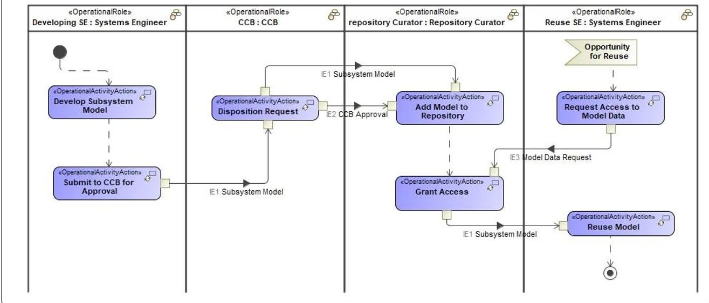
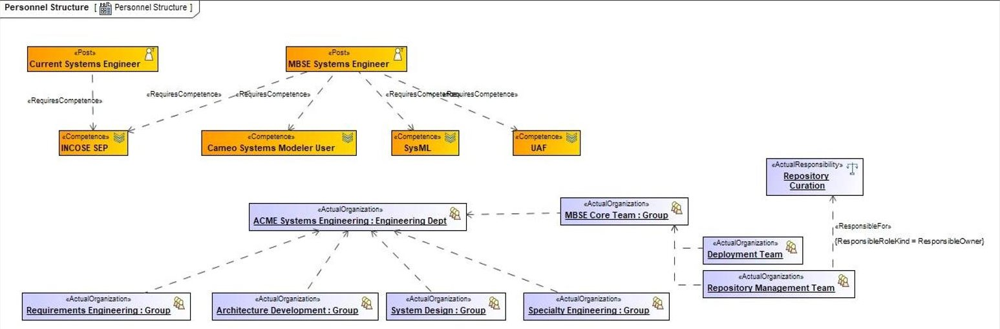
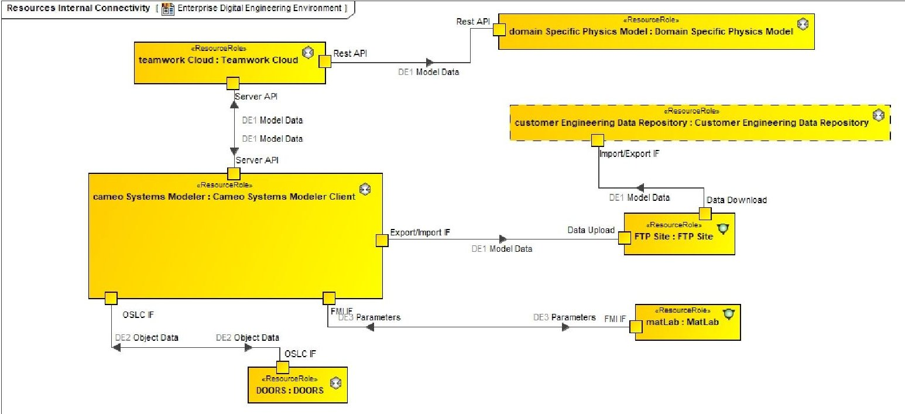
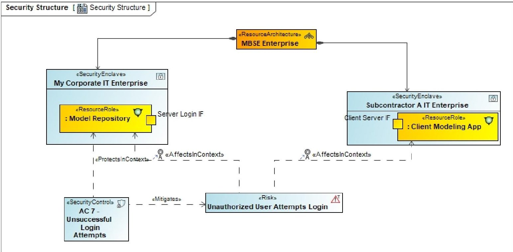

<!-- PDF_PAGE: 1 -->

Virtual Event July 20-22,2020

# Implementing MBSE - An Enterprise Approach to an Enterprise Problem

Barry L. Papke

CATIA/No Magic

700 Central Expwy S., Suite 110

Allen, Texas, USA

774-556-3460

barry.papke@3DS.com

Gan Wang, Ph.D.

BAE Systems

8201 Greensboro Dr., Suite 1200

McLean Virginia, USA

703-873-5339

gan.wang@baesystems.com

Ron Kratzke

CATIA/No Magic

700 Central Expwy S., Suite 110

Allen, Texas, USA

774-556-3544

ron.kratzke@3DS.com

Chris Schreiber

Lockheed Martin

12257 S. Wadsworth Blvd

Littleton, CO 80125

303-971-8955

chris.schreiber@lmco.com

Copyright © 2020 by Dessault Systemes, BAE Systems, and Lockheed Martin Co. Permission granted to INCOSE to publish and use.

Abstract. Model Based Systems Engineering (MBSE) is now widely accepted throughout the industry, from commercial to aerospace and defense. However, while we understand and accept the principles of MBSE, successful adoption and implementation is still a challenge within the industry. The migration from document-based systems engineering processes to MBSE requires more than purchasing tools and a one-week course on Systems Modeling Language (SysML). MBSE does not change the practice of Systems Engineering as defined in the INCOSE SE Handbook or ISO/IEEE 15288, but it does affect the way in which systems engineering processes are implemented and supported within and across organizations. Organizations adopting MBSE must address issues such as new skill and competency requirements for systems engineers, model and data management over the lifecycle of the system, and integration with other engineering tools and processes, among others. It is not a tool problem or a modeler problem. It is an enterprise problem and requires an enterprise approach. The approach must be defined and guided by an enterprise architecture, which is broader than just the engineering tools and their interfaces. It includes the enterprise strategic vision, capabilities, operational concepts, organizations, and material solutions required to achieve MBSE adoption, how they relate to one another, and their evolution over time.

<!-- PDF_PAGE: 2 -->

This paper provides a broad overview of the fundamentals of MBSE adoption and the broader effort of digital engineering transformation, presenting the digital engineering environment as a system-of-systems. It presents the use of enterprise architecture as a roadmap for MBSE adoption within the industry.

## Introduction

Model Based Systems Engineering (MBSE) is now widely accepted within the industry, from commercial to aerospace and defense. Yet while we understand and accept the principles of MBSE, successful adoption and implementation is still a challenge throughout the industry. The migration from document-based systems engineering processes to MBSE requires more than purchasing tools and a one-week course on Systems Modeling Language (SysML). It requires a system-of-systems engineering approach guided by an enterprise architecture (Shaked & Reich, 2019).

Before taking on the challenge of Model Based Systems Engineering (MBSE) adoption, it is important to understand the nature of the task. While MBSE does not change the basic systems engineering processes (IEEE/ISO-15288 2018), it can significantly affect how systems engineers and engineers of all disciplines perform design and development activities across the systems engineering lifecycle. Initiatives such as the Office of the Deputy Assistant Secretary of Defense for Systems Engineering's (OSD/ASD SE) Digital Engineering Strategy (Engineering, 2018) and the United States Naval Air Systems Command's (NAVAIR) Systems Engineering Transformation (SET), along with similar initiates within industry, are transforming the system engineering design environment from a set of federated and isolated discipline-specific processes, each with individual, unconnected data, into an integrated digital environment that uses "...authoritative sources of systems' data and models as a continuum across disciplines to support lifecycle activities from concept through disposal" (Blackburn, 2017). The result of these initiatives is that MBSE becomes one part of the much larger Digital Engineering (DE) transformation.

Digital Engineering not only aims to integrate all design data related to a system across the entire life cycle, from inception to operations and sustainment, but also to bridge the business processes across all functional disciplines. The goals of DE require an unprecedented level of intra-disciplinary collaboration and integration across an engineering business enterprise.

Some engineering disciplines have made domain-specific digital transitions over the past several decades. For example, the mechanical and structural engineering disciplines use robust digital design tools. Today, mechanical/structural design is supported by an infrastructure of computer aided design (CAD) tools integrating 3-D design with analytical tools supporting finite element analysis and aerodynamic analysis. These design tools are also integrated with enterprise resource planning (ERP) tools and pass design data in digital form to digitally controlled manufacturing tools.

For the systems engineering community, the adoption of MBSE begins with the adoption of a model-based methodology, a modeling language, and a tool suite that enforces the modeling language syntax and semantics (Delligatti, 2014) for systems engineering. The full DE transformation involves the integration of MBSE tools and processes with the domain-specific engineering tools

<!-- PDF_PAGE: 3 -->

and disciplines that make up the larger engineering environment across the entire engineering enterprise of an organization. Because of this, a successful MBSE adoption effort must address enterprise level challenges, such as:

- A plan for process definition, tool and infrastructure investment, and tool integration

- A comprehensive concept of operation (CONOPS) describing how users of the digital environment intend to create, share, maintain and reuse digital engineering data

- A clearly defined data taxonomy and ontology, guidance, standards for data exchange, interconnection, and tool-tool interoperability

- Requirements for the digital environment that are sufficiently defined such that platform OEMs, system integrators, and tool vendors can develop and field material solutions

- Identification of organizational changes and new skills training required for all constituent organizations within the enterprise needed in a digital environment over the full lifecycle of systems

When implemented, the resulting digital engineering enterprise displays all the characteristics of a System of Systems (Maier, 1996). Each engineering department across an organization and across company boundaries exhibits:

- Operational independence -each accepts and executes engineering projects independently of one another

- Managerial independence - each makes staffing, resource and process changes independently of one another

- Geographic distribution - some engineering activities may be allocated to remote teammates or suppliers or may be assigned to engineering in other company divisions

- Emergent behavior - the resulting dynamics produce unplanned or unpredicted performance or behaviors

- Evolutionary development process - each evolves their respective organizations and assets incrementally over time.

As such, the same enterprise architecture approach used for the development of SoS should be applied to effectively implement a digital engineering transformation.

The remainder of the paper describes how MBSE adoption and the associated challenges must be addressed through the application of a structured, systems engineering approach guided by enterprise architecture using the Unified Architecture Framework (UAF).

While this approach clearly suggests the development of an architecture model, this paper will not focus on model development. Instead, we will use the framework to organize and communicate the issues, concerns and approaches needed for successful MBSE adoption within an integrated digital environment by analyzing it as a systems-of-systems through the lens of an enterprise architecture framework.

## What does the MBSE environment look like?

In an MBSE approach, projects capture and maintain system design information in data repositories accessible using a system modeling toolset. Model elements within the repository are connected through element relationships, creating a "digital thread" that provides traceability from

<!-- PDF_PAGE: 4 -->

element to element in the model (and the data repository). The repository forms the "single source of truth." Each model element exists once and only once within the repository. Required artifacts are built from the information within the data repository. When the system design data changes, the change promulgates throughout the digital repository (the "digital thread"), and the change is reflected wherever it is used. Documents may still be created when required; however, they take a secondary role and are no longer the main mechanism of system engineering design data.

The MBSE environment typically consists of one or more authoring tools of different engineering disciplines connected to one or more data repositories. Tools may include requirements management tools, architecture model authoring tools, system model authoring tools, and simulation and analysis tools, as well as domain-specific, physics-based models. The modeling tools and repositories typically have import/export functions or application programming interfaces (API) for direct access to data from external tools or databases.

The integration of models allows engineering data to be digitally connected across engineering functional domains in terms of "traceability," such that changes can be automatically reflected both up- and downstream throughout the system life cycle.

In a DE environment, while each tool captures its model elements and their properties in its own proprietary format, the interconnectivity of tools allows for integration of data. As a result, this integrated engineering data reflects the holistic data configuration of the system that is maintained throughout its lifecycle. In a DE environment, information is maintained at the level of individual model elements and their properties.

Within a larger business enterprise, or across enterprises such as the supplier and acquirer environment in typical government acquisitions, the DE environment will itself be a System-of-Systems (SoS) of independent organizations and their interconnected cross-domain tools, data, processes, and people. The DE enterprise consists of the interfaces between the toolsets of other disciplines (such as software engineering, structural engineering, electrical engineering, etc.), as well as distributed material suppliers and capability acquirers, with operational and managerial independence of constituent systems, geographic distribution, and emergent behavior, and with an ability to evolve to satisfy customer needs. With MBSE at the core of a digital engineering environment, the environment integrates multiple engineering domains and supports the full lifecycle system development and sustainment.

MBSE will take the form of an Acknowledge SoS, where it has recognized objectives, a designated manager, and resources for the SoS; while the constituent systems retain their independent ownership, objectives, funding, and development and sustainment approaches (Dahmann & Baldwin, 2008). The constituent systems will maintain operational and managerial independence and geographic distributions, exhibit emergent behavior, and will experience evolutionary development. Changes in the systems will be based on collaboration between the SoS and the individual systems. The resulting digital environment must be able to support the engineering process, produce the required outputs, and provide for the lifecycle management of the engineering data as required to meet the needs of the enterprise.

<!-- PDF_PAGE: 5 -->

## MBSE Adoption Leveraging Enterprise Architecture Principles

Numerous papers have been published about MBSE adoption (Chami, Morkevicius, Aleksandraviciene, & Bruell, 2018) (Schreiber, 2019) (Karban, Zamparelli , Bauvir , & Chiozzi , 2012). Most focus on the problems and challenges of tool selection, the application of the modeling language, and the generation of the engineering artifacts from the modeling tools themselves. In their discussion of adoption challenges, almost all acknowledge that MBSE adoption affects business and engineering enterprises, not just systems engineering practices.

An enterprise consists of much more than an individual system of interest. It consists of a network of interdependent resources (e.g., people, processes, organizations, supporting technologies, and funding) that interact with each other to coordinate functions, share information, allocate funding, create workflows, and make decisions to achieve business and operational goals through a complex web of interactions distributed across geography and time. (Rebovich & White, 2011). Thus, MBSE adoption requires an enterprise perspective.

The Federation of Enterprise Architecture Professional Organizations defines Enterprise architecture (EA) as "a well-defined practice for conducting enterprise analysis, design, planning, and implementation, using a comprehensive approach at all times, for the successful development and execution of strategy. Enterprise architecture applies architecture principles and practices to guide organizations through the business, information, process, and technology changes necessary to execute their strategies. These practices utilize the various aspects of an enterprise to identify, motivate, and achieve these changes." (Organizations, 2018)

Accordingly, the approach to understanding and effectively implementing MBSE requires leveraging enterprise architecture principles, including:

- The overall strategy of the enterprise, including its evolution of goals and capabilities over time,

- The organizations and stakeholders involved,

- The concept of operations for execution of the enterprises business process,

- Information assurance and security concerns,

- The enterprise wide definition of the digital engineering environment, including its components, personnel and processes.

- The projects, organizations and resources to implement the enterprise goals.

Most importantly, the enterprise architecture for MBSE and digital engineering transformation includes the evolution of the enterprise over time.

## Why UAF?

When taking an enterprise approach to implementing and managing change, it is best to adopt an enterprise architecture framework. The Object Management Group released the Unified Architecture Framework (UAF) as an open standard in December 2017 (Figure 1). The UAF incorporates the best practices and lessons learned from predecessor enterprise architecture frameworks, including: Zachman; Department of Defense Architecture Framework (DoDAF); NATO Architecture Framework (NAF) and others (Morkevicius, Hause, & Bleakley, Technology Update on the Unified Architecture Framework (UAF), 2016). While those legacy frameworks were developed

<!-- PDF_PAGE: 6 -->

primarily to address the needs of their respective government and industry concerns, UAF is developed to support government, mil-aerospace, and commercial industries.

Figure 1-UAF matrix format - model kinds in columns and domains in rows.

With the addition of the new domains including Personnel, Security and Requirements, UAF provides a comprehensive framework appropriate for defining the complex architecture of MBSE adoption in the context of an enterprise level digital engineering environment. The following sections describe how UAF Views enable the analysis, planning and definition required to manage the transition to and ensure successful implementation of MBSE in an enterprise.

## Strategic View

The transition from document-based systems engineering to model-based systems engineering requires significant investment in tools, IT infrastructure, training and revision of engineering processes. While the transition and corresponding investment can be incremental, it still requires planning and commitment of resources. Because it also includes process and culture change, it requires senior level champions to maintain advocacy for the effort (Peterson, 2017).

Several case studies have identified the need for champions at the executive level as a key component of successful MBSE adoption (Wang, 2019; Bartkevicius, 2019). In order for the executive level champions to commit resources and set the direction for the organization, they must understand how MBSE adoption supports the enterprise goals and objects and the potential benefits or return on investment. Failure to consider the broader engineering organizational needs, as well as those of the enterprise itself, results in lack of enterprise leadership support, including MBSE adoption decisions and choices that fail to operate within the overall engineering environment and fail to achieve their goals even within the systems engineering organization.

<!-- PDF_PAGE: 7 -->

The Strategic View describes the enterprise's vision, goals, and its structure and time phased evolution (Error! Reference source not found.). It also defines the capability objectives for the enterprise. The Strategic View is critically important, as it provides the unifying vision for the enterprise's objectives. All concepts and decisions defined in the other views are derived from the strategic vision.

Figure 2 - The Strategic View describes the enterprise's time phased evolution and its vision goals and capabilities.

A key Strategic View task for an organization committing to MBSE adoption is to define the digital engineering enterprise's vision and goals and to ensure that those goals align with the overall goals of the business enterprise. This includes the definition of Operational Capabilities and the time phasing for their accomplishment.

Operational Capabilities define the operations or activities the enterprise wants to accomplish to specific performance standards under specified conditions. They define the objective Measures of Effectiveness the enterprise will use to evaluate the success of their operation. Operational Capabilities are implementation independent. They link the enterprise vision to the concept of operations and the material solution of company resources (hardware, software and personnel) that are responsible for implementing and achieving the organization's production, financial and support commitments. They become one of the criteria for evaluating the different courses of action and design decisions chosen for MBSE implementation. If an organization does not know what it wants to achieve, it will not know if it has made the right hardware, software, and personnel implementation choices.

Another key Strategic View task is to define a time-phased approach for achieving digital engineering objectives. (Hallvqist & Larson, 2016) As discussed previously, MBSE adoption is transformational. Most case studies advocate an incremental approach. The initial phase typically includes initial tool selection and conducting a pilot project to develop the MBSE processes and to establish a core MBSE team. A later phase deploys the MBSE process in one or more single programs and begins to evaluate the MBSE implementation in the context of an actual system

<!-- PDF_PAGE: 8 -->

design and development effort. As the design effort is executed, changes to the planned implementation are taken as needed to achieve the desired outcomes. Final phases extend deployment to the entire department and, eventually, enterprise-wide as tools and procedures are refined and further integrated with other disciplines, tools and processes. Planning at the strategic level is needed to drive funding and to synchronize MBSE adoption efforts with other enterprise initiatives.

Without an understanding of the Strategic View of the enterprise, MBSE adoption decisions may not align with an enterprise's vision, or at worst be counterproductive to the overall enterprise strategic vision.

## Operational View

Transition to MBSE does not change the fundamental systems engineering process as defined by the INCOSE Handbook, but it does change the way it is performed. Model development replaces document generation. Direct access to a model data repository replaces the exchange of data through spreadsheets. Additionally, new operational processes must be defined, such as management and curation of digital re-use libraries.

The Operational View helps to define and understand the key tasks or activities that the enterprise must perform, who performs them, and the required information/data exchanges between them (Figure 3). It describes the organization's Concept of Operation (CONOPS). Like the Strategic View, the Operational View is implementation independent. It describes "what," not "how." (G- 043A, 2012)

A key task of an Operational View for an organization adopting MBSE is describing how the organization will apply the systems engineering processes (such as the technical and management processes defined by the INCOSE SE Handbook) in the execution of projects within the context of model based methods and toolsets. It addresses what activities systems engineering performs, which engineering disciplines interact within the context of those technical activities, the allocation of responsibility, and the logical information provided or required. Organizational Views provide the CONOPS that must be implemented by the material solution (tools, processes, people and procedures) for the digital engineering enterprise.

It is important to understand that engineering procedures are not a concept of operations. They are a Concept of Employment (CONEMP). They describe how to use the system, as implemented. Engineering procedures are typically very solution dependent. Many engineering organizations do not have an operational level description of engineering operations. Also, implementing an MBSE environment is not the automation of the document-based environment. Therefore, the thoughtful consideration of how MBSE implementation will affect engineering operation must be developed.

<!-- PDF_PAGE: 9 -->

Operational Process Flow [ Manage Models for Reuse ]

Figure 3 - The Operation View describes CONOPS for operation in a digital engineering enterprise.

Another key operational consideration is the lifecycle phases of the business. The definition of the MBSE capability extends beyond the development phase. The CONOPS must also define how the model data will be managed and maintained during the operations and sustainment phases of the system lifecycle and how those processes will integrate with broader product lifecycle management processes and systems (Fisher, et al., 2014). Before any implementation of the MBSE environment can be considered, the organization must define and understand the operational processes it is implementing.

In addition to the CONOPS for the conduct of Systems Engineering within the engineering organization itself, the enterprise must also define and understand how department discipline interacts with each other in the context of the overall engineering process and in the context of program or project execution. This also extends to exchanging models and model data with subcontractor teams and conducting joint technical reviews.

The CONOPS may also be time-phased. If the adoption strategy is a time-phased approach, each transitional phase may have unique operational constraints that must be considered.

The CONOPS for conduct of systems engineering and of the engineering business processes in general is the primary driver for design decisions made for the implementation (Resource definition) of the MBSE/DE environment. Without a CONOPS baseline, the resulting implementation may fail validation for use as an engineering resource.

## Personnel View

Adoption of MBSE can have significant impacts on both the systems engineering organization and other engineering specialty departments. These impacts occur at both the project level and at the functional level.

The Personnel View describes the organizational structure of the company, including chains of command, personnel types, required skills and competencies, and roles and responsibilities (Figure 4). Within the enterprise architecture definition, the Personnel View may include the organizations

<!-- PDF_PAGE: 10 -->

that supply the personnel resources identified in the CONOPS, the personnel responsible for procurement and support of the IT resources, or any stakeholders that affect or are affected by the MBSE adoption effort.

Obvious organizational impacts begin with a requirement for new competency and required training for systems engineers in both the underlying modeling language and the use of the modeling tools themselves. Personnel within engineering support organizations (such as Configuration Management (CM) and Quality Assurance (QA)) may not require the same training as model content authors, but they will need sufficient training to review model data and perform applicable CM functions within the toolset.

Figure 4 - The Personnel View describes the actual organization responsible for providing the staff resources required to execute the engineering CONOPS along with their competencies and responsibilities.

As the MBSE deployment activity progresses through the enterprise phases, new roles and responsibilities may emerge. It is common to create an MBSE Core Team within the SE organization to support programs/projects adopting MBSE for the first time. This team will provide guidance on model repository structure, training and technical support for systems engineers still learning MBSE, and conducting model based technical review and generation or contract deliverables. As reuse libraries are created, there will eventually be a need to create a role for the model repository manager/curator. Understanding the time-phased personnel competency needs and roles is fundamental to making these functional organizational changes.

Enterprises adopting MBSE that fail to consider these concerns from a Personnel View take on huge risk in their ability to execute their MBSE vision. Resourcing a business with personnel is a long lead activity. Personnel with the required skills and experience in an emerging practice like MBSE may not be available in the marketplace. Understanding potential or needed changes in organizational structure, responsibilities and competencies required for successful MBSE adoption is critical.

## Resource View

Once the organization has defined its strategy and CONOPS for MBSE adoption, they must define and develop the solution (tools, model data repositories, processes and personnel) that exhibits the

<!-- PDF_PAGE: 11 -->

strategic capabilities and implements the MBSE/Digital Engineering CONOPS. While it is common for organizations to begin their initial investigation of MBSE tools and methods and to conduct proof-of-concept projects concurrent with the development of the overall enterprise architecture, successful transformation requires the definition of the objective solution architecture and a roadmap to achieve it.

The Resource View describes the implementation or solution architecture of the MBSE/Digital Engineering environment. This includes the engineering modeling tools, data repositories, personnel and processes and the interfaces and data exchanges between them (Figure 5).

Figure 5 - The Resource View shows the systems and applications involved in the digital engineering environment, the interfaces and the data exchanges between systems.

The enterprise capabilities and vision (defined in the Strategic View) and the concept of operation (defined in the Operational View) form the requirements that the MBSE implementation must achieve. The MBSE implementation itself is a system of interest (SOI) and requires the same systems engineering technical processes and any other SIO for successful design and development. As one SOI within the larger digital engineering system-of-systems, the MBSE SOI will most likely be integrated into an existing network of engineering tools, networks and data repositories.

The systems engineers responsible for defining MBSE solution architecture will have two major perspectives guiding their decisions: (1) the selection and architecture of the MBSE specific tools and methodology and (2) the broader integration of other engineering domains (and their digital tools) into the enterprise-wide digital engineering environment.

The selection of MBSE modeling tool and methodologies must meet the requirements of the systems engineering organization for the business domain or domains in which they operate. There are numerous modeling tools and multiple methodologies such as Object-Oriented Systems Engineering Method (OOSEM) (Fridedenthal, Moore, & Steiner, 2015) No Magic's MBSE Grid (Morkevicius, Aleksandraviciene, Mazeika, Bisikirskiene, & Strolia, 2017), and IBM Rational's Harmony process. (Estefan, 2008). However, organizations fail if they only consider the needs of the engineering design phase in their criteria. In order to take full advantage of the benefits of

<!-- PDF_PAGE: 12 -->

MBSE, the implementation must consider the full lifecycle of the engineering models and the associated data. Boeing's MBSE tool trade study identified thirteen evaluation criteria for selection of their enterprise modeling tool suite. Of those criteria, only two were related to the modeler or the model development phase. The remaining criteria were related to enterprise level concerns such as import/export capabilities, configuration management, data query capabilities, database scalability, application training and support and security (Friedland, Ferguson, Herrold, & Malone, 2017).

The architecture for integration of the MBSE tools into the broader digital engineering tool environment must meet the requirements of the enterprise. The scope of the integration (which disciplines, tools and data repositories are to be included) is driven by the enterprise goals and capability requirements from the Strategic View, levels of integration are driven by the CONOPS from the Operational View and the time-phasing and scope of each increment is driven by the funding and schedule from the Project View. For example, using the five levels of information systems interoperability (Group C. A., Levels of Information Systems Interoperability (LISI), 1998), the as-is digital engineering architecture may exhibit Level 2 (Connected) integration where systems are connected but data exchange is through formatted file transfers. The initial deployment of the MBSE solution may only exhibit Level 3 (Functional) integration where a subset of common data is directly between applications. The objective digital engineering architecture may aim to achieve Level 4 (Enterprise) integration where applications operate on an enterprise platform for data repositories and shared services. Depending on the organizations maturity, the systems engineering team may be required to develop a view of the as-is digital engineering architecture as a baseline for where to begin.

Enterprises that fail to consider the Resource View run the risk of committing procurement, development and integration resources to implement an MBSE environment that neither meets the functional requirements of the systems engineering organization nor the strategic, business and operational goals of the enterprise as a whole.

## Security View

Recall that the MBSE environment is part of a highly connected network of modeling and analysis tools, databases, and data repositories. One of the goals of MBSE is to operate on engineering information at the data level rather than the document level. As a result, the engineering data must be accessible to the tools and processes that require it. The digital engineering environment is the information processing system for engineering data and its architecture. The CONOPS and implementation must take into consideration the definition of the security enclaves, classification levels, intellectual property protection needs, and the required protections associated with the spectrum of engineering design data.

The Security View helps the enterprise define and quantify its engineering information security and protection concerns and helps to define the controls, methods and procedures needed to protect it (Figure 6). Unlike engineering goals, capabilities or CONOPS, security requirements may be mandated by government or corporate regulations beyond the control of the organization.

A key Security View task is to define how models and model data will be managed across data classification enclaves, how competitive-sensitive and intellectual property data will be protected

<!-- PDF_PAGE: 13 -->

between contractor teams on distributed projects, and how International Traffic in Arms Regulations (ITAR) compliance will be ensured in multi-national programs.

Figure 6 - The Security View supports analysis of the system architecture for identification of security risk and assignment of security controls and other mitigations.

When overlaid on the business enterprise and engineering CONOPS, the security view reveals the risk associated with interfaces between organizations within the enterprise and between the enterprise and external customers, partners and suppliers. It then defines the security control measures required along with the physical implementation planned to mitigate the risks.

Any MBSE implementation that ignores information security requirements will be unable to meet operational requirements for the exchange of engineering data and may expose classified data and intellectual property to unauthorized recipients.

## Project View

At the end of the day, MBSE adoption requires the definition, development and deployment of a digital engineering environment of network infrastructure, design and modeling tools, integrated databases, and engineering data repositories. It will require the development and conduct of training, revision to procedures, and sustainment efforts during its operation. The engineering infrastructure will likely be incrementally funded and incrementally developed. These activities can only be achieved through the commitment of financial, material, and personnel resources through planned and managed projects.

The Project View ties the Strategic View and Resource View together with enterprise plans for execution. It describes how the actual organizations within the enterprise will commit resources to develop and deliver the material solutions to meet capability needs through the execution of funded projects. Each project includes its time phasing, capabilities, and deliverable material solutions. It also maps projects to responsible organizations and personnel and describes dependencies between projects.

<!-- PDF_PAGE: 14 -->

Unlike other views within the framework, the Project View is not the project plan. The actual project management plan is defined and managed from the organization's project management, scheduling, and cost control tools suite. The Project View captures key elements of the project management plan and ties them to key elements of the Strategic View (enterprise phases and capabilities), the Resource View (systems and their planned dates for availability), and the Personnel View (organizational resources and the projects they are responsible for.) The Project View enables the enterprise to evaluate the impact of schedule delays due to funding, project performance, or resource limitations. For example, when a project to integrate the data interfaces of several tools is delayed due to personnel availability, the project view allows the enterprise leadership to see which goals and capabilities are affected. It provides the ability for executive-level leadership to understand the strategic and operational impacts from individual project cost and schedule decisions.

MBSE projects that fail to understand the enterprise wide impacts of local project management decisions risk failing to meet enterprise commitments that may affect the entire business strategy. By using the perspective offered using Project Views, the entire team gains an understanding of seemingly minor project changes on the overall enterprise implementation and strategic vision.

## Using the Enterprise Architecture Model to Manage and Guide the MBSE Adoption Process

While the body of this paper presented key concepts, approaches and issues related to adoption of MBSE through the perspective of UAF, it did not describe the actual modeling of such an architecture. However, if an organization planning to adopt MBSE chooses to model their architecture, such a model can provide measureable benefits. Modeling tools that support the UAF modeling language provide graphical as well as data representation of the architecture elements. Traceability relationships between the viewpoints enable analysis of the completeness and correctness of any given architecture view and provide the capability to perform impact analysis from top down requirements changes or bottom up resulting performance. Finally, the adoption of MBSE methods with an integrated model to guide and define the MBSE adoption approach is a key enabler for applying systems engineering rigor to the process of transformation from a document based to a digital engineering based enterprise.

## Summary and Conclusion

The adoption of MBSE is no longer an activity internal to the systems engineering organization. Just as systems engineering is the centerpiece of the bridge between the stakeholders and all other engineering disciplines in the engineering lifecycle, the digital systems engineering environment will be the centerpiece of the enterprise's digital engineering infrastructure. The enterprise's digital engineering infrastructure is a complex system-of-systems whose development and evolution requires systems engineering discipline and must be guided by an enterprise architecture.

This paper presents the Unified Architecture Framework as a methodology to plan and define the enterprise strategy, concept of operations, security concerns, organizational impacts, and material solutions required to successfully implement MBSE within the context of a larger digital engineering transformation. The framework also provides mechanisms to identify and manage risks and concerns and associated mitigation approaches.

<!-- PDF_PAGE: 15 -->

Key conclusions include:

- The adoption of MBSE is not isolated to the System Engineering department. It affects the entire set of engineering disciplines and overall business enterprise.

- Successful implementation and adoption of MBSE is not a single, discrete event. Successful implementation requires a time-phased transformation in a complex System-of-Systems enterprise environment. As such, a coordinated vision across the entire enterprise is essential.

- The adoption of MBSE will change the way in which the organization performs systems engineering and will create ever-increasing expectations of what the digital engineering environment can do for the business and its customers.

- The adoption of MBSE and the development and implementation of the digital engineering environment requires systems engineering methods and rigor. If not applied to the definition of requirements, development of the CONOPS, analysis of organizational impacts, and security concerns and the planning of development and integration, the resulting implementation of tools and the information technology infrastructure will likely fall well short of the strategic needs of the business and the functional and performance requirements.

- The Unified Architecture Framework provides the domains viewpoints and traceability between domains to ensure that a CONOPS exists that can execute the strategic vision, that the implementation can achieve the CONOPS, that the phased execution supports enterprise phase goals and that the resulting engineering enterprise provides proper protection to data and intellectual property.

The follow-on work is to develop a template within a modeling tool using UAF to help guide organizations through the lifecycle of MBSE adoption. The development of an enterprise architecture model of the MBSE adoption and digital engineering enterprise will allow organizations to benefit from MBSE during the adoption process.

## References

## References

Bartkevicius, R. (2019, May). Enterprise MBSE Deployment Practices. 2019 MBSE Cyber Experience Symposium. Allen, TX, USA.

Blackburn, M. (2017). Model Centric Engineering Enabling a New Operational Paradigm for Acquisition. NDIA 20th Annual Systems Engineering Conference. Springfield: National Defense Industrial Association.

Chami, M., Morkevicius, A., Aleksandraviciene, A., & Bruell, J. (2018). Towards Solving MBSE Adoption Challenges: The D3 MBSE Adoption Toolbox. INCOSE International Symposium (pp. 2-3). Washington DC: John Wiley and Sons.

<!-- PDF_PAGE: 16 -->

Dahmann, J., & Baldwin, K. (2008, May 14). Understanding the Current State of US Defense Systems of Systems and the Implications for Systems Engineering. Retrieved from IEEEXplore: https://ieeexplore.ieee.org/document/4518994

Delligatti, L. (2014). SysML Distilled - A Brief Guide to the Systems Modeling Language. Upper Saddle River: Addison-Wesley.

Engineering, O. o. (2018). Department of Defense Digital Engineering Strategy. Washington D.C.: Deputy Assistant Secretary of Defense.

Fisher, A., Friedenthal, S., Sampson, M., VanZandt, L., Palmer, J., Nolan, M., . . Hart, L. (2014, July). Model Lifecycle Management for MBSE. Proceedings of the INCOSE International Symposium (pp. 207-229). Las Vegas: John Wiley and Sons.

Fridedenthal, S., Moore, A., & Steiner, R. (2015). A Practical Guide to SysML - The Systems Modeling Language. Waltham: Elsevier.

Friedland, B., Ferguson, G., Herrold, J., & Malone, R. (2017). Conducting a Model Based Systems Engineering Tool Trade Study Using a Systems Engineering Approach. INCOSE International Symposium (pp. 1087-1099). Adelaide: John Wiley and Sons.

G-043A, A. (2012). Guide to the Preparation of Operational Concept Documents. Reston, VA, US: American National Standards Institute and American Institute for Aeronautics and Astronautics.

Group, C. A. (1998, March 30). Levels of Information Systems Interoperability (LISI). Washington, District of Columbia, United States.

Group, O. M. (2019, November). About the Unified Architecture Framework Specification Version 1.0. Retrieved from Object Management Group: https://www.omg.org/spec/UAF/About-UAF/

Hallvqist, J., & Larson, J. (2016). Introducing MBSE By using Systems Engineering Usign Systems Engineering Principles. Proceedings of the INCOSE International Symposium (pp. 512-525). Edinburgh: John Wiley and Sons.

Karban, R., Zamparelli , M., Bauvir , B., & Chiozzi , G. (2012). Three years of MBSE for a large scientific programme: Report from the Trenches of Telescope Modeling. INCOSE International Symposium, 1544-1558.

Maier, M. W. (1996). Architecting Principles for Systems-of-Systems. INCOSE International Symposium, 6(1), 565-573.

Malone, R., Ferguson, G., Herrold, J., & Friedland, B. (n.d.). Conducting a Model Based Systems Engineering Tool.

Morkevicius, A., Aleksandraviciene, A., Mazeika, D., Bisikirskiene, L., & Strolia, Z. (2017). MBSE Grid: A Simplifeid SysML-Based Approach for Modeling Complex Systems. INCOSE International Symposium (pp. 136-150). Washington, DC: John Wiley and Sons.

<!-- PDF_PAGE: 17 -->

Morkevicius, A., Hause, M., & Bleakley, G. (2016). Technology Update on the Unified Architecture Framework (UAF). INCOSE International Symposium, 1145-1160.

Organizations, T. F. (2018). A Common Perspective on Enterprise Architecture. Retrieved from The Federation of Enterprise Architecture Professional Organizations https://feapo.org/wp-content/uploads/2018/10/Common-Perspectives-on-Enterprise Architecture-Final-1-copy.pdf

Peterson, T. A. (2017). MBSE and Systems Engineering Transformation. NDIA 20th Annual Systems Engineering Conference (pp. 78-108). Springfield: National Defense Industrial Association.

Rebovich, G., & White, B. E. (2011). Enterprise Systems Engineering: Advances in Theory and Practice. Boca Raton, FL: CRC Press, Francis Taylor Group, Auerbach.

Schreiber, C. (2019, July). An Approach for Implementing MBSE. Orlando, Florida, USA.

Shaked, A., & Reich, Y. (2019, July 10). Designing development processes related to system of systems using a modeling framework. Systems Engineering, pp. 561-575.

Wang, G. (2019, May). Architecting Model-Based Engineering for a Defense System Services Business. 2019 MBSE Cyber Experience Symposium. Allen, TX, USA.

## Biography

Barry Papke is the Director of Professional Services for No Magic Inc. He has thirty-two years of systems engineering and operations analysis experience in the aerospace and defense industry across the entire systems engineering lifecycle from concept development through integration, test and post-delivery support. Throughout his career he has been actively involved in application of model based methods including requirements management, cost estimation, system design, and operations analysis. Barry has a Bachelor of Science in Mechanical Engineering from Texas A&M University and a Master of Science in Systems Engineering from Steven's Institute of Technology. He is currently active within the INCOSE Agile and Security Working Groups and with the MBSE Initiative. Barry is an OMG-Certified Systems Modelling Professional.

Gan Wang, Ph.D., is an INCOSE Fellow, ESEP, a Global Engineering Fellow at BAE Systems and the Chief Engineer for its Integrated Defense Solutions business. He is a recognized leader and has over 25 years of experience in systems and software engineering, particularly in the areas of MBSE / MBE, system and enterprise architecture, systems engineering processes and program engineering management, design reuse methodologies, cost estimating and analysis, and multicriteria decision making methods. He is also a regular instructor within the company and a frequent author of these subject areas. Prior to BAE Systems, Dr. Wang spent many years developing realtime, virtual-reality based geospatial data visualization applications for mission planning and rehearsal, command-and-control (C2), and battlefield management, and designing and developing main-in-the-loop aircrew training and flight simulation systems.

Ron Kratzke is a Senior Solutions Consultant for No Magic Inc. He has over thirty years of systems management and development experience in the aerospace and defense industry across the entire systems engineering lifecycle from concept development through post-delivery operation,

<!-- PDF_PAGE: 18 -->

maintenance and support. Ron learned the fundamentals of system integration, operation, and maintenance during a 20 year Navy career as a nuclear propulsion officer. For the past 19 years, Ron supported government agencies and contractors applying system engineering and model based methods for the design, analysis, and development of technology solutions. Ron has a Bachelor of Arts in Statistics from the University of Rochester, a Masters of Arts in International Relations and Strategic Planning from the US Navy War College, and a Master of Applied Science (Engineering Management) from Southern Methodist University. He is currently an active participant with the INCOSE Quality Management Working Group. Ron is a Certified Systems Engineering Professional (CSEP) and a Six Sigma Green Belt.

Chris Schreiber is a Systems Engineering Senior Manager for Lockheed Martin Space with responsibility for the Systems Engineering Modernization department, focused on supporting Space Systems programs with Model-Based Systems Engineering, Agile Systems Engineering, and Augmented Reality capabilities. For 10+ years Chris has been focused on developing and deploying MBSE practices, training and infrastructure at Space Systems. He has led a number of ModelBased Engineering and Systems Engineering pilots, IRADs and implementations, including Systems Engineering efforts for Lockheed Martin's Digital Transformation Initiative. Chris has 20+ years of experience in a variety of industries ranging from Management Consulting to Manufacturing to Aerospace. Chris is active in a number of industry associations as a member of INCOSE and OMG, co-chairing the Model & Simulation Committee for the National Defense Industrial Association (NDIA) Systems Engineering Division, the joint OSD/INCOSE/NDIA Digital Engineering Information Exchange Working Group (DEIXWG), and works on development efforts for SysML 2.0. He also serves as a Corporate Advisory Board member for Englewood Public Schools' STEM initiative.