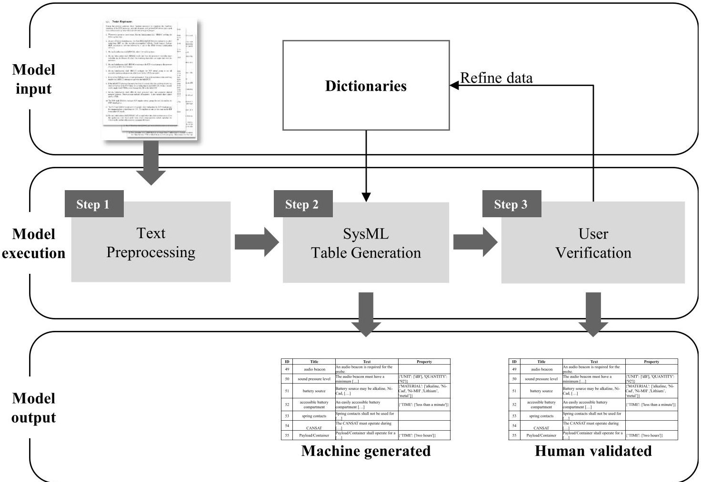
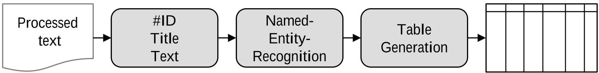
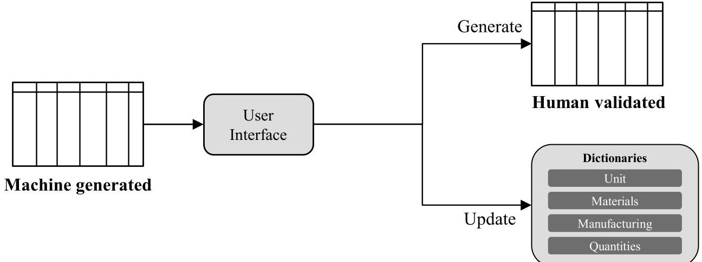

<!-- PDF_PAGE: 1 -->

# Application of natural language processing for systematic requirement management in model-based systems engineering

Michael Riesener Laboratory for Machine Tools and Production Engineering of RWTH Aachen University m.riesener@wzl.rwth-aachen.de

Christian Dölle Laboratory for Machine Tools and Production Engineering of RWTH Aachen University c.dölle@wzl.rwth-aachen.de

Annika Becker Laboratory for Machine Tools and Production Engineering of RWTH Aachen University a.becker@wzl.rwth-aachen.de

Sofia Gorbatcheva RWTH Aachen University Sofia.gorbatcheva@rwth-aachen.de

Eric Rebentisch MIT Center for Sociotechnical Systems Research erebenti@mit.edu

Günther Schuh Laboratory for Machine Tools and Production Engineering of RWTH Aachen University g.schuh@wzl.rwth-achen.de

Copyright © 2021 by Riesener, Dölle, Becker, Gorbatcheva, Rebentisch, Schuh. Permission granted to INCOSE to publish and use.

Abstract. Today, manufacturing companies are confronted with an enormous number of product requirements, which increasingly demand an interaction of the different engineering disciplines mechanics, electric/electronic (E/E) and software. At the same time, companies must realize a shorter time to market, lower costs and higher quality. As a result, development methods are required, which support the fast, flexible and structured transfer of numerous requirements into products despite this increased complexity in processes and products. In this context, Model-Based Systems Engineering (MBSE) takes advantage of the increasing digitalization of products and development processes. It provides structures and processes for the efficient processing of requirements by fostering the collaboration between different engineering disciplines and enabling early validation of the product. In this context, it is often challenging that requirements are not structured, but rather unstructured and heterogeneous. For the processing within MBSE, text-based requirements today usually still have to be prepared with high manual effort. This paper presents a methodology that supports the transformation of unstructured and heterogeneous text-based requirements using Natural Language Processing in order to prepare them for further processing within MBSE.

<!-- PDF_PAGE: 2 -->

## Introduction

Manufacturing companies are confronted with an enormous number of product requirements. In order to realize these requirements, products are increasingly transforming into mechatronic systems and thus require close collaboration between the disciplines of mechanics, E/E and software. (Cabrera et al. 2014; Akkaya et al. 2016) Furthermore, current market developments lead to the need for increased quality, lower costs and a shorter time-to-market. It can therefore be summarized that complexity is increasing both in products and in development processes. (Gausemeier et al. 2013) In order to counter this complexity, development approaches are needed that support the agile and structured transfer of requirements into new products. In this context, Model-Based Systems Engineering (MBSE) takes advantage of the increasing digitalization of products and development processes. It enables the structured processing of requirements within the product development process through model-based simulation and allows early validation. (Madni und Sievers 2018) Furthermore, various modeling languages have been introduced to MBSE, which improve communication and comprehension throughout the participating engineering disciplines. (Eigner et al. 2012) In this context, it is challenging that MBSE needs formalized and structured requirements as input. As in industrial practice, requirements are gathered from heterogeneous sources and knowledge and are initially mostly text-based and thus unstructured, it is crucial to transform them into structured requirements. (Yue et al. 2015; Xiao und Wang 2015) The manual processing of text-based requirements implicates an enormous effort. The usage of Natural Language Processing (NLP) therefore offers considerable potential. (Cheng und Atlee 2007)

In order to address this potential, an approach for the automated processing of requirements using NLP is presented in this paper. Relevant fundamentals on requirements, MBSE and NLP are introduced in the following chapter.

## Fundamentals

MBSE has been introduced as an approach for the interdisciplinary development of complex systems from the early design phase throughout the development and further life cycle phases. (Madni und Purohit 2019) Traditional development processes are improved by providing a formalized central system model for all involved disciplines. This system model serves as the basis for interdisciplinary design and development of processes and functions (Friedenthal et al. 2014) by containing all relevant information for various stakeholders. Modeling languages are furthermore introduced as tools to ensure a consistent and formal description of models. Systems modeling language (SysML) is commonly applied in MBSE. (Eigner et al. 2012)

Within MBSE, requirements engineering (RE) marks the first step. RE comprises the systematic detection and documentation of stakeholders' requirements. Furthermore, it focuses on the validation and adjustment of requirements as well as on their tracing throughout the product life cycle. (Pohl und Rupp 2015) The modeling language SysML provides requirement diagrams, which support to connect requirements, specifications and design models. Amongst others, one diagram type for requirements is the tabular format. Requirement tables comprise a requirement ID, a unique requirement title as well as the original requirement text. Furthermore, user-defined property categories can be added. (ISO/IEC 19514:2017 2020)

Before being processed in requirement tables, requirements are usually formulated in natural language (NL). NL comprises languages developed and evolved by humans. (Sarkar 2019) Various languages exist and can be communicated in speech, writing or sign language, containing different alphabets and grammatical rules. Within one language, several domain-specific languages exist, including jargon, business-rules, expert language, or even company-specific language. (Dalpiaz et al. 2018) In order to prepare requirements in such heterogeneous NL for the use in MBSE and specifi-

<!-- PDF_PAGE: 3 -->

cally requirement tables, NLP offers enormous potential. NLP is defined as a field in computer science, engineering and artificial intelligence (AI) with roots in computational linguistics. NLP enables computers to comprehend unstructured content, make derivations and add context to language. The main task of NLP is to develop applications that provide an interaction between machines and NL by processing and understanding human NL and to perform specific tasks to generate useful output. Thus, it enables to handle large amounts of natural language in order to transform it into data which can be processed and analysed. (Banerjee 2020)

## Critical analysis of existing approaches

To determine the research gap regarding the transformation of unstructured, text-based requirements into MBSE compatible requirements, existing approaches are analyzed and evaluated in the following.

(Deeptimahanti und Sanyal 2011) present a method to semi-automatically transform text-based requirements into modeling language diagrams. As first step, the method preprocesses the text of requirements. Modeling language categories, such as actors or use-cases, are subsequently extracted from the requirements based on predefined rules. The authors utilize NLP to preprocess the requirements and extract information. Although some steps are performed automatically, this approach still requires human intervention throughout the process since the NLP steps are not automatically linked to each other.

(Arellano et al. 2015) present an approach to process requirements by creating domain-based ontology models. Ontology models represent the architecture of the system to be developed. Through this approach, requirements are allocated to the associated elements of the system architecture. Thus, the requirements can be structured according to the system architecture, and thus receive a hierarchical structure. Furthermore, dependencies and relationships can be identified. Nevertheless, ontology models have to be created manually for each technical system and cannot simply be replicated. This approach focuses on the requirement relationship among each other, but lacks the ability for automated transformation from textual requirements into modeling languages.

Another approach to express requirements in a model-compatible form is presented by (Bernard 2012). Based on the theory of (Micouin 2008), the author proposes a method of transforming property-based requirements directly into MBSE common modeling languages. Property-based requirements can be understood as a logical syntax which equals model attributes. On the one hand, a more accurate and less ambiguous requirement specification can be reached. On the other hand, the proposed method requires an amount of requirements which corresponds to the syntax of property-based requirements. Additionally, the procedure cannot be formally applied for textual written requirements.

More recent approaches are making use of AI to transform requirements into MBSE modeling languages. (Chami et al. 2019) apply NLP and Machine Learning (ML) techniques to create models from semi-structured input text. SysML model elements are extracted from the input text by applying named-entity recognition. The presented approach is developed on a small dataset and performs poorly when used on new text input. However, the approach provides a research basis for future implementations of ML in MBSE context.

The examined literature promises to significantly improve the processing of requirements and serves as an orientation for the approach presented in this paper. (Deeptimahanti und Sanyal 2011) have given a valuable insight into the application of NLP for the semi-automatic transformation of requirements into models. Furthermore, ontology models can support the extraction of knowledge from requirements. Finally, (Chami et al. 2019) presented a first step towards AI in MBSE and demonstrated the need for a significant amount of labelled data in order to provide reliable results through ML.

<!-- PDF_PAGE: 4 -->

There is a lack of research on a systematic transformation process of initial NL requirements into requirement models suitable for modeling and design in MBSE. Thus, this paper specifically focuses on the challenge on how to input a high amount of requirement specifications consisting of unstructured NL and convert them automatically into MBSE readable requirements to enable the application of model-based requirements analysis tools

## Research results

The aim of this paper is to present an approach that enables an automated transformation of unstructured, text-based requirements into structured MBSE requirement tables by extracting essential requirement properties. Thereby, the manual workload within this transformation process is reduced and a faster system and design analysis in the development process is achieved. Further, the output of the presented method creates a labeled dataset that enables future research to train ML models in the context of MBSE.

In this paper, a focus is put on SysML requirement tables, which provide an overview of requirements and their properties. (Friedenthal et al. 2014)

Figure 1. Model for requirement transformation compatible for MBSE

Figure 1 shows a holistic overview of the elaborated approach including its inputs and outputs. The methodology should be used at the beginning of the MBSE process, specifically during the RE process after stakeholder needs are identified and documented in the NL requirements specifications.

The approach consists of three steps. In the first step, text-based requirements are preprocessed in order to enable text analysis. The second step utilizes the preprocessed data to identify and extract essential requirement properties from the text resulting in a requirement table. The two steps represent two pipelines which are automatically executed one after another. In the third step, the user is able to validate the table and correct the results, if needed. The three steps are explained in more detail in the following.

<!-- PDF_PAGE: 5 -->

Step 1: Text Pre-Processing

Figure 2 shows a five step pipeline of the text pre-processing. In this approach, spaCy $ ^{1} $ is used which is an open-source library for advanced NLP task.

Figure 2. Pre-processing of the text

First, in order to gain access to each word independently, the unstructured raw text is converted into an array of digital bits, called tokens. (Kulkarni und Shivananda 2019) Tokens are the basic building blocks of a written text and fundamental to understand the meaning of the text. Subsequently, in order to identify the role of each token in the sentence, a syntactic analysis is conducted, known as Part-of-Speech (POS) tagging. POS assigns a category to each token, such as noun, verb, adverb, etc. (ISO/IEC 19514: 2017 2020) After performing POS, structural units of sentences are examined, known as noun phrase (NP). For instance, the tokens 'battery' and 'source' can be grouped in a NP as 'battery source' resulting in a segment formed by multiple tokens. NP are relevant for the next processing step, the dependency analysis. The dependency analysis identifies functional constitutes, meaning subject and objects, within a sentence. These functional constitutes consider the extracted NP mentioned above and are relevant for later information extraction of the requirements in step 2. After identifying the relationship between words, ambiguity in requirements, arising from the use of pronouns called co-referencing, is reduced. Co-referencing is the use of two or more terms in a text which rely to the same entity, typically a pronoun. As for requirements, pronouns are often used to replace system components of the preceding sentence. For instance, the requirement 'An audio beacon is required for the probe. It may be powered [...]' consists of two requirements. The requirements can only be understood in relation to each other. In order to reduce the existing ambiguity, the pronouns have to be replaced with the previously occurring mentions, known as antecedent. (Jurafsky und Martin 2008) This means that, in the example mentioned above, "It" is replaced with "audio beacon". This is performed with the python library neuralcoref. $ ^{2} $ The output of the presented steps forms the input for the second step of the methodology.

Step 2: SysML requirement table

As shown in Figure 3, the second pipeline illustrates the process of extracting requirement properties according to the SysML requirement table.

Figure 3. Generation of SysML requirement tables

To develop a compatible requirement table, a requirement identification (ID) and a requirement title need to be extracted and assigned to the requirement text.

Starting with the ID allocation, each requirement receives a unique ID. In this paper, it is defined that each sentence corresponds to one requirement. Sentences are separated by punctuation which indicates a segmentation criterion for the developed algorithm. Requirements that are in one paragraph

<!-- PDF_PAGE: 6 -->

are defined as related requirements (Indurkhya und Damerau 2010) and get sub IDs, e.g. ID number 1.1 and 1.2.

Similarly, according to the SysML syntax for each requirement, a unique title needs to be assigned (Dalpiaz et al. 2018). As this task is typically performed manually and is based on the user's preference, a standardized logic for the title generation is developed. The title builds on the results from the first pipeline, specifically the extracted NP and the dependency analysis, and is taken from the requirement text. A logic for the title configuration is illustrated in Table 1. If the preferred option of the direct object is not possible, the algorithm selects an alternative option. If all options fail, the requirement ID is set as the title.

Table 1. Title configuration logic

<table border="1"><tr><td>ID</td><td>Title</td><td>Text</td><td>Property</td></tr><tr><td>49</td><td>audio beacon</td><td>An audio beacon is required for the probe.</td><td></td></tr><tr><td>50</td><td>sound pressure level</td><td>The audio beacon must have a minimum[...</td><td>{&#x27;UNIT&#x27;:['dB]&#x27;,&#x27;QUANTITY&#x27;:['92']}</td></tr><tr><td>51</td><td>battery source</td><td>Battery source may be alkaline,Ni-Cad,[...</td><td>{&#x27;MATERIAL&#x27;:['alkaline,Ni-Cad&#x27;,&#x27;Ni-MH&#x27;,&#x27;Lithium&#x27;,&#x27;metal&#x27;]}</td></tr><tr><td>52</td><td>accessible battery compartment</td><td>An easily accessible battery compartment[...</td><td>{&#x27;TIME&#x27;:['less than a minute']}</td></tr></table>

After having identified the essential requirement properties to generate a SysML requirement table, mechatronic specific entities have been defined and extracted which characterize the requirement. This is done through Named Entity Recognition (NER). NER identifies entities which are real-world objects in unstructured text from predefined categories, such as organizations, persons or countries. (Sarkar 2019) Due to the domain-specific language used in textual requirements of mechatronic systems, NLP algorithms are not suitable and lack appropriate training data to generate valuable insights in the engineering domain (Weischedel et al. 2013). To obtain accurate entities, a dictionary analysis is performed and NER categories are added. Dictionaries containing relevant domain-specific keywords are applied and regular expressions are developed to detect mechatronic requirement entities. For this paper, the following entities are extracted: technical units with its associated quantities, material properties indicating the used material components and manufacturing processes. By extracting the entities from text-based requirements, they can be accessed quickly and used for other modeling and computational analysis. For instance, the SysML parametric diagram can access extracted units from the requirement diagram.

In the final step of the second pipeline, the previously extracted requirement properties are summarized in a requirement table according to the defined columns of SysML requirement table. An exemplary result of a generated SysML requirement table is illustrated in Table 2.

<!-- PDF_PAGE: 7 -->

Table 2. Exemplary SysML requirement table

<table border="1"><tr><td>#</td><td>Title</td><td>Example</td><td>Req. Title</td></tr><tr><td>1</td><td>Direct object</td><td>The system shall purify dirty water.</td><td>Water</td></tr><tr><td>2</td><td>Direct object with the verb</td><td>The system shall purify dirty water.</td><td>Purify Water</td></tr><tr><td>3</td><td>Indirect object</td><td>The system shall provide dirty water to the boiler.</td><td>Boiler</td></tr><tr><td>4</td><td>Subject</td><td>The system shall work.</td><td>System</td></tr><tr><td>5</td><td>Requirement ID</td><td>RQ4: The system shall purify dirty water</td><td>4</td></tr></table>

Step 3: User verification

Once the requirement table is created, some entities may not have been recognized by the algorithm. To enable the user to improve the algorithm's accuracy, the user can verify the results through a command-line application. Each requirement can be obtained and if necessary, corrected by the user by inserting the missing entity. After the user inserts the correct specification, two processes are performed, which are illustrated in Figure 4.

Figure 4. User interface for verification

First, a new requirement table with the verified and corrected input by the user is generated and saved. Second, the dictionaries are adjusted and, if an entity is inserted which is new to the dictionary, it is added to the specified dictionary.

By completing this step, the transformation from unstructured textual requirements (see Figure 1) into MBSE compatible SysML requirement tables has been achieved. Through the two pipelines, requirements are automatically transformed from raw requirement texts into structured tables. As a result, a user-validated table in a .xlsx-file format is generated. This table can be used as an input for SysML modeling software in order to directly extract the obtained information and create a graphical representation of the requirement table. Further, the requirement table represents a structuring tool for RE to transform large volumes of text-based requirements into structured formats, extracting relevant information and supporting overview and validation purposes. Lastly, the generated table is suitable to use for ML purposes since it represents a labeled data set.

<!-- PDF_PAGE: 8 -->

In order to measure the performance of the developed algorithm, the approach has been validated using 56 requirements written in English from the NASA student competition CanSat. [24] The algorithm identified each requirement and assigned the correct requirement ID, further, each requirement received a unique title. The performance of the NER is assessed based on this case study. The performance is evaluated with the classifier performance measure, known as confusion matrix. The confusion matrix is used in classification tasks and presents results of supervised-learning tasks. The rows in the confusion matrix represent the actual class, whereas the columns represent a predicted class. In order to measure the performance, the confusion matrix compares the set of predictions towards the actual targets. The diagonal sum of the matrix illustrates the amount of the overall true predictions. Additionally to the confusion matrix, further evaluation metrics exist. The evaluation metric "accuracy" is calculated by the sum of the diagonal of the confusion matrix, divided through the total sum of all entries within the confusion matrix. The metric "recall" represents the rate of positive instances which are correctly detected. The recall thus focuses on detecting requirements properties in the requirements. If the algorithm does not detect an entity that exists in the manually generated table, the recall score decreases. The metric "precision" focuses on detecting only correct requirement properties. If the algorithm detects an entity which does not exist in the manually created table, the precision score decreases.

The results of the presented approach within the evaluation show an accuracy of 91%, recall of 83%, and a precision of 93%. In this paper, an emphasis is put on the recall score, because the authors prioritize the identification of all entities in the requirements. For the applied case study, the primary results show that the proposed methodology is effective.

## Conclusion

In this paper, an approach is presented to generate SysML requirement tables from requirements written in NL. Therefore, a three step methodology is introduced. In the first step, the text-based requirements are pre-processed and prepared for further analysis. In the second step, requirement properties are extracted and a SysML requirement table is generated. In the third step, the user can verify the generated requirement table through a user interface and make corrections to improve the algorithm's performance. An evaluation of the methodology has been presented through a case study based on satellite requirements. Additional case studies have to be conducted to refine and validate this approach in an operational context. Through the application of the presented approach, the authors believe that this approach is able to automatically transform amounts of requirements written in NL into MBSE compatible tables. Further, the authors consider NLP as a valuable tool for MBSE in order to extract information, improve communication between various disciplines and reduce manual workload of domain experts.

Future research work is needed to establish NLP in the industrial context. This paper presents a first approach to extract valuable requirement information from unstructured text. In order to establish intensive domain understanding, ML algorithms need to be trained to detect requirement properties based on the given context.

## Acknowledgements

Funded by the Deutsche Forschungsgemeinschaft (DFG, German Research Foundation) under Germany's Excellence Strategy - EXC-2023 Internet of Production - 390621612

<!-- PDF_PAGE: 9 -->

## References

Akkaya, Ilge; Derler, Patricia; Emoto, Shuhei; Lee, Edward A. (2016): Systems engineering for industrial cyber-physical systems using aspects. In: Proceedings of the IEEE 104 (5), S. 997-1012.

Arellano, Andres; Zontek-Carney, Edward; Austin, Mark A. (2015): Frameworks for natural language processing of textual requirements. In: International Journal On Advances in Systems and Measurements 8, S. 230-240.

Banerjee, Dibyendu (2020): Natural Language Processing (NLP) Simplified: A Step-by-step Guide. Hg. v. datascience foundation. Online verfügbar unter https://datascience.foundation/sciencewhitepaper/natural-language-processing-nlp-simplified-a-step-by-step-guide, zuletzt aktualisiert am 26.07.2020.

Bernard, Yves (2012): Requirements management within a full model-based engineering approach. In: Systems Engineering 15 (2), S. 119-139.

Cabrera, A. AlvarezA; Komoto, H.; van Beek, T. J.; Tomiyama, T. (2014): Architecture-centric design approach for multidisciplinary product development. In: Advances in Product Family and Product Platform Design: Springer, S. 419-447.

Chami, Mohammad; Zoghbi, Christophe; Bruel, Jean-Michel (2019): A First Step towards AI for MBSE: Generating a Part of SysML Models from Text Using AI.

Cheng, Betty H. C.; Atlee, Joanne M. (2007): Research directions in requirements engineering. In: Future of Software Engineering (FOSE'07). IEEE, S. 285-303.

Dalpiaz, Fabiano; Ferrari, Alessio; Franch, Xavier; Palomares, Cristina (2018): Natural language processing for requirements engineering: The best is yet to come. In: IEEE software 35 (5), S. 115119.

Deeptimahanti, Deva Kumar; Sanyal, Ratna (2011): Semi-automatic generation of UML models from natural language requirements. In: Proceedings of the 4th India Software Engineering Conference, S.165-174.

Eigner, Martin; Gilz, Torsten; Zafirov, Radoslav (2012): Proposal for functional product description as part of a PLM solution in interdisciplinary product development. In: DS 70: Proceedings of DESIGN 2012, the 12th International Design Conference, Dubrovnik, Croatia.

Friedenthal, Sanford; Moore, Alan; Steiner, Rick (2014): A practical guide to SysML: the systems modeling language: Morgan Kaufmann.

Gausemeier, Jürgen; Czaja, Anja Maria; Wiederkehr, Olga; Dumitrescu, Roman; Tschirner, Christian; Steffen, Daniel (2013): Studie: Systems Engineering in der industriellen Praxis. In: 9. Paderborner Workshop: "Entwurf mechatronischer Systeme.

Indurkhya, Nitin; Damerau, Fred J. (2010): Handbook of natural language processing: CRC Press (2).

ISO/IEC 19514:2017 (2020): Information technology-Object management group systems modeling language (OMG SysML).

Jurafsky, Daniel; Martin, James H. (2008): Speech and Language Processing: An introduction to speech recognition, computational linguistics and natural language processing. In: Upper Saddle River, NJ: Prentice Hall.

Kulkarni, Akshay; Shivananda, Adarsha (2019): Natural language processing recipes: Springer.

<!-- PDF_PAGE: 10 -->

Madni, Azad M.; Purohit, Shatad (2019): Economic analysis of model-based systems engineering. In: Systems 7 (1), S. 12.

Madni, Azad M.; Sievers, Michael (2018): Model-based systems engineering: motivation, current status, and needed advances. In: Disciplinary convergence in systems engineering research: Springer, S. 311-325.

Micouin, Patrice (2008): Toward a property based requirements theory: System requirements structured as a semilattice. In: Systems Engineering 11 (3), S. 235-245.

Pohl, Klaus; Rupp, Chris (2015): Basiswissen Requirements Engineering: Aus-und Weiterbildung nach IREB-Standard zum Certified Professional for Requirements Engineering Foundation Level: dpunkt. verlag.

Sarkar, Dipanjan (2019): Semantic Analysis. In: Text Analytics with Python: Springer, S. 519-566.

Weischedel, Ralph; Palmer, Martha; Marcus, Mitchell; Hovy, Eduard; Pradhan, Sameer; Ramshaw, Lance et al. (2013): Ontonotes release 5.0 ldc2013t19. In: Linguistic Data Consortium, Philadelphia, PA 23.

Xiao, Liang; Wang, Yinglin (Hg.) (2015): Proceedings of 2015 IEEE International Conference on Progress in Informatics and Computing. December 18-20, 2015, Nanjing, China. 2015 IEEE International Conference on Progress in Informatics and Computing (PIC). Nanjing, China, 12/18/2015 - 12/20/2015. IEEE International Conference on Progress in Informatics and Computing; Institute of Electrical and Electronics Engineers; Nanjing-Ligong-Daxue; PIC; IEEE PIC. Piscataway, NJ: IEEE.

Yue, Tao; Briand, Lionel C.; Labiche, Yvan (2015): aToucan: an automated framework to derive UML analysis models from use case models. In: ACM Transactions on Software Engineering and Methodology (TOSEM) 24 (3), S.1-52.