<!-- PDF_PAGE: 1 -->

# An Agile Systems Engineering Analysis of a University CubeSat Project Organization

Evelyn Honoré-Livermore Norwegian University of Science and Technology (NTNU)

7491 Trondheim

+47 400 18 398

evelyn.livermore@ntnu.no

Ron Lyells

Honeywell (retired)

+1 505-263-1893

rlyells@aol.com

Joseph L. Garrett

NTNU

7491 Trondheim

joseph.l.garrett@ntnu.no

Rock Angier

IBM (retired)

+1 919-233-8029

rangier@mindspring.com

Bob Epps

Lockheed Martin Corporation (retired)

+1 610-247-0961

repps999@aol.com

Copyright © 2021 by The Authors. Permission granted to INCOSE to publish and use.

Abstract. University CubeSat projects become popular in recent decades, and face challenges that include both technical and sociotechnical aspects. However, these teams often lack the infrastructure and resources for having effective systems engineering or project management which are beneficial for addressing these challenges and developing complex systems, such as satellites. In this paper we present the results of an exploratory case study of a university CubeSat team developing an Earth Observation satellite. The Agile Decision Guidance method was applied to pinpoint parts of the project organization that could benefit from agile methods in three specific areas: customer problem space, solution space, and product development space. The results drew attention to areas such as; stakeholder management, knowledge and information management, and the support environment, that could benefit from an agile approach. We outline some of the plans to move forward and how the team responded to the analysis. We also discuss if the method was appropriate for academic small satellite organizations and adaptations of the method made during the assessment.

## Introduction

Even though academic CubeSat projects have grown in popularity in the past decades, but still only have a success rate of 60% (Berthoud et al. 2019). These projects apply a mix of ad hoc practices, streamlined processes, or standard space system practices (Swartout 2019). The low success rate is attributed to multiple factors such as a lack of consistent processes and support functions, inadequate knowledge transfer because of high turnover based on the academic calendar and graduations, a lack of dedicated project management (PM), little time for verification and validation, and schedule overruns (Grande et al. 2017).

<!-- PDF_PAGE: 2 -->

The environment of a university CubeSat project is typically characterized by 15-30 volunteer students, a few professors, and a small team of researchers (Cho et al. 2017). They lack resources or support systems for stringent process requirements and quality management, or dedicated support functions (such as procurement or mechanical workshops), as is typical in larger aerospace and defense companies that historically developed satellites.

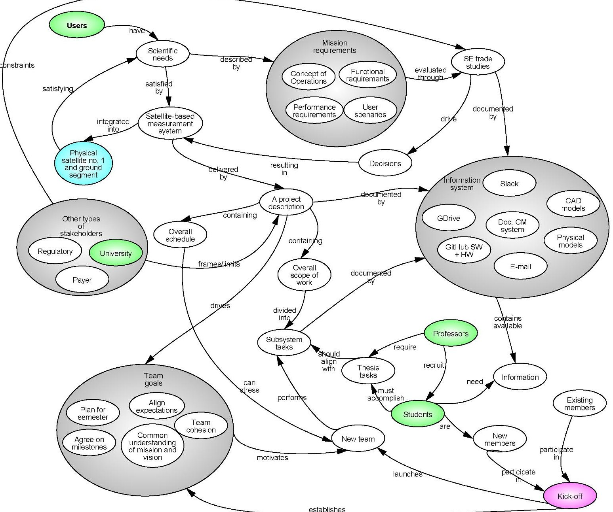

Figure 1. High-level systemigram of CubeSat project organization. The light green boxes are stakeholders, the light blue the final system, and purple a physical meeting.

The Norwegian University of Science and Technology (NTNU) has a goal of building the capabilities needed to rapidly deliver scientific CubeSat missions for maritime surveillance. The first CubeSat mission, started in 2017, had an original schedule of 2 years. However, it was delayed for several reasons, and will be launched in 2021. The team would like to shorten the development time from ideation to launch-ready to 1 year on average. Because of the limited resources available, and the uncertain circumstances in the university context, it was decided to take an agile approach to the introduction of system engineering (SE) processes, instead of, for example introducing the full body of the European Space Agency (ESA) or the National Aeronautics and Space Administration (NASA) standards commonly applied in space projects.

A high-level systemigram in Figure 1 shows some aspects of the project organization and its information system. University students must balance the thesis work and project work - balancing the needs and expectations of their professors with that of the project team. Moreover, there is a high turnover every ~9 months for when the students graduate.

<!-- PDF_PAGE: 3 -->

Agile SE "refers to the adaptability and sustainment of adaptability" (Dove, LaBarge 2014, 859), and is concerned with being agile in both the process applied to developing systems - and to the systems themselves. The agile method has perhaps gained the most popularity in software development through "Manifesto for Agile Software Development" and is increasingly applied in the hardware and other domains as well. The INCOSE Agile SE Working Group develop an "Agile Decision Guidance (ADG) Method" (Lyells et al. 2018). This method was applied to the project after reviewing a "Project story", a narrative describing the development of a university CubeSat system, together with the method's inventors.

In this paper, we show how the issues described in the "Project story" helped uncover some of the challenges with developing CubeSats in this academic project, such as flow of work, goal alignment, support environment, and knowledge transfer. Then, we discuss how the ADG method was used to study the CubeSat project, and what it indicated about the CubeSat project organization.

## Understanding the Problem Space

The OODA-loop, conceived by John Boyd, is the basis of the ADG method (Lyells et al. 2018). The OODA-loop consists of the following four activities: Observe-Orient-Decide-Act. This paper describes the results from the activities in the first three components of the OODA-loop, which is reflected in Figure 2.

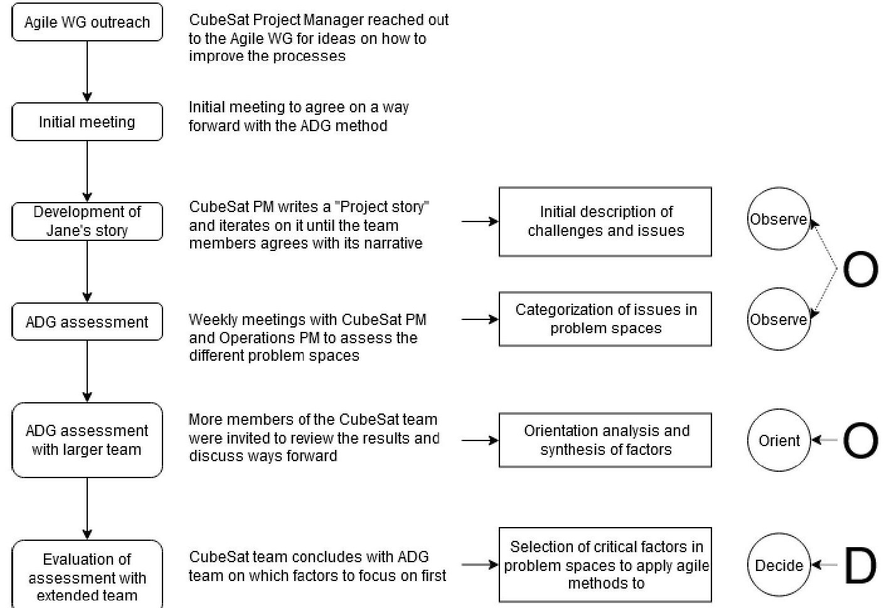

Figure 2. Workflow applied in this project. The phases of the OODA-loop are indicated on the right-hand side.

## Observation: Project Story for Academic CubeSat Team

The "Project story", given in the Appendix, was used to describe the current project from the project manager's perspective on the culture and behavior of the development. The university had not had any successful CubeSat missions previously, and the faculty members had little or no experience building satellite systems. Furthermore, the university does not have a formal SE program, although some courses are available in the Department of Mechanical and Industrial Engineering. The CubeSat

<!-- PDF_PAGE: 4 -->

team mostly consisted of electronics and cybernetics students, which are fields typically characterized by reductionist approaches.

The Project story was used to develop team alignment with the problem definition. Team members were asked to read through and then meet for a workshop to improve and change parts so that there was an agreement on the situation described. The Project story revealed problems of development such as flow of work (knowledge transfer, rework time, decision-making, authority, common processes), goal alignment between stakeholders (students for their thesis vs. for project work, professors wanting a fast delivery of CubeSat in parallel with research articles, engineering vs. research goals), and information flow. These system development problems were sociotechnical in nature, and could be linked partially to the failure to adopt a clear SE approach, evident through lack of good requirements handling, or systematic decision-making. This was attributed in part to one person having to simultaneously fulfill the role of researcher, project manager, and systems engineer. During the writing and in-team orientation of the Project story, some participants indicated that multiple information sources caused confusion - and that it was challenging to be the first team to work on a CubeSat in the university, but that they were hopeful that it would become better as the organization matured.

A challenge with the Project story is keeping it up to date, since the organization is not static and there will be new issues appearing as the projects move through their lifecycles. It is also difficult to express the different viewpoints from the team members, for example if they are in different positions or have different academic profiles (student vs. professor vs. Ph.D.). The story was not used actively during the next assessment phase but was available for reference if needed and, it is a good starting point for discussing issues and grounding the problem definition.

## Observation: Assessment Questionnaire

The assessment questionnaire is divided into three observation spaces: (1) customer problem space, (2) solution space, and (3) product development space (Lyells et al. 2018). These observation spaces are used to describe the organization and mission context, looking at factors such as stakeholders, requirements, goals, modules, solution sets, development environments and support environments. These factors are all part of the SE context. There is also a fourth component, which assesses the team's agile response capabilities. Each space has a set of questions for characterizing the stability, variety, observability, and predictability of a factor. Thirty-six factors were assessed by answering 111 questions, which were scored between 1-7. An example is shown in Figure 3.

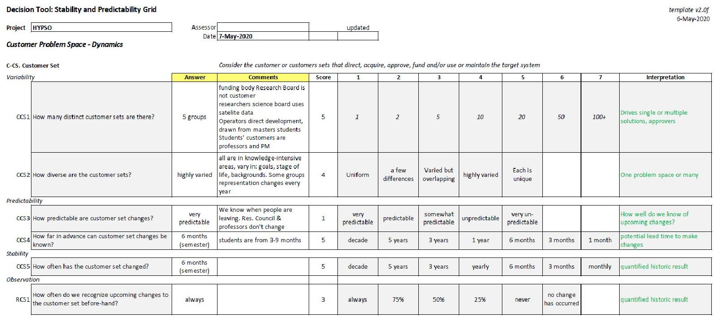

Figure 3. Typical question format

<!-- PDF_PAGE: 5 -->

The assessment questionnaire was introduced to the CubeSat project manager and the CubeSat operations manager (hereafter called the subjects) in a kick-off meeting. Prior to this meeting, the subjects had acquainted themselves with the method through the original paper by Lyells et al. (2018). The first session was as much assessment as familiarizing the subjects with the questions and format. Two representatives were sufficient to describe the organization, because the subjects both have managerial responsibilities and do engineering as well as other project tasks. There were some discussions between the subjects when answering each question, and the rationale for each answer was recorded in the "Comments" row as shown in Figure 3. In the first session, 12 questions were covered. Each of the remaining 6 sessions covered between 18-25 questions.

Throughout the sessions, the subjects gave feedback on both the ADG method and the questionnaire, either when the wording or questions were unclear, or when it was difficult to give an answer. For example, after three sessions, it was determined that the project was too complex to be described by a single score for each question. The questionnaire was then updated to take in a range of scores, so that different aspects of the project were represented. For example, when discussing the solution space, software modules can be updated regularly, and functional and logical allocation may change

- which may change the solution. On the other hand, the physical ground segment does not change much after it has been procured.

## Orientation: Agility Factors

After each observation space was assessed, the factors were analyzed to give insight into Dynamics, Variety and Visibility. These characteristics helped the team understand how the factors compared in each observation space, and where they could focus efforts on improving:

- Dynamics: The space's dynamics show how the project changes over time, the predictability of those changes, and how the team responds. The dynamics analysis influences the types of actions needed. Analysis guidelines are given in Lyells et al. (2018). For example, if a factor has a low stability but high predictability, the response should be rapid and can follow a known template. An example of dynamics analysis is shown in Figure 4.

- Visibility: The visibility shows the change rate vs. lead time for implementing changes. It reflects how soon changes can be known and how quickly the team can react to them. If the changes happen more often than the lead time to implement changes required, it becomes challenging to keep up. An example of visibility analysis is shown in Figure 5.

- Variety: The variety shows the number of and uniqueness of instances, which affects the mechanisms and capacity required to respond. A team would require a larger amount of effort to manage a high number of instances, and if they are very diverse, each instance may require a tailored effort. Applying a systematic approach to managing each instance and to seeing the differences between each instance could be helpful, as opposed to an ad hoc approach. An example of the variety analysis is shown in Figure 6.

A missed detection factor was calculated based on historic experience data gathered from the questionnaire. The missed detection rate measures the effectiveness of the project's observation system, where a higher value means a less effective observation. For example, the support environment factor had a high dynamic factor and missed detection rate and is coupled to the challenges and constraints that shape the support environment (a university), as shown in Figure 7.

A dynamics factor for the CubeSat team, shown in Figure 8, was calculated based on the frequency of changes and the capacity to anticipate changes, which represents the interplay of these factors from:

$$
D _ {f} = \sqrt {I n s t a b i l i t y ^ {2} + U n p r e d i c t a b i l i t y ^ {2}}.
$$

<!-- PDF_PAGE: 6 -->

Moreover, the effort required from the team depends both on the number of the tasks to complete, and the diversity of the tasks. Here, diversity means that the tasks need tailored approaches to be completed. Thus, the scope of impact factor is defined as:

$$
I _ {f} = \sqrt {D i v e r s i t y ^ {2} + \left(\log_ {1 0} \frac {Q u a n t i t y}{2}\right) ^ {2}}.
$$

The missed detection factor, the dynamics factor, and the impact factor were charted in bar charts to enable comparison of factors across the observation spaces and to look for coupling to other factors. A high score represents a greater challenge to the team for all factors.

The factors that were identified as high in dynamics shown in Figure 8 were: support environment, challenges and constraints, stakeholders, and all Solution set factors. The factors with high scope of impact shown in Figure 9 were: support environment, solution interfaces, stakeholders, module set, customer set, mission environment and construction environment.

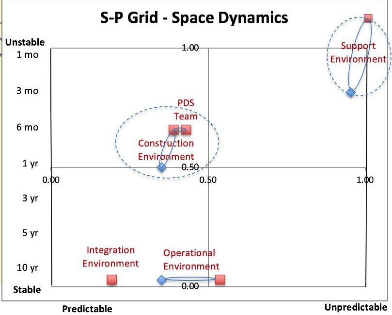

Figure 4. Dynamics view of the Product Development Space.

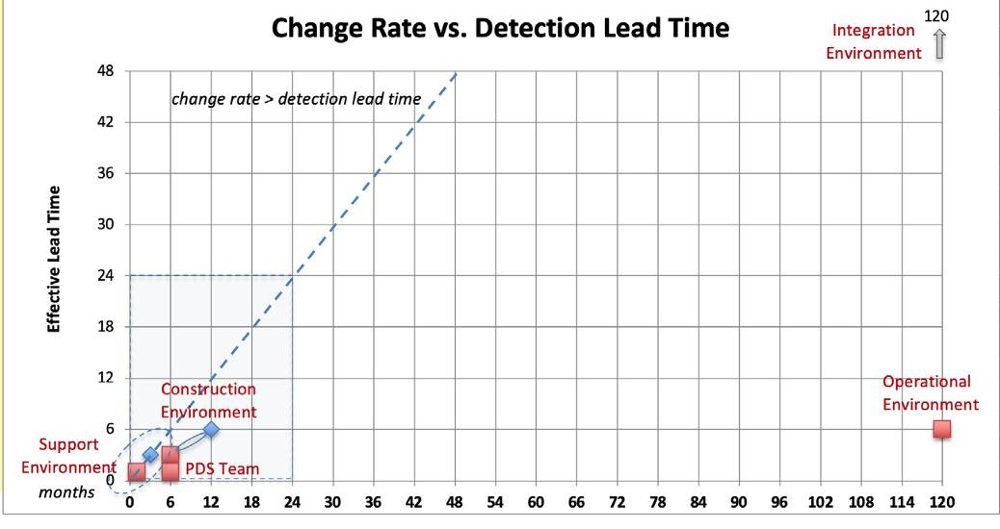

Figure 5. Change rate vs. detection lead time of the Product Development Space.

<!-- PDF_PAGE: 7 -->

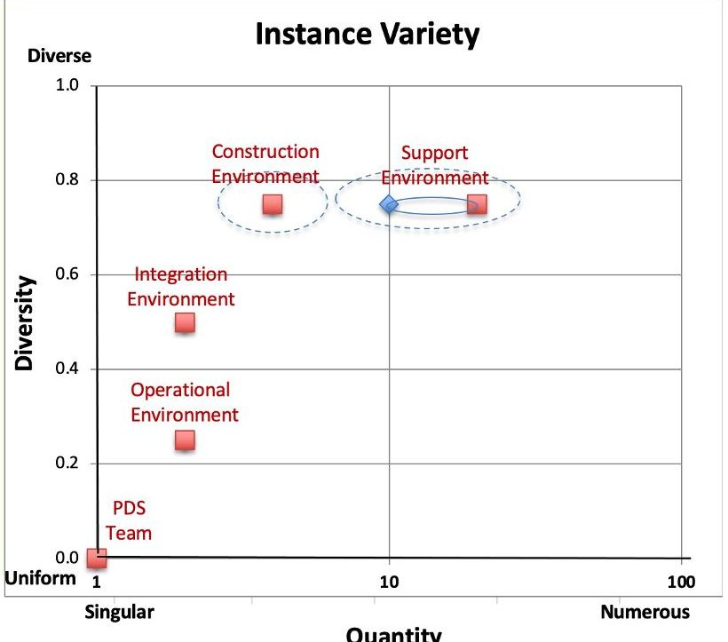

Figure 6. Variety view of the Product Development Space

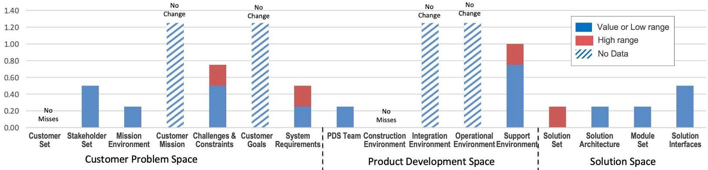

Figure 7. Missed detection of factors for CubeSat team based on historic data.

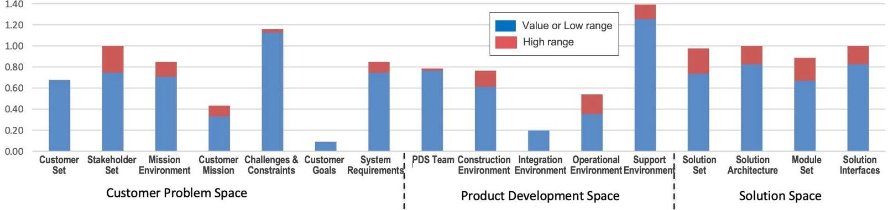

Figure 8. Dynamics of factors for CubeSat team.

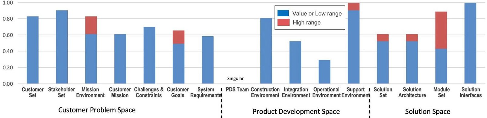

Figure 9. Scope of impact of factors for CubeSat team.

<!-- PDF_PAGE: 8 -->

# Customer Problem Space

Within the customer problem space, the following factors were assessed: customer set, stakeholders mission environment, customer mission, challenges and constraints, customer goals, and system requirements. In this academic project, the set of customers and stakeholders were highly varied yet identifiable. For example, customers include: professors interested in students graduating or funding more research projects, students wanting a good grade and experience preparing them for the workforce, and end-users wanting the satellite data products. The commonality between the customers identified was that they all belong to knowledge-intensive areas. Most of the customers are relatively invariant, except that the group of students will change every year, and each individual may have different goals and needs for the project and mission.

The organization context is the university, which imposes unique challenges and constraints. Students are both the main source of resources, and a limited resource. Moreover, training is often required because they do not always have a complete skill set or experience needed when they join the team. There may be goal misalignments, as shown in the systemigram in Figure 1, such as students wanting to get an easy grade (which has not been the experience of the team so far) and the project needing engineering tasks or assembly tasks that do not contribute directly to thesis writing. The resource availability is limited to the academic year so tasks that are not completed before the students graduate must be postponed until the new team members arrive. If the new team members do not have the knowledge needed to perform those tasks, further delays can accrue.

In addition, the project manager does not have incentives that can be used for external motivation of students but relies on building team spirit and ownership of project to create intrinsic motivation factors. Most of the reward systems in universities are built on rewarding the individual, through exams or coursework throughout the semester. When students then join a project team, but their thesis work still relies on individual assessment, there is no reward structure in place to encourage teamwork.

In the customer problem space, most of the factors have a lead time that equals the change rate. However, if we look at the scope of impact of these factors in Figure 9, all the factors have a high score. This means that even though the team can change and adapt, it still costs them much in terms of effort.

Figure 7 shows that the project has historically missed changes in stakeholders, mission environment mission challenges and constraints and system requirements. The background for a "high miss" in mission challenges and constraints was the delayed development of an integrated testing setup because there were not enough resources. Once the team started integrating subsystems, missing performance and functionality was discovered, leading to an adaptation of the system requirements. Some of the missed detections of system requirements may be attributed to the lack of experience of the whole regulatory framework since it was the first time the team has built a CubeSat, while other misses are due to ambiguity of the ownership of requirements. These stem from having an initial SE approach that was too complicated to be implemented with the size of the team. Requirements management and verification and validation are key SE activities.

During the assessment, the team successfully made some efforts to improve the requirements management. The requirements were moved from being managed in an excel spreadsheet to a SE-enabled software tool. In the software tool, the requirements had required attributes such as: ID, Name, Description, Rationale, and relationships to Verification Requirements, Verification Type, Parent Requirement, Child Requirement. All Verification Requirements were allocated to specific events (such as environmental testing or analysis deadlines) and assigned to individuals as owners.

<!-- PDF_PAGE: 9 -->

## Solution Space

The assessment of the solution space looked at solution set, solution architecture, module set, and solution interface. The software has been developed with multiple modules, which allows for individual thesis work, as is expected from the university. The downside of this is that the module set has been very unstable, and sometimes the interfaces have not been clear at the time of development. This has created integration issues, such as a malfunctioning codebase or rework on other modules. Additionally, there have been instances when the module interfaces have changed but the changes were not discovered until after the student has left, and residual code was not documented well enough to understand or troubleshoot. The project began without a defined software architecture which could have provided the interface management and understanding of how modules were interdependent. The discussion of solution interfaces started the topic of knowledge management, which was stated in the Project story - how sometimes changes are made but not communicated well or absorbed well by the rest of the team, leading to delays and confusion. Interface and knowledge management, in addition to being technical challenges, are also sociotechnical SE challenges.

An N-Squared chart had been created to show the dependencies between people and their interfaces, and how their work was dependent on others (Honoré-Livermore 2019). However, this was not revisited as often as it perhaps should have been, so it was not reinforced, but could have helped the interface management.

## Product Development Space

In the product development space, construction environment, integration environment, operation environment, support environment, and product development team were assessed. As mentioned earlier, the product development team has a high change rate, but is very predictable since the academic calendar is consistent. The support environment is the most challenging factor for this CubeSat project, reflected both in the Project story and in the questionnaire assessment. The dynamics of the support environment is the highest of all factors, as shown in Figure 8. In Figure 9, the support environment also has a high impact on the project team. For example, a delay in accessing a laboratory during assembly of the hardware will delay the schedule for the whole project, because it is not straight-forward to replace or mimic the capabilities the laboratory provides. During the discussions, it became clear that most of the support environment activities are ad-hoc, such as supplier management, procurement, quality control, workshop access, and laboratory access. Furthermore, that there is not a transparent prioritization process in allocating supporting resources at the university.

On the other hand, the construction and integration environments are fully under control of the project team. They can choose which tools and methods they use to build the system. Although the tools vary between specific tasks due to the complexity of the system, changes to the environments are predictable. During the assessment, it became evident that the team has not worked much with the satellite operations environment because of lack of qualified people. Thus, it was difficult to evaluate some of the questions associated with the operational environment.

## Product Development Agile Response Capability

The final characteristics to be assessed were the product development agile response capabilities. The results are shown in Figure 10 and Figure 11, where the factors have been categorized into "Communicate and Orient", and "Decide, Act, and Observe". Communication is an underlying capability needed for the team to execute the OODA-loop shown.

Communicate and Orient: The team used a variety of tools to communicate, such as Slack, e-mail, GitHub, in-person meetings and shared online drives. They used a mix of push (GitHub) and pull (online drives) of information, and there was a consensus that the scope of information was sufficient, but the assimilation of information was ineffective. This was also reflected in the Project story, as

<!-- PDF_PAGE: 10 -->

there had been instances where decisions had been made but not fully disseminated. The effectiveness of information assimilation increased with project work experience, for example students worked better in the spring semester than in the fall semester.

Since the assessment took place during the spring semester of 2020, the COVID-19 university lockdown had influenced the way the team worked to a great degree. This "tested" the agility of the team in terms of readiness to adjustment and levels of project commitment and value alignment. The team responded to the lockdown by quickly adjusting working habits and increased utilization of online mechanisms for collaboration and were open to adjusting their tasks to make sure that both the project and the theses moved forward.

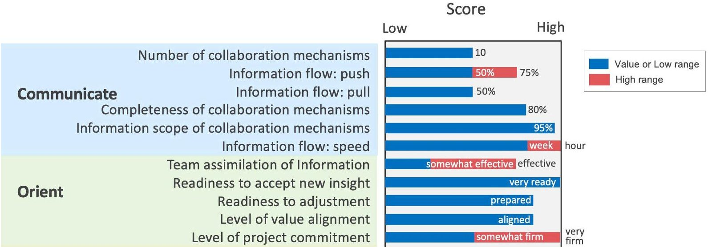

Figure 10. Agile response factors for CubeSat team - communicate and orient.

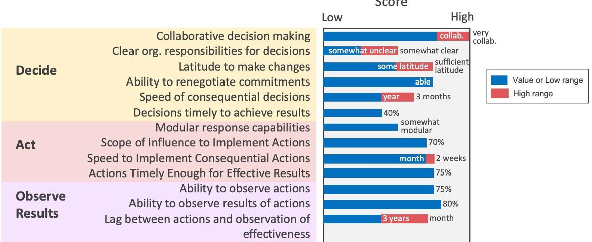

Figure 11. Agile response factors for CubeSat team - decide, act, observe.

Observe, Decide, Act: The team culture is to make decisions collaboratively, especially in the software development, shown in Figure 11. When the decisions influence both software and hardware, it has not been clear who has the responsibility to make a decision and communicate it to the relevant people. There have been instances where decisions were made within a subsystem that did not reach the other affected in a timely manner as explained in the Project story. Although the team has sufficient latitude to make changes, the stakeholders should be consulted before action is taken to ensure that any adjustments do not reduce the mission performance or functionality. Because building the CubeSat and software development takes longer than a single academic year, most of the team members are not able to see the end results of actions taken. Some results have a short feedback cycle, while others will not be apparent until the satellite has been launched and is operational.

<!-- PDF_PAGE: 11 -->

# Discussion and Conclusion

Based on the above observations, the HYPSO team agreed on factors they would address moving forward:

- Support environment: increase visibility of changes.

- Solution architecture: reduce solution set and architecture dynamics.

- System requirements: increase visibility of changing requirements and reduce dynamics of requirements.

- Information assimilation: increase team assimilation of information.

The support environment, shaped by the university context, has historically had the lowest detection rate, largest impact, and highest dynamics. The support environment has had the largest impact on all parts of the system except software development, so anything related to hardware is critical to consider while planning and scheduling the project. There is a need to make the organization more robust towards changes in the support environment, or to anticipate the changes better. However, because it is a university project, it is not straight-forward to improve this factor, for example by vertical integration of functions. We suggest that the team could investigate better goal alignment and organizational structure at the university to improve this factor.

Since the solution architecture has been, and is evolving, the adoption of Agile SE system architecture principles around reusability, reconfigurability, and scalability (Dove, et al. 2014) can be used to proactively move to a more agile architecture in future HYPSO projects. The team could benefit from having a continuously updated system model such as the one introduced in the INCOSE Space Systems Working Group (Kaslow, Cahill, Frank 2019), integrated with the other systems such as GitHub and CAD tools. There have been some efforts in this area, but a dedicated effort is needed to create a better knowledge source. If the system model were integrated into the project lifecycle, new team members could use it to enhance their training. The model could also support requirements and with its traceability to components and functions, could also increase the team ownership of the requirements. An improved solution architecture should make the requirements management simpler, and the team could also investigate principles for lean requirements management (Oppenheim and Haskins 2016) to minimize the efforts needed.

Two critical aspects were addressed in both the Project story discussion and in the agile response factors assessment, namely, knowledge information and assimilation, and flow of work. While there seemed to be a good coverage of knowledge, and a mix of push and pull information flow, the information did not assimilate well. Moving forward, the team could reach out the INCOSE Social Systems Working Group to explore ways to improve this important communications capability.

A common theme throughout the "Project story" and assessment was the lack of interconnection between the software and hardware teams. While there are documents describing the system, and models showing interdependencies, this way of thinking is not embraced. Traditionally separated in different programs at the university, the students do not have much experience working together across these study areas. It is one of the roles of SE to integrate different disciplines, and the challenge is to do so during the short onboarding period the students have when joining the project for their thesis work. We want to encourage more systems thinking amongst the students using the kick-off and the daily stand-ups events. The hardware, software and operations teams join a joint project stand-up meeting where the systems engineer has the opportunity to encourage interface discussions and dependencies, and to help the students become more aware of their contribution in the bigger system. The project could benefit from having a more systematic approach to integrating hardware and software, and some have suggested having a system model in which all the information is stored, instead of it being separated in design reports for software and hardware.

<!-- PDF_PAGE: 12 -->

The team's willingness to adjust to new input indicates a capacity for implementing new agile activities. For example, both software and hardware manage their work using the agile methodology Scrum (Rising and Janoff 2000). This allows for adjustment of plans when new discoveries are made (for example that a laboratory is closed for maintenance, or a critical bug discovered during testing should be fixed quickly), or when people have changing priorities (for example holidays or coursework), using sprints and stand-ups. This agility may be attributed to the team being young, since most of the team is under 30 years.

The ADG method does not specifically measure if an enterprise (a team, project, or organization) is agile or not on some predefined scale of goodness. What it does is help the enterprise understand its ability to thrive in a continuously changing and uncertain environment. The method does this by answering two basic questions; how uncertain and unpredictable the environment of the enterprise is, and how capable is the enterprise in responding to those uncertainties and unpredictabilities. The insight gained from answering these two questions is what helps the enterprise see where improved agility could lead to improved enterprise performance. Once this is known, changes in strategies, tactics, plans and measures can be put into action to improve the agile capability of the enterprise. The ADG method has been structured with an initial set of observation spaces and associated factors to help the user focus on where uncertainties and unpredictabilities are likely to exist. It also provides a way to assess and provide evidence of the relative impact of those uncertainties and unpredictabilities to aide the enterprise in prioritizing improvement actions. The assessment took almost 12 weeks to complete, with 1-1.5 hours meeting each week. This time was used for in-depth discussions and exploration of themes to gain more insight about the organization and was highly valuable.

Using the ADG method was helpful for an academic CubeSat organization because of the discussions and orientations it provided about the team. Some of the questions needed more explanation and refinement to be applicable, and the scoring needed to allow for a range of values to be useful in representing the situation. The latter may also be useful when applied to industrial cases.

## References

Beck, K., Beedle, M., van Bennekum, A., Cockburn, A., Cunningham, W., Grenning, J., Highsmith, J., Hunt, A., Jeffries, R., Kern, J., Martin R.C., Mellor, S., Schwaber, K., Sutherland, J. and Thomas, D., 2001, 'Manifesto for Agile Software Development', <https://agilemanifesto.org/> [accessed 21 October 2020]

Berthoud, L., Swartout, M., Cutler, J., Klumpar, D., Larsen, J.A. and Nielsen, J.D, 2019 'University CubeSat Project Management for Success', $ 33^{\mathrm{rd}} $ Annual AIAA/USU Conference on Small Satellites, UT (US).

Cho, M. and Mazui, H., 2017 'Best practices for successful lean satellite projects', 4th UNISEC Global Meeting, Varna, Bulgaria.

Dove, R., 1992. 'The 21st Century Manufacturing Enterprise Strategy or What is All This Talk about Agility?' Invited paper originally published by Paradigm Shift International (December) and then translated into Japanese and published in a 1993 issue of Prevision, the Japan Management Association Research Institute.

Dove, R. and LaBarge, R., 2014, July. '8.4.1 Fundamentals of Agile Systems Engineering', In INCOSE International Symposium (Vol. 24, No. 1, pp. 859-875).

Grande, J., Birkeland, R., et al., 2017. 'Norwegian student satellite program - lessons learned', 68th International Astronautical Congress, Adelaide, Australia.

Kaslow, D., Cahill, P.T. and Frank, R., 2019 'Developing a CubeSat MBSE Reference Model Interim Status #5', 33rd Annual AIAA/USU Conference on Small Satellites, UT (US).

Lyells, R., Angier, R. and Epps, B., 2018, July. 'Creating Decision Guidance for Applying Agile Systems Engineering', In: INCOSE International Symposium (Vol. 28, No.1 pp. 655-670).

<!-- PDF_PAGE: 13 -->

Oppenheim, B.W., Haskins, C., 2016, 'Powerful Opportunities to Improve Program Performance Using Lean Systems Engineering and Lean Program Management' in: Advances in Systems Engineering, Reston, VA (US).

SEBoK contributors, 'Guide to the Systems Engineering Body of Knowledge (SEBoK)', SEBoK 15 May 2020, <https://www.sebokwiki.org/w/index.php?title =Guide_to_the_Systems_Engineering_Body_of_Knowledge_(SEBoK)&oldid=59187> [accessed 30 September 2020]

Swartout, M., 2019, 'CubeSat Mission Success: Are We Getting Better?', 2019 CubeSat Developers Workshop, CA (US).

Radigan, D., 2020, 'Five agile metrics you won't hate' on Atlassian Agile Coach, <https://www.atlassian.com/agile/project-management/metrics> [accessed 11 November 2020]

Rising, L. and Janoff, N.S., 2000, 'The Scrum software development process for small teams', IEEE Software, Vol. 17, No. 4, pp. 26-32

## Appendix: The Project story

The HYPSO project team consists mainly of temporary employees and students at NTNU, with little or no experience with aerospace engineering or multidisciplinary teamwork. The HYPSO project is a part of a larger strategic initiative from the faculty, to be able to deliver fast integration of scientific payloads into small satellites and autonomous assets. The project takes place in a university, and the students mainly do work in the projects through master and bachelor theses. The master students typically arrive in August/September and stay on until May/June the following year. The bachelor students join the team in January and leave in May. The undergraduate students also have coursework in parallel with their theses, and cannot work full-time in the project. The professors supporting the project have not developed systems for space previously, and do not have the time nor knowledge to participate actively in the project. They do, however, provide supervising for the theses and provide direction for the mission. The professors also retain approval responsibility for decisions taken since they are in control of the funding of the project.

The team feels that there aren't enough people and resources in the project, especially in hardware (both electronics and mechanics). The people working in hardware feel stressed when thinking about the amount of work that has to be done, and how difficult it is to get the full picture. Even though the previous years' members are available by email and sometimes phone, they feel as though they are not able to understand the full picture of the challenges or the work that remains to be done. The project manager/systems engineer (a PhD fellow) feels this on a personal level when fielding repetitive questions on topics discussed several months ago, such as where to find specific information and how a decision was made. The PM understands that the team members are stressed, and thinks this is one of the reasons that these messages are forgotten/ignored. The PM observes that most of the team members are almost up to speed after 6 months, which is too long when they only have 9 months to contribute to the project in total.

Since the start of the project, there have been challenges in ensuring an understanding of decisions made and sharing these decisions. This first surfaced when some decisions were made, and the person in charge of them was away for a while, and it was not easy for the remaining team members to see why the decision had been made. The team re-iterated the decision with a more standard approach and communicated it in all meetings + documentation. The decision-making process has improved, but there is still a problem of making sure that everyone knows about the decision. The SE has tried setting up a "common model", but it is not shared or used by all. The SE is also the PM, and a researcher, and feels like there is not enough time to be a good SE. The professors/stakeholders have not been able to do much about this since they have not been able to find someone to fill the role of either PM or SE to replace some of the duties.

<!-- PDF_PAGE: 14 -->

Most decisions that must be made are design-decisions and task planning decisions. The design-decisions are implemented in the common model after the decisions have been made, but the common model has not been used to support decision-analysis because there have not been enough resources to develop that capability. Most of the critical (=affecting many subsystems and mission) decisions are made with a minimum number of people, recorded in a minutes-of-meeting, and then documented in the design reports. However, there have been some instances where the team was not able to see the breadth and impact of the decision made, where it has impacted the mission in ways that were not anticipated.

The software part of the project is quite big and involves both pure algorithm development for future enhancement, firmware development for hardware, software interfacing between segments and subsystems, user interface development, and command & control software of the satellite and payload. It is both a large area and a complex area in the project. An additional complication is that many of the subsystems the payload interfaces with are developed by a different company, with limited documentation and parallel development/changing. There is one person in charge of the software group, who is also working as a researcher.

In March 2020, the team was going to make a go/no-go launch decision based on a Critical Design Review (CDR). The team decided on a set of requirements that would have to be verified by CDR, and if they were not, the decision should be to postpone the launch. Having this deadline helped focus on the development and integration testing, and documentation of these. The process up to CDR uncovered missing requirements and functions, and in some cases, lack of communication between the operations group and software group.

The CDR collocation meeting via Zoom was considered a success by the team. There were good discussions and the team generated valuable feedback across the functional areas. The team was not able to verify all the requirements, and some critical dependability and risk issues were pointed out because of the lack of design maturity. After CDR, some of the momentum was lost. This was partly because of Corona, partly Easter holiday, and partly because students were refocusing on theses writing. This was evident both through lower participation in daily stand-ups, and from their feedback saying that they were focusing on writing their thesis.

<!-- PDF_PAGE: 15 -->

## Biography

Evelyn Honoré-Livermore. Evelyn is a Ph.D. Fellow at NTNU in the Department of Electronic Systems, researching the integration of systems engineering and project management methods for academic research projects. She is the project manager of the small satellite HYPSO. Evelyn received her MSc in Electronics Engineering from NTNU in 2012, and her MBA from Yonsei University, Seoul in 2017. She has project manager experience working with space systems in the Norwegian aerospace industry.

Ron Lyells. Ron Lyells has been a member of INCOSE for over 12 years. He is current Past President of the Enchantment Chapter and is a co-chair of the Agile Systems & SE Working Group. Retired from Honeywell's Aerospace Group, Ron has over 40 years in various leadership positions involved in product development lifecycle stages ranging from proposal to production support. Other contributions included developing and promoting MBSE techniques and methods, piloting a common system engineering competency framework, individual and team mentoring, and change management facilitation. He holds a B.S degree in Electrical engineering from Arizona State University.

Joseph L. Garett. Joseph received a BSc in Physics and Mathematics from the Ohio State University in 2011 and a Ph.D. in Physics from the University of Maryland in 2017. He now studies hyperspectral imaging and image processing from satellites and drones as a postdoctoral researcher at NTNU.

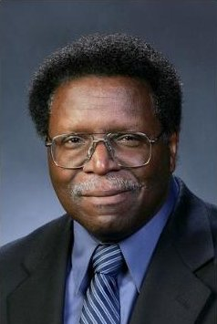

Robert (Rock) Angier is a retired system engineer and executive IT architect with 44 years of experience at IBM. His areas of contribution include Air Traffic Control collision avoidance, Space Shuttle avionics and flight-to-flight reconfiguration, Space Station, systematic software reuse, and global enterprise business and IT architectures. He has a long-held interest in agile systems. Rock holds an MS in Computer Science with Univ. of Houston, a BS in Physics from Georgia Tech, and is an Associate Fellow with the American Institute of Aeronautics and Astronautics.

Bob Epps has a background in Systems Architecture, Systems Engineering and Software Engineering. Bob worked for Lockheed Martin for 19 years, where he served as Sr. Manager Architecture Integration Technology Center, Sr. Manager Systems Engineering Architecture and Corporate Engineering. Prior to Lockheed Martin, Bob worked at Link Flight Simulation for 25 years in various Engineering and Management positions in Systems Architecture, Systems Engineering, Software Architecture, and IR&D. Bob has a BS degree in Physics from Drexel University and a MS degree in Applied Mathematics from SUNY-Binghamton.