<!-- PDF_PAGE: 1 -->

# Model-based guidelines for user-centric satellite control software development

Dov Dori $ ^{1,2,*,\dagger} $ and Somwang Thippayathetthana $ ^{1} $

$ ^{1} $Massachusetts Institute of Technology, Cambridge, MA 02139, USA $ ^{2} $Technion, Israel Institute of Technology, Haifa 32000, Israel

## SUMMARY

Three persistent common problems in satellite ground control software are obsolescence, lack of desired features and flexibilities, and endless software bug fixing. The obsolescence problem occurs when computer and ground equipment hardware become obsolete, usually after only one-third into the satellite mission lifetime. The software needs to be updated to accommodate changes on the hardware side, requiring significant work of satellite operators to test, verify, and validate these software updates. Trying to help solve these problems, we have proposed an object-process methodology model and guidelines for developing satellite ground control software. The system makes use of a database-driven application and concepts of object-process orientation and modularity. In the new proposed framework, instead of coding each software function separately, the common base functions will be coded, and combining them in various ways will provide the different required functions. The formation and combination of these base functions will be governed by the main code, definitions, and database parameters. These design principles will make sure that the new software framework would provide satellite operators with the flexibility to create new features and enable software developer to find bugs quicker and fix them more effectively. Copyright 2015 John Wiley & Sons, Ltd.

Received 16 January 2015; Revised 14 May 2015; Accepted 2 June 2015

KEY WORDS: satellite software; conceptual modeling; object-process methodology; software engineering

## 1. INTRODUCTION

As satellite operators' day-to-day operations rely heavily on satellite ground control software, a decision of great significance for satellite owners is how to select a satellite ground control system for controlling their fleet. Over many years, several commercial off-the-shelf (COTS) satellite control software products have been introduced into the market. These COTS products offer both standard functions [1] and specific features that help make the job of satellite controllers easier. While the satellite owner or operators must choose one product, different COTS software products have different pros and cons. One product might have very good user interface but limited non-standard features or lack of usercustomized functions. Another product that might have poor user interface and slow learning curve offers a more complete range of features and customized functions.

Main metrics for selecting COTS products are the maturity of the product, the expertise and experience of the product developer, standard functions and special features of the product, product price, and quality of after-sale service. Unfortunately, these metrics provide satellite owners with little help as they are faced with the need to select the best COTS product for their needs. Satellite operators using COTS satellite ground control software have repeatedly experienced a variety of problems [1, 2], including the following:

<!-- PDF_PAGE: 2 -->

- Obsolescence: A communication satellite is nominally designed for 12-20 years of service, but many pieces of ground equipment, such as the antenna control unit, cortex, and server/workstation computers, have shorter lifespan of 6-10 years. This ground equipment will become obsolete and be discontinued, making the control software at all levels unusable. The alternatives are to look for expensive rare equipment in the second-hand market or to invest in developing a new version of the missing control software. Clearly, none of these options is attractive. Software obsolescence alone is not a critical problem in satellite control software, because if the hardware does not become defective, the satellite control system can work well without any further software support or update. Hardware obsolescence and software obsolescence are interlinked. If no more updated versions nor support are available for obsolete software, two possible solutions are (i) find the compatible old hardware in the second-hand market or (ii) buy a bundle of new hardware and software.

- Lack of desired features: One piece of software can do some useful things that others cannot, but users have to choose only one and work around to overcome the lack of desired but missing features. Moreover, sometimes, the desired and promised features do not function as users expected, so they have to develop their own tools to achieve these defunct features.

- Endless bug fixing and integration problems: Everyone knows and accepts the fact that no software is bug-free. However, especially when a new software version is introduced, it is painful to find bugs, collect data for problem reproduction, and then send a report to the software developers. If and when software developers fix a reported problem, they often deliver a new software version that is plagued with new problems, leaving users stuck in an endless loop of bug fixing. This scenario, which is not unique to satellite communication software, incurs hidden costs that are difficult to estimate but should be accounted for.

- Operator familiarity: Many operators will resist the adoption of a new technology for years, primarily because of human nature of resisting change. However, management often disregards this issue and views operator resistance as lack of will to learn and adapt. From the management perspectives, lack of operator familiarity means additional expenses for retraining, which come on top of hidden integration expenses due to the bugs problem described earlier.

## 2. PRIMARY RESEARCH OBJECTIVES

This research was aimed at helping satellite owners in either selecting COTS software or developing their in-house software by providing an object-process methodology (OPM [3]) model-based framework and guidelines for software selection or development. The research focuses on users' requirements collected by reviewing the literature and looking for common problems of satellite ground control software and users' complaints about satellite ground control software.

Taking a model-based systems engineering approach, we obtain analyses of user requirements and common problems that reveal their unmet needs. These, in turn, are used to define and conceptually model a set of requirements for developing satellite ground control software or selecting some vendor-specific satellite control software package.

Based on users' feedback and derived requirements, a conceptual OPM model of satellite ground control software has been developed and tested. The OPM model-based framework provides practical guidelines for developing satellite control software or selecting a vendor-developed satellite control software package.

## 3. USER REQUIREMENTS

User requirements are divided into two groups. The first group includes basic functional requirements that come directly from standard, general functions of satellite control software. The second requirement group is those related to specific features and users' common problems and complaints; it is the collection of users' unmet needs that reflect the satellite ground control software quality and vendors' after-sale or maintenance services.

<!-- PDF_PAGE: 3 -->

## 3.1. Basic functional requirements

Users' basic functional requirements for ground control software are mainly derived from the functions and components of the satellite. Thus, the complexity of users' requirements is in line with the complexity of the satellite and its components. When users require high-level automatic functions, high availability, or ground control intelligent features, the complexity of the ground control software can be high, making it expensive [4-7]. In this research, the basic functions of ground control satellite are partially based on a simple model discussed by Straka [1].

Figure 1 is a simple block diagram that shows the main function of ground control software called satellite controlling. Under this main function are five sub-functions: ground equipment controlling, satellite positioning, communications controlling, platform controlling, and payload and mission controlling. Satellite controlling is an overarching system function that oversees all the services and interfaces to both its subsystems and the users. Ground equipment controlling provides all groundequipment-related services to the satellite controlling main function. Satellite positioning processes the satellite's range and position provided by the main function and returns the attitude and orbit of the satellite back to the main function. Communications controlling takes care of the status and parameters of the satellite's communication system. Platform controlling monitors and controls all the satellite's platform units. Finally, payload and mission controlling manages the satellite's payload configuration and monitors the performance of the satellite's missions or services.

Each sub-function monitors, determines, and reports its current status and trend of the units or processes; it is responsible for supporting the main function by using telemetry, radar, and other observations and measurements. The main function propagates this detailed information, including warnings and alarm messages, to users and subsystems. The main function can automatically perform certain predefined actions, including sending commands to ground equipment or to satellite, or setting off warning or alarm status and messages in response to a reported status or trend from its subsystems. Users or system analysts analyze the information received from the main function and take immediate actions or plan scheduled operations, such as sending out a command to the ground control units or to the satellite. The main function generates, checks, sends, and verifies the command requested by both its internal automatic functions and users' inputs.

## 3.2. Unmet needs

When it is time to upgrade the satellite computer hardware, or when ground equipment is broken, satellite operators often become frustrated to find out that the model of that equipment is discontinued and there are no spare parts available in the market. They then learn from the ground control software vendor that if they upgrade their satellite computer hardware or operating system, or change the model of ground equipment, they have to upgrade the ground control software as well.

Even in the most mature organizations, those that have achieved capability maturity model level 5 [8], upgrading the COTS products is still a challenge. Anderson and McAuley [2] shared their experience of a hardware upgrade event that mandated complementary upgrade of many COTS products. They describe the many obstacles they faced, ranging from changing the primary contractor to COTS product vendors or developers, going through acquisition and merging process, to the difficulty of obtaining full attention from COTS software developers in order to solve the issues reported during software upgrading. These hardships caused schedule delays and over-budgeted man-years effort.

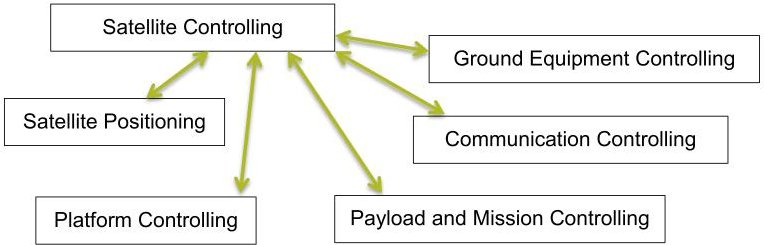

Figure 1. Basic functions of satellite ground control software.

<!-- PDF_PAGE: 4 -->

Straka [1] described eight concerns associated with the COTS software, which included the software not being fully compliant with user's requirements, vendor or developer going out of business, obsolescence, software interface issues, standardization of COTS software, responsiveness of COTS vendor or developer, software features flexibility, and hidden cost of COTS software, such as training and maintenance cost.

By and large, these complaints and concerns, expressed by Straka [1] and Anderson and McAuley [2], can be grouped into three major issues: (i) missing desired features of COTS software, (ii) obsolescence, discussed in detail in the previous section, and (iii) poor quality of vendor services.

Three main unmet needs from satellite software, in addition to serving the basic functions, arise from the literature review and are phrased as follows as fundamentally non-functional requirements:

(1) The ground control software shall provide flexibility and customizability (customizing capabilities) for the satellite system.

(2) The ground control software shall support upgrades or changes in the hardware or operating system.

(3) The ground control software vendor or developer shall provide responsive high-quality technical support, bug correction, and troubleshooting training.

## 4. REQUIREMENT ANALYSIS

As this research focuses on users' unmet needs, the basic functional requirements from the usual standard COTS software system are stated in a short, simplified version.

## 4.1. Basic functional requirements

(I) Satellite controlling shall provide overall services and interfaces to its subprocesses and users. Satellite controlling shall

(1) collect and process data from the satellite, the ground equipment, and its own subprocesses listed in items 2-6;

(2) display and archive the raw and processed data; and

(3) generate, validate, execute, and verify commands to change satellite status or parameters, ground equipment, and its own subprocesses.

Satellite controlling is the main system function. It oversees functions performed by its subsystems, and it complements and integrates these functions.

(II) Ground equipment controlling shall provide all ground-equipment-related services. Ground equipment controlling shall

(4) collect and process data from ground equipment; and

(5) help satellite controlling generate, validate, execute, and verify commands to change ground equipment status or parameters.

(III) Satellite positioning shall handle position-related computation:

(6) collect and process satellite range and position data; and

(7) calculate the attitude and orbit of satellite.

(IV) Communications controlling shall command and control the communication system of the satellite:

(8) collect and process status and parameter of the satellite communication system; and

(9) help satellite controlling generate, validate, execute, and verify commands to change status or parameters of the satellite communication system.

(V) Satellite platform controlling shall monitor and control all satellite platform units:

(10) Collect and process status and parameter of all satellite platform units, and

(11) Help Satellite Controlling generate, validate, execute, and verify commands to change status or parameter of all platform units.

<!-- PDF_PAGE: 5 -->

(VI) Payload and mission controlling shall manage the satellite's payload configuration and maintain the satellite mission or service performance:

(12) collect and process status and parameters related to payload configuration and mission; and

(12) collect and process status and parameters related to payload configuration and mission, and (13) help satellite controlling generate, validate, execute, and verify commands to change status or parameter related to the satellite payload configuration and mission.

## 4.2. Unmet needs

(1) The ground control software shall be flexible and customizable. It shall provide customizing capabilities for the specific system.

- The ground control software shall be divided into separate modules, each coded as a database-driven function, such that in order to change or customize a function, the user will be able to just modify the related function in the database, principally without affecting other modules.

- The ground control software shall provide a tool for the user to create and modify the database.

- The ground control software shall provide database translator that allows the user to convert manufacturers' database to the database that is used by the software.

- The ground control software shall provide a tool for the user to create and customize the software's functions.

- The ground control software shall allow the user to define names and locations of the data-recorded files generated by the software.

- The ground control software shall allow users to create and modify or display the format of the displayed data by modifying and creating the database without any change in the software code

- The ground control software shall allow users to create new commands and modify existing commands by creating and modifying the database without any change in the software code.

- The inter-module interfaces of each module shall be clearly defined and include definitions and examples of input and output.

(2) The ground control software shall support upgrades and changes in the hardware and/or in the operating system.

- Using this modular and database-driven function model, upgrading or changing in software code shall be easy to manage and limited in scope.

- The ground control software shall be coded with platform-independent and operating-system independent programming languages.

- The re-coding of ground control software due to any hardware change shall affect only the changed hardware-related modules, and the required re-coding shall not propagate and be invisible to other modules and main processes.

- The ground control software shall be able to use and display all data recorded before the software upgrade or shall provide a tool to convert all data generated by the software in older versions to the data that can be used and displayed by the upgraded software.

(3) The ground control software vendor or developer shall provide high-quality technical support, bug correction, and troubleshooting training.

- The ground control software system shall keep all system information and error exceptions and provide error records in a human understandable format and intelligible language.

- The ground control software shall record and provide report of software events, for example, the success or failure of processes' initialization.

- The ground control software shall record and provide a report of a user activities, such as a user logging in to the system, a user request to send a command, and database modification by the user.

While some of these needs are met by COTS software, this list aims to draw the attention of satellite owners and operators to needs that are not listed as functional requirements.

<!-- PDF_PAGE: 6 -->

## 5. OPM GROUND CONTROL SOFTWARE MODEL

In this section, we discuss the concept of the proposed software system and the ways it solves the problems specified in the previous sections. We then present the OPM model of the ground control software and its merits.

## 5.1. The database-driven architecture solution concept

Based on the functional requirements, the ground control software will be nominally divided by the different functions matched with the satellite subsystem functions. Adopting a database-driven application architecture concept [9, 10], each functional requirement is assigned to a generic module, governed by a different set of database elements. Thus, instead of having a different software code for each module, which is lacking functionality, the database will comprise a small set of generic modules, each providing a basic common functionality.

Rather than having six different functional models-satellite controlling, ground equipment controlling, satellite positioning, communications controlling, platform controlling, and payload and mission controlling-the database set shall comprise three common function modules: data displaying, data collecting and processing, and commanding. This database-driven architecture will accommodate the flexible and new feature requirements.

## 5.2. Modular interface or device driver

To address the hardware obsolescence problem, the concept of modular interface or device driver is added as a software development requirement. With this modular interface or device driver, in case the hardware becomes obsolete or needs to be changed, only the device driver or interface module related to that specific hardware would need to be recoded.

To cope with a change of the operating system, a requirement on the choice of programing language shall be imposed. The programing language being used shall be readily portable to the new operating system version or even across different operating systems. System data recording and activity recording that will record all activities and system events will facilitate system troubleshooting and debugging.

## 5.3. OPM system diagram - the top-level system view

The OPM model of satellite controlling system consists of several levels of object-process diagrams (OPDs). The top level, called the system diagram, shows the overview of satellite controlling system. In Figure 2, the operator group is an agent (or actor in SysML terms) who is the group of professionals who handles the satellite controlling process. The satellite owner is an environmental object representing the owner of the satellite. The satellite controlling process affects both satellite, which is an environmental object, and satellite controlling system.

The following OPDs elaborate on details of satellite, satellite controlling process, and satellite controlling system and demonstrate the effects and interactions between satellite controlling subprocesses and the components and processes of satellite and satellite controlling system.

The in-zoomed view of satellite controlling process is shown in Figure 3. Initializing and logging in are subprocesses of satellite controlling. The initializing subprocess is the first process to be executed, and as a result, working database set, used by other processes, is created. Then, if the system is successfully initialized, operator group is allowed to log into the system using the second subprocess, logging in. If the logging in process is successful, a system's user is created. The initialization status and log-in status are also generated and recorded.

The in-zoomed view of the initializing process (Figure 4) shows two subprocesses: working database generating and system self-checking. When executed, working database generating creates a working database set. Then, system self-checking checks the readiness of the overall system and reports the initialization status to the activity recording process if system initialization is successful or to the system data recording process if the initializing process fails.

<!-- PDF_PAGE: 7 -->

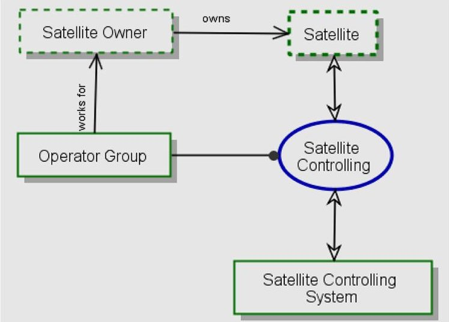

Figure 2. System diagram (SD) of satellite controlling system.

Object-process language of SD:

Satellite is environmental and physical.

Satellite owner is environmental and physical.

Satellite owner owns satellite.

Operator group is physical.

Operator group works for satellite owner.

Operator group handles satellite controlling.

Satellite controlling system is physical.

Satellite controlling affects satellite and satellite controlling system.

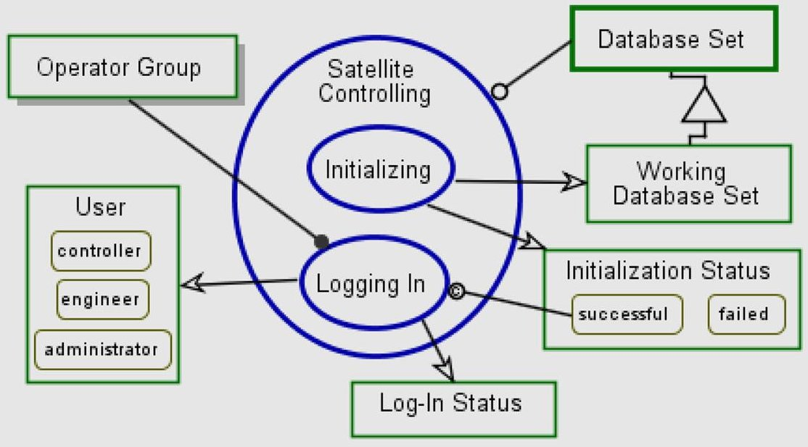

Figure 3. System diagram (SD1) satellite controlling in-zoomed.

Object-process language of SD1:

Operator group is physical.

Operator group handles logging in.

User can be controller by default, engineer, or administrator.

Initialization status can be successful or failed.

Working database set is a database set.

Satellite controlling requires database set.

Satellite controlling zooms into initializing and logging in.

Initializing yields working database set and initialization status.

Logging in occurs if initialization status is successful.

Logging in yields user and log-in status.

<!-- PDF_PAGE: 8 -->

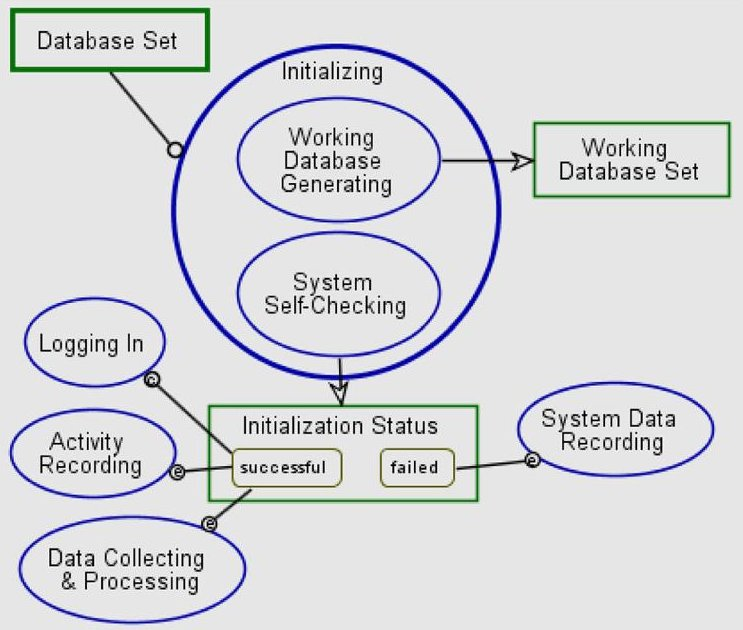

Figure 4. System diagram (SD1.1) initializing in-zoomed.

Object-process language of SD1.1:

Initialization status can be successful or failed.

Initialization status triggers data collecting and processing and activity recording when it enters successful.

Data collecting and processing requires successful initialization status.

System data recording requires failed initialization status.

Logging in occurs if initialization status is successful.

Activity recording requires successful initialization status.

Initializing requires database set.

Initializing zooms into working database generating and system self-checking.

Working database generating yields working database set.

System self-checking yields initialization status.

The in-zoomed view of logging in shows two subprocesses: user-password checking and user creating (Figure 5). Operator group interacts with user-password checking, which authenticates operator group by checking the user name and password stored in the working database set. User-password checking provides log-in status that signifies the success or failure of the logging in process. If logging in succeeds, user creating will be executed and create a user, and then, activity recording will be activated to record the logging in activity. If logging in fails, the logging in process will be triggered to allow operator group to try logging in again, and system data recording will be triggered to record the attempt of user logging in.

Figure 6 illustrates four asynchronous subprocesses of satellite controlling: data displaying, data collecting and processing, commanding, and database managing. When requested by operator group, data displaying process reads, formats, and displays data from data set. Data collecting and processing can be triggered by different system events to collect and process data related to those events. Operator group who is logged in as controller is allowed to send commands to both ground equipment set and satellite via the commanding process. Operator group who is logged in as administrator or engineer is allowed to make changes to the database set by calling the database managing process.

The in-zoomed view of the commanding process in Figure 7 shows three subprocesses: command selecting, telecommand sending, and ground Command (Cmd) sending. Command selecting uses information from the user, working database set, and data set to generate a command info object. If the command is related to ground equipment set, the ground Cmd sending process generates a ground command object. If the command info is a telecommand, the telecommand sending process generates a telecommand and an executing telecommand object. Upon completion of the commanding process, the activity recording process records the details of command and user information.

Figure 8 shows several sequential subprocesses of the telecommand sending process. Command generating generates a telecommand object that is sent to satellite via ground equipment set. If Cmd verification status is enabled, the command verifying process will be executed to verify that the

<!-- PDF_PAGE: 9 -->

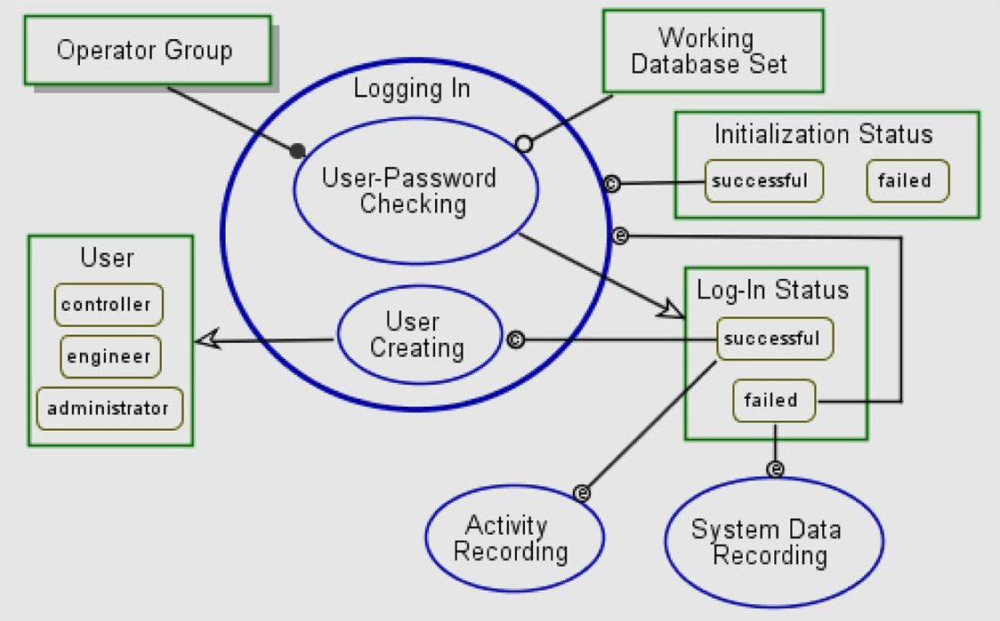

Object-process language of SD1.2:

Operator group is physical.

Operator group handles user-password checking.

User can be controller by default, engineer, or administrator.

Initialization status can be successful by default or failed.

Log-in status can be successful or failed.

Log-in status triggers activity recording when it enters successful.

Log-in status triggers logging in and system data recording when it enters failed.

Activity recording requires successful log-in status.

System data recording requires failed log-in status.

Logging in occurs if initialization status is successful.

Logging in requires failed log-in status.

Logging in zooms into user-password checking and user creating.

User-password checking requires working database set.

User-password checking yields log-in status.

User creating occurs if log-in status is successful.

User creating yields user.

command is correctly sent to satellite by comparing the sent command with the data set collected from satellite telemetry. If the Cmd verification status is disable or command verifying process is successfully executed, command executing process generates executing telecommand to execute the stored command on satellite. Next, if Cmd validation status is enable, the command validating process is executed to check whether the command is successfully executed by comparing the expected effect defined by the related database in database set with the data set collected from satellite telemetry. Upon the completion of the command verifying process or command validating process, the activity recording process is executed to keep record of the command verification or validation result.

The in-zoomed view of data displaying (Figure 9) consists of two independent subprocesses: system requested displaying and user requested displaying. System-requested displaying obtains data from database set and data set and then formats and displays the data on display screen. The user requested displaying listens to the operator group's request and acquires the related data from database set and data set and then formats and displays it on display screen.

Figure 10 illustrates the steps of the system requested displaying process. When activated by satellite controlling process, activity recording and system recording, for example, the system requested displaying process looks at the predefined default display data selection, retrieves the related data and information from database set and data set and then formats and displays data on display screen.

The subprocesses of the user requested displaying process is shown in Figure 11. Per operator group request, the data set selecting process allows operator group to select data set of his or her interest. Data

<!-- PDF_PAGE: 10 -->

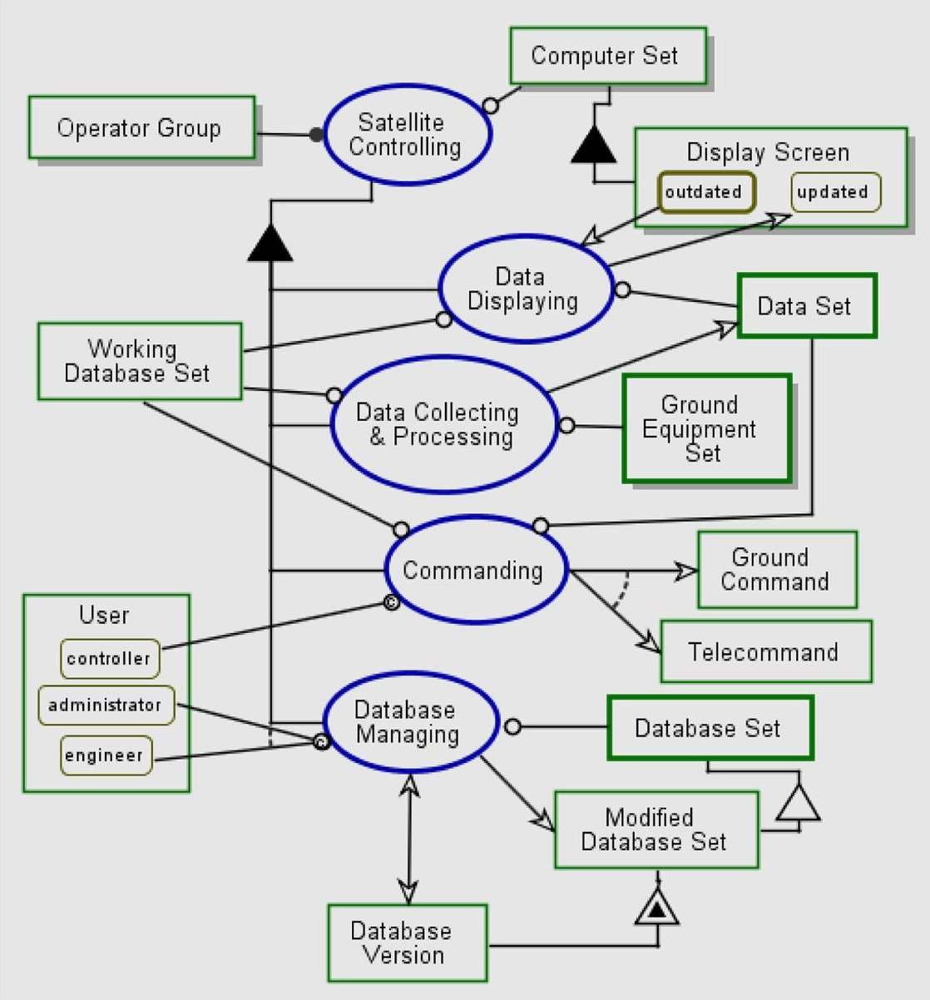

Figure 6. System diagram (SD2) — satellite controlling unfolded Object-process language of SD2: Operator group is physical. Operator group handles satellite controlling. Computer set is physical.

Computer set consists of display screen. Display screen is physical. Display screen can be outdated or updated. Outdated is initial.

Ground equipment set is physical.

User can be controller by default, engineer, or administrator.

Modified database set is a database set.

Modified database set exhibits database version.

Satellite controlling consists of data collecting and processing, database managing, commanding, and data displaying.

Data collecting and processing requires working database set and ground equipment set.

Data collecting and processing yields data set.

Database managing occurs if either user is administrator or user is engineer.

Database managing requires database set.

Database managing affects database version.

Database managing yields modified database set.

Commanding occurs if user is controller.

Commanding requires working database set and data set.

Commanding yields either ground command or telecommand.

Data displaying requires data set and working database set.

Data displaying requires data set and working database set. Data displaying changes display screen from outdated to updated.

Satellite controlling requires computer set.

Satellite controlling zooms into initializing and logging in.

<!-- PDF_PAGE: 11 -->

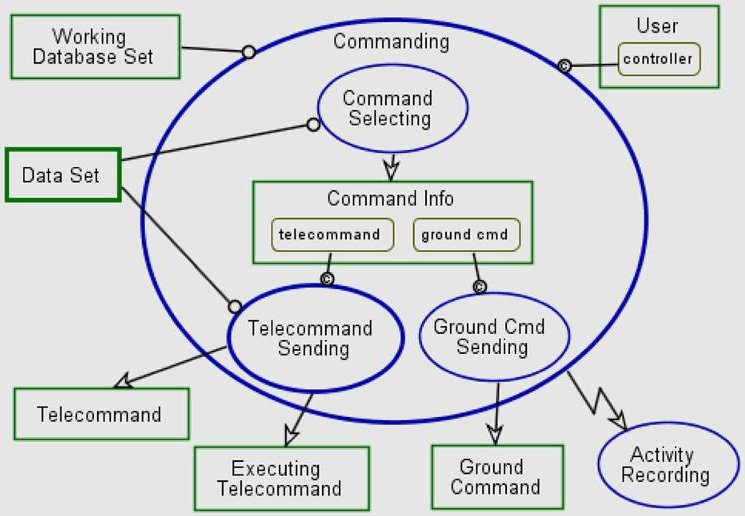

Figure 7. System diagram (SD2.1) Commanding in-zoomed.

Object-process language of SD2.1:

User is controller by default.

Commanding occurs if user is controller.

Commanding requires working database set.

Commanding invokes activity recording.

Commanding zooms into command selecting, telecommand sending, ground Cmd sending, and command info. Command info can be ground Cmd or telecommand.

Command selecting requires data set.

Command selecting yields command info.

Telecommand sending occurs if command info is telecommand.

Telecommand sending requires data set.

Telecommand sending yields telecommand and executing telecommand.

Ground Cmd sending occurs if command info is ground Cmd.

Ground Cmd sending yields ground command.

set selecting acquires the related data from working database set and data set and creates the selected data set object. Based on the selected data set and information from database set, the data are formatted by data formatting process and displayed on display screen by data displaying process.

Data collecting and processing process, consisting of four asynchronous subprocesses, is shown in Figure 12. Each subprocess is triggered by related events. For example, telemetry processing is triggered by the creation of raw telemetry object, and a new ground data triggers ground data recording. The outputs of these processes are specific types of data set, satellite data set and ground data set, for example.

Telemetry processing, depicted in Figure 13, has two sequential subprocesses. raw telemetry recording uses data definition provided by working database set to de-commutate and records raw telemetry in satellite data set. Then, telemetry processing uses various definitions in working database set, such as parameter and function definitions, to process the raw telemetry into the processed telemetry set.

Data set, illustrated in Figure 14, represents all the information that is recorded by the satellite controlling process. Data set can be categorized into several sets of data, such as activity record set, ground data set, satellite data set, and system data set.

The simplified process of database managing is illustrated in Figure 15. When operator group, logged in as administrator or engineer, triggers the database managing process, database set selecting allows operator group to select a database set to be modified or created, and based on input from operator group and information from database set, a selected database set object is created. Working on the selected database set, the creating and modifying process allows operator group to modify or create a new database set. The new or modified database set is generated together with its controlled version.

Database set is a set of definitions, and it plays a key role in governing the processes, functions, and interaction of objects and processes in the system. It can be divided into several subsets as depicted in Figure 16. To avoid repetition of definitions, common database contains all definitions that are used by many subsets of database set. For specific definitions in one subset that are different from others, the dedicated definitions are defined separately. For example, function definition set, command definition set, and parameter definition set that are specific to satellite are kept in satellite database.

<!-- PDF_PAGE: 12 -->

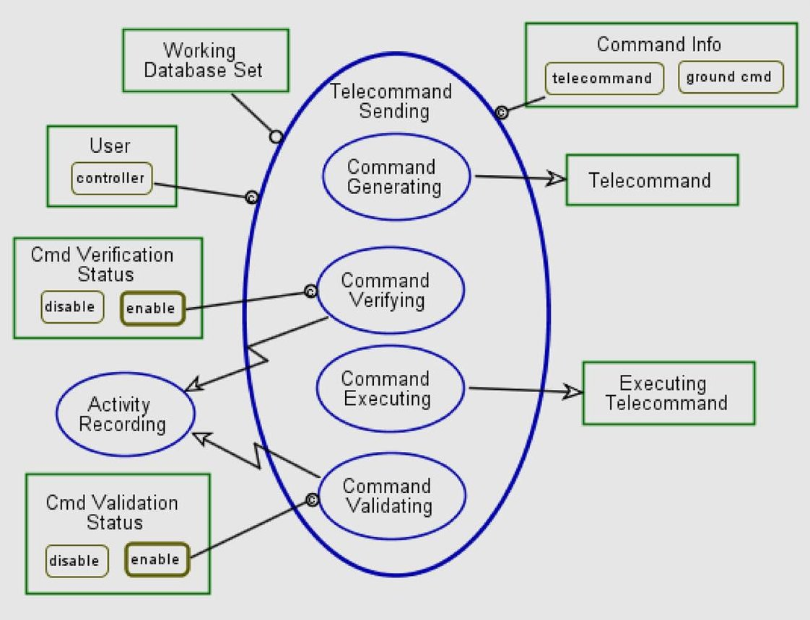

Figure 8. System diagram (SD2.1.1) Telecommand sending in-zoomed.

Object-process language of SD2.1.1:

User is controller by default.

Cmd verification status can be enable or disable Enable is initial

Cmd validation status can be enable or disable. Enable is initial

Enable is initial.

Command info can be ground Cmd or telecommand.

Telecommand sending occurs if user is controller and command info is telecommand.

Telecommand sending requires working database set.

Telecommand sending zooms into command generating, command verifying, command executing, and command validating.

Command generating yields telecommand.

Command verifying occurs if Cmd verification status is enabled.

Command verifying invokes activity recording.

Command executing yields executing telecommand.

Command validating occurs if Cmd validation status is enabled.

Command validating invokes activity recording.

Command definition set of common database is shown in Figure 17. There are many common command definitions in this database set. Cmd verification status and Cmd validation status are examples of common command parameters being used in the satellite controlling process.

A simplified model of ground equipment set is illustrated in Figure 18. Ground equipment set shall, at a minimum, perform the following functions: ground commanding processing, ground data generating, telemetry receiving, and command transmitting. The ground equipment set consists of antenna and baseband unit set, which are the primary physical devices used to link and exchange the signals between satellite controlling system and satellite. Status and parameters of ground equipment are changed and controlled by operator group via satellite controlling process and ground command processing process. Ground data generating collects status and parameters information from ground parameter set and antenna and baseband unit set and creates ground data object that is recorded by the ground data recording process. Telemetry from satellite is sent through antenna and baseband unit set and processed by the telemetry receiving process.

To demonstrate the interaction between satellite controlling system and satellite, a simplified model of a satellite is presented in Figure 19, showing three main processes. Satellite command processing receives the telecommand and executing telecommand from satellite controlling system with the help

<!-- PDF_PAGE: 13 -->

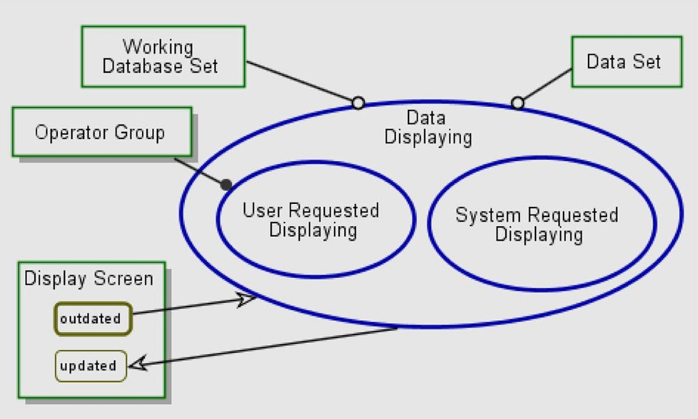

Figure 9. System diagram (SD2.2) data displaying in-zoomed.

Object-process language of SD2.2:

Operator group is physical.

Operator group handles user requested displaying.

Display screen is physical.

Display screen can be outdated or updated.

Outdated is initial.

Data displaying requires data set and working database set.

Data displaying changes display screen from outdated to updated.

Data displaying zooms into system requested displaying and user requested displaying.

of antenna and baseband unit set. Depending on the information in the command, satellite command processing distributes telecommand and executing telecommand to the specific unit in subsystem set. Telemetry collecting regularly collects data from each satellite's subsystems and satellite's parameter set and then generates telemetry object that is transmitted to satellite controlling system by the telemetry transmitting process.

Figure 20 shows the structure of the satellite controlling system. This is not an exhaustive set of the required objects, but it represents the objects that are needed to perform and simulate the simplified model of the system.

## 6. GUIDELINES FOR SATELLITE GROUND CONTROL SOFTWARE

Independently of the complexity of the satellite and the number of subsystems and base functions that the satellite has, the OPM model comprises only a few main top-level functions in satellite ground control system. These base functions are the main subprocesses that include data collecting and processing, commanding, data displaying, and database managing. Thus, the guidelines specified in this section as requirements are related primarily to these base functions.

As the focus of this research is not on the security of the software, the standard requirements of software security are assumed to be incorporated into the general requirement and will not be stated in the following guidelines. Each guideline is followed by a motivation clause, which links it to the OPM model and how this model relates to the rationale behind that specific guideline.

## 6.1. Proposed Guidelines and Their Motivation

1. Development tools and programing languages.

1. 1. The number of development tools and programing languages shall be kept to a minimum to avoid unnecessary development and maintenance complexity. Motivation: The software

<!-- PDF_PAGE: 14 -->

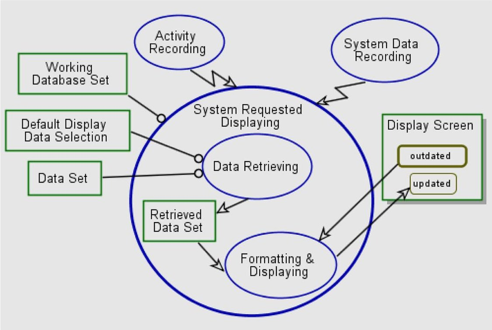

Figure 10. System diagram (SD2.2.1) system requested displaying in-zoomed.

Object-process language of SD2.2.1:

Display screen is physical.

Display screen can be outdated or updated. outdated is initial

System data recording invokes system requested displaying.

Activity recording invokes system requested displaying.

System requested displaying requires working database set.

System requested displaying zooms into data retrieving and formatting and displaying, and retrieved data set.

Data retrieving requires default display data selection and data set.

Data retrieving yields retrieved data set.

Formatting and displaying changes display screen from outdated to updated.

Formatting and displaying consumes retrieved data set.

developers, who integrated several legacy programs that are coded with different programing languages into their software, found great difficulty in their development, system integration, and maintenance phases.

1. 2. The selected tools and programing languages shall be platform-independent and operating system-independent. Motivation: This requirement increases the flexibility of the software when there is a need to change or upgrade hardware, and it opens opportunities to work on mobile computers such as tablet and smartphone.

1. 3. Coding changes due to any operating system upgrade will be zero or negligible. Motivation: Because of the long lifetime of satellite mission compared with the operating system lifecycle, there will be at least one operating system upgrade within the satellite mission lifetime. Developers needs to plan at the design and development phase to accommodate the foreseeable operating system update.

1. 4. Virtual machine is an acceptable solution to overcoming the problem of operating system change or upgrade. Motivation: Virtual machine is a widely used solution to the change in operating system. It is an alternative to points 1.2 and 1.3. However, developers are encouraged to explore and propose more suitable and efficient solutions.

## 2. Software structure and programming style

2. 1. Concepts of object-oriented programming, such as encapsulation, abstraction, inheritance, and code reusability shall be used. Motivation: The object-oriented programming concepts are efficient and flexible. If the software is well developed following these concepts, it will readily accommodate the future changes in processes and customizable functions.

<!-- PDF_PAGE: 15 -->

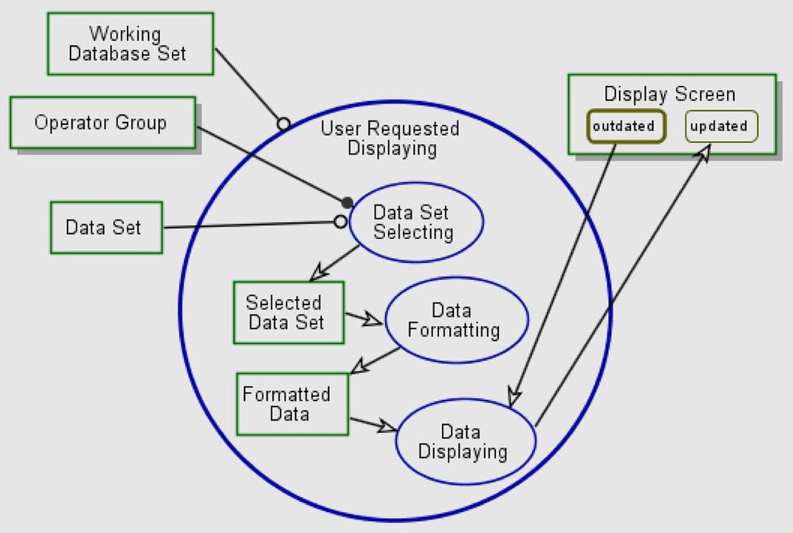

Figure 11. System diagram (SD2.2.2) user requested displaying in-zoomed.

Object-process language of SD2.2.2:

Operator group is physical.

Operator group handles data set selecting.

Display screen is physical.

Display screen can be outdated or updated.

outdated is initial.

User requested displaying requires working database set.

User requested displaying zooms into data set selecting, data formatting, and data displaying, and formatted data and selected data set.

Data set selecting requires data set.

Data set selecting yields selected data set.

Data formatting consumes selected data set.

Data formatting yields formatted data.

Data displaying changes display screen from outdated to updated.

Data displaying consumes formatted data.

2. 2. Modularity structure and database-driven application concepts shall be implemented. Motivation: Developing modular software and database-driven application concepts enhances flexibility and visibility in software structure and functions. For example, developers and users can modify existing features or create new ones by modifying the database without any change in software code.

2. 3. The high-level functions and features shall be developed based on the base functions, and the functionalities will be defined by parameters, configurations, and definitions in the sets of the predefined and user-defined database. Motivation: As the OPD in Figure 6 shows, the main system function is modeled as being comprised of five main base functions: satellite controlling, data displaying, data collecting and processing, commanding and database managing. The parameters as shown in the OPM model are function definition set, command definition set, and parameter definition set. The main processes are linked to the database in the OPM model, as shown in figures 3, 6, 7, 9, 12.15, and 16.

2. 4. All hardware-dependent functions shall be embedded in their designated modules, and their interface functions and definitions shall be carefully coded and documented in full detail. Motivation: As shown in Figure 10, the formatting and displaying process is defined as one separated module dedicated to communication with the display screen. The documentation of interface functions and definitions of these hardware-dependent functions is very important for future software upgrades, software errors troubleshooting, and system maintenance.

<!-- PDF_PAGE: 16 -->

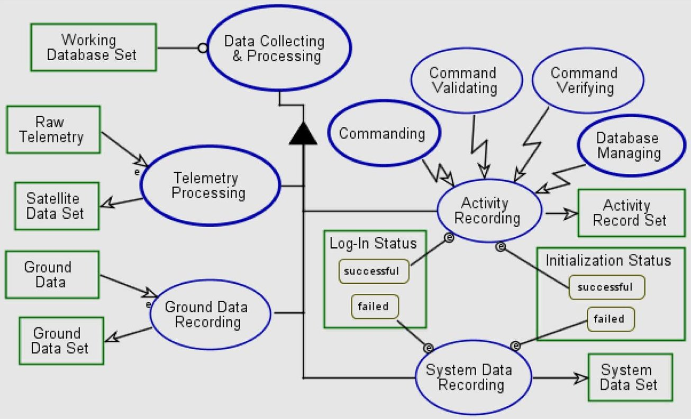

Figure 12. System diagram (SD2.3) data collecting and processing unfolded.

Object-process language of SD2.3:

Raw telemetry triggers telemetry processing.

Ground data triggers ground data recording.

Initialization status can be successful or failed.

Initialization status triggers activity recording when it enters successful.

Initialization status triggers system data recording when it enters failed.

Log-in status can be successful or failed.

Log-in status triggers activity recording when it enters successful.

Log-in status triggers system data recording when it enters failed.

Database managing invokes activity recording.

Commanding invokes activity recording.

Command verifying invokes activity recording.

Command validating invokes activity recording.

Data collecting and processing consists of telemetry processing, ground data recording, system data recording, and activity recording.

Telemetry processing consumes raw telemetry.

Telemetry processing yields satellite data set.

Ground data recording consumes ground data.

Ground data recording yields ground data set.

System data recording requires failed initialization status and failed log-in status.

System data recording yields system data set.

Activity recording requires successful log-in status and successful initialization status.

Activity recording yields activity record set.

Data collecting and processing requires working database set.

2. 5. Any hardware change shall affect only the changed hardware-related modules, and the required re-coding shall not propagate and be invisible to other modules and main processes. Motivation: By applying modularity and database-driven concepts to the hardware-dependent functions, the re-coding required by hardware change shall affect only the hardware-related modules. This requirement helps prevent coding errors or bugs propagating from one module to the others, and it is likely that the system verification and validation of each module will be easy as the developer can focus only on the modules related to the changed hardware.

3. Data collecting and processing

3. 1. System and activities status, including system initialization status, log-in status, and all user activities and requests shall be recorded in detail. System and activities status,

<!-- PDF_PAGE: 17 -->

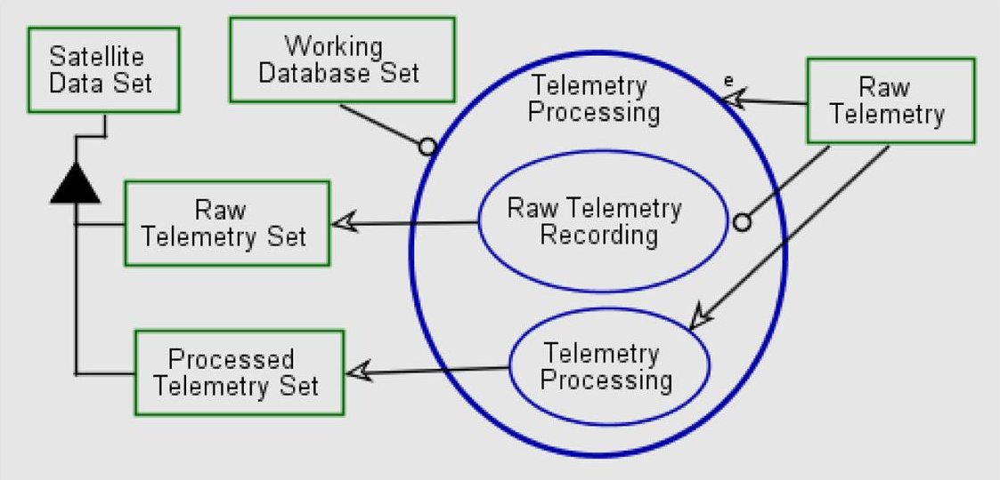

Figure 13. System diagram (SD2.3.1) telemetry processing in-zoomed Object-process language of SD2.3.1:

Raw telemetry triggers telemetry processing.

Satellite data set consists of raw telemetry set and processed telemetry set.

Telemetry processing requires working database set.

Telemetry processing consumes raw telemetry.

Telemetry processing zooms into raw telemetry recording and telemetry processing.

Raw telemetry recording requires raw telemetry.

Raw telemetry recording yields raw telemetry set.

Telemetry processing consumes raw telemetry.

Telemetry processing yields processed telemetry set.

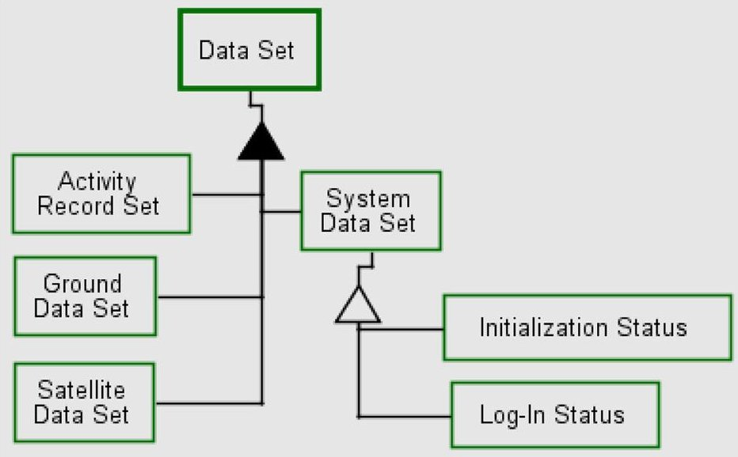

Figure 14. System diagram (SD2.4) data set unfolded.

Object-process language of SD2.4:

Data set consists of activity record set, satellite data set, ground data set, and system data set.

Initialization status is a system data set.

Log-in status is a system data set.

including system initialization status, log-in status, and all user activities and requests shall be recorded in detail. Motivation: As specified in the OPM model, most processes generate triggering messages that are recorded by system data recording or activity recording processes. For example, in Figure 4, the initializing process generates the initialization status object that triggers activity recording to record its successful status or triggers system data recording to record its failed to initialize the status. The same practice is applied to the logging in process (and to other processes) in Figure 5. The logging in process creates login status object that triggers activity recording to record its successful status or triggers system data recording to record its failed to log-in status.

<!-- PDF_PAGE: 18 -->

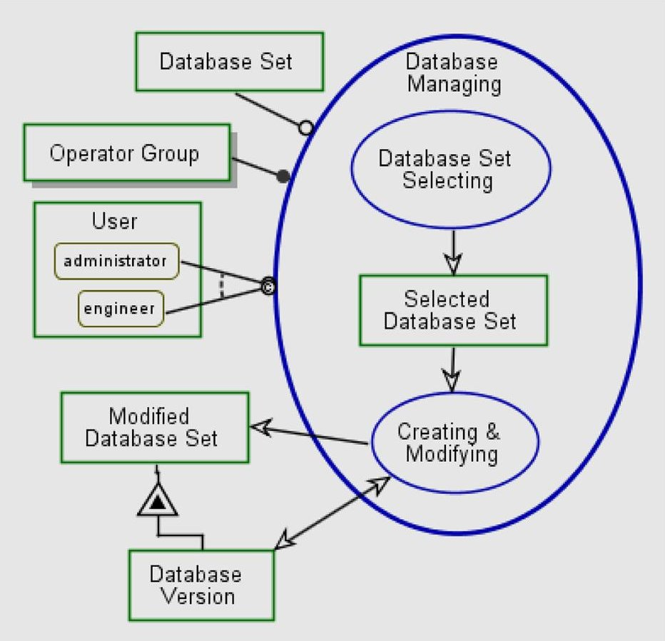

Figure 15. System diagram (SD2.5) database managing in-zoomed.

Object-process language of SD2.5:

Operator group is physical.

Operator group handles database managing.

User can be engineer or administrator.

Modified database set exhibits database version.

Database managing occurs if either user is administrator or user is engineer.

Database managing requires database set.

Database managing zooms into database set selecting and creating and modifying, and selected database set.

Creating and modifying affect database version.

Creating and modifying consume selected database set.

Creating and modifying yield modified database set.

3. 2. The data collecting and processing process shall allow the user to trace and analyze process errors and provide clear, filterable, and searchable information of process issues and all messages related to system and user activities. Motivation: Not only welldocumented-and-recorded data are important, but also searching, filtering, and formatting these document and data records are very helpful for users to quickly understand and obtain the information and evidence they are looking for.

3. 3. The data collecting and processing process shall support event analysis and event report. Motivation: As shown in figures 10 and 11, the selected data set or the default display data selection, the predefined set of data and formatting in the database set will readily help the user to perform event analysis and produce event report.

3. 4. The name of record file(s) and file(s) location shall be configurable by the user. Motivation: To enable users to define their own file names and locations, the software developer has to design the system to allow users to configure their preferences not by changing software code but by setting the parameter definition set in the database set.

3. 5. All data shall be processed, and all necessary statistics, such as minimum, maximum, and average values, shall be generated and easily retrievable. Motivation: The OPD in Figure 13 emphasizes that both raw telemetry set and processed telemetry set are recorded. Thus, there is no need to reprocess the raw telemetry every time it is requested to display its processed value.

<!-- PDF_PAGE: 19 -->

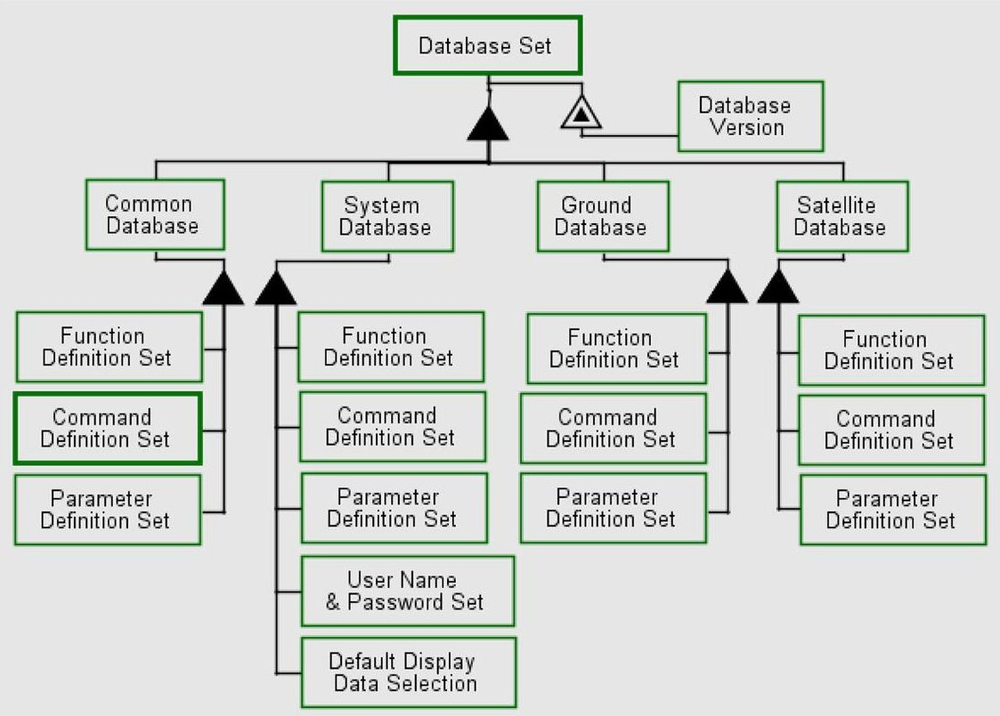

Figure 16. System diagram (SD2.6) database set unfolded.

Object-process language of SD2.6:

Database set exhibits database version.

Database set consists of system database, ground database, satellite database, and common database.

System database consists of parameter definition set, function definition set, command definition set, user name and password set, and default display data selection.

Ground database consists of parameter definition set, function definition set, and command definition set.

Satellite database consists of parameter definition set, command definition set, and function definition set.

Common database consists of function definition set, command definition set, and parameter definition set.

3. 6. The parameters of statistical information and data processing, such as sample size and period of statistical calculation, shall be configurable. Motivation: Almost all the time, users eventually find out that they need to change predefined parameters, such as the number of samples or time period used to calculate statistical values of the data set. Thus, the developer has to design the software so that it allows users to change these parameters via the parameter definition set in the database set.

## 4. Commanding

4. 1. The commanding process shall facilitate user's command selection by providing filterable command list. Motivation: The OPD in Figure 7 shows that the command selecting process uses both information from working database set and data set to facilitate command selection by the user.

4. 2. The commanding process shall handle all kinds of commands related to satellite and ground equipment. Motivation: As illustrated in Figure 7, the commanding process can process both ground command and telecommand.

4. 3. Different command types and structures shall be defined in the database set and not by the different subprocesses. Motivation: As shown in Figures 16 and 17, the command types and structures are defined by the command definition set, the parameter definition set, the function definition set, and other definitions in the database set.

4. 4. The command generating, the command transmitting, the command verifying, the command executing, and the command validating processes shall be defined by the command definition set, the parameter definition set, the function definition set, and interface control documents or user manuals provided by satellite and hardware

<!-- PDF_PAGE: 20 -->

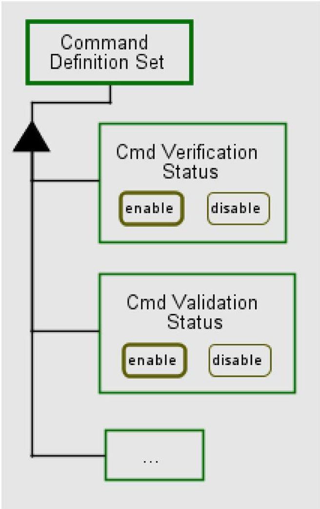

Figure 17. System diagram (SD2.6.1) command definition set unfolded.

Command definition set consists of Cmd verification status, Cmd validation status, and ... Cmd verification status can be enable or disable. enable is initial.

Cmd validation status can be enabled or disabled enable is initial.

manufacturers. Motivation: The design of the command generating, the command transmitting, the command verifying, the command executing, and the command validating processes are based on the command definition set, the parameter definition set, the function definition set, and other definitions in the database set that are derived from various documents, mainly interface control documents and user manuals provided by satellite and hardware manufacturers.

4. 5. The steps of the commanding process shall be configurable by changing parameters in the command database. Motivation: This requirement provides users with flexibility to operate their satellite in different scenarios. For example, in emergency situations, users want to send a command to the satellite at the fastest rate; thus, they set the status of both Cmd verification status and Cmd validation status to disable in the command definition set (in Figure 17). As shown in the OPD in Figure 8, by this setting, the telecommand sending process is completed quickly without waiting for command verifying and command validating.

4. 6. The software system shall allow the user to introduce new commands or change existing commands by modifying or creating the database set without any change in the process code. Motivation: This requirement provides users with the flexibility to incorporate future need for new commands, which can be fulfilled by creating and modifying the database set without any change in the software code. Flexibility and interoperability are costly features and need to be traded off with system performance and cost.

<!-- PDF_PAGE: 21 -->

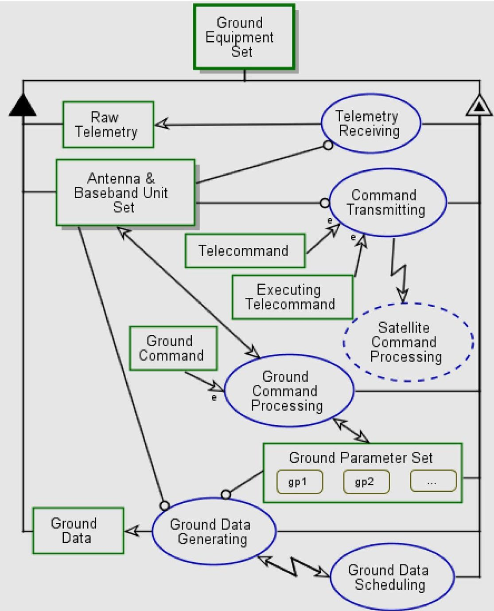

Figure 18. System diagram (SD2.7) ground equipment set unfolded. Object-process language of SD2.7:

Object-process language of SD2.7:

Ground command triggers ground command processing.

Telecommand triggers command transmitting.

Executing telecommand triggers command transmitting.

Ground equipment set is physical.

Ground equipment set exhibits ground parameter set and telemetry receiving, ground command processing,

command transmitting, ground data generating, and ground data scheduling.

Ground parameter set can be gp1, gp2, or ...

Telemetry receiving requires antenna and baseband unit set.

Telemetry receiving yields raw telemetry.

Ground command processing affects antenna and baseband unit set and ground parameter set.

Ground command processing consumes ground command.

Command transmitting requires antenna and baseband unit set.

Command transmitting consumes executing telecommand and telecommand.

Command transmitting invokes satellite command processing.

Ground data generating requires ground parameter set and antenna and baseband unit set.

Ground data generating yields ground data.

Ground data generating invokes ground data scheduling.

Ground data scheduling invokes ground data generating.

Ground equipment set consists of raw telemetry, ground data, and antenna and baseband unit set.

Antenna and baseband unit set is physical.

Satellite command processing is environmental.

<!-- PDF_PAGE: 22 -->

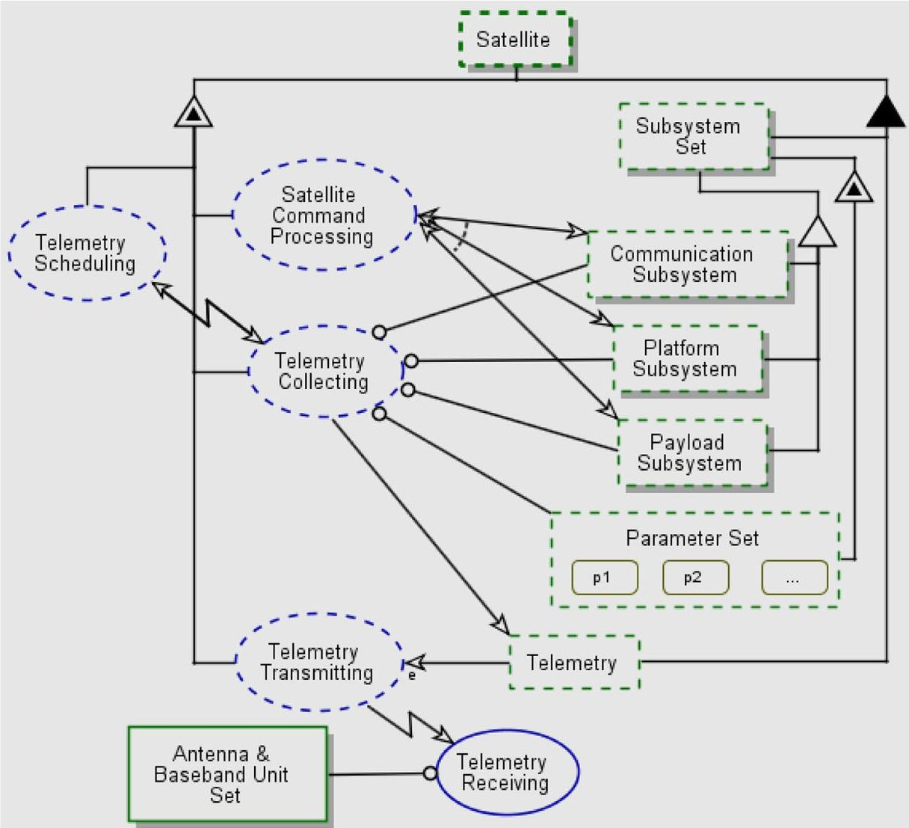

Figure 19. System diagram (SD3) satellite unfolded.

Object-process language of SD3:

Antenna and baseband unit set is physical.

Satellite is environmental and physical.

Satellite exhibits satellite command processing, telemetry collecting, telemetry transmitting, and telemetry scheduling.

Satellite command processing is environmental.

Satellite command processing affects communication subsystem either platform subsystem, or payload subsystem. Telemetry collecting is environmental.

Telemetry collecting requires parameter set, platform subsystem, communication subsystem, and payload subsystem. Telemetry collecting yields telemetry.

Telemetry collecting invokes telemetry scheduling.

Telemetry transmitting is environmental.

Telemetry transmitting consumes telemetry.

Telemetry transmitting invokes telemetry receiving.

Telemetry scheduling is environmental.

Telemetry scheduling invokes telemetry collecting.

Satellite consists of subsystem set and telemetry. Subsystem set is environmental and physical. Subsystem set exhibits parameter set. Parameter set is environmental. Parameter set can be p1, p2, or ... Telemetry is environmental.

Telemetry triggers telemetry transmitting.

Platform subsystem is environmental and physical.

Platform subsystem is a subsystem set.

Payload subsystem is environmental and physical.

Payload subsystem is a subsystem set.

Communication subsystem is environmental and physical.

Communication subsystem is a subsystem set.

Telemetry receiving requires antenna and baseband unit set.

<!-- PDF_PAGE: 23 -->

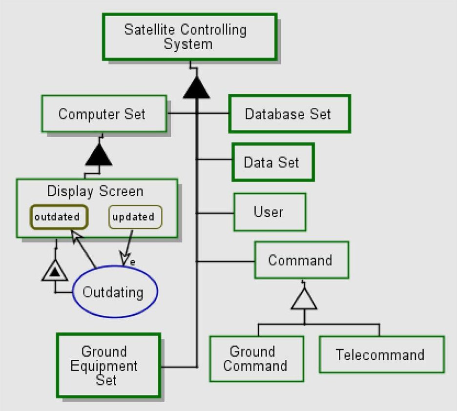

Figure 20. System diagram (SD4) satellite controlling system unfolded.

Satellite controlling system consists of database set, data set, computer set, ground equipment set, command, and user. Computer set is physical.

Display screen triggers outdating when it enters updated.

Ground equipment set is physical.

Ground command is a command.

Telecommand is a command.

## 5. Data displaying

5. 1. The data displaying process shall handle all kinds of data related to the system - both the satellite and the ground equipment. Motivation: As the OPD in Figure 9 shows, the data displaying process can display the data from the data set, which, as shown in Figure 14, contains data items related to system (system data set and activity record set), satellite (satellite data set), and ground equipment (ground data set).

5. 2. The data formatting of the data set from system, satellite, and ground equipment shall be governed by the database set and not by subprocesses. Motivation: The OPD in Figure 11 shows that the user requested displaying process uses the working database set to determine the format of the selected data set to be displayed.

5. 3. The software system shall allow the user to change or create a new display format of any data set by modifying or creating the database set without any change in the process code. Motivation: The display format of different types (system data set, activity record set, satellite data set, and ground data set in Figure 14) of the data set is defined by the definition set, such as function definition set and parameter definition set, in the database set, shown in Figure 16.

<!-- PDF_PAGE: 24 -->

## 6. Database managing

6. 1. The database managing process shall provide the authorized user with easy access to the database set and facilitate creating new database set or changing the existing database set. Motivation: As illustrated in Figure 15, only a user who is an administrator or engineer is allowed to modify the database set.

6. 2. The database set shall have database version for tracking and recording the creation and modification of the database set. Motivation: The OPD in Figure 15 shows that the creating and modifying process creates the modified database set and updates its database version for tracking and reference purpose.

6. 3. A database translation process (not modeled) shall be provided to facilitate the translation of manufacturers' database formats into the software database format. Motivation: While rare, there are times during the satellite mission lifetime that the satellite manufacturer updates and sends out the updated version of the satellite database to the satellite owner. The satellite owner and operator can then use the tool for translating the old database to the new database format used by the new software or vice versa. Asking the software developer to translate the updated database during the maintenance period has proved to be difficult and expensive.

## 7. CONCLUSION AND DISCUSSION

This research provides guidelines for developing satellite ground control software that are grounded in a relatively detailed OPM conceptual model of the system-to-be. The underlying concepts of this model and guidelines include database-driven application, object-oriented, and modularity concepts. Instead of coding each different function differently, only the common base functions shall be coded, and combining some of these base functions will form specific high-level required functions. The formation and combination of these functions will be governed by the main code and a database. These concepts will provide the satellite operator with the flexibility to create new features and help software developers to find and fix bugs. The OPM model along with the suggested guidelines are expected to help alleviate the problems identified in the various stages of satellite ground control software lifecycle.

The concepts of database-driven application, object-oriented programming, and modularity have potential significant benefits, but these bear some costs, as discussed next.

A well-designed database-driven and modular application will make it easier to manage requirements change or the needs for new features during and after the development of the satellite ground control software. This architecture also makes it easier and quicker to find and fix bugs.

On the flip side, a considerable upfront investment of design effort is required to design and code all the base functions that govern the formation and combination of high-level functions.

The OPM model and guidelines proposed in the paper, while not all-inclusively and extensively detailed solutions, provide satellite owners and operators with a fresh look and a host of new ideas for alleviating current problems in the domain of satellite communication software. While a significant number of the general principles specified in the proposed guidelines section are already followed by COTS satellite control software, the domain of satellite communication software still suffers from a host of problems, which we have delineated in this paper. Here, we proposed a unique combination of an OPM model that goes hand-in-hand with a set of constructive guidelines to help solve these problems.

## 7.1. Future research

Further studies related to the topic of this research include the following:

(1) Creating a more elaborate and executable OPM model to demonstrate and verify the effectiveness of the proposed concept and system architecture.

(2) Using physical-informatical essence duality concept with OPM modeling to help analyze and understand satellite anomalies.

(3) Developing tool to generate system requirement directly from existing OPM models.

<!-- PDF_PAGE: 25 -->

## REFERENCES

1. Straka WC. "The role of COTS software in satellite ground control systems," IEEE Aerospace Conference, 1997 Proceedings, 1997; 4: 149-158.

2. Anderson W, McAuley J. "Commercial off-the-shelf product management lessons learned-satellite ground control system (SGCS) upgrade," in Fifth International Conference on Commercial-off-the-Shelf (COTS)-Based Software Systems, 2006, 2006; p. 8 pp.-.

3. Dori D. Object-process Methodology—A Holistic System Paradigm. Springer Verlag: Berlin, Heidelberg, New York, 2002.

4. Vardanega T. "An evolutionary approach to the construction of new-generation software-intensive satellite control systems," in Proceedings of the Joint Workshop on Parallel and Distributed Real-Time Systems, 1997, 1997; pp. 263-268.

5. Cutler JW, Kitts CA. "Mercury: a satellite ground station control system," 1999 IEEE Aerospace Conference, 1999 Proceedings, 1999; 2: 51-58.

6. Kitts N, Kiser L, Girouard F, Hopkins A, Morgan T, Chakrabarti S, Cook T, Cotton D, Dell P. "A fully implemented semiautomated ground-control system for the TERRIERS satellite," AIAAUSU Conf. Small Satell. Sep. 1996.

7. Kim IJ, Jung WC, Kim M, Kim JH. "Design and prototyping of high availability architecture for satellite ground control system," The 7th International Conference on Advanced Communication Technology, 2005, ICACT 2005; 2: 1044-1048.

8. "CMMI Institute - the home of Capability Maturity Model Integration," CMMI Institute. [Online]. Available: http:// cmmiinstitute.com/. [Accessed: 23-Mar-2014].

9. "Data-driven programming," Wikipedia, the free encyclopedia. 16-May-2014.

10. Riaz M. "Maintainability prediction of relational database-driven applications: a systematic review," 263-272, 2012.

## AUTHORS' BIOGRAPHIES

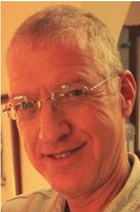

Professor Dov Dori is Harry Lebensfeld Chair in Industrial Engineering and head of the Enterprise System Modeling Laboratory at the Faculty of Industrial Engineering and Management, Technion, Israel Institute of Technology. Since 2000, he has been intermittently a visiting professor at MIT's Engineering Systems Division, where he is currently a lecturer. He received his PhD in Computer Science in 1988 from Weizmann Institute of Science, MSc in Operations Research from Tel Aviv University in 1981, and BSc in Industrial Engineering and Management from Technion in 1975. His research interests include model-based systems engineering, conceptual modeling of complex systems, systems architecture and design, software and systems engineering, and systems biology. Prof. Dori invented and developed object-process methodology, the new ISO 19450 Publically Available Specification. He has authored over 300 publications, including journal and conference publications, books, and book chapters. Prof. Dori has mentored over 50 graduate students.

He was a chairperson of nine international conferences or workshops. Among his many editorial duties, Prof. Dori was an associate editor of IEEE Transaction on Pattern Analysis and Machine Intelligence, and currently, he is an associate editor of Systems Engineering. He is Fellow of INCOSE - International Council on Systems Engineering, Fellow of IAPR - International Association for Pattern Recognition, Member of Omega Alpha Association - International Honor Society for Systems Engineering, and a senior member of IEEE and of ACM.

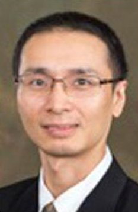

Somwang Thipphayathetthana has been working for THAICOM Plc, a leading Asian satellite communication company for more than 14 years. He got a scholarship from THAICOM Plc for his graduate studies in the System Design and Management program at MIT, and he recently graduated with MSc in Engineering and Management from MIT. He also graduated with Bachelor's (first class honor) and Master's Degree of EE major in Telecommunication from Chulalomgkorn University, Thailand. He is highly experienced and interested in satellite communication, software development, adaptive filtering, and artificial intelligence.