<!-- PDF_PAGE: 1 -->

# From Modular to Distributed Open Architectures: A Unified Decision Framework

Babak Heydari, $ ^{*} $ Mohsen Mosleh, and Kia Dalili

Stevens Institute of Technology, School of Systems and Enterprises, Hoboken, NJ

Received 13 August 2013; Revised 2 May 2016; Accepted 9 June 2016, after one or more revisions Published online in Wiley Online Library (wileyonlinelibrary.com). DOI 10.1002/sys.21348

## ABSTRACT

This paper introduces a conceptual, yet quantifiable, architecture framework by extending the notion of system modularity in its broadest sense. Acknowledging that modularity is not a binary feature and comes in various types and levels, the proposed framework introduces higher levels of modularity that naturally incorporate decentralized architecture on the one hand and autonomy in agents and subsystems on the other. This makes the framework suitable for modularity decisions in Systems of Systems and for analyzing the impact of modularity on broader surrounding ecosystems. The stages of modularity in the proposed framework are naturally aligned with the level of variations and uncertainty in the system and its environment, a relationship that is central to the benefits of modularity. The conceptual framework is complemented with a decision layer that makes it suitable to be used as a computational architecture decision tool to determine the appropriate stage and level of modularity of a system, for a given profile of variations and uncertainties in its environment. We further argue that the fundamental systemic driving forces and trade-offs of moving from monolithic to distributed architecture are essentially similar to those for moving from integral to modular architectures. The spectrum, in conjunction with the decision layer, could guide system architects when selecting appropriate parameters and building a system-specific computational tool from a combination of existing tools and techniques. To demonstrate the applicability of the framework, a case for fractionated satellite systems based on a simplified demo of the DARPA F6 program is presented where the value of transition from a monolithic architecture to a fractionated architecture, as two consecutive levels of modularity in the proposed spectrum, is calculated and ranges of parameters where fractionation increases systems value are determined. $ \textcircled{c} $ 2016 Wiley Periodicals, Inc. Syst Eng 19:252-266,2016

Key words: modularity; uncertainty; modular open systems architecture; MOSA; ecosystem; complex adaptive systems; complex networks; uncertainty management; fractionated satellite

## 1. INTRODUCTION

Although modularity has long been suggested as an effective complexity management mechanism in natural and manmade systems, interests in modular design and modularity science have recently surged as a result of the increased complexity level of most engineering systems and more

<!-- PDF_PAGE: 2 -->

attention to new architecture schemes such as Modular Open Systems Approach and flexible systems [Fricke and Schulz, 2005; Nilchiani and Hastings, 2007]. The definition of modularity, in this sense, goes beyond simply having modular components, and refers to "a general set of principles that help with managing complexity through breaking up a complex system into discrete pieces, which can then communicate with one another only through standardized interfaces" [Langlois, 2002].

The significance of modularity for complex systems was first identified by Herbert Simon in his classic 1962 paper [Simon, 1962], in which a complex system was regarded as one made up of a large number of distinct parts that interact in a nontrivial way. One way to reduce this complexity, Simon suggests, is to decrease the number of distinct parts by encapsulating some of them into modules, where the internal information of each module is hidden from other modules. He referred to the notion of near-decomposability as a common feature of many natural systems that enables them to respond effectively to external changes without disrupting the system as a whole. More recent studies further validate Simon's hypothesis and demonstrate various forms of biological modularity in protein-protein networks, neural cells, and gene regulation networks [Lorenz, Jeng, and Deem, 2011; Clune, Mouret, and Lipson, 2013]. Modularity has also been recognized as an essential concept in architecting products, processes, and organizations and has been an active area of research in many academic disciplines such as management sciences, systems and mechanical engineering, and organizational design. It has been shown to increase product and organizational variety [Karl and Steven, 2000], the rate of technological and social innovation [Baldwin and Clark, 2000], market dominance through interface capture [Moore, Louviere, and Verma, 1999], cooperation and trust in networked systems [Gianetto and Heydari, 2015a,b], and to reduce cost through reuse [Moore et al., 1999]. Following Conway's law [Conway, 1968], it has been argued that modularity in products gives rise to modularity in organizations that manufacture them [Sanchez and Mahoney, 1996] and can result in some benefits at the enterprise and organizational level. A comprehensive list of studies related to the advantage of modularity in products and organizations can be found in Schilling and Steensma [2001], Langlois [2002], Campagnolo and Camuffo [2010], Doran and Hill [2009].

With all these advantages, we might be encouraged to make systems as modular as possible, limited only by physical and practical considerations. However, the observed trends in natural and engineered systems indicate that, under certain circumstances, some systems follow an opposite path, that is, moving away from modularity toward more integration. The microelectronics industry provides the best example where more integration has been pursued not only for electronic components, but also mechanical and biomedical parts, resulting in the so-called system on a chip solutions. Such reverse trends remind us to also investigate costs of modularity and disadvantages of overmodularity. Increasing modularity often requires developing additional interfaces and standards, and thus can increase the overall cost of the system [Sharman and Yassine, 2004], can result in static architectures and excessive product similarity [Kusiak, 2002], and might hamper

innovation in design [Ethiraj and Levinthal, 2004]. Moreover, increased levels of modularity can adversely affect the system performance under limited available margins. For example, designing some microelectronics and communication systems requires combining various standard modules into an integral architecture to increase the overall system performance [Heydari et al., 2007a,b; Srivastava and Motani, 2005]. Finally, when certain modules are equipped with decisionmaking autonomy, they can result in coordination difficulties and suboptimal aggregate behavior [Papadimitriou, 2001; Gianetto and Heydari, 2016; Brusoni et al., 2007].

These opposing effects mean that system architects face a dilemma in deciding between modular versus integral architectures. Moreover, since modularity is not a binary property, determining the right level of modularity becomes a complicated decision that requires formal frameworks and methods. Several conceptual framework and decision analysis methods and algorithms for modularizing an otherwise integral system have been suggested in the literature, examples of which are models based on complex network analysis [Sosa, Eppinger, and Rowles, 2007], Fractal Product Design (FPD) [Kahmeyer, Warnecke, and Sheider, 1994], Modular Product Development (MPD) [Pahl et al., 1988], Modeling the Product Modularity (MPM) [Huang and Kusiak, 1998], Modular Function Deployment (MFD) [Erixon, 1998], Design Structure Matrix (DSM) [Pimmler and Eppinger, 1994], Axiomatic Design (AD) [Suh, 1990], and methods based on Real Options [Baldwin and Clark, 2000]. However, the majority of these methods treats modularity as a binary feature rather than a continuum and do not relate modularity decisions to characteristics of the environment as defined earlier. DSM, a representation method for the interactions among systems components [Steward, 1981], in particular, has been widely used in many modularity decision methods [Browning, 2001; Sangal et al., 2005; Hölttä-Otto and de Weck, 2008]. Although the method uses a natural representation of internal system interactions and is simple to use, it is only effective in modularity decisions for relatively simple systems. DSMs have serious shortcomings when used in systems with higher levels of complexity, since they are static, do not incorporate the system's interactions with the environment, and do not allow for clear presentation of multiple relations or time domain evolution [Dong, 2002; Bartolomei et al., 2012]. Some extensions of the method, such as Domain Mapping Matrix (DMM) [Danilovic and Browning, 2007] and Engineering System Matrix (ESM) [Bartolomei et al., 2012], have been proposed in order to overcome these limitations. However, they have not advanced much beyond framework definitions and multiattribute relational descriptions of the system; and more research is needed to make these methods applicable for real problems.

Besides accommodating a nonbinary notion of modularity and incorporating environment parameters, a novel modularity decision framework needs to extend to open architectures and Systems of Systems and be able to capture the impact of system modularity on various parameters of the surrounding ecosystem. These extensions must incorporate two important features, namely, decentralized/distributed schemes and autonomy of system components. These features contribute to system complexity, yet at the same time provide new

<!-- PDF_PAGE: 3 -->

capacities for complexity management mechanisms which in turn require a transformation in the notion of modularity from static to dynamic in which the modular structure of the system can dynamically and autonomously change in response to variations in the environment by leveraging available autonomy in the system as well as its underlying decentralized network structure [Heydari and Dalili, 2015]. This notion of modularity is generally missing in the literature of product and system design.

This paper introduces a conceptual, yet quantifiable modularity framework that is a step toward addressing these shortcomings. First, it acknowledges that modularity is not a binary feature and comes in various types and levels. Second, the framework introduces higher stages of modularity that naturally incorporate decentralized architecture on the one hand and autonomy in agents and subsystems on the other. This makes the framework suitable for modularity decisions in Systems of Systems and analyzing the impact of modularity on broader surrounding ecosystems. Third, stages of modularity in the proposed framework are naturally aligned with the level of variations and uncertainty in the system and its environment; a relationship that is central to the benefits of modularity. Finally, the conceptual framework is complemented with a decision layer that makes it suitable to be used as a computational architecture decision tool to determine the appropriate stage and level of modularity of a system, for a given profile of variations and uncertainties in its environment. We further argue that the fundamental systemic driving forces and trade-offs of moving from monolithic to distributed architecture are essentially similar to those for moving from integral to modular architectures. In both of these two dichotomies, increased uncertainty, often in the environment, is one of the key contributors for pushing a system toward a more decentralized scheme of architecture, in which subsystems are loosely coupled. Trends in processing units in computer systems can be illustrative here. Depending on the relative rate of change and uncertainty, the CPU can be an integrated part of the system (e.g., Smartphone), be modular at the discretion of the user (e.g., PC), transition to client-server architecture to accommodate smoother response to technology upgrade, security threads, or computational demand, or finally migrate to a fully flexible system with dynamic resource sharing (e.g., cloud computing).

The organization of the rest of the paper is as follows: In Section 2, a method for characterizing the complexity of the environment and its impact on systems modularity is proposed. Next, in Section 3, a conceptual five-stage modularity spectrum is introduced together with a computational decision layer that quantifies the value of architecture transitions along this spectrum. In Section 4, a formal method to quantify such transition decisions is presented. To show the applicability of the framework, one representative example is discussed, quantified, and simulated in detail using a case study related to fractionated spacecraft systems. Finally, Section 5 summarizes conclusions and provides direction for future studies. Following the general theme of the paper, its structure is designed quite modular; thus the reader who is interested in the conceptual parts, the theoretical foundation and the setup of the framework can skip Section 4 without losing much of the core message of the paper.

## 2. THREE DRIVERS OF MODULARITY AND A SPACE-TIME MODEL OF A SYSTEM'S ENVIRONMENT

Much of the increase in systems' complexity can be attributed to mechanisms that enable systems to deal with external complexity resulting from variations and uncertainties in their environments. In other words, the complexity of the system is driven by the complexity of the environment in which it is planned, architected, and operated [Ashby, 1958; Alderson and Doyle, 2010]. The notion of environment goes beyond the physical context and includes factors such as consumers and stakeholders requirements; various market forces; and policy, budgetary, and regulatory issues that can affect the performance of the system, and to which the system is expected to respond. The increase in external complexity means that the system should be able to respond to a wide range of scenarios, many of which are not entirely known during earlier phases of the system's life cycle and can be subject to unanticipated changes. From this perspective, complexity management is a set of mechanisms that keep the system's complexity (internal complexity) at an appropriate level that can respond to an expected level of external complexity, while staying robust, resilient, and within budget [Wade and Heydari, 2014]. Deviating from this level can result in performance degradation, where the system is unprepared to respond to the environment (undercomplexity), or unnecessary cost and damaging unintended consequences, where the complexity is above the required level (overcomplexity).

In an earlier work [Heydari and Dalili, 2015], using a dynamic network formation model [Jackson, 2008], we demonstrated that the appropriate level of modularity in a heterogeneous complex networked system can be described by three factors: the level of heterogeneity (diversity) in the environment, the average cost of resource exchange, and the resource processing capacity of systems constituents. "Resource" can have different interpretations depending on the context and can refer to information, power and energy or materials. We showed, using analytical and computational methods, that an increase in the first two factors pushes networks toward more modularity, while the third factor has an opposite effect. We refer to Heydari and Dalili [2015] and Heydari, Mosleh, and Dalili [2015] for thorough description, assumptions, results, and implications of this framework.

These factors, once translated properly, help us to identify and categorize key drivers of modularity in complex engineering systems. It is worth mentioning that even though many complex systems do not have network architecture—which was a fundamental assumption that lead to these results relationship and dependencies among their constituents can be represented using network structures, as is the case in Design Structure Matrix that can also be considered as the adjacency matrix of a graph [Eppinger and Browning, 2012].

The first factor, that is, the heterogeneity of the environment, can now be defined in such a way that captures variations and uncertainties in the environment over time (temporal heterogeneity), as well as variations in the system's environment at a given point in time (spatial heterogeneity). Examples of spatial heterogeneity include diversities that exist in stakeholders' requirements, in product consumers

<!-- PDF_PAGE: 4 -->

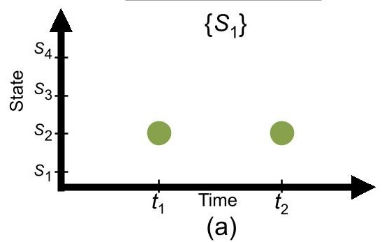

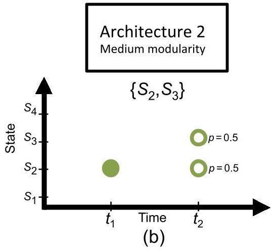

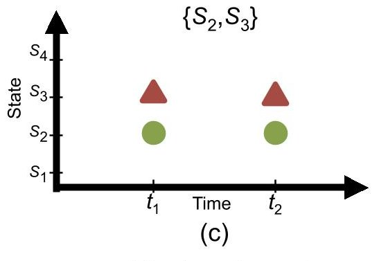

Fixed requirements

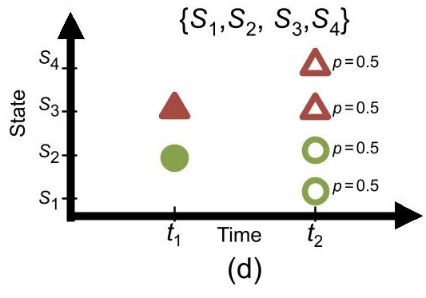

Uncertain requirements

Figure 1. A hypothetical case in which environment is represented by two binary parameters, for example, Demand (D) and Temperature (T) which can be either Low (L) or High (H). There are four possible states for the environment: $ S_{i}\in\{(D,T)|(L,L),(L,H),(H,L),(H,H)\} $ Environment states that the system needs to respond to are represented for (a) single stakeholder with constant requirements over time, (b) single stakeholder with uncertain requirements overtime, (c) two stakeholders with constant requirements over time, and (d) two stakeholders with uncertain requirements.

preferences, or in expected missions for multimission systems. For a single stakeholder, single mission, and no environmental uncertainty (e.g., technical failure, technology evolution and market fluctuation, funding availability) one will get the highest value by going for the most integral architecture. $ ^{1} $ We then expect to gain more value from modularity if the stakeholders' needs or expected missions become heterogeneous, since modularity provides the option for customization. From this perspective, having a single stakeholder whose needs might change over time (temporal heterogeneity), once adjusted using discount factors, creates a similar impact as having multiple heterogeneous stakeholders at a given point of time. Here, the basic intuition is that we can model the environment as a finite set of possible states and design the architecture in order to be able to respond to these states. From this perspective, increase in both types of heterogeneity-that is, spatial and temporal—adds to the number and diversity

of such states and results in higher levels of adaptability required for the system.

The simple hypothetical case shown in Figure 1 can further clarify the notion of space-time heterogeneity. To keep things as simple as possible, we limit the number of time steps to two and assume the environment can be modeled by two binary parameters. These parameters, for example, can be assumed to be market demand and temperature, both may take low and high values. This results in a total of four states in the environment, represented by $ S_{1} $ to $ S_{4} $ . Depending on whether the environment is expected to be static or dynamic, and the number of stakeholders (one or two), one can identify four scenarios, each represented by a separate panel in Figure 1. Panel (a) shows the states of the environment against time for a single stakeholder with a static environment. In Panel (b), requirements of the single stakeholder are uncertain and can result in two different states of the environment. Panel (c) depicts the states of the environment for two stakeholders with static requirements over time that result in two different states of the environment. Finally, Panel (d) shows states of the environment for two stakeholders with uncertain requirements over time, which results in four possible states for

<!-- PDF_PAGE: 5 -->

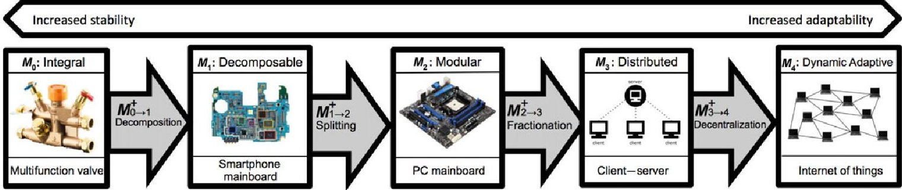

Figure 2. A five-stage modularity spectrum and M+ operators. A schematic example is depicted for each stage. Description of the framework and more examples for each stage are provided in Section 3.

the environment. This way, system (a) needs to respond to one environment state and system (d) to four, thus we can expect system (a) to have low modularity and system (d) to be highly modular. Systems (b) and (c), although different in number of stakeholders and environment dynamics, both need to respond to two environment states (i.e., $ S_{2} $ and $ S_{3} $ ), thus we can expect them to be both similar in their level of modularity.

The heterogeneity level of the environment determines the level of responsiveness needed for the system, but to translate this into the actual modularity level, one needs to consider the other two factors. These two factors, namely, the processing capacity of the system's constituents and the cost of resource exchange among them, are intertwined in engineering systems. The cost of resource exchange, which defines the cost to establish and maintain a connection between two parts, includes various components such as the cost of interface design, maintaining an information link, losses and inefficiencies at the interface, and noise impacts. These cost components increase with the heterogeneity among the system's constituents. Moreover, the increased range of customization options can result in more unintended consequences, including security risks that can ultimately compromise the robustness of the system. The processing capacity of nodes, as the third factor in the suggested model, captures various notions of budget in the system, and includes factors such as monetary budgets for development/customization of interfaces, information processing capacity on each subsystem, information link and noise budget for wireless systems, and cognitive budget for real-time decision-making where the system has human-in-the-loop.

## 3. SPECTRUM OF MODULAR ARCHITECTURES AND DECISION OPERATORS

As discussed earlier, and as been pointed out by other scholars in management sciences and engineering, modularity is not a binary property and needs to be considered as a spectrum of various levels and forms [Ulrich, 1995; Holttä-Otto and de Weck, 2007]. This continuous nature exists for the level of a component's modularity, as well as the modularity level of certain subsystems or that of a system as a whole. For some systems, continuous modularity can be modeled and quantified in a more intuitive and systematic way. For example, in the Complex Networks literature, network modularity

is naturally defined as a continuous parameter ranging from zero to one, and continuous measures of modularity have been introduced for a subset of components in the network [Newman, 2006; Gianetto and Heydari, 2015a]. For most other engineered systems, however, dealing with continuous spectrums in systems architecture decisions can be challenging for several reasons. One reason is that using a general continuous spectrum would turn the decision problem into an optimization problem that can easily become computationally intractable and might not be easily reconcilable with the engineering design intuition that is needed for such decisions. Furthermore, treating modularity as a single continuous spectrum does not lend itself to hierarchical and layered architectures, where adding a new layer to the system results in a discontinuity in the level of modularity. As a result, the real-world interpretation of a given point on a continuous spectrum of modularity can become difficult and often subjective.

To address this dilemma, we suggest a hybrid solution that keeps the spectral nature of modularity, yet discretizes it into multiple stages, each representing a different modularity class. Within each stage, modularity can be approximated as continuous (or can be further discretized if needed), while a change in the modularity stage is considered as discontinuous shifts.

## 3.1. Modularity Spectrum

Following the broad definition of modularity [Langlois, 2002], our proposed framework is composed of five stages of modularity, indicated by $ M_{0} $ to $ M_{4} $ , and is shown in Figure 2. Higher stages represent more complex architectures from the perspective of a particular element in the functional domain and are able to respond to higher levels of complexity in the environment.

Stage $ M_{0} $ is considered as the lowest level of modularity and describes integral products where there is an unstructured mapping from functional elements to physical components. Engineering systems that are fully integral are rare, yet some products or subsystems such as pipes, communication transmission lines, or certain analog integrated electronic circuits belong to this stage. $ M_{0} $ can be considered as zero modularity level and be used as a baseline in modularity quantification.

At the next stage, $ M_{1} $ represents systems of identifiable physical components and subsystems, each responsible for specific elements in the functional structure. For most engineering systems, this stage represents the lowest bound of

<!-- PDF_PAGE: 6 -->

modularity. Components at this stage, although have identifiable functions, cannot easily be customized, replaced, or upgraded during later stages of systems life cycle. Some types of modularity introduced in the literature such as Modularity in-design [Baldwin and Clark, 2000], or certain types of Slot Modularity [Ulrich, 1995] can fall under $ M_{1} $ stage. Smartphones or tablet hardware, most home appliances, most car components and medical devices can be considered at this modularity stage. Following our stream of examples regarding computer processors, smartphone's central processor (CPU) shows a good example of $ M_{1} $ where the design of the entire electronic board is such that it prevents users from replacing, customizing, or upgrading. Similar to other stages on the proposed spectrum, there are potentially different architectures that can all be at $ M_{1} $ , so it is important to keep in mind that stages do not represent unique architectures.

To allow additional flexibility, one needs to go to the next stage, $ M_{2} $ . Here, similar to $ M_{1} $ , there is a structured mapping between functional and physical structure, however components interact with each other through flexible standard interfaces. These standard interfaces allow the components to be replaced or upgraded without disrupting the rest of the system. This stage represents what is often referred to in the literature as product modularity in general and can itself take several different forms such as component-sharing, component swapping, mix, sectional, and bus modularity [Ulrich, 1995; Huang and Kusiak, 1998; Salvador, Forza, and Rungtusanatham, 2002]. Returning to our processor example, contrary to in smartphones, personal computers' CPUs are at $ M_{2} $ stage, which allow users to customize or upgrade the processing units according to their preferences. The extent of such customization or upgrade depends on the limitations of standard interfaces. In the case of the CPU example, limited bit-rate capacity or signal interference of onboard interconnections are often limits that make users unable to keep upgrading beyond a few years, as newer technologies impose stricter requirements on interface latency, noise, and interference shielding.

Stages $ M_{0} $ to $ M_{2} $ represent modularity schemes for monolithic systems in which all components are in the same, and often compact, physical unit. These components might be decomposable or $ M_{2} $ - modular, using standard interfaces. Extending the notion of modularity from monolithic to decentralized systems is crucial since much of the trends in Cyber-Physical Systems, critical infrastructure systems and Internet-of-Things are moving toward decentralized architectures. Moreover, many of these systems include a set of autonomous agents, either in the form of autonomous machines, or interactive human agent that needs to be rigorously considered in the design process. Decentralized scheme and autonomy contribute to systems' complexity; yet at the same time provide new capacities for complexity management mechanisms which in turn require a transformation in the notion of modularity from static to dynamic in which the modular structure of the system can dynamically and autonomously change in response to variations in the environment by leveraging available autonomy in the system as well as its underlying decentralized network structure. In light of this, the next two stages of the modularity spectrum are formulated.

Considering modularity as an architecture mechanism that enables the system to respond to a given complexity level in the environment, as this was the motivation for moving from integral to modular in the first place, one can extend the notion of standard interfaces beyond what was defined in the $ M_{2} $ level so that it includes platform architecture, wireless standards, and web protocols to also cover decentralized systems. In such systems, certain functionalities of the otherwise monolithic system $ ^{2} $ are transferred to different, and often remote, physical units. Here, we refer to these units as systems fractions. Systems at $ M_{3} $ and $ M_{4} $ stages are composed of more than one (and, in certain systems, a large number) of fractions. These distributed fractions then communicate and coordinate either in peer-to-peer schemes, or using standard wireless or web-based protocols.

At $ M_{3} $ , some critical resource-extensive functionalities are embedded in one fraction (or a small subset of fractions) that provide service to other fractions according to a predetermined resource-allocation protocol. This creates a distributed yet static scheme, since the relationships of clients and servers are fixed and are decided in advance. $ M_{3} $ has several advantages compared to $ M_{2} $ . It improves system responsiveness to market and technology changes by facilitating and expediting upgrade and maintenance of critical subsystems, thus adding to the overall system's flexibility. It also results in some scalability (not much though, as will be discussed in the $ M_{4} $ description), since more client fractions can be added to the system during later stages of systems life cycle. Following our thread of examples related to computational components, starting from iPhone CPU $ (M_{1}) $ and moving to desktop computer CPU $ (M_{2}) $ , at $ M_{3} $ multiple fractions can use the computational power of a dedicated fraction in a hub-and-spoke architecture. Other server-type fractions can also be considered for data-transmitter, sensors, navigation units, or memory and storage, depending on the nature of the system.

The static nature of $ M_{3} $ can limit the flexibility and scalability of the system. Moreover, systems with $ M_{3} $ architecture are not highly resilient in general, especially in response to targeted attacks, as the critical fractions are easily identifiable and the overall performance of the system depends on such fractions. These limitations motivate moving to a dynamic scheme of connectivity and resource-sharing, formulated as the $ M_{4} $ stage. $ M_{4} $ stage is similar to $ M_{3} $ in having multiple fractions with heterogeneous functionality, which perform different functions and communicate and coordinate resource allocation among themselves. It is, however, different from $ M_{3} $ in the way the resource allocation is realized. Un like $ M_{3} $ , in which clients and servers are fixed and preplanned, $ M_{4} $ systems have multiple resource-sharing possibilities that increase both flexibility and scalability. This difference significantly affects the network connectivity structure of these two schemes where fractions are nodes of the network and resource-sharing paths are the links. Whereas the connectivity structure of $ M_{3} $ systems are closer to tree or two-mode networks with no loops, the structure of $ M_{4} $ systems have numerous loops and multipath connections that can take the complexity of the system to a much higher level and cause

<!-- PDF_PAGE: 7 -->

new systemic problems such as coordination, cooperation and proneness to cascading failure [Dueñas-Osorio and Vemuru, 2009; Gianetto and Heydari, 2016] .

In addition to dynamic resource-sharing, one can add another degree of flexibility at $ M_{4} $ by allowing for dynamic connectivity structure in response to changes in the environment. Determining the connectivity structure of systems with heterogeneous components in response to the environmental uncertainty is an important design decision and creates an array of interesting and challenging research problems at the junction of engineering, economics, and computer science [Heydari et al., 2015]. The sheer number of possibilities for connectivity structure and resource-sharing paths, even for a small set of fractions, makes preplanning of such systems infeasible. As a result, in most $ M_{4} $ systems network nodes (fractions) are given some level of autonomy to create and delete links and prioritize resource allocation requests. The autonomous, dynamic, network nature of systems at this stage makes analysis and design of such systems challenging and we can expect to see these challenges to motivate considerable volume of interdisciplinary and systems-oriented research in the coming decade.

It is worth emphasizing that a given architecture can be at different stages at the same time for different elements in the functional domain. For example, a cloud computing system can be at $ M_{4} $ stage for data processing, while being at $ M_{2} $ or even $ M_{1} $ from the perspective of data storage (relying on local hard-drives). However, a portion of the cost of moving toward higher stages are shared by more than one functionality, which in turn means that once the system is transferred to a higher stage for one function (e.g., computation), transfer of other functionalities to this new stage can be performed with less cost. This path dependency in architecture transitions need to be considered in quantitative decision models.

## 3.2. M+ Decision Operators

In order to transform the proposed conceptual framework into a computational tool, we need to add a decision layer to the model that determines the optimal level of modularity for a given functionality of a system and under a certain profile of the environment. This decision involves selecting the stage of modularity, as well as the design instantiation within that stage. Here, we focus on the former by introducing a set of operators （M+ Operators) that calculate the value of transition from one stage of modularity $ ( M_{x} ) $ to its next immediate stage $ ( M_{x+1} ) $ . The proposed decision operators compare the value of the system prior to the operation with the value of the system afterward by calculating the probability distribution of value difference of two consecutive stages. This will allow decisions to be made not only based on the value difference average but also on the level of the risk tolerance.

One can consider transitions between different levels of modularity as a value-seeking process to also enable future evolution of the system. This view toward complex systems matches existing theoretical conjectures that natural selection favors more evolvable systems [Kauffman, 1993]. Building on this metaphor and considering variation and selection as two of the key elements of the value-seeking evolutionary process, one can think of each modularity stage $ M_{x} $ as

determinant of limits of variations. Moreover, within each stage, a selection process is needed to decide the fittest design instantiation.

Here, we introduce a set of operators that address the first element by determining the optimal stage of modularity. However, as noted by Baldwin and Clark [2000], variation and selection in human design process are more intertwined than what appears to be the case in biological systems. This fact underscores a simplifying assumption in the decision layer of our proposed framework in which these two steps need to be done sequentially. This can be a sound assumption if one uses multiple iterations of these value-determining steps. One can further assume that the value of a transition operator between two stages should use the best-case design instantiation of the source (the one with the highest value in its modularity stage), since this instantiation is already determined in the previous round of iteration.

As mentioned in the previous section, $ M_{1} $ is the lowest modularity for most engineering systems, therefore, the first decision operation, Splitting Operation, refers to the transition from $ M_{1} $ to $ M_{2} $ by developing and using proper standard interfaces. Fractionation operation takes a system from $ M_{2} $ to $ M_{3} $ by moving one or more of its subsystems to other fractions.

Although the specifics of M+ evaluation depend on individual systems and their parameters, we can provide a procedural algorithm that would act as the evaluation engine for decision operations. To measure the value of the M+ operation, we have to compare the value of the system prior to the operation with the value of the system afterward. Such evaluation requires knowledge of the system and its environment. Figure 3 shows the input and output of the evaluation engine. The value of the system at each modularity level can be calculated via any of the standard system evaluation methods (e.g., scenario analysis, discounted cash flow analysis) and should consider the following parameters:

- Technical Parameters: For example, probability density for time to failure, time to availability of an upgrade, maximum number of modules allowed, and maximum communication bandwidth.

- Economic Parameters: For example, the number of modules in demand at a given time, launch and operational cost of a module, and rate of value generation for various module types.

- Life Cycle Parameters: Total operation time, budget, and maximum time to initial deployment.

Calculating the value of decentralization sharing operation—that is, moving from $ M_{3} $ to $ M_{4} $ is more challenging because of the dynamic nature of the resulting system. The cost of moving to $ M_{4} $ depends on the ratio of clients to servers, the total heterogeneity of the system, and resource capacity of the fractions. Given the autonomous behavior of systems units at $ M_{4} $ and the dynamic nature of sharing resources and connectivity structure, calculating the associated cost and benefits, using analytical methods, is difficult for this level of modularity.

The underlying network structure together with the dynamic, autonomous behavior of some systems constituents require designers to use multi-agent systems approaches that

<!-- PDF_PAGE: 8 -->

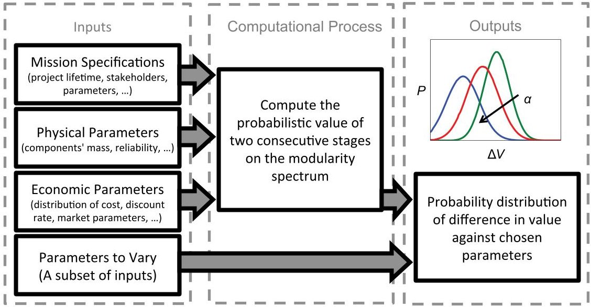

Figure 3. Quantifying the value of the M+ operation. Considering various technical and economic parameters, we compute the system value at two adjacent modularity levels and compare the two values.

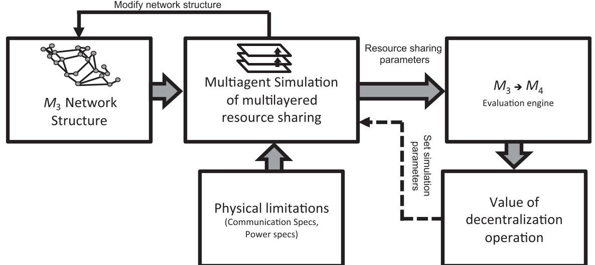

Figure 4. Calculating the value of the decentralization operation $ ( M_{3} $ to $ M_{4} $), the last stage on the modularity spectrum, based on multi-agent simulation of the networked system. In addition to space-time environmental parameters, network architecture and physical limitations are given to the engine as inputs.

incorporate dynamics and evolution of systems with strategic autonomous behavior of interconnected constituents [Weiss, 1999]. A high-level sketch of the method that calculates the value of the decentralization operation is depicted in Figure 4. Further details, more elaborate methods and illustrative case studies for the $ M_{3} $ to $ M_{4} $ transition create a number of interesting and challenging research questions that can be pursued in future publications.

## 4. VALUE OF THE FRACTIONATION OPERATION FOR A SPACECRAFT

As mentioned earlier, the specific details of the model and implementation of the proposed operations depend on the context of the problem, depth and timescale of analysis, system boundary, and types of uncertainties to consider. Moreover, similar to Real Options Analysis, there are different ways to implement M+ operations depending on the underlying assumptions and available computational resources. To show

an illustrative example of how this framework can be implemented, we apply it to a simplified case of fractionating a spacecraft. We use this example to show a real-world realization of modularity stages （ $ M_{2} $ and $ M_{3} $ in this case) on the one hand, and show the way that the proposed framework extends the notion of modularity by considering distributed systems, on the other hand. It is worth emphasizing that the case in this section is not meant to demonstrate the full capability of the framework, the complexities of implementation, or a detailed solution for a fractionated spacecraft.

The presented case is constructed based on a simplified architecture that is proposed as a part of DARPA F6 program, whose objective is to determine the feasibility of replacing a number of large, expensive, and rigid monolithic satellite systems with agile, flexible, and evolvable systems based on reconfigurable fractions [DARPA, 2013]. Traditional monolithic satellites are at the $ M_{2} $ stage of modularity and have limited ability to respond to variations and uncertainties in the environment. In fractionated architecture, however, subsystems are placed into separate fractions that communicate

<!-- PDF_PAGE: 9 -->

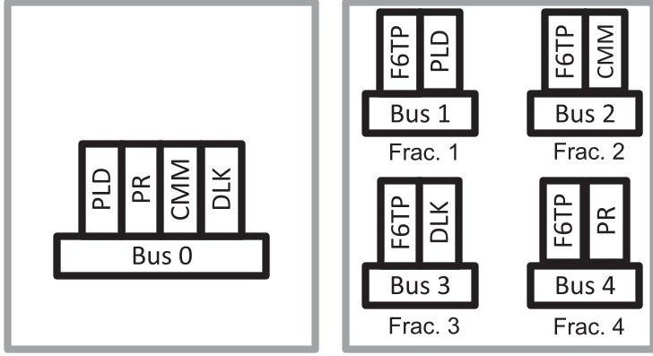

Figure 5. The allocation of subsystems in a monolithic system and a fractionated system based on a stylized case inspired by DARPA F6 mission: (a) Monolithic satellite system, (b) Fractionated satellites system. PR: Processor, DLK: Downlink, CMM: Communication Link, F6TP: F6 Tech-Package, PLD: Payload.

wirelessly to deliver the capability of the original monolithic system [Brown, Eremenko, and Hamilton, 2002; Brown, Eremenko, and Collopy, 2009], thus moving the system to level $ M_{3} $ (fractional) in the proposed framework. Clearly, this transition does not make sense for all satellite systems, thus the system architect needs to know conditions in the system and its environment, under which transition toward fractionated architecture increases the overall value of the system [Mosleh, Dalili, and Heydari, 2014]. While dynamic resource-sharing （ $ M_{4} $ stage) has been proposed to further increase the flexibility of fractionated satellite systems, we restrict our attention to a static scheme and consider $ M_{3} $ as the ultimate level of flexibility for this case and calculate the value $ M+ $ operator for moving to this level.

The system in this case study contains four fractions flying in low earth orbit; one fraction carries the payload (sensor), one fraction carries a high performance computing unit, one fraction provides high-speed downlink capabilities, and a final fraction provides broadband access to a ground network through Inmarsat I-4 GEO constellation. Data collected by the sensor needs to be processed and transmitted to earth via a high-speed downlink, while a connection from earth to the system is needed for maintenance. In fractionated architecture, these functions are separated into four fractions while relations between fractions are fixed and no reconfiguration/reuse of assets is planned. Each fraction in the system carries a System F6 Tech-Package (F6TP), which enables fractions to wirelessly communicate. Figure 5 illustrates the allocation of subsystems for the monolithic and a fractionated architecture.

In order to make the calculations feasible for a small case study, we make a number of simplifying assumptions. Most of these assumptions, as will be explained, do not change the logic behind the proposed framework, yet they are needed to keep the case calculation tractable. In some other cases, for example for limiting the number of uncertainties, the simplifying assumptions are made in order to retain the focus of the paper. Similar to many other computational methods, such as Net Present Value (NPV) and Real Options, curse of dimensionality can also create computational problems for

the framework. We discuss this in the last part of the paper and in our future publications.

To evaluate the fractionation operation $ ( M+: M_{2}\rightarrow M_{3}) $ we compare the fractionated architecture with a monolithic system comprised of the same four subsystems at the $ M_{2} $ level of modularity. Note that since we are comparing the value of the fractionated system to the monolithic system, design costs of all subsystems are already taken into account. For simplification we assume that the project lifetime is fixed, and the system is managed to keep uninterrupted functionalities to the end of the project lifetime. This assumption results in gaining the same benefit from both systems. As a result, the value of the M+ operation can be represented by the cost difference of the two systems. To simplify calculations, we compare the cost of running the project to the end of its lifetime in the two different modularity levels. However, a similar method can be used to compare the total value of the system even if the benefits are not identical. We further simplify by considering only the following uncertainties in our calculations:

- Component Failure: We assume time to failure for a subsystem follows a known distribution that can be approximated using historical data, and we assume various subsystems have independent failure times.

- Technological Obsolescence: We assume that subsystems can become obsolete via technology upgrades and assume each technology has its own obsolescence time distribution. We also assume that different subsystems have independent time to obsolescence.

We also assume that deployment of a subsystem has a fixed cost through time, but future expenditures are discounted by a given interest rate. We are effectively assuming that replacement is immediate once it is needed. However, this assumption can easily be lifted without changing the underlying method. The parameters we use for the calculations include subsystem costs and masses; spacecraft bus cost, mass, and capacity; distribution parameters for component failure and technological obsolescence; and launch costs, assumed to be proportional to mass.

First let us consider the replacement time for a fraction in the fractionated system. The fraction has to be replaced either because it has failed, or because it is obsolete. Given that these two are independent events, we can analytically compute the probability distribution function for the time to replacement given the probability distributions of time to failure, and time to obsolescence. Similarly, the monolithic system has to be replaced when any of its components require replacement, and can also be calculated analytically (Section 4.1). Once the distribution for time to replacement is calculated, replacing the fractions becomes a renewal process with a known distribution. Due to the fact that finding analytical solution for cost distribution is not easily tractable, we rely on simulation to approximate cost distributions.

## 4.1. Computing Replacement Time Probability Distribution

Given the probability distribution of the time to failure for each subsystem, the bus and the F6TP, and the probability

<!-- PDF_PAGE: 10 -->

distribution of each subsystem's obsolescence time, we calculate the probability distribution for replacement time. We can also assume that time to failure, and technology obsolescence times are independent random variables.

For a fraction, we consider its payload, the F6TP and the bus, each having time to failure $ T_{i} $ with $ f_{i} $ and $ F_{i} $ being Probability Density Function (PDF) and cumulative distribution function (CDF), respectively. The payload's obsolescence time is also given by a random variable $ O_{1} $ with PDF and CDF $ g_{1} $ and $ G_{1} $ . We can then compute the CDF of the fraction's replacement time, $ T $ , as follows. Note that the fraction has to be replaced if either one of its three components fail, or if its payload is technologically obsolete. Therefore,

$$
\begin{array}{l} F (t) = p (T \leq t) \\ = 1 - p \left(T _ {1} > t, T _ {2} > t, T _ {3} > t, O _ {1} > t\right) \\ = 1 - \left(1 - F _ {1} (t)\right) \left(1 - F _ {2} (t)\right) \left(1 - F _ {3} (t)\right) \left(1 - G _ {1} (t)\right). \\ \end{array}
$$

Thus, the PDF of T i

$$
\begin{array}{l} f (t) = f _ {1} (t) \left(1 - F _ {2} (t)\right) \left(1 - F _ {3} (t)\right) + f _ {2} (t) \left(1 - F _ {1} (t)\right) \\ \times \left(1 - F _ {3} (t)\right) + f _ {3} (t) \left(1 - F _ {1} (t)\right) \left(1 - F _ {2} (t)\right). \\ \end{array}
$$

We can compute the PDF and the CDF for the replacement time of the monolithic system in a similar way, with minor differences; the F6TP will not be part of a monolithic system, and as such its time to failure will not enter our calculations. On the other hand, we have to consider all four subsystems, their time to failure, and their technology obsolescence times.

## 4.2. Simulation Setup to Calculate Value Distribution

In this section, we calculate the probability distribution for the value of the fractionation operation $ ( M+: M_{2}\rightarrow M_{3}) $ based on the cost of building and launching of subsystems, and the probability distributions of their replacement times.

For monolithic satellite systems to remain functional, the whole system has to be replaced once one of its components become obsolete or fails. However, for a fractionated system, only the fraction associated with the dysfunctional component has to be deployed and launched again. Hence, a lower bound for the value of fractionated architecture can be calculated by comparing the cost imposed by each component replacement in a fractionated to an equivalent monolithic architecture over its lifetime. $ ^{3} $

We can formulate the cost of running the system as follows: For each fraction j, suppose a sequence of random variables $ R_{1 j}, R_{2 j}, \dots, R_{n j} $ represents the time between two consecutive replacements. A new instance of a fraction j has to be deployed at times $ R_{0 j}=0, R_{0 j}+R_{1 j}, \dots, R_{0 j}+R_{1 j}+\dots+ R_{n j} $ in order for the system to function without interruption until the end of its lifetime. n is the largest integer such that $ R_{0 j}+R_{1 j}+\dots+R_{n j}<T $ , where T is the project lifetime. Suppose that $ C_{F j} $ is the cost of building and launching a new instance of fraction j. The cost of running a system, C, with m fractions is the sum of the costs of its fractions, discounted

to the present time (discount rate = r), that is, for a monolithic architecture, we can consider a single fraction in this model.

$$
\begin{array}{l} C = C _ {F 1} \sum_ {i = 0} ^ {n} e ^ {- r \sum_ {k = 0} ^ {i} R _ {k 1}} + C _ {F 2} \sum_ {i = 0} ^ {n} e ^ {- r \sum_ {k = 0} ^ {i} R _ {k 2}} \\ + \dots + C _ {F m} \sum_ {i = 0} ^ {n} e ^ {- r \sum_ {k = 0} ^ {i} R _ {k m}}. \\ \end{array}
$$

In the Monte Carlo simulation setup, we sample components' replacement times based on their probability distribution. We find the component with the earliest replacement time and calculate the cost associated with its replacement in both monolithic and fractionated architecture. We continue this for both architectures until the earliest replacement time is greater than the given lifetime. For each run of the simulation, we calculate the cost difference of running the fractionated system against the monolithic system and discount it to the present time. Repeating this process a large number of times yields an approximation for the value distribution of the fractionated architecture over the monolithic architecture.

Table I presents the values that are used in the simulation. The input to the simulation includes subsystems' costs, masses, and failure and obsolescence probability distribution parameters. We use typical values and distribution functions for satellite systems design suggested in Brown et al. [2007]. For approximating subsystems' failure, we use Weibull probability distribution. For technological obsolescence approximation, we employ a Lognormal distribution and assume subsystems' obsolescence times are independent. We assume mean value of 1 year with standard deviation of 3 years for the obsolescence distribution. We also assume buses and F6TP do not become obsolete. Moreover, we consider $30k per kg for launch cost. We consider an interest rate of 2% in our simulation for a project lifetime of 20 years. All these assumptions and values can be easily tailored to other projects and circumstances.

## 4.3. Results

Figure 6 illustrates the cost of operating a fractionated satellite system, where each main subsystem is assigned to a separate fraction, versus a monolithic system. The solid curves in Figure 6 represent expected cost for each architecture during the lifetime. The curves have relatively low slopes in the beginning of the system lifetime due to the low probability of obsolescence and failure in the early years. The initial cost of running the fractionated system is greater than that of the monolithic system due to fractionation cost, that is, the cost of building additional subsystems such as F6TP. However, the expected lifetime cost of the monolithic system increases more quickly over time due to the fact that the whole system must be redeployed and launched when a component fails or becomes obsolete.

The boxplot in Figure 6 depicts the probability distribution of cost. The cost variance at each point is the result of two opposing forces. On the one hand, the intrinsic property of the underlying stochastic process results in increase of variance over time. On the other hand, during the lifetime, whenever

<!-- PDF_PAGE: 11 -->

Table I. Component Cost, Mass, and Reliability Parameters

<table border="1"><tr><td>Component</td><td>Weibull Alpha</td><td>Weibull Beta</td><td>Component Cost(k$)</td><td>Mass(kg)</td></tr><tr><td>Payload-Figure6</td><td>15</td><td>1.7</td><td>27,000</td><td>50</td></tr><tr><td>Payload1-Figure7</td><td>15</td><td>1.7</td><td>1600</td><td>25</td></tr><tr><td>Payload2-Figure7</td><td>15</td><td>1.7</td><td>11,600</td><td>350</td></tr><tr><td>Communication</td><td>870</td><td>1.7</td><td>35,000</td><td>70</td></tr><tr><td>Downlink</td><td>190</td><td>1.7</td><td>40,000</td><td>10</td></tr><tr><td>Processor</td><td>90</td><td>1.7</td><td>30,000</td><td>20</td></tr><tr><td>F6TP</td><td>600</td><td>1.7</td><td>2000</td><td>5</td></tr><tr><td>Bus(Monolithic)</td><td>108</td><td>1.7</td><td>34,000</td><td>260</td></tr><tr><td>PayloadBus(Fractionated)</td><td>108</td><td>1.7</td><td>28,000</td><td>180</td></tr><tr><td>CommunicationBus(Fractionated)</td><td>108</td><td>1.7</td><td>29,000</td><td>200</td></tr><tr><td>DownlinkBus(Fractionated)</td><td>108</td><td>1.7</td><td>25,000</td><td>150</td></tr><tr><td>ProcessorBus(Fractionated)</td><td>108</td><td>1.7</td><td>26,000</td><td>160</td></tr></table>

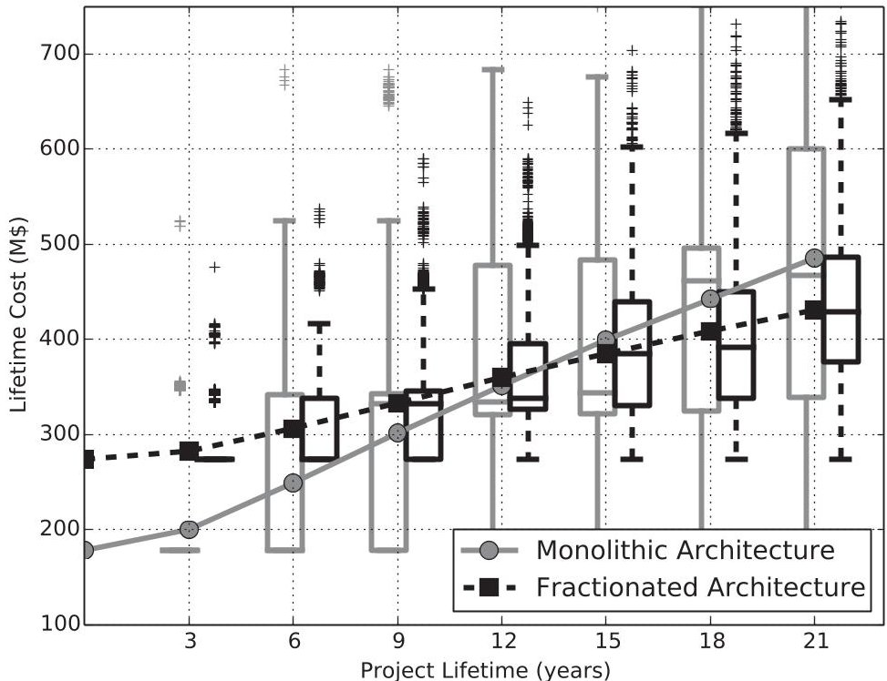

Figure 6. Total cost of monolithic $ ( M_{2} ) $ versus fractionated $ ( M_{3} ) $ architecture graphed against project lifetime. The curves represent expected values and boxplots depict distribution of the costs.

a fraction is deployed and launched, the replacement time of its components is reset, which suppresses variance of cost. In the monolithic architecture, when a component fails, the time of replacement for the whole system is reset with a high cost. However, in case of failure of the equivalent component in the fractionated architecture, the replacement time for the other components do not change but the failure results in a lower cost. Figure 6 shows that the cost variances of both systems increase by time. However, the monolithic architecture has higher variance at every time step due to dominance of the impact of cost associated with each incident of subsystem replacement.

At this point, we will only look at the value of the fractionation operation. Figure 7 shows the value of fractionated architecture for two different payloads as listed in Table I. Payload 2 has higher mass and is more expensive than Payload 1. It can be observed that fractionation does not result

in any significant value to the system with Payload 1 over the simulated lifetime. However, the system having Payload 2 has a positive fractionation value earlier in the project lifetime.

Since F6TP will only be a part of a fractionated system, it is important to analyze how its characteristics affect the value of fractionation. Figure 8 depicts the effect of reliability parameters of F6TP on the system fractionation value. In Figure 8, $ \beta $ is the shape parameter, and average lifetime is the mean value in Weibull distribution. The results in Figure 8 suggest that the value of fractionation is highly sensitive to the reliability of F6TP. If the average lifetime of FT6TP is less than a certain value (e.g., average lifetime = 35 (years) for beta = 5), fractionation would impose unnecessary costs to the system. This is due to the large number of replacements of fractions due to failure of F6TP when compared to the monolithic architecture.

<!-- PDF_PAGE: 12 -->

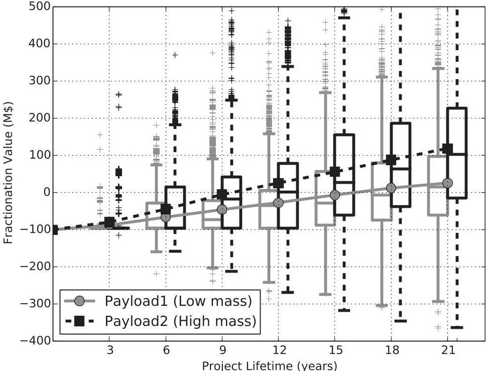

Figure 7. The value of fractionation operation graphed against project lifetime. Payload 2 has higher mass and is more expensive than Payload 1. Curves depict expected values and boxplots show value distributions.

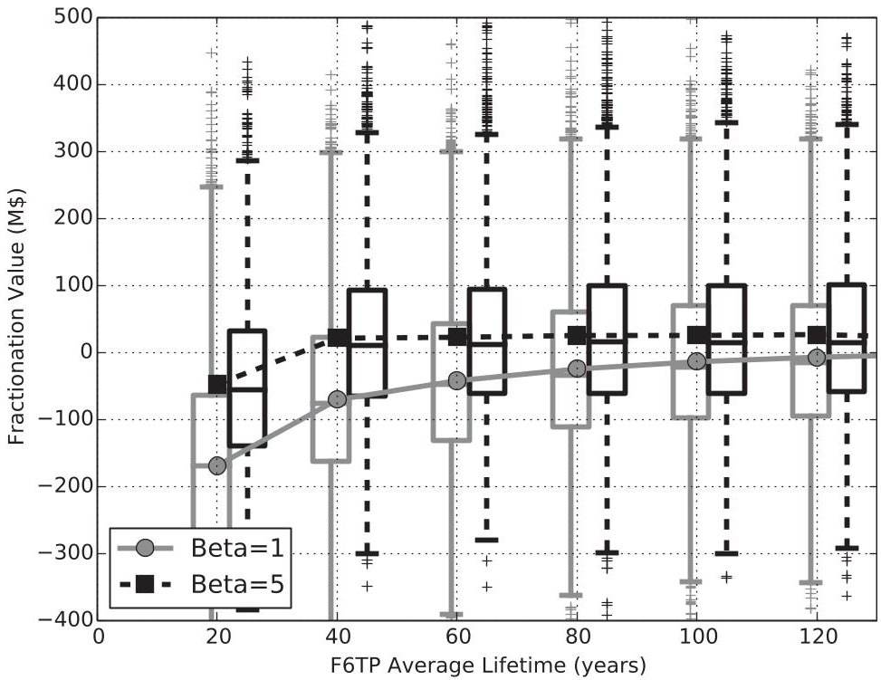

Figure 8. The value of fractionation operation graphed against reliability parameters of F6 Tech Package. Curves depict expected values and boxplots show value distributions.

## 5. CONCLUSION AND FUTURE DIRECTIONS

As a common feature in many complex systems, modularity is a primary mechanism for complexity management in natural, social, and engineering systems, with several associated advantages and disadvantages identified in the literature. On the one hand, modularity increases the adaptability and evolvability of systems and enables local changes without disrupting the whole system. On the other hand, it introduces additional costs, makes finding global optimized design more difficult, and hinders those innovations where a major change in the

architecture is needed. These fundamental trade-offs make it necessary to determine under what conditions modularity increases the overall system value. Moreover, with the increasing complexity of large-scale engineering systems, in which features such as decentralized architecture and autonomy of systems components are becoming increasingly common, we need to extend the notion of modularity. Modularity must be a complexity management mechanism that incorporates these novel schemes such that system architectures can take advantage of them within complexity management in future generations of engineering systems.

<!-- PDF_PAGE: 13 -->

In this paper, we used a general definition that recognizes modularity as a set of principles that enhance the management of complexity by breaking up a complex system into discrete pieces that communicate (interact) through standard interfaces. This definition encompasses a wide spectrum of modularity in complex systems that goes beyond component modularity and extends to decentralized and autonomous networked systems. We proposed a domain-independent framework that helps with understanding trade-offs of modularity and the dependency of these trade-offs on the characteristics of the system and its surrounding environment. The proposed framework accommodates different classes of architecture and allows designers to decide the class, the stage, and level of modularity for a system as a function of uncertainty parameters in the environment. This unification originates from a theoretical complex network model in which structural (architectural) mechanisms of complexity management are divided into three general categories: space-time heterogeneity in the environment, transaction-cost of resource exchange between system components, and the available resource budget per system component. This paper argues that the same combination of factors that push an integral system toward modularity, once intensified, are responsible for pushing it further to higher stages of structural complexity as noted on the proposed spectrum. The paper also provides a novel way of looking at environment complexity by unifying complexity factors related to static variations such as heterogeneity in customers preferences or stakeholders requirements, with those factors related to temporal variation of an uncertainty. Further quantification of this notion of environment complexity and its impact on architecture decisions of a system can be further explored in future work.

To make this framework computationally feasible, we discretized the spectrum into five major stages of modularity, including fully integral $ ( M_{0} ) $ integral yet decomposable $ ( M_{1} ) $ modular yet monolithic $ ( M_{2} ) $ static distributed (clientserver architecture $ M_{3} $ ）and dynamic distributed architecture $ ( M_{4} ) $ . We introduced a set of value operators $ ( M+operator) $ that quantify the net value of changing the level of modularity on this spectrum between two adjacent stages. The spectrum in conjugation with $ M+ $ operators can guide designers in selecting appropriate parameters and building a system-specific computational tool from a combination of existing tools and techniques. To illustrate the functionality of the proposed framework in a rather simple system, we apply it to the case of fractionated satellite systems, as a part of the DARPA System F6 program. We analyze the value of fractionation as a function of uncertainty parameters by quantifying the $ M+: M_{2}\rightarrow M_{3} $ operation in the proposed framework.

The proposed framework has also some limitations that can be addressed further in future research: First, while conceptually general, the framework might not scale well when the number of uncertainty parameters increases. As a result, one proposed direction for the future of this research is to devise methods that alleviate the curse of dimensionality. Second, the key drivers of modularity in the paper are based on a theoretical work that is mathematically verified, but not empirically validated. While several examples are provided in this work to shape an intuition regarding these drivers, a thorough empirical work to further validate the assumptions

of the framework seems to be a natural next step for this work. Third, this paper treated the $ M_{3} $ to $ M_{4} $ transition at a very general level. Systems at $ M_{4} $ stage are becoming exceedingly crucial given that many sociotechnical systems are now moving toward peer-to-peer resource-sharing and autonomous schemes. The decision layer will require a more specific computational procedure to formulate this transition. Fourth, the relationship between the proposed framework and other taxonomies of system architecture, especially its precise relationship to layered systems [Maier, 2000], that can fall under $ M_{3} $ and $ M_{4} $ stages, can be further elaborated. As for the case study presented in this paper, our primary intention was to illustrate the applicability of the framework to real systems, so we made a series of simplifying assumptions: We limited uncertainties to technology obsolescence and technical failure. The model of the environment can be expanded by adding more sources of uncertainty and inclusion of spatial heterogeneities such as diversity in stakeholders preferences. Finally, we mainly focused on flexibility and uncertainty management, and ignored the values of scalability, resilience, and evolvability that are all important aspects of distributed architecture. Hence, the value presented is a lower bound for the proposed architecture. Integrating the added value related to resilience, evolvability and the impact of architecture and modularity transitions on innovation [Bignon and Szajnfarber, 2015], collaboration, and market competition [Baldwin and Henkel, 2015] will add another set of interesting questions for future research by Systems Engineering community.

## ACKNOWLEDGEMENTS

This work was supported in part by the DARPA/NASA Ames under Contract NNA11AB35C through the Fractionated Space Systems F6 Project. The authors would like to thank DARPA and all the government team members for supporting this work as a part of the System F6 program. In particular, we would like to thank Paul Eremenko, Owen Brown, and Paul Collopy, who lead the F6 program and inspired us at various stages during this work. We would also like to thank Steve Cornford from JPL for his constructive feedback at various stages of this project. Our colleagues at Stevens Institute of Technology, especially Dr. Roshanak Nilchiani, were a great support of this project. We would also like to thank other members of our research group, the Complex Evolving Networked Systems lab, especially Peter Ludlow for various comments and feedback that improved this paper.

## REFERENCES

D.L. Alderson and J.C. Doyle, Contrasting views of complexity and their implications for network-centric infrastructures, IEEE Trans Syst Man Cybern A Syst Hum 40(4) (2010), 839-852.

W.R. Ashby, Requisite variety and its implications for the control of complex systems, Cybernetica 1 (1958), 83-99.

C.Y. Baldwin and K.B. Clark, Design rules, Volume 1: The power of modularity, vol. 1, MIT Press, Cambridge, MA, 2000.

<!-- PDF_PAGE: 14 -->

C.Y. Baldwin and J. Henkel, Modularity and intellectual property protection, Strateg Manag J 36(11) (2015), 1637-1655.

J.E. Bartolomei, D.E. Hastings, R. de Neufville, and D.H. Rhodes Engineering systems multiple-domain matrix: An organizing framework for modeling large-scale complex systems, Syst Eng 15(1) (2012), 41-61.

I. Bignon and Z. Szajnfarber, Technical professionals identities in the R&D context: Beyond the scientist versus engineer dichotomy, IEEE Trans Eng Manag 62(4) (2015), 517-528.

O.C. Brown, P. Eremenko, and P.D. Collopy, Value-centric design methodologies for fractionated spacecraft: Progress summary from phase 1 of the DARPA System F6 program, Defense Technical Information Center, 2009.

O. Brown, P. Eremenko, and B. Hamilton, The value proposition for fractionated space architectures, Sciences 99(1) (2002), 2538- 2545.

S. Brusoni, L. Marengo, A. Prencipe, and M. Valente, The value and costs of modularity: A problem-solving perspective, Eur Manag Review 4(2) (2007), 121-132.

O. Brown, A. Long, N. Shah, and P. Eremenko, System lifecycle cost under uncertainty as a design metric encompassing the value of architectural flexibility, AIAA Paper 6023, 2007.

D. Campagnolo and A. Camuffo, The concept of modularity in management studies: A literature review, Int J Manag Rev 12(3) (2010), 259-283.

T.R. Browning, Applying the design structure matrix to system decomposition and integration problems: A review and new directions, IEEE Trans Eng Manag 48(3) (2001), 292-306.

J. Clune, J.-B. Mouret, and H. Lipson, The evolutionary origins of modularity, Proc R Soc B Biol Sci 280(1755) (2013), 1-9.

M.E. Conway, How do committees invent, Datamation 14(4) (1968) 28-31.

M. Danilovic and T.R. Browning, Managing complex product development projects with design structure matrices and domain mapping matrices, Int J Project Manag 25(3) (2007), 300- 314.

DARPA. DARPA, System F6 Program. [Online]. Available: http://www.darpa.mil/Our_Work/TTO/Programs/System_F6. aspx, accessed December 18, 2013.

Q. Dong, Predicting and managing system interactions at early phase of the product development process, PhD dissertation, Massachusetts Institute of Technology, 2002.

D. Doran and A. Hill, A review of modular strategies and architecture within manufacturing operations, Proc Inst Mech Eng D J Automobile Eng 223(1) (2009), 65-75.

L. Due nas-Osorio and S.M. Vemuru, Cascading failures in complex infrastructure systems, Struct Saf 31(2) (2009), 157-167.

S.D. Eppinger and T.R. Browning, Design structure matrix methods and applications, MIT Press, Cambridge, MA, 2012.

G. Erixon, Modular function deployment, a systematic method and procedure for company supportive product modularization, PhD thesis, Royal Institute of Technology, Stockholm, Sweden, 1998.

S.K. Ethiraj and D. Levinthal, Modularity and innovation in complex systems, Manag Sci 50(2) (2004), 159-173.

E. Fricke and A.P. Schulz, Design for changeability (DfC): Principles to enable changes in systems throughout their entire lifecycle, Syst Eng 8(4) (2005), 342-359.

D. Gianetto and B. Heydari, Network modularity is essential for evolution of cooperation under uncertainty, Sci Rep 5 (2015a), 9340. doi:10.1038/srep09340.

D. Gianetto and B. Heydari, Catalysts of cooperation in system of systems: The role of diversity and network structure, IEEE Syst J, 9(1) (2015b), 303-311.

D.A. Gianetto and B. Heydari, Sparse cliques trump scale-free networks in coordination and competition, Sci Rep 6 (2016), 21870. doi:10.1038/srep21870.

B. Heydari, E. Adabi, M. Bohsali, B. Afshar, A. Arbabian, and A.M. Niknejad, Internal unilaterization technique for CMOS mm-wave amplifiers, in 2007 IEEE Radio Frequency Integrated Circuits (RFIC) Symposium, IEEE, 2007a, pp. 463-466.

B. Heydari, M. Bohsali, E. Adabi, and A.M. Niknejad, Millimeterwave devices and circuit blocks up to 104 GHz in 90 nm CMOS, IEEE J Solid-State Circuits 42(12) (2007b), 2893-2903.

B. Heydari and K. Dalili, Emergence of modularity in system of systems: Complex networks in heterogeneous environments, IEEE Syst J 9(1) (2015), 223-231.

B. Heydari, M. Mosleh, and K. Dalili, Efficient network structures with separable heterogeneous connection costs, Econ Lett 134 (2015), 82-85.

K. Hölttä-Otto and O. de Weck, Degree of modularity in engineering systems and products with technical and business constraints, Concurr Eng 15(2) (2007), 113-126. [Special Issue on Managing Modularity and Commonality in Product and Process Development]

K. Hölttä-Otto and O. de Weck, Metrics for assessing coupling density and modularity in complex products and systems, in Proceedings of the 19th ASME International Conference on Design Theory and Methodology, ASME, 2008, pp. 343-352.

C.-C. Huang and A. Kusiak, Modularity in design of products and systems, IEEE Trans Syst Man Cybern A: Syst Hum 28(1) (1998), 66-77.

M.O. Jackson, "Strategic network formation," in Social and Economic Networks, ch. 6, Princeton University Press, Princeton, 2008.

M. Kahmeyer, H. Warnecke, and W. Sheider, Fractal product design: Design for assembly and disassembly in fractal factory, in Proceedings of DFMA Conference, 1994, pp. 1-9.

T.U. Karl and D.E. Steven, Product design and development, vol. 1, McGraw-Hill Companies, Inc., New York, 2000.

S.A. Kauffman, The origins of order: Self-organization and selection in evolution, Oxford University Press, New York, 1993.

A. Kusiak, Integrated product and process design: A modularity perspective, J Eng Des 13(3) (2002), 223-231.

R.N. Langlois, Modularity in technology and organization, J Econ Behav Organ 49(1) (2002), 19-37.

D.M. Lorenz, A. Jeng, and M.W. Deem, The emergence of modularity in biological systems, Phys Life Rev 8(2) (2011), 129-160.

M. Maier, E. Rechtin, The art of systems architecting, 2nd edition, CRC Press, Boca, Raton, FL, 2000.

W.L. Moore, J.J. Louviere, and R. Verma, Using conjoint analysis to help design product platforms, J Prod Innov Manag 16(1) (1999), 27-39.

M. Mosleh, K. Dalili, and B. Heydari, Optimal modularity for fractionated spacecraft: The case of system F6, Procedia Comput Sci 28 (2014), 164-170.

M.E. Newman, Modularity and community structure in networks Proc Natl Acad Sci 103(23) (2006), 8577-8582.

R. Nilchiani and D.E. Hastings, Measuring the value of flexibility in space systems: A six-element framework, Syst Eng 10(1) (2007), 26-44.

<!-- PDF_PAGE: 15 -->

G. Pahl, W. Beitz, Engineering design: A systematic approach, Springer, New York, 1988.

C. Papadimitriou, Algorithms, games, and the internet, in Proceedings of the Thirty-Third Annual ACM Symposium on Theory of Computing, ACM, 2001, pp. 749-753.

T.U. Pimmler and S.D. Eppinger, Integration analysis of product decompositions, Alfred P. Sloan School of Management, Massachusetts Institute of Technology, 1994.

F. Salvador, C. Forza, and M. Rungtusanatham, Modularity, product variety, production volume, and component sourcing: Theorizing beyond generic prescriptions, J Oper Manag 20(5) (2002), 549- 575.

R. Sanchez and J.T. Mahoney, Modularity, flexibility, and knowledge management in product and organization design, Strateg Manag J 17 (1996), 63-76.

N. Sangal, E. Jordan, V. Sinha, and D. Jackson, Using dependency models to manage complex software architecture, in ACM SIGPLAN Notices, vol. 40, ACM, 2005, pp. 167-176.

M.A. Schilling and H.K. Steensma, The use of modular organizational forms: An industry-level analysis, Acad Manag J 44(6) (2001), 1149-1168.

D.M. Sharman and A.A. Yassine, Characterizing complex product architectures, Syst Eng 7(1) (2004), 35-60.

H.A. Simon, The architecture of complexity, Proc Am Philos Soc 106(6) (1962), 467-482.

M.E. Sosa, S.D. Eppinger, and C.M. Rowles, A network approach to define modularity of components in complex products, J Mech Des 129 (2007), 1118-1129.

V. Srivastava and M. Motani, Cross-layer design: A survey and the road ahead, IEEE Commun Mag 43(12) (2005), 112-119.

D.V. Steward, The design structure system: A method for managing the design of complex systems, IEEE Trans Eng Manag 28(3), 1981, 71-74.

N.P. Suh, The principles of design, vol. 990, Oxford University Press, New York, 1990.

K. Ulrich, The role of product architecture in the manufacturing firm, Res Policy 24(3) (1995), 419-440.

J. Wade and B. Heydari, Complexity: Definition and reduction techniques; complex systems, Complex Syst Des Manag, Paris, France, November (2014).

G. Weiss, Multiagent systems: A modern approach to distributed artificial intelligence, MIT Press, Cambridge, MA, 1999.

Babak Heydari is an assistant professor at the School of Systems and Enterprises, at Stevens Institute of Technology and the director of Complex Evolving Networked Systems Lab. He holds a PhD in Electrical Engineering from University of California at Berkeley with a minor in management and economics and has three years of industry experience in Silicon Valley. He has a diverse set of research interests and academic backgrounds and does interdisciplinary research at the intersection of engineering, economics and systems sciences. His current research, is on developing model-driven approach in analysis, design and governance of complex Networked systems. His research interests are network resource-sharing formation and diffusion of collective behavior, modularity, emergence and evolution of collective behavior and the coevolution of structure and behavior in complex networks. His research has been funded by NSF, DARPA, INCOSE, SERC, and a number of private corporations. He is the recipient of NSF CAREER Award in 2016.

Mohsen Mosleh is a PhD candidate in the School of Systems and Enterprises at Stevens Institute of Technology. He has also been a member of Complex Evolving Networked Systems lab (CENS) at Stevens since 2012. He received his BS degree in Electrical Engineering and Masters in Business Administration, both from Sharif University of Technology, Tehran, Iran in 2008 and 2010, respectively. He worked as a systems engineer in the energy automation industry for five years prior to starting his PhD. His research interests are Architecture of Systems of Systems, Economic and Technological Networks, and Modeling the Emergence of Social Norms and Collective Behavior in Sociotechnical Systems. He is the recipient of the INCOSE Foundation Doctoral award for promising research in Systems Engineering and Integration in 2015.

Kia Dalili received the BS degree in Mathematics from the Sharif University of Technology, Tehran, Iran in 1999 and a PhD degree in Mathematics, from Rutgers University, New Brunswick, New Jersey, in 2005. He was a researcher at Dalhousie University, Halifax, Nova Scotia, Canada from 2005 to 2007 and at the University of Missouri, Columbia, from 2007 to 2011. He was with the School of Systems and Enterprises at Stevens Institute of Technology as a postdoctoral associate from 2011 to 2013. He has been with Facebook as a Data Scientist since 2013. His research interests include network science, data-driven model building and decision-making, and emergence of modularity in networked structures.