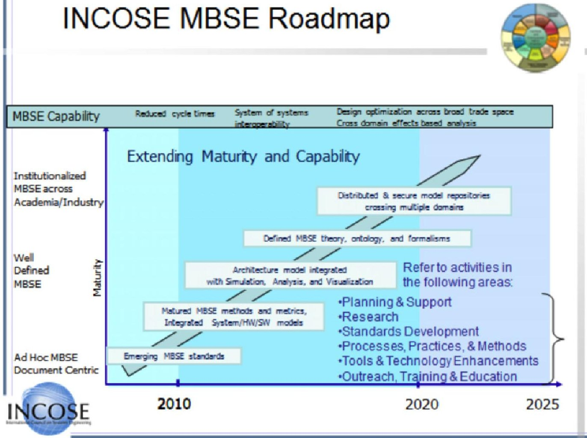
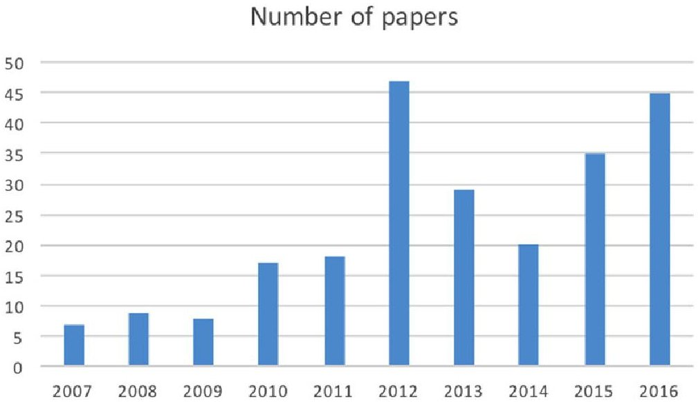
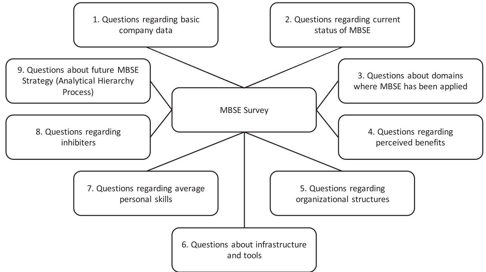
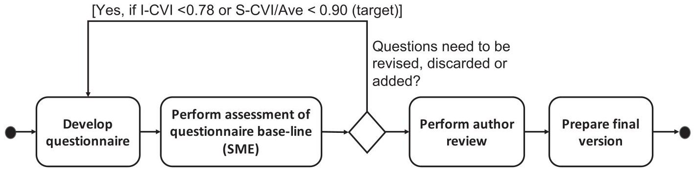
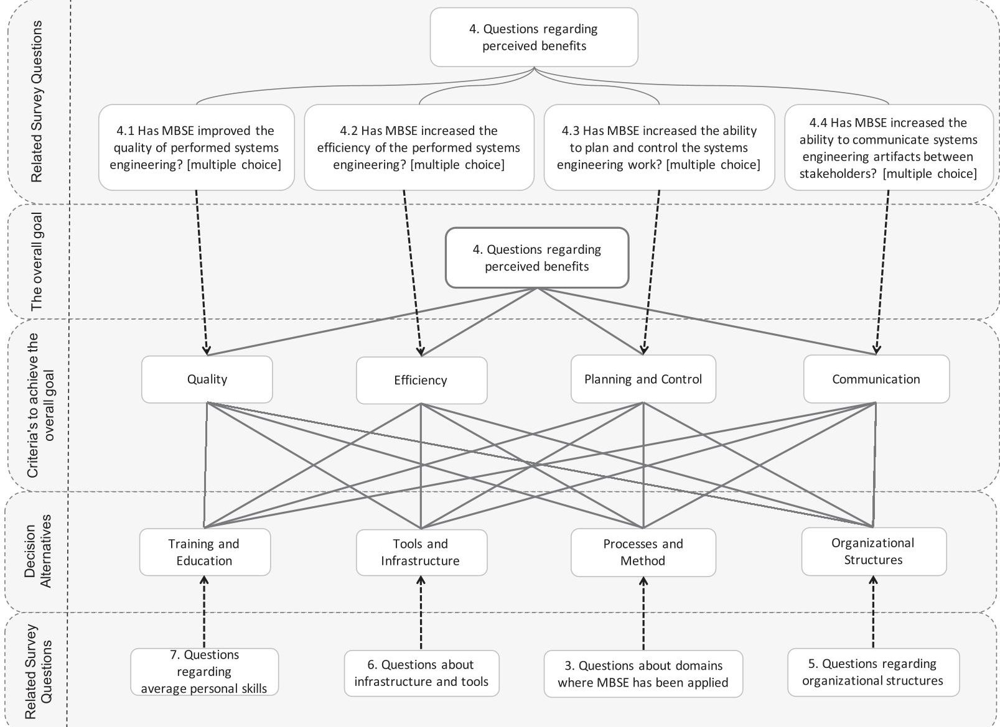
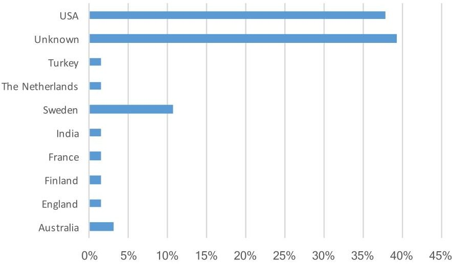
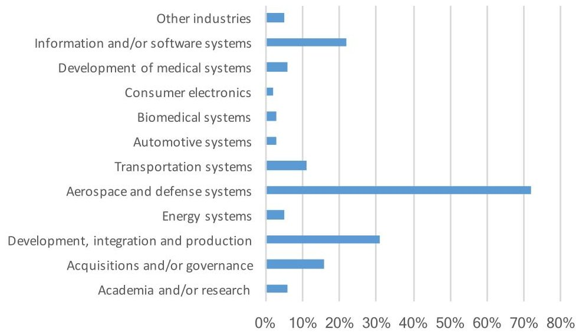
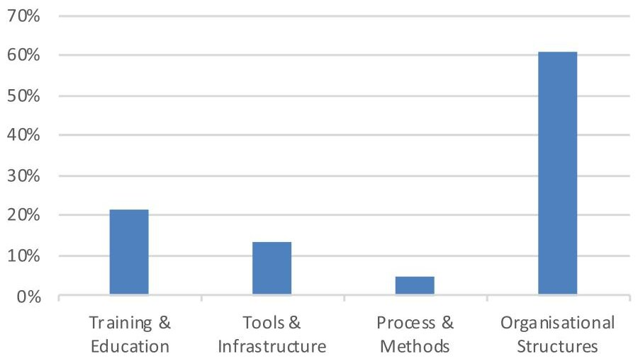

<!-- PDF_PAGE: 1 -->

REGULAR PAPER

WILEY

# State-of-practice survey of model-based systems engineering

T. Huldt I. Stenius

Department of Aeronautical and Vehicle Engineering at KTH, Royal Institute of Technology, Stockholm, Sweden

Correspondence

I. Stenius, Department of Aeronautical and Vehicle Engineering at KTH, Royal Institute of Technology, Stockholm, Sweden.

Email: stenius@kth.se

## Abstract

This paper aims to examine and document the current state of practice of model-based systems engineering (MBSE), and how organizations look toward the future. The paper is based on a survey of how MBSE has been applied and factors that influenced the perceived benefits and results. The survey was designed to evaluate the maturity and status of the implementation of MBSE (also called model-centric systems engineering), within industry, academia, and governments. The approach to the survey development is described along with the survey results. The study indicates that one of the main hurdles to introducing a model-based approach is the lack of clear and adopted organizational structures and an understanding of required conditions and needs at a management level. The survey also indicates that 50-75% of the respondents noted some improvement or a significant improvement across almost all systems engineering tasks.

## KEYWORDS

analytical hierarchy process (AHP), model-based systems engineering (MBSE), systems engineering, systems engineering management, systems modeling language (SysML), Unified Modeling Language (UML)

## 1 INTRODUCTION

Since 2001, when the model-driven systems design work group at the International Council on Systems Engineering decided to customize the Unified Modeling Language (UML) $ ^{1} $ for systems engineering applications, model-based systems engineering (MBSE) has been an ever-increasing area of interest. The first version of the open-source standard was issued by the Object Management Group, released in September 2007. $ ^{2} $ The development organization of the standard was staffed by industrial leaders, subject matter experts (SMEs), and tool vendors. As a consequence, several tools were available in the market almost at the time of the release of the standard. However, MBSE is nothing new as a concept. Models have been used as a design and validation principle long before we actually used the term systems engineering. Throughout computer science and the development of software and information infrastructures, at the speed of Moore's Law, new and evolved design patterns and methods have evolved. This has driven the evolution to develop more complex systems, often combining disparate technologies and elements. These are elements not necessarily developed as decomposed parts of the system itself, but rather elements developed independently and reused in several system contexts. This, in combination with shorter development lead times, often with smaller margins, creates significant business challenges. To cope with these business and technology challenges, management and engineers realized that new methods and tools were required. Major

resources were spent on implementing new ways to produce, integrate, and manage vast amounts of data representing the system at different levels of abstraction, without losing control of the details. Efforts aimed to pull the validation closer to the beginning of the development cycle, increasing the validity of the system engineering efforts, but also to increase the quality and fidelity of engineering data supporting engineering management and product development. The foreseen positive consequences were, for example, decreased project risks, shorter lead times, decreased development costs, and higher product quality. The concept of MBSE was born.

The efforts were seen as rather costly and challenging and with varying results. A need for coordination and standardization was identified and several initiatives were launched, for example, the International Council on Systems Engineering decided to customize the UML for systems engineering applications. The result was a standard that specifies a general-purpose modeling language for systems engineering, called System Modeling Language (SysML). $ ^{2} $ As a consequence, the standard does not include any normative descriptions about how systems engineering is to be conducted and therefore the reader is not guided regarding applicable processes or methods.

SysML is commonly used as the main concept to undertake a model-based initiative and to provide a means to create a holistic and architectural description of the system, integrating different engineering domain-specific models and data. By establishing well-integrated architectural descriptions, it is predicted to be possible to define and

<!-- PDF_PAGE: 2 -->

FIGURE 1 INCOSE MBSE Roadmap (courtesy of Sanford Friedenthal and Mark Sampson INCOSE)

visualize the complexity of a system from different well-defined and constrained viewpoints, without losing track of the complete whole or the necessity of details.

The maturity and breadth of applications of SysML are still limited; however, the trend indicates an increasing usage and is forecasted to continue to do so. Figure 1 indicates that MBSE and its applications are at an immature level and requires further development in order to fully support the engineering community. $ ^{3} $

Companies and organizations have recognized the potential of MBSE and foresee benefits in terms of higher quality and shorter lead times. Predicted benefits are seen as great enough to invest money, knowledge, and time to enforce a model-based paradigm. However, further studies are required to analyze and document how these efforts have been conducted and the output provided, in terms of improvements or impairments. Furthermore, studies are required to investigate where industry, academia, and governments are today, where they want to be in the future, and how they plan to reach their targets.

The scope of this paper is to study and highlight: current trends; patterns when applying a model-based approach to systems engineering; and future trends and needs.

This paper presents the development as well as an analysis and results of a state of practice survey of how MBSE has been performed and the perceived benefits of MBSE. The work is done through a literature study, a number of interviews, and a public survey targeting professionals within the field. The public survey is the prime contributor to

the paper, and the purpose of the literature study and interviews is to create a qualitative basis for the design of the survey.

The survey was developed and published publicly as well as presented at the INCOSE International Workshop 2016 in Los Angeles. The survey was designed to evaluate organizational aspects of MBSE. The approach to the survey development is described along with the survey results.

## 2 STATE OF THE PRACTICE DEFINITION OF MBSE

The definition of MBSE is not yet internationally converged or standardized. As a consequence, the definition of MBSE is rather vague and open to a broad range of interpretations of the concept. MBSE is also relatively unexplored from a research perspective. Despite a comprehensive literature study, the authors have only been able to find a few published research papers relevant to this study. However, some common trends can be identified and there are some characteristics that appear to be common based on previously performed surveys. $ ^{4} $ In addition, the results from this survey generalize, reinforce, and complement the lessons learned from particular case studies, such as those conducted in support of the development of The Guide to the Systems Engineering Body of Knowledge (SEBoK), v. 1.9, $ ^{5,6} $ such as the case studies on the Submarine Warfare Tactical Federated System and the Thirty-Meter Telescope.

<!-- PDF_PAGE: 3 -->

FIGURE 2 Number of papers addressing MBSE at the annual INCOSE symposia (source: http://onlinelibrary.wiley.com/journal/10.1002/(ISSN) 2334-5837/issues)

According to Refs. 3, 7, 8, and 9, MBSE makes the model the focal point for systems engineering activities and data management. This point of view seems to be rather generic and common among the systems engineering community. The evolution of MBSE follows the same evolutionary development of model-based methods used by the software and hardware domains. Therefore, it appears that the MBSE concept is used to enforce a paradigm change from a focus on document-based requirements to the use of models as the central hub for engineering. However, the goal does not seem to be to eliminate the usage of documents but rather to use models to generate and validate data and information used in different viewpoints and artifacts, for example, documents.

Although there is a wide variation in the definition of MBSE. There is a central and common business objective, which emphasizes the need to develop descriptive techniques that logically reflect the system's functional and architectural structures and rules. This is important in order to increase the understanding of the system's characteristics and qualities as a consequence of its design, early and throughout the system life cycle.

The aim is to contribute to the development process by enriching the knowledge of the system by integrating data and artifacts from different engineering domains to one common system definition. This integrated environment strives to enable the organization to perform system assessment and analysis at different levels of abstraction, with a common language and in an automated manner. The output is information and knowledge that can, for example, be used to plan, evaluate, and execute engineering decisions, reduce risks and uncertainties, cut lead times, and improve system quality.

According to the INCOSE SE Handbook, $ ^{10} $ the benefits of using MBSE are:

- improved communication among the development stakeholders,

- increased ability to manage system complexity,

- improved product quality and enhanced knowledge capture, and

- improved ability to teach and learn systems engineering fundamentals.

In addition to these benefits, it is also stressed that MBSE is strengthening the capacity to conduct early system validation, compared to more traditional systems engineering methods. $ ^{7,8} $

The model-based paradigm is rather new and is constantly evolving. According to INCOSE, the current status of MBSE $ ^{11} $ is described as follows: "MBSE has grown in popularity as a way to deal with the limitations of document-based approaches, but is still in an early stage of maturity similar to the early days of CAD/CAE". This further underlines that there is no clear definition of MBSE and that there are several areas and domains to be further developed, until MBSE methodologies are at a stage where they are proven to be efficient and well structured. However, the trend is clear and indicates that there are several initiatives striving to both clarify the definition and to improve its applications. $ ^{9} $ Current trends also indicate that organizations are establishing long-term goals at strategic levels to enhance their systems engineering capabilities using a model-based paradigm. $ ^{12} $ Furthermore, MBSE is predicted to become the norm for systems engineering execution, with focus on integrated modeling environments. $ ^{11} $

An indicator of the increased interest in MBSE is the number of paper presentations at the annual INCOSE symposiums since 2007 that address MBSE. Figure 2 illustrates the result if the keyword MBSE is used on the Wiley Online Library for the INCOSE International Symposium.

## 3 | CONTEXT FOR THE SURVEY

This section includes a brief description of interviews performed by the authors, and the resulting primary observations, which served as the basis for the design of the survey. The survey and interviews were conducted between November 29,2015 and June 30,2016. Four organizations were interviewed, covering industry, government, defense, and research. The selection was made to cover different domains, conditions, and cultural aspects. All four organizations use, or have been using, the concept of MBSE at a strategic level and have several years of experience in the field. Very limited conclusions can be drawn from such a small number of interviews. However, valuable input to the design of the survey was obtained, along with a broader perspective on

<!-- PDF_PAGE: 4 -->

the scope and application of MBSE. The interviews indicate some common patterns when introducing MBSE. Typically, the decision to apply MBSE was initiated by the technical leadership, but in one case, it was requested by the customer.

In all organizations, MBSE was introduced to strengthen the capability to create a deeper understanding of the behavior of the system, as well as creating an overarching and integrated logical decomposition of the system and its corresponding requirement structure.

Interviewed organizations aimed to increase the quality of performed systems engineering rather than to increase the efficiency, and the main objectives were to clarify the system architecture and to decrease uncertainties and risks. One major goal was also to create architectural views that were easy to communicate with other stakeholders, both within and external to the systems engineering community.

The process improvements were focused on strengthening the capability to generate abstract and logical representations of the system, using modeling techniques. Three of the interviewed organizations selected the modeling language SysML as its preferred representation and one organization selected a version of UML. All organizations acquired dedicated tools that supported the preferred language.

To facilitate this change, a limited number of personnel resources were trained. In general, training was limited to personnel in technically leading roles. To further increase the knowledge base, or strengthen the production, consultancy was often acquired. No or little emphasis was made at middle management levels or at contiguous units such as portfolio or project management, production, marketing, etc. No or few adjustments were made to adjust the systems engineering processes or methods.

Furthermore, the interviews indicated that the organizations made no adaptations to how projects were planned and executed. As a consequence, the MBSE initiative often became an isolated effort, not part of the generic planning process, leading to unclear goals and objectives. The output (viewpoints) was therefore not efficiently tailored according to stakeholder needs and the modeling effort thus became more of an introverted process feeding the modelers rather than their external customers. When not delivering clear value, the initiative was challenged and, in all cases, given new objectives and scope, ranging from cancelation to restarting the initiative. When restarting, planning and control was the main focus to make sure that stakeholders receive value, at an early stage, in a format tailored to their need and capabilities.

The interviewed organizations indicate that with the right knowledge, understanding, and planning, MBSE can make it easier to understand, document, and communicate complex system aspects, compared with more traditional approaches. They also emphasized that it will require several improvements by the engineering community before the method can be considered mature. Areas highlighted as particularly important are:

- customized and scalable processes, methods, and open standards;

- improved tools, easier to use for modeling as well as creating customized reports and views;

- improved skills and understanding for participants at all levels, including external stakeholders, to prevent cultural problems and improve communication;

- integrate MBSE with other processes, methods, and information; and

- create clear structures for the management of MBSE.

## 4 DESIGN AND VERIFICATION OF THE SURVEY

## 4.1 Questionnaire development

To reduce the risk of cognitive bias, the questionnaire was designed based upon the same principles and methodology that are commonly used in the design of medical studies, with certain simplifying adjustments. $ ^{13-15} $

Selection bias occurs when the selection of survey participants is not made according to a randomized set of the population under analysis. $ ^{13} $ As a consequence, the sample obtained might not be representative of the population intended to be analyzed. This type of bias is a source of error that depends on the method used to collect data or if the selection of samples is not representative of the subject examined. To reduce this effect, the survey was published openly and presented/distributed through several different networks and channels. However, all channels had a clear relationship to systems engineering, since knowledge and experience in this domain was a prerequisite to answer the questions in the survey. The addressed group was primarily composed of individuals with at least a few years' experience in MBSE, directly as systems engineers or indirectly as stakeholders of its output.

Confirmation bias is our tendency to unconsciously selectively pay attention to information that confirms our own opinions, while giving disproportionately less consideration to alternative possibilities. $ ^{13} $ To reduce this effect, the questions were designed to be neutral in nature. Furthermore, the design of the survey addresses the issue by introducing an external review process. However, bias cannot be fully avoided since several parameters are unknown or cannot be scientifically excluded.

As outlined in Figure 3, the target was to design a survey that evaluates and analyzes how organizations implement their transformation toward MBSE, and scores their results. Therefore, the questionnaire was developed and tailored to reflect the organizations' current status of using MBSE, perceived effects, investments and efforts made, and future needs and trends.

The questions were written to address individual perceived experiences of MBSE, but from an organisztional level. Personal data were not collected in the survey, nor was the identity of the organization; this preserved the confidentiality of both the individual and the organization.

The process of writing and verifying questions was performed in an iterative manner, aiming for a set of relevant and qualitative questions pertinent to the objectives of the study and reflecting the nature of MBSE.

<!-- PDF_PAGE: 5 -->

FIGURE 3 High-level question topics

FIGURE 4 Survey development steps

The work started with writing a set of preliminary questions. The preliminary questions were then inserted into an iterative process that aimed to establish a set of qualified questions, constituting the basis for the survey. This iterative process follows the flowchart presented in Figure 4. Initially, there were 17 questions, and after two iterations, the number grew to 20. Moreover, during the process, five questions were deleted and eight new questions were developed.

When a sufficient quality (further elaborated below) was established, the work continued with an author review. The goal was to select the final and qualified set of questions.

## 4.2 Questionnaire validity assessment

After each iteration in the survey development process, the questions were evaluated and issues documented by a group of SMEs, and a content validity index (CVI) was calculated. The CVI value can be calculated for each question (I-CVI) as well as for the overall scale (S-CVI). A CVI is the value of the expert group's subjective perception of a question's quality. $ ^{14} $ This process was used in order to facilitate the development of the survey and to provide evidence of content validity. An iterative approach continued until a satisfactory quality level was reached.

According to Polit et al, $ ^{14} $ the CVI is a plausible method of estimating the content validity of a new (or revised) scale. However, in Polit et al, $ ^{14} $ the authors stress the importance that scale developers must work hard to develop good questions and construct specifications and to select a strong panel of SMEs. For this study, the SMEs were selected following the guidelines presented by Davis. $ ^{15} $

The first iteration of the questions was focused on identifying questions to be revised or discarded, and to consult SMEs whether the questions sufficiently covered the domain of interest. The I-CVI was used to guide the developers to either modify or discard questions. Furthermore, the SMEs review comments were used to modify or develop new questions.

The second iteration was focused on the detailed development of the questionnaire. The questionnaire was primarily designed to enable publication and data retrieval via a web-based platform. However, the design ensured that the survey could be conducted using a printed copy. During the second review, the SMEs were able to evaluate both the web-based as well as the printed version of the survey.

An I-CVI was calculated for each question, and an S-CVI was calculated for the overall set of questions, following the recommendations made in Polit et al. $ ^{14} $

<!-- PDF_PAGE: 6 -->

The calculations were based upon the SME's perceived relevance of the questions. Each question was judged as 1 = not relevant, 2 = somewhat relevant, 3 = quite relevant, 4 = highly relevant, according to Davis. $ ^{15} $ The I-CVI was calculated as the ratio of the number of SMEs who rated the question a 3 or 4 to the total number of SMEs. For example, an I-CVI is calculated to 0.75 if a question is considered as "quite" or "highly" relevant three out of four SMEs.

According to Lynn, $ ^{16} $ the acceptable level of I-CVI is dependent on the number of SMEs and should be one if the number of SMEs is five or less. However, if more than five participate, a more modest level of agreement can be accepted and therefore an I-CVI less than one. If six, an I-CVI of 0.83 is recommended and if seven, 0.86.

To validate the quality of the pool of questions, an S-CVI/Ave (Average) was calculated after each iteration. The S-CVI/Ave, used in this study, is the sum of all I-CVI divided by the total number of questions indicating the quality of the set of questions.

According to recommendations, $ ^{14} $ a quality target level was set. S-CVI/Ave was set to be at least 0.80 (but preferably greater than 0.90) and an I-CVI level greater than 0.78. At that level, the survey would be composed of a majority of questions on which there was complete agreement and a few on which there was a modest amount of disagreement.

The second review indicated an S-CVI/Ave of 0.96 and 18 questions scored an I-CVI of 1.0 and 2 scored 0.75. As a consequence, no questions were deleted and no third iteration was performed.

## 4.3 The usage of SMEs

To verify the quality of the survey, five SMEs were designated. They volunteered to participate as independent experts covering different aspects and domains of systems engineering and survey development. Together they covered experience from academia, government, the defense industry, and the commercial market. The selection of SMEs aimed to create a heterogeneous group covering as many aspects as possible, in order to view the survey from a broad spectrum of valid aspects and points of view.

To create a questionnaire that reflects the true nature of MBSE independent from the influence from external structures, all SMEs were informed that their contribution was treated as confidential and all their work entirely voluntary.

## 4.4 | Finalized questions and the architecture of the survey

The final survey was divided into two major parts. The first part of the questionnaire was focused on quantitative measures, and aimed to evaluate the efforts undertaken in order to apply MBSE and the perceived effects these have entailed. This part included eight sections (numbered 1-8, as shown in Figure 3) and covered questions regarding different aspects of MBSE and some basic data that enabled an evaluation of the type of organization. The second part included an evaluation of potential areas of improvement that was considered to be of future interest (number 9 in Figure 3). This part was designed according to the method analytic hierarchy process (AHP). $ ^{17} $

AHP is a method to support decisions between alternatives based upon factors that are important for that decision. The factors are arranged, once selected, in a hierarchical structure descending from an overall goal to criteria, subcriteria, and alternatives in successive levels. Selected levels are illustrated as the three middle horizontal fields in Figure 5.

As illustrated in Figure 5, the goal for the AHP was defined as "Choosing the Best Strategy to Implement MBSE" and the evaluation criteria were quality, efficiency, planning and control, and communication. The different alternatives to improve MBSE were defined as training and education, tools and infrastructure, processes and methods, and organizational structures.

The selection of criteria and alternatives were selected to integrate the first part of the survey (quantitative measures) with the second part (AHP). This is illustrated in Figure 5 as dependencies between survey questions and criteria to achieve the overall goal and the selection of the different alternatives. The objectives were to capture performed efforts and the corresponding perceived benefits in the first part of the survey, and in the second part of the survey, to capture the most relevant future investment.

## 5 ANALYSIS

The survey was conducted during the period from January 22,2016 to June 30,2016. The number of respondents who responded to the complete questionnaire was 66. The goal was above 99. However, the confidence interval and confidence level were considered to be sufficient to publish the result.

## 5.1 Demographic profile

The demographic profile is similar to previously performed surveys, $ ^{4} $ which may indicate that the spread of MBSE occurs mainly within the same domains. Most of the respondents were from the United States, which may indicate that the United States is the country with the greatest level of MBSE application maturity, or that there was a bias in the questionnaire or its procedure, as shown in Figure 6. Likewise, the survey indicates that survey respondents mainly came from the aerospace and defense industry, as shown in Figure 7.

## 5.2 Maturity in the application of model-based approaches

Tables 1 and 2 indicate that a model-based approach is frequently used as a foundation to perform systems engineering, and Tables 3-5 indicate that the maturity of languages, methods, processes, and infrastructures to support systems engineering tasks are relatively mature. However, the response also indicates that there is a need to increase the capabilities to perform model-based approaches on a greater scale, for example, life cycle, program, and portfolio management. This deficiency probably originates from shortcomings of the language used, such as SysML, to manage versions and variants. As a consequence, the current tools and infrastructures either use

<!-- PDF_PAGE: 7 -->

FIGURE 5 The survey architecture

FIGURE 6 Demographic profile in terms of where the organization/company headquarter is located (country)

proprietary solutions for configuration management, or do not handle it at all, which creates hurdles to implementing a model-based life cycle approach.

The results in this paper together with the results reported in Cloutier $ ^{4} $ indicate that MBSE is adopted at the scale of a single project and is most intense during the early life cycle phases. This suggests that MBSE is primarily used as a front-end methodology. A reason might be that methods, modeling languages, and tools are not sufficiently tailored to support program and product management, which may be limiting its use over the complete system life cycle.

## 5.3 Quality and efficiency

In general, Tables 3 and 4 indicate that the most significant improvements, regarding quality and efficiency, have been demonstrated during the earlier parts of the systems engineering life cycle in the domains of architecting, requirements, and design. This suggests that latter parts of the systems engineering life cycle need further development of MBSE applications, methods, and notations, to support, for example, risk management, technical reviews, and verification and validation. Furthermore, Table 6 indicates that a model-based

<!-- PDF_PAGE: 8 -->

FIGURE 7 Demographic profile in terms of business and/or systems the studied company/organization represents

TABLE 1 Survey question: To what extent in the last 3 years has the company/organization applied MBSE?

<table border="1"><tr><td></td><td>Almost always</td><td>Quite often</td><td>Sometimes</td><td>Rarely</td><td>Not at all</td><td>Do not know</td></tr><tr><td>On pilots and studies</td><td>11%</td><td>30%</td><td>35%</td><td>10%</td><td>11%</td><td>3%</td></tr><tr><td>Development of programs/projects</td><td>17%</td><td>20%</td><td>28%</td><td>23%</td><td>10%</td><td>2%</td></tr><tr><td>To manage product versions and variants</td><td>6%</td><td>11%</td><td>30%</td><td>27%</td><td>24%</td><td>2%</td></tr><tr><td>Throughout the life cycle of the product</td><td>8%</td><td>8%</td><td>30%</td><td>26%</td><td>26%</td><td>2%</td></tr></table>

TABLE 2 Survey question: Approximately what is the general number of sites involved in an MBSE-based project or program, including partners and subcontractors?

<table border="1"><tr><td></td><td>1 site</td><td>2-4 sites</td><td>5-10 sites</td><td>More than 10</td></tr><tr><td>Involved in an MBSE project or program</td><td>6%</td><td>40%</td><td>24%</td><td>30%</td></tr></table>

TABLE 3 Survey question - To what extent has the MBSE approach increased the quality of; architecting and design; requirement analysis; architectural view; traceability between systems requirements and the realization; technical reviews; verification and validation; and technical risk assessment?

<table border="1"><tr><td></td><td>Big improvement</td><td>Some improvement</td><td>No change</td><td>Some impairment</td><td>Big impairment</td><td>Not applicable</td></tr><tr><td>Architecting and design</td><td>49%</td><td>25%</td><td>10%</td><td>0%</td><td>2%</td><td>15%</td></tr><tr><td>Requirement analysis</td><td>44%</td><td>29%</td><td>11%</td><td>0%</td><td>2%</td><td>15%</td></tr><tr><td>Architectural view</td><td>42%</td><td>26%</td><td>10%</td><td>2%</td><td>2%</td><td>20%</td></tr><tr><td>Traceability between systems requirements and the realization</td><td>36%</td><td>27%</td><td>14%</td><td>2%</td><td>2%</td><td>19%</td></tr><tr><td>Technical reviews</td><td>23%</td><td>33%</td><td>19%</td><td>7%</td><td>0%</td><td>18%</td></tr><tr><td>Verification and validation</td><td>18%</td><td>38%</td><td>26%</td><td>3%</td><td>2%</td><td>13%</td></tr><tr><td>Technical risk assessment</td><td>13%</td><td>38%</td><td>25%</td><td>3%</td><td>2%</td><td>19%</td></tr></table>

approach also helps an organization to introduce new members which is a common problem when executing long-term programs or projects.

## 5.4 Communication

One of the major goals in performing a well-executed systems engineering process is to be able to communicate important system aspects between different stakeholders. Tables 5 and 6 indicate that a modelbased approach increases the capability to communicate. However, the survey also indicates, according to Table 7, that the main inhibitors

include cultural hurdles, learning curve, and availability of skills. This indicates that communication capabilities are improved, but there are still some hurdles to overcome in order to fully implement a modelbased methodology, at an organizational scale.

## 5.5 Hurdles to implement a model-based approach

Organizations that have tried to implement a model-based approach to systems engineering probably recognize the hurdles listed in Table 7. As indicated by the interviews, successful organizations have addressed and resolved these issues at a management level.

<!-- PDF_PAGE: 9 -->

TABLE 4 Survey question - To what extent has the MBSE approach increased the efficiency to perform: architecting and design; requirement analysis; traceability analysis between requirements and the realization; decision support; verification and validation; tailoring architectural views; technical reviews?

<table border="1"><tr><td></td><td>Big improvement</td><td>Some improvement</td><td>No change</td><td>Some impairment</td><td>Big impairment</td><td>Not applicable</td></tr><tr><td>Architecting and design</td><td>44%</td><td>28%</td><td>10%</td><td>2%</td><td>2%</td><td>14%</td></tr><tr><td>Requirement analysis</td><td>36%</td><td>31%</td><td>16%</td><td>2%</td><td>2%</td><td>13%</td></tr><tr><td>Traceability analysis between requirements and the realization</td><td>30%</td><td>36%</td><td>18%</td><td>2%</td><td>2%</td><td>13%</td></tr><tr><td>Decision support</td><td>16%</td><td>41%</td><td>24%</td><td>2%</td><td>2%</td><td>15%</td></tr><tr><td>Verification and validation</td><td>15%</td><td>42%</td><td>23%</td><td>2%</td><td>3%</td><td>15%</td></tr><tr><td>Tailoring architectural views</td><td>16%</td><td>40%</td><td>19%</td><td>3%</td><td>3%</td><td>19%</td></tr><tr><td>Technical reviews</td><td>17%</td><td>32%</td><td>22%</td><td>15%</td><td>0%</td><td>14%</td></tr></table>

TABLE 5 Survey question - To what extent has the MBSE approach increased the quality to: establish a unified understanding of system behavior; establish a unified understanding of system design; establish a unified understanding of system characteristics?

<table border="1"><tr><td></td><td>Big improvement</td><td>Some improvement</td><td>No change</td><td>Some impairment</td><td>Big impairment</td><td>Not applicable</td></tr><tr><td>Establish a unified understanding of system behavior</td><td>35%</td><td>37%</td><td>10%</td><td>2%</td><td>2%</td><td>14%</td></tr><tr><td>Establish a unified understanding of system design</td><td>24%</td><td>46%</td><td>11%</td><td>0%</td><td>3%</td><td>16%</td></tr><tr><td>Establish a unified understanding of system characteristics</td><td>25%</td><td>43%</td><td>18%</td><td>0%</td><td>2%</td><td>12%</td></tr></table>

TABLE 6 Survey question - To what extent has the MBSE approach increased the efficiency to: introduce new members in the respect of system design; introduce new members in the respect of system behavior; introduce new members in the respect of system characteristics?

<table border="1"><tr><td></td><td>Big improvement</td><td>Some improvement</td><td>No change</td><td>Some impairment</td><td>Big impairment</td><td>Not applicable</td></tr><tr><td>Introduce new members in the respect of system design</td><td>18%</td><td>44%</td><td>18%</td><td>2%</td><td>3%</td><td>15%</td></tr><tr><td>Introduce new members in the respect of system behavior</td><td>26%</td><td>33%</td><td>15%</td><td>8%</td><td>3%</td><td>15%</td></tr><tr><td>Introduce new members in the respect of system characteristics</td><td>20%</td><td>32%</td><td>26%</td><td>5%</td><td>2%</td><td>15%</td></tr></table>

TABLE 7 Survey question - Specify to what degree the items below currently inhibit a successful adoption of MBSE?

<table border="1"><tr><td></td><td>High inhibitor</td><td>Significant inhibitor</td><td>Somewhat inhibitor</td><td>Minor inhibitor</td><td>Not an inhibitor</td><td>Do not know</td></tr><tr><td>Cultural and general</td><td>36%</td><td>36%</td><td>20%</td><td>5%</td><td>2%</td><td>1%</td></tr><tr><td>Lack of perceived value of MBSE</td><td>31%</td><td>34%</td><td>20%</td><td>8%</td><td>5%</td><td>2%</td></tr><tr><td>Availability of skills</td><td>28%</td><td>31%</td><td>30%</td><td>8%</td><td>1%</td><td>2%</td></tr><tr><td>Lack of management support</td><td>36%</td><td>19%</td><td>25%</td><td>12%</td><td>6%</td><td>2%</td></tr><tr><td>MBSE learning curve</td><td>17%</td><td>36%</td><td>31%</td><td>13%</td><td>0%</td><td>3%</td></tr><tr><td>Method maturity</td><td>24%</td><td>21%</td><td>25%</td><td>16%</td><td>11%</td><td>3%</td></tr><tr><td>MBSE training</td><td>17%</td><td>19%</td><td>31%</td><td>12%</td><td>19%</td><td>2%</td></tr><tr><td>Risk associated with the adoption of MBSE</td><td>16%</td><td>19%</td><td>36%</td><td>13%</td><td>8%</td><td>8%</td></tr><tr><td>Availability of tools</td><td>11%</td><td>15%</td><td>30%</td><td>25%</td><td>16%</td><td>3%</td></tr><tr><td>Tool maturity</td><td>11%</td><td>14%</td><td>32%</td><td>24%</td><td>13%</td><td>6%</td></tr></table>

<!-- PDF_PAGE: 10 -->

TABLE 8 Survey statement - The MBSE approach has made it easier to: monitor the progress; delegate responsibilities; define work packages; estimate required resources; estimate the lead time

<table border="1"><tr><td></td><td>Big improvement</td><td>Some improvement</td><td>No change</td><td>Some impairment</td><td>Big impairment</td><td>Do not know</td></tr><tr><td>Monitor the progress</td><td>10%</td><td>40%</td><td>27%</td><td>5%</td><td>0%</td><td>18%</td></tr><tr><td>Delegate responsibilities</td><td>10%</td><td>39%</td><td>32%</td><td>5%</td><td>0%</td><td>14%</td></tr><tr><td>Define work packages</td><td>11%</td><td>35%</td><td>37%</td><td>5%</td><td>2%</td><td>11%</td></tr><tr><td>Estimate required resources</td><td>3%</td><td>24%</td><td>47%</td><td>10%</td><td>2%</td><td>14%</td></tr><tr><td>Estimate the lead time</td><td>2%</td><td>19%</td><td>48%</td><td>8%</td><td>2%</td><td>21%</td></tr></table>

TABLE 9 Survey statement - The company/organization has: designated responsibilities and roles in the organization regarding MBSE; a separate department responsible to manage personnel and/or resources regarding MBSE; identified an MBSE career path

<table border="1"><tr><td></td><td>To a high degree</td><td>To some extent</td><td>To a small extent</td><td>Not at all</td><td>Do not know</td></tr><tr><td>Designated responsibilities and roles in the organization regarding MBSE</td><td>12%</td><td>40%</td><td>25%</td><td>20%</td><td>3%</td></tr><tr><td>A separate department responsible to manage personnel and/or resources regarding MBSE</td><td>8%</td><td>25%</td><td>19%</td><td>46%</td><td>2%</td></tr><tr><td>Identified an MBSE career path</td><td>6%</td><td>16%</td><td>20%</td><td>55%</td><td>3%</td></tr></table>

TABLE 10 Survey question: To what level does the company/organization provide MBSE training?

<table border="1"><tr><td>Personal level</td><td>43%</td></tr><tr><td>Project level</td><td>20%</td></tr><tr><td>Company level</td><td>11%</td></tr><tr><td>Program level</td><td>8%</td></tr><tr><td>Not at all</td><td>18%</td></tr></table>

Organizations that have not addressed these issues at the appropriate management level (e.g., choosing to delegate authority and resources to lower levels of management) have failed to establish a long-term capability.

Table 7 also indicates that current issues are not strongly correlated to methods, notations, or tools to perform MBSE.

The survey and interviews strongly indicate that a successful implementation of a model-based approach is a management issue that can only be resolved through a clear and committed leadership. This requires that managers have the relevant understanding and competence. However, the survey also shows that education does not take place on relevant roles and levels, as per Table 10, which further impedes an effective implementation.

Compared with previous surveys, $ ^{4} $ the same top five hurdles (as presented in Table 7) are also identified in this paper. The survey indicates that it is not the methods or notations that constitute the greatest hurdles, but rather the lack of support on how to efficiently implement MBSE.

## 5.6 Management, training, and organization structures

Tables 8-11 indicate that the areas of management, training, and organizational structures could be improved by most organizations,

in order to implement MBSE in a more efficient manner. Some hurdles to the implementation of a model-based approach can probably be derived from these results, see Figure 8. Therefore, inhibitors can most likely be significantly reduced if management, training, and structures are improved, which again is a matter for the organization's management.

## 5.7 Infrastructure and tools

Table 12 indicates that systems engineering tools are commonly used when performing systems engineering tasks. However, systems engineering tools are not generally applied in a wider context to support collaborative environments to integrate different technical domains. The consequence will most likely be that the full potential of introducing an MBSE approach is not reached, and the effects are typically constrained to the systems engineering domain.

## 5.8 Analytic hierarchy process

The goal of the AHP was to select the best strategy to improve the implementation of MBSE and the evaluation criteria were quality, efficiency, planning and control, and communication.

The different focus areas to improve the implementation (with respect to the evaluation criteria) of MBSE were defined as training and education, tools and infrastructure, processes and methods, and organizational structures.

As illustrated in Figure 8, according to the survey, 61% of the responders thought improved organizational structures would be the preferred means of improving an MBSE approach; 21% training and education; 14% tools and infrastructure; and 5% process and methods.

<!-- PDF_PAGE: 11 -->

TABLE 11 Survey question: What kind of roles and responsibilities are trained in MBSE at your company?

<table border="1"><tr><td></td><td>To a high degree</td><td>To some extent</td><td>To a small extent</td><td>Not at all</td><td>Do not know</td></tr><tr><td>Systems Engineers (or equivalent)</td><td>36%</td><td>47%</td><td>17%</td><td>0%</td><td>0%</td></tr><tr><td>Project managers (or equivalent)</td><td>8%</td><td>25%</td><td>34%</td><td>31%</td><td>2%</td></tr><tr><td>Program managers</td><td>8%</td><td>12%</td><td>32%</td><td>44%</td><td>4%</td></tr></table>

FIGURE 8 Distribution of preferred choices to improve a MBSE approach

## 6 SUMMARY AND CONCLUSIONS

A number of interviews and one survey were performed in order to investigate where the systems engineering community is today, in terms of MBSE, and how organizations look toward the future.

The performed interviews and the survey point out that a modelbased approach to systems engineering is perceived to increase both the quality as well as the efficiency when performing traditional systems engineering tasks. Furthermore, the approach is also perceived to increase the capability to communicate systems engineering artifacts between different stakeholders. This indicates that processes, methods, notations, and tools are rather mature and efficient to support systems engineering tasks.

In short, the survey indicates that the following areas most significantly prevent an effective introduction of a model-based approach (Table 7):

- lack of perceived value of MBSE,

- availability of skills,

- lack of management support, and

- MBSE learning curve.

The survey also indicates that 50-75% of the respondents noted some improvement or a significant improvement across almost all systems engineering tasks (Tables 3-6). However, one aspect to take into consideration is that systems engineering is a relatively young discipline and there are no well-established methods on how to measure its benefits, on a larger organizational scale. This will also have an impact on how MBSE is perceived and validated. Well-defined and largely deployed methodologies and standards, for example, SysML, could increase the ability to evaluate systems engineering in general and thereby support a more accurate manner on how to verify its value.

- cultural,

The survey (Figure 8) indicates that the majority of responders (61%) thought that improving organizational structures would be the

TABLE 12 Survey statement - The company/organization has invested in a: requirement management tool; configuration management tool; system architecting tool (e.g. SysML tool); central management of IT and infrastructures; simulation tool(s); collaborative environment to integrate different technical domains and information

<table border="1"><tr><td></td><td>To a high degree</td><td>To some extent</td><td>To a small extent</td><td>Not at all</td><td>Do not know</td></tr><tr><td>Requirement management tool</td><td>55%</td><td>27%</td><td>8%</td><td>5%</td><td>5%</td></tr><tr><td>Configuration management tool</td><td>43%</td><td>28%</td><td>16%</td><td>8%</td><td>5%</td></tr><tr><td>System architecting tool(e.g.SysML tool)</td><td>39%</td><td>32%</td><td>16%</td><td>11%</td><td>2%</td></tr><tr><td>Central management of IT and infrastructures</td><td>34%</td><td>29%</td><td>21%</td><td>8%</td><td>8%</td></tr><tr><td>Simulation tool(s)</td><td>27%</td><td>25%</td><td>17%</td><td>23%</td><td>8%</td></tr><tr><td>Collaborative environment to integrate</td><td>13%</td><td>39%</td><td>32%</td><td>11%</td><td>5%</td></tr><tr><td>different technical domains and information</td><td></td><td></td><td></td><td></td><td></td></tr></table>

<!-- PDF_PAGE: 12 -->

most effective way to improve the impact of MBSE, as compared to, for example, process and methods (5%). However, it can be assumed that there is a correlation between organizational structures and training and education, in particular when considering the poor result regarding education of higher echelons of management (Table 10 ). Improved training would potentially also increase other important management aspects such as the understanding of the value of MBSE and how it should be planned, managed, and executed efficiently.

Furthermore, this study also indicates that there are several areas to improve, when implementing an MBSE approach. The clearest common aspects highlighted throughout this study are:

- lack of strong management structures to support and guide the implantation, from higher echelons and down to its execution;

- lack of understanding of what MBSE is and what value it brings;

- lack of knowledge to integrate a model-based approach with current business processes; and

- lack of available trained resources.

Current management methods and structures are designed for document-based systems engineering, and the survey indicates that there is a need for further development for the MBSE approach, supporting how to manage a successful implementation rather than improving its execution. Furthermore, it indicates that management levels need to be trained and educated in the topic in order to increase the knowledge and understanding of what it is and its value, in order to clearly guide and control an effective implementation.

Today, there are several courses, books, and readily available information on the internet regarding MBSE. Unfortunately, less information is available regarding how to introduce and manage MBSE initiatives, which are areas indicated by the survey as the current main challenges. Therefore, the study underlines a need to further strengthen and develop how an MBSE approach should be introduced and managed to be able to utilize the full potential of MBSE.

Hence, there seems to be a need for a broader approach to MBSE in the sense that academia, authorities, and industry should strive to initiate a multitude of well formulated initiatives that aim to compile knowledge in the management area and ultimately make this knowledge available to the public, as standards, books, education programs, or training courses. This is one important evolutionary step for MBSE.

## ACKNOWLEDGMENT

This research has been financially supported by the Swedish Defence Materiel Administration (FMV).

## ORCID

I. Stenius ID http://orcid.org/0000-0001-7542-3225

## REFERENCES

1. OMG Unified Modeling Language TM (OMG UML). http://www. omg.org/spec/UML/2.5, 2.5 edition, 2015b. Accessed August 21, 2018.

2. OMG Systems Modeling Language TM (OMG SysML). http://www. omg.org/spec/SysML/1.4/, 1.4 edition, 2015a. Accessed August 21, 2018.

3. INCOSE. Systems Engineering Vision 2020. Technical Report INCOSE-TP-2004-004-02, International Council on Systems Engineering (INCOSE), www.incose.org, 2007. Accessed August 21, 2018.

4. Cloutier R. Current modeling trends in systems engineering. INCOSE Insight. 2015;18(2):10-13.

5. MBSE Workshop at INCOSE IW 2012. http://www.omgwiki.org/MBSE/doku.php?id=mbse:incose_mbse_is_2012, 2012. [Online]. Accessed June 25, 2018.

6. MBSE Workshop at INCOSE IW 2015. http://www.omgwiki.org/MBSE/doku.php?id=mbse:incose_mbse_iw_2015, 2015. [Online]. Accessed June 25, 2018.

7. Piaszczyk C. Model based systems engineering with department of defense architectural framework. Syst Eng. 2011;14(3):305-326.

8. Estefan JA. Survey of Model-Based Systems Engineering (MBSE) Methodologies. Technical Report INCOSE-TD-2007-003-01, Jet Propulsion Laboratory, Pasadena, CA; 2008.

9. Ramos AL, Ferreira JV, Barcelo J. Model-based systems engineering: an emerging approach for modern systems. IEEE Trans Syst Man Cybern C (Appl Rev). 2012;42(1):101-111.

10. Walden DD, Roedler GJ, Forsberg KJ, Hamelin RD, Shortell TM. Systems Engineering Handbook. INCOSE-TP-2003-002-04. 4th ed. Hoboken, NJ: John Wiley & Sons, Inc; 2015.

11. INCOSE. Systems Engineering Vision 2025 [online]. Available: www. incose.org, International Council On Systems Engineering, 2014.

12. Andersson H, Herzog E, Johansson G, Johansson O. Experience from introducing unified modeling language/systems modeling language at Saab aerosystems. Syst Eng. 2010;13(4):369-380.

13. Plous S. The Psychology of Judgment and Decision Making. New York: McGraw-Hill Education; 1993.

14. Polit DF, Beck CT, Owen SV. Is the CVI an acceptable indicator of content validity? Appraisal and recommendations. Res Nursing Health, 2007;30:459-467.

15. Davis L. Instrument review: getting the most from a panel of experts. Appl Nurs Res. 1992;5:194-197.

16. Lynn M. Determination and quantification of content validity. Nurs Res. 1986;35:382-385.

17. Saaty TL. How to make a decision: the analytic hierarchy process. Eur J Oper Res. 1990;48:9-26.

## AUTHORS' BIOGRAPHIES

TOMAS HULDT was born in Sweden and holds an M.Sc. in Systems Engineering from the Royal Institute of Technology in Stockholm and is a Certified Systems Engineering Professional (CSEP) and CSEP Acquisition (CSEP-Acq.). He is a Principal Consultant in Engineering Management at TM&C Consulting AB in Stockholm, Sweden. He has 23 years of experience in consulting and lecturing within Logistics and Systems Engineering, specializing in the acquisition and product definition of defense platforms and industrial product portfolios.

IVAN STENIUS was born in Sweden and holds a Ph.D. in Lightweight Structures from the Centre of Naval Architecture at the Royal Institute of Technology (KTH) in Stockholm, Sweden. Ivan holds a position as an Associate Professor at the Centre for Naval Architecture (KTH) and is a coordinator for the Swedish Maritime Robotics Centre (SMaRC).

How to cite this article: Huldt T, Stenius I. State-of-practice survey of model-based systems engineering. Systems Engineering. 2019;22:134-145. https://doi.org/10.1002/sys.21466