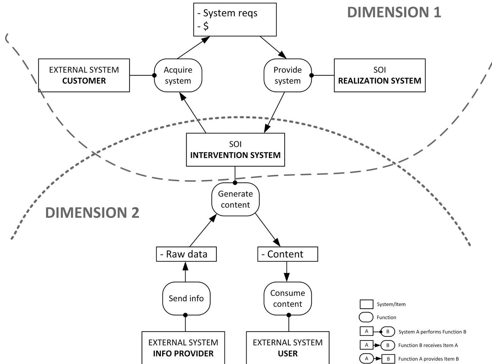
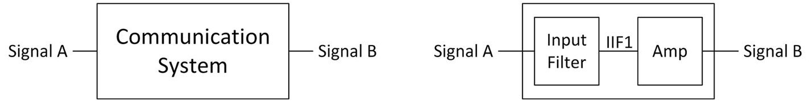

<!-- PDF_PAGE: 1 -->

# A systems-theoretic articulation of stakeholder needs and system requirements

Alejandro Salado $ ^{1,2} $ iD

$ ^{1} $ Virginia Tech, Grado Department of Industrial and Systems Engineering, Blacksburg, Virginia, USA

$ ^{2} $ Independent Contractor

## Correspondence

Correspondence Alejandro Salado, Virginia Tech, Grado Department of Industrial and Systems Engineering Blacksburg, VA 24061, USA. Email: asalado@vt.edu

## Abstract

The literature shows disparities in how fundamental systems engineering concepts in the area of requirements engineering, such as stakeholder needs, system requirements, requirements elicitation, requirements derivation, and requirements decomposition, are used within the communities-of-practice and in research. Such disparities can lead to conceptual and application inconsistencies, which have been shown to contribute to the formulation of poor requirements. In this paper, such concepts are articulated using systems theory as the underlying theoretical framework. The concepts of problem space, solution space, open system, and closed system are central to this work. It is argued that the proposed articulations facilitate avoiding usage disparity, ultimately resulting in better formulation of requirements. These articulations are supported by in-depth examples that comprehensively cover different types of needs and requirements, and provide step-by-step insights into how elicitation, derivation, and decomposition occur within a problem formulation effort.

## KEYWORDS

requirements engineering, scientific foundations of systems engineering, theory of systems engineering

## 1 INTRODUCTION

Adequately framing and formulating the problem before initiating design and development activities is one of the core principles of systems engineering. $ ^{1-3} $ Solving a wrong problem likely leads to an ineffective solution. $ ^{4} $ Requirements written in natural form (eg, using shall statements) are often used to formulate engineering problems. $ ^{5,6} $ Yet, the inability to formulate the right requirements right remains a prevalent issue in the practice of systems engineering. $ ^{7} $ I contend that the disparity in the understanding and use of several requirements engineering concepts is one of the factors causing this issue. $ ^{8-10} $

For example, stakeholder needs, system requirements, requirements elicitation, requirements derivation, and requirements decomposition are fundamental concepts in systems engineering. $ ^{1,2,11-13} $ However, they are used inconsistently within the communities of practice and in research (as shown in Section 2). I organize them in two types of inconsistencies. First, there is conceptual inconsistency. Different sources/authors interpret the same concept differently. It should be noted that this does not refer to a definition mismatch, where different terms are used to refer to different concepts. Such a situation, which also exists, is easily solved by performing simple term mapping. Conceptual inconsistency, as used in this paper, refers to sources/authors having disparate interpretations of a given concept. Examples are given in Section 2. Second, there is application inconsistency. Even in cases where a specific interpretation of a concept is adopted (eg, a specific systems engineering handbook is used as a basis), the artifacts resulting from applying or using that concept (eg, a system requirement) do not conform with the interpretation that has been adopted (eg, a statement intended to serve as a system requirement actually represents a stakeholder need according to adopted interpretations) (eg, Refs. 8 and 9).

One could argue that these two inconsistencies are caused by poor, or incorrect, understanding and practice of requirements engineering. In fact, education and training in requirements engineering is certainly

<!-- PDF_PAGE: 2 -->

weaker, in general, than in other areas of engineering (one only needs to look at engineering curricula throughout engineering programs). However, I believe that existing definitions for requirements engineering concepts are inherently limited in preventing usage inconsistencies. I contend that the lack of a formal, or theoretical, framework that serves as the basis for defining requirements engineering concepts is a major contributor to usage inconsistencies.

To address this issue, in this paper, I present the concepts of stakeholder needs (or requirements), system requirements, need elicitation, requirement derivation, and requirement decomposition from the lens of systems theory. $ ^{14} $ I use the notions of problem space, solution space, open system, and closed system as frames of reference to articulate these requirements engineering concepts. The presented definitions (or formulations) are supported by in-depth examples that comprehensively cover different types of needs and requirements and provide step-by-step insights into how elicitation, derivation, and decomposition occur within a problem formulation effort. While textual representations for needs and requirements are used, the work presented in this paper is independent of a formulation approach and of specific process implementation.

This paper targets researchers and practitioners alike. The systems engineering community has identified a growing interest in establishing the scientific foundations or theory of systems engineering, both led by the International Council on Systems Engineering (INCOSE) $ ^{15,16} $ and the National Science Foundation (NSF). $ ^{17-19} $ Noting that "the rigor and precision of a science is measured ... by the extent to which its formulations are free from statement compounds of non-truth-functional kinds," $ ^{20} $ I contend that formalizing requirement engineering concepts that have been traditionally defined based on individual practices with a systems-theoretic underpinning is of direct benefit for the systems engineering research community. By extension, practitioners may find value in this paper by achieving clarity in understanding, interpreting, and using fundamental requirements engineering concepts. Ultimately, improved precision and rigor can facilitate avoiding usage disparity, ultimately resulting in better formulation of requirements.

The rest of the paper is organized as follows: Section 2 provides evidence of the inconsistencies in usage of requirements engineering concepts in the literature. Section 3 is devoted to articulating various requirements engineering concepts from a systems-theoretic lens, which are exemplified in Section 4. Section 5 discusses the implications of the formal concepts to requirements engineering practice and provides guidelines on how to apply them. Concluding remarks are provided in Section 6.

## 2 REQUIREMENTS ENGINEERING CONCEPTS: USAGE INCONSISTENCIES IN THE LITERATURE

This section presents some specific examples to support the problems identified in the previous section related to inconsistencies in the usage of requirements engineering concepts. The section is not intended to be exhaustive, as exhaustiveness is considered unnecessary for the purpose of this paper.

## 2.1 Conceptual inconsistencies

In the Systems Engineering Body of Knowledge (SEBoK), $ ^{21} $ stakeholder needs and requirements are defined as elements that "represent the views of those at the business or enterprise operations level - that is, of users, acquirers, customers, and other stakeholders as they relate to the problem (or opportunity), as a set of requirements for a solution that can provide the services needed by the stakeholders in a defined environment." Stakeholder needs are differentiated from stakeholder requirements, the former being transformed into the latter. The distinctive feature between the two lies in the precision with which each is formulated. Specifically, stakeholder needs are vaguely defined, whereas stakeholder requirements are more precise. For example, while a stakeholder need reads as "to easily maneuver a car in order to park," corresponding stakeholder requirements read as "increase the drivability of the car, decrease the effort for handling, assist the piloting, protect the coachwork against shocks or scratches." $ ^{21} $ The activity of elicitation is reserved to stakeholder needs only, not to stakeholder requirements. System requirements are defined distinctively from stakeholder needs and requirements and include "all of the requirements at the system level that describe the functions which the system as a whole should fulfill to satisfy the stakeholder needs and requirements." System requirements clarify and translate stakeholder needs and are formulated using a technical language. Following the previous example, a system requirement that would contribute to satisfy the stakeholder requirement increase the drivability of the car could address the sensitivity of the car to driver input. The process or activity to go from stakeholder needs and requirements into system requirements is termed definition.

Verma $ ^{12} $ states that stakeholder requirements "are a detailed description from the stakeholders' perspective of what is required to meet the operational need." Stakeholder requirements "state what must be done in operational terms." They may be referred to as operational requirements, customer requirements, business requirements, or mission requirements. They all mean the same thing: a set of statements defining what is required to fulfill the mission or business objective. This emphasis on the stakeholder's perspective is reinforced by suggesting a formulation structure of " [Subject] requires [Functionality][Modifier]," although other imperatives, such as needs or shall, are also used. For example, a stakeholder requirement reads "The user requires notification of a potentially dangerous wildfire within 30 minutes of detection. $ ^{12} $ In the same book, Lee et al $ ^{13} $ proposed that system requirements should be written from the perspective of the system, and that they include input and output requirements, functional requirements, and performance and nonfunctional system requirements. For example, a system requirement that contributes to satisfy the previous stakeholder requirement reads "The system shall provide the current position of all fires within 5 km (threshold), 500 m (objective)." $ ^{13} $ The authors describe a flow from need to stakeholder requirements to system concept or implementation approach to system requirements to system architecture to subsystem requirements. The term derivation is used for all the activities related to such an end-to-end flow.

<!-- PDF_PAGE: 3 -->

Buede and Miller $ ^{2} $ differentiate between two classes of requirements as well: (1) mission requirements, and stakeholder requirements, and (2) system requirements, component requirements, and so on. Mission requirements "establish how the stakeholders will benefit by introducing the system in question into" the system's context. Mission requirements "relate to objectives of the stakeholders that are defined in the context" of the system's context, "not the system itself." Stakeholder requirements, however, "should focus on the boundary of the system." The authors provide as examples the liftable weight of an aircraft or the empty weight of an aircraft. System requirements, on the other hand, are defined as "a translation (or derivation) of the stakeholders' requirements into engineering terminology." This definition seems internally inconsistent though, since the examples the authors provide for stakeholder requirements (eg, different weights of the aircraft) seem to be given in technical terms. The whole chain to flow mission requirements down to component requirements is also termed derivation.

Kossiakoff et al $ ^{22} $ differentiate between operational, functional, performance, and physical requirements. Specific examples of these requirements are not provided in the original source, only definitions. Operational requirements refer to the mission and purpose of the system. They "describe and communicate the end state of the world after the system is deployed and operated," refer to the system as a whole, and "are broad and describe the overall objectives of the system." Operational requirements "must initially be described in terms of operational outcomes rather than system performance." No prescription of when the evolution occurs, nor whether all requirements need be evolved simultaneously or not are provided. Functional requirements refer to "what the system should do," are largely quantitative, and refer to the system as a whole. Performance requirements refer to how well the previous two requirements are met and are always objective and quantitative, providing a minimal numerical threshold. Physical requirements refer to "characteristics and attributes of the physical system and the physical constraints placed upon the system design."

Blanchard and Blyler, $ ^{23} $ similar to Blanchard and Fabrycky, $ ^{3} $ also employ the term operational requirements and use it to refer to those requirements that "reflect the needs of the consumer (i.e., the user) in terms of system deployment, utilization, effectiveness, and the accomplishment of its intended mission(s)." However, their use of the term seems to be much broader, since they include examples, such as operational distribution or deployment, mission profiles or scenarios, performance and related operational parameters (meant to be characteristics of a system, such as speed, accuracy, etc.), utilization requirements, effectiveness requirements (defined as system requirements, such as availability, reliability, etc.), system interface and interoperability requirements, and environmental requirements. In fact, they clarify that the objective of producing operational requirements is "to respond to the questions ... What functions must the system perform, when must these be accomplished, where will the system be utilized and for how long, and how will the system accomplish its objectives?"

Wasson $ ^{24} $ distinguishes between source (or originating needs or requirements) and system product-level requirements. Source requirements are defined as those that "serve as the publicly released requirements used as the basis to acquire a system, product, or service." System product-level (specification) requirements are defined as those that are "essential capability requirements statements that specify and bound the performance-based capabilities of a system, product, or service entity." Where the Federal Aviation Administration's definition for requirement is adopted, "an essential characteristics, condition or capability that shall be met or exceeded by a system or a component to satisfy a contract, standard, specification or other formally imposed document." The difference between these two types of requirements is purely of organizational nature. Therefore, the author further decomposes specification requirements into several types: operational requirements and capability requirements, nonfunctional requirements, interface requirements, environmental condition requirements, and design and construction constraint requirements. Operational requirements refer to those that specify high-level requirements required to achieve system mission objectives and behavioral interactions and responses within a prescribed operating environment and conditions. Capability requirements "specify and bound a solution space with functional/logical performance actions each system/entity or item must be capable of producing, such as outcome(s), products, by-products, or services." The author states that these types of requirements are traditionally called functional requirements. Nonfunctional requirements refer to physical attributes and characteristics. Interface requirements address the connectivity of the system beyond its own boundaries, and environmental condition requirements address factors, such as temperature, humidity, altitude, etc., in which the system will operate. Finally, the design and construction constraint requirements address aspects, such as manufacturing, human factors, safety, and security. Examples of these types of requirements are not provided in the original source.

Sols $ ^{25} $ describes stakeholder requirements as those in the problem domain and system requirements as those in the solution domain, the latter being solution dependent. Specifically, stakeholder requirements "should only reflect the capabilities and functionalities or wished by the user," which are translated into system requirements when a design concept is chosen. Under these definitions, an example of a stakeholder requirement reads as "The system is to provide an all-weather communication capability between two cities," with a complete description of what all-weather means. A system requirement traced to such a stakeholder requirement reads as "The ferry is to transport people with the same house ambient comfort stated in standard S-ABC."

This summary shows that, while there are common threads among the authors (in particular in terms of realizing that there are different classes of problem spaces that need to be formulated), there are several conceptual discrepancies among most of them that are worth summarizing:

1) Some authors (eg, Ref. 21) consider that the main difference between stakeholder needs and requirements is dictated by the level of precision with which they are formulated. This implies that the classification of these requirements is purely based on

<!-- PDF_PAGE: 4 -->

formulation, not on the problem space they formulate. Other authors do not adopt this differentiation.

2) Some authors (eg, Refs. 2 and 21) consider that the difference between stakeholder requirements and system requirements is only dictated by whether engineering terminology is employed (or not) in the formulation. Once again, this implies that the classification of these requirements depends purely on formulation, not on the problem space they formulate. Other authors do not adopt this differentiation.

3) Some authors (eg, Ref. 22) define a type of requirement to capture outcomes initially and system performance later, as the system development progresses. This implies that the nature of the requirement (and, hence, the nature of the problem space) depends on the maturity of the system development. Other authors do not adopt this interpretation and keep requirement classes static.

4) Some authors (eg, Ref. 24) define requirements only based on their contractual relevance. Other authors do not.

All definitions cited above are based on practice and experience, either directly by those of the authors or upon reflection from the experience of others. None of them are built on, or at least explained from the context of, established theoretical concepts or by elaborating consistent theoretical constructs. No reasoning or justification for the choice of terms and interpretations is given. This has two negative implications. First, it is not possible to resolve the discrepancies using formal methods. Second, the definitions and interpretations of the concepts become prone to vagueness for use in practice, as shown in the next section.

## 2.2 Application inconsistencies

Instances of application inconsistencies are mainly found in the application of requirements engineering in actual projects. An exhaustive assessment of such inconsistencies would require a dedicated study, controlling for the expertise of requirement authors. It is, therefore, outside of the scope of this paper. Rather, the purpose of this section is to exemplify application inconsistencies and explain how concepts may be a source for such inconsistencies.

Consider, for example, the development of a space system, which is subject to a normative document on requirements engineering. $ ^{26} $ The normative document (a standard) specifies that technical requirements define what the system must do from the perspective of a contractor, not of a user. $ ^{26,27} $ I draw the attention to two types of requirements, operational requirements (which are defined as "those related to the system operability"), and logistic support requirements (which are defined as "those related to the logistics support considerations to ensure the effective and economical support of a system for its life cycle"). $ ^{26} $ An example of an operational requirement, common in actual sets of requirements for space systems, reads as "The [payload] shall be powered on by the platform. $ ^{i} $ $ ^{9} $ An example of a logistics support requirement, directly provided in the normative document (Ref. (26), reads as "The product shall be designed to be installed at the

customer's site within two days." Both requirement examples show application inconsistencies. $ ^{8} $ Fulfillment of the former requires certain behavior of the platform and, therefore, it cannot be entirely considered as a requirement of what the system must do from the perspective of the contractor. The same situation occurs with the latter, which is directly defined in the context of the customer's tasks.

I contend that these inconsistencies are not limited to a specific industrial domain though. Some of the concept definitions used in systems engineering textbooks, presented in the previous section, also induce to application inconsistencies. For example, Kossiakoff et al $ ^{22} $ define an operational requirement to be stated for the system as a whole and the system's perspective; however, it is also defined by simultaneously referring to a state of the world, system as a whole, and objectives of the system. However, a state of world includes more elements than the system. The authors implicitly suggest avoiding the inconsistency by defining different types of operational requirements along the system development. However, as noted in Section 2.1, there is no prescription for how such evolution occurs.

Similarly, Wasson $ ^{24} $ refers to operational requirements and capability requirements as functional requirements. Yet, the definition of operational requirements refers to mission objectives and that of capability requirements to the production outcomes, products, byproducts, or services. However, as I will describe later, a function cannot produce outcomes.

Even textbooks that employ internally consistent definitions exhibit application inconsistencies with the requirement examples they provide. For example, the requirement "The FireSat spacecraft shall be maintainable by a Class 2 Engineering Technician, as defined in KSC WP-3556, Technician Qualifications Manual" is provided as an example of an operational requirement in Ref. 13. Operational requirements are defined in the source as a kind of system requirement that define how the system must "tolerate or respond to the operational environment throughout its lifecycle." While the definition of operational requirement is consistent with that of a system requirement (ie, written from the perspective of the system), the textual requirement is written from the perspective of an exchange between two actors, the system and a technician.

## 3 SYSTEM-THEORETIC REQUIREMENTS ENGINEERING CONCEPTS

## 3.1 Theoretical framework

I adopt INCOSE's interpretation of the purpose of requirements (and needs), which is to define, formulate, and/or scope the problem to be solved or the opportunity to be sought, $ ^{1} $ because of its consistency with problem-solving theory and relevance to the systems engineering community. In fact, the terms problem space and solution space have traditionally been used in engineering and computer science to distinguish the work related to requirements engineering (in the problem space) from the work related to architecture, design, and implementation (in the solution space), $ ^{28-33} $ regardless of whether

<!-- PDF_PAGE: 5 -->

those activities occur sequentially, highly iteratively, or concurrently. In this paper, I draw from the theories of problem solving in cognitive psychology $ ^{34} $ and topology $ ^{35} $ to define the problem and solution spaces in terms of what they are, and not in terms of the activities that lead to them or occur in them.

The problem space is a representation of a problem. A problem is defined as a desired situational change: there is a current situation and a desired future situation that is different from the current one. A problem can, thus, refer to both the solution to an undesired situation and the response to a desirable opportunity. $ ^{1,12} $ The notion of representation explicitly differentiates the problem space from the problem itself. While both are considered mental constructs, the problem space requires the problem to be represented, not just exist. $ ^{36} $ In systems engineering, needs and requirements are used to represent certain types of problems; thus, they are a type of problem space. The solution space is a set of elements that solve the problem represented by the problem space. Therefore, a problem space yields a solution space. $ ^{4} $ In systems engineering, the solution space is a set of systems (to be defined next) that solve the problem represented by the problem space.

I adopt von Bertalanffy's definition of a system: a system is a set of inter-related elements, $ ^{14} $ where the type of inter-relations is unrestricted. The notion of system boundary is central to this definition of system: some elements form the system and some elements do not. The boundary of a system separates that system from the rest, including other systems. von Bertalanffy's definition implies that if a relation can be defined among a set of elements, then the set can be said to be a system. That property has been called systemness and has been defined as "the degree to which an entity or concept is considered or conceived of as a system." $ ^{37} $ It follows from this definition that systemness is not a property of being (things cannot be systems) but a construct of the observer (things can only be considered, conceptualized, or viewed as systems); such is the reason for italicizing the word "be" two sentences earlier. In fact, since the null relation is a form of relation, $ ^{38} $ there is indeed no restriction as to how to define system boundaries (from a system's definition standpoint). By extension, identification of the boundary is a sufficient condition for something to be conceived as a system since a relation between the elements inside will necessarily exist (even if it is the null relation).

Two classes of systems are central in this paper: open systems and closed systems. An open system is one that exchanges information, matter, or energy with external systems. $ ^{14} $ That is, information, matter, or energy pass through the system's boundary. A major implication for this paper is that an open system can be described as an entity that processes inputs into outputs $ ^{14} $ ; it executes a function. A closed system, to the contrary, is one that does not exchange any information, matter, or energy with any external system. $ ^{14} $ That is, information, matter, or energy do not inflow or outflow through the system's boundary. A major implication for this paper is that a closed system cannot be described as a process of inputs into outputs. Instead, a closed system may be described by properties of the whole or sequences of snapshots of its inside.

## 3.2 Problem spaces, context systems, and systems of interest

I contend that there are two classes of problem spaces of interest for systems engineering: problem spaces of outcomes and problem spaces of functions.

A problem space of outcomes defines the desired state of a universe of discourse. It defines the outcomes desired by the stakeholders. Outcomes are not inputs into a system or outputs provided by a system; an outcome cannot be produced by a system. Rather, outcomes are consequences of interactions (or inter-relations, in von Bertalanffy's terms). For example, a thirsty person may desire to stop being thirsty (a desired outcome). A solution to the thirst problem may be composed of different elements (one of them being the person) that interact in such a way that the person stops being thirsty. The satisfaction of the person is a state (or a property or condition), not an output of the person or any other element. Therefore, a problem space of outcomes necessarily yields a solution space that consists of closed systems. The outcome is, thus, a representation of a condition, state, or property (used indistinctively here) of the whole closed system and, by definition, is not an output of it (note: closed systems cannot produce outputs, as previously discussed).

Continuing with the thirst problem, consider a water fountain that provides water and a person who drinks the water. The person, the water fountain, and the right interaction (eg, the water fountain provides sufficient water to the person in such a way that the person can drink it and decides to drink it at a certain rate) form a closed system (for the purpose of the thirst problem) that achieves the outcome of the person no longer being thirsty. Note that the water fountain alone is unable to achieve the outcome, nor is the person no longer being thirsty an output of the water fountain. The water fountain provides an output (water) that the person takes as an input, the successful exchange of which results in the person no longer being thirsty. Hence, the roles of the two elements (the person's ability and willingness to drink the water and the fountain's ability and willingness to provide water) are essential in this example to achieving the desired outcome.

Solving the problem space of outcomes requires finding a suitable closed system, that is, a set of existing systems, a set of new systems, and their inter-relations (ie, interactions) that achieve the desired state for the whole. I refer to such a closed system as a Context System in this paper. This choice requires two clarifications. First, while the term System Context is often used in systems engineering, $ ^{1} $ from the definition of system, given above, a set of systems in inter-relation can be conceived as a system. Therefore, I contend that it is sensible to refer to such a closed system as a system and not as a context (note that the new systems are also part of the closed system). Second, Martin $ ^{39} $ also uses the term Context System with a similar purpose, albeit slightly differently. Table 1 lists the differences and justifies the choice made in this paper.

In summary, a solution to the problem space of outcomes is a closed system that consists of several elements in inter-relation. Since such elements interact to achieve certain outcomes (ie, they exchange

<!-- PDF_PAGE: 6 -->

TABLE 1 Differences in the use of the term context system between this paper and Martin $ ^{39} $

<table border="1"><tr><td>Martin 2004</td><td>This paper</td></tr><tr><td>Distinguishes between the Context System and the Modified Context System as two distinct systems, where the former refers to the set of elements that form the undesired current situation (with no new systems in place) and the latter captures the elements that work together in the desired future situation (with new systems in place).</td><td>Martin emphasizes the importance of defining/capturing the as-is situation (as a system) because of its importance to adequately formulating the problem space. I fully concur with such an idea. However, I suggest that the As-Is Context System and the To-Be Context System are the same (closed) system in a different situation. In Martin&#x27;s nomenclature, the Context System and the Modified Context System cannot coexist because the latter is an evolution of the former. In terms of problem solving, as framed in this paper, the difference between Martin&#x27;s Context System and the Modified Context System is the desired situational change that is identified as a problem and represented as a problem space. Therefore, such situational difference is assigned to a given closed system, even though it may seem an impossibility due to the inexistence of new systems in Martin&#x27;s Context System. However, since the Context System includes all elements that influence the desired situational change, evolution within the closed system is certainly possible. All resources and elements necessary for the new systems to come into existence are already available within the Context System. Through a process of changes in the different elements, a new system emerges at the expense of other elements changing their states. Therefore, from a problem formulation standpoint, there is not only no need to distinguish between Martin&#x27;s Context System and Modified Context System as two separate systems, but such a distinction would not fit consistently within the principles of systems theory and problem-solving theory presented earlier in this paper.</td></tr><tr><td>The problem is considered a system and is part of the Context System.</td><td>A problem is defined as a desired situational change and is described by a problem space. If the problem is considered a system, being an element of the Context System, one of the following two conditions must hold: (1) If the Problem System is considered a closed system, then it does not affect nor is it affected by the Context System. In this case, it is not meaningful to present the Context System because it does not have any role in addressing the problem. (2) If the Problem System is considered an open system, then it interacts with other elements in the Context System. The Problem System would get inputs and generate undesired issues. This understanding is inconsistent with the theory of problem solving. Since none of the conditions hold, the problem cannot be conceived as a system; therefore, I have adopted the interpretation from the theory of problem solving.</td></tr><tr><td>External systems necessary to support the systems created to solve the problem system are not considered part of the Modified Context System.</td><td>Supporting systems are necessary elements of the solution. They contribute to achieving the desired outcomes and are, thus, part of the desired situational change. Therefore, the closed system that solves the problem represented by the problem space must include supporting systems. Therefore, they are part of the Context System as defined in this paper.</td></tr></table>

energy, information, and/or matter), they must necessarily be open systems, as per the previous definitions. Therefore, a solution to the problem space of outcomes is a closed system that consists of several open systems in inter-relation. In some cases, the desired outcomes may be achieved with a set of existing systems by finding a new inter-relation (ie, a set of interactions between the systems). In other cases, some systems must be newly realized to enable the necessary interactions to achieve the desired outcomes. This is a common situation in systems engineering, where a minimal set of systems will be realized to interact with a set of existing systems. Realizing those (open) systems can be conceived as solving a problem and, hence, this creates the need for a second class of problem spaces in systems engineering: the problem space of functions.

A problem space of functions defines a set of desired output trajectories for a given set of input trajectories (ie, a set of desired functions). Since closed systems cannot accept inputs or provide outputs, a problem space of functions necessarily yields a solution space formed by open systems. Therefore, any desired open system that is needed to interact in a certain way within a desired closed system is a response to a problem space of functions.

Coming back to the thirst problem, let us consider that the water fountain does not exist. Given the desired closed system presented earlier, there are desired functions for the water fountain such that it provides water of certain characteristics (following certain input request and resources; abstracted for the moment). In this case, the problem space is not described as a desired outcome, but as a desired function at the boundary of the open system. Therefore, the achievement of the desired function by an open system is independent of the role or action of any system external to it. In the thirst example, given the defined boundary conditions, the water fountain will provide the water regardless of whether the person drinks it or not or whether the person is thirsty or not. In fact, the person might even do something unanticipated with the water he/she gets from the fountain, such as store it, let it flood, or connect a hose to the fountain and flow the water to a garden.

Solving the problem space of functions requires finding a suitable open system that achieves the desired functions at its boundary. I refer to such an open system as a System of Interest (SOI), following INCOSE's nomenclature, $ ^{1} $ since they are conceptually equivalent.

Recapitulating this section, I have presented two classes of problem spaces and two classes of systems. The problem space of outcomes describes a desired situational change, the desired state of the stakeholders. The Context System is a solution to such a problem space and is a closed system that consists of one or more SOIs and all the

<!-- PDF_PAGE: 7 -->

systems with which they interact. The desired situational change (or state) applies to the Context System as a whole and, thus, it is achieved by the interaction of the SOIs with all other systems in the Context System. An SOI is an open system that must be realized to execute functions that yield output trajectories based on input trajectories that enable the interactions desired in the Context System. The SOI is a solution to the problem space of functions, which describes the functions that are desired at the SOI boundary. These concepts form the pillars to formally define (and distinguish) stakeholder needs and system requirements, which are presented in the next section.

## 3.3 Stakeholder needs and system requirements

In the previous section, I argued that two classes of problem spaces are sufficient for systems engineering. It follows that two classes of requirements (ie, mechanisms to formulate the problem space) are sufficient as well: one class of requirement to formulate each class of problem space. Instead of proposing new nomenclature, such as outcome requirements and function requirements or closed system requirements and open system requirements, I adopt and refine nomenclature already in use in the field. I use the term stakeholder needs to refer to the mechanisms that formulate the problem space of outcomes, and the term system requirements to refer to the mechanisms that formulate the problem space of functions.

As per the definitions of the two classes of problem spaces, stakeholder needs capture the desired properties of the interaction or engagement of the SOI with external systems. Therefore, their satisfaction occurs after putting the SOI into its environment so that the engagement of all external systems with it are exercised. System requirements capture the desired properties of a system's boundary, which do not depend on the actions of external systems. Therefore, their fulfillment can be demonstrated by assessing the system in isolation. This distinction is essential to assess the adequacy of a given formulation mechanism in the context of the class of problem space that it is intended to formulate. Consider, as an example, the need for balloons at a party. One of the stakeholder needs that would address such a need could be:

SN1: The user needs the system to inflate a balloon with Gas Type A in less than 20 s.

Note 1: Balloon: Model MC-123 manufactured by Magic Balloons.

Note 2: Gas Type A composition is as defined in STD-222.

Note 3: Inflation is determined as the balloon reaching at least 1 cubic foot in ambient pressure.

(Note that this example is provided in the context of differentiating the formulations of the different classes of problem spaces. All references and values are notional. Furthermore, SN1 may refine or derive from a higher-level need, but it is valid for the purpose of the example. A detailed explanation of refinement and derivation of stakeholder needs is provided in Section 4. Moreover, other formulations could have been used, such as, The system shall inflate a balloon with Gas Type A in less than

20 s. A specific discussion about different formulations is provided in Section 4.)

As can be seen, SN1 is defined in the context not only of the system, but also of the user and the balloon. That is, the user and the balloon are not part of the SOI, but external systems to it. Demonstrating the satisfaction of this stakeholder need requires the system to operate correctly as well as the balloon to meet certain characteristics (eg, elasticity, airtightness, etc.) and be available and ready to interact with the system. It also requires the user to correctly operate the system. Furthermore, satisfaction conditions are defined as outcomes: time to execute an activity (less than 20 s) and an end state condition (balloon is inflated). Other stakeholder needs in this example could include the fatigue level of the user after inflating a number of balloons (which is a state condition of the user). None of these are outputs or inputs of any of the elements in the SN1, consistent with the nature of the problem space of outcomes presented in the previous section.

Consider the following Context System as a solution to the stakeholder need: an SOI is attached to the balloon and, using a mechanical force injected by the user, takes air from the environment, and pushes it into the balloon. Note how the SOI remains a black box, as its internal functioning is not described. The SOI is only defined as a set of interactions at its boundary with other systems in the Context System. (This is not the only solution to the problem. For example, one could open the air entrance of the balloon and move the balloon quickly around in an environment filled with Gas Type A. With sufficient force, the balloon could be inflated.) Consider now two system requirements related to SN1 that could read as follows:

SR1: The SOI shall provide Gas Type A at a flow of at least 1 cubic meter per minute for 20 min through IF-1.

Note 1: Gas Type A composition is defined in STD-222.

Note 2: IF-1 is defined in ICD-10. (Where IF-1 is a notional interface and ICD-10 is a notional document.)

SR2: The SOI shall provide Gas Type A at no more than 2 cubic meters per minute for 20 min through IF-1.

Note 1: Gas Type A composition is defined in STD-222.

Note 2: IF-1 is defined in ICD-10. (Where IF-1 is a notional interface and ICD-10 is a notional document.)

(As with SN1, the requirements are provided in the context of differentiating the formulations of the different classes of problem spaces. All references and values are notional. SR1 and SR2 are not the result of a complete derivation of SN1, just two of the requirements that could result from the derivation effort. Other formulations could have been used. A specific discussion about different formulations is provided in Section 4.)

Contrary to SN1, the formulations of both SR1 and SR2 are independent of external systems. Their fulfillment only depends on the characteristics of the SOI, and not on the actions and decisions of systems external to the SOI. It is possible to demonstrate the fulfillment of both SR1 and SR2 by measuring the air flow produced by the SOI at IF-1. Does fulfilling these two requirements imply satisfying SN1? Not necessarily. Ideally, IF-1 will be defined by a set of characteristics that will

<!-- PDF_PAGE: 8 -->

resemble those of balloon Model MC-123 manufactured by Magic Balloons (as defined in SN1), but they will still be an abstraction of the actual balloon and, thus, satisfaction of SN1 cannot be guaranteed by simply fulfilling SR1 and SR2. This is consistent with the concepts of verification and validation in systems engineering. $ ^{40} $

The concepts and uses of stakeholder needs and system requirements will be further elaborated in Section 4, in the context of their mutual relationships in the processes of elicitation, derivation, and decomposition.

## 3.4 Constraints and guidelines

Stakeholder needs and system requirements have been described in the previous section as sufficient mechanisms to formulate the two classes of problem spaces. For completeness, it is worth discussing two additional mechanisms that are frequently used in practice (constraints and guidelines) to understand their effect on problem formulation from a formal standpoint.

The formulation of a problem space can be modified with constraints and aided by guidelines. In this paper, the term constraint is defined as an element of the problem space that does not describe the problem of interest. In other words, a constraint modifies the solution space unnecessarily for a given problem. $ ^{4} $ This definition differs from how the term constraint is sometimes used in systems engineering. $ ^{1,13,41,42} $ However, I contend that the proposed use in this paper better resembles the term's definition in the Oxford English Dictionary.

In the problem space of outcomes, a constraint takes the form of a stakeholder need that stakeholders do not need. In the problem space of functions, a constraint is a requirement whose fulfillment plays no role in achieving the purpose of the system. A common example of a constraint is a design-dependent requirement, by which a specific solution or aspect of a solution is enforced. Hence, establishing constraints is considered poor practice in requirements engineering. $ ^{2,4,5,13,43} $ Reasoning in terms of classes of problem spaces can facilitate identifying whether a given statement is a constraint or not:

- If a formulation intended as a stakeholder need describes an aspect of the boundary or an inner characteristic of one or more systems, or enforces a particular interaction between two or more systems (not the desired properties of the interaction), then the formulation is a constraint and not a stakeholder need. Indeed, such a formulation results in discarding context systems from the solution space based on their composition, not based on their ability to achieve desired outcomes (the basis of the problem space of outcomes).

- If a formulation intended as a system requirement describes an inner aspect or feature of the SOI (not a characteristic related to its boundary), then the formulation is a constraint and not a system requirement. Indeed, such a formulation results in discarding SOIs from the solution space based on their composition, not on their ability to provide the desired functions that will enable the desired interactions within the context system (the basis of the problem space of functions).

Guidelines are directions offered to the engineer in support of the exploration of the solution space. A common guideline may be written as a suggestion to use a specific solution. Continuing with the balloon example, a guideline could read as The system may use oil as a lubricant. Guidelines provide a direction of search in the solution space and, thus, they do not need to be fulfilled.

Constraints and guidelines are similar in intention since both are used to point to specific solutions. However, constraints enforce those specific solutions, whereas guidelines do not. Since guidelines are not formulated as requirements (eg, the term may implies optionality), there is no risk in this case of misrepresenting a guideline as a problem formulation mechanism.

## 3.5 SOIs: product and organization

It is common in system development to include requirements for the organization that will realize the system to set expectations on some of the processes that will be utilized to realize the system (eg, which documents to deliver, which risk management process to use, provision of spare parts, etc.). Most of these requirements are usually documented independently from requirements that address the product, in artifacts such as a Statement of Work (SOW) or directly in the contract. However, some of these process requirements (ie, for the organization) are often inadvertently included in and confused with system requirements or specification documents for the engineered system. $ ^{9} $ In addition to evident problems associated with requirements management and verification, this mix leads to gaps in requirement formulation. $ ^{8} $ The articulations presented in this paper help to clearly distinguish if a requirement addresses the product or the process.

In line with Martin, $ ^{39} $ I contend that the product and the organization realizing the product are two SOIs, and I will refer to them as the Intervention System (the product) and the Realization System (the organization realizing the product or Intervention System). However, while Martin $ ^{39} $ presents the Intervention System as an element of the Realization System, I propose that the two SOIs, while related, belong to two orthogonal dimensions (ref. Figure 1). The Intervention System acts as a system executing functions in one of them, while it acts as the element that is transformed/exchanged in the other. In the former, the Realization System does not play any role. In the latter, the Realization System takes a set of requirements that formulate the problem space for the Intervention System, financial resources, and potentially some nondevelopmental items as inputs, while providing the Intervention System and information about it (eg, documentation) as outputs.

All the discussions presented so far are applicable to the Realization System as an open system, which is part of a Context System that addresses the process aspects of the Intervention System development, as shown in Figure 1. Therefore, the two classes of problem spaces and formulation mechanisms presented in the previous sections are sufficient to capture the process requirements. The theoretical construct in this case is to simply conceive the Realization System and the Intervention System as two different SOIs for which

<!-- PDF_PAGE: 9 -->

FIGURE 1 A two-dimensional representation of the intervention and realization systems

problem spaces of outcomes and problem spaces of functions can be formulated.

Hereafter, for word economy and if not otherwise specified, I will refer to the Intervention System simply as the system or the SOI, and use the terms organization, customer, or contractor to refer to the Realization System or one of its external systems.

## 4 REQUIREMENTS ENGINEERING PROCESSES

I distinguish between three activities in the generation of requirements: elicitation, derivation, and decomposition. Elicitation refers to the discovery and formulation of stakeholder needs. Derivation refers to the formulation of system requirements using stakeholder needs as a starting point. Decomposition refers to the formulation of system requirements at a given level of encapsulation using system requirements at the immediately superior level of encapsulation as a starting point. Levels of encapsulation here refer to the system partitioning into lower level elements that happens during development of the system architecture.

The term elicitation is only used in the context of formulating stakeholder needs. While needs belong to stakeholders (hence, they can be elicited from them), system requirements do not belong to any

actor. Rather, they derive from an established set of stakeholder needs. Therefore, elicitation and derivation activities are termed as elicitation of stakeholder needs and derivation of system requirements.

The elicitation and derivation activities are strongly confounded and are usually iterative. Furthermore, it is not uncommon to find references where the elicitation/derivation activities are considered hierarchical, being applied to multiple levels of encapsulation. This conceptualization is possible, but usually misinterpreted. Details are provided when presenting decomposition, which is a special case where the elicitation/derivation activities are simplified due to the control that is exerted when architecting a system. Therefore, this section is organized with two subsections: the first subsection presents the concepts, and the second subsection integrates them with an example.

## 4.1 Elicitation, derivation, and decomposition: concepts

Stakeholder needs are elicited from the stakeholders and should align with their preferences. I interpret the concept of preference as what a stakeholder ultimately seeks to realize by leveraging the SOI, which is in line with its interpretation in the field of decision analysis. $ ^{4 4} $

<!-- PDF_PAGE: 10 -->

Preferences can be mapped to a quantitative scale, in which case, we will talk about value. $ ^{44} $ Preferences (and, hence, value) represent the purpose of the system to exist. In commercial enterprises, the preference may be given by more profit is preferred to less (short-term, longterm, etc.). In scientific endeavors, the preference may be given by more scientific discovery is preferred to less, or higher relevance of scientific discovery is preferred to less. In defense endeavors, the preference may be given by higher military capability is preferred to less. Therefore, stakeholder needs must represent the preferences of the stakeholders and their value scale. In this sense, establishing preferences (and, hence, value) as the starting point to elicit stakeholder needs becomes essential for adopting a value-based engineering approach. $ ^{45-47} $

Understanding value generation can be used to validate stakeholder needs as they are elicited. For example, a stakeholder need of a commercial company interested in maximizing profit formulated as The operator needs to spend less than 2 h per week in maintenance operations $ ^{ii} $ could be meaningfully elicited due to its effect on operational costs and service availability, which are both related to total ownership cost and revenue, which are related to profit, which is the purpose of the system. In this way, purpose (preference) is broken down into stakeholder needs; stakeholder needs become a refinement and/or derivation of purpose (preference). Details on the refinement and derivation of stakeholder needs are proved in Section 4.2.

Deriving system requirements consists of designing the Context System that solves the problem described by the problem space of outcomes, so that the problem space of functions for the SOI can be formulated. Using common systems engineering jargon, deriving system requirements consists of designing an engagement (operational) concept between the SOI and its external systems that leads to satisfaction of the set of stakeholder needs. This process becomes iterative with stakeholder needs being refined, elicited, and derived as the Context System (ie, operational concept) is matured. For example, the stakeholder need addressing maintenance duration presented earlier may have resulted from a maintenance versus reliability tradeoff performed in the frame of designing the Context System. Such a trade-off could have resulted specifically in (1) identifying a new stakeholder/external system (the operator), (2) eliciting a new stakeholder need (the maintenance duration for the mutual interaction between the operator, user, and SOI), and (3) deriving a system requirement (on the reliability of the SOI). While the choice of that maintenance operation is part of the Context System (ie, operational concept), the Context System remains incomplete. The trade-off does not prescribe how the operator must specifically engage or interact with the SOI. Without such information, it is not possible to establish requirements for the SOI that are independent of its operation in context, that is, to completely formulate the problem space of functions. Hence, the derivation of system requirements would continue with designing in detail how the operator should engage with the SOI (note that the SOI remains a black box) to achieve the target of spending less than 2 h per week on maintenance. That specific exchange would yield additional system requirements.

Circling back to the theoretical concepts presented in Section 3, it is important to re-emphasize that stakeholder needs and system requirements formulate two different classes of problem spaces, both of which address the same level of encapsulation, yet from different perspectives. Stakeholder needs and system requirements do not map to different encapsulation levels. Stakeholder needs are defined in relation to the interactions between the elements of the context system. System requirements are defined in relation to the boundary of one or more of those elements. Once stakeholder needs have been elicited, establishing system requirements does not require the decomposition of any of the context system's elements. Rather, it requires the completion of the design of the Context System to abstract the effect of all external systems so that the required functions of the SOI can be established.

Moving on to architecting the SOI, each of its building blocks (which I will call components $ ^{iii} $ ) can be conceived as a system, based on the definition given earlier. Therefore, it is sensible to ask if the two classes of problem spaces defined earlier (and, thus, the elicitation/derivation pattern) can be replicated for each of the SOI's building blocks (or at least at each encapsulation level). When considering decomposing the SOI requirements into requirements for its components, the answer is no. The SOI is conceived as an open system that executes a function. Establishing stakeholder needs for the components (and, hence, a problem space of outcomes for the SOI) would require conceiving the SOI as a closed system, which is impossible to do without losing information (removing external inputs and outputs into/from the SOI). Therefore, the SOI's function is decomposed into a set of functions (those to be executed by its components) that cannot be converted into outcomes. Hence, elicitation and derivation do not apply when formulating the problem spaces of functions for the SOI's components (which will be referred to as component requirements). Instead, system requirements are decomposed into component requirements.

Decomposing a requirement consists of partitioning it into requirements that formulate a problem space of functions for systems at the next lower level of encapsulation. In other words, a desired function is decomposed into a set of desired functions that, when composed, yield the original desired function. Two aspects are worth noting. First, a requirement can be decomposed into a single requirement (this is known as decomposition through equivalence $ ^{2} $ ). This implies that a desired function for the SOI will be executed entirely by a specific component of the SOI. Second, decomposed requirements also need to be established for internal interfaces, for completeness. This is because the interface connecting two SOI components also executes a function, even if it is the identity function.

However, once each component goes through its own lifecycle, there may be additional stakeholders that emerge, and stakeholder needs that must be elicited due to their unique development situations. For example, an organization developing a component may have interests on the component that are different or in addition to those originally intended for the component in the frame of the SOI (eg, the component's development organization may desire to use the component to support evolution as part of a future product line-perhaps resulting in needs/requirements related to modularization), or may use the component in scenarios not anticipated in the scope of the SOI (eg, needs/requirements related to specific interfaces to support

<!-- PDF_PAGE: 11 -->

developmental testing and debugging at the component level). The resulting problem space of functions for a component will be the union of the requirements decomposed from the SOI system requirements and those derived from the stakeholder needs elicited in the frame of the organization developing the component.

## 4.2 Elicitation, derivation, and decomposition elaboration

The (ideal $ ^{\mathrm{i v}} $ ) starting and ending points of elicitation and derivation are somewhat obvious. The elicitation of stakeholder needs starts with a statement of purpose. The derivation into system requirements ends with a complete set of system requirements. $ ^{\mathrm{v}} $ I believe that the formulations that occur in between those points are what lead to confusion and problems of interpretation on what problem space is being formulated and what formulation mechanism should be used. In this section, I develop a fairly comprehensive example (in terms of depth) of the several design and formulation steps $ ^{\mathrm{v i}} $ that may occur within the context system to eventually arrive at a problem space of functions for the SOI.

Consider a need (statement of purpose) to protect a valuable item. During the stakeholder need elicitation process, such a statement of purpose may be refined until a quantifiable, precise, and accurate statement of the need is achieved. For example, the following stakeholder needs may be elicited to refine the meaning of protect a valuable item:

SN1. The user needs the system to protect valuable item from robbery.

SN2. The user needs the system to protect valuable item from being lost.

SN3. The user needs the system to protect valuable item from being destroyed.

(Assume that, for completeness, those statements are associated with detailed descriptions of what a robbery is, what losing the item is, and what destruction implies, as well as the properties of the valuable item and the performance criteria of those needs. They have been omitted here for simplicity and have no effect on the insights of the discussion. Note that, as defined earlier, precision and/or vagueness are not considered conditions to differentiate a stakeholder need from a system requirement. The differentiation comes from the class of problem space that they formulate. Therefore, both stakeholder needs and system requirements must conform to qualities or attributes that achieve accurate and precise formulation. In addition, different language structures could have been used for the statements, such as The user needs to protect valuable item from robbery or The system shall protect valuable item from robbery. For this paper, the specific formulation does not affect the general presentation of how they relate to different classes of problem spaces. The critical point is whether the statement refers to outcomes and/or includes external systems, or it is formulated in terms of functions or transformations absent of external systems. Yet, the formulation may have implications on the accuracy and precision of the formulation. These aspects are outside the scope of this paper.)

As can be seen, the statements do not describe a desired function; there is no input or output. Rather, they describe desired properties or states of elements within the context system: a valuable item (part of the context system) must be in the state protected given the actions of a robber.

An interesting characteristic of this refinement effort is that choices have not been made at this point. Refinement of stakeholder needs is not the result of a choice. Instead, refinement is the result of understanding (interpreting) what protecting a valuable item means to the stakeholders; it purely remains a problem space formulation activity. In this example, the three needs could be further refined, for example, by specifying the sources of potential destruction, but they are considered sufficient for this example.

Once this initial set of stakeholder needs is elicited (ie, before any choice has been made), let us consider that mission engineering starts to design the Context System; to choose a class of solutions/systems in the solution space. While the three needs would be considered simultaneously for conducting trade-offs, let us use SN1 (robbery) only for simplicity. Consider that three potential solutions to protect the valuable item from robbery are identified as:

Solution 1. Deter the robber.

Solution 2. Deceive the robber.

Solution 3. Resist the robbery.

The three solutions could satisfy the stakeholder need, but each one does so differently. In solution 1, the robber thinks twice and walks away from the robbery. In solution 2, the robber is misled into believing success when that is not the case. In solution 3, the robber gives up after trying. The different solutions have different characteristics, which would result in different levels of satisfaction for a whole set of stakeholder needs. Note that the solutions do not specify the inner characteristics or elements of the SOI. Instead, they define different possible engagements of the SOI with external systems. Therefore, solutions 1-3 specify part of the solution of the Context System. Let us assume that, given a comprehensive set of stakeholder needs, it is decided to go with solution 1 as a first step in establishing the concept of operations (ie, the System Context). There are, however, multiple ways to deter a robber. Hence, a sort of requirement is needed to evaluate the goodness of different deterrence solutions, formulating a new problem space. Consider, for example, the following statement:

## The system shall deter X% of robbers attempting to steal valuable item for Y years. $ ^{vii} $

A sensible question is, is this statement a stakeholder need or a system requirement? Clearly, the statement refers to the interaction of three actors (the SOI, robber, and valuable item). It does not address what the SOI must do, but what the system must achieve. Deterrence is an outcome, not an SOI's output. Therefore, the statement cannot be a system requirement. Given the previous definitions, this implies that the statement formulates a problem space of outcomes and, therefore, it must be conceived as a stakeholder need.

<!-- PDF_PAGE: 12 -->

At the same time, we can ask the question of whether this statement is derived from SN1 or, on the contrary, whether it refines it. Contrary to what happened when eliciting SN 1 through SN 3, in this case, the statement results from a choice that has been made. Satisfying SN 1 could have been done in three ways, but one was chosen. Therefore, the statement does not really support understanding, but codes a design choice; in other words, there has been an intentional reduction of the solution space of Context Systems. Hence, there is sort of a derivation (not a refinement) of SN1 into (let us call it) SN1.1.

Moving on, mission engineering activities continue, and a deterrence concept must be established. The following alternatives are suggested:

Solution 1.1. Make robbery attempt very dangerous for the robber.

Solution 1.2. Make robbery attempt incredibly difficult for the robber.

Solution 1.3. Detect robber and make robber aware of detection.

Solution 1.4. Detect robber and make robber and user aware of detection.

Solution 1.5. Detect robber and make robber and law enforcement officers aware of detection.

As in the previous step, note that the solutions do not specify the inner characteristics or elements of the SOI. Instead, they define different forms of engagement of the SOI with external systems. Therefore, solutions 1.1-1.5 specify part of the solution of the Context System. Consider again a full set of stakeholder needs and a decision analysis that advises that solution 1.3 is the best course of action; so, it is selected from the solution space. As in the previous case, there are multiple ways to detect a robber and make him/her aware of the detection. As in the previous step, a sort of requirement is needed to evaluate the goodness of different detection and awareness solutions, formulating a new problem space. Consider, for example, the following statements:

The system shall detect L% of robbers attempting to steal valuable item for Y years.

The system shall make Z% of detected robbers aware they have been detected.

(Specific values in the statements could be determined by analyzing how detection effectiveness and awareness effectiveness relate to deterrence effectiveness. Simplistically, one could say that Z $ ^{*} L $ needs to be higher than X.)

A sensible question again is, are these statements stakeholder needs or system requirements? As in the previous case, we can see that the statements refer to the interaction of three actors (the SOI, robber, and valuable item). They do not address what the SOI must do, but what the interactions must achieve. Achieving detection and making the robber aware require the robber to engage with the system in certain ways. For example, detection may be achieved if the SOI is able to observe certain characteristics of the robber, and the robber is within the observation bounds of the SOI. Detection and making aware are outcomes, not SOI outputs. As in the previous case, the statements cannot be conceived

as system requirements. The statements formulate a problem space of outcomes and, therefore, they must be conceived as stakeholder needs.

At the same time, we can again ask the question as to whether these statements are derived from SN1.1 or, on the contrary, do they refine it. In this case, as for SN1.1, a choice has been made that results in the new statements. Satisfying SN1.1 could have been done in five ways, but one was chosen. Therefore, the statement does not really support understanding of SN1.1, but codes a design choice; there has been another intentional reduction of the solution space of Context Systems. Hence, this is a sort of a derivation (not a refinement) of SN1.1 into (let us call them) SN1.1.1 and SN1.1.2.

Moving on, mission engineering activities continue and a concept to detect the robber and make him/her aware of the detection must be established. The following alternatives for detection are suggested:

Solution 1. Artificial illumination and observation in the visual range.

Solution 2. Observation in the infrared range.

The following alternatives for awareness of the detection are suggested as well:

Solution 3. Observe movement.

Solution a. Sound a loud alarm.

Solution b. Emit a dance of lights.

Solution c. Eject ammunition.

As in the previous step, note that the solutions do not specify the inner characteristics or elements of the SOI. Instead, they define different forms of engagement of the SOI with external systems and, thus, they specify part of the solution of the Context System. Consider again, a full set of stakeholder needs and a decision analysis that informs that solution tuple 2a (observing in the infrared range and sounding a loud alarm) is the best course of action, thus, it is selected from the solution space. As in the previous case, there are multiple ways to make observations in the infrared range and to sound a loud alarm. As in the previous step, a sort of requirement is needed to evaluate the goodness of different infrared observation and alarm sounding solutions, formulating a new problem space. Consider, for example, the following statements:

R1. The system shall observe Target 1 (with properties of the target in terms of spectrum, intensity, etc.).

R2. The system shall emit Sound 1 (with properties of frequency, intensity, directionality, etc.).

Assume that Target 1 has been determined using a characterization of a certain population of robbers and Sound 1 using a characterization of how that population of robbers reacts to different sound profiles. Contrary to the previous steps, statements R1 and R2 do not depend on actors external to the system. They specify actions that the SOI can execute absent of the external systems. In fact, they define a desired function: given an input (regardless of the element that provides the input), they provide a desired output (regardless of how that output affects or is used by an external element). Therefore, R1 and R2

<!-- PDF_PAGE: 13 -->

FIGURE 2 Communication system and its physical architecture

represent system requirements that formulate the problem space of functions. The derivation effort is, therefore, complete at this point and system architecture, with requirement decomposition, might follow.

Before moving on to decomposition, there are two aspects that deserve some discussion. First, this example shows that the elicitation and derivation of stakeholder needs into system requirements has a refinement component, where statements of needs are broken down into smaller pieces that provide deeper understanding of the needs of the stakeholders, and a sort of derivation component, where design decisions about the Context System are made. However, it is important to clarify that those design decisions do not resemble a hierarchical process. Note how protecting value, deterrence, and detection remain at the same level of encapsulation: they simply address more precise ways in which the system and the robber interact with each other. Therefore, I avoid the term decomposition of stakeholder needs because they are not really broken apart. Rather, there is a refinement of the Context System (ie, concept of operations) that requires making a series of decisions, each one providing a higher level of precision in describing it.

Second, the process of gaining precision is fluid and different steps may be necessary for different stakeholder needs. Furthermore, a given stakeholder need may actually result in a set of system requirements, on the one hand, and a set of stakeholder needs that still need to be derived, on the other hand. One could argue that all the steps in the derivation process that have been shown earlier could be collapsed so that the first stakeholder needs that are elicited are directly derived into system requirements, deleting all stakeholder needs in between (eg, SN1.1, SN1.1.1, etc.). This can certainly be done, and I suggest that it is a choice that depends on the specific problem that is being formulated. Regardless, collapsing or not collapsing does not change the validity of the presented concepts.

Moving on to requirement decomposition, to ease understanding instead of continuing with the protection of valuable item example, a different case is used; however, the overall structure is maintained to keep the requirements engineering flow consistent. $ ^{viii} $ Consider a problem space formulated by the following two requirements at the system level for a communication system, which resemble the two system requirements previously presented (SR1 resembles R1, since both of them capture a required input; SR2 resembles R2, since both capture a required output as a function of the input):

SR1. The system shall accept Signal A. Note: Signal A power $ \in[0 $ dBW, 3 dBW].

SR2. The system shall provide Signal B. Note: Signal B power > = Signal A power + 5 dB

Consider a system architecture formed by two components (eg, an input filter [C1] and an amplifier [C2]), selected from the solution space in response to requirements SR1 and SR2. The system as a black box and its physical architecture are depicted in Figure 2.

We proceed to decompose SR1 and SR2 as follows. SR1 addresses the acceptance of an external signal. Since Signal A is allocated to the input filter (C1) only, it suffices to decompose it as an equivalent requirement to the input filter (C1). Hence, we can decompose SR1 into the following requirement:

C1R1. The input filter shall accept Signal A. Note: Signal A power [0 dBW, 3 dBW].

SR2 is trickier, because it includes the required end-to-end function (functionality) of the system and, therefore, the input filter, amplifier, and interface connecting both of them (which will be called IIF1) contribute to fulfilling such a requirement. Decomposition is shown into two steps. It should be noted that the relative sequence of the two steps is not prescriptive, although both steps need to be performed to complete the decomposition of a requirement. The first step consists of allocating the functionality/performance aspect of the system requirement. $ ^{i x} $ Let us consider that the allocation effort initially results in decomposing SR2 into the following requirements for the input filter (noted by C1Rx), the amplifier (denoted by C2Rx), and the internal interface (denoted by IIF1Rx):

Note: Signal A power > = Signal B1 power > = Signal A power - 1 dB

C1R2. The system shall provide Signal B1.

IIF1R1. The system shall accept Signal B1.

Note: Signal B1 power > = [-1 dBW, 3 dBW]

IIF1R2. The system shall provide Signal B2.

Note: Signal B1 power > = Signal B2 power > = Signal B1 power - 2 dB

C2R1. The system shall accept Signal B2.

Note: Signal B2 power > = [-3 dBW, 3 dBW]

C2R2. The system shall provide Signal B.

Note: Signal B power > = Signal B2 power + 8 dB

It can be shown that fulfilling all those requirements implies fulfilling SR2.

At this point in the decomposition, three problem spaces are formulated, one given by C1R1 and C1R2, one given by C2R1 and C2R2, and one given by IIF1R1 and IIF1R2.

In the second step, and before the requirements of the components are finalized, the internal interface is designed. That is, an interface is

<!-- PDF_PAGE: 14 -->

TABLE 2 Application inconsistencies associated with mixing outcome and function/output-based formulations

<table border="1"><tr><td>Formulated as desired formulation</td><td>Outcome</td><td>Function/output</td></tr><tr><td>Stakeholder need</td><td>Consistent use</td><td>Overconstrained problem space</td></tr><tr><td>System requirement</td><td>Unbounded problem space</td><td>Consistent use</td></tr></table>

chosen from the solution space yielded by IIF1R1 and IIF1R2. For the requirements of a component to be complete, its external interfaces need to be precisely defined. Otherwise, while the required function of the open system is established, the physical boundary where this occurs is not. Note that in the first stage of decomposition, only the requirements for the interface are defined, not how that interface will be implemented. Let us consider then that, in this example, fulfilling the attenuation goal given by IIF1R1 and IIFR2 can be achieved by using certain coaxial cable of a certain length, radius, and material, and let us call that coaxial interface COAX-M for each connector on the interface implementation (requiring COAX-F on the other sides, ie, on the components). In this case, C1R2 and C2R1 are then refined and finalized as:

C1R2. The system shall provide Signal B1 through COAX-F.

Note: 3 Signal A power > = Signal B1 power > = Signal A power - 1 dB

C2R1. The system shall accept Signal B2 through COAX-F.

Note: Signal B2 power > = [-3 dBW, 3 dBW]

As can be seen, decomposition in this case is achieved by decomposing a required function without defining specific outcomes within the SOI.

## 5 IMPROVING PROBLEM FORMULATION

As stated in the introduction of this paper, I contend that the systems-theoretic formalization of requirements engineering concepts presented in this paper is inherently beneficial because "the rigor and precision of a science is measured ... by the extent to which its formulations are free from statement compounds of non-truth-functional kinds." $ ^{20} $ As a specific example, the proposed formulations are effective in easily identifying application inconsistencies associated with unboundedness and unnecessary constraining of the problem space, which are summarized in Table 2.

Unboundedness of the problem space occurs when an outcome is used to define a system requirement (ie, when one wants to describe what the system must do). In such a situation, the system of interest is inherently unable to fulfill the requirement, because achieving the required outcome depends on specific behaviors and actions of external systems. As a result, systems in the solution space cannot guarantee solving the problem space. An overconstrained problem space results from using a function or output to define a stakeholder need (ie, when one

TABLE 3 Application inconsistencies associated with mixing outcome and function/output-based formulations

<table border="1"><tr><td>Application inconsistency</td><td>Example</td></tr><tr><td>Stakeholder need defined as function/output</td><td>N1. The user needs the system to sound an alarm.
N2. The user needs the system to display access information.</td></tr><tr><td>System requirement defined as outcome</td><td>R1. The system shall provide access to authorized users.
R2. The system shall protect confidential information from intruders.</td></tr></table>

TABLE 4 Summary of key characteristics of stakeholder needs and system requirements

<table border="1"><tr><td>Stakeholder need</td><td>System requirement</td></tr><tr><td>Formulated in the context of a closed system</td><td>Formulated for an open system</td></tr><tr><td>Describes desired outcomes/states</td><td>Describes desired functions/inputs/outputs</td></tr><tr><td>Addresses an external actor, or the SOI and at least one external actor</td><td>Addresses only the SOI; external actors are abstracted out through characterization; they can be simulated</td></tr></table>

wants to describe what the system must achieve or what the stakeholders desire the system for). In such a situation, a solution to achieve a desired outcome is prescribed, potentially leaving out of the solution space solutions that could be acceptable to or even preferred by the stakeholders. $ ^{51} $ Examples of such types of application inconsistencies, all of which are acceptable with the definitions presented in Section 2, are shown in Table 3.

Consider now the system-theoretic formulations presented in this paper. Their main tenets, which are listed in Table 4, may be useful for a practitioner to quickly sort out if a given statement refers to a stakeholder need or a system requirement; that is, if the statement describes what the stakeholders want to achieve or what the system must do. It is then evident that N1 and N2 in Table 2 describe outputs the system must provide (sounding an alarm and displaying information), and not a given state or outcome in a closed system (while the user is included in the statement, the statement does not refer to a state or outcome of an exchange between the user and the system). Similarly, it is easy to recognize also that R1 and R2 in Table 2 not only include external actors in the statement (authorized users and intruders), but they define desired outcomes and states of such actors, not functions that the system will exercise (protected and access are states).

Clarity in distinguishing types of requirements is achieved by conceptualizing them in terms of the type of problem space they are intended to describe. In this way, classifying a requirement becomes independent of vague terms, such as precision, context of application, or the use of technical jargon. In fact, traditional characteristics of good

<!-- PDF_PAGE: 15 -->

TABLE 5 Summary of key characteristics of elicitation, derivation, and decomposition

<table border="1"><tr><td>Elicitation</td><td>Derivation</td><td>Decomposition</td></tr><tr><td>Outputs stakeholder needs</td><td>From stakeholder needs to system requirements</td><td>From system requirements at a level of encapsulation to system requirements at a lower level of encapsulation</td></tr><tr><td>Owned by stakeholders</td><td>Output of operational design (how the system is used, engages with external systems)</td><td>Output of system architecture and design</td></tr><tr><td>Addresses closed systems</td><td>Addresses open systems within a closed system</td><td>Addresses open systems that compose another open system</td></tr></table>

requirements, $ ^{5} $ such as unambiguity, still apply to both stakeholder needs and system requirements.

Finally, Table 5 summarizes the key tenets of elicitation, derivation, and decomposition, which could be useful for a practitioner to quickly identify the requirements engineering activity at hand. Informed by discussions with colleagues, I speculate that clarity in these concepts is important to perform these activities correctly. For example, using the term elicitation when referring to system requirements implies that system requirements are owned by or represent someone's desires rather than being the result of operational choices. Similarly, using the term decomposition to refer to establishing system requirements from stakeholder needs implies that both refer to different levels of encapsulation, which is incorrect.

## 6 CONCLUSIONS

This paper has contributed to the theory of systems engineering with novel, formal articulations of requirements engineering concepts. Specifically, the concepts of stakeholder needs, system requirements, elicitation, derivation, and decomposition have been articulated using systems-theory and theory of problem solving as the underlying theoretical frameworks.

Two classes of problem spaces have been presented as sufficient to support problem formulation in systems engineering. The first class has been called the problem space of outcomes, and it yields a solution space formed by closed systems. These closed systems, called Context Systems (and including the traditional concepts of system context, concept of operations, and operational concept), consist of the SOI and external systems that interact with it. Stakeholder needs have been defined as mechanisms or vehicles to formulate such a class of problem space. This problem space describes desired outcomes from the interactions and/or states of the SOI and the external systems that interact with it.

The second class has been called the problem space of functions, and it yields a solution space that is formed by open systems. These open systems represent the SOI. System requirements have been defined as mechanisms or vehicles to formulate such a class of problem space. This problem space describes desired functions that the SOI executes.

An end-to-end example has been used to show how using the concepts of closed and open systems helps in identifying whether a given statement represents a stakeholder need or a system requirement. This has been shown to be of particular importance to understanding the activities of requirements elicitation, derivation, and decomposition.

Elicitation has been used to refer to the discovery and formulation of stakeholder needs. Derivation has been used to refer to the formulation of system requirements using stakeholder needs as a starting point. Finally, decomposition has been used to refer to the formulation of system requirements at a given level of encapsulation using system requirements at the immediately superior level of encapsulation as the starting point. The examples provided in this paper explain the way in which elicitation and derivation are strongly confounded and iterative, and show that they are meaningful only in the frame of stakeholder needs and system requirements. Elicitation and derivation, thus, cannot be hierarchically applied to formulate problem spaces as a system is decomposed. This is because elicitation and derivation occur in the frame of a closed system, while system architecting (and hence, requirement decomposition) occurs in the frame of open systems (a function cannot be decomposed into a set of outcomes, only as a decomposition of other functions).

I contend that these concept articulations should help improve rigor and precision in requirements formulation, contributing to overcome the problems resulting from conceptual and application inconsistencies existing in current definitions. Indications of this have been presented through literature review and anecdotal examples, are supported by Quine's quote in the introduction of the paper about the rigor and precision of a science, and are consistent with my own experience as an instructor of graduate courses and corporate training in systems engineering. However, these improvements have not been formally measured in this paper and, therefore, future research is necessary to gain additional confidence of its potential impact to practice.

Finally, while textual representations have been used to formulate needs and requirements, the articulations that have been presented in this paper are independent of formulation approach and specific process implementation. In fact, future research may further their formalization through ontologies and meta-models, enabling the operationalization of formal models of the problem space, which are currently lacking. $ ^{52} $

## ORCID

Alejandro Salado https://orcid.org/0000-0001-9378-0795

## NOTES

<!-- PDF_PAGE: 16 -->

Why is this statement a stakeholder need, and not a system requirement? Note how the statement is formulated in the context of an external actor to the system, that is, the operator. Satisfying this statement is not only a function of the system, but also of the operator to exercise their actions correctly (functions). In fact, the actions of both the system and the operator have not been defined yet at this point. As will be discussed shortly, an operational concept must be designed that satisfies those needs.

iii An SOI building block is also referred to in the literature as subsystems, parts, or elements, among others.

iv The term ideal here should not necessarily be interpreted as desired, rather as an abstracted situation of reality.

The completeness of a requirement set cannot be demonstrated. 48-50 Completeness here should be interpreted as the state in which the team has converged to a set of requirements that they consider sufficiently comprehensive to start system architecture or design with a given target confidence.

vi Design activities are those by which systems in the solution space are chosen; formulation activities describe the problem space.

vii As in the previous cases, assume that the statement is provided with all details and definitions to make it quantifiable, verifiable, and so on, but are omitted for simplicity.

viii Following the decomposition of observational and detection requirements may not be easy to understand to engineers without application expertise in such a field. In addition, showing the decomposition of observational and detection requirements meaningfully requires incorporating several design attributes, which would make the example unnecessarily complicated.

ix This allocation is usually based on detailed analyses and performance of trade-offs that often involve more than one requirement. Notional values are used in this paper for illustration purposes.

## ACKNOWLEDGMENT

Effort sponsored in part by the U.S. Army Combat Capabilities Development Command (CCDC) Aviation and Missile Center, under Recipient Agreement No. W911W6-17-3-0002, for which the author worked as an independent contractor, not as a Virginia Tech employee. The U.S. Government is authorized to reproduce and distribute reprints for Governmental purposes notwithstanding any copyright notation thereon.

The views and conclusions contained herein are those of the authors and should not be interpreted as necessarily representing the official policies or endorsements, either expressed or implied, of the U.S. Army Aviation and Missile Research, Development and Engineering Center.

## REFERENCES

1. INCOSE. Systems Engineering Handbook: A Guide for System Life Cycle Processes and Activities. version 4.0 ed. Hoboken, NJ: John Wiley and Sons, Inc.; 2015.

2. Buede DM, Miller WD. The Engineering Design of Systems: Models and Methods. 3rd ed. Hoboken, NJ: John Wiley & Sons, Inc.; 2016.

3. Blanchard BS, Fabrycky WJ. Systems Engineering and Analysis. Prentice Hall, NJ; 1990.

4. Salado A, Nilchiani R, Verma D. A contribution to the scientific foundations of systems engineering: solution spaces and requirements. J Syst Sci Syst Eng. 2017;26(5):549-589.

5. INCOSE. Guide for Writing Requirements. International Council of Systems Engineering; 2012.

6. Robertson S, Robertson J. Mastering the Requirements Engineering Process. Getting Requirements Right. Addison-Wesley; 2012.

7. Hooks IF. Why Johnny still can't write requirements. 22nd Annual SSTC Conference. Salt Lake City, UT; 2010.

8. Salado A, Nilchiani R. Categorizing requirements to increase the size of the solution space: moving away from NASA and ESA's requirements categorization models. Paper presented at: 6th International Systems & Concurrent Engineering for Space Applications Conference. Stuttgart, Germany; 2014.

9. Salado A, Nilchiani R. A categorization model of requirements based on Max-Neef's model of human needs. Syst Eng. 2014;17(3):348-360.

10. Salado A, Nilchiani R. Reducing excess requirements through orthogonal categorizations during problem formulation: results of a factorial experiment. IEEE Trans Syst Man Cybern Syst. 2017;47(3):405-415.

11. NASA. NASA Systems Engineering Handbook. Washington, DC: National Aeronautics and Space Administration (NASA); 2016.

12. Verma D. Stakeholder expectations and requirements definition. In: Larson WJ, Kirkpatrick D, Sellers JJ, Thomas LD, Verma D, eds. Applied Space Systems Engineering. McGraw Hill; 2009:37-64.

13. Lee RE, Hooks I, Barker BG. Engineering and managing system requirements. In: Larson WJ, Kirkpatrick D, Sellers JJ, Thomas LD, Verma D, eds. Applied Space Systems Engineering. McGraw Hill; 2009:95-139.

14. von Bertalanffy L. General Systems Theory - Foundations, Development, Applications. New York: George Braziller, Inc.; 1969.

15. Rousseau D. A vision for advancing systems science as a foundation for the systems engineering and systems practice of the future. Syst Res Behav Sci. 2019;36(5):621-634.

16. Rousseau D. The theoretical foundation(s) for systems engineering? Response to yearworth. Syst Res Behav Sci. 2020;37(1):188-191.

17. Triantis KP, Collopy PD. A comprehensive basis for systems engineering theory. Paper presented at: Systems Conference (SysCon). 2014 8th Annual IEEE. 2014.

18. Collopy PD. Report on the science of systems engineering workshop. 53rd AIAA Aerospace Sciences Meeting. American Institute of Aeronautics and Astronautics; 2015.

19. Collopy PD. Systems engineering theory: what needs to be done. Paper presented at: Systems Conference (SysCon). 2015 9th Annual IEEE International. 2015.

20. Quine WVO. Elementary Logic: Revised Edition. Cambridge, MA: Harvard University Press; 1980.

21. SEBoK. Stakeholder Needs and Requirements. SEBoK Web site. 2020. Available at: https://www.sebokwiki.org/w/index.php?title= Stakeholder_Needs_and_Requirements&oldid=59216. Accessed June 28, 2020.

22. Kossiakoff A, Sweet WN, Seymour SJ, Biemer SM. Systems Engineering Principles and Practice. 2nd ed. Hoboken, NJ: John Wiley & Sons, Inc.; 2011.

23. Blanchard BS, Blyler JE. Systems Engineering Management. 5th ed. Hoboken, NJ: John Wiley & Sons, Inc.; 2016.

24. Wasson CS. Systems Engineering Analysis, Design, and Development Concepts, Principles, and Practices. Hoboken, NJ: John Wiley & Sons, Inc.; 2016.

25. Sols A. Systems Engineering. Theory and Practice. Madrid, Spain: Universidad Pontificia de Comillas; 2014.

26. ECSS. Space Engineering - Technical Requirements Specification. European Cooperation for Space Standardization; 2009.

27. Boenke T, Agnolon D. PLATO P/L Specific Design and Interface Requirements Document (P/L SDIR). Noordwijk, The Netherlands: European Space Agency (ESA); 2015.

28. Berg K, Bishop J, Muthig D. Tracing software product line variability: from problem to solution space. Proceedings of the 2005 Annual Research Conference of the South African Institute of Computer Scientists and Information Technologists on IT Research in Developing Countries. White River, South Africa; 2005.

29. Dorst K, Cross N. Creativity in the design process: co-evolution of problem-solution. Des Stud. 2001;22(5):425-437.

<!-- PDF_PAGE: 17 -->

30. Maher M, Tang H-H. Co-evolution as a computational and cognitive model of design. Res Eng Des. 2003;14(1):47-64.

31. Yilmaz S, Seifert CM, Gonzalez R. Cognitive heuristics in design: instructional strategies to increase creativity in idea generation. Artif Intell Eng Des. 2010;24(3):335-355.

32. Raja BS, Iqbal MA, Ihsan I. Moving from problem space to solution space. World Acad Sci Eng Technol, Int J Soc Behav Educ Econ Bus Ind Eng. 2007;1:764-767.

33. Martin JN. Systems Engineering Guidebook. A Process for Developing Systems and Products. Boca Raton, FL: CRC Press; 1997.

34. Kotovsky K, Simon HA. What makes some problems really hard: explorations in the problem space of difficulty. Cogn Psychol. 1990;22(2):143-183.

35. Zhang L, Zhang B. The quotient space theory of problem solving. Fundam Inf. 2004;59(2-3):287-298.

36. Newell A. Reasoning, problem solving, and decision processes: the problem space as a fundamental category. The Soar Papers (Vol. 1): Research on Integrated Intelligence. MIT Press; 1993:55-80.

37. Dori D, Sillitto H. What is a system? An ontological framework. Syst Eng. 2017;20(3):207-219.

38. Wymore AW. Model-Based Systems Engineering. Boca Raton, FL: CRC Press; 1993.

39. Martin JN. 3.1.2 The seven Samurai of systems engineering: dealing with the complexity of 7 interrelated systems. INCOSE Int Symp. 2004;14(1):459-470.

40. Bahill AT, Henderson SJ. Requirements development, verification, and validation exhibited in famous failures. Syst Eng. 2005;6:1-14.

41. Hull E, Jackson K, Dick J. Requirements Engineering. Springer; 2005.

42. NASA. Systems Engineering Handbook. 2007.

43. Salado A, Nilchiani R. Understanding how problem formulation in systems engineering influences systems affordability: a systems thinking investigation. Int J Appl Syst Stud. 2017;7(4):227-256.

44. Howard RA, Abbas AE. Foundations of Decision Analysis. 1st ed. Pearson; 2015.

45. Hazelrigg GA. A framework for decision-based engineering design. J Mech Des. 1998;120(4):653-658.

46. Collopy PD, Hollingsworth PM. Value-driven design. J Aircraft. 2011;48(3):749-759.

47. Abbas AE, Cadenbach AH. On the use of utility theory in engineering design. IEEE Syst J. 2018;12(2):1129-1138.

48. Carson RS. Requirement completeness: a deterministic approach. INCOSE Int Symp. 1998;8:738-746.

49. Carson RS, Shell T. Requirements completeness: absolute or relative? Syst Eng. 2001;4:230-231.

50. Carson RS, Aslaksen E, Gonzales R. Requirements completeness Paper presented at: INCOSE International Symposium. 2004.

51. Salado A, Nilchiani R. Increasing the probability of developing affordable systems by maximizing and adapting the solution space. Proc Comp Sci. 2014;28:547-554.

## AUTHOR BIOGRAPHY

DR. ALEJANDRO SALADO is an assistant professor in the Grado Department of Industrial and Systems Engineering and the Director of its Systems Engineering program at Virginia Tech. He conducts research in problem formulation, design of verification and validation strategies,

model-based systems engineering, and engineering education. Before joining academia, Dr. Salado spent over 10 years in the space industry, where he held positions as systems engineer, chief architect, and chief systems engineer in manned and unmanned space systems of up to $1B in development cost. He has published over 75 technical papers, and his research has received federal funding from the National Science Foundation (NSF), the Naval Surface Warfare Command (NSWC), the Naval Air System Command (NAVAIR), and the Office of Naval Research (ONR), among others. He is a recipient of the NSF CAREER Award, the International Fulbright Science and Technology Award, the Omega Alpha Association's Exemplary Dissertation Award, and several best paper awards. Dr. Salado holds a BS/MS in electrical and computer engineering from the Polytechnic University of Valencia, an MS in project management, and an MS in electronics engineering from the Polytechnic University of Catalonia, the SpaceTech MEng in space systems engineering from the Technical University of Delft, and a PhD in systems engineering from the Stevens Institute of Technology. Alejandro is a member of INCOSE and a senior member of IEEE and AIAA.

How to cite this article: Salado A. A systems-theoretic articulation of stakeholder needs and system requirements. Systems Engineering. 2021;24:83-99. https://doi.org/10.1002/sys.21568