<!-- PDF_PAGE: 1 -->

## REGULAR ARTICLE

WILEY

# Towards Developing Metrics to Evaluate Digital Engineering

Kaitlin Henderson $ ^{1} $ Tom McDermott $ ^{2} $ Eileen Van Aken $ ^{1} $ Alejandro Salado $ ^{3} $

$ ^{1} $Grado Department of Industrial and Systems Engineering, Virginia Tech, Blacksburg Virginia, USA

$ ^{2} $Systems Engineering Research Center, Stevens Institute of Technology, Hoboken New Jersey, USA

$ ^{3} $Department of Systems and Industrial Engineering, The University of Arizona, Tucson, Arizona, USA

## Correspondence

Kaitlin Henderson, Grado Department of Industrial and Systems Engineering, Virginia Tech, Blacksburg, VA, USA. Email: karj1@vt.edu

Funding information U.S. Department of Defense, Grant/Award Number: Contract HQ0034-19-D-0003

## Abstract

Model-based systems engineering (MBSE) is an increasingly accepted practice in the Systems Engineering (SE) community, however, little has been done to empirically show that MBSE provides value. Furthermore, as the industry continues in the direction of digital transformation, MBSE will become a critical component of the larger Digital Engineering (DE) approach. This paper presents a measurement framework for selecting and developing appropriate metrics to assess the value/benefits of MBSE and subsequently DE. Utilizing expected benefits identified in a review of MBSE literature, a causal map was hypothesized to show how expected benefits (potential metrics) influence and relate to each other. This was done in order to systematically determine which benefits would be the most impactful to measure. The hypothesized causal model was presented for feedback to subject-matter experts from a working group developing the first DE measurement framework. This group is a joint effort with industry, academia, and the USA government to develop DE metric standards. Once the causal map was finalized, a case study was used to partially validate the causal model. Based on the causal map and subsequent analysis, we can recommend the first metrics to be employed for DE/MBSE based on the most influential nodes of the causal model. The potential metric candidates include: system quality, defects, time, rework, ease of making changes, system understanding, Effort, accessibility of information, collaboration, project methods/processes, and use of DE/MBSE tools. We believe a concerted effort across the industry to focus on measuring these variables is the most effective way to establish proof of the value of MBSE and DE.

KEYWORDS

digital engineering, model-based systems engineering, performance measurement

## 1 INTRODUCTION

Systems continue to grow in complexity, and with that growth comes greater difficulty in managing the development of these systems. $ ^{1} $ The utilization of models to design systems is increasingly considered a principle of good system design, especially given the ability of models to cope with system complexity. $ ^{2-5} $ The SE and other engineering

fields are pushing for a transformation towards digital environments to better address the complex and rapidly changing needs of system capabilities. Digital engineering (DE) is an enterprise approach for incorporating data-driven infrastructure, methods and tools, innovation, and workforce transformation centered on an authoritative source of truth (ASOT) for engineering data. $ ^{6} $ DE aims to integrate design data across the entire system life cycle as well as "bridge the

<!-- PDF_PAGE: 2 -->

business processes across all functional disciplines." $ ^{7} $ This requires a high level of intra-disciplinary collaboration and integration across an engineering business. DE "moves the engineering discipline towards an integrated model-based approach." $ ^{6} $ Model-based systems engineering (MBSE) is the part of this larger DE transformation that enables this integration through the ASOT.

MBSE may be conceived as "the formalized application of modeling" to the systems engineering (SE) process. $ ^{8} $ As an emerging field, the MBSE literature boasts of the many benefits organizations can expect to achieve if the approach is implemented properly. $ ^{9-12} $ However, evidence shows little attention to formally measuring these benefits. $ ^{13} $ SE as a discipline has historically had difficulty providing quantifiable evidence of its value, although those familiar with the SE process attest to intuitively understanding its benefits. $ ^{14,15} $ MBSE, as a subset of SE, appears to be following that same pattern. Transitioning from a document-based to a model-based approach to SE represents a substantial financial investment, and organizations want to know if the effort and cost to adopt MBSE are worth it. $ ^{4,16,17} $ However, lack of perceived value is commonly cited as one of the leading barriers to adopting MBSE. $ ^{4,18-22} $

The aim for this project was to work with programs to observe their processes and implement specific metrics to try and capture the value of DE/MBSE, similarly to how Honour measured SE Return on Investment. $ ^{23} $ However, we quickly found that this would be more difficult than we anticipated. Based on our experience and discussions, programs largely do not have any measurement efforts in place, and those that do are lacking maturity. This would mean that a program would have to develop the infrastructure to collect data for metrics, and then apply the additional effort of tailoring the measures for important factors for DE and/or MBSE. This was not in the scope of this project. A few papers were found describing examples of programs that attempted to use quantifiable metrics to show the value of DE/MBSE. However, these few programs focus on different benefits and aspects of MBSE. $ ^{24-26} $ These independent efforts provide little value, since their results cannot be aggregated collectively for generalization purposes. Ideally, the same benefit needs to be shown over multiple different cases to strengthen the claim of value. Therefore, establishing a common set of metrics that can empirically show the value of MBSE could enable its continued dissemination in the industry to support the larger digital transformation.

This paper attempts to fill that gap by proposing a set of metrics that should be employed in order to best show the value of DE and MBSE. Since the potential benefits are many, we pull from performance measurement literature to systematically decide on which metrics should be prioritized. The rest of the paper is organized as follows. Section 2 discusses previous studies and projects that have led to this one. Following that, in Section 3, we present the methodology used and the results of those efforts. Section 4 presents a case study that is used to validate the causal model. In Section 5, we articulate the critical outcomes from the causal model analysis and case study. Section 6 describes the working set of metrics we recommend based on this work. Finally, in Section 7, we present our conclusions and discuss the next steps moving forward.

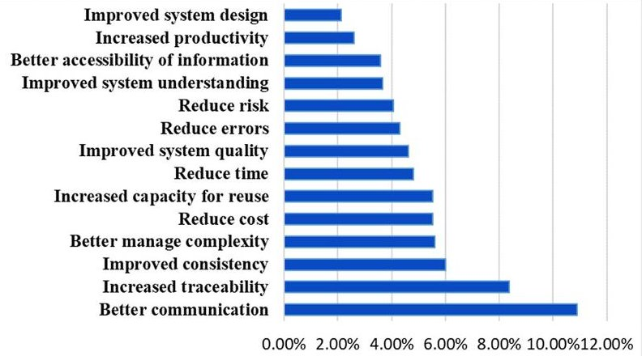

FIGURE 1 Top cited MBSE benefits by percentages

## 2 BACKGROUND

This paper builds on previous efforts to identify the benefits of MBSE and DE. The following sections summarize those efforts.

## 2.1 Literature review of MBSE benefits

The first work this paper builds on was an adapted systematic literature review. $ ^{13} $ The goal of the literature review was to evaluate the state of the literature with respect to substantiated evidence of MBSE benefits. Twenty journals and conferences from the areas of SE, engineering design, and space SE were selected for analysis. All papers that mentioned "MBSE" were reviewed for any mention of benefits. The benefits were also categorized based on how those claims were supported. These categories were measured, observed, perceived, or referenced to another source.

A total of 847 papers were identified and evaluated for any mentioning of MBSE benefits. No restriction as to the type of benefit, benefit claim, or claim context was applied. If the author(s) of a paper claimed that because of MBSE, a positive characteristic was added or improved, or a negative characteristic was removed or reduced, such a claim was recorded as a benefit. A total of 1233 individually claimed benefits were found in 360 papers. The results were aggregated into 48 benefit categories. The distribution of benefits across the 48 benefits was fairly even, with the most cited benefit only taking up about 10% of total benefit occurrences. The most frequently cited benefits are shown in Figure 1. It should be noted that these results do not represent the likelihood of such benefits existing, rather just a report of the frequency with which benefits were discussed in the literature.

The majority of the papers (240) were found to contain benefits that were only perceived or expected to occur by the authors. Only two of the papers had a defined measurement methodology, however, both of those had various methodological problems that may affect the validity of their findings. This review concluded that there is a need to "create a more unified basis of evidence" through the formal and systematic measurement of MBSE benefits. $ ^{13} $

<!-- PDF_PAGE: 3 -->

TABLE1 Top enabling and obstructing factors according to survey respondents

<table border="1"><tr><td>Top enablers</td><td>Top obstacles</td></tr><tr><td>Leadership support</td><td>Organizational culture</td></tr><tr><td>People willing to use MBSE tools</td><td>Workforce knowledge/skills</td></tr><tr><td>Workforce knowledge/skills</td><td>Leadership support</td></tr><tr><td>Demonstrating benefits/results</td><td>Awareness of MBSE benefits</td></tr></table>

## 2.2 MBSE adoption and benefits survey

The MBSE Maturity Benchmark Survey was developed through the combined efforts of the International Council on Systems Engineering (INCOSE), the National Defense Industrial Association (NDIA), and the Systems Engineering Research Center (SERC). $ ^{21} $ The intent of conducting this survey was to establish a current profile of MBSE use and expectations in the industry. Two critical aspects of the survey include: assessing the observed and expected value of MBSE, and collecting reports of enablers and barriers to MBSE adoption. These were both accomplished through the analysis of over 100 textual responses regarding benefits, adoption enablers, and barriers to adoption.

The responses to the benefit-related questions were coded using the 48 benefits that were found in the previously mentioned literature review. The results of the survey aligned very well with those found from the literature review, further validating those results.

The responses to the adoption-related questions were coded inductively. The factors found were either related to the adoption of MBSE, or the benefits of MBSE. Furthermore, a factor could be either an enabler, an obstacle, or both. For example, one of the factors was customer/stakeholder buy-in/engagement. This was presented in the responses as an obstacle if it was lacking, and an enabler if it was present. Thirty-seven factors were found to be enablers and/or obstacles to adoption. The top enablers and obstacles are shown in Table 1.

## 2.3 DE metrics study

DE is a subset of the larger aspects of enterprise digital transformation. Gartner reported four common characteristics for good enterpriselevel digital transformation metrics: adoption, usability, productivity, and new value. $ ^{27} $ The metrics categories in parentheses were derived as part of this work and are discussed below.

1. Measure people adoption, and enterprise process adoption (adoption)

2. Analyze breadth of usability, and issues with usability (user experience)

3. Measure productivity indicators (velocity/agility)

4. Generate new value to the enterprise (quality and knowledge transfer)

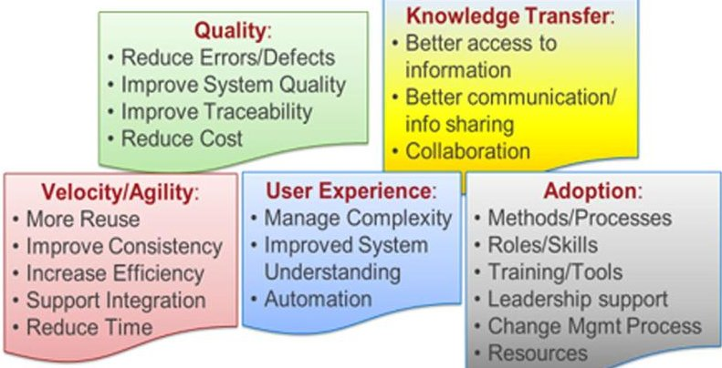

FIGURE 2 DE success categories

Digital transformation is a change process heavily rooted in workforce and culture, as noted by Goal 5 of the DoD DE strategy. The change process needs to assess both adoption of the methods and tools into the workforce in terms of number of users, resources, and so forth, and also the drivers of adoption that are linked to user experience with the methods and tools. To understand productivity indicators and areas of new value, the previous SERC study, Enterprise System-of Systems Model for Digital Thread Enabled Acquisition, was used as the base digital enterprise transformation model. $ ^{28} $ This study linked digital enterprise transformation to outcomes related to improved quality, improved velocity/agility, and better knowledge transfer. Knowledge transfer is a unique value of DE/MBSE that can be distinguished from other digital enterprise transformation metrics, as a primary goal of MBSE and the ASOT is communication, sharing, and management of data, information, and knowledge.

From this background research, a general categorization was created of DE/MBSE organizational change metrics linked to quality, velocity/agility, user experience, knowledge transfer, and adoption. These categories are shown in Figure 2. The benefits found in the previous literature review study were then sorted into these five categories. Table 2 includes a sample of this categorization, with a few adoption factors included under the adoption category. For a full list of categorized benefits, see Table 4.

## 3 CAUSAL MAP DEVELOPMENT

One of the key challenges of designing a performance measurement system (PMS) is selecting which measures to track. $ ^{29} $ Organizations should try to align metrics with strategies or goals that they have. This means selecting measures that are the true drivers of desirable outcomes (i.e., lower cost, higher quality, etc.). $ ^{30} $ For example, if a goal of an organization is to have happy customers, customer satisfaction would be an effective metric to track that goal. Not finding these fundamental drivers of performance can lead to having too many measures, which makes it difficult to know which measures are valuable or just noise. $ ^{31} $

Ittner and Larcker $ ^{31} $ suggest a process to "discover which nonfinancial factors have the most powerful effects on long-term economic

<!-- PDF_PAGE: 4 -->

TABLE 2 Sample of metrics categorized into the larger metric areas

<table border="1"><tr><td>Metric area</td><td>Metrics category</td></tr><tr><td>Quality</td><td>Increased traceability</td></tr><tr><td></td><td>Reduced defects/errors</td></tr><tr><td></td><td>Reduced cost</td></tr><tr><td>Velocity/Agility</td><td>Reduced time</td></tr><tr><td></td><td>Improved consistency</td></tr><tr><td></td><td>Better support for integration, early V&amp;V</td></tr><tr><td></td><td>Increased capacity for reuse</td></tr><tr><td>User experience</td><td>Multiple viewpoints of model</td></tr><tr><td></td><td>Higher level support for automation</td></tr><tr><td>Knowledge transfer</td><td>Better accessibility of information</td></tr><tr><td></td><td>Better communication/info sharing</td></tr><tr><td>Adoption</td><td>DE/MBSE methods and processes</td></tr><tr><td></td><td>Training</td></tr><tr><td></td><td>People willing to use DE/MBSE tools</td></tr></table>

performance." These steps include developing a causal model, gathering the data and turning that data into information, continually refining the model, and using the findings to determine actions/improvements. The causal model is initially developed based on a hypothesis. Then the companies should use data and other validation techniques (such as interviews and focus groups) to support the hypothesized model. This causal model can show which factors have fundamental influence on the outcomes that correlate to the goals of an organization. Causal models have been used throughout the performance measurement field to determine the true drivers of performance. $ ^{32-35} $

A causal map is the main artifact that we used to select measures, based on the precedence in the performance measurement field. A causal map is a "directed graph representing perceptions of situations as statements (nodes) connected by causal links." $ ^{36} $ The goal behind developing the causal model was to examine the relationships between the potential benefits to find the fundamental drivers of performance. This will provide guidance on where efforts to measure MBSE benefits should begin.

## 3.1 Methodology

There are two main components of the causal map that need to be determined: the nodes and the causal links between them. Causal maps are used in a variety of different contexts and as such have different methods used to create them. $ ^{37} $ The methodology we have used to determine these two components is described below:

## 1. Select nodes

2. Develop causal links

3. Seek validation from Subject Matter Experts (SMEs)

TABLE 3 DE metrics working group stakeholders

<table border="1"><tr><td colspan="2">Organizational involvement</td></tr><tr><td>Industry associations</td><td>AIA(lead)</td></tr><tr><td></td><td>NDIA</td></tr><tr><td></td><td>INCOSE</td></tr><tr><td>Government</td><td>DoD(OUSDR&amp;E)</td></tr><tr><td></td><td>FFRDCs(SERC,CMU/SEI)</td></tr><tr><td></td><td>U.S.Army(PSM)</td></tr><tr><td>Academia</td><td>MIT</td></tr><tr><td></td><td>VirginiaTech</td></tr><tr><td></td><td>University ofArizona</td></tr></table>

Select nodes. The first step in the process was to select potential metric candidates. These were represented as the different nodes in the causal map. If throughout the causal map development, there appeared to be missing elements in the causal chains, this step could be returned to in order to have a more complete causal map. The data source for this causal map was text-based. These types of causal maps are "developed from documents or transcripts created for another purpose." $ ^{37} $ The components of the causal model that represent candidate metrics were obtained through two sources: a literature review on MBSE benefits and an MBSE survey that evaluated adoption enablers and inhibitors of success. It should be noted that these data points are largely based on beliefs, perceptions, and/or expectations (as discussed in Section 2.1).

Develop causal links. Once the potential metric candidates were determined, the causal relationships between them were mapped out. Because the data source for this map is text-based, the causal relationships are typically not implicitly stated in the original literature. The authors of this paper utilized the knowledge of the MBSE process from experience and literature to hypothesize the causal relationships between the nodes. In this way, the causal map captures the cognitive structures or beliefs of the authors, rather than those who had created the original sources for the data. $ ^{37} $

The form we have used to represent the causal map is a diagram, where causal concepts are linked to effect concepts through directed arrows. The causal mapping was conducted using the software NodeXL. $ ^{38} $ This software enables streamlined organization and management of the causal map. It also includes analysis of the map for several different variables including centrality measures, which was useful in determining critical nodes.

Seek validation from SMEs. When the research team reached a consensus on the causal map, validation from outside subject-matter experts was sought out. A recently formed government/industry/academic Digital Engineering Metrics Working Group provided the subject matter experts. Table 3 shows the organizational involvement for each of those categories. As of now, 29 people have participated in the development of this Working Group. This consists of four members from academia, four from government, four FFRDC, 14 from various industry companies, and three that are retired.

<!-- PDF_PAGE: 5 -->

TABLE 4 Expected benefits of MBSE

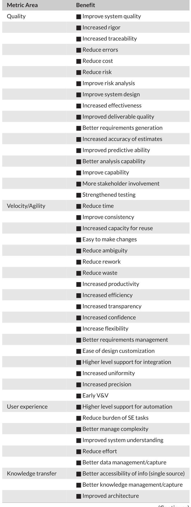

TABLE 4 (Continued)

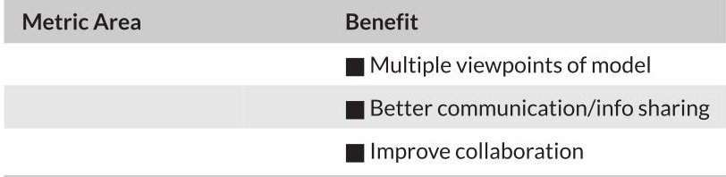

We acknowledge that 29 people are likely insufficient to derive generalizable results. At the same time, the represented organizations offered those people because of their expertise/relevance in the subject matter, representing the goals and experiences of their organizations. Because we lack detailed/comprehensive empirical data, the goal of this study is to define a starting point for empirical research in this area that is meaningful given the information we have at hand. Within this scope, we find that the 29 people representing the aforementioned organizations are a decent starting point.

Feedback was obtained verbally as a result of the SMEs being walked through the causal map in detail by the research team. Screenshots of different paths of the causal map were presented in Microsoft PowerPoint as well as a holistic view of the whole map. Displaying the map in different portions that were related assisted in the readability of the map, especially for those who were looking at the map for the first time. The SMEs contributed observations based on their experience with MBSE, which supplemented the knowledge of the authors.

If the feedback obtained in this step identified changes that should be made to the map, then the team returned to the previous steps. This process continued iterating until final consensus between the research team and SMEs was reached. Consensus was reached after approximately 4-5 rounds of review with the SMEs.

After the final consensus between the team and SMEs was reached an outside case study found in the literature was used to partially validate the causal model. This will be discussed further in Section 4.

## 3.2 Causal map results

Table 4 shows the expected benefits of MBSE from the literature review and survey. The expected benefits of MBSE were the initial nodes used to create the causal model. After the first version of the map was developed, it was apparent that there were some influential factors that were missing in the causal chains related to enabling factors to adoption. Many of these enabling factors fit into the natural progression of the causal map. These are listed in Table 5.

The initial structure of the causal map is as follows. The starting nodes that the causal map developed from are those benefits that come directly from the improved capability or additional features of MBSE (see Table 6). These can also be seen as the actionable benefits or what could be directly influenced. These benefits served as the origin points for the map.

From these, top-level benefits stem the secondary benefits which are the effects/result of those top benefits. These include those

<!-- PDF_PAGE: 6 -->

TABLE 5 Enabling factors to MBSE adoption

<table border="1"><tr><td>MBSE methods/processes</td><td>Organizational culture</td><td>Training</td></tr><tr><td>Customer/stakeholder buy-in/engagement/involvement</td><td>MBSE terminology/ontology/libraries</td><td>Communicating success stories/practices</td></tr><tr><td>People willing to use MBSE tools</td><td>Legacy/current processes</td><td>MBSE tools</td></tr><tr><td>Cost to use MBSE tools</td><td>Demonstrating benefits/results</td><td>Leadership support/commitment</td></tr></table>

TABLE 6 Benefits of MBSE that come directly from implementation

<table border="1"><tr><td>Direct benefits</td><td>Definition</td></tr><tr><td>Higher level support for automation</td><td>Use of tools and methods that automate previously manual tasks and decisions</td></tr><tr><td>Early V&amp;V</td><td>Moving tasks into earlier development phases that would have required effort in later phases</td></tr><tr><td>Reusability</td><td>Reusing existing data, models, and knowledge in new development</td></tr><tr><td>Increased traceability</td><td>Formally linking requirements, design, test, and so forth through models</td></tr><tr><td>Strengthened testing</td><td>Using data and models to increase test coverage in any phase</td></tr><tr><td>Better accessibility of information(ASOT)</td><td>Increasing access to digital data and models to more people involved in program decisions</td></tr><tr><td>Higher level support for integration</td><td>Using data and models to support both the integration of information and system integration tasks</td></tr><tr><td>Multiple viewpoints of model</td><td>Presentation of data and models in the language and context of those that need access</td></tr></table>

potential metrics that are typically of interest to managers and other stakeholders (e.g., cost, quality, etc.). This structure is critical because benefits from MBSE should originate from the improved features MBSE provides over document-based SE. Later, when creating metrics to capture these secondary benefits, one could review the causal map to see what feature or capability of MBSE is responsible for that secondary benefit. For example, reduced time could come from reusability, automation, and time saved from information being accessible. So the time measure could be a function of time saved from those primary benefits. This may also be a way to isolate the effects of MBSE in the measurement. Figure 3 shows the initial version of the causal map that was developed. The top row of nodes in green is the benefit that comes directly from the improved capability or additional features of MBSE. The remaining nodes in gray are the secondary or resulting benefits. This version only utilized the expected benefits from the literature review as a source for the nodes.

The design of this map is intentionally one-directional at this stage, although we believe that there are feedback loops involved in some of the metrics and benefits. Feedback loops were left out of the diagram for simplicity. The purpose of this causal model is to establish an initial understanding of the relationships between the expected benefits. For that reason, we determined that displaying every potential causal loop would complicate the evaluation of the relationships by experts, as these add a level of complexity that is difficult for people to conceptualize. $ ^{39} $ As we get a clearer idea of the relationships with the measurement of benefits by programs in the future, this map should be updated to include feedback loops.

Figure 4 shows the causal map after adding adoption factors from the survey. The nodes that represent the adoption factors are blue in the causal map. Adding these adoption factors changed the structure from a single direction flow to a large feedback loop. Using MBSE methods and tools leads to demonstrated results, which convinces leadership of its value. This leads to higher investment in tools, which will affect the top-level benefits. Then the use of these MBSE capabilities leads to the secondary or outcome benefits, which again demonstrates results to leadership. It should be noted that this is not visually depicted in the causal maps in this paper, in order to maintain readability.

SMEs were presented the causal map with different visuals. In order to increase readability, we isolated the causal chains that emerged from each of the primary benefits. Figure 5 shows how the effects of Automation were shown. This was conceptually easier for the SMEs to validate because they could think through effects the primary benefit should have on the process. Figure 6 shows that the final version after feedback from the SMEs was incorporated. For a complete list of the causal links and our justifications for including those links, see Appendix Table A1.

For alternate views of the causal model that improve readability, see Appendix Figures A1-A8.

## 3.3 Causal map analysis

In the effort to analyze the causal model for potential measures, a preliminary visual analysis was conducted. This was conducted by breaking down the causal model into the eight direct benefit causal chains, similarly to how the model was presented to the SMEs for validation. For each of these chains, the nodes that visually appeared to be critical points in the causal chain were identified. Figure 7 shows an example of the visual analysis for the Automation causal

<!-- PDF_PAGE: 7 -->

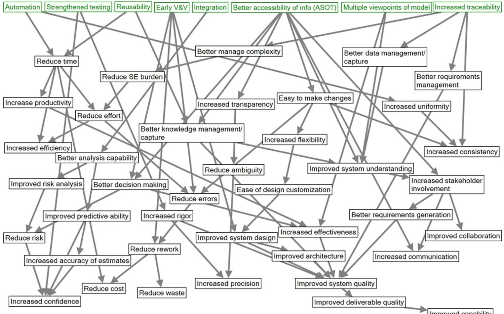

## FIGURE 3 Causal map with benefits only

chain. For this chain, Greater use of tools, Easy to make changes, Reduce time, and Improved system quality were identified as important nodes. These nodes are located at key points in this causal chain and have the most links that pass through them. The following are all the key nodes that were identified from the visual analysis: Greater use of tools, Easy to make changes, Reduce time, Improved system quality, Reduce rework, Improved collaboration, Reduce effort, and Improved system understanding.

An additional visual analysis was conducted for the entire causal map. The benefit of this is a higher level examination of which nodes had the highest number of links overall. Table 7 reports the nodes that had at least four links moving into the node (in-degree) or leaving the node (out-degree). Nodes that have a high out-degree have a large influence on nodes further down the causal chain. Nodes that have a high in-degree have a large number of nodes contributing to their existence. Almost all of the key nodes already identified also fall in this selection of nodes.

Further quantitative analysis was conducted on the entire causal model. Eigenvector centrality and PageRank are two different methods of measuring the influence or importance of a node on the map. The top-ranked nodes from each of these methods are shown in Table 8. These measures take into account a node's location in the causal chain as well as the number of inputs/outputs. The two methods place different weights on these factors so it is worth examining both, although there is notable overlap.

## 4 CASE STUDY VALIDATION

The initial validation efforts of the causal model (discussed in Section 3) were a valuable way to capture the perspectives of SMEs who have worked in this field. In order to improve the quality of the validation effort, however, it is important to also use more concrete examples/data. The difficulty with this, as mentioned previously, is that there is very little data available. So, the data-based validation for this model is based on the analysis of one program's experience applying MBSE.

The Submarine Warfare Federated Tactical Systems (SWFTS) program has been transitioning from a document-centric SE process to a model-based one over the past decade. A report from 2021 has reported on this effort and quantified a positive ROI from this transition. $ ^{26} $ SWFTS is a common set of mission hardware and software that has been fielded across multiple submarine classes and multiple baselines since 1998. To date, the program reported 18 total baseline releases to 104 total submarines. The program moved to a common requirements model in 2009 with baseline 10 and to a full MBSE model in 2011 with baseline 12. The report discusses the baseline change process and the realized quantitative benefits of the full MBSE process over the equivalent requirements-only process. Since moving to the MBSE process, the paper reported a 37% decrease in fielded product trouble reports, a 9% decrease in overall problem reports, an 18% increase in "saves" or problems discovered in earlier phases, and an

<!-- PDF_PAGE: 8 -->

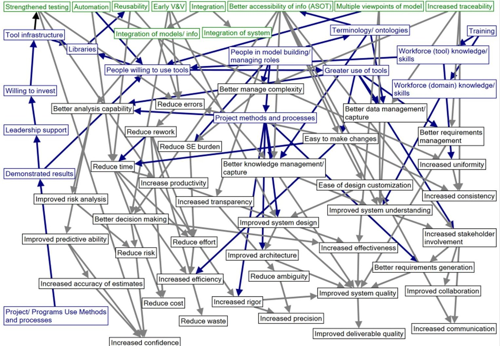

FIGURE 4 Causal map with adoption factors added

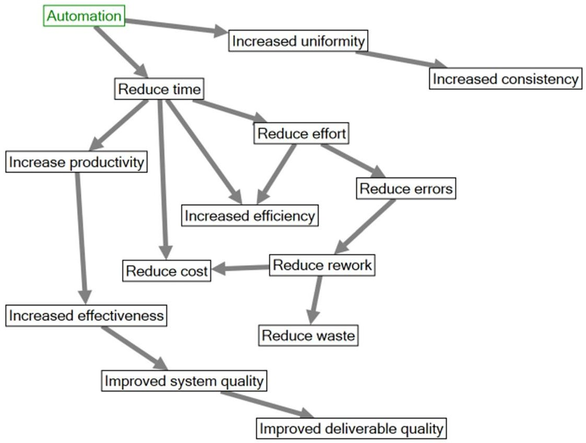

FIGURE 5 Example breakdown of a causal map for presentation

<!-- PDF_PAGE: 9 -->

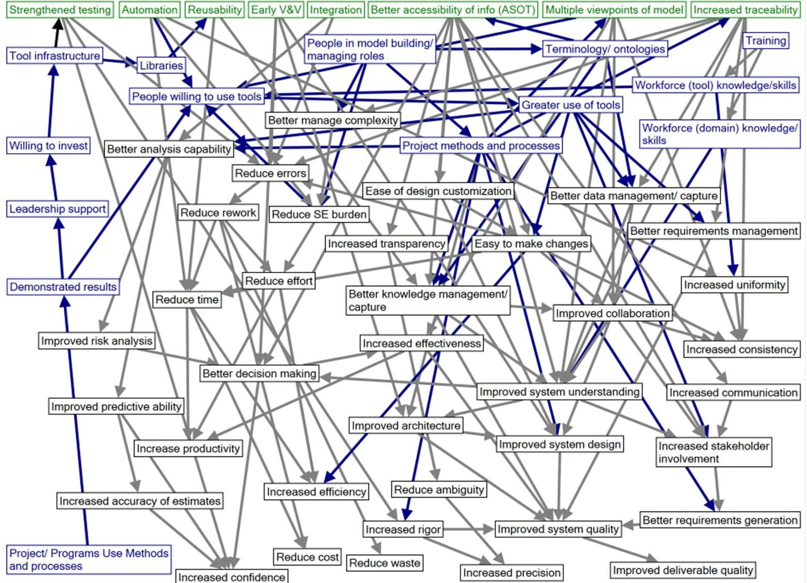

## FIGURE 6 Final causal map

18% decrease in total SE effort hours. These findings are depicting in Figure 8.

The SWFTS case study was selected because the authors effectively reported on the experience of adopting MBSE, and were able to capture quantitative measures showing the value of MBSE. The validation analysis was conducted by analyzing the paper, which reported on this case study. Causal relationships that were explicitly and implicitly stated were recorded and compared to the existing causal model. Since this data was interpreted from the author's presentation, there is a risk that the relationships gleaned were not intentionally presented by the authors. We consider this threat to validity negligible for three reasons. First, the authors of the SWFTS case study paper present many of their findings with quantifiable evidence, which negates the need for interpretation. Second, the causal model is based on perceptions/beliefs and is not (at this point) intended to exactly represent reality. Finally, this case study is not intended to serve as a complete validation of the model. A full validation will include multiple sources that can corroborate each other.

Examining the findings from the case study in the context of the causal model can provide a deeper understanding of those observations. For example, a causal relationship described in the paper was: workforce knowledge/skills improving lead to a lower average cost of processing a baseline change request. This point is able to fit within

the existing causal model, but is not a direct connection. The trace from cost to workforce knowledge/skills is shown in Figure 9.

These causal links elucidate key factors that influence the observed relationship. For instance, a program that is looking to implement MBSE should not expect workforce knowledge/skills to reduce cost if their people are not willing to use the tools. This factor may not have been a consideration otherwise.

Figure 10 shows the causal links that were validated based on the case study analysis. Again, this case did not study all of the benefits and adoption enablers that are present in the causal model. So this only serves as an initial validation of the model. More cases that study other variables are necessary to fully validate the causal model.

There was no information in the report that directly challenges the links in the causal model. However, two relationships described in the model represent causal links that were not present in the causal model. These statements may show areas in the causal model that have missing links. Those relationships are described here:

1. A service view of system interfaces, which identifies roles, responsibilities, requirements, and other factors, facilitated reuse within the model.

2. A centrally accessible source of information leads to an improved capability to manage complexity.

<!-- PDF_PAGE: 10 -->

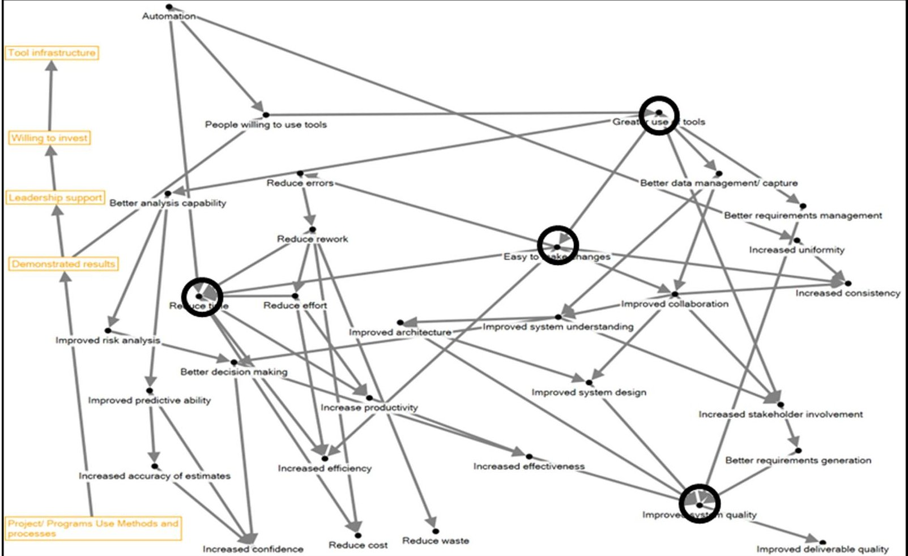

FIGURE 7 Visual analysis example

TABLE7 Nodes ranked based on number of links to other nodes

<table border="1"><tr><td colspan="2">In-degree</td><td colspan="2">Out-degree</td></tr><tr><td>Improved system quality</td><td>7</td><td>Better accessibility of information</td><td>8</td></tr><tr><td>Improved system understanding</td><td>7</td><td>Project methods and processes</td><td>8</td></tr><tr><td>Improved system design</td><td>5</td><td>Increased traceability</td><td>6</td></tr><tr><td>Reduce time</td><td>5</td><td>Multiple views of model</td><td>5</td></tr><tr><td>Increased consistency</td><td>5</td><td>Greater use of tools</td><td>5</td></tr><tr><td>Increased stakeholder involvement</td><td>5</td><td>Easy to make changes</td><td>5</td></tr><tr><td>Reduce errors</td><td>5</td><td>Improved system understanding</td><td>4</td></tr><tr><td>People willing to use tools</td><td>5</td><td>Early V&amp;V</td><td>4</td></tr><tr><td>Improved collaboration</td><td>4</td><td>Improved collaboration</td><td>4</td></tr><tr><td>Better decision making</td><td>4</td><td>Reduce rework</td><td>4</td></tr><tr><td>Better knowledge management/capture</td><td>4</td><td>People in model building/managing roles</td><td>4</td></tr><tr><td>Increased confidence</td><td>4</td><td>Automation</td><td>4</td></tr></table>

TABLE 8 Calculated centrality metrics of causal map

<table border="1"><tr><td colspan="2">Eigenvector centrality</td><td colspan="2">PageRank</td></tr><tr><td>Improved system understanding</td><td>0.354</td><td>Improved system quality</td><td>0.0207</td></tr><tr><td>Improved collaboration</td><td>0.311</td><td>Better accessibility of info(ASOT)</td><td>0.0200</td></tr><tr><td>Better accessibility of info(ASOT)</td><td>0.271</td><td>Reduce time</td><td>0.0200</td></tr><tr><td>Better knowledge management/capture</td><td>0.265</td><td>Improved system understanding</td><td>0.0193</td></tr><tr><td>Project methods and processes</td><td>0.241</td><td>Reduce rework</td><td>0.0192</td></tr><tr><td>Easy to make changes</td><td>0.219</td><td>Project methods and processes</td><td>0.0191</td></tr><tr><td>Increased stakeholder involvement</td><td>0.218</td><td>Demonstrated results</td><td>0.0184</td></tr><tr><td>Multiple viewpoints of model</td><td>0.214</td><td>Easy to make changes</td><td>0.0184</td></tr><tr><td>Increased traceability</td><td>0.208</td><td>Better analysis capability</td><td>0.0183</td></tr><tr><td>Better data management/capture</td><td>0.198</td><td>People willing to use tools</td><td>0.0182</td></tr></table>

<!-- PDF_PAGE: 11 -->

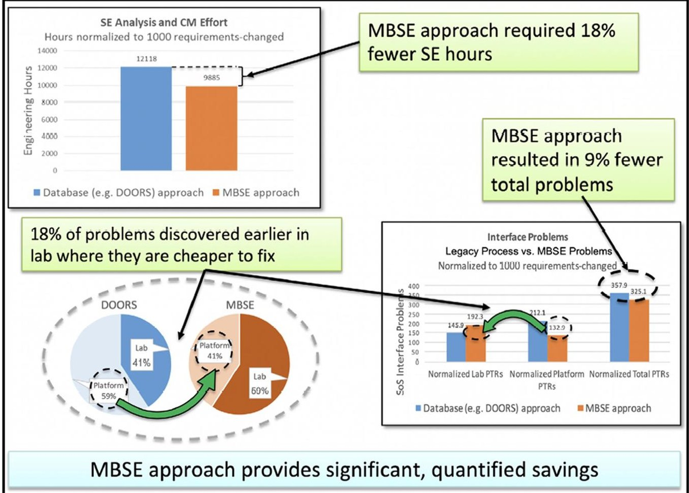

FIGURE 8 SWFTS quantified benefits (Rogers III & Mitchell, 2021)

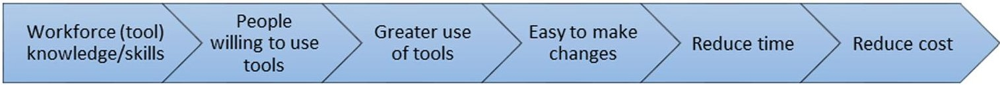

FIGURE 9 Trace from reduce cost to workforce knowledge/skills

The first relationship suggests that there is an additional input into Reusability that is missing from the model. Based on the observations in this case study, Multiple viewpoints of model should be a preceding link to Increased capacity for reuse (Reusability). Having a view of the system that had a deeper level of information and knowledge allowed those working in the model to reuse that knowledge when they could. Currently, in our model, Reusability is a direct input into Better knowledge management/capture. But this case study suggests that Better knowledge management/capture could lead to higher reuse of information and/or designs. This supports our view that feedback loops will need to be eventually incorporated into the model.

Better manage complexity in our model is preceded by two factors: People in model building/managing roles, and Increased traceability. According to the observations in the case study, Better accessibility of information is another causal factor contributing to Better manage complexity. "The model provides a centrally accessible source for SoS architecture and design that improves the capability of the SE and Integration agent to manage SoS complexity."26 For the SWFTS program, the SE&I agent is responsible for SoS engineering, technology insertion, and integration and test. This role of the SE&I agent may fit into

the category People in model building/managing roles, which does directly influence Better manage complexity. This leads to the conclusion that Better accessibility of information and People in model building/managing roles should be connected in some way, with respect to the resultant Better manage complexity.

## 5 DISCUSSIONS

## 5.1 Causal map analysis

This causal analysis helps us to infer several outcomes with respect to metrics design. First, there are three core factors for increased DE/MBSE stakeholder involvement that are central to adoption: DE/MBSE tools, DE/MBSE methods and processes, and people willing to use DE/MBSE tools. Many of the other benefits of a DE/MBSE transformation will be lost if artifacts have to be produced and activities have to be conducted outside of the digital environment and related models. Additionally, enterprise and program terminologies/ontologies and associated digital libraries are essential to creating and adopting

<!-- PDF_PAGE: 12 -->

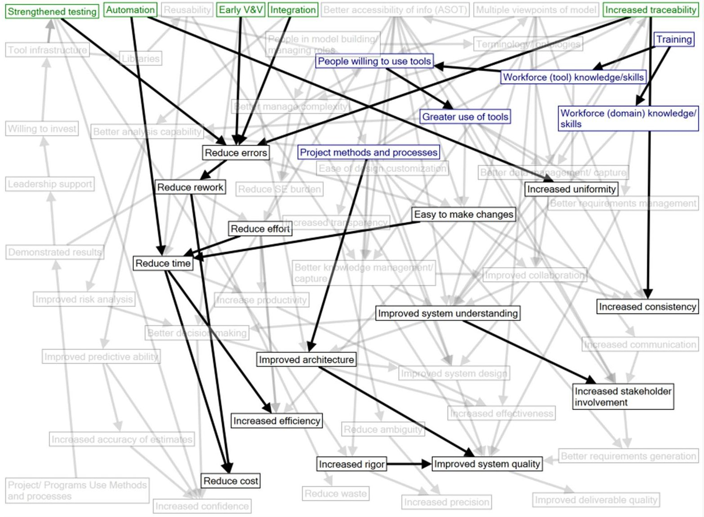

FIGURE 10 Validated links from case study

the ASOT. Both the number of people willing to use DE/MBSE tools and the number or percentage of models/data sets in the ASOT are critical leading indicators of successful DE transformation.

There are a set of base measures in the DE/MBSE domain that are common to most digital transformation activities and well described in the software community. These include Reduce errors/defects, Reduced effort, and as an output Reduce time. Reduce errors/defects and Reduce effort have a strong causal relationship to Easy to make changes, which is a benefit that is not easily measured itself. For this benefit, DE/MBSE could also borrow practices from the software community related to configuration management and change control in the digital environment, such as change failure rate. However, as much of the benefits of DE/MBSE are intended to prevent such failures, the causal model indicates that Reduce rework and as an outcome reduced cost will be important specific measures. Reduce rework is a more unique indicator of DE/MBSE value based on causal relationships to Improved consistency, Improved system understanding, and Improved system design.

In reviews with SMEs developing the DE Measurement Framework, a key aspect of DE/MBSE is to improve functional completeness and functional correctness of the underlying description of the design. These aspects are also causally related to stakeholder involvement and our two potential adoption measures. Measures of functions in

SE are similar to measures of stories in agile software development. The ability to quantify number of functions in a digital systems model is causally related to the benefits Early V&V, Strengthened Testing, and Increased Traceability. All of these decompose to base measures of reduced errors/defects, reduced effort, and reduced rework. These would generally be reflected in measures of effort completed versus planned. The MBSE community should put additional effort in defining measurement models associated with decomposition of capabilities, functions, and requirements.

A further area of interest in the measurement framework is the efficiency gained in model-based review artifacts. Causally, these are related to the Better Accessibility of Information (ASOT) and Multiple Viewpoints of Model. These are again causally related to the two potential adoption measures. In this case, improved collaboration is the most central secondary benefit. Improved collaboration would be difficult to measure directly but is an important user experience metric to assess via surveys or other means in the transformation process. Key-related quantitative measures are reduced errors/defects and reduced rework, but in particular, how these measures are tracked from phase to phase of the review and decision process. The core product-related measures are defect resolution by phase and rework that must be done or traveled to later phases. Leading indicators would be associated

<!-- PDF_PAGE: 13 -->

TABLE 9 Potential measures for primary benefits

<table border="1"><tr><td>Primary benefits</td><td>Direct measure</td><td>Example secondary measures</td></tr><tr><td>Higher level support for automation</td><td>Product automation</td><td>Deployment lead time
Efficiency
Effort
Deployment lead time
Cost</td></tr><tr><td>Early verification and validation(V&amp;V)</td><td>Model review item discrepancies</td><td>Defect resolution
Rework
Deployment lead time</td></tr><tr><td>Strengthened testing</td><td>Defect detection, defect resolution(by phase)</td><td>Rework
Deployment lead time</td></tr><tr><td>Better accessibility of information(ASOT)</td><td>ASOT frequency of access</td><td>Deployment lead time
Runtime performance
Number of consumers of the ASOT</td></tr><tr><td>Increased traceability</td><td>Model traceability</td><td>Functional architecture completeness and volatility
Functional correctness
Product size</td></tr><tr><td>Multiple model viewpoints</td><td>Number of model views/Artifacts</td><td>Efficiency
Runtime performance
Model review item discrepancies</td></tr><tr><td>Reusability</td><td>Model reuse</td><td>Automation
Model traceability</td></tr><tr><td>Higher level of support for integration</td><td>Deployment lead time</td><td>Functional correctness
Efficiency</td></tr></table>

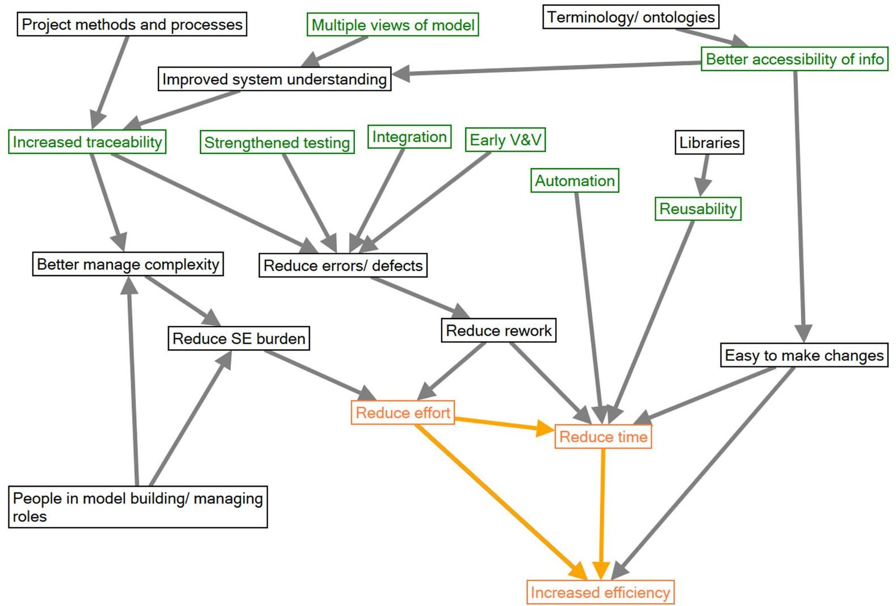

FIGURE 11 Excerpt of causal model

<!-- PDF_PAGE: 14 -->

TABLE 10 Critical measures for DE/MBSE

<table border="1"><tr><td>DE success area</td><td>Metric candidates</td></tr><tr><td>Quality</td><td>System quality
Defects</td></tr><tr><td>Velocity/Agility</td><td>Time
Rework
Ease of making changes</td></tr><tr><td>User experience</td><td>System understanding
Effort</td></tr><tr><td>Knowledge transfer</td><td>Accessibility of information
Collaboration</td></tr><tr><td>Adoption</td><td>Project methods/processes
Use of DE/MBSE tools</td></tr></table>

TABLE 11 GQM table example

<table border="1"><tr><td colspan="2">Accessibility of information</td></tr><tr><td>Goal Purpose</td><td>Improve</td></tr><tr><td>Issue</td><td>The accessibility of</td></tr><tr><td>Object (process)</td><td>Information</td></tr><tr><td>Viewpoint</td><td>for everyone involved in the system</td></tr><tr><td>Question</td><td>Are all stakeholders accessing the data/models for review?</td></tr><tr><td>Metrics</td><td># of people using models
# of people requiring artifacts outside the ASOT</td></tr><tr><td>Question</td><td>How effectively can we access and share information across stakeholders?</td></tr><tr><td>Metrics</td><td># consumers of the ASOT
# of review views/artifacts
Frequency of access (by org)</td></tr><tr><td>Question</td><td>How effectively can we access and share information across disciplines?</td></tr><tr><td>Metrics</td><td># interfaces/channels to ASOT
# links added/updated
Frequency of access (by org)</td></tr></table>

with a number of review discrepancies/actions and decision signoffs or approvals at the review.

Another primary benefit area is Automation. Central to automation are number of People willing to use DE/MBSE tools (automation should increase this), Easy to make changes, Reduce effort, and Reduce time.

Reusability is a final primary benefit and is most causally related to Better knowledge management/capture. Knowledge management is traditionally a difficult area to measure. In DE/MBSE, the causal linkage is from program terminologies/ontologies and associated digital libraries, to reuse of data and models, to better knowledge management/capture. Actual measurement models related to this causal chain will be explored in future work.

Table 9 shows examples of how the primary benefits can be measured in terms of measures that are further down the causal chain, as well as examples of direct measures of those primary benefits.Many of

the secondary measures listed in this table are metrics that are important to proving value to management and others. Deployment lead time, for example, is often a critical metric for those delivering systems to clients. Using the causal pathways as shown in this table, we can see that there are four primary benefit areas that could contribute to this measure: Higher level support for automation, Early V&V, Strengthened testing, and Better accessibility of information. In order to improve deployment lead time, these four areas should be addressed. Table 9 shows the direct measures that could be used to monitor this progress. Capturing those direct measures alongside the deployment lead time metric can also show which of those primary benefit areas have the greatest impact on the secondary measure.

## 5.2 Validating case study contributions

The authors of the SWFTS case study make several conclusions about MBSE based on the metrics they took/calculated. $ ^{26} $ First, MBSE was more efficient than the legacy process, specifically with regard to the effort needed to modify and configuration-manage interface requirements. Second, interface defects were discovered earlier, when it is typically less expensive to fix. Third, MBSE produced a higher quality product, in terms of total number of defects found. Finally, the authors determined that a positive ROI was achieved from the investment to use MBSE. The authors also note additional qualitative and observed benefits throughout.

When examining the validated links, it is apparent that the majority of the validation includes more easily quantifiable benefits such as reduce errors/defects, reduce rework, reduce time, and reduce cost. This program appeared to have used metrics that were already being captured, such as labor hours, number of changed interface requirements (effort), interface defects found over time, and average cost per baseline change request.

One of the requirements in their tool is that the model needs to be internally consistent. Because the relationships between elements are better captured in models, more defects were discovered in the legacy SE products (which were used to build the model). This is one example of how Improved traceability can lead to Reduced errors (defects).

Another one of the metrics calculated in this study was efficiency. The program compared the number of labor hours to how many interface requirements were updated. They found in the legacy process, the number of SE hours per requirement was 12.1, which reduced to 9.9 h/requirement using MBSE. Using the causal model, you can trace the origins that contribute to this change in efficiency (see Figure 11). The key contributors to effort and time are: Reduce SE burden, Reduce rework, and Easy to make changes. This is essentially caused by two main factors. First is a system that is easier to manage and make changes. Second is the reduction of errors and defects that need to be addressed and fixed.

Another metric that was tracked was when defects were discovered. The program found that defects were found earlier in testing and integration phases using MBSE. Specifically, they found that 18% of defects

<!-- PDF_PAGE: 15 -->

TABLE 12 Summary of GQM tables

<table border="1"><tr><td>Goal</td><td>Questions</td><td>Metrics</td></tr><tr><td>Improve the accessibility of information for everyone involved in the system</td><td>Are all stakeholders accessing the data/models for review?</td><td># of people using models
# of people requiring artifacts outside the ASOT</td></tr><tr><td></td><td>How effectively can we access and share information across stakeholders?</td><td># consumers of the ASOT
# of review views/artifacts
Frequency of access (by org)</td></tr><tr><td></td><td>How effectively can we access and share information across disciplines?</td><td># interfaces/channels to ASOT
# links added/updated
Frequency of access (by org)</td></tr><tr><td>Improve the ability to detect errors/defects in the system</td><td>Are we containing defects into earlier phases?</td><td>Defect detection and resolution (by phase)</td></tr><tr><td></td><td>Are reviews effective in finding errors?</td><td>Defect detection and resolution (by phase)
# of model review item discrepancies</td></tr><tr><td></td><td>Are DE processes reducing defects?</td><td>Defect detection and resolution (total)</td></tr><tr><td></td><td>Is product quality improved using DE methods?</td><td>Successful releases</td></tr><tr><td>Improve the quality of collaboration between stakeholders for everyone involved in the system</td><td>How effectively can we access and share information across stakeholders?</td><td># consumers of the ASOT
# of review views/artifacts
Frequency of access (by org)</td></tr><tr><td></td><td>How effectively can we access and share information across disciplines?</td><td># interfaces/channels to ASOT
# links added/updated
Frequency of access (by org)</td></tr><tr><td>Improve the understanding of the system for all users and stakeholders</td><td>How many people are trained to the appropriate levels for DE based on role?</td><td># of people trained
Effectiveness of training</td></tr><tr><td></td><td>Are all stakeholders accessing the data/models for review?</td><td># of people using models
# of people requiring artifacts outside the ASOT</td></tr><tr><td>Reduce the amount of effort required to create and maintain the system for users and developers</td><td>What is the distribution of labor and cost for model-driven development by the activity of phase versus traditional methods</td><td>Labor/cost distribution across lifecycle phases</td></tr><tr><td></td><td>How much of the DE design and development process can be automated to reduce effort and shorten cycle times?</td><td># or % of DE tasks automated</td></tr><tr><td></td><td>How much effort can be saved through automation?</td><td>Effort</td></tr><tr><td>Increase the ease of making changes to system information for all stakeholders</td><td>How efficiently can we assess the impact of and implement changes?</td><td>Change backlog
Change request cycle time</td></tr><tr><td>Reduce the amount of rework to correct errors/defects in the system</td><td>Are we containing defects into earlier phases?</td><td>Defect resolution (by phase)</td></tr><tr><td></td><td>How much effort is spent reworking defects?</td><td>Product Lead Time to assess and complete a change
Effort to assess and complete a change</td></tr><tr><td></td><td>Is rework effort using DE methods less than traditional methods (particularly post-delivery)</td><td># of Failed releases</td></tr><tr><td>Reduce the amount of time spent by developers and users</td><td>How quickly can we deploy new capabilities to the field?</td><td>Product Lead Time
% design time vs. production time</td></tr><tr><td></td><td>Are DE processes reducing review times?</td><td># approvals completed in review
Amount of review data captured digitally</td></tr><tr><td></td><td>What is the extent of artifact reuse across the enterprise?</td><td>Reuse metric (not yet defined in the framework)</td></tr><tr><td></td><td>How much of the DE design and development process can be automated to reduce effort and shorten cycle times?</td><td># or % of DE tasks automated</td></tr><tr><td></td><td>How much task time can be saved due to automation?</td><td>Effort and cost (labor hours)
Product Lead Time</td></tr><tr><td>Improve the quality of traceability across elements of the system</td><td>What # of elements have been modeled v. planned?</td><td>Model Size</td></tr></table>

<!-- PDF_PAGE: 16 -->

TABLE 12 (Continued)

<table border="1"><tr><td>Goal</td><td>Questions</td><td>Metrics</td></tr><tr><td></td><td>What % of functions are allocated to system model elements?</td><td>Functional completeness</td></tr><tr><td></td><td>What is the extent of coverage and traceability across model elements?</td><td>Functional Correctness
#traceability discrepancies</td></tr><tr><td></td><td>Are designs more complete and reliable using DE approaches?</td><td>Model quality? (not yet defined in the framework)</td></tr></table>

were found earlier during lab integration instead of platform testing. The direct benefits Strengthened testing, Higher level support for Integration, and Early V&V all contribute to this aspect of reduced defects. Once again, the causal model can be used to show these relationships. Defects were found earlier in the system lifecycle when they are easier to fix. This reduces the effort and time needed to rework those defects.

The SWFTS case study sheds light on the importance of Reduce errors/defects to the quantitative proof of value they found. A metric such as defects is one that most programs are already using. Utilizing defects as a metric means that a program does not have to go through an additional effort to develop new measurement practices. Furthermore, it means that there will be historical data that can be used for comparison. A difficulty in trying to measure the value of MBSE is having a baseline to compare it to. If new metrics are introduced, this could be a challenge. Programs would either have to calculate or estimate the historical values of the metrics. Otherwise, there is no way to show if the results with MBSE are an improvement or not. As the authors of this paper point out, this case study is only a single point of measurement. These results need to be supported by other programs that are tracking the same type of metrics. Prioritizing existing metrics could be a beneficial way to more quickly get support for the value of MBSE.

## 6 METRIC CANDIDATE RECOMMENDATIONS

Based on the analyses described in this paper, we can recommend a set of metrics that should be the focus of initial measurement efforts. Table 10 shows the measures that we have determined to be important to show the value of DE/MBSE. The metric set covers all five DE transformation success areas.

An initial effort to develop specific metrics for the recommended set was conducted using the Goal-Question-Metric (GQM) approach. $ ^{40} $ The GQM approach starts with a goal that identifies a desirable outcome that will be tracked using measurement. Each goal is broken down into questions that state different issues related to that goal. Finally, potential metrics are identified that could be used to answer those questions. This approach provides an additional means to organize the potential measures/metrics discussed in this study. The recommended metrics from Table 10 served as the goals. The information needs and questions developed in the DE Metric Working Group were sorted based on which goal they would help address. Additionally, the potential metrics that were brainstormed were also sorted based on which questions they would help answer. Questions and metrics could be used in multiple goals, as per the GQM approach.

Table 11 shows an example of the GQM approach for developing metrics. A summary of all the GQM tables is depicted in Table 12. The metric candidates in the adoption category were not developed into GQM tables. Both of these metrics are essentially measuring if DE/MBSE tools, methods, processes, and so forth are actually being used by employees. Since these aspects are unique to each program, metrics will need to be tailored to the different programs.

## 7 CONCLUSIONS AND FUTURE WORK

This and prior research indicate that the SE community is gaining a much greater understanding of the opportunity to quantify DE/MBSE measures, but actual implementation, lessons learned, and experience remain in the early stages of practice. The DE/MBSE community continues to search for a starting point for measures. The extensive collection of literature and survey data produced a broad framework for DE/MBSE metrics across key digital transformation attributes of quality, velocity/agility, user experience, adoption, and knowledge transfer. The value of this framework is a comprehensive list of potential metrics spanning the domain of individual processes up to full enterprise transformation. The causal analysis created a more detailed understanding of the most central measures related to DE/MBSE, while still retaining the understanding of enterprise and detailed process relationships. This research to categorize MBSE benefits and the resultant causal model, as well as the initial draft DE measurement framework, will provide a baseline for programs to begin focused efforts on measurement and quantification of benefits. The digital transformation and shift from document-based to model-based artifacts offer a great opportunity to quantify and expand the application of SE to complex projects.

As the DE/MBSE field grows in maturity, the measurement capabilities will ideally also increase in maturity. This will allow for continued validation and refinement of the causal model, and ultimately the analysis of the individual relationships between the factors identified for the causal model and program success. Eric Honour's work on SE Return on Investment $ ^{23} $ shows that statistically significant relationships between SE activities and program success can be determined with the right measurements and data. Once this analysis can be done for DE/MBSE, the value of DE/MBSE will be able to be quantified systematically.

<!-- PDF_PAGE: 17 -->

## ACKNOWLEDGMENTS

This material is based upon work supported by the U.S. Department of Defense through the Systems Engineering Research Center (SERC) under Contract HQ0034-19-D-0003. SERC is a University Affiliated Research Center managed by Stevens Institute of Technology. Any opinions, findings, and conclusions or recommendations expressed in this material are those of the authors and do not necessarily reflect the views of the U.S. Department of Defense. This material was partially presented at the American Society for Engineering Management 2021 International Annual Conference. $ ^{41} $

## DATA AVAILABILITY STATEMENT

Data sharing is not applicable to this article as no datasets were generated or analyzed during the current study.

## ORCID

Kaitlin Henderson ID https://orcid.org/0000-0002-7860-2103

Alejandro Salado ID https://orcid.org/0000-0001-9378-0795

## REFERENCES

1. DiMario M, Cloutier R, Verma D. Applying frameworks to manage SoS architecture. Eng Manag J. 2008;20(4):18-23.

2. Bahill AT, Botta R. Fundamental principles of good system design. Eng Manag J. 2008;20(4):9-17.

3. Gregory J, Berthoud L, Tryfonas T, Rossignol A, Faure L. The long and winding road: mBSE adoption for functional avionics of spacecraft. J Syst Softw. 2020;160:110453.

4. Vogelsang A, Amorim T, Pudlitz F, Gersing P, Philipps J. Should I stay or should I go? On forces that drive and prevent MBSE adoption in the embedded systems industry. Paper presented at: International Conference on Product-Focused Software Process Improvement. 2017.

5. Boggero L, Ciampa PD, Nagel B. An MBSE architectural framework for the agile definition of system stakeholders, needs and requirements. Paper presented at: AIAA AVIATION 2021 FORUM. 2021.

6. DoD. Department of Defense Digital Engineering Strategy. Office of the Deputy Assistant Secretary of Defense for Systems Engineering; 2018.

7. Papke BL, Wang G, Kratzke R, Schreiber C. Implementing MBSE-an enterprise approach to an enterprise problem. Paper presented at: INCOSE International Symposium. 2020.

8. Friedenthal S, Griego R, Sampson M. INCOSE model based systems engineering (MBSE) initiative. Paper presented at: INCOSE 2007 Symposium. 2007.

9. Barbedienne R, Messaoud YB, Choley J-Y, Penas O, Ouslimani A, Rivière A. SAMOS for spatial architecture based on multi-physics and organisation of systems in conceptual design. Paper presented at: 2015 IEEE International Symposium on Systems Engineering (ISSE) 2015.

10. Friedenthal S, Burkhart R. Evolving SysML and the system modeling environment to support MBSE. Insight. 2015;18(2):39-41.

11. Kretzenbacher M, Lange C, Harvey D. An exploration of MBSE through the modelling of the S2TEP space system. Paper presented at: INCOSE International Symposium. 2017.

12. Long JE. Model-based systems engineering for project success: the complete process. Paper presented at: INCOSE International Symposium. 2008.

13. Henderson K, Salado A. Value and benefits of model-based systems engineering (MBSE): evidence from the literature. Syst Eng. 2021;24(1):51-66.

14. Honour EC. 6.2. 3 Understanding the value of systems engineering Paper presented at: INCOSE International Symposium. 2004.

15. Sheard S, Miller CL. The Shangri-La of ROI. Paper presented at: INCOSE International Symposium. 2000.

16. Wilking F, Schleich B, Wartzack S. MBSE along the value chain-an approach for the compensation of additional effort. Paper presented at: 2020 IEEE 15th International Conference of System of Systems Engineering (SoSE). 2020.

17. Chami M, Aleksandraviciene A, Morkevicius A, Bruel JM. Towards solving MBSE adoption challenges: the D3 MBSE adoption toolbox. Paper presented at: INCOSE International Symposium. 2018.

18. Cloutier R. Current modeling trends in systems engineering. Insight. 2015;18(2):10-13.

19. Huldt T, Stenius I. State-of-practice survey of model-based systems engineering. Syst Eng. 2019;22(2):134-145.

20. Lu J, Wen Y, Liu Q, Gürdür D, Törngren M. MBSE applicability analysis in Chinese industry. Paper presented at: INCOSE International Symposium. 2018.

21. McDermott T, Hutchison N, Clifford M, Van Aken E, Salado A, Henderson K. Benchmarking the Benefits and Current Maturity of Model-Based Systems Engineering across the Enterprise. SERC-2020-SR-001. Systems Engineering Research Center; 2020.

22. Motamedian B. MBSE applicability analysis. Int J Sci Eng Res. 2013;4(2):7.

23. Honour E. 11.4. 2 Systems engineering return on investment. Paper presented at: INCOSE International Symposium. 2010.

24. Maurandy J, Helm A, Gill E, Stalford R. 11.5. 3 Cost-benefit analysis of SysML modelling for the atomic clock ensemble in space (ACES) simulator. Paper presented at: INCOSE International Symposium. 2012.

25. Mitchell SW. Transitioning the SWFTS program combat system product family from traditional document-centric to model-based systems engineering. Syst Eng. 2014;17(3):313-329.

26. Rogers III EB, SW Mitchell. MBSE delivers significant return on investment in evolutionary development of complex SoS. Syst Eng. 2021;24:385-408.

27. Moore S. How to measure digital transformation progress. Information technology insights. 2019. Accessed December 14, 2021. https://www.gartner.com/smarterwithgartner/how-to-measure digital-transformation-progress

28. McDermott T, Collopy P, Paredis C, Nadolski M. Enterprise System of Systems Model for Digital Thread Enabled Acquisition. SERC-2018- TR-109. Stevens Institute of Technology Hoboken; 2018.

29. Powell S. The challenges of performance measurement. Manag Decis. 2004;42:1017-1023.

30. Bourne M, Neely A, Platts K, Mills J. The success and failure of performance measurement initiatives. Int J Oper Prod Manag. 2002;22:1288- 1310.

31. Ittner CD, Larcker DF. Coming up short on nonfinancial performance measurement. Harv Bus Rev. 2003;81(11):88-95.

32. Keats BW, Hitt MA. A causal model of linkages among environmental dimensions, macro organizational characteristics, and performance. Acad Manag J. 1988;31(3):570-598.

33. Lebas MJ. Performance measurement and performance management. Int J Prod Econ. 1995;41(1-3):23-35.

34. Othman R. Balanced scorecard and causal model development: preliminary findings. Manag Decis. 2006;44:690-702.

35. Schmidt FL, Hunter JE. Development of a causal model of processes determining job performance. Curr Dir Psychol Sci. 1992;1(3): 89-92.

36. Ackermann F, Alexander J. Researching complex projects: using causal mapping to take a systems perspective. Int J Project Manag. 2016;34(6):891-901.

37. Narayanan V, Armstrong DJ. Causal Mapping for Research in Information Technology. IGI Global; 2004.

38. Archive C. NodeXL. 2018. 2021. Accessed June 4, 2021. https:// archive.codeplex.com/?p=nodexl

<!-- PDF_PAGE: 18 -->

39. Ghaffarzadegan N, Lyneis J, Richardson GP. How small system dynamics models can help the public policy process. Syst Dyn Rev. 2011;27(1):22-44.

40. Caldiera VRBG, Rombach HD. The goal question metric approach. Encycl Softw Eng. 1994;1:528-532.

41. Henderson K, McDermott T, Salado A, Van Aken E. Measurement Framework for Model-Based Systems Engineering (MBSE). 2021 International Annual Conference. American Society for Engineering Management; 2021; Virtual.

42. Hameed MA, Counsell S, Swift S. A meta-analysis of relationships between organizational characteristics and IT innovation adoption in organizations. Inf Manag. 2012;49(5):218-232.

43. Kwon TH, Zmud RW. Unifying the fragmented models of information systems implementation. Critical Issues in Information Systems Research. John Wiley & Sons, Inc.; 1987:227-251.

44. Raymond L. Organizational characteristics and MIS success in the context of small business. MIS Q. 1985;9:37-52.

45. Staccioli, J, Virgillito, ME. Back to the past: the historical roots of labor-saving automation. Eurasian Business Review. 2021;11:27-57.

46. Bright, JR. Automation and management. Boston: Division of Research, Graduate School of Business Administration, Harvard University; 1958.

47. Kotter, J. Leading Change. Harvard Business Review Press; 2012.

48. Chen, MY, Chen, AP. Knowledge management performance evaluation: a decade review from 1995 to 2004. Journal of Information Science. 2021;32(1):17-38.

49. Adams, S, Beatty, M, Moore, C, Desai, A, Bartlett, L, Culbert, E, Orkin, J. Perspectives on team communication challenges in caring for children with medical complexity. BMC health services research. 1982;21(1):1-14.

50. Howard, RA, Abbas, A. Foundations of Decision Analysis. Pearson; 2016.

51. O'Reilly III, CA. Variations in decision makers' use of information sources: The impact of quality and accessibility of information. Academy of Management journal. 2002;25(4):756-771.

52. Khalili-Araghi, S, Kolarevic, B. Variability and validity: Flexibility of a dimensional customization system. Automation in Construction. 2021;109, 102970.

53. Dahmann, J, Lane, J, Rebovich, G, Baldwin, K. A model of systems engineering in a system of systems context. In Proceedings of the Sixth Conference on Systems Engineering Research; 2008.

54. Groll, MW, Heber, D. E/E-Product Data Management in Consideration of Model-Based Systems Engineering. In ISPE Transdisciplinary Engineering; 2016:(pp.289-298).

55. Rus, I, Lindvall, M, Sinha, S. Knowledge management in software engineering. IEEE software. 2009;19(3):26-38.

56. Salado, A, Nilchiani, R, Verma, D. A contribution to the scientific foundations of systems engineering: Solution spaces and requirements. J. Syst. Sci. Syst. Eng. 2017;26:549-589.

57. Salado, A, Nilchiani, R. Understanding how problem formulation in systems engineering influences system affordability: a systems thinking investigation. International Journal of Applied Systemic Studies. 2018;7(4):227-256.

58. Carson, RS. 1.6.4 Requirements Completeness: A Deterministic Approach. INCOSE International Symposium. 1998;8:738-746.

59. Carson, RS, Shell, T. Requirements completeness: Absolute or relative? Comments on "System function implementation and behavioral modeling" [Systems Engineering 4 (2001), 58-75]. Systems Engineering. 2001;4:230-231

60. Carson, RS, Aslaksen, E, Caple, G, Davies, P, Gonzales, R, Kohl, R and Sahraoui, A-E. 5.1.3 Requirements Completeness. INCOSE International Symposium. 2004;14:930-944.

61. Robertson, S, Robertson, J. Mastering the Requirements Process. Addison-Wesley; 2006.

62. Blanchard, BS, Fabrycky, WJ. Systems Engineering and Analysis. Prentice Hall International Series in Industrial & Systems Engineering; 1981.

63. Avgeriou, P, Kruchten, P, Ozkaya, I, Seaman, C. Managing technical debt in software engineering (dagstuhl seminar 16162). In Dagstuhl Reports (Vol. 6, No. 4). Schloss Dagstuhl-Leibniz-Zentrum fuer Informatik; 2016.

64. André, S, Elgh, F. Modeling of transdisciplinary engineering assets using the design platform approach for improved customization ability. Advanced Engineering Informatics. 2015;38:277-290.

65. Ampatzoglou, A, Ampatzoglou, A, Chatzigeorgiou, A, Avgeriou, P. The financial aspect of managing technical debt: A systematic literature review. Information and Software Technology. 2009;64:52-73.

66. Salado, A. A systems-theoretic articulation of stakeholder needs and system requirements. Systems Engineering. 2021;24(2):83-99.

67. Barak, M. Are digital natives open to change? Examining flexible thinking and resistance to change. Computers & Education. 2018;121:115- 123.

68. Chen, L, Whyte, J. Understanding design change propagation in complex engineering systems using a digital twin and design structure matrix. Engineering, Construction and Architectural Management; 2021.

69. Bittner, EAC, Leimeister, JM. Why shared understanding matters Engineering a collaboration process for shared understanding to improve collaboration effectiveness in heterogeneous teams. In 2013 46th Hawaii International Conference on System Sciences (pp. 106-114). IEEE; 2013.

70. Kossiakoff, A, Sweet, WN, Seymour, SJ, Biemer, SM. Systems engineering principles and practice (Vol. 83). John Wiley & Sons; 2011.

71. Heber, DT, Groll, MW. A meta-model to connect model-based systems engineering with product data management by dint of the blockchain. In 2018 International Conference on Intelligent Systems (IS) (pp. 280-287). IEEE; 2018.

72. Smith, WB. 3.3. 2 Re-Use Libraries Leveraging Model-Based Systems Engineering to greatly increase engineering productivity. In INCOSE International Symposium. 2019;24(1):298-312.

73. Piaszczyk, C. Model based systems engineering with department of defense architectural framework. Systems Engineering. 2012;14(3):305-326.

74. Richards, MG, Shah, NB, Hastings, DE, Rhodes, DH. 6.4.3 Architecture Frameworks in System Design: Motivation, Theory, and Implementation. In INCOSE International Symposium. 2011;(Vol. 17, No. 1, pp. 981-990).

75. Nordqvist, T, Edberg, MA, Byström, MH, Gustafsson, MML. Systems Engineering, Architecture Frameworks and Modelling & Simulation. Sweden. Accessed. 2007;24(04):2017.

76. Fosse, E. Model-based systems engineering (MBSE); 2016:101.

77. Bayer, T, Chung, S, Cole, B, Cooke, B, Dekens, F, Delp, C, Wagner, D. 11.5.1 Early Formulation Model-Centric Engineering on NASA's Europa Mission Concept Study. In INCOSE International Symposium. 2002;(Vol. 22, No. 1, pp. 1695-1710).

78. Straub, ET. Understanding technology adoption: Theory and future directions for informal learning. Review of educational research. 2014;79(2):625-649.

79. Henderson, K, Salado, A. Is CAD A Good Paradigm for MBSE? In INCOSE International Symposium. 2012;(Vol. 31, No. 1, pp. 144-157).

80. Estefan, JA. Survey of model-based systems engineering (MBSE) methodologies. Incose MBSE Focus Group. 2005;25(8):1-12.

81. Hoegl, M, Schulze, A. How to support knowledge creation in new product development: An investigation of knowledge management methods. European management journal. 2021;23(3):263-273.

82. Salado, A, Kannan, H. Properties of the utility of verification. In 2018 IEEE International Systems Engineering Symposium (ISSE) (pp. 1-8). IEEE; 2018a.

83. Salado, A, Kannan, H. A mathematical model of verification strategies. Systems Engineering, 2018b;21(6):593-608.

<!-- PDF_PAGE: 19 -->

84. Milton, SK, Keen, CD, Kurnia, S. Understanding the benefits of ontology use for Australian industry: a conceptual study. ACIS 2010 Proceedings. 64; 2010.

85. Leroux, C, Dove, R. Merit of Adaptable Pairing as an Agile Systems Engineering Knowledge Management Practice. In INCOSE International Symposium. 2016;26(1):713-724).

86. Tangen, S. Understanding the concept of productivity. In Proceedings of the 7th Asia-Pacific Industrial Engineering and Management Systems Conference, Taipei; 2002:(pp.18-20).

87. Madni, AM, Sievers, M. Model-based systems engineering: Motivation, current status, and research opportunities. Systems Engineering. 2018;21(3):172-190.

88. Vidal, EJ, Villota, ER. Sysml as a tool for requirements traceability in mechatronic design. In Proceedings of the 2018 4th International Conference on Mechatronics and Robotics Engineering. 2018:(pp. 146-152).

89. Birnholtz, J, Dixon, G, Hancock, J. Distance, ambiguity and appropriation: Structures affording impression management in a collocated organization. Computers in Human Behavior. 2018;28(3):1028-1035.

90. Enoch, MC. Transparency and ambiguity in central bank safety net operations. International Monetary Fund; 1997.

91. Best, J. The Politics of Transparency: Ambiguity and the Liberalization of International Finance. In Turbulence and New Directions in Global Political Economy (pp. 126-144). Palgrave Macmillan, London; 2003.

92. Ryan, M, Wheatcraft, L, Zinni, R, Dick, J, Baksa, K. Guide for Writing Requirements. INCOSE-TP-2010-006-02.1; 2017.

93. Spyropoulos, D, Baras, JS. Extending design capabilities of SysML with trade-off analysis: electrical microgrid case study. Procedia Computer Science. 2006;16:108-117.

94. Cencetti, M, Maggiore, P. System modeling framework and MDO tool integration: MBSE methodologies applied to design and analysis of space system. In AIAA modeling and simulation technologies (MST) conference; 2013:(p.4590.).

95. Do, Q, Cook, S, Lay, M. An investigation of MBSE practices across the contractual boundary. Procedia Computer Science. 2013;28:692-701.

96. Leserf, P, de Saqui-Sannes, P, Hugues, J. Trade-off analysis for sysml models using decision points and csps. Software and Systems Modeling. 2014;18(6):3265-3281.

97. Flechais, I, Sasse, MA. Stakeholder involvement, motivation, responsibility, communication: How to design usable security in e-Science. International Journal of Human-Computer Studies. 2020;67(4):281-296.

## AUTHOR BIOGRAPHIES

tems Engineering (MBSE) and Digital Engineering (DE) with her works on MBSE adoption, MBSE domain maturity, and MBSE/DE performance measurement. Kaitlin won the Best Presentation Award at the SERC Doctoral Student Forum in 2020 and has been recognized for her 2021 publication in Systems Engineering.

Kaitlin Henderson has a PhD in Industrial and Systems Engineering with a concentration in Management Systems from Virginia Tech in Blacksburg, Virginia. She also earned her Bachelor's and Master's degrees in Industrial and Systems Engineering at Virginia Tech. Kaitlin has contributed to the fields of Model-Based Sys-

Her research interests include organizational design, technology adoption, and performance measurement.

Tom McDermott serves as the Deputy Director and Chief Technology Officer of the Systems Engineering Research Center (SERC) at Stevens Institute of Technology in Hoboken, NJ. The SERC is a University Affiliated Research Center sponsored by the Office of the Secretary of Defense for Research and Engineering. With the SERC,

he develops new research strategies and is leading research on Digital Engineering transformation, education, security, and artificial intelligence applications. Mr. McDermott also teaches system architecture concepts, systems thinking and decision-making, and engineering leadership. He consults with several organizations on enterprise modeling for transformational change, and often serves as a systems engineering expert on government major program reviews. He currently serves on the INCOSE Board of Directors as Director of Strategic Integration and AIAA.

Eileen Van Aken is a Professor and Department Head of the Grado Department of Industrial and Systems Engineering at Virginia Tech. She earned her BS, MS, and Ph.D. degrees in industrial engineering from Virginia Tech. Dr. Van Aken served as an Associate Department Head and Undergraduate Program Director from 2005 to 2016, served as Interim Department Head from 2016 to 2018, and was appointed as Department Head in June 2018. Her research and teaching interests are in organizational transformation, process improvement, team-based work systems, and performance measurement system design. Prior to joining the ISE faculty at Virginia Tech, she was employed for 7 years at the Center for Organizational Performance Improvement at Virginia Tech, and was also employed by AT&T Microelectronics in Virginia where she worked in both process and product engineering. She served as a Chair of the Council of Industrial Engineering Academic Department Heads and is President-elect of the Institute of Industrial and Systems Engineers (IISE). She is a Fellow of IISE, the American Society of Engineering Management (ASEM), and the World Academy of Productivity Sciences. She is also a member of the American Society for Engineering Education. In recognition of her achievements and service, Dr. Van Aken has received the Fred Crane Award for Service from IISE, the Frank Woodbury Special Service Award, and the Bernard Sarchet Award from ASEM, the latter being the highest honor given by ASEM in the engineering management profession.

<!-- PDF_PAGE: 20 -->

Alejandro Salado has over 15 years of experience as a systems engineer, consultant, researcher, and instructor. He is currently an Associate Professor of systems engineering with the Department of Systems and Industrial Engineering at the University of Arizona. In addition, he provides part-time consulting in areas related

to enterprise transformation, cultural change of technical teams, systems engineering, and engineering strategy. Alejandro conducts research in problem formulation, design of verification and validation strategies, model-based systems engineering, and engineering education. Before joining academia, he held positions as Systems Engineer, Chief Architect, and Chief Systems Engineer in manned and unmanned space systems of up to $1B in development cost. He has published over 100 technical papers, and his research has received federal funding from the National Science Foundation (NSF), the Naval Surface Warfare Command (NSWC), the Naval Air System Command (NAVAIR), and the Office of Naval Research (ONR), among others. He is a recipient of the NSF CAREER Award, the International Fulbright Science and Technology Award, the Omega Alpha Association's Exemplary Dissertation Award, and several best paper awards. Dr. Salado holds a BS/MS in electrical and computer engineering from the Polytechnic University of

Valencia, an MS in project management and an MS in electronics engineering from the Polytechnic University of Catalonia, the SpaceTech MEng in space systems engineering from the Technical University of Delft, and a Ph.D. in systems engineering from the Stevens Institute of Technology. Alejandro is a member of INCOSE and a senior member of IEEE and AIAA.

How to cite this article: Henderson K, McDermott T, Van Aken E, Salado A. Towards Developing Metrics to Evaluate Digital Engineering. Systems Engineering. 2023;26:3-31. https://doi.org/10.1002/sys.21640

## APPENDIX 1

Figure A1

Figure A2

Figure A4

Figure A3

Figure A5

Figure A6

Figure A7

Figure A8

<!-- PDF_PAGE: 21 -->

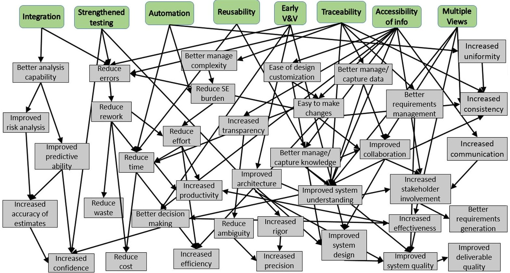

FIGURE A1 Partial causal model view—no adoption factors

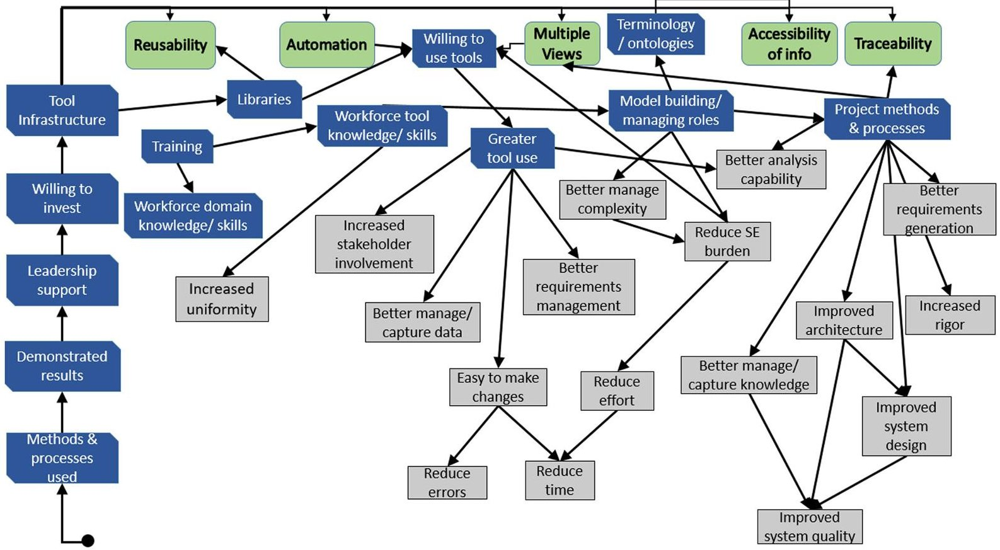

FIGURE A2 Partial causal model view-focus on adoption factors

<!-- PDF_PAGE: 22 -->

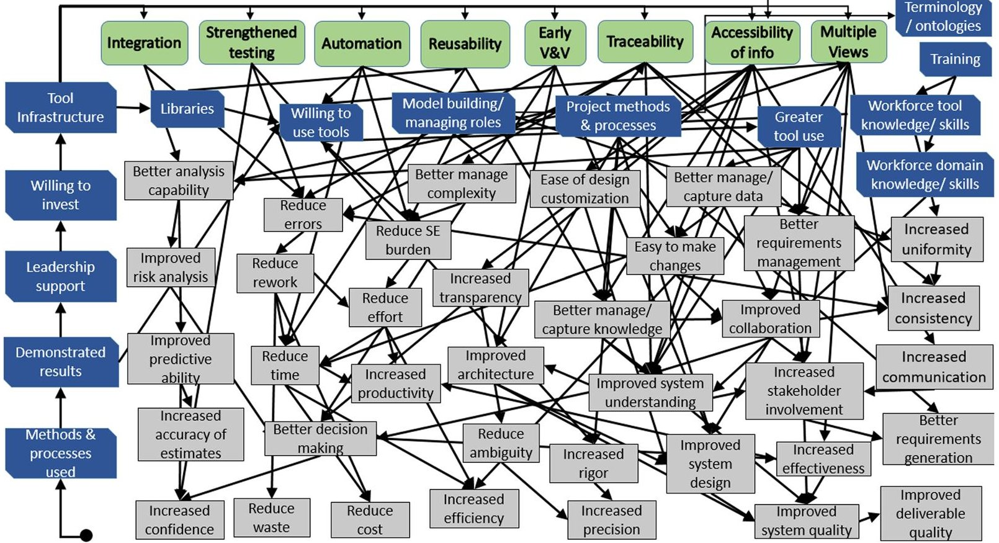

FIGURE A3 Full causal model-alternate view

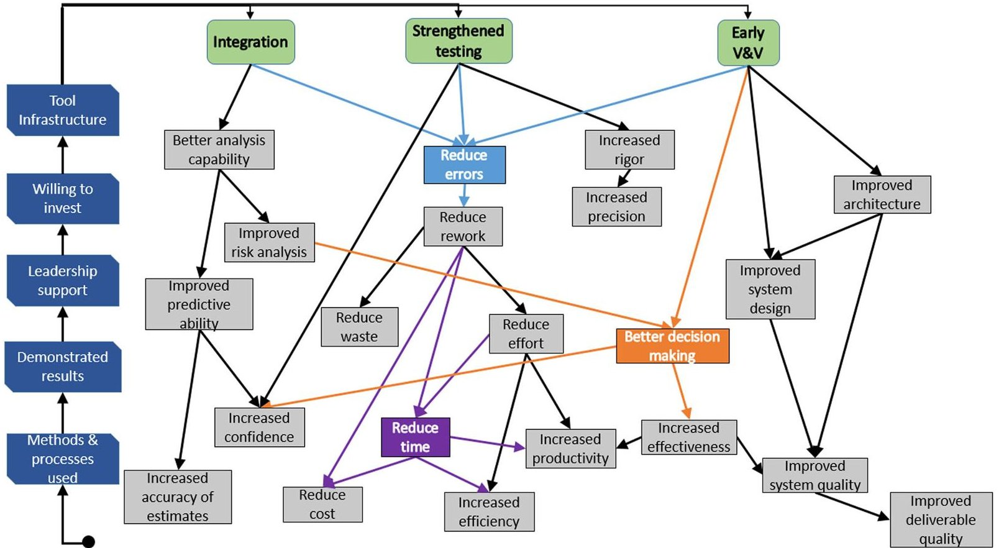

FIGURE A4 Partial causal model view-integration, strengthened testing, and early V&V

<!-- PDF_PAGE: 23 -->

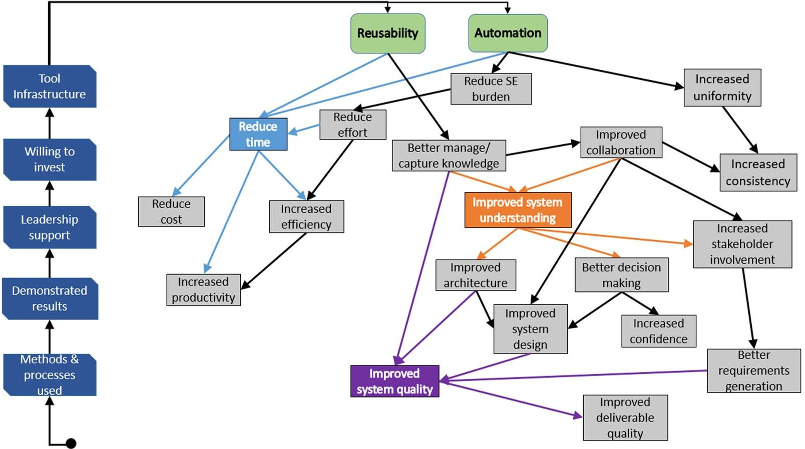

FIGURE A5 Partial causal model view—reusability and automation

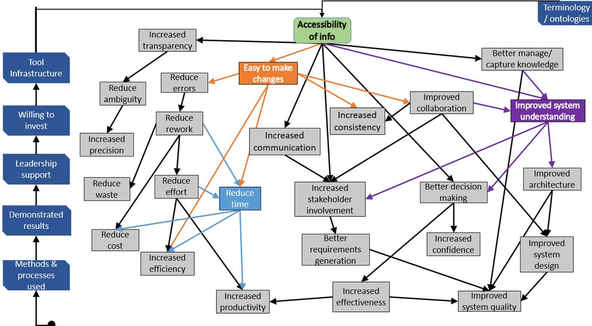

FIGURE A6 Partial causal model view-accessibility of information

<!-- PDF_PAGE: 24 -->

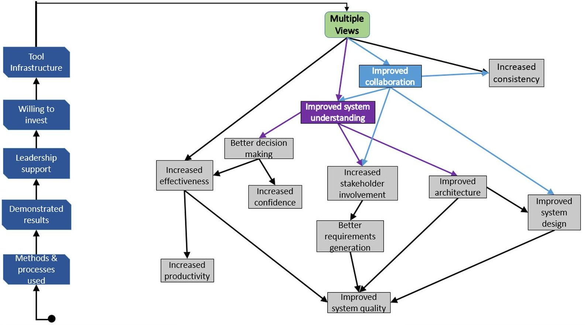

FIGURE A7 Partial causal model view-multiple viewpoints of model

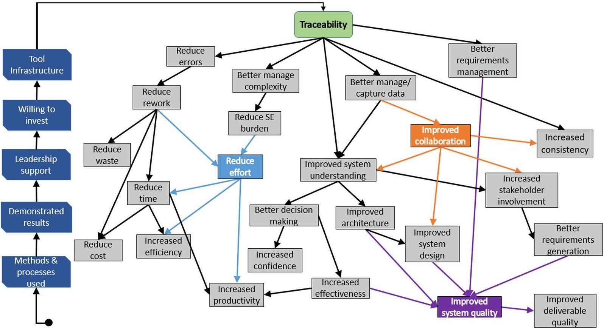

FIGURE A8 Partial causal model view—traceability

<!-- PDF_PAGE: 25 -->

TABLE A1 Logical justifications for causal links in final model

<table border="1"><tr><td>Vertex 1</td><td>Vertex 2</td><td>Logical justification</td></tr><tr><td>Automation</td><td>Reduce time</td><td>Automation moves tasks from humans to computers to reduce execution time due to faster ability of computers to perform such tasks.45</td></tr><tr><td>Automation</td><td>Increased uniformity</td><td>Automating tasks removes the potential for human error in performing the same task separately multiple times.46</td></tr><tr><td>Automation</td><td>People willing to use tools</td><td>Automation has the potential to make someone&#x27;s job easier or more enjoyable by cutting out menial or repetitive tasks.4 This, in turn, results in an increase of willingness to use the tools.</td></tr><tr><td>Automation</td><td>Reduce SE burden</td><td>Automation has the potential to make someone&#x27;s job easier by cutting out menial or repetitive tasks.4</td></tr><tr><td>Reduce SE burden</td><td>People willing to use tools</td><td>If MBSE tools make someone&#x27;s job less tedious or burdensome, that should provide motivation for them to want to use the tool. People are more likely to use new technology if they think it will improve their day-to-day activities.47</td></tr><tr><td>Better accessibility of info</td><td>Better knowledge management/capture</td><td>If the information relating to the system is widely accessible and centralized, it should provide more opportunities to capture and manage all necessary knowledge.48</td></tr><tr><td>Better accessibility of info</td><td>Easy to make changes</td><td>If information is easily accessible and centralized, then it should be easier to make changes and have those changes reflected across the entire model.</td></tr><tr><td>Better accessibility of info</td><td>Increased communication</td><td>Higher accessibility of information should provide more opportunities for communication, having information more centralized and accessible can be seen as a method of communication as well. Information accessibility is important to facilitate well-informed communications between all parties.49</td></tr><tr><td>Better accessibility of info</td><td>Increased stakeholder involvement</td><td>If information is more accessible, it should be easier for stakeholders to be involved/more engaged. Stakeholders may be more likely to provide input into the system if the relevant information is more available.</td></tr><tr><td>Better accessibility of info</td><td>Increased transparency</td><td>Information being more accessible means that the system is more transparent. Transparent means easy to perceive or detect, so information being accessible and centralized should make it easier to find, therefore, transparent.</td></tr><tr><td>Better accessibility of info</td><td>Better decision making</td><td>Information is a key element of decision quality.50 Decision makers are more likely to use information in their decision-making if the information is more accessible.51</td></tr><tr><td>Better accessibility of info</td><td>Improved system understanding</td><td>Information being more accessible and available should lead to a greater understanding of the system. Accessibility of information has been shown to lead to increased frequency of use of those information sources.51</td></tr><tr><td>Better accessibility of info</td><td>Ease of design customization</td><td>If information is more accessible, then it should be easier to make customizations to the design since the relevant information is easy to access. Information is necessary to determine what customizations need to be made in the system design.52</td></tr><tr><td>Better analysis capability</td><td>Improved risk analysis</td><td>Risk analysis is an analysis capability, so essentially improved risk analysis is a subset of better analysis capability and is therefore related.</td></tr><tr><td>Better analysis capability</td><td>Improved predictive ability</td><td>Predictive analytics is an analysis capability, so essentially improved predictive ability is a subset of better analysis capability and is therefore related.</td></tr><tr><td>Better data management/capture</td><td>Improved system understanding</td><td>The improved ability to capture/manage data should make the system/model easier to understand and reduce misunderstandings.53</td></tr><tr><td>Better data management/capture</td><td>Improved collaboration</td><td>Increased ability to manage and share data allows for better collaboration, especially across disciplines.54</td></tr><tr><td>Better decision making</td><td>Increased confidence</td><td>This is a fundamental decision analysis principle, understanding confidence as the confidence in the selection of alternatives.50</td></tr></table>

(Continues)

<!-- PDF_PAGE: 26 -->

TABLE A1 (Continued)

<table border="1"><tr><td>Vertex 1</td><td>Vertex 2</td><td>Logical justification</td></tr><tr><td>Better decision making</td><td>Increased effectiveness</td><td>Increased effectiveness means: effectively perform SE work, improved representation effectiveness, increased effectiveness of model, and more effective processes. As per the principles of decision analysis, better decision-making leads in the long run to better outcomes.50</td></tr><tr><td>Better knowledge management/capture</td><td>Improved system quality</td><td>Knowledge management can address certain factors that lead to reduced quality, such as changing personnel on projects, mistakes, and rework.85</td></tr><tr><td>Better knowledge management/capture</td><td>Improved system understanding</td><td>The improved ability to capture/manage knowledge should make the system/model easier to understand and reduce misunderstandings.48,55</td></tr><tr><td>Better knowledge management/capture</td><td>Improved collaboration</td><td>Because systems are so complex, more disciplines need to collaborate and share knowledge. Stored knowledge helps people collaborate;“collaboration is related to mutual sharing of knowledge”.55</td></tr><tr><td>Better manage complexity</td><td>Reduce SE burden</td><td>Reduce SE burden means reducing the complexity of the engineering process/making SE tasks easier. Hence, this relationship exists by definition.</td></tr><tr><td>Better requirements generation</td><td>Improved system quality</td><td>A better formulation of the problem leads to a more effective solution.56,57</td></tr><tr><td>Better requirements management</td><td>Improved system quality</td><td>Requirements management facilitates avoiding omitting requirements and controlling compliance.58-61</td></tr><tr><td>Demonstrated results</td><td>Leadership support</td><td>Leadership is motivated to support MBSE if there are demonstrated results that provides value.47</td></tr><tr><td>Demonstrated results</td><td>People willing to use tools</td><td>If people see that MBSE provides benefits/value, they may be more willing to use the tools since they can see that it is worth it.47</td></tr><tr><td>Early V&amp;V</td><td>Improved system design</td><td>Because changes are easier to execute early in the lifecycle,62 early discovery of misalignment with needs and requirements enables easier change, which facilitates reducing technical debt.63</td></tr><tr><td>Early V&amp;V</td><td>Reduce errors</td><td>If errors or changes are found earlier in the process it will prevent expensive rework from needing to be done in later stages of the design cycle where it would be more difficult to make changes.62</td></tr><tr><td>Early V&amp;V</td><td>Better decision making</td><td>V&amp;V activities provide information about the system.82 Availability of information is a key element of decision quality.50</td></tr><tr><td>Early V&amp;V</td><td>Improved architecture</td><td>Early V&amp;V activities should result in faster architecture maturity.</td></tr><tr><td>Ease of design customization</td><td>Easy to make changes</td><td>Ease of design customization is a way that changes are easier to make.64</td></tr><tr><td>Ease of design customization</td><td>Improved system design</td><td>The design of the system being easier to customize should, therefore, improve the system design. Customizations can be used to better reflect the requirements of the stakeholders, which results in a better system design.64</td></tr><tr><td>Easy to make changes</td><td>Increased consistency</td><td>If it is easy to make changes across the system model that should lead to more consistency across the system. The ease of making changes should provide the means and motivation for those changes to be made across all necessary elements of the model.65</td></tr><tr><td>Easy to make changes</td><td>Reduce errors</td><td>If it is easy to make changes, this should lead to fewer defects because any errors that are found can be fixed more easily.66 May apply specifically to escapes, a subset of the “reduce errors” benefit type.</td></tr><tr><td>Easy to make changes</td><td>Increased efficiency</td><td>By definition, since easier is defined as needing less resources.</td></tr><tr><td>Easy to make changes</td><td>Reduce time</td><td>By definition, since easier is defined as needing less resources.</td></tr><tr><td>Easy to make changes</td><td>Improved collaboration</td><td>Because it is easier to make changes, people may be more willing to work with others to address issues. Platforms that allow simultaneous access to users (i.e., Google Drive) where changes can be made and seen by all users in real-time, facilitates collaboration.67</td></tr><tr><td>Greater use of tools</td><td>Better analysis capability</td><td>Tools provide capabilities that humans do not have.</td></tr><tr><td>Greater use of tools</td><td>Easy to make changes</td><td>Doing system modeling with tools in a digital environment allows designers to manage changes more conveniently.68</td></tr></table>

(Continues)

<!-- PDF_PAGE: 27 -->

TABLE A1 (Continued)

<table border="1"><tr><td>Vertex1</td><td>Vertex2</td><td>Logical justification</td></tr><tr><td>Greater use of tools</td><td>Increased stakeholder involvement</td><td>Using MBSE tools requires stakeholders to be more involved because their input is needed</td></tr><tr><td>Greater use of tools</td><td>Better data management/capture</td><td>The tools are what is used to manage data, so they need to be in use</td></tr><tr><td>Greater use of tools</td><td>Better requirements management</td><td>The tools are what is used to manage requirements, so they need to be in use</td></tr><tr><td>Improved architecture</td><td>Improved system quality</td><td>By definition, a system is a refinement of its architecture.</td></tr><tr><td>Improved architecture</td><td>Improved system design</td><td>By definition, a system is a refinement of its architecture.</td></tr><tr><td>Improved collaboration</td><td>Improved system understanding</td><td>Collaboration leads to sharing knowledge and beliefs.</td></tr><tr><td>Improved collaboration</td><td>Improved system design</td><td>This is a key tenet of systems engineering.</td></tr><tr><td>Improved collaboration</td><td>Increased consistency</td><td>Collaboration leads to shared knowledge and beliefs, hence increasing collective consistency.</td></tr><tr><td>Improved collaboration</td><td>Increased stakeholder involvement</td><td>Collaboration increasing means that more stakeholders are involved and engaged in system development.</td></tr><tr><td>Improved predictive ability</td><td>Increased confidence</td><td>Prediction improvement reduces uncertainty and hence increases confidence.</td></tr><tr><td>Improved predictive ability</td><td>Increased accuracy of estimates</td><td>By definition.</td></tr><tr><td>Improved risk analysis</td><td>Better decision making</td><td>Better characterization of risk is inherent to good decision making.</td></tr><tr><td>Improved system design</td><td>Improved system quality</td><td>A system is a refinement of its design.</td></tr><tr><td>Improved system quality</td><td>Improved deliverable quality</td><td>Deliverable refers to any artifact that is baselined and formally transferred between actors in the system development. Relationship exists by definition.</td></tr><tr><td>Improved system understanding</td><td>Increased stakeholder involvement</td><td>Knowledge and skills of technology have been shown to be a determinant of technology use.</td></tr><tr><td>Improved system understanding</td><td>Better decision making</td><td>Understanding is associated with knowledge and hence with information, which is a key element of the quality of a decision.</td></tr><tr><td>Improved system understanding</td><td>Improved architecture</td><td>If the system is better understood, the architecture created should better represent the system as results. The “degree to which experts can express knowledge and offer necessary detail” during the knowledge acquisition process can impact the architectural completeness of a model (Barber &amp; Holt, 2001).</td></tr><tr><td>Leadership support</td><td>Willing to invest</td><td>Leadership often owns investment decisions.</td></tr><tr><td>Libraries</td><td>Reusability</td><td>If reuse libraries are established and maintained, that should lead to more reuse.</td></tr><tr><td>Multiple viewpoints of model</td><td>Improved system understanding</td><td>If there are multiple viewpoints and the model is more holistically represented, it should be easier to understand the system because there are several different ways of visualizing and conceptualizing it.</td></tr><tr><td>Multiple viewpoints of model</td><td>Increased effectiveness</td><td>Increased effectiveness means: effectively perform SE work, improved representation effectiveness, increased effectiveness of model, and more effective processes. So multiple viewpoints of the model should allow the engineers to more effectively perform SE work, as well as provide a more effective representation of the system.</td></tr><tr><td>Multiple viewpoints of model</td><td>People willing to use tools</td><td>People should be more willing to use tools if the tool provides a view that is easy for them to understand and addresses their specific concerns (Walewski &amp; Heiles, 2016).</td></tr><tr><td>Multiple viewpoints of model</td><td>Increased consistency</td><td>“System model supports multiple views to address different stakeholder concerns, but all views refer to same model elements, so changes in an element appear on all views”.</td></tr><tr><td>Multiple viewpoints of model</td><td>Improved collaboration</td><td>A view for different people that they can understand should make it easier for everyone to work together on the system.</td></tr></table>

(Continues)

<!-- PDF_PAGE: 28 -->

TABLE A1 (Continued)

<table border="1"><tr><td>Vertex1</td><td>Vertex2</td><td>Logical justification</td></tr><tr><td>People in model building/managing roles</td><td>Terminology/ontologies</td><td>Developing terminologies and ontologies is a common task of a modeler. A task is more likely to get completed if there are resources allocated for that task. A dedicated role to a task facilitates the allocation of resources(i.e.,Responsibility Assignment Matrix)(PMI,2017).</td></tr><tr><td>People in model building/managing roles</td><td>Project methods and processes</td><td>Designated modelers are more familiar with modeling best practices and methods.77(Simpson et al.,2012).</td></tr><tr><td>People in model building/managing roles</td><td>Better manage complexity</td><td>The resulting complexity of a model and/or modeling environment depends on how the model is organized(Sarma et al.,2009).Dedicated resources for model management should result in model structures that allow easier model navigation.</td></tr><tr><td>People in model building/managing roles</td><td>Reduce SE burden</td><td>If there is someone dedicated to building and managing the model,that should reduce the amount of knowledge/work that SEs need to maintain the model.77</td></tr><tr><td>People willing to use tools</td><td>Greater use of tools</td><td>If people are more willing to use tools,then there should be more use of the tools.78</td></tr><tr><td>Project methods and processes</td><td>Better analysis capability</td><td>MBSE methods/processes are a critical part of using MBSE,and it is likely some expected benefits will not be realized if there is not a method/process established.79Project methods and processes detail different types of analyses that should be carried out,80which should result in a more complete analysis.</td></tr><tr><td>Project methods and processes</td><td>Better knowledge management/capture</td><td>MBSE methods/processes are a critical part of using MBSE,and it is likely some expected benefits will not be realized if there is not a method/process established.79Knowledge management methods support the creation and management of knowledge.81</td></tr><tr><td>Project methods and processes</td><td>Increased rigor</td><td>MBSE methods/processes are a critical part of using MBSE,and it is likely some expected benefits will not be realized if there is not a method/process established.79Project methods and processes provide a more rigorous approach.80</td></tr><tr><td>Project methods and processes</td><td>Improved system design</td><td>MBSE methods/processes are a critical part of using MBSE,and it is likely some expected benefits will not be realized if there is not a method/process established.79An MBSE methodology that defines steps to develop a system design should result in a better design than one that is developed independent of a method.80</td></tr><tr><td>Project methods and processes</td><td>Improved architecture</td><td>MBSE methods/processes are a critical part of using MBSE,and it is likely some expected benefits will not be realized if there is not a method/process established.79An MBSE methodology that defines steps to develop a system architecture model should result in a better architecture than one that is developed independent of a method.80</td></tr><tr><td>Project methods and processes</td><td>Better requirements generation</td><td>MBSE methods/processes are a critical part of using MBSE,and it is likely some expected benefits will not be realized if there is not a method/process established.79Following an MBSE method that outlines how to work with stakeholders can lead to better and more thorough requirements generation.80</td></tr><tr><td>Project methods and processes</td><td>Multiple viewpoints of model</td><td>MBSE methods/processes are a critical part of using MBSE,and it is likely some expected benefits will not be realized if there is not a method/process established.79Using an MBSE method assists in maintaining consistency throughout multiple system views.80</td></tr><tr><td>Project methods and processes</td><td>Increased traceability</td><td>MBSE methods/processes are a critical part of using MBSE,and it is likely that some expected benefits will not be realized if there is not a method/process established.79Using an MBSE method ensures that traceability is maintained throughout the model.80</td></tr><tr><td>Project/Programs Use Methods and processes</td><td>Demonstrated results</td><td>By definition,results can only be yielded if the methods and processes are used.</td></tr></table>

(Continues)

<!-- PDF_PAGE: 29 -->

TABLE A1 (Continued)

<table border="1"><tr><td>Vertex1</td><td>Vertex2</td><td>Logical justification</td></tr><tr><td>Reduce ambiguity</td><td>Increased precision</td><td>Ambiguity means open to interpretation or inexact, so a reduction in that means that there is an increase in exactness and that the system is less open to interpretation. Precision is the condition of being exact or accurate, so these benefits should be inversely related.</td></tr><tr><td>Reduce effort</td><td>Reduce time</td><td>If it takes less effort to accomplish the same task, that task may be able to be accomplished in less time</td></tr><tr><td>Reduce effort</td><td>Increased efficiency</td><td>By the definition of efficiency.</td></tr><tr><td>Reduce effort</td><td>Increase productivity</td><td>By the definition of productivity.</td></tr><tr><td>Reduce errors</td><td>Reduce rework</td><td>By definition.</td></tr><tr><td>Reduce rework</td><td>Reduce effort</td><td>By definition.</td></tr><tr><td>Reduce rework</td><td>Reduce waste</td><td>By definition.</td></tr><tr><td>Reduce rework</td><td>Reduce cost</td><td>By definition.</td></tr><tr><td>Reduce rework</td><td>Reduce time</td><td>By definition.</td></tr><tr><td>Reduce SE burden</td><td>Reduce effort</td><td>By definition.</td></tr><tr><td>Reduce time</td><td>Reduce cost</td><td>By definition.</td></tr><tr><td>Reduce time</td><td>Increase productivity</td><td>By definition of productivity.</td></tr><tr><td>Reduce time</td><td>Increased efficiency</td><td>By definition of efficiency.</td></tr><tr><td>Reusability</td><td>Reduce time</td><td>Reuse has potential to save time by not having to develop certain parts of the system model that exist in a reuse library.72</td></tr><tr><td>Reusability</td><td>Better knowledge management/capture</td><td>Having model components in a reuse library is essentially a way of capturing knowledge and managing it through the reuse library.55</td></tr><tr><td>Strengthened testing</td><td>Increased rigor</td><td>Increased rigor means that the model, process, data of the system are more thorough, in depth, and consistent within the defined parameters. These can be improved through testing, by the purpose of testing.</td></tr><tr><td>Strengthened testing</td><td>Increased confidence</td><td>Testing is a kind of V&amp;V activity and, therefore, generates information that shapes confidence.82,83</td></tr><tr><td>Strengthened testing</td><td>Reduce errors</td><td>Errors are found through testing.</td></tr><tr><td>Terminology/ontologies</td><td>Better accessibility of info</td><td>To establish an ASoT, there needs to be an ontology defined so the different inputs can relate.84</td></tr><tr><td>Terminology/ontologies</td><td>Better knowledge management/capture</td><td>By having an ontology and terminologies established, knowledge can be captured and related consistently across the model.84</td></tr><tr><td>Terminology/ontologies</td><td>Better data management/capture</td><td>By having an ontology and terminologies established, data can be captured and related consistently across the model.84</td></tr><tr><td>Tool infrastructure</td><td>Libraries</td><td>Libraries are a part of the tool infrastructure, by definition.</td></tr><tr><td>Tool infrastructure</td><td>All direct benefits</td><td>Improvements or additions to the tool infrastructure provide improved or additional capabilities, which are represented by the direct benefits.</td></tr><tr><td>Training</td><td>Workforce (tool) knowledge/skills</td><td>By definition.</td></tr><tr><td>Training</td><td>Workforce (domain) knowledge/skills</td><td>By definition of training.</td></tr><tr><td>Willing to invest</td><td>Tool infrastructure</td><td>Tool infrastructure usually costs money and takes time.</td></tr><tr><td>Workforce (domain) knowledge/skills</td><td>Improved system understanding</td><td>A greater knowledge of the domain should lead to a greater understanding of the system, by definition.</td></tr><tr><td>Workforce (tool) knowledge/skills</td><td>People willing to use tools</td><td>If people have more knowledge and skills related to the tools, they should be more willing to use them.78</td></tr><tr><td>Workforce (tool) knowledge/skills</td><td>Increased uniformity</td><td>If people have more knowledge and skills related to the tools, it should standardize the way tasks are carried out, since they know the best practices of using the tool.77</td></tr></table>