<!-- PDF_PAGE: 1 -->

REGULAR ARTICLE

WILEY

# Pragmatic verification and validation of industrial executable SysML models

Benedek Horváth $ ^{1,2} $ Vince Molnár $ ^{3} $ Bence Graics $ ^{3} $ Ákos Hajdu $ ^{3} $ István Ráth $ ^{1} $ Ákos Horváth $ ^{1} $ Robert Karban $ ^{4} $ Gelys Trancho $ ^{5} $ Zoltán Micskei $ ^{3} $

$ ^{1} $IncQuery Labs cPlc., Budapest, Hungary

$ ^{2} $Department of Business Informatics - Software Engineering, Johannes Kepler University Linz, Linz, Austria

$ ^{3} $Department of Measurement and Information Systems, Budapest University of Technology and Economics, Budapest, Hungary

$ ^{4} $Jet Propulsion Laboratory, California Institute of Technology, Pasadena, California, USA

$ ^{5} $TMT International Observatory LLC, Pasadena, California, USA

Correspondence

Benedek Horváth, IncQuery Labs cPlc.,

Budapest, Hungary.

Email: benedek.horvath@incquerylabs.com

## Funding information

Nemzeti Kutatasi Fejlesztesi és Innovacios Hivatal, Grant/Award Numbers: 2019-2.1.1-EUREKA-2019-00001, TKP2021-EGA-02; Horizon 2020 Framework Programme, Grant/Award Number: Marie Skłodowska-Curie grant agreement No 813884

## Abstract

In recent years, Model-Based Systems Engineering (MBSE) practices have been applied in various industries to design, simulate and verify complex systems. The verification and validation (V&V) of such systems engineering models are crucial to develop highquality systems. However, this is a challenging problem due to the complexity of the models and semantic differences in how different tools interpret the models, which can undermine the validity of the obtained results if they go undiscovered. To address these issues, we propose (i) a subset of the SysML language for which the practical semantic integrity of tools can be achieved and (ii) a cloud-based V&V framework for this subset, lifting verification to an industrial scale. We demonstrate the feasibility of our approach on an industrial-scale model from the aerospace domain and summarize the lessons learned during transitioning formal verification tools to an industrial context.

## KEYWORDS

formal verification, hidden formal methods, MBSE, model checking, SysML

## 1 INTRODUCTION

Model-Based Systems Engineering (MBSE) $ ^{1} $ is a widely used discipline to design and implement complex systems. MBSE promotes models from static documents to executable first-class citizens, $ ^{2} $ connecting the steps of the whole engineering life cycle with explicit traceability information: starting from requirements through design, simulation and verification, until implementation and reporting. $ ^{3} $ A recent trend in MBSE is moving from standalone tools to integrated environments connecting various tools working on linked models. OpenMBEE $ ^{4} $ is a community providing core components to realize the vision of connected models and environments, which are used by organizations

such as the European Southern Observatory (ESO) or NASA Jet Propulsion Laboratory (JPL).

## 1.1 Context

The NASA JPL develops complex robotic space missions. JPL has started to adopt MBSE by transforming its document-centric engineering processes to integrated, collaborative model-based practices, which have already been used in several flight missions, for example, the Mars 2020 Perseverance rover. JPL missions incorporate a wide variety of languages and tools. To support its engineers, JPL offers

<!-- PDF_PAGE: 2 -->

common engineering environments that connect these tools and models through cloud-based services. This paper is concerned with the models and ecosystem around the Systems Modeling Language (SysML). $ ^{5} $

## 1.2 Motivation

SysML supports the architectural design and analysis by providing structural and executable behavioral models. $ ^{6-8} $ Requirements are usually validated by simulating operational scenarios on SysML state machines and activity diagrams. However, as these SysML models are complex, simulating a handful of traces is usually not enough to find subtle design errors in the models. Many organizations have used model checking $ ^{9} $ - an automated formal verification technique that systematically traverses execution paths in the model - to verify design models. $ ^{10,11} $ The widespread adoption of formal methods is still limited for two main reasons. First, model checkers usually require expertise in formal methods (e.g., in aligning the semantics of formal and engineering models). Second, even modern tools require a significant amount of computing resources, which may not be readily available on end-user devices, for example, workstations or mobile appliances.

## 1.3 Objectives

Based on the motivations above, we aim to extend verification and validation (V&V) capabilities for SysML models in the OpenMBEE ecosystem. Our goal is to propose an "off-the-shelf",scalable, and multiuser framework that checks the properties of the model and offloads the resource-intensive verification tasks to cloud-based services. The framework improves quality assurance by finding errors in the system behavior that could lead to failures in a worst-case scenario. Recognizing the difficulties in realizing an ideal solution, we define the long-term goals as (1) operating at an industrial scale (e.g., hundreds of actions in a state machine), (2) supporting frequently used modeling constructs (e.g., communicating state machines), and (3) being deployable in an enterprise environment as a common service used by teams of engineers.

## 1.4 Method

Driven by these goals, we conducted interviews and focus group meetings with subject matter experts from several organizations during 2020. As a result, we identified a prioritized list of objectives and modeling language elements that need support. We reviewed the relevant fUML and PSSM specifications $ ^{12,13} $ to reveal potentially challenging elements concerning V&V. We studied the modeling practices and patterns employed by engineers. We worked with one of the largest open-source SysML models, the model of the Thirty-Meter Telescope (TMT), $ ^{14,15} $ which applies the practices of the OpenSE Cookbook. $ ^{16} $ We experimented with industry-leading SysML tools to simulate these models. Consequently, we adopted an attitude of favoring practicality and performance over completeness and precision: certain elements are not supported because they unnecessarily complicate verification, the semantics of certain elements are simplified to the most common interpretations, and thus the explorable state space is reduced. We counter the reduction in completeness with detailed feedback through verification-specific validation rules. This process was supported by iteratively building prototypes that eventually grew into a cloud-based framework that can validate and verify SysML models using the selected subset of elements.

## 1.5 On the meaning of V&V

When we talk about V&V, it is crucial to clarify the various meanings of these terms. Validation commonly means two activities. (1) System validation is the process of examining with stakeholders that the designed system is the one they intended to specify, while (2) model validation is the (automated) method of checking the well-formedness of the models, for example, the models conform to the language or its restricted subset. Verification generally means the process of checking whether an implementation conforms to its specification. V&V can therefore mean system V&V, with more focus on the correct construction of the system, or model V&V, with more emphasis on the design artifacts, for example, models. This paper concerns the latter, that is, checking the correctness of behavioral models.

## 1.6 Contributions

We make the following contributions towards the V&V of industrial executable SysML models:

- We integrate a V&V workflow to a modeling ecosystem used in the industry (Section 2); and recommend a pragmatic subset of SysML behavioral modeling elements (state machines and activity diagrams) that can be validated and verified even at an industrial scale (Section 3).

- The cloud-based workflow is based on IncQuery Suite (IQS) $ ^{17} $ for model validation and transformation, using the Gamma Framework $ ^{18} $ as an intermediate format for the Theta $ ^{19} $ and UPPAAL $ ^{20} $ model checkers. The framework enables verification to be used as a common service by many users on a scalable platform (Section 4).

- We demonstrate the workflow on the TMT model in an illustrative multi-user scenario (Section 5).

- We summarize the key lessons learned while developing the V&V workflow (Section 6).

In this paper, we extend our initial prototype $ ^{21} $ with both theoretical and engineering contributions that made it possible to verify a SysML model order of magnitude larger than previously. This is an important milestone, as real-world projects are generally not accessible until one can show convincing results, posing a significant challenge in

<!-- PDF_PAGE: 3 -->

developing such solutions. With this maturity, the possibility of experimenting with confidential models opens up.

## 1.7 Lessons learned

This paper reinforces the lessons learned from successful academic industrial collaborations. $ ^{22,23} $

1. Supported modeling elements are constrained by practice, not convenience: constructs frequently used by engineers cannot be ignored.

2. Single-user desktop applications are not applicable in industrial settings: requirements like access control, multi-user jobs, and deployability are not just optional (even though they are not "novel").

3. A tool must be useful for the end-users, not theoretically complete: it is better to successfully discover one actionable issue and ignore others than to fail while trying to find all of them (even if this is a "limitation").

## 2 INDUSTRIAL CONTEXT

MBSE is a widely used discipline to design and implement complex systems in aerospace and other domains. $ ^{24} $ NASA JPL has approximately 4000 engineers developing and deploying complex cyber-physical and aeronautical systems. JPL employs multi-paradigm modeling using SysML, Matlab/Simulink, and Python. A single vendor rarely possesses the functionality needed for the whole modeling life cycle. Thus, products of multiple vendors are integrated into a toolchain. $ ^{25} $

Recently, many organizations have started to utilize cloud-based, collaborative environments to integrate modeling and analysis tools. Such platforms provide various viewpoints to the different stakeholders and keep system models consistent and traceable. To achieve the interoperability of such tools in a cloud-based environment, they should provide a web-based API and leverage technologies that are used to ease the deployment of the applications to the cloud, for example, Kubernetes. $ ^{1} $ A prime example is the open-source OpenMBEE project, $ ^{2} $ an open environment for connected models. NASA JPL is a member of the project among many other companies and organizations in the aerospace domain, for example, Boeing and ESO. OpenMBEE (Open Model Based Engineering Environment) includes a model repository （MMS $ ^{3} $ ）, model authoring tool adapters for syncing models to the repository （MDK $ ^{4} $ ）, and a web-based environment to interact with views and documents generated from the model (View Editor $ ^{5} $ ）, as depicted in Figure 1. Although it supports the design phase with several tools, there is no explicit tool support for the V&V aspects in the ecosystem.

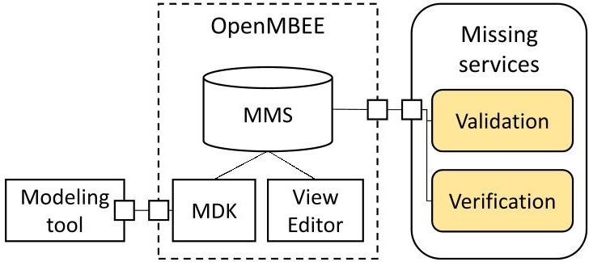

FIGURE 1 OpenMBEE, Open Model Based Engineering Environment.

Systems engineering in SysML is supported by several tools. Models are created, for example, in MagicDraw $ ^{6} $ or Cameo Systems Modeler $ ^{7} $ , and are versioned in central repositories (MMS or Teamwork Cloud $ ^{8} $ ). Cameo Simulation Toolkit (CST $ ^{9} $ ) is used to simulate models and validate timing or functional properties. Documents and reports are generated by the View Editor, later to be consumed by other engineering teams. Implementation code is either created manually or by code generation (e.g., with COMODO $ ^{26} $ ).

The OpenSE Cookbook $ ^{16} $ collects modeling guidelines and processes proven to be helpful in the industrial practice. The largest, open-source, industrial-scale application of the cookbook is the TMT. $ ^{14,15} $

Many organizations follow the Executable Systems Engineering Method (ESEM), emphasizing executable models to deliver high-quality systems. Textual requirements are formalized using constraints and parameters. System behavior is modeled using state machines communicating through ports. The detailed behavior of states and transitions are defined using activity diagrams. Operational scenarios can be defined as sequence diagrams, driving simulations to obtain for example, timing diagrams or other analysis results.

## 2.1 Running example demonstrating industrial modeling practices

As a running example model in the paper, let us consider the composite system of a simplified Spacecraft and Ground Station model in Figure 2. The model omits the technical details about the internal operation and communication between the two entities. Its purpose is to illustrate our approach on an easy-to-understand system.

As soon as the Ground Station is in Operation, it notifies the Spacecraft to Start sending Data. The station counts and forwards the incoming data packets via its Status port. The Spacecraft is waiting in the Idle state until it receives a Start signal from the station to start sending data in packets. Data transmission consumes 1% of battery power per packet, and if the battery level falls below 80% ongoing data transmission is paused until full recharge. Several proper-

<!-- PDF_PAGE: 4 -->

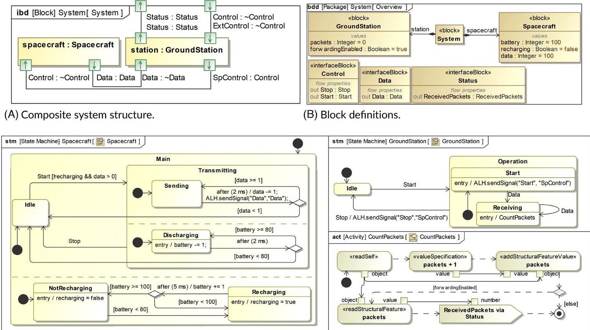

(C) Behavior definitions.

FIGURE 2 A SysML model describing a simplified Spacecraft and Ground Station to illustrate the scope.

ties can be formulated about the behavior of the system. For illustrative purposes, let us consider that the Spacecraft $ ^{10} $ (a) should only start transmitting when receiving a Start signal, and (b) should never transmit when the battery is below 80% and the Ground Station has already received at least 20 packets.

While property (a) could be checked in principle by reviews or validation rules, property (b) is much more complex as we have to consider all paths in the model. A handful of executions can be explored in a simulator. However, engineers could easily get lost if finding a trace requires solving complex conditions or ordering concurrent behaviors.

These properties can be captured as reachability properties on state machines of the composite system. A reachability property describes a state configuration with predicate logic (that can refer to state nodes and state variables). A reachability property can be checked: a model checker can compute whether a state configuration matching the property can be reached from the initial state. A requirement may be derived from a reachability property by specifying whether the state configuration is desirable (a liveness requirement) or undesirable (a safety requirement). A liveness requirement is satisfied by a system if there exists an execution path (a witness) that leads the system into a matching configuration. In contrast, a safety property is violated if there is such an execution (which in this case is called a counterexample). Note that a safety requirement can be converted into a liveness requirement by negating both the description of the state configuration and the result of model checking.

A SysML sequence diagram can be used as a surface notation to define a reachability property. The diagram consists of Lifelines representing the Part Properties of the composite Block it describes. Each Lifeline can contain several State Invariants. The property illustrated by Figure 3, corresponds to property (b), describing a configuration where the Transmitting state of the Spacecraft is active, the battery level is below 80% , the Ground Station is in the Receiving state and has already received at least 20 packets.

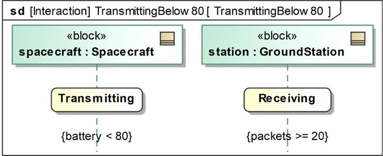

FIGURE 3 A sequence diagram describing the reachability property (b).

## 2.2 V&V of industrial SysML models: State of the art

The correctness of systems engineering models is a crucial aspect in the aerospace and astronomy domains due to the extensive design, development, and operational costs, the longevity, and the safety-critical properties of the systems. There are several techniques for validating the designs. $ ^{10,11} $ During manual reviews, engineers inspect the models and documentation. Static validation rules are used to check the

<!-- PDF_PAGE: 5 -->

structural consistency of the models. Simulations are used to evaluate executions of the behavior or test cases. The primary result of the simulation is one or more execution traces, which can be used to analyze different qualitative and quantitative properties.

Testing and simulation are proven methods, but they depend on the engineer's expertise and in the case of complex models, have a chance of missing problems (partly mitigated by test design methodologies). This has inspired research in formal methods to support verification with complementary approaches that reduce this chance by systematic, (semi-) automated reasoning. One such approach is model checking, which can be viewed as an automated and highly optimized exploratory simulation driven by a declaratively specified goal. Traditionally, this goal is to demonstrate the satisfaction or violation of a requirement with a suitable execution (witness). In the case of a reachability property, the goal is to look for traces that reach a state configuration specified by the property. Therefore, model checking can enhance a set of hand-made operational cases with a machine-assisted exploration of hard-to-find corner cases. Note that from the engineer's point of view, the model checking result should be an execution trace similar to the result of simulation or testing, which can be used to analyze the behavior. An example of this practice is NASA JPL's usage of Java Pathfinder $ ^{27} $ and Spin $ ^{28} $ to verify properties on code generated from state machines. $ ^{10} $

Tool integration is an essential aspect of the applicability of model checking in industrial settings. Typically, engineers work with feature-rich tools that support the authoring of high-level, generic, and flexible models. In contrast, model checkers are often single-user applications with many configuration options and a mathematically precise, low-level input language. This gap is probably the most dominant obstacle in the industrial adoption of results accumulated during decades of formal methods research.

Given this task of integrating (primarily academic) formal verification tools with industrial authoring environments, we can identify several levels:

2. The formal models and traceability information are derived from the design models via automated model transformation. $ ^{30} $ Results are still evaluated by experts familiar with the formal model and tool.

1. Design and formal models are built separately by a group of specialists. $ ^{29} $ Traceability can be added manually.

3. In addition to automatic generation, results are automatically back-annotated into the design model, $ ^{31} $ which allows the complete workflow to be executed from the design environment.

An orthogonal aspect is how much of the language elements are supported by the verification workflow. An ideal solution would reach level 3 for the whole language - in our case, SysML. Since this is extremely challenging due to the richness and flexibility of the language, most solutions deal with only a fragment of the modeling elements.

## 2.3 Objective and challenges

We defined the vision to extend an industrial SysML-based engineering environment with capabilities to check properties defined over state machine models using formal verification techniques, with the following objectives:

1. The approach shall check reachability properties over executable SysML models to provide early feedback to engineers in a language they are familiar with.

2. Verification shall be hidden and offloaded to cloud services supporting multiple model checkers.

3. The solution shall be integrated with OpenMBEE and support a reasonable subset of widespread modeling practices.

4. The solution shall satisfy the entry conditions of typical enterprise deployments, that is, multi-user and parallel jobs, containerized environment, and access control.

Our main challenges were that (1) there are subtle differences in how different tools and engineers interpret SysML models or even the standard itself, (2) there is a significant gap between the models of computation of SysML models and most formal languages, and (3) formal verification approaches generally do not scale to larger models.

We started our collaboration to tackle these challenges in 2019, with the identification of the modeling elements to be supported by an acceptable solution. In 2020, we implemented the first prototype presented in a workshop paper. $ ^{21} $ In the autumn of 2020, we extended the prototype with support for activity diagrams and communicating state machines, reaching a set of supported elements that is sufficient to tackle real-world models. In 2021, with major engineering efforts put into the transformation optimization and a technological upgrade to a cloud-native architecture, the solution has been scaled to the TMT model, and industrial deployment became feasible.

In this paper, we present the details of this journey. The prototype, at its current state, is sufficiently evolved to demonstrate that verification of industrial SysML models is feasible. The distinguishing feature of our approach is that the heterogeneous team resulted in a healthy balance between academic and industrial interests and constraints, driving the development toward the needs of end users while respecting the capabilities of existing verification tools. We call the resulting compromise a pragmatic V&V approach for SysML.

## 3 A PRAGMATIC V&V APPROACH FOR SysML

## 3.1 Challenges of verifying SysML models

## 3.1.1 SysML and UML semantics

Because SysML inherits many elements and semantics from UML, in this chapter, we explore SysML and UML together. Both standards $ ^{5,32} $

<!-- PDF_PAGE: 6 -->

have been defined to ensure that the different tools in this workflow process models the same way. However, standards are usually ambiguous because standardization needs to find a compromise between human intelligibility and formal preciseness. This flexibility may lead to subtle differences in how the models are interpreted by both stakeholders and tools. For example, a verification tool may return an execution trace not reproducible by the simulator. To address this issue, several standards have been proposed as an extension to the base standards (e.g., PSSM, $ ^{13} $ PSCS, $ ^{33} $ fUML $ ^{12} $ ). These standards define detailed operational semantics, explicitly capture some known variations as semantic variation points, and contain test suites to demonstrate the expected behavior of model elements. However, as the main parts of the standards are still semi-formal natural text, they still could not completely eliminate ambiguity and specify every possible corner case.

To complement these standards, researchers have proposed to map UML/SysML to a formal analysis domain. $ ^{34} $ These formalizations differ in the types of supported elements: ranging from a handful of elements in activity diagrams $ ^{35} $ and state machines $ ^{36} $ to rich feature support for UML state machines $ ^{37} $ . The approaches also use several alternatives for the mathematical basis: for example, Petri nets, $ ^{38} $ PROMELA, $ ^{39} $ CML $ ^{35} $ or Kripke structures. $ ^{40} $ However, these formalizations are usually not complete. $ ^{34,36} $

According to our experience, in an industrial setting, further practical perspectives need to be considered apart from the aforementioned theoretical ones. (1) In a large organization, model users might interpret the same diagram differently or use certain modeling constructs in conflicting ways. This might result in inconsistent, non-reusable models if modeling guidelines and validations are not used. $ ^{41,42} $ (2) Some industrial design, simulation, and verification tool developers strive for maximum standard compliance, but this is hard to achieve due to the imprecise semantics that makes it difficult to implement the corner cases correctly. $ ^{43-45} $ (3) Furthermore, the integration of these tools is difficult in an industrial environment because the execution traces provided by them might not be consistent with each other. For example, a formal verification tool might find a trace that cannot be produced by the simulator, or the model user might come up with an execution trace that is not possible due to some limitations of the language. $ ^{45} $

## 3.1.2 Challenges

To summarize, we observed these challenges when using formal verification for executable SysML state machines:

1. The SysML and UML standards are complex, with many elements and intricate details.

2. Several constructs used in practice result in demanding verification problems (e.g., conflicting read-write access to shared variables in orthogonal regions or calling arbitrary source code in effects).

3. MBSE tools might handle certain constructs differently. For example, it is a serious risk if the execution order of orthogonal regions is handled differently in the model simulator, code generator, and model checker.

4. Humans might use and interpret certain constructs in a nonstandard way, for example, priorities of transitions or aborting a do activity, that may conflict with the result of the verification.

## 3.1.3 Semantic integrity

In an ideal setting, there would be full semantic integrity across the whole organization and engineering life cycle: simulation, verification, code generation tools, execution platforms, and engineers would interpret the models consistently, and the behavior of an artifact produced in one tool would conform to the behavior in other tools. However, ensuring such semantic consistency across a supply chain or an organization is a highly challenging task despite the efforts of standardization bodies, academic researchers, tool vendors, and even domain experts. Therefore, we aimed for consistency with a pragmatic subset of SysML and a particular integrated toolchain, where a validation and verification tool shall report problems that can be discovered with a simulator or explained to systems engineers.

## 3.2 Pragmatic, semantic integrity

As discussed in the previous section, achieving the semantic integrity of a full MBSE life cycle is an overly ambitious goal. Therefore as a first step, we aimed for a pragmatic approach by making the following compromises: we focused (1) on the V&V of the SysML-based systemlevel design phases, (2) with a fixed set of tools, (3) on a subset of the SysML language, (4) by using syntactic and semantic restrictions that can limit the ambiguity, and the possible state space of the behavioral models to make formal verification scalable. However, we made sure that the resulting approach was not too limited from a practical point of view, and engineers could use it to design real systems. Thus sometimes we included language elements for which semantic integrity could not be guaranteed but are required by existing modeling practices. In these cases, we give warnings that explain the differences in the interpretations.

## 3.2.1 Pragmatic, semantic integrity

The pragmatic, semantic integrity of a given toolchain means that the tools in the workflow interpret the models the same way or provide means to explain the differences. In this way, systems engineers are informed that the results are consistent with each other and with the modeling practices, considering the restrictions of the respective tools.

## 3.2.2 Example

A good example of making such pragmatic choices is handling orthogonal regions in state machines. According to the official PSSM standard, the execution of effects and related actions can interleave in any order for transitions in different regions, even in one run-to-completion step,

<!-- PDF_PAGE: 7 -->

FIGURE 4 Selected toolchain of design (MagicDraw, Cameo Systems Modeler), simulation (CST), and repository (OpenMBEE) tools extended with the new V&V services proposed in this paper.

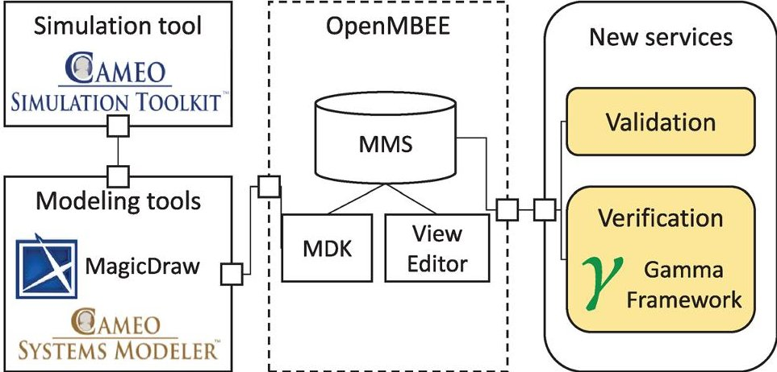

resulting in many possible traces. Such concurrency could cause state space explosion in complex models. Nevertheless, orthogonal regions shall be supported as they are essential in industrial models. Thus we restricted the execution of orthogonal regions to a strict sequential order in formal verification. Simulation tools usually also choose to have a deterministic execution order and produce only one of the possible traces. However, this order is not documented; therefore, the simulation might produce a trace different from the one returned by formal verification. Thus, our approach warns if orthogonal regions are used in a model.

## 3.2.3 Method

We used the following method to achieve the pragmatic, semantic integrity among the selected tools and to compile a pragmatic subset of the SysML language. We

1. manually inspected the relevant SysML, fUML, and PSSM standards to collect the most important concepts;

2. conducted interviews and focus group meetings with engineers from NASA JPL, ESO, and OpenMBEE to learn about their engineering practices;

3. inspected available domain-specific models from TMT and the OpenSE Cookbook to identify the design patterns and most common elements;

4. experimented with selected SysML modeling, simulation, and verification tools to discover the differences in their operation (see Figure 4);

5. inspected the used modeling elements from the formal verification's complexity point of view;

6. finally, compiled a pragmatic subset of the SysML language

As formal verification tools vastly differ in their expressive power and capabilities, we relied on the intermediate language offered by the Gamma Framework. $ ^{18} $ The Gamma Statechart Composition and Verification Framework was specifically developed for the formal verification of reactive systems. It offers a tailored modeling language with precise formal semantics and a common interface supporting several formal verification backends.

## 3.2.4 Pragmatic subset

The central artifact of our approach is a subset of the SysML language for which the pragmatic, semantic integrity can be achieved in the case of design and V&V activities. To create this subset, we selected the first modeling elements that are uniformly and unambiguously supported by each tool. Next, the elements that have different interpretations between the tools or have large performance implications in simulation or verification, but were required due to modeling practice reasons, were included in the subset. The differences among the tools were bridged either by restricting their execution to a common subset or defining warnings to explain the possible inconsistencies. The elements with unmanageable differences between the tools were excluded from the subset. This process could be repeated by iteratively updating the pragmatic subset as the standards, engineering practices, and tools evolve.

## 3.3 A pragmatic subset of the SysML language

Our goal was to give systems engineers a design-time model validation, and verification workflow that can check the dynamic behavioral properties of the models in a semantically integrated way. We focused on SysML state machines and activity diagrams since they are one of the most commonly used formalisms for behavioral modeling.

Although the SysML language gives a huge degree of freedom in using and combining the different modeling elements, we had to apply restrictions to achieve formal verification in practice. (1) We limited the execution order of orthogonal regions to the same order as they are defined in the model. (2) We forbade do-activities completely as they are running concurrently with the state machines, and aborting them is not well-defined in the standard. (3) We forbade arbitrary source code, dynamic memory allocation, and loops in guards, actions, and effects because they are well-known difficult problems in software model checking. $ ^{11} $ (4) Although the activity diagrams help engineers describe complex control and communication logic easily, their asynchronous and parallel execution impose huge verification complexity. Therefore, we simplified them so they can be verified by the Gamma Framework.

Due to some restrictions, not all theoretically possible traces are explored during verification (e.g., not all interleavings of events in

<!-- PDF_PAGE: 8 -->

TABLE1 A pragmatic subset of the SysML language suitable for formal verification.

<table border="1"><tr><td colspan="2">(a) State machine and structure elements.</td></tr><tr><td>Element</td><td>Restriction</td></tr><tr><td>Block, composite Block, interface Block</td><td>-</td></tr><tr><td>Port</td><td>-</td></tr><tr><td>Parameterized Signal</td><td>-</td></tr><tr><td>Data type</td><td>Integer, Boolean, Enumeration Literal</td></tr><tr><td>Initial, Choice, Deep and Shallow History</td><td>-</td></tr><tr><td>Pseudostates</td><td></td></tr><tr><td>Simple and composite States</td><td>-</td></tr><tr><td>Transition with Time Event or</td><td>-</td></tr><tr><td>Signal Event Trigger</td><td></td></tr><tr><td>JavaScript Guards or Actions</td><td>variable assignments, predicates, ALH.sendSignal to send</td></tr><tr><td></td><td>Signals, ALH.inState to check if the State is active,</td></tr><tr><td></td><td>no loop, no array, no dynamic memory,</td></tr><tr><td></td><td>no other function call is allowed</td></tr><tr><td>Transition Effect</td><td>Activity, or restricted JavaScript</td></tr><tr><td>State Entry or Exit Actions</td><td>Activity, or restricted JavaScript</td></tr><tr><td colspan="2">(b) Activity diagram elements.</td></tr><tr><td>Element</td><td>Restriction</td></tr><tr><td>Control Flow</td><td>loop and recursion free</td></tr><tr><td>Data Flow</td><td>-</td></tr><tr><td>Initial, Activity Final Nodes</td><td>there must exist exactly one of each</td></tr><tr><td>Decision and Merge Nodes</td><td>Decision Node must have a default true branch</td></tr><tr><td>Fork and Join Nodes</td><td>sequential execution of concurrent Control Flows,</td></tr><tr><td></td><td>that must join in the same Join Node</td></tr><tr><td>Call Behavior Action</td><td>Behavior is Activity, no recursion in the call hierarchy</td></tr><tr><td>Send Signal Action</td><td>-</td></tr><tr><td>Add Structural Feature Value Action</td><td>-</td></tr><tr><td>Read Structural Feature Action</td><td>-</td></tr><tr><td>Value Specification Action</td><td>Literal Integer or Boolean value, restricted JavaScript Expression</td></tr><tr><td>Opaque Expressions, Actions</td><td>see JavaScript Guards and Actions</td></tr></table>

orthogonal regions). But we can still check a much greater number of traces with these restrictions than what is possible with simulation while giving warnings when such trade-offs are applied.

The final, refined pragmatic subset of modeling elements is listed in Table 1. State machines communicate with each other using parameterized Signals via Ports; and have timed Transitions. Expressions can

include variables and literals of type Boolean, Integer, or Enumeration. Activities or simplified JavaScript can express an uninterruptible, loop- and recursion-free Control Flow. We have confirmed with subject matter experts from NASA-JPL, ESO, and OpenMBEE that this subset contains the most commonly used elements in the aerospace domain and still enables practitioners to build sufficiently complex yet verifiable systems engineering models (like the TMT model $ ^{14} $ which adopts design patterns applied at NASA JPL). Language elements left out can be replaced by a combination of elements from the practical subset, or they pose such complexity for verification that they cannot be reasonably verified.

Although the concrete, pragmatic subset of the SysML language was compiled from models and modeling practices in the aerospace and astronomy domain, the method we outlined can be applied in other domains as well because the process is domain-independent.

## 4 THE V&V WORKFLOW

In this section, we overview the workflow supporting the designtime V&V of SysML models using elements of the pragmatic subset. The workflow is built around the Gamma Framework: validating if the SysML model conforms with the pragmatic subset, transforming the model to the input language of Gamma, running verification and back-annotating the results to the modeling domain.

## 4.1 Steps of the V&V workflow

## 4.1.1 Validation

In the validation phase, we check if the selected models conform with the restrictions of our pragmatic subset of SysML. If the model contains unsupported or structurally incorrect elements, then we return validation errors. Warnings are returned for elements that are interpreted with restricted semantics. We used the Viatra Query Language (VQL) $ ^{46} $ to implement a comprehensive validation suite consisting of more than 130 imperative and declarative rules. Imperative rules check the JavaScript guard expressions, action, and effect statements. Declarative rules are composed as graph patterns and validate the structure of the SysML models. Table 2 lists a sample of validation rules by model element.

## 4.1.2 Transformation to Gamma models

Next, the SysML composite system and reachability property models are transformed to the Gamma Statechart and Property models respectively. During the transformation, a traceability model between the SysML state machine and the Gamma statechart is built to track the mapping between the source and target models. This traceability model is used for transforming the reachability property and back-annotating the verification results to the source domain.

<!-- PDF_PAGE: 9 -->

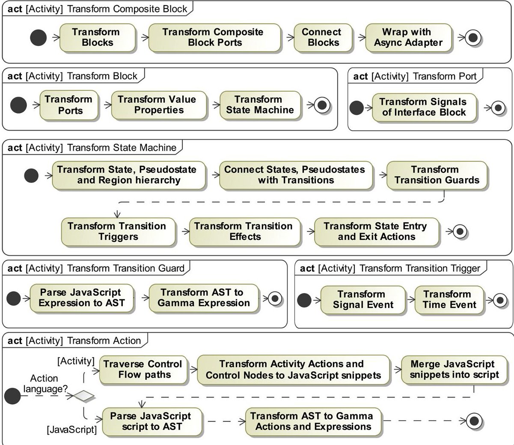

FIGURE 5 Composite Block transformation process.

TABLE 2 Example validation rules by model element.

<table border="1"><tr><td>Element</td><td>Rule</td></tr><tr><td>State machine Region</td><td>Region shall not have more than one Initial States.</td></tr><tr><td></td><td>Region shall either have an Initial or a History State.</td></tr><tr><td></td><td>(Warning) Orthogonal Regions shall not write the same variable.</td></tr><tr><td>Activity</td><td>Activity shall have exactly one Initial Node.</td></tr><tr><td></td><td>Activity shall have exactly one Activity Final Node.</td></tr><tr><td></td><td>There shall not be a loop in the Control Flow of the Activity.</td></tr><tr><td>Activity Action</td><td>Action shall be on a Control Flow path from Initial Node to Final Node.</td></tr><tr><td></td><td>Action shall have at most one outgoing Control Flow.</td></tr><tr><td></td><td>Action&#x27;s outgoing Object Flow shall start from a Pin.</td></tr></table>

Figure 5 illustrates the transformation process of the SysML composite Block. Each Block of the composite system is transformed to a Gamma statechart. After the transformation of the individual Blocks, the Ports of the composite system are transformed, and the generated statecharts are connected to each other according to the system's internal structure. Finally, the components are wrapped according to

the compositional semantics of Gamma. The technical details of the whole process can be found in the supplementary technical report. $ ^{47} $

## 4.1.3 Verification of Gamma models

In the verification phase, Gamma transforms the Gamma Statechart models to formal models (timed automata in UPPAAL or extended transition system in Theta) and the Property model to a formal query (restricted CTL expression). During the translation, several semantics-preserving optimizations reduce the size of the models, which reduces the verification time. Such optimizations are: removing the statically unreachable states and unfireable transitions, removing unused variables and events, and inlining consecutive variable assignments. $ ^{48} $ After that, the model checker evaluates the formal expression on the formal model to check if it is satisfied. $ ^{19,20} $ If the expression is satisfied, the model checker returns a low-level formal trace that is transformed to an Execution Trace in Gamma.

## 4.1.4 Back-annotation and inspection of the Execution Trace

If the reachability property is satisfied, then an Execution Trace exists that will be back-annotated to a SysML sequence diagram. Otherwise,

<!-- PDF_PAGE: 10 -->

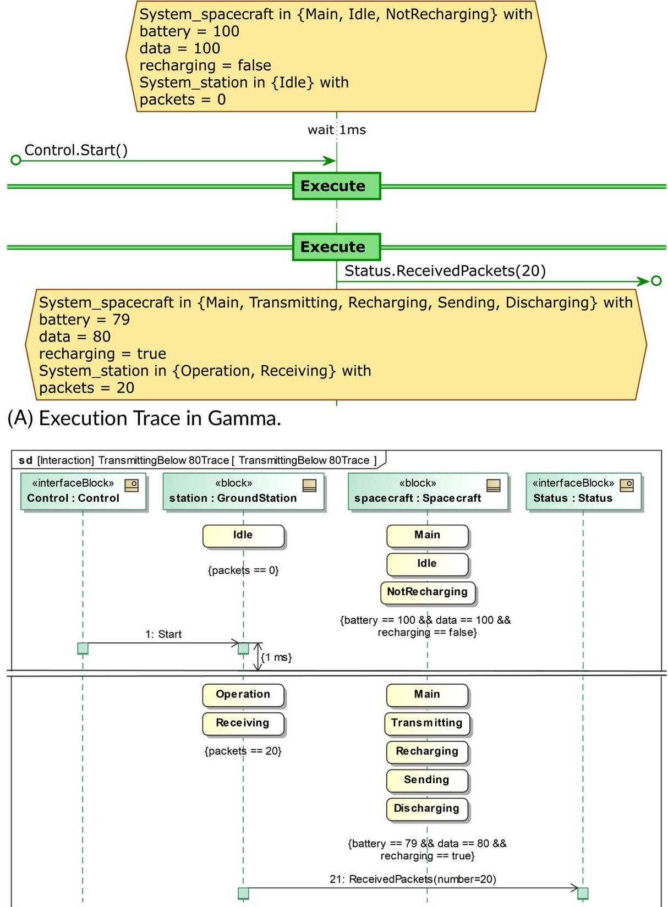

(B) SysML sequence diagram trace.

FIGURE 6 Execution Trace to sequence diagram mapping.

no trace is returned, and the user is notified that the property is unsatisfied. If the verification did not complete due to timeout or technical error, then we notify the user that the result is inconclusive.

(Figure 6A) illustrates an Execution Trace in Gamma. Each step of the trace contains: (1) The active state configuration of the components, including the values of variables (represented by a hexagon), (2) the set of input signals that were received by the composite system (represented by incoming arrows), (3) the set of output signals that were sent by the system (represented by outgoing arrows), and (4) the time that was spent before proceeding to the next step (in case of a timed

system, represented by wait X ms). The steps in the trace are visually separated by a horizontal line and an Execute rectangle in the middle.

Using the traceability model created during the forward transformation, we back-annotated the Execution Trace to a SysML sequence diagram, as depicted in(Figure 6B) for the running example. The technical details of the back-annotation process can be found in the supplementary technical report. $ ^{47} $ On the diagram, we can see that the composite system is in the initial state configuration when it receives a Start Signal via the Control Port and 1 ms elapses until we get to the next state configuration. After that, due to space limitations, we only

<!-- PDF_PAGE: 11 -->

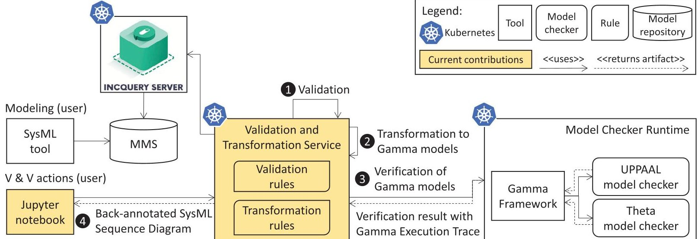

FIGURE 7 Overview of the architecture.

present the last state configuration of the trace. The spacecraft is in the Transmitting State, it has sent 20 packets to the station, and its battery is 79. The station is in the Receiving State, it has received 20 packets, and as a last action, it sends the Received Packets(20) Message via the Status Port of the composite system. Reaching the last state configuration proves that the reachability property of the running example is satisfied.

The back-annotated SysML sequence diagram (Figure 6B) shows a detailed execution scenario of how the model can get into the prescribed state configuration. This may be an execution that the systems engineer did not expect to occur based on their assumptions. The diagram can be used for manual inspection of the execution and step-by-step simulation of the state machines while comparing its local variables and the Signals sent or received in each step in the CST. It is the systems engineer's task to find the cause of why the execution deters from the expected behavior. The sequence diagram only proves that such an execution path exists.

## 4.2 Technical realization

We implemented the aforementioned V&V workflow using proprietary and open-source tools. The architecture is depicted in Figure 7.

Systems engineers design the state machines, and activity diagrams and define the reachability properties in SysML modeling tools, for example, Cameo Systems Modeler, and push them to the MMS model repository. Then, users open a web browser to perform V&V actions in a Jupyter notebook $ ^{11} $ serving as a frontend. The frontend is connected to the Validation and Transformation Service (VTS) in the backend, which validates the SysML models, $ \textcircled{1} $ before transforming them to Gamma models $ \textcircled{2} $ and verifying them with the Gamma Framework. $ \textcircled{3} $ The verification result is presented in the browser, $ \textcircled{4} $ possibly including a Gamma Execution Trace that is back-annotated to a SysML sequence diagram.

On the backend side, we use IQS, a scalable model query middleware on top of collaborative model repositories, $ ^{17} $ to improve the performance of the validation and transformation phases. IQS builds an in-memory index from the model and can efficiently evaluate queries implemented in the Viatra Query Language. These queries are used by model validation (Section 4.1.1) and transformation rules. We implemented several model transformation rules that build the target and traceability models. The transformed models are persisted and are used in the verification and back-annotation phases of the V&V workflow.

In the verification phase, the Gamma Framework translates the intermediate models to formal models and queries to be checked by different model checkers, that is, UPPAAL $ ^{20} $ or Theta $ ^{19} $ . The philosophy of Gamma is to have a portfolio of supported model checkers. Each tool implements different algorithms tailored to specific classes of problems; therefore, having a larger variety of model checkers increases the chance of successful verification. For example, UPPAAL uses explicit model checking and is efficient for timed systems, while Theta uses a wide array of abstraction-based symbolic techniques that have a more significant overhead on simpler problems but have a chance of verifying harder ones where an explicit algorithm would not scale.

To have a scalable architecture, we moved the processing from workstations to the cloud. Most components in the architecture can be deployed on Kubernetes, an open-source cloud orchestration, deployment, and scalability tool for containerized applications. Applications can be deployed into different execution units, called pods, with a certain amount of computation resources allocated. They can be scaled up with a high amount of CPU and memory (vertical scalability), or new pods can be started on-demand (horizontal scalability), as long as the cluster has enough computational resources. The elastic scalability of the cloud enables the adaptive allocation of a high amount of computational resources, $ ^{49} $ which can address the high resource demand of the MCR component. Moreover, the portfolio of model checkers philosophy of Gamma can also benefit from the cloud-based setting because we can execute multiple model checker configurations in parallel and stop the process when one of them gives a result. Ultimately, suppose

<!-- PDF_PAGE: 12 -->

we accumulate enough data about the target models. In that case, we may be able to reduce the executed configurations to a few promising ones and achieve a relatively good price/performance ratio.

As model checking is the most resource-intensive task in the workflow, we serve each verification task in a separate pod, running the MCR. This way, the long-running tasks can be served in parallel. As the concurrent pods (managed by Kubernetes) can be deployed to a computing cluster, the overall performance is no longer limited by the resources available on a single computer. Therefore, the workflow can serve many users running their verification tasks concurrently and enable its use as a common verification service for a team of systems engineers.

Besides scalability, another advantage of our approach is the separation of concerns for the engineering and the formal verification domains: systems engineers design both the models and the properties in a high-level engineering language they are familiar with. The formal models are automatically derived from these high-level design models by a series of transformations hidden from the users. The verification result is back-annotated to the original engineering language, making it easier to understand potential issues without expertise in formal methods. Besides, it helps engineers to inspect the execution in detail or to derive further test cases.

## 4.3 Demonstration of semantic integrity

The semantic integrity of the toolchain can be illustrated by checking Property (b) on the motivating example (Figure 3). The verification result trace (Figure 6) proves that the property is violated because in the last state battery is 79% the Spacecraft is still transmitting, and the Ground Station has already received 20 packets. Simulating the sequence diagram trace in CST, one can find that the entry action of Discharging state causes the issue (Figure 2C). The faulty model can be fixed by moving the action to the effect of the outgoing timed transition. Rerunning the verification proves that the undesired state is not reachable anymore.

From the systems engineering perspective, the checked properties are representatives of requirements that would have been difficult to check with inspection or traditional simulation of operational scenarios. The warnings during the transformation emphasize that only part of the possible behavior is explored. The returned execution trace can help engineers inspect the actual behavior of their model. We revisit the limitations of trace back-annotation in Section 6.

## 5 EVALUATION

We evaluated our proposed V&V workflow in different scenarios imitating real-world use. These scenarios demonstrate that

1. our approach can scale to industrially relevant models,

2. the cloud-based workflow can efficiently serve multiple users running different verification jobs.

## 5.1 Environment

We set up an evaluation environment on Amazon Elastic Kubernetes Service (EKS). The infrastructure consisted of two EC2 nodes: one m5.xlarge instance (4 vCPUs, 16 GB RAM) and one m5.2xlarge instance (8 vCPUs, 32 GB RAM). The elements of the architecture in Figure 7 were deployed as follows: IIQS and the VTS were running on the m5.xlarge instance; the Model Checker Runtime (MCR) was deployed in a varying number of pods on the m5.2xlarge instance, depending on the scenario.

## 5.2 Models

For benchmark purposes, we used the running example Spacecraft model from this paper with two versions and a modified version of OpenMBEE's Thirty-Meter Telescope (TMT) $ ^{14} $ model. In the faulty version of the Spacecraft model, the reachability property (Figure 3) is satisfied; in the fixed version, the reachability property is unsatisfied due to the correction described in Section 4.3. Both the faulty and the fixed versions of the model contain 11 states, 23 transitions, and 5 activity actions.

In the TMT model, we chose the Procedure Executive and Analysis Software (PEAS) Block. We adapted its state machine and activities to the pragmatic subset of SysML supported by our workflow. We removed do-behaviors from the state machine, removed unsupported Actions from the Activities, replaced Float variables with Integers, and resolved data type inconsistencies in Activity actions. This was necessary to make the model conform to our pragmatic subset. Nevertheless, the resulting model is still quite complex and represents the general modeling patterns used in the OpenSE Cookbook. We specified four reachability properties for the TMT model, denoted as TMT1-4 in Table 3. The table contains the name of the target state and the number of states and activity actions for the shortest paths satisfying the respective property. The PEAS block contains 61 states, 93 transitions, and 2310 activity actions.

## 5.3 Evaluation scenarios

We describe the two scenarios in which the workflow was executed and the results obtained in each.

## 5.3.1 Scenario 1: Artificial and real-world models

## Description

We deployed the MCR in one pod, and we only sent one validation, transformation, and verification request at a time for each model and reachability property. This scenario serves as a high-level validation and as a baseline.

## Results

Figure 8 depicts the measurement results. (Figure 8A) shows that the model validation and transformation were completed in an

<!-- PDF_PAGE: 13 -->

TABLE 3 Reachability properties in TMT and metrics on the shortest path to reach the target state.

<table border="1"><tr><td>Name</td><td>Target state</td><td>Number of states</td><td>Number of activity actions</td></tr><tr><td>TMT1</td><td>Minimize sensor readings</td><td>5</td><td>213</td></tr><tr><td>TMT2</td><td>M3 alignment3</td><td>8</td><td>533</td></tr><tr><td>TMT3</td><td>Broad band phasing3um</td><td>9</td><td>636</td></tr><tr><td>TMT4</td><td>Broad band phasing1um3</td><td>10</td><td>739</td></tr></table>

FIGURE 8 Validation, transformation, and verification times of the Spacecraft and TMT models.

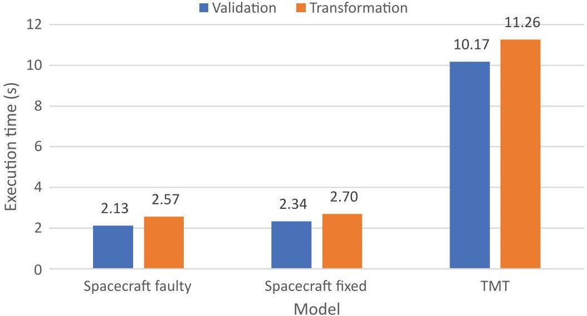

(A) Validation and transformation times.

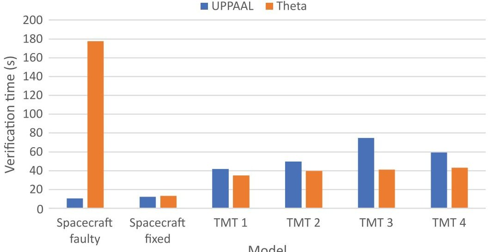

(B) Verification times.

acceptable time, despite running more than 130 validation rules. The model sizes are reflected in the execution times. While the simpler Spacecraft model is validated in 2 s and transformed in 2.5 s, the more complex TMT model is validated in 10 s and transformed in 11 s.

Regarding the verification times, depicted in (Figure 8B), it can be seen, on the one hand, that UPPAAL outperforms Theta for the Spacecraft faulty model, which contains timed transitions. On the other hand, Theta performs better for the TMT model, which contains many data variables, due to the large number of activity actions whose instructions are transformed to variable assignments. The large difference in verification times of the Spacecraft faulty model is due to the abstraction-refinement algorithm implemented by Theta that tracks

the values of the clock variables in the model, which results in a large number of combinations that need to be checked by the model checker. However, in the case of the Spacecraft fixed model, where the property is unsatisfied, Theta finishes in about the same time as UPPAAL due to the abstraction domain used in verification.

Conclusions: As Figure 8 shows the approach can transform and verify properties on artificial and complex industrial models within an acceptable time. Besides, the differences between explicit and abstraction-based model checkers could also be observed: UPPAAL may handle timed systems better than Theta. However, further models and verifiable properties are needed to draw a definitive conclusion in this respect. As Figure 8 shows, the verification times are the most

<!-- PDF_PAGE: 14 -->

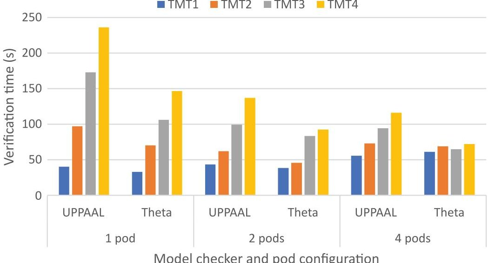

influential in the whole validation and verification workflow; therefore in the subsequent scenario, we only measure the verification time.

## 5.3.2 Scenario 2: Horizontal scalability

## Description

This scenario investigates that if we have multiple verification requests (possibly coming from different users), then how does the approach scale if more than one MCRs are performing verification. Therefore we deployed the MCR on 1, 2, and 4 pods. Each pod was handling only one verification request at a time. We sent four verification requests (TMT1-4) in a fixed order directly after each other asynchronously to the workflow. The verification requests were waiting in a queue until being processed by a free pod. We repeated the measurements separately with each model checker (UPPAAL and Theta), resulting in six sub-scenarios (3 pod configurations $ \times2 $ model checkers).

## Results

By looking at Figure 9, we can see the execution order and the effect of the queuing times of the requests. As the number of processing pods grows from 1 to 2, so is the overall execution time of the requests reduced. However, in the case of four pods, we can see that the concurrent verification requests give a higher load to the single processing m5.2xlarge node. This results in longer verification times than in (Figure 8B) when only one request was processed by the node simultaneously. Besides, we can also observe that Theta verified the models faster than UPPAAL, confirming our observations from Scenario 1.

Conclusions: The benefit of using a cloud-based approach in the deployment is that, as the number of pods grows, we can serve more users concurrently with the same resources. This approach can result in lower round-trip times for long-running verification tasks and better resource utilization in multi-user environments. However, we shall also consider the computational capacity of the processing nodes when allocating pods to the nodes to avoid starvation.

FIGURE 9 TMT model verification times when using the elastic scalability of the workflow.

## 5.4 Discussion

## 5.4.1 Summary of the results

The evaluation results show that using the recommended SysML subset and the developed V&V workflow checking reachability properties on large, executable models with hundreds of detailed actions is feasible. Due to the reasonable V&V times, the workflow can provide feedback to engineers that the behavior of the system model differs from the expectations described by the reachability properties.

The computation environment and its scaling scenarios discussed in the Evaluation section are just indicative, and it is part of the future work actually to deploy the architecture in a real-world enterprise environment.

## 5.4.2 Threats to validity

To address threats to the internal validity $ ^{50} $ of the measurements, we executed 20 rounds of warm-up requests in each phase, followed by the 7 rounds of measurements whose median represents a data point on each figure. To address the external validity $ ^{50} $ concerns, we used an industrial model (TMT) apart from a syntactic model (running example). However, our results might not be generalizable for models built from elements that are not part of the pragmatic subset defined in Section 3.3 (construct validity $ ^{50} $ ). Nevertheless, it is essential to note that industrial models are generally confidential, so having an evaluation presented in this paper is vital to move forward to industrial use.

## 6 LESSONS LEARNED

We present the lessons learned while designing a method capable of verifying system models in an industrial setting. We discuss the requirements and challenges related to: (1) Supporting SysML models in practice, (2) industrial deployment, and (3) scaling model checking.

<!-- PDF_PAGE: 15 -->

## 6.1 Handling and interpreting industrial models

## 6.1.1 Minimum supportable elements

During the interviews with systems engineers, we learned that pure SysML state machines alone are usually not enough to tackle practical engineering problems. Script-based action and guard languages help engineers express statements and conditions with a compact textual syntax. Based on the TMT model and discussions with systems engineers from NASA JPL, an activity diagram is a commonly used formalism to express behavior in an engineering-friendly way. The data and control flow-based semantics of activity diagrams is usually easier for systems engineers to understand than the state-based semantics due to its resemblance to programming.

Lesson 1. Supporting some executable action, guard language, and activity diagrams for specifying detailed actions is recommended to verify industrial models.

## 6.1.2 Interpretation of semantics

Although the precise definition of the semantics of UML/SysML models has vastly improved with the introduction of the fUML and PSSM specifications, there are still ambiguous interpretations in the execution semantics of activity and state machine diagrams. $ ^{45,51} $ The questions related to semantics are further complicated by two aspects in practice. First, tool vendors developing a modeling tool for a longer time may implement some parts based on previous specifications, or they need to fill the gaps in the specification. This can lead to situations like that the simulation tool of MagicDraw (CST) executes the models according to a semantics (SCXML $ ^{12} $ ) that is independent of the OMG specified standards. $ ^{12,13} $ Second, even if some parts of the specification are precise, systems engineers might interpret a diagram differently. We encountered several occasions when based on previous experiences with other tools or statechart notations, engineers did not realize all the possible interleavings due to non-determinism in a complex statechart with orthogonal regions. Due to these reasons, the model checker may return several traces that cannot be reproduced by the corresponding tools or contradict the intuitions of systems engineers.

Lesson 2. Finding a pragmatic subset of the modeling language can help reduce the ambiguity in interpretation among the tools and humans.

## 6.1.3 A pragmatic subset of SysML

On the one hand, the pragmatic subset of SysML chosen in Section 3.3 can be regarded as an opinionated modeling approach that puts some restrictions on the modeling practice of the engineers. On the other hand, these restrictions are necessary to find an appropriate balance between verifiable models and the large degree of freedom engineers

like to have when designing systems. From the engineering point of view, the pragmatic subset enables the design of composite asynchronous reactive systems that communicate with signals and have actions defined with textual JavaScript syntax or graphical activities. From the formal verification perspective, the pragmatic subset represents the most common modeling elements that state-of-the-art model checkers can verify.

In this paper, we have experimented with the tools mentioned in Section 3. The semantic integrity of the workflow is specific to the tools involved in it. Therefore, further analysis is needed to test if some tools could be replaced by others, for example, using a tool other than MagicDraw and Cameo Systems Modeler for system design.

## 6.1.4 Back-propagation of results

Running a successful formal verification on a complex state machine is only the first part of the challenge. In the case of a long counterexample, presenting the low-level trace of the model checkers usually does not add much business value as systems engineers need a representation that can help to locate and correct the root cause of the problem. Therefore, the verification results are recommended to be mapped back to the domain of the system model. This is a non-trivial task known in the literature. For example, Hegedus et al. $ ^{31} $ have listed several challenges that could occur when back-propagating a formal execution trace to a domain execution sequence: mismatch between step granularity, independent subsequences, and spurious formal sequences. We encountered similar challenges later tackled by the Gamma Framework during the back-propagation of the low-level formal traces to the Execution Trace in Gamma. After the Gamma Execution Trace to SysML sequence diagram transformation, we faced the issue that the resulting Interaction was not completely compatible with the CST, as the simulator did not wait the exact amount of time as set in the Duration Constraints. Besides, the Interaction simulation sporadically became unsynchronized with the state machines, for example, the Interaction did not proceed from a State Invariant, even though the respective state was active. These issues hindered the correct execution of the traces, which can be instead used for manual inspection purposes. The full simulation was not a priority feature at the moment, but a future challenge is to be able to simulate all special corner cases returned by the model checker.

Lesson 3. Backpropagating and simulating complex counterexamples involving multiple state machines with exact timing information is an open challenge not supported by all current tools.

## 6.2 Infrastructure for an industrial environment

## 6.2.1 Requirements

Having a verification solution alone is unfortunately not enough to be deployed to an enterprise environment. According to our experience, the tool should (1) be deployable both on-premise and to cloud

<!-- PDF_PAGE: 16 -->

infrastructure, and (2) should be able to integrate to other systems. Besides, for confidentiality reasons, it should have (3) authentication and authorization with auditing, (4) should be able to serve jobs from multiple users in parallel with an acceptable response time. For auditing purposes, the system (5) should log the executed operations without degrading its performance, and (6) should make the transformation artifacts and logs easily retrievable. Fulfilling these requirements needs extra effort, but it enables applying state-of-the-art research in practice.

Lesson 4. The verification workflow is advised to be adapted to the policies and requirements of the corresponding enterprise and contain many features usually not supported by research tools.

## 6.2.2 Realization

To be able to deploy the V&V workflow to the industrial context presented in the paper, one of the objectives set out in Section 2.3 was to have a toolchain that can be integrated with OpenMBEE. This goal was achieved in the following way. The workflow uses MMS as a model repository, where the SysML models can be uploaded by using the MDK plug-in of MagicDraw and can be reviewed by the View Editor component (Figure 1). Although we used MMS in our case study, our solution is model repository agnostic because it delegates the model acquisition task to IQS. Therefore, further repositories (e.g., Teamwork Cloud) can be added to the workflow as long as they are supported by IQS. Moreover, all the features of the workflow are accessible through REST APIs, which makes it easy to integrate them into various engineering workflows with different tools. A major effort was put into developing a container-based wrapper around the Gamma Framework and model checker tools that can be easily deployed (i.e., MCR) and a job management feature that orchestrates the requests and the steps in the V&V workflow.

## 6.3 Scaling model checking

State space explosion is one of the most difficult problems in model checking, which makes it difficult to scale for industry-grade models. To proceed with tackling this challenge, we took the benefit of several optimizations in the Gamma Framework. On the level of the state machines, such optimizations include removing statically unreachable states and unfireable transitions. On the level of the formal models, these include merging consecutive atomic transition sequences to one transition, using scoped local variables in actions, inlining statically deducible variable assignments, and removing unused variables. Besides, to reduce concurrency in the models, we restricted the execution order of orthogonal Regions in state machines and Control Flows between Fork-Join nodes in Activities. These restrictions reduce the state space that must be explored and provide verification results faster.

Proving properties with abstraction-based model-checking techniques may cause unexpectedly long execution times if the wrong abstraction refinement is chosen by the model checker. To avoid this outcome, when the Theta is chosen as a model checker for a verification task, we run multiple instances with different abstraction parametrizations (forming a model checking portfolio). The others are terminated as soon as the quickest instance returns a result. Nevertheless, it may occur that all instances run indefinitely, in which case formal engineering expert knowledge is needed to fine-tune the parametrizations according to the models and the properties being verified. However, this adaptive fine-tuning is left as future work. $ ^{52} $

Nevertheless, by applying the proposed approach, we have learned that applying model checking on industry-size models remains challenging despite the aforementioned optimizations. On the one hand, in model checking, improving abstraction-based verification algorithms $ ^{53} $ can help gain some runtime performance. On the other hand, the cloudready architecture enables the use of elastic cloud resources which give more computation power even if this improvement is less significant compared to an improvement on the algorithm level. Finally, further evaluations are needed to find the scalability limits of the approach with respect to the model size.

Lesson 5. To proceed towards scaling verification for industrial behavioral models, restricting the explored state space according to the environmental constraints in which the models will be used is an optimization choice.

## 7 RELATED WORK

To put our research in a broader context, we collected related work about the practical advantages and perceived challenges of using model-driven engineering (MDE) and formal methods in industry (Section 7.1) and applications of hidden formal methods in verifying system models (Section 7.2).

## 7.1 MDE and formal methods in industry

Bucchiarone et al. $ ^{54} $ described tool and implementation challenges hindering the widespread use of model-driven engineering. Among others, lack of good tooling, for example, component-based integrated environments that adopt textual languages and treat them like models or graphical interfaces tailored for the engineers' needs. From the implementation perspective, traceability between the different artifacts $ ^{55} $ and understanding the semantics of such links are also important. Finally, scalability in terms of size and diversity of artifacts, that is, models, metamodels, model transformations, and dependencies in any non-trivial project have been denoted as one of the open challenges that tools tried to address. We encountered similar challenges and therefore focused on an integrated, scalable tooling environment.

Verbruggen et al. $ ^{56} $ conducted a meta-review on the state of practice in using modeling languages. According to the study, MDE is

<!-- PDF_PAGE: 17 -->

beneficial for practicioners, because it saves cost, is easy to use, improves productivity, quality, and understanding of the system; and it supports software and systems development activities. However, the most frequently reported issues are the missing tool functionalities.

Hutchinson et al. $ ^{57} $ conducted a survey with 449 participants and complemented it with in-depth interviews with practitioners from four companies to learn about the success and failure factors of adopting MDE practices in the industry. They concluded that the successful adoption of MDE requires a progressive and iterative approach with a transparent organizational commitment, clear business focus, and willingness to align internal processes accordingly. The social implications of this change management, for example, increased training costs, and willingness to change the engineering methodology, should also be considered besides the technical factors. Huldt and Stenius $ ^{58} $ identified similar factors in a survey with 66 professionals. Our experiences confirm that an iterative approach is key to success, and the cost and challenge of changing modeling methods and practices should be considered from the start.

Gleirscher and Marmsoler $ ^{22} $ surveyed 216 participants from industry (78%) and academia (22%) about the use of formal methods (FM) in mission-critical software domains. Their results indicate an increased intent to apply FMs in the industry across all application domains, suggesting a positively perceived usefulness. Besides, the intrinsic motivation to use FM is stronger than the regulatory one. Scalability, skills, and education were perceived as the toughest challenges of applying FMs in practice. More experienced respondents more often rated these challenges as highly difficult compared to less experienced ones. Finally, experience with formal methods was positively correlated with future usage intent. We observed a similar situation in NASA JPL, where successful previous projects $ ^{10,59} $ opened the way for working in an environment to use formal verification as a service.

Garavel et al. $ ^{23} $ surveyed 130 high-profile experts in different aspects of formal methods. One aspect was the industrial adoption of formal method practices. 67.7% of the responders believe that formal methods are now ready to be used in industry to a limited extent. The reasons are often related to the domains, tool maturity, and people's skill and willingness to transfer and adopt academic research results to industrial case studies. The most often mentioned limiting factors of broader adoption are the improper integration of formal methods in the industrial design life-cycle, the lack of proper training of FMs, and its steep learning curve. According to the research participants, more collaborative projects between research and industry and increased support for academic researchers developing tools can contribute to addressing these challenges. We contributed to overcoming these limitations by developing a workflow that is tightly integrated into the engineering environments.

Woodcock et al. $ ^{60} $ surveyed 62 industrial projects to collect experiences about the industrial adoption of formal methods. According to the survey, improved quality was one of the main benefits of applying formal methods. Detection of faults, improvements in design, increased confidence, and understanding were the most often mentioned specificities of quality improvement. On the other hand, the education of engineers, the integration of model-checking solutions into the toolset

of engineers, and quick response time were the major impediments to formal methods adoption. Our objectives of developing a pragmatic verification approach were motivated by the same limitations.

Vinarcik $ ^{61} $ compiled a list of validation rules to improve the consistency and integrity of behavioral (activity, state machine) and structural (IBD) models in SysML. Although the rule set was initially applied in academic settings but later it was demonstrated on industrial models too, for example, TMT.

## 7.2 Verifying systems with hidden formal methods

To motivate the use of hidden formal methods, Visser et al. $ ^{62} $ surveyed papers that applied such methods to verify complex domain-specific hardware and software models. They observed that keeping the formal and intermediate models hidden from the end user is paramount to the success of the domain-specific model checker. Besides, they argued that model checking becomes effective when the natural notations of the design domain are also supported in the formal models. However, suppose there is a semantic gap between the two domains, then similar to our approach, they advocate developing appropriate intermediate representations (models) to bridge the gap both in the forward transformation and the back-annotation phases.

Software and systems model checking is widely researched, with many tools and approaches available. Ciccozzi et al. $ ^{63} $ performed a systematic review of solutions for the execution of UML models. The closest one to ours is Kölbl et al. $ ^{30} $ who proposed an approach to translate SysML models to the language of NuSMV, Prism, and Spin model checkers. Similar to us, they used an intermediate metamodel between the engineering and formal domains, and the counterexamples were returned as SysML sequence diagrams. In contrast to us, they verified Linear Temporal Logic (LTL) expressions specified as OCL state invariants in SysML, supported only send signal actions in activities, and used only a small model of an airbag system.

Calvino and Apvrille $ ^{64} $ proposed the direct model-checking of SysML state machine models. In their paper, they used AVATAR to design the SysML models directly verified by TTool. They support verifying a broader set of formal expressions specified textually. The verification results of the reachability and liveness properties are backannotated directly to the state machines, but a trace of the model checker representation is also returned.

Gibson et al. $ ^{10} $ verified properties on SysML statecharts by combining code generation with software model checking techniques. They translated the state machines to Java code by the COMODO model-to-text transformation tool and evaluated specific properties by Java Pathfinder. $ ^{27} $ The verifiable property was directly inserted in the generated code, the guards of the transitions were transformed manually, and the result was not annotated back to the original model. They used depth limits as a trade-off between performance and the ability to verify properties. $ ^{59} $

de la Croix et al. $ ^{65} $ proposed a role-based framework for the design execution, and verification of robotic applications. The framework

<!-- PDF_PAGE: 18 -->

extends the Business Process Modeling Language and Notation to design missions. To check the models' correctness, they translate a subset of the elements to Spin $ ^{6 6} $ and verify simple LTL properties. The back-annotation of results is a proposed future work.

Miller et al. $ ^{67} $ proposed a translator framework that allows engineers to automatically translate synchronous dataflow models and state machines from MATLAB Simulink and Esterel Technologies SCADE Suite to a variety of model checkers and theorem provers (NuSMV, SAL, Prover, PVL, ACL2). As an intermediate language, they use the Lustre formal specification language. Like Gamma, the translator framework applies optimizations to the models to reduce their formal verification time. The counterexamples produced by the model checkers are translated to a simple spreadsheet showing the inputs and outputs of the model for each step. Finally, they demonstrated the framework's application in three industrial case studies.

Cicchetti et al. $ ^{68} $ proposed the CHESS framework to design, validate and verify and generate code from complex component-based embedded software system models. For modeling, they use CHESSML which adopts elements from the UML, SysML, and MARTE languages. In the validation and verification phase, engineers can perform dependability and schedulability analysis (e.g., Failure Mode and Effect Analysis, Fault Tree Analysis, etc. $ ^{68} $ ), contract-based analysis, and formal verification. $ ^{69} $ In formal verification, the system and component-level properties are formalized into LTL expressions verified by the nuXmv model checker. The analysis and verification results are backpropagated to the design model, following the principles of hidden formal methods.

To the best of our knowledge, all of these tools are purpose-built, single-user tools targeted toward experts. The main differentiating feature of our approach is a workflow integrated into standard engineering design tools hiding formal methods that can be deployed into a multi-user, cloud-based enterprise environment.

## 8 CONCLUSION

This paper presented an automated V&V workflow of industrial executable SysML models. The workflow is integrated to the OpenMBEE project and maintains pragmatic, semantic integrity among the tools used in the design, validation, and verification phases. We identified a pragmatic subset of the SysML language supported by all tools that allow for complex practical modeling, while also supporting scalable, but limited state-space verification. Some limitations of the subset are: limited execution order of orthogonal Regions, restricted JavaScript action language, no do-action in States, and simplified Activities. Although the pragmatic subset reduces the degree of freedom in the design, it achieves formal verification in practice. The workflow enables the verification of reachability properties on state machines and activity diagrams, using the Gamma Framework and different model checkers. The process is hidden, fully automated, and offloaded to cloud services. The results are back-propagated to the original domain to help engineers understand them in a language they are familiar with.

The most important lessons learned in our research were: (1) Finding a pragmatic subset of the modeling language can help with reducing the ambiguity in interpretation among the tools and humans, (2) supporting some executable action and guard language is a must to verify industrial models, (3) restricting the explored state space is a necessary optimization choice to proceed towards scaling verification for industrial behavioral models.

As future work, we are planning to adapt our approach to the next generation of SysML (SysML v2), which completely changes the way semantics are captured in the standard, $ ^{70,71} $ and has the potential of widening the semantic integrity for a larger set of next-generation tools. Second, we plan to deploy the workflow to an industrial partner to improve the work of systems engineers and collect feedback from them. Third, we will experiment with modeling and simulation tools from different vendors to integrate them into the workflow. This may involve redefining the pragmatic subset of SysML, following the method outlined in Section 3.2, to achieve the semantic integrity of the new toolchain. Finally, we will fine-tune the portfolio-based execution to predict which model checker parametrization provides the fastest results.

## ACKNOWLEDGMENTS

The authors are grateful for the valuable feedback of the anonymous reviewers. This research was carried out at the Jet Propulsion Laboratory (JPL), California Institute of Technology, under a contract with the National Aeronautics and Space Administration (NASA). The authors would like to thank Luigi Andolfato (ESO), as well as Myra Lattimore and Ivan Gomes (NASA JPL) for their suggestions to improve the paper. We would also like to thank Milan Mondok (BME) and Abel Hegedus, Armin Zavada and Balazs Várady (IncQuery Labs) for their help with implementing the workflow. This work partially received funding from the European Union's Horizon 2020 research and innovation program under the Marie Skłodowska-Curie grant agreement No 813884, and the NRDI Fund of Hungary, financed under Grant TKP2021-EGA-02 and the [2019-2.1.1-EUREKA-2019-00001] funding scheme.

Disclaimer. Reference herein to any specific commercial product, process, or service by trade name, trademark, manufacturer, or otherwise, does not constitute or imply its endorsement by the United States Government or the Jet Propulsion Laboratory, California Institute of Technology.

## DATA AVAILABILITY STATEMENT

The data that support the findings of this study are available from the corresponding author upon reasonable request.

## ORCID

Benedek Horváth ID https://orcid.org/0000-0002-9805-1580

Vince Molnár ID https://orcid.org/0000-0002-8204-7595

Bence Graics ID https://orcid.org/0000-0001-5546-5970

Ákos Hajdu ID https://orcid.org/0000-0001-8001-8865

István Ráth ID https://orcid.org/0000-0002-5516-696X

Ákos Horváth ID https://orcid.org/0000-0003-3545-3694

Zoltán Micskei ID https://orcid.org/0000-0003-1846-261X

<!-- PDF_PAGE: 19 -->

## REFERENCES

1. Madni AM, Sievers M. Model-based systems engineering: motivation, current status, and research opportunities. Syst Eng. 2018; 21: 172-190.

2. Younse P, Cameron J, Bradley TH. Comparative analysis of modelbased and traditional systems engineering approaches for simulating a robotic space system architecture through automatic knowledge processing. Syst Eng. 2022; 25: 360-386.

3. Wolny S, Mazak A, Carpella C, Geist V, Wimmer M. Thirteen years of SysML: a systematic mapping study. Softw Syst Model. 2019;19:111-169.

4. Karban R, Robertson R, Qamar A, Lee E. Preface to the OpenMBEE International Workshop. In: Companion Proceedings of the 23rd International Conference on Model Driven Engineering Languages and Systems. IEEE; 2021:464-464.

5. OMG. System Modeling Language (SysML). 2022. ptc/2022-08-02. https://www.omg.org/spec/SysML/1.7/Beta1/PDF

6. Taraila WM, Asundi S. Model-based systems engineering for a small-lift launch facility. Syst Eng. 2022;25(6):537-550

7. Karban R, Dekens FG, Herzig S, Elaasar M, Jankevicius N. Creating system engineering products with executable models in a model-based engineering environment In: Modeling, Systems Engineering, and Project Management for Astronomy VII. Vol 9911. SPIE; 2016:96-111.

8. Karban R, Jankevičius N, Elaasar M. ESEM: automated systems analysis using executable SysML modeling patterns. In: INCOSE International Symposium. Vol 26. Wiley; 2016: 1-24.

9. Clarke EM, Henzinger TA, Veith H, Bloem RP. Handbook of model checking. Springer; 2018.

10. Gibson C, Karban R, Andolfato L, Day J. Formal Validation of Fault Management Design Solutions. ACM SIGSOFT Software Engineering Notes. 2014:39:1-5.

11. Gibson C, Bonnici M, Castet JF. Model-based Spacecraft Fault Management Design & Formal Validation. 2015 IEEE Aerospace Conference. IEEE; 2015:1-12.

12. OMG. Semantics of a Foundational Subset for Executable UML Models (fUML). 2021. formal/21-03-01.

13. OMG. Precise Semantics of UML State Machines (PSSM) 2019. formal/19- 05-01.

14. Corporation TO. Thirty Meter Telescope SysML model. 2022. Last accessed on: 2023-03-15 https://github.com/Open-MBEE/TMT-SysML-Model

15. Jankevicius N. Resource Analysis and Automated Verification for the Thirty Meter Telescope using Executable SysML Models. Executable Modeling. Vol. 1760. CEUR-WS.org; 2016:2-4.

16. Karban R, Crawford AG, Trancho G, et al. The OpenSE Cookbook: a practical, recipe based collection of patterns, procedures, and best practices for executable systems engineering for the Thirty Meter Telescope. In: Modeling, Systems Engineering, and Project Management for Astronomy VIII; 10705:107050W 2018. SPIE Astronomical Telescopes + Instrumentation; 2018

17. Hegedüs A, Bergmann G, Debreceni C, et al. IncQuery Server for Teamwork Cloud: Scalable Query Evaluation over Collaborative Model Repositories. In: Proceeding of the 21st International Conference on Model Driven Engineering Languages and Systems. ACM; 2018:27-31.

18. Molnár V, Graics B, Vörös A, Majzik I, Varró D. The gamma statechart composition framework: Design, verification and code generation for component-based reactive systems. In: Proceeding of the 40th International Conference on Software Engineering. ACM; 2018:113-116.

19. Toth T, Hajdu A, Vörös A, Micskei Z, Majzik I. Theta: a Framework for Abstraction Refinement-Based Model Checking. Formal Methods in Computer-Aided Design. 2017:176-179.

20. Behrmann G, David A, Larsen KG, et al. UPPAAL 4.0. In: Proceeding of the 3rd International Conference on the Quantitative Evaluation of Systems. IEEE; 2006:125-126.

21. Horvath B, Graics B, Hajdu A, et al. Model Checking as a Service: Towards Pragmatic Hidden Formal Methods. In: Companion Proceeding of the 23rd International Conference on Model Driven Engineering Languages and Systems. ACM; 2020.

22. Gleirscher M, Marmsoler D. Formal methods in dependable systems engineering: a survey of professionals from Europe and North America. Empir Softw Eng. 2020; 25: 447-4546.

23. Garavel H, Beek MH, Pol J. The 2020 Expert survey on formal methods. Formal Methods for Industrial Critical Systems, Lecture Notes in Computer Science. Vol. 12327. Springer; 2020:3-69.

24. Jansma PA, Jones RM. Advancing the practice of systems engineering at JPL. In: IEEE Aerospace Conference. 2006:19.

25. Karban R, Piette M, Brower E, et al. 2020. Last accessed on 2023-03-15. https://github.com/Open-MBEE/_OpenMBEE-Documentation/ blob/master/The_JPL_Systems%20Environment_Aug-2020.pdf

26. Andolfato L, Chiozzi G, Migliorini N, Morales C. A platform independent framework for statecharts code generation. In: Proceeding of the 13th International Conference on Accelerator and Large Experimental Physics Control Systems. 2011.

27. Havelund K, Pressburger T. Model Checking JAVA Programs using JAVA Finder. Int J Softw Tools Technol Transf. 2000; 2: 366-381.

28. Holzmann GJ. Mars code. Commun ACM. 2014; 57: 64-73.

29. Fritzsch J, Schmid T, Wagner S. Experiences from Large-Scale Model Checking: Verification of a vehicle control system with NuSMV. In: 14th IEEE Conference on Software Testing, Verification and Validation (ICST). 2021;372-382.

30. Kölbl M, Leue S, Singh H. From SysML to Model Checkers via Model Transformation. In; Proceeding of the 25th International Symposium on Model Checking Software. Lecture Notes in Computer Science. Vol 10869. Springer; 2018:255-274.

31. Hegedus A, Bergmann G, Rath I, Varro D. Back-annotation of Simulation Traces with Change-Driven Model Transformations. In: Proceeding of the 8th International Conference on Software Engineering and Formal Methods IEEE Computer Society. 2010:145-155.

32. OMG. Unified Modeling Language (UML) 2017. formal/17-12-05. https://www.omg.org/spec/UML/2.5.1/PDF

33. OMG. Precise Semantics of UML Composite Structures (PSCS) 2019. formal/19-02-01. https://www.omg.org/spec/PSCS/1.2/PDF

34. André E, Liu S, Liu Y, Choppy C, Sun J, Dong JS. Formalizing UML State Machines for Automated Verification-a Survey. ACM Computing Surveys. 2023.

35. Lima L, Didier A, Cornélio M. A formal semantics for sysML activity diagrams. In: Formal Methods: Foundations and Applications. Lecture Notes in Computer Science. Vol 8195. Springer; 2013: 179-194.

36. Crane ML, Dingel J. On the semantics of UML state machines: categorization and comparison. In: Technical Report 2005-501, School of Computing, Queen's. 2005.

37. Liu S, Liu Y, André É, et al. A formal semantics for complete UML state machines with communications. In: Proceeding of the 10th International Conference on Integrated Formal Methods. Lecture Notes in Computer Science. Vol 7940. Springer; 2013: 331-346.

38. Hu Z, Shatz SM. Explicit modeling of semantics associated with composite states in UML statecharts. Autom Softw Eng. 2006; 13: 423-467.

39. Latella D, Majzik I, Massink M. Automatic Verification of a Behavioural Subset of UML Statechart Diagrams Using the SPIN Model-checker. Form Asp Comput. 1999; 11: 637-664.

40. Latella D, Majzik I, Massink M. Towards a formal operational semantics of UML statechart diagrams. In: Formal Methods for Open Object-Based Distributed Systems. Springer; 1999:331-347.

41. Baduel R, Chami M, Bruel JM, Ober I. SysML models verification and validation in an industrial context: challenges and experimentation. In: Modelling Foundations and Applications. Springer International Publishing; 2018:132-146.

<!-- PDF_PAGE: 20 -->

42. Grumbach JL, Thomas LD. Systems integration implications of component reuse. Syst Eng. 2022.

43. Eshuis R. Reconciling statechart semantics. Sci Comput Program. 2009; 74: 65-99.

44. Crane ML, Dingel J. UML vs. classical vs. Rhapsody statecharts: not all models are created equal. Softw Syst Model. 2007; 6: 415-435.

45. Elekes M, Molnár V, Micskei Z. Assessing the specification of modelling language semantics: a study on UML PSSM. Softw Qual J. 2023:1-43.

46. Varró D, Bergmann G, Hegedüs Á, Horvath Á, Ráth I, Ujhelyi Z. Road to a reactive and incremental model transformation platform: three generations of the VIATRA framework. Softw Syst Model. 2016; 15: 609-629.

47. Horvath B, Molnár V, Graics B, et al. Supplementary material to the pragmatic verification and validation of industrial executable sysML models: description of the model transformation workflows tech. rep. Budapest University of Technology and Economics, Department of Measurement and Information Systems 2023. Last accessed on 2023-03-15. https://doi.org/10.5281/zenodo.7564295

48. Graics B, Molnár V, Majzik I. tech. rep. Budapest University of Technology and Economics, Department of Measurement and Information Systems 2022. Last accessed on 2023-03-15. https://inf.mit.bme.hu/sites/default/files/publications/graicsb/graics_integration_test_generation_gamma.pdf

49. Sharifloo AM, Metzger A. MCaaS: Model checking in the cloud for assurances of adaptive systems. In: Software Engineering for Self-Adaptive Systems III. Springer; 2013:137-153.

50. Brewer MB, Crano WD. Research Design and Issues of Validity. In Reis HT & Judd CM Eds. Handbook of Research Methods in Social and Personality Psychology. 2nd ed. Cambridge University Press; 2014:11-26.

51. Micskei Z, Konnerth RA, Horvath B, Semerath O, Vörös A, Varró D. On open source tools for behavioral modeling and analysis with fUML and Alf. 1st Workshop on Open Source Software for Model Driven Engineering. Vol 1290. CEUR; 2014:31-41.

52. Ádám Zs, Bajczi L, Dobos-Kovács M, Hajdu Á, Molnár V. Theta: Portfolio of CEGAR-based analyses with dynamic algorithm selection (competition contribution). In: Proceeding of the 28th International Conference on Tools and Algorithms for the Construction and Analysis of Systems. Lecture Notes in Computer Science. Springer; 2022.

53. Toth T. Abstraction refinement-based verification of timed automata. PhD thesis. Budapest University of Technology and Economics; 2021.

54. Bucchiarone A, Cabot J, Paige RF, Pierantonio A. Grand challenges in model-driven engineering: an analysis of the state of the research. Softw Syst Model. 2020; 19: 5-13.

55. Akdur D, Garousi V, Demirörs O. A survey on modeling and model-driven engineering practices in the embedded software industry. J Syst Archit. 2018; 91: 62-82.

56. Verbruggen C, Snoeck M. Practitioners' experiences with model-driven engineering: a meta-review. Softw Syst Model. 2023; 22: 111-129.

57. Hutchinson JE, Whittle J, Rouncefield M. Model-driven engineering practices in industry: Social, organizational and managerial factors that lead to success or failure. Sci Comput Program. 2014;89:144-161.

58. Huldt T, Stenius I. State-of-practice survey of model-based systems engineering. Syst Eng. 2019; 22: 134-145.

59. Gibson C, Karban R, Andolfato L, Day JC. Abstractions for executable and checkable fault management models in systems engineering research. Procedia Computer Science. 28;2014:146-154.

60. Woodcock J, Larsen PG, Bicarregui J, Fitzgerald JS. Formal methods: Practice and experience. ACM Comput Surv. 2009;41:19:1-19:36.

61. Vinarcik MJ. Treadstone: A process for improving modeling prowess using validation rules. In: 2020 ASEE Virtual Annual Conference Content Access. 2020.

62. Visser W, Dwyer MB, Whalen MW. The hidden models of model checking. Softw Syst Model. 2012; 11: 541-555.

63. Ciccozzi F, Malavolta I, Selic B. Execution of UML models: a systematic review of research and practice. Softw Syst Model. 2018; 18: 2313-2360.

64. Calvino AT, Apvrille L. Direct Model-checking of SysML Models. In: Proceeding of the 9th International Conference on Model-Driven Engineering and Software Development. SCITEPRESS; 2021:216-223.

65. de la Croix JP, Lim G, Vander Hook J, et al. Mission modeling, planning, and execution module for teams of unmanned vehicles. In: Unmanned Systems Technology XIX; 10195:101950J International Society for Optics and Photonics. 2017.

66. Holzmann G. The SPIN Model Checker: Primer and Reference Manual. 1st ed. Addison-Wesley Professional; 2011.

67. Miller SP, Whalen MW, Cofer DD. Software model checking takes off. Commun ACM. 2010; 53: 58-64.

68. Cicchetti A, Ciccozzi F, Mazzini S, et al. CHESS: a model-driven engineering tool environment for aiding the development of complex industrial systems. In: Automated Software Engineering. ACM; 2012:362-365.

69. Debiasi A, Ihirwe F, Pierini P, Mazzini S, Tonetta S. Model-based analysis support for dependable complex systems in CHESS. In: Proceedings of the 9th International Conference on Model-Driven Engineering and Software Development. SCITEPRESS; 2021:262-269.

70. Friedenthal S. Requirements for the Next Generation Systems Modeling Language (SysML v2). INSIGHT. 2018; 21: 21-25.

71. OMG. Systems modeling language (SysML) v2 RFP 2017. ad/17-12-02. https://www.omg.org/cgi-bin/doc?ad/17-12-02.pdf

How to cite this article: Horváth B, Molnár V, Graics B, et al. Pragmatic verification and validation of industrial executable SysML models. Systems Engineering. 2023;26:693-714. https://doi.org/10.1002/sys.21679

## AUTHOR BIOGRAPHIES

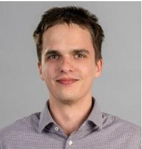

Benedek Horváth is currently a software engineer at itemis. He received his MS degree in computer science engineering at Budapest University of Technology and Economics in 2018. As a PhD student, he participated in the Lowcomote project, an

ITN program financed by the European Union. Johannes Kepler University in Linz was his host university and IncQuery Labs in Budapest was his host company. His main research interest lies in taking advantage of the elastic scalability of the cloud to proceed towards scalable model transformations and formal verification. As a visiting researcher he spent a month at IMT Atlantique in Nantes. He presented his work at different workshops of MODELS.

Vince Molnár is an assistant professor at the Budapest University of Technology and Economics. His main research field is model-based development and formal methods, with the primary focus on concurrent, distributed and safety-critical systems. He is the leader of the develop-

<!-- PDF_PAGE: 21 -->

ment of the Gamma Statechart Composition Framework, coordinates the development of the Theta Verification Framework and contributed to the development of PetriDotNet as well. He has been participating in several successful and ongoing EU projects such as EMBrACE or ADVANCE, and various industrial cooperations. He worked several months in research visits or project secondments, including a research visit to the McGill University in Canada, to the National Institute for Space Research of Brazil (INPE), and a project secondment at CERN during which he developed the architecture of PLCverif2. As a member of the SysMLv2 Submission Team, he works mainly on the execution semantics of the new systems modeling language. He serves regularly in program committees of international conferences and was PC co-chair of the 25th Brasilian Sysmposium on Formal Methods.

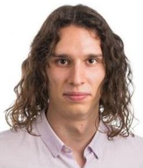

Bence Graics is a research assistant at the Budapest University of Technology and Economics (BME), Hungary under the supervision of Dr. István Majzik. He earned his MS degree in computer engineering at BME in 2019. He joined the Critical Systems Research Group (ftsrg)

during his undergraduate studies at BME and has been the main developer of the open source Gamma Statechart Composition Framework since the start of the project in 2016. His main research interest lies in the model-based design and verification of reactive systems using formal methods. As a visiting researcher, he spent several months at the National Institute for Space Research of Brazil (INPE) in the context of the H2020 ADVANCE EU project. He presented his work at conferences, such as ICSE, MODELS, and DepCoS, and in the Software and Systems Modeling (SoSyM) journal.

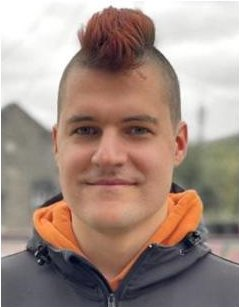

Ákos Hajdu is currently a software engineer at Meta. Akos earned his PhD degree in 2020 at the Critical Systems Research Group (ftsrg) of the Budapest University of Technology and Economics (Budapest, Hungary), where he also worked as an assistant lecturer at the time of conducting the research presented in this paper.

His main topics of interest are programming languages, static analysis, verification, formal methods and logic. Formerly, Akos interned at CERN and SRI International, and visited McGill University and the University of Coimbra. He co-started the open source Theta Verification Framework and solc-verify, and he is a contributor to the Infer static analysis platform. Akos has 25+ publications at various journals and conferences, including the Journal of Automated Reasoning, FMCAD and ESOP. Recently, he received the best industry paper award at ICST. Akos also serves regularly as a program committee member at conferences, including CAV, PLDI and VMCAI.

Dr István Ráth is the CEO of the IncQuery Group, makers of the IQS, the leading platform for digital thread analytics. He has a PhD in Software Engineering; his main professional interest is building the next generation of digital engineering tools. He is experienced in international business as well as engineering R&D, in industries such as aerospace and defense, automotive, biomedical and industrial automation. He has coauthored more than 90 peer-reviewed papers and won multiple ACM/IEEE Best Paper Awards, as well as a Deloitte Rising Star for accelerated growth.

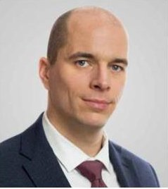

Dr Akos Horvath is the CTO of IncQuery Labs. He holds a PhD in Software Engineering and has a strong background in the application of model-driven technologies for the realization of next generation digital engineering toolchains. Since 2006, he has been involved in several EU

research projects; and participated in several large-scale industrial co-operations with several Fortune 500 companies including Airbus, Ericsson, Honda and many more. He has co-authored more than 60 peer-reviewed papers and won several IEEE/Springer Best Paper awards including the prestigious Most Influential Paper Award at the ACM/IEEE 23rd International Conference on Model Driven Engineering Languages & Systems (MODELS) in 2020.

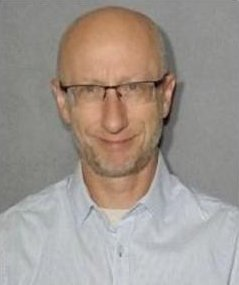

Robert Karban is a Principal Systems Engineer, the Technical Group Lead of the Software and Systems Solutions Engineering group, and the lead for the ComputerAided Engineering Systems Environment at NASA/JPL. His team provides a digital engineering ecosystem for systems engineering and analysis activities to the 4000+ engineers at the laboratory. Robert is internationally recognized as an industry leader in MBSE and MBE using his leadership role in the Open-MBEE community and as NASA representative at the OMG for SysML to align the different model-based aspects. Prior to that, he developed control and instrumentation systems and software for very large telescopes at the European Southern Observatory, pioneering MBSE for large systems applying model-driven technology, and for particle accelerators at the European Organization for Nuclear Research. Robert is an active member of INCOSE where he received a working group award in the field of MBSE. He published 25+ papers at different conferences and has given keynotes at major event. He received his MSc in computer science from the Technical University in Vienna, Austria.

<!-- PDF_PAGE: 22 -->

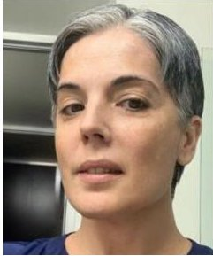

Dr Gelys Trancho is the Project Systems Engineer at the Thirty Meter Telescope International Observatory (TIO). She received her PhD degree in Astrophysics from University La Laguna, Tenerife, Spain. Prior to working at TIO, she was the Senior System Engineer at GMTO

and Gemini Observatory. Her systems engineer research interest includes Systems Engineering Methods/Process and model-based Systems Engineering applied to ground based telescopes. Her science research interests are in extragalactic clusters in merging galaxies. She published 50+ papers in both fields (astrophysics and systems engineering).

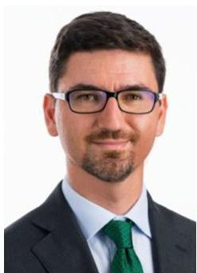

Zoltán Micskei is an associate professor at the Budapest University of Technology and Economics (BME), Hungary, leading the Critical Systems Research Group (ftsrg). He received his MS and PhD degrees in software engineering from BME. His research interests include software testing and model-based engineering, focusing on empirical studies. He served as the general co-chair for DISC'19 and as a PC member for various international conferences. He is a Senior Member of ACM and a member of the Hungarian Young Academy. He received the Kalmár Award from NJSZT in 2021. A publication he co-authored won the Most Influential Regular Paper award for the Journal on Software and Systems Modeling in 2021.