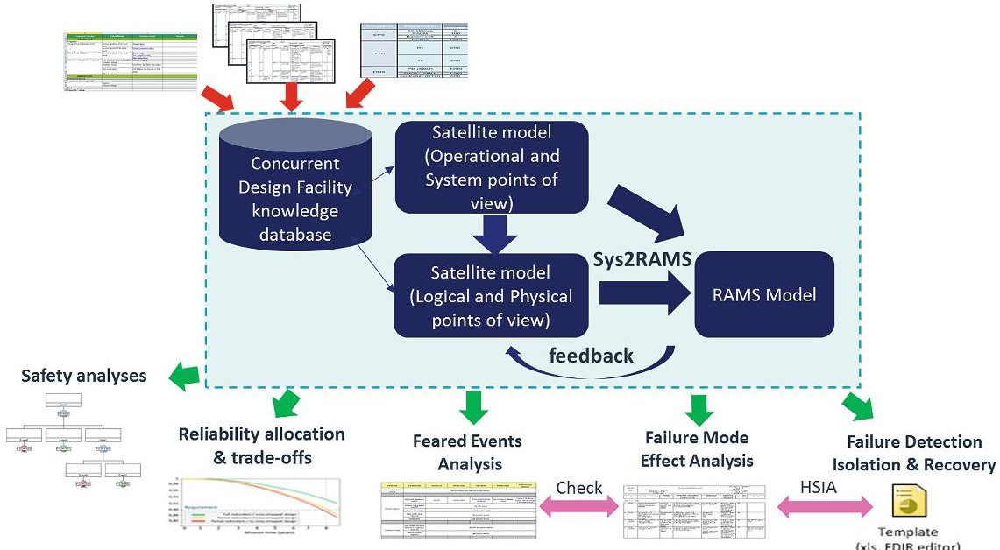
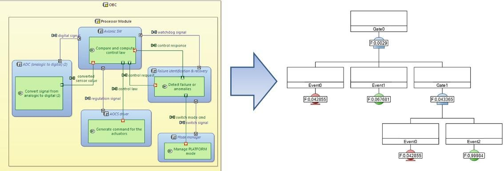
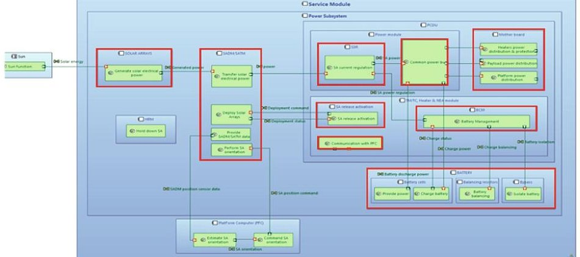
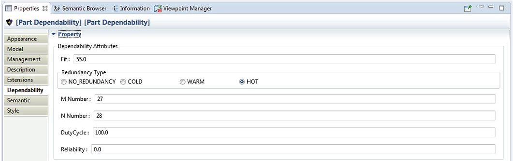
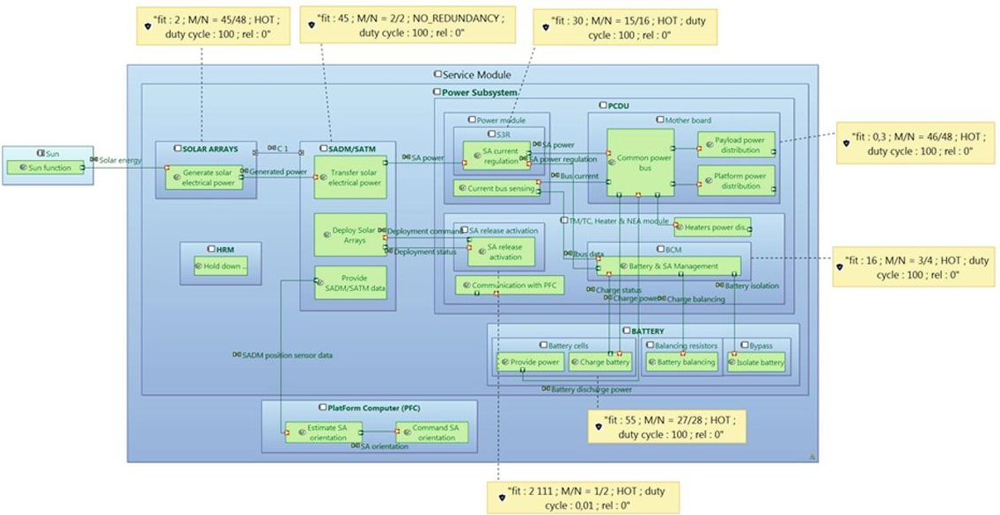
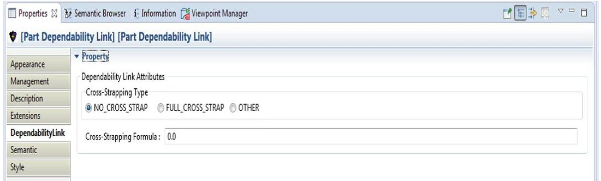
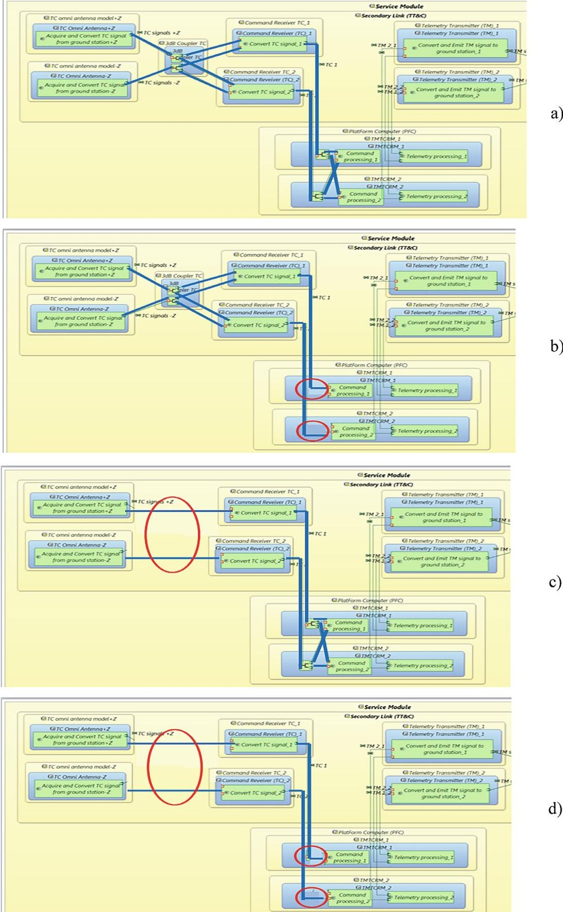
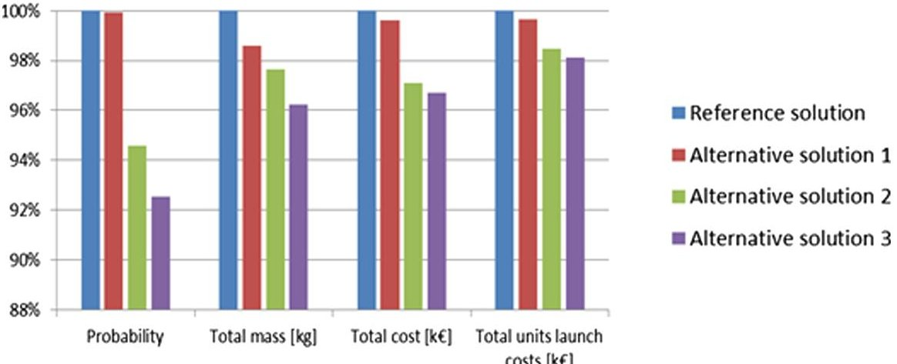

<!-- PDF_PAGE: 1 -->

# Model Based Approach for RAMS Analyses in the Space Domain with Capella Open-Source Tool

Lorenzo Bitetti $ ^{1} $ ( $ \times $ ) , Régis De Ferluc $ ^{1} $ , David Mailland $ ^{1} $ Guy Gregoris $ ^{1} $ , and Fulvio Capogna $ ^{2} $

$ ^{1} $ Thales Alenia Space, Cannes, France lorenzo.bitetti@thalesaleniaspace.com $ ^{2} $ European Space Agency, Noordwijk, The Netherlands

Abstract. The objective of this paper is to evaluate the interest and applicability of a Model Based approach to support Dependability engineers in performing RAMS (Reliability, Availability, Maintainability and Safety) analyses.

In order to address the future challenges of the Space domain and to improve the co-engineering activities during the whole spacecraft design process, the open-source Capella tool, based on the Arcadia methodology, has been recently envisaged and evaluated in Thales Alenia Space.

Capella can already support Model Based System Engineering (MBSE) activities: from requirement specification to physical architecture definition, through functional and logical analyses. The MBSE approach has already demonstrated its benefits for System Engineering activities since it enhance the ability to capture, to analyze, to share, and to manage the information associated with the complete specification of a product.

Some features are currently being implemented in Capella in order to support also dependability activities. The Model Based RAMS approach with Capella is expected to improve the co-engineering activities between system engineers, equipment experts and dependability responsible. This will in turn improve the current Quality Assurance process, which is indispensable for the futures space missions.

The preliminary applications of the Model Based approach for RAMS analyses have shown some possible limitations and axes of improvements that will be addressed by future studies.

Keywords: Model based RAMS approach·Capella open-source tool· Arcadia methodology·Reliability and safety analyses

## 1 Introduction

## 1.1 Dependability Process in the Space Domain

The space domain is characterized by some specific needs and constraints which make the dependability process quite different compared to that of other engineering fields. Note that this paper is mainly focused on the satellite industry even if some aspects can be applicable also to launchers or crew missions.

<!-- PDF_PAGE: 2 -->

The satellite industry is characterized by:

- No or very limited production in series, except for the expected new megaconstellations. In addition each satellite is quite unique, requiring therefore quite long development phases;

- No maintenance or repairing operations once the satellite is in orbit, even if on-orbit servicing missions are currently being studied and the corresponding technologies will be available in the future;

- High reliability and availability requirements, often specified for an extended period of time (e.g. 15 years of continuous operation for geostationary satellites);

- Very aggressive external environment and operating conditions (e.g. launch efforts, space radiations, extreme temperatures and thermal cycles, etc.);

- High autonomy of the satellite, especially in case of missions with limited ground visibility, and therefore nominal and failure scenarios have to be managed by the satellite itself, at the maximum extend.

- In order to tackle all these needs and particularities of the space domain, several activities are performed during a typical dependability process [4-8]:

- Feared Events Analysis (FEA) is performed at the beginning of the project, it is a functional top-down analysis whose main objective is to identify the feared events leading either to interrupt the mission or even to lose the spacecraft. The main outcomes are the recommendations on how to recover and ideally to avoid these feared events;

- Failure Mode and Effect Analysis (FMEA) is a bottom-up analysis which is performed as soon as the design of the satellite is known. The results of the FMEA are used to improve the design and for the implementation of corrective actions or operational procedures to be executed, on-board or on ground, in case of failures;

- Fault Tree Analysis (FTA) is performed in order to ensure that the design conforms to the failure tolerance requirements even in case of multiple failures. This analysis is performed for some specific applications, like those linked to safety requirements or the investigation of in-orbit anomalies;

- Failure Detection, Isolation and Recovery (FDIR) analysis. Fault management strategies and mechanisms are chosen in order to ensure that availability, autonomy and failure avoidance or recovery requirements are fulfilled;

- Reliability and Availability analyses which are performed to demonstrate the compliance with the contractual requirements. Starting from this high level specification, reliability figures are allocated to the different systems. Then specific redundancy schemes are chosen for each equipment in order to guarantee an overall good reliability and availability of the system. Reliability Block Diagrams (RBD) and other models (e.g. Petri Nets, Markov chains, etc.) are usually used for these purposes.

There are some limits in the dependability approach currently followed in the space domain that could be ideally solved, or at least partially, with new and innovative approaches. Recent studies conducted by Thales Alenia Space have pointed out that:

<!-- PDF_PAGE: 3 -->

- Graceful degradations are not, or not always, taken into account during the requirements specification and design phases. Redundancy schemes and fault management strategies are therefore chosen in order to guarantee a full success of the mission also in worst case scenario. This means that alternative and simpler architectures may probably exist in which the satellite is no longer fully redundant and cross-strapped;

- The allocation at lower levels (subsystem and equipment) of the satellite reliability and availability requirements is sometimes more linked to previously known or expected designs rather than to a real need at mission level. This can lead to a design where some functional chains may have a reliability higher or lower than the one really needed to guarantee performance and success of the mission. In addition, for some subsystems it may be more or less complex and costly to achieve a certain reliability figure. Therefore, the whole mass and cost of the satellite could be optimized by taking into account also this aspect during the allocation phase;

- Existing RAMS tools are sometimes not designed or at least not optimized for the first phases of the satellite development where multidisciplinary activities are performed iteratively in order to compare different designs and to choose the best solution. In fact these tools are not always linked, or at least not directly, to the ones used by system engineers. Therefore reliability aspects are taken into account later, and sometime too late, or the coherence between these models is not always guaranteed, especially when the hypotheses and designs change very frequently;

- Fault management process usually starts late in the development process since not enough information are available at the beginning. This could therefore lead to major design modifications and late changes that are usually costly and with a great impact on the planning;

- Main inputs for the dependability process are the analyses performed at lower level and the documents describing the whole functions and architectures. However these documents are not necessarily complete or not all detailed diagrams are available. The missing information are therefore to be found in specific documents, if available at the time of the analysis are done. The gathering of all the up-to-date information can become a time-consuming activity, especially in case of several reissues of the documents or design modifications. Therefore the coherence with the current design and the correctness of the dependability analyses could be sometimes difficult to guarantee and especially to verify by a third party;

- Finally some analyses, like Fault Tree Analyses, are performed manually, which represents a high workload for the dependability responsible.

In order to address the future challenges of the space domain and to improve the coengineering activities during the whole satellite lifetime, a Model Based approach has been considered as a good potential candidate to solve some of the aforementioned issues, or at least partially. The main goals and functionalities are described in the rest of this paper.

<!-- PDF_PAGE: 4 -->

## 2 Model Based Approach with Capella Open-Source Tool

## 2.1 Arcadia Methodology and Capella Tool

Model Based System Engineering (MBSE) approaches have already been applied in different engineering domains and have demonstrated their interest and benefits. In fact, by enhancing the ability to capture, to analyze, to share and to manage the information associated with a whole product or system, MBSE approaches lead to:

- Improved communications among the different stakeholders (e.g. customer, managers, systems engineers, hardware and software developers, testers, and engineers of special disciplines);

- Increased ability to manage system complexity by enabling a system model to be viewed from multiple perspectives, and to analyze the impact of changes;

- Improved product quality by providing an unambiguous and precise model of the system that can be evaluated for consistency, correctness, and completeness;

- Enhanced knowledge capture and reuse of the information by capturing information in more standardized ways and leveraging built in abstraction mechanisms inherent in model driven approaches.

The open source Capella tool [1], based on the Arcadia methodology [2], has been used in the frame of on-going projects conducted by Thales Alenia Space.

Capella supports system engineering activities from requirements specification to the definition of the physical architecture, through the functional and logical analyses. In fact, different engineering steps and the corresponding models and concepts are defined in Arcadia to cover all these aspects:

- Operational Analysis: focused on the analysis of the user needs and goals,the expected mission phases and the operational scenarios of the system. It ensures the good adequacy of the system definition with regards to its real operational use;

- System Analysis: this level is used to model the system, viewed like a black box, by identifying its boundaries and external actors, and to clarify what the system is expected to do in the different phases of its whole mission to satisfy the former operational needs. At this stage the system actors, mission capabilities, functions and functional exchanges are defined;

- Logical Analysis: used to develop the logical architecture of the system and to identify the components and their interactions, but excluding the physical implementation or technical issues. The system is seen here as a white box by defining how it will work as to fulfill its expectations and by refining the previous system functions. In addition, the allocation of functions to components and the trade-offs between alternative architectures can be realized at this stage, before a specific physical architecture is defined in the next step;

- Physical Analysis: this final step of the Arcadia method aims at identifying the system physical components, their contents and relationships including the implementation or technical and technological aspects. It describes how the system will be developed and built, and makes the logical architecture evolve according to the final design.

<!-- PDF_PAGE: 5 -->

## 2.2 Model Based Approach for RAMS Analyses

Several studies have been recently performed by Thales Alenia Space in order to evaluate the interest and applicability of a Model Based approach to support RAMS engineers in performing safety and reliability analyses and in producing the corresponding models and artifacts.

Some Capella viewpoints and interfaces with external tools, which were already available or that have been specifically developed by Thales Alenia Space, have been used for this purpose. The initial focus has been paid mainly on safety and reliability analyses for which some activities and studies have been performed, as presented below.

However it should be noted that in addition to these analyses, a more generic and global Model Based approach with Capella has been envisaged by Thales Alenia Space. As depicted in Fig.1, the main dependability activities that are required to comply with the satellite Reliability, Availability, Maintainability and Safety (RAMS) requirements could be performed with or at least supported by this open-source tool.

Fig. 1. Envisaged Model Based RAMS approach with Capella open-source tool

It should be noticed that this Model Based RAMS approach has not been fully implemented (yet) in Capella and that additional studies will be conducted in the future in order to develop all these features, to implement all the required interface with external RAMS tools and to provide at the same time some guidelines on the modeling strategy in Capella.

Safety Analyses. Several studies are currently performed at system, segment and equipment level in the frame of an internship and in collaboration with other Thales entities and external companies. Several existing tools allowing to perform safety analyses are evaluated in order to evaluate the interest of these tools and to derive some

<!-- PDF_PAGE: 6 -->

recommendations and suggestions leading to an improved and common MBSA approach.

While using MBSE tools for Safety applications it has been clearly demonstrated that, at least at that time, it was not possible to generate directly FTA, FMECA or other RAMS Analyses for the complex systems encountered in the space domain (e.g. navigation systems). MBSA tools based on AltaRica language [9] have also been tested. It was possible to perform fault tree analyses but some limitations have been found:

- It is not possible to make a model of a cold redundancy without introducing "fake" components in the fault tree. Contrary to other engineering domain, aeronautics for instance, cold redundancies are widely used in Space domain therefore this is an important aspect that has to be further addressed.

- A huge amount to time is spent by MBSA user to make his fault tree look like the expected one and this less time is left for the understanding of the system itself.

- It was not possible with old AltaRica versions to make a model of monitoring (it leads to a loop), being this latter an important feature of all Safety of Life system. This has been corrected recently in Alta Rica 3.0 but not tested yet in Thales Alenia Space.

Future studies will further address these points, eventually allowing MBSE and/or MBSA tools performing risk analysis of complex systems and supporting the (semi) automatic generation of FTA and FMEA (Fig. 2).

Fig. 2. Envisaged generation of fault trees starting from the model implemented in Capella.

Reliability Analyses. The already existing add-ons and viewpoints of Capella were not directly or not completely useful for reliability analyses. This is why a new viewpoint specifically dedicated to the reliability allocation and assessment has been implemented in Capella by Thales Alenia Space. The main aim is to compute the reliability figures of a functional chain or of a given system starting from the Capella model realized by system engineers. The main features and outputs of this viewpoint are described more in detail in the following section.

<!-- PDF_PAGE: 7 -->

## 3 Examples of RAMS Analyses Performed with Capella

This section is mainly focused on the initial proof-of-concept of the Reliability viewpoint developed in Capella which represents a real innovation in the Model Based approach in the space domain. Here the steps to be followed to assess the reliability of a given system are described through the presentation of a practical example.

- The first step is to evaluate the completeness and validity of the Capella model versus the reliability model in order to derive the inputs, outputs and especially the level of details needed to have a direct link between them.

As an example, by comparing the Reliability model (a) and the Capella (b) one of the Electrical Power Subsystem (EPS) it has been derived that, as shown by the red blocks in Fig. 3, all the different items modeled in Capella are those needed in the Reliability model, and also with a similar level of details. This means that, in this particular case, there is no need to further refine the Capella model because of the reliability assessment purpose. On the other hand, in some cases the Capella model may have to be improved or even simplified.

A study that will be started in the next months will aim, among other goals, to define a modeling strategy and to provide some instructions and conditions to be respected for a successful utilization of the Reliability Viewpoint.

<table border="1"><tr><td rowspan="2">S/System</td><td rowspan="2">Equipment</td><td colspan="6">Mission redundancy</td><td rowspan="2">Reliability</td></tr><tr><td>%</td><td>FIT on</td><td>FIT off</td><td>FIT eq</td><td>m</td><td>n</td></tr><tr><td rowspan="11">EPS</td><td>Solar Array</td><td>100</td><td>2</td><td>0</td><td>2</td><td>45</td><td>48</td><td>A</td><td>1,0000</td></tr><tr><td>SADM/SATM</td><td>100</td><td>45</td><td>5</td><td>45</td><td>2</td><td>2</td><td>A</td><td>0,9945</td></tr><tr><td>Battery cell</td><td>100</td><td>55</td><td>6</td><td>55</td><td>27</td><td>28</td><td>A</td><td>0,9959</td></tr><tr><td>PCDU S3R</td><td>100</td><td>30</td><td>3</td><td>30</td><td>15</td><td>16</td><td>A</td><td>0,9996</td></tr><tr><td>PCDU BCM</td><td>100</td><td>16</td><td>2</td><td>16</td><td>3</td><td>4</td><td>A</td><td>1,0000</td></tr><tr><td>PCDU Battery switch</td><td>100</td><td>18</td><td>2</td><td>18</td><td>6</td><td>8</td><td>A</td><td>1,0000</td></tr><tr><td>PCDU SA release</td><td>0</td><td>2111</td><td>211</td><td>211</td><td>1</td><td>2</td><td>A</td><td>1,0000</td></tr><tr><td>PCDU Main bus</td><td>100</td><td>0.3</td><td>0</td><td>0</td><td>46</td><td>48</td><td>A</td><td>1,0000</td></tr><tr><td>PCDU TM/TC</td><td>100</td><td>140</td><td>14</td><td>140</td><td>1</td><td>2</td><td>A</td><td>0,9999</td></tr><tr><td>PCDU TM/TC I/F</td><td>100</td><td>7</td><td>1</td><td>7</td><td>1</td><td>2</td><td>A</td><td>1,0000</td></tr><tr><td>PCDU Heater distr.</td><td>100</td><td>626</td><td>63</td><td>626</td><td>1</td><td>2</td><td>P</td><td>0,9992</td></tr><tr><td></td><td>PCDU TLM lbat/lbus/lsa</td><td>100</td><td>15</td><td>1</td><td>15</td><td>1</td><td>2</td><td>P</td><td>1,0000</td></tr></table>

a)

b)

Fig. 3. Comparison of the Reliability model (a) and the Capella one (b) for the EPS subsystem (Color figure online)

<!-- PDF_PAGE: 8 -->

- Then some additional information have to be filled by dependability engineers in the Capella model in order to be able to compute the reliability figures:

- The duty cycle (d.c.): the ratio of functioning time over the total time for the identified element;

- The intrinsic failure rates of the units at full duty cycle (FIT ON), expressed in failure per $ 1 0^{9} $ h;

- The intrinsic failure rates of the units when not operating (FIT OFF).

- The quantity of units that are necessary to achieve a particular function (m);

- The quantity of units that are available (n);

- The redundancy type: cold, hot, warm or no redundancy;

- Finally the user can also directly provide the reliability figure of one unit. This has been done especially for the mechanical items for which the reliability is assessed with the stress-strength method. In this case the probability is time independent and the failure rates are not defined (Fig. 5).

These values are those already presented in the Excel reliability model (see Fig. 3a) but with the proposed Model Based approach they are added directly into the Capella model. The user interface allowing to do that is depicted in Fig. 4.

Fig. 4. User interface allowing to enter the reliability information

Fig. 5. Capella model with reliability inputs (Failure rates and redundancies schemes)

<!-- PDF_PAGE: 9 -->

In the reliability viewpoint, as shown in Fig. 6, the user can also chose the classical relationship between two units (e.g. HW in series, fully cross-strapped, etc.) or define any particular link with more complex formulae (e.g. Bayesian expression for not fully cross-strapped items).

Fig. 6. User interface allowing to define the relationship between two hardware components

- Once all these reliability information are defined in Capella, the output of the reliability viewpoint is a table, like the one shown in Fig. 7, which can be easily imported in Excel where the reliability figures can be then computed.

Note that for this initial proof-of-concept it has been preferred to keep the two software separated instead of implementing the reliability formulae directly into Capella. This has been done for the purpose of compatibility with current analyses but also because it could be interesting in the future to have interfaces also with other external tools specifically focused on RAMS activities. Finally this has been done also to guarantee the coherence and quality of RAMS analyses, that could be performed also by non RAMS experts if everything is implemented directly in Capella, thus losing all the aforementioned benefits of a Model Based approach.

However this choice could be challenged and revised in the future, if needed, thus having the possibility of computing the reliability figures directly in Capella.

<table border="1"><tr><td></td><td>Fit</td><td>M Number</td><td>N Number</td><td>Redundancy Type</td><td>Duty Cycle</td><td>Reliability</td></tr><tr><td>Power Distribution</td><td>88.0</td><td>1</td><td>2</td><td>HOT</td><td>100.0</td><td>0.0</td></tr><tr><td>Battery cells</td><td>55.0</td><td>27</td><td>28</td><td>HOT</td><td>100.0</td><td>0.0</td></tr><tr><td>SADM/SATM</td><td>45.0</td><td>2</td><td>2</td><td>NO_REUNDANCY</td><td>100.0</td><td>0.0</td></tr><tr><td>S3R</td><td>30.0</td><td>15</td><td>16</td><td>HOT</td><td>100.0</td><td>0.0</td></tr><tr><td>SA release activation</td><td>2111.0</td><td>1</td><td>2</td><td>HOT</td><td>0.01</td><td>0.0</td></tr><tr><td>SOLAR ARRAYS</td><td>2.0</td><td>45</td><td>48</td><td>HOT</td><td>100.0</td><td>0.0</td></tr><tr><td>BCM</td><td>16.0</td><td>3</td><td>4</td><td>HOT</td><td>100.0</td><td>0.0</td></tr></table>

Fig. 7. Output of the Capella viewpoint and input of the Excel reliability model

<!-- PDF_PAGE: 10 -->

b)

Fig. 8. Example of different TT&C architectures modeled in Capella

<!-- PDF_PAGE: 11 -->

Fig. 9. Evaluation and comparison of alternative TT&C architectures

- Once the reliability figures can be directly assessed starting from a Capella model of the system, several interesting analyses can be realized. In fact, multi-disciplinary trade-offs can be performed by using the Architecture Evaluation feature and other viewpoints that are already available in Capella (e.g. Mass and Cost Viewpoints [3]). The main purpose of these viewpoints is to support system engineering trade-offs and decision making about the architecture in order to address stakeholders concerns and meet architecture expectations.

- As an example, Fig. 8 shows the trade-offs realized for the Telemetry, Tracking & Command (TT&C) subsystem and in particular for the Ground to satellite TeleCommand link. Some architectures alternative to the current one (case a) have been envisaged for this particular functional chain:

- case (b) same as the current design but cross-strappings between TC receivers and the TM/TC/Reconfiguration Module blocs of the PlatForm Computer (PFC) have been removed;

- case (c) same as the current design but cross-strappings between TC omni antennas and TC receivers have been removed;

- case (d) merge of the two previous solutions where all cross-strappings between TC omni antennas, TC receivers and PFC TMTCRM modules have been removed.

For each of the items of these architectures, the mass, cost and reliability data can be defined in Capella and then the overall results obtained and compared, as shown in Fig. 9. In this particular example, the solution (c) and (d) would have been probably preferred if the attention was paid only to the mass and cost reductions. In fact, they lead to higher gains compared to alternative solution (b). However one can easily derive that these two solutions are not acceptable from a reliability point of view and should be excluded from the trade-off.

This simple example shows thus the importance and benefits from computing the reliability figures at the same time of the system engineering parameters.

<!-- PDF_PAGE: 12 -->

## 4 Conclusion and Perspectives

The Model Based approach, by enhancing the ability to capture, to analyze, to share, and to manage the information associated with the complete specification of a product, has already demonstrated its benefits for System Engineering activities.

Several studies have been performed in recent years by Thales Alenia Space in order to evaluate the interest and applicability of a Model Based approach to support RAMS engineers in performing safety and reliability analyses and in producing the corresponding models and artifacts. The Capella open-source tool, based on the Arcadia methodology, has been used for this purpose.

Some Capella viewpoints and interfaces with external tools, which were already available or that have been specifically developed by Thales Alenia Space, have been used. The initial focus has been paid mainly on safety and reliability analyses for which some activities and studies have been performed.

The main outcomes and conclusions of these studies are that the Model Based RAMS approach is seen as a promising solution that could improve and solve some of the limitations identified for the current Quality Assurance process.

In fact, compared to the current and classic approach where RAMS analyses are "based on documents", several benefits are possible when the same tool is used and the same models are shared between all the stakeholders involved in the satellite development process:

- All information needed for the different activities, including RAMS ones, could be more easily captured and better structured and visualized;

- The coherence and validity of the different analyses can be guaranteed even during those phases when hypotheses and designs change frequently;

- Multi-disciplinary activities, including dependability aspects, can be performed since the early phases of the development process thus allowing to choose the best satellite architecture from both system engineering and dependability points of view at the same time;

- One can benefit of the computing power of the tools in order to generate complex analyses such as Fault Tree Analyses, to automatically check some design rules impacting the safety: such as the fault tolerance or to verify that no single failure could lead to catastrophic failure conditions;

- Some analyses and the corresponding artifacts can be automatically generated, or at least initialized, by the tool itself thus reducing the workload of the RAMS responsible who could be thus focused on those activities with a higher added value.

- On the other hand, these preliminary evaluations have highlighted some classical open points and limitations of the Model Based approach:

- RAMS analyses often require dedicated and specific models which may differ from the ones implemented and used by system engineers. This is mainly due to their different points of view (functional versus dysfunctional behavior of the system, respectively) and because of the required granularity of the model: more or less detailed depending on the specific applications and goals;

<!-- PDF_PAGE: 13 -->

- A good knowledge of the tools and good capabilities and experience in modeling are necessary to be able to fully take advantage of the aforementioned benefits of the Model Based approach and thus improving the efficiency and efficacy of the dependability process followed in the space domain;

- Sometimes the traditional functional approach and the currently used tools could be more powerful and efficient compared to a Model Based approach if the model of the system to be evaluated is too complex, meaning that is it composed of a very high number of elements and interactions between them;

- There is sometimes a tendency/psychological bias to develop the models in order to obtain the desired results, e.g. to demonstrate the validity and utility of a particular Model Based tool, without being too realistic and showing the existing limits of the approach;

- People (wrongly) think that, once all the single failures of the system are modeled in the tool, this latter could "magically" determine also all the propagation of these failures and/or the impact of multiple failures. In fact, the tools cannot add additional failure modes by themselves, there is no Artificial Intelligence or other features (for the time being) that could replace the analysis of RAMS engineers. Therefore we can only have, as an output of the tool, what has been modeled in it.

- Finally the models and the outputs (e.g. the fault trees generated by MBSA tools) could be sometimes not really "readable", they must be re-arranged and/or simplified in order to be understood and thus fully exploited.

For each of the aforementioned points, some dedicated activities and solutions have already been identified by Thales Alenia Space and are proposed for future studies (e.g. definition of guidelines and instructions on how to model the system, development of interface with commonly used RAMS tools, implementation of libraries and databases of failure rates and failure modes, identification of specific cases where the Model Based approach is more efficient than traditional one, etc.).

To conclude, the Model Based approach is thought to be a promising solution that can improve the co-engineering activities between system and RAMS engineers and thus the current Quality Assurance process followed in the space domain.

However current applications of the Model Based approach for RAMS analyses have shown also some possible limitations and improvements that need to be addressed by future studies.

Thales Alenia Space will evaluate further the Model Based approach in order to conclude on its interest and real benefits and then to use operationally these tools to improve the efficacy and efficiency of RAMS analyses.

## References

1. Capella: Model based system engineering (MBSE) tool. https://www.polarsys.org/capella/index.html

2. Arcadia: Model based system engineering (MBSE) method. https://www.polarsys.org/capella/ arcadia.html

<!-- PDF_PAGE: 14 -->

3. Capella mass/cost/performance viewpoints. https://wiki.polarsys.org/Capella/Viewpoints/ BasicViewpoints

4. ECSS-Q-ST-30C: Space product assurance - dependability

5. ECSS-Q-ST-30-02C: Space product assurance - failure modes, effect (and criticality) analysis

6. ECSS-Q-ST-30-09C: Space product assurance - availability analysis

7. ECSS-Q-ST-40C: Space product assurance - safety

8. ECSS-Q-ST-40-12C: Space product assurance - fault tree analysis

9. OpenAltaRica. https://www.openaltarica.fr/