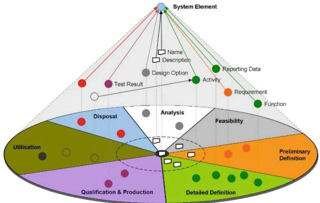
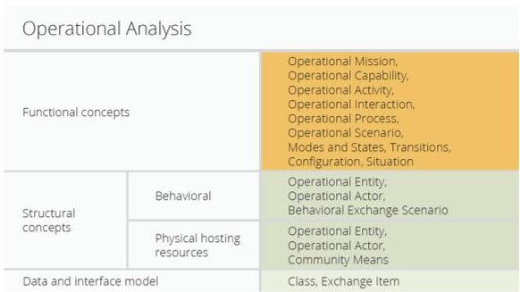
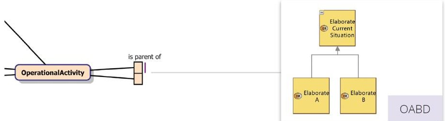
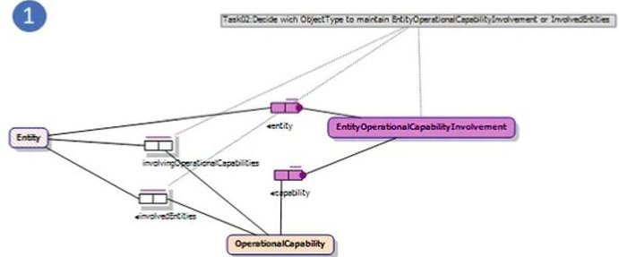
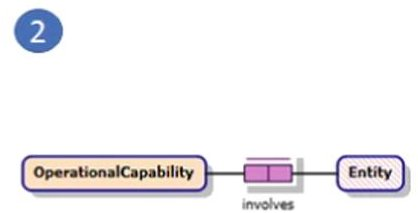
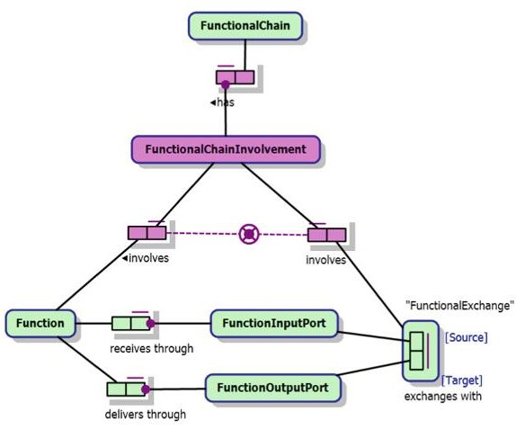

<!-- PDF_PAGE: 1 -->

# Creating a Space System Ontology Using "Fact Based Modeling" and "Model Driven Development" Principles

Kaiton Buitendijk $ ^{\left( \boxtimes \right)} $ and Carla Arauco Flores

GorillaIT, Arnhem, The Netherlands kaiton.buitendijk@gorillait.nl http://www.gorillait.nl

Abstract. In this practical paper we describe our ongoing project of building a candidate skeleton for the new Space System Ontology that is to be used by the space system community; starting from the vision: being able to achieve semantic interoperability instead of focusing on technical interoperability), through our approach: Fact Based Modeling (FBM) and Model Driven Development (MDD) and finally ending with the results: an Object Role Model containing the semantic model of the Space System Ontology. This project is based on the already existing meta-model of Arcadia, a field proven method for model based system engineering. By reverse engineering the UML-based meta-model of a tool supporting the method, we were able to remove the technical HOW's and restore the true conceptual meaning of the meta-model. We will describe the algorithms we used for automatically reverse engineering UML-based meta-models to ORM-models, we will talk about the value of connecting the conceptual model to real-life examples by visualizing, and introduce the process of automatically generating editors in order to verify completeness and correctness by populating the model. We will conclude with general findings while reverse engineering UML-based models and some tips on how to solve typical modeling problems that arises when transforming object oriented artifacts to their semantic equivalents.

Keywords: Ontology·Semantic interoperability·Fact-oriented modeling·ORM·ESA·ECSS·Global conceptual model·Model Driven Development·Model driven architecure·Code generation· Reverse engineering·ECORE·Eclipse

## 1 Introduction

Developing space systems implies complex activities involving many parties. It requires efficient and effective information exchange during the overall space development and operations life-cycle. According to the European Space Agency (ESA), this can only be achieved by realizing semantic interoperability between all involved parties [1]. ESA stands not alone on this; the space system community is moving towards the definition of a Space System Ontology (SSO) that

<!-- PDF_PAGE: 2 -->

has the potential to embrace the complete life-cycle of a space system, supporting this interoperability [2]. ESA is currently assessing the possibility to reverse engineer the widely used system engineering methodology Arcadia $ ^{1} $ , supported by the tool Capella $ ^{2} $ , to provide a conceptual skeleton for the SSO.

## 2 The Project - A Conceptual Skeleton for the SSO

GorillaIT has been asked by ESA to provide a conceptual skeleton for the Space System Ontology. In this paper we describe our project of building this conceptual skeleton. Both ESA and GorillaIT are big proponents of the Object Role Modeling method for semantic modeling. After years of applying many of the theoretical ideas presented by the Fact Based Modeling community in our daily work, we want to share how we applied those ideas during this project.

## 3 The Three Fundamental Pillars of This Project

## 3.1 The Need for Semantic Interoperability

ESA formulated a few fundamental starting points for this project. Firstly, the skeleton for the Space System Ontology should be a semantic conceptual model, focusing on the WHAT (instead of technical HOW). This vision to establish a formalization of the European Cooperation for Space Standardization (ECSS) vision focusing on semantics and semantic interoperability is described in ECSS-E-TM-10-23A [4] and graphically summarized in Fig.1 on page 2.).

Fig.1. ECSS-E-ST-10-23 looks at standardizing the information model ensuring the overall consistency of the model through all phases

<!-- PDF_PAGE: 3 -->

## 3.2 The Use of Object Role Modeling

Secondly, Object Role Modeling (ORM) [3], is chosen as the required method to develop a global conceptual data model. ORM is primarily a method for modeling an information system at the conceptual level. The focus of ORM is on data modeling, since the data perspective is the most stable and it provides a formal foundation on which operations can be defined. For correctness, clarity and adaptability, information systems are best specified first at the conceptual level, using concepts and language that people can readily understand. ESA requires that the tool NORMA is used for this project.

## 3.3 The Reuse of Knowledge, by Reverse Engineering Arcadia

Thirdly, instead of starting from scratch, the work should be based on a reverse engineered conceptual model from the already existing meta-model of Arcadia, a method for model based system engineering that has already been used by the space community for years. This way this project can solely concentrate on solving the semantics and ontology aspects, instead of also having to solve system based engineering difficulties and problems that already have been solved by the Arcadia-team in the past.

## 4 Introducing: Arcadia, Capella, Ecore and the Meta-model

## 4.1 Arcadia

Arcadia is a method devoted to systems & architecture engineering. It describes the detailed reasoning to understand the real customer need, define and share the product architecture among all engineering stakeholders and early validate its design and justify it. Five major steps structure the engineering activities, each one dealing with specific engineering issues, grouped by the needs and the solution. The steps describing the understanding part are "Operational analysis" and "System Need analysis". The steps describing the solution are "Logical analysis", "Physical analysis" and "End-Product Breakdown Structure".

## 4.2 Capella

Capella is the tool supporting the method Arcadia. It provides methodological guidance, intuitive model editing and viewing capabilities for Systems, Software and Hardware Architects. The tool itself is built using the Eclipse Modeling Framework (EMF). From a model specification, EMF provides tools and runtime support to produce a set of Java classes for the model, along with a set of adapter classes that enable viewing and command-based editing of the model, and basic editors $ ^{3} $ . The meta model of Capella is what ESA expects to be a robust foundation for the new Space System Ontology.

<!-- PDF_PAGE: 4 -->

## 4.3 Ecore and the Capella Meta-model

The meta model of the tool Capella is stored physically in an EMF-file. This core EMF includes a meta model (Ecore) for describing models and run-time support for the models including change notification, persistence support with default serialization and a very efficient reflective API for manipulating EMF Objects generically.

## 5 The General Approach

The approach for this project is to reuse the knowledge of the Arcadia method by fully and adequately reverse engineering the meta-model of Capella. In general, the steps of the approach are:

- Reuse the existing knowledge by studying the Arcadia method and using the physical meta-model from Capella to automatically convert Ecore to ORM

- Analyze the knowledge by mapping concepts of the meta-model to the theory and by analyzing the tool Capella and consult with Arcadia and Capella-experts

- Model the analyzed knowledge by remodelling non-semantic structures, adding semantics and adding missing constraints.

The project followed this approach and the resulting milestones will be discussed in the following paragraphs.

## 6 The Results so Far

## 6.1 Milestone Product 1: A ORM-model Automatically Converted from Ecore

To get a starting model there were two options:

1. start with an empty ORM-model and model fact by fact, object by object what we understood from the Capella-metamodel and manually copying sentences and information, thus filtering information before entering in the ORM-model.

2. or start with blindly automatically copying everything from Ecore to ORM, and cleaning the ORM-Model afterwards.

It was decided to go for the latter option, for the reason that: 1. a tool capable of importing Ecore already existed, 2. the project team was very proficient with ORM and NORMA, 3. the project team had very deep technical knowledge on how to read ORM-files and about the inner working of NORMA, 4. we had an idea how to automatically report progress using ORM and 5. ESA had a strong preference for that option.

The first milestone was an ORM-model that holds all the structure and information of the Arcadia meta-model, without worrying if the imported makes

<!-- PDF_PAGE: 5 -->

sense for including in a semantic model. This information is stored in multiple Ecore-files and these are used to generate Capella (using EMF). Since Arcadia is an open-source tool, these files are easily found and can be downloaded from the internet $ ^{4} $

Matt Curland, one of the main developers of NORMA, created a specialized plugin for NORMA that can import Ecore-files into an ORM-file. This tool has the following functionality:

- It converts Ecore-classes to ORM-objects.

- It converts Ecore-attributes to ORM-facts with correct mandatoriness and correct uniqueness constraints.

- It converts Ecore-relationships to ORM-facts with correct mandatoriness and correct uniqueness constraints.

- It converts all Ecore-properties to ORM-custom-attributes, so that all knowledge will be converted in the ORM-model.

- It converts Ecore typing hierarchies (supertype/subtype) into ORM equivalents.

Using this tool, the structure of Capella was imported into an ORM-model. After dragging elements to diagrams to visualize what was imported, it could immediately be recognized that it looked very different compared to manually made ORM models. Examples are cryptic sentences and object names, only binary fact-types, no objectified fact-types, no uniqueness constraints spanning multiple roles and enormous super-type/sub-type structures.

## 6.2 Milestone Product 2: Identifying Main Challenges of What Was Imported

The result of using the Ecore-importer was an ORM model with approximately 1200 facts. The first task was to identify the main challenges.

Challenge 1: Cryptic Imported Fact Names. While importing, the Ecore-importer uses an algorithm to name all facts and provide basic fact-sentences. Most of the time it concatenates class names together with attribute names, or in case of a reference, it concatenates a class name together with the reference name and with the referenced class name. The quality of the output is highly dependent of the naming by the original designers of the Ecore-metamodel. Names were not self-explanatory and because of this understanding the intended meaning of the meta-model was difficult.

Challenge 2: Huge Inheritance Structures. One challenge was the huge super-type/sub-typing structure. As an example, the class "Operational analysis" had an inheritance structure of 28 classes. This inheritance structure is common to most (close to 90%) classes we imported from Ecore. Many of the class names were not self-explanatory. Many sub classes also had common super types for unknown reasons, which made understanding the model very difficult.

<!-- PDF_PAGE: 6 -->

Challenge 3: Understanding the General Structure. Normally, when looking at a ORM-diagram, it is easy to guess the general structure of the model by recognizing main concepts and from there follow the structure to the more detailed facts. Looking at the imported model, no easy starting points could be found and therefore understanding the structure was difficult.

## 6.3 Milestone Product 3: Mapping the Meta-model to Capella-Theory

The Information Sources. Having identified the major challenges to tackle, the next task was to understand the model. The Arcadia method and the tool Capella are very detailed described in books and websites $ ^{5678} $ . Next to that a Capella expert was consulted.

Our Modeling Approach in NORMA. Our starting point for our ORM skeleton was an ORM-model with lots of elements imported, but without any diagrams. The following modeling approach was used in NORMA;

- understand the meaning of the elements before dragging ORM-elements into the diagram.

- create a ORM-diagram for the big overview. With only the main concepts and facts connecting those main entities.

- create an ORM-diagram per Arcadia-perspective.

- add semantics by improving sentences of the dragged facts.

- add or improve constraints, such as uniqueness and mandatory.

Finding the Starting Points. Starting from the theory, Arcadia is grouped in 5 different perspectives, each concerning a different phase of the life-cycle with system based engineering. These are: Operational Analysis, System Analysis, Logical Architecture, Physical Architecture and End-Product Breakdown Structure Architecture. Objects corresponding to these perspectives could be found in the ORM-model. Using these five different root entities as starting points, it was easier to untangle the meaning of the meta-model.

Grouping All Entities by the Corresponding Arcadia Perspectives. The next step was to group all the imported ORM-entities to their containing perspectives. The theory of Arcadia described the main concepts. Figure 2 on page 7 shows, as an example, the entities of the Operational Analysis-perspective. Those tables are also available for the other perspectives and can be freely found on the internet $ ^{9} $

$ ^{5} $ https://www.elsevier.com/books/model-based-system-and-architecture-engineering with-the-arcadia-method/voirin/978-1-78548-169-7.

$ ^{6} $ https://www.elsevier.com/books/systems-architecture-modeling-with-the-arcadiamethod/roques/978-1-78548-168-0.

$ ^{7} $ https://www.polarsys.org/capella/arcadia.html.

$ ^{8} $ https://www.polarsys.org/capella/index.html.

$ ^{9} $ https://www.polarsys.org/capella/resources/Datasheet_Arcadia.pdf.

<!-- PDF_PAGE: 7 -->

With this information the main entities and structure of the metamodel of Arcadia could be recognized, resulting in a ORM-diagram with a first version of the skeleton of our project.

Connecting the First Version of the Skeleton Visually to the Theory. We realized that to make an ontology successful, it has to be used and understood by the users. We already experienced the difficulties in connecting the Arcadia-theory

Fig.2. The main concepts of the perspective Operational Analysis as described in the theory of Arcadia.

to the meta-model, and even after getting familiar with the theory and metamodel, it was difficult to explain and share our knowledge with the stakeholders. For that reason a big-picture was created, visually connecting the Arcadia-theory with the ORM-model.

This picture consisted of five horizontal lanes, one per Arcadia perspective, starting at the top with "Operational Analysis" and ending at the bottom with "EPBS". These lanes were divided vertically in columns. The first column consisted of the graphical figure used on the Arcadia website to describe the five different perspectives $ ^{10} $ . The second and third column described the main Arcadia-concepts per perspective, again using graphical material found on the website of Arcadia. The last column contained the ORM-model.

By horizontally dividing all the columns people could easily recognize which Arcadia entities belong to which perspective and how they are called and relate to each other and how the were modelled in the ORM-model.

Using Posters to Improve Communication and Understanding. The big picture was printed out as a big poster. Hanging it on the wall it really invited all stakeholders to start discussing about it. The visual connection from the ORM-elements to the theory improved communication and understanding compared to just having the ORM-model on a computer-screen together with the Arcadia-books alongside. For that reason it was decided to create one poster per perspective. Each poster showed the meta-model of the perspective in ORM. Next to that, modeling examples in Capella were included, next to the corresponding facts in ORM. That way, it made understanding the meaning and use of every ORM-element easier.

In Fig.3, a small part of the poster of the perspective Operational Analysis is shown. It shows a small part of the meta-model; an "Operational Activity" can be a parent of an other "Operational Activity". Just reading the ORMmodel, it may be difficult to understand what the fact is trying to express,

<!-- PDF_PAGE: 8 -->

Fig. 3. An ORM-fact type expressing that an "Operational Activity" can be a parent of an other "Operational Activity"

but with a corresponding example of an Arcadia-model we see it is easier to understand. At the end we created all five posters, with all of the main facttypes in the ORM-model included, accompanied with a corresponding example of an Arcadia-model.

## 6.4 Milestone Product 3: A Clean ORM-Model

Having the big skeleton in place, we started with cleaning the ORM-model.

First sentences were added to the facts that were understood by mapping it to the Arcadia-theory. In case the imported names or the theory did not help us, the Capella-expert was consulted for the meaning of the facts and for suggestions for naming.

Secondly, the huge inheritance structures had to be solved. All the elements in the imported ORM-model inherit from a concept called Element. Sometimes a class inherited from numerous other classes, for which no reason could be found in the Arcadia theory. After consulting the Arcadia-expert it was concluded that many of those classes were introduced solely for technical reasons; without those classes, the Capella-tool could not be programmed (it uses those classes to draw, to facilitate programming or to group functionality) and therefore those technical classes were removed from the model.

Thirdly, there were imported structures that could be remodeled more elegantly in ORM. As an example, the Arcadia-theory indicates the fact that an "Operational Entity" involves an "Entity", what sounds as a simple fact that can easily expressed in ORM. The imported structure for that fact looked very different as shown in Fig. 4 on page 9.

After consulting with the Capella-experts, who suggested that the structure did not have any semantic meaning, it was decided to model it like Fig. 5 on page 9.

<!-- PDF_PAGE: 9 -->

Fig. 4. Simple according to the theory, but complicated in Ecore meta-model

Fig. 5. After consulting the experts, it was modeled in a much simpler way

Establishing Modeling Rules. While reverse engineering and remodeling it occurred often that certain structures found in the reverse engineered structure (in this case Ecore) could not be understood. The big pitfall was to spend hours on finding out and discussing about why the original designers structured it like that. To prevent that we used the following steps to make modeling decisions:

1. Use the reverse engineered structure as a base. In this case: Ecore reversed engineered with the Ecore-importer.

2. If we cannot understand the reason why it is structured like it is reversed engineered, we try to find this reason by understanding the theory (by reading books & literature, consulting experts).

3. If we cannot find the reason of the structure in theory we focus on understanding the reason by investigating the tool Capella.

4. If we cannot find the reason of the structure by investigating Tool or Theory, we just look at what is expressed semantically/functionally and we model the most simple way to express this in ORM.

## 6.5 Milestone Product 4: An Automatic Way to Report Progress Reverse Engineering Ecore to ORM

Having imported almost 1200 facts from Ecore to ORM, we had to come up with a way to report progress. The people that created the Ecore meta-model obviously thought a lot about the structure and therefore we wanted to be able to report what happened with every imported fact; keep it (with reference to ORM-element), remodel it (with reference to ORM-element) or delete it (with a reason why). To do that manually is prone to errors (and takes lots of time) and therefore a way to automate this process had to be created.

<!-- PDF_PAGE: 10 -->

For that purpose, a program, based on Acceleo $ ^{11} $ , was created that could generate Excel-reports, reporting all the entities, attributes and references. Essential for the approach was that every row, for tracking reasons, was automatically given a unique identifier. Next, an extended attribute was added, called "ExcelUniqueId" to our Norma-model. Extended attributes is a functionally provided by Norma. It gives the modeler the functionality of adding extra properties on ORM-elements (such as facts, objects and constraints). Every time the modeler modeled an element of the Ecore-model in ORM, this extended attribute was filled in, referring back to the original row in the Excel-report. Lastly, a program was created that could read our ORM-file, read the excel-report and for every row in excel find the corresponding ORM-element (by looking for the value of the extended attribute "ExcelUniqueId". In case the program could not find a corresponding ORM-element OR a reason for deletion (typed by the modeler in the excel-sheet) it reported for that element that it was still "to do". That way, it is possible to fully trace back what happened with all the information in the original Ecore-file and report the progress of the project (Fig. 6).

Big Reduction of Facts Reported. After modeling and being able to report we found an interesting outcome. As described earlier, a big part of the structure was modeled for technical reasons and did not have any semantic value or could be remodeled more elegantly. After deleting and remodeling, the number of facts reduced drastically. A reduction of almost 50%

<table class="table table-bordered"><thead><tr><th></th><th>A</th><th>B</th><th>C</th><th>D</th><th>E</th></tr></thead><tbody><tr><td>1</td><td colspan="5">No. of facts</td></tr><tr><td>2</td><td>Ecore-model</td><td>Modeled</td><td>Delete</td><td>Total</td><td>% Done</td></tr><tr><td>3</td><td>Capability</td><td>34</td><td>3</td><td>37</td><td>100</td></tr><tr><td>4</td><td>Deployment</td><td>7</td><td>0</td><td>7</td><td>100</td></tr><tr><td>5</td><td>Trace</td><td>18</td><td>0</td><td>18</td><td>100</td></tr><tr><td>6</td><td>Project management</td><td>25</td><td>1</td><td>26</td><td>100</td></tr><tr><td>7</td><td>requirement</td><td>17</td><td>5</td><td>22</td><td>100</td></tr></tbody></table>

Fig. 6. An example automatically-generated Excel-report by combining ORM-models with Excel-sheet.

## 6.6 Milestone Product 5: An ORM Model with Constraints Added

Ecore supports various ways to check models and prevent errors. Nevertheless, many rules on a typical meta model can not be enforced just by using Ecore-functionality. EMF therefore provides an architecture for attaching rules written Java-code to the Ecore-model. The programmers of the tool Capella used this functionality to write hundreds of constraints. We found out that a lot of the constraints that were programmed in Java could be expressed elegantly using normal ORM-constructs. As an example, the Capella programmers had to enforce a rule that a "Functional Chain Involvement" should either involve a Function or a Functional Exchange. The constraint is not possible to enforce using Ecore and therefore they created a Java-function consisting of tens of lines of code. In Fig. 7 on page 11 is shown how we added this constraint in the ORM-model.

<!-- PDF_PAGE: 11 -->

## 7 Conclusions

At the time of writing, this is still an ongoing project.

Summarizing our achievements until now:

- A first skeleton of the Space System Ontology, including all the perspectives of Arcadia.

- Using automatic converting, we are sure we included all information from the Capella meta-model Ecore-models.

- Using automatic reporting, we know that every element in the original meta-model has been covered by our modeling process.

- We found a way to visually connect the theory of the meta-model with the ORM-model by making posters.

- We found that with reversing Ecore, at least for this project, the amount of facts reduced with almost 50% without losing semantic value.

- We found out that many constraints that conventionally have to be programmed, can be elegantly modeled in ORM.

For each FunctionalChainInvolvement, exactly one of the following holds:

that FunctionalChainInvolvement involves some FunctionalExchange;

that FunctionalChainInvolvement involves some Function.

Fig.7. A constraint that had to be programmed in tens of lines of Java code originally, but could be easily modeled using ORM.

## 8 The Road Ahead

## 8.1 Validation by Examples

Right now we are in the phase of validating the meta-model for correctness and completeness. It is already foreseen that it is difficult to be sure if the model is correct and complete without actually populating it with concrete examples. The next concrete steps are therefore:

- Find real world examples for populating the first version of the Space System ontology. Take typical off-the-shelve-components that are relevant to the space system industry and try to populate the meta model.

- Validate if the model is correct (the structure of the meta-model can hold semantically the needed information).

- Validate if the model is complete (all information needed to describe the component can be semantically described using the provided semantics of the ORM-model).

<!-- PDF_PAGE: 12 -->

## 8.2 Generate Application with Editor-Functionality for the Space System Ontology

GorillaIT has years of experience in automatically generating working software by using Model Driven Development methods. We do that by transforming ORM models into working applications. Our vision on application generation corresponds with that of the ESA. Currently, we are in the process of automatically converting the ORM model of the skeleton in a working application supplying basis editor-functionality to populate the model. Next to that, We will create a list of examples and iteratively we will populate the generated application with all the data of the examples. In case the model is not correct or not complete, we re-analyze the example, adapt the model, regenerate the application and try to populate the application again. We will repeat this process until the model is correct and complete.

Acknowledgements. We thank ESA (Serge Valera and Quirien Wijnands) for asking us for this project. Thanks to Gerald Garcia for helping us with the Capella, Ecore and Arcadia.

## References

1. Lemmens, I., Sgaramella, F., Valera, S.: Development of tooling to support factor-oriented modeling at ESA. In: Meersman, R., Herrero, P., Dillon, T. (eds.) OTM 2009. LNCS, vol. 5872, pp. 714-722. Springer, Heidelberg (2009). https://doi.org/ 10.1007/978-3-642-05290-3_87

2. Garcia, G.: Foreword Book. ESA-GorillaIT, Arnhem (2019)

3. Halpin, T., Microsoft Corporation: Object role modeling. In: Bernus, P., Mertins, K., Schmidt, G. (eds.) Handbook on Architectures of Information Systems, ch. 4. Springer, Berlin (1998)

4. Valera, S.: ECSS, ECSS-E-TM-10-23A: Space Engineering - Space system data Repository, Noordwijk, The Netherlands (2011)