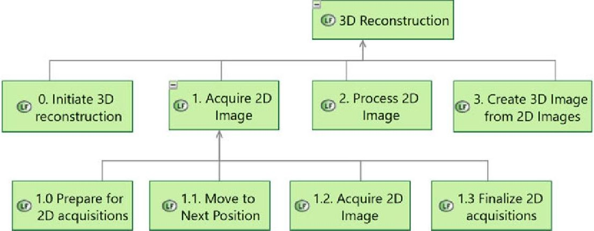
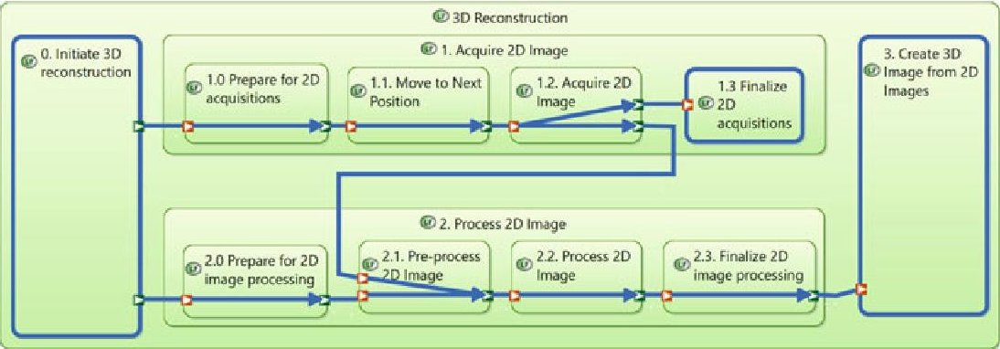
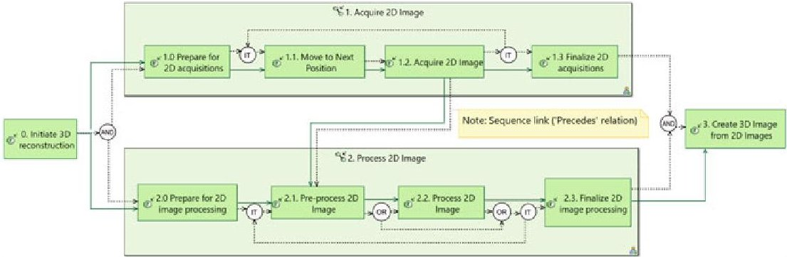
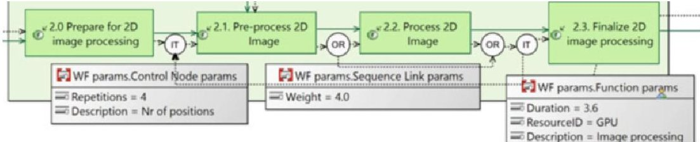
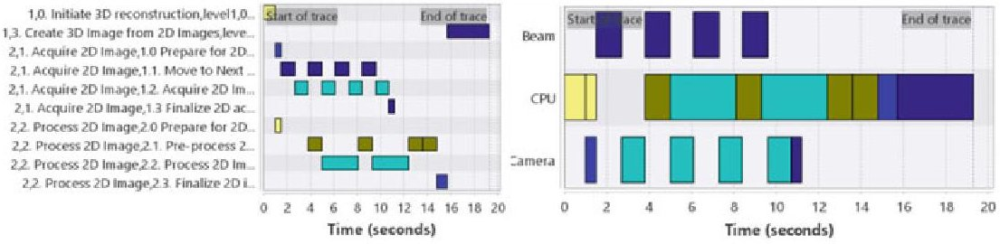
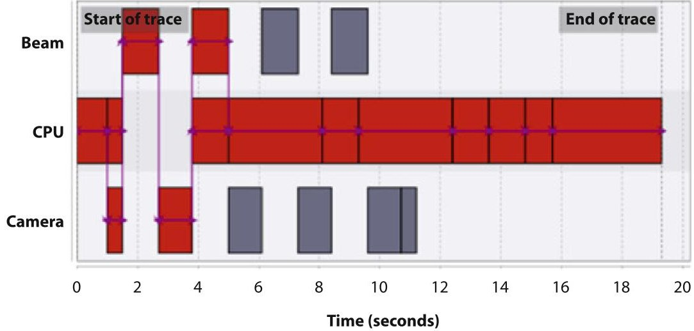
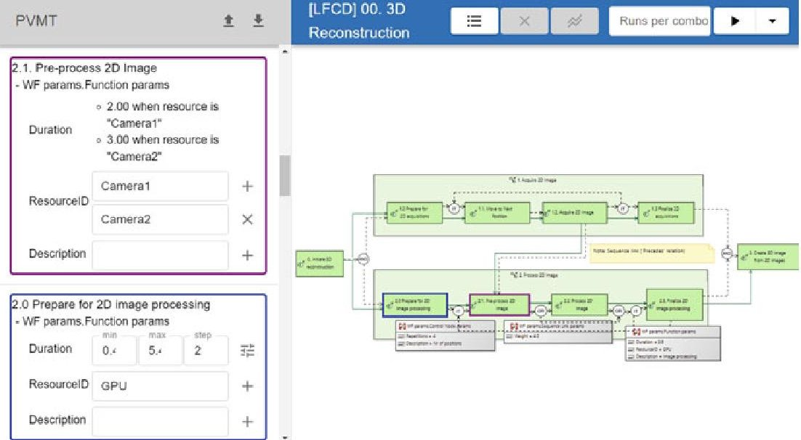
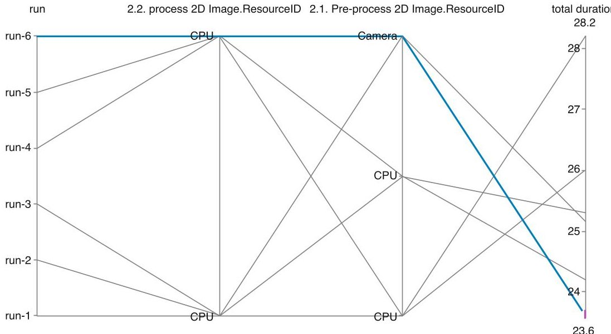

<!-- PDF_PAGE: 1 -->

# MBSE-Based Design Space Exploration for Productivity Improvement Using Workflow Models

Jozef Hooman, Koen Kanters, Alexandr Vasenev, and Jacques Verriet

Abstract During systems design, systems engineers would like to reason about systems feasibility as early in the process as possible. In this chapter, we present a model-based systems engineering (MBSE) method to support design decisions early in the process of systems development by quantitative information about important system qualities. We focus on productivity and propose a method based on system workflows that provide customer value. We annotate the workflows with quantitative information and resources being used and define a formal semantics for these workflows to enable analysis by means of simulation. The approach reuses constructs of the MBSE method Arcadia and is supported by prototype tooling in the form of an add-on of the tool Capella. We visualize simulation results using Gantt charts, with several viewing possibilities and critical path analysis. Finally, the add-on includes design space exploration functionality, which supports specification of parameter ranges and automatic simulation of all combinations. This integrates early design space exploration with MBSE.

Keywords Model-based systems engineering·System workflows·Quantitative analysis·Design space exploration·Simulation

## 1 Introduction

Model-based systems engineering (MBSE) is a paradigm where models (i.e., formalized systems' representations) support and facilitate systems engineering tasks throughout a system's life cycle [1]. MBSE advocates employing a (consolidated) centralized repository - an authoritative source of information - for systems development. This ensures efficient reuse of insights captured during system creation. Several MBSE methodologies exist that include own processes,

<!-- PDF_PAGE: 2 -->

methods, and tools. For example, Estefan and Weilkiens [2] mention the object-oriented systems engineering method (OOSEM), the object-process methodology (OPM), and the Arcadia methodology supported by the open-source Capella tool.

MBSE typically concentrates on modeling the functionality of the system, e.g., by means of use cases and functional decomposition [3, 4]. Important design decisions, however, are often based on needs to improve important system qualities, such as productivity, energy consumption, reliability, and availability. MBSE tools [5] usually do not support quantitative analysis of system configurations. Hence, systems architects often use Excel sheets or their own scripts/programs to quantitatively analyze crucial system qualities, often called critical-to-quality (CTQ) parameters [6]. Dedicated analysis methods, e.g., to perform performance analysis, are hardly used because they require specialized knowledge and additional modeling effort. Another disadvantage of separate analysis is the difficulty of keeping Excel sheets or dedicated analysis models in sync with the models in MBSE tooling.

In addition, MBSE tools miss the possibility of performing design space exploration. That is, the ability to change aspects of the systems design and obtain feedback about the impact of these changes on CTQ parameters. For instance, systems engineers have to decide on the mapping of functions to components; then, a fast exploration of several alternatives and the impact on performance are highly valuable. Other examples are the impact of changes of hardware components or software algorithms. Design space exploration is also relevant to decide which efforts are the most beneficial to improve customer value.

In this chapter, we propose a methodology to perform quantitative analysis for decision-making, which is integrated with MBSE tooling. With our approach, there is no need for systems architects to make and maintain separate analysis models. In this way, we avoid duplication of information at multiple places, achieving a single source of truth [7]. The aim is to allow reasoning about quantitative system aspects early in the development process, without having to model all parts in full detail. Hence, the method allows the description of functionality at different levels of abstraction, e.g., an abstract function might represent a large piece of functionality, to make it possible to focus on critical parts fast. Finally, we provide prototype tooling for automated design space exploration, that is, to obtain an overview of the consequences of the combination of a number of design choices.

The approach has been developed in close collaboration with systems architects of Thermo Fisher Scientific working on electron microscopy [8]. Electron microscopes are applied in different domains, such as life sciences, materials sciences, and the semiconductor industry [9,10]. The use of electron microscopes is characterized by customer workflows. The Oxford Dictionary defines a workflow as "the sequence of industrial, administrative, or other processes through which a piece of work passes from initiation to completion." Electron microscopy workflows typically include several levels of nested flows, reuse of functionality, iteration of sub-flows, and parallel and alternative flows.

Based on the use of the Arcadia methodology and corresponding Capella tooling [11] at Thermo Fisher Scientific [12], we propose the definition of customer workflows as functional chains in Capella. As the first case, we focus on the productivity of electron microscopes and investigate the duration of customer

<!-- PDF_PAGE: 3 -->

workflows. Often, there are several ways to improve these workflows, for instance, using faster hardware, increasing the amount of parallelism, reducing the number of calibration steps by advanced algorithms, etc. The goal is to determine which improvements provide the best return of investment.

We provide an overview of our methodology and the choices made to obtain prototype tool support for productivity analysis; details will be provided in the subsequent sections. To investigate the integration with MBSE tooling, our prototype tooling is an add-on of Capella. Assumptions about the resources and durations of functions have to be added to Capella's functional chains. This is done using the Property Values Management Tool (PVMT) add-on [13]. Next, the annotated functional chains are automatically translated to a model of the POOSL (Parallel Object-Oriented Specification Language) tool [14] for performance simulation. Our generated POOSL model stores the simulation in a format that can be used by the TRACE4CPS tool [15] to visualize the execution in different ways and perform analysis such as critical path analysis. Since POOSL and TRACE4CPS are available as Eclipse plug-in, all steps above are integrated in one Capella add-on. This add-on also contains the possibility of performing design space exploration by a dedicated application. Our prototype and its sources are publicly available [16].

This chapter is structured as follows. Section 2 contains related work. The methodology to quantitatively analyze customer workflows is described in Sect. 3. Section 4 presents the design space exploration to analyze the effect of design choices on customer workflows. Concluding remarks can be found in Sect. 5.

## 2 Related Work

Our approach is based on functional modeling [17], which supports reasoning about complex system aspects early in the development process. The use of a common language of functionality helps overcome barriers between the subdisciplines and allows reasoning about system aspects without modeling all parts in all detail. In addition, it enables computer-based reasoning using quantitative system analysis, e.g., simulation. Simulation is a common way to quantify aspects of a systems design. The industry survey by Bemmami and David [18] shows that simulation improves the efficiency, quality, and performance of the MBSE process. These benefits originate (among others) from earlier and cheaper testing and prototyping.

Several approaches exist to simulate Arcadia models, e.g., to master the behavior of a system and to answer the important questions of systems developers. For instance, Obeo [19] outlines how to couple architectural design practices provided by Capella with the simulation capabilities provided by Matlab Simulink. Rioux et al. [20] suggested how to couple Capella with the model-checking tool ROMEO to reduce the risk of timing errors detected after the integration phase. Batista and Hammami [21] proposed a method to explore functional allocation in the avionics domain by linking an MBSE model to architectural synthesis using optimization techniques. Each logical function is seen as a software task deployed with respect to constraints and resources.

<!-- PDF_PAGE: 4 -->

Our approach differs from the listed ones in several aspects. First, we support high-level questions of systems engineers like "how does a change of functional duration or parallelization impact the total workflow duration?" and leave more detailed analysis to disciplines like software engineering. Second, we focus on sequences of functions that reflect a functional flow block diagram (FFBD) formalism, which is known to systems and software engineers [23]. In particular, we introduce an additional formalism by means of control nodes and sequence links available in the Arcadia methodology. In this way, our work builds on the premise that "Time flow-oriented representations of transformation and interaction processes may serve as a suitable basis in integrated function modelling" [22]. Finally, we introduce new links into the ecosystem of open-source solutions (Capella, POOSL, TRACE4CPS).

To simulate customer workflows, one needs a formalism to describe them. For instance, in the LSAT (Logistics Specification and Analysis Tool) approach [24] system, behavior is specified in terms of activities consisting of actions performed by system resources. The execution of a sequence of activities results in a Gantt chart of the workflow execution. One can optimize workflow performance by identifying and resolving bottlenecks in the workflow. LSAT is able to express the pipelined parallelism observed in electron microscope workflows but not the necessary iterations and stochastic behavior.

BPMN (Business Process Model and Notation) [25] is another formalism that is commonly used to describe customer workflows. Traganos et al. [26] used a recipe-based extension of BPMN to model complex manufacturing workflows from Industry 4.0. Their extension allows advanced synchronization between process steps, e.g., bundling and unbundling of multiple objects. They used a case from the printing domain as an example. This extension of BPMN was able to express the iterations and stochastics of the electron microscopy workflows, but it could not express the necessary pipelined parallelism.

Timed Petri nets [27] are a formalism that supports all necessary aspects. Salimifard and Wright [28] provide an overview of the use of Petri net extensions to describe workflows.

Design space exploration concerns the systematic exploration and analysis of design options according to a number of key objectives. There is an extensive amount of literature on this topic in the area of embedded hardware design and the mapping of software to computing hardware [29]. In this area, the focus is often on the accuracy of performance predictions. Our aim is to apply design space exploration early in the process of systems development, where precision is less important, but it is more relevant to compare design options based on quantitative information.

## 3 Methodology

In this section, we describe the steps of our methodology and the supporting tooling. As a running case, we use an application of electron microscopy, namely,

<!-- PDF_PAGE: 5 -->

Fig.1 Part of the hierarchy of system functions

the construction of a three-dimensional (3D) model out of two-dimensional (2D) images. The case is artificial but resembles realistic electron microscopy workflows [30]. In Sect. 3.1, we describe the basic model-based system modeling activities that form the basis of our approach. Section 3.2 presents the next steps where customer workflows are modeled and annotated with the information needed for quantitative analysis. Our approach to automated analysis can be found in Sect. 3.3. The extension of this approach to design space exploration is presented in Sect. 4.

## 3.1 Modeling System Functions

Our quantitative analysis assumes a few preceding MBSE activities to define what the system should do and how this is realized by a logical architecture. In the Arcadia methodology [31], the first two steps analyze the needs of the customer and what the system should do, including a functional and nonfunctional analysis. The third step defines the logical architecture with a breakdown of the system in functions and components.

We assume that these steps have been taken. Our aim is then to allow early analysis of critical customer values at the logical level. In the 3D reconstruction example, we identified the system functions and modeled them in Capella. Part of the functional hierarchy is shown in Fig. 1.

Assume that the analysis in the first steps revealed that productivity is a CTQ parameter, which should be improved. Consequently, we aim at analyzing the duration of important workflows at the logical level.

## 3.2 Modeling System Workflows

What is expected from the system is expressed in customer workflows that provide customer value. In Capella, a function has function ports that can be used to

<!-- PDF_PAGE: 6 -->

0. 3D Reconstruction

Fig.2 Functional chain

Fig. 3 A functional chain description view with control nodes and sequence links

communicate with other functions. As defined in Roques [31], a "functional exchange" is a unidirectional exchange of information or of matter between two functions, linking two function ports. A specific flow of functional changes can be expressed by means of a functional chain. Figure 2 shows a functional chain for our running case using the functions of Fig. 1. Function ports are denoted by small triangles. Note that this functional chain includes two sub-chains, one for the acquisition of 2D images and the other for the processing of these images. Moreover, there is a functional exchange between a function of the first sub-chain and that of the second.

Based on a functional chain, a so-called functional chain description view is created (see Fig. 3), where the functional exchanges are represented by solid arrows. In our approach, we add sequence links to express that one function precedes another (see the dashed arrows in Fig. 3). Moreover, control nodes are used to express a choice between functions (OR nodes), parallelism of functions (AND nodes), and iterations (IT nodes). Figure 3 shows the parallel composition of two chains with a sequence link between them to specify that an image can only be processed after it has been acquired. This sequence link describes the pipelined parallelism of two iteration branches.

Although Arcadia/Capella allows a lot of freedom in constructing functional chain views, it does not specify the semantics precisely enough for simulations.

<!-- PDF_PAGE: 7 -->

Fig. 4 Part of the functional chain view with annotations

We have defined a number of well-formedness rules to be able to define a formal semantics and translate these views into formal analysis tools:

- AND, OR, and IT nodes should occur in pairs, i.e., an opening node and a closing node.

- An opening IT node has two incoming links (one from the IT closing node) and one outgoing link.

- A closing IT node has one incoming link and two outgoing links (one to the opening IT node).

- Opening AND and OR nodes have one incoming and at least two outgoing links.

- Closing AND and OR nodes have at least two incoming and one outgoing link.

- To allow easy composition of chains, we also require that there be exactly one start node and one end node.

Validation checks for these constraints have been added to our Capella add-on, and the generation of analysis models is prohibited if constraints are violated.

To be able to calculate CTQ parameters, additional information has to be added such as the number of iterations. In Capella, this is done via a dedicated profile of Capella's PVMT add-on [13]. The current profile allows for each function the specification of its duration and its required resources. Moreover, the outgoing links of an OR node can be given weights to indicate the probability with which it will be taken. For example, if there are two outgoing links with weights 1 and 4, then they will be taken with probability 1/5 and 4/5, respectively. Figure 4 shows a few values such as the number of iterations for an opening IT node, the weight of a sequence link originating from an OR node, and the duration of a function. Note that at this level, durations are rough estimates (e.g., based on measurements of the preceding implementations). The aim is not to calculate accurate predictions but to identify critical parts and decide which improvements are the most beneficial to create customer value. For parameters without an explicit definition of a value, we use default values.

## 3.3 Analyzing a Workflow Configuration

To analyze functional chains, we define a formal semantics in terms of (timed) Petri nets, a formalism that is frequently used to describe workflows [28]. A Petri net model contains places and transitions, where places may contain tokens that can be

<!-- PDF_PAGE: 8 -->

Fig. 5 Gantt charts with on the left the activity view and on the right the resource view

Fig. 6 Critical path

consumed and produced by the transitions. We represent functions as transitions, and tokens determine which function(s) can be executed. Resources are represented by places. For instance, a resource that cannot be shared will initially be represented by a place with a single token.

In our tool, the Petri net semantics is represented in POOSL [14], an open-source simulation tool, which can be easily integrated in the Eclipse environment of Capella and can also be coupled to visualization tools to show simulation results. In our add-on, POOSL stores the simulation steps as a trace of the open-source tool TRACE4CPS [15], which is also available as Eclipse plug-in.

After executing the generated POOSL model of our running example for certain values of the parameters, we obtain a trace that can be visualized by TRACE4CPS as a Gantt chart. Figure 5 shows two TRACE4CPS views of our example workflow: on the left, its activity view and on the right, its resource view.

TRACE4CPS' views can be customized using coloring, filtering, and grouping: using attributes of the Gantt chart elements, one can create a custom view. Besides these viewing possibilities, the TRACE4CPS plug-in also contains analysis possibilities. Figure 6 shows the application of critical path analysis to our example workflow; it shows the elements of the critical path in red. This is where

<!-- PDF_PAGE: 9 -->

Fig. 7 A design space exploration page

improvements can be obtained, e.g., improving the processing power of the CPU or the speed of the camera.

## 4 Design Space Exploration

In the previous section, we described how to analyze a single configuration, i.e., a particular setting of the variables. At this early stage of the system, however, it is usually more relevant to compare different options to decide on which part to spend most of the effort to increase customer value: for instance, whether it is beneficial to improve certain mechanical components, to add more power computing resources, or to invest in more powerful algorithms to increase the possibility of skipping costly steps. To this end, given a particular functional chain, a dedicated web-based application has been developed to make it convenient to specify alternatives, run multiple simulations, and visualize the results for a fast comparison. Figure 7 shows exploration options for our running example.

On the right, there is an interactive version of the functional chain, where one can click on nodes to specify values for parameters and possible ranges of parameters. On the top left, two different camera options are specified. There is a separate editor to specify the duration of functions executed by each of the resources; the specified values are shown after "Duration." An alternative is to specify ranges of the duration and the step size, as shown on the bottom left. In addition, it is also possible to specify ranges for the number of iterations for an IT start node and the weights of the outgoing links of an OR start node.

<!-- PDF_PAGE: 10 -->

Fig. 8 Results of design space exploration

After specifying a number of resource alternatives and ranges, running design space exploration (the play button on the top right) will simulate all combinations of the values. Since OR nodes have a probabilistic character, it is possible to specify multiple runs for each setting (the "Runs per combo" on the top right); then, the average of these runs is taken.

For our example workflow, we would like to explore the replacement of the CPU by either a graphics processing unit (GPU) or a camera with preprocessing functionality for function 2.1 Pre-process 2D Image. In addition, function 2.2 Process 2D Image may also be executed on a GPU. This leads to six possible combinations; each combination is simulated 20 times. The results can be visualized in a parallel coordinates chart as shown in Fig. 8, where we focused on the lowest total duration. The figure shows which combination leads to the smallest workflow duration.

To validate the methodology presented in Sects. 3 and 4, we discussed it with two experienced workflow architects of Thermo Fisher Scientific. These professionals did not participate in the method development but possess in-depth domain and modeling knowledge. Earlier, both had to develop their own approaches to model workflows. While their own approaches did not employ resource sharing, both architects confirmed the importance of being able to model resource claims of parallel activities. Moreover, the architects highlighted the importance of using clear visual models for communication and the ability to quickly experiment on high-level questions.

<!-- PDF_PAGE: 11 -->

## 5 Concluding Remarks

A methodology has been presented to extend MBSE with support for making design decisions based on quantitative information about important system qualities. The analysis is based on a formal semantics of workflows in terms of Petri nets. Prototype tooling has been developed as an add-on of the MBSE tool Capella. The tooling has a modular structure and parts can be easily replaced. For instance, the POOSL simulation tool can be replaced by a simulation using the SNAKES library [32, 33], which represents Petri nets in Python. This could improve the speed of running design space exploration. Moreover, connections to other MBSE tools are conceivable; this mainly requires a definition of the semantics of a notation for workflows in terms of Petri nets. For instance, workflows may be represented as Unified Modeling Language (UML) activity diagrams for which a Petri net semantics exists [34].

The approach has been validated on several electron microscopy workflows provided by Thermo Fisher Scientific. These include nontrivial cases with (pipelined) parallelism, several levels of nested functional chains, reuse of functions, and reuse of functional chains. It is conceivable that applications in other domains reveal the need for extensions of the approach. For instance, it might be needed to express conditional flows where the choice between functions is based on the value of an expression. Another option for future work is to develop a convenient way to express that a function requires multiple resources, which is rather cumbersome in the current version. The most important topic of future work is the quantification of other system qualities such as availability and to provide insight into the trade-off with productivity.

## References

1. C. Singam, Model-based systems engineering (MBSE) (2022), https://www.sebokwiki.org/wiki/Model-Based_Systems_Engineering_(MBSE)

2. J.A. Estefan, T. Weilkiens, MBSE methodologies, in Handbook of Model-Based Systems Engineering, (Springer, 2022), pp. 1-40

3. J.A. Estefan, Survey of model-based systems engineering (MBSE) methodologies, in INCOSE MBSE Initiative (2008)

4. J. Ma, G. Wang, J. Lu, H. Vangheluwe, D. Kiritsis, Y. Yan, Systematic literature review of MBSE tool-chains. Appl. Sci. 12, 3431 (2022)

5. T. Weilkiens, MBSE tools (2022), https://mbse4u.com/sysml-tools/

6. Critical To Quality (CTQ) (2022), https://www.isixsigma.com/dictionary/critical-to-quality- ctq/

7. P.F. Smith, S.M. Prabhu, J. Friedman, Best practices for establishing a model-based design culture. SAE Technical Paper (2007)

8. Thermo Fisher Scientific, Electron microscopy (2022), https://www.thermofisher.com/nl/en/home/electron-microscopy.html

9. Electron microscope (2023), https://en.wikipedia.org/wiki/Electron_microscope

10. Electron Microscopy Learning Center (2023), https://www.thermofisher.com/nl/en/home/ electron-microscopy/learning-center.html

11. Arcadia/Capella (2022), https://www.eclipse.org/capella/arcadia.html

<!-- PDF_PAGE: 12 -->

12. N. Roos, Thermo Fisher Scientific develops an appetite for modeling (2022), https://bitschips.nl/artikel/thermo-fisher-scientific-develops-an-appetite-for-modeling/

13. Property Values Management Tools (PVMT) (2022), https://www.eclipse.org/capella/addons.html

14. POOSL (2022), https://www.poosl.org/

15. Eclipse TRACE4CPS (2022), https://projects.eclipse.org/projects/technology.trace4cps

16. Design space exploration of workflows in Capella (2022), https://github.com/TNO/capella-workflow-dse

17. M.S. Erden, H. Komoto, T.J. van Beek, V. D'Amelio, E. Echavarria, T. Tomiyama, A review of function modeling: approaches and applications. Artif. Intell. Eng. Des. Anal. Manuf. 22, 147-169 (2008)

18. K.E. Bemmami, P. David, State-of-practice survey in industry on the deployment of simulation in systems engineering. IFAC-PapersOnLine 54(1), 1132-1137 (2021)

19. OBEO, What if you could simulate your Capella model? (2021), https://news.obeosoft.com/en/post/what-if-you-could-simulate-your-capella-model

20. L. Rioux, R. Henia, N. Sordon, Using model-checking for timing verification in industrial system design, in 2017 IEEE International Conference on Software Testing, Verification and Validation Workshops (ICSTW), (IEEE, 2017), pp. 377-378

21. L. Batista, O. Hammami, Capella based system engineering modelling and multi-objective optimization of avionics systems, in 2016 IEEE International Symposium on Systems Engineering (ISSE), (IEEE, 2016), pp. 1-8

22. B. Eisenbart, K. Gericke, L. Blessing, Taking a look at the utilisation of function models in interdisciplinary design: insights from ten engineering companies. Res. Eng. Des. 28, 299-331 (2017)

23. J.E. Long, Relationships between common graphical representations in systems engineering. Insight 21(1), 8-11 (2018)

24. B. van der Sanden, Y. Blankenstein, R. Schiffelers, J. Voeten, LSAT: specification and analysis of product logistics in flexible manufacturing systems, in 2021 IEEE 17th International Conference on Automation Science and Engineering (CASE), (IEEE, 2021), pp. 1-8

25. BPMN Specification (2022), https://www.bpmn.org/

26. K. Traganos, D. Spijkers, P. Grefen, I. Vanderfeesten, Dynamic process synchronization using BPMN 2.0 to support buffering and (un)bundling in manufacturing, in Business Process Management Forum. BPM 2020, Lecture Notes in Business Information Processing, ed. by D. Fahland, C. Ghidini, J. Becker, M. Dumas, vol. 392, (Springer, 2020), pp. 18-34

27. J. Wang, Deterministic timed petri nets, in Timed Petri Nets, The Kluwer International Series on Discrete Event Dynamic Systems, vol. 9, (Springer, 1998), pp. 37-61

28. K. Salimifard, M. Wright, Petri net-based modelling of workflow systems: an overview. Eur. J. Oper. Res. 134(3), 664-676 (2001)

29. M. Herget, F.S. Saadatmand, M. Bor, I. González Alonso, T. Stefanov, B. Akesson, A.D. Pimentel, Design space exploration for distributed cyber-physical systems: state-of-the-art, challenges, and directions, in 2022 25th Euromicro Conference on Digital System Design (DSD), (IEEE, 2022), pp. 632-640

30. K. Miranda, W. Girard-Dias, M. Attias, W. de Souza, I. Ramos, Three dimensional reconstruction by electron microscopy in the life sciences: an introduction for cell and tissue biologists. Mol. Reprod. Dev. 82(7-8), 530-547 (2015)

31. P. Roques, Systems Architecture Modeling with the Arcadia Method - A Practical Guide to Capella (ISTE Press - Elsevier, 2018)

32. F. Pommereau, Nets-in-nets with SNAKES, in Fifth International Workshop on Modelling of Objects, Components, and Agents (MOCA'09) (2009), pp. 107-126

33. SNAKES, the net algebra kit for editors and simulators (2022), https://snakes.ibisc.univevry.fr/

34. J.P. López-Grao, J. Merseguer, J. Campos, From UML activity diagrams to Stochastic Petri nets: application to software performance engineering, in WOSP '04: Proceedings of the 4th International Workshop on Software and Performance, (ACM, 2004), pp. 25-36