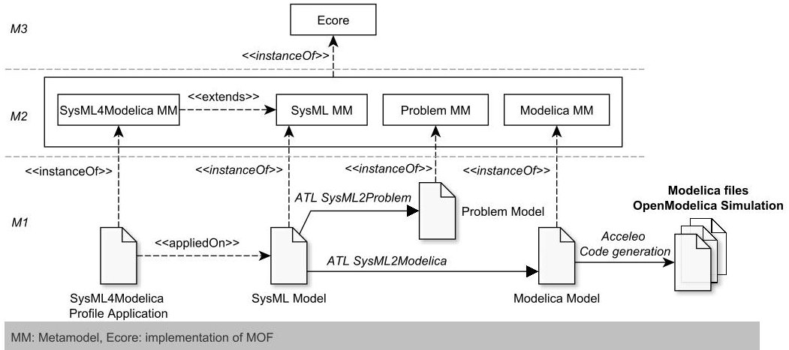

<!-- PDF_PAGE: 1 -->

<div align="center">

# Tooled Process for Early Validation of SysML Models Using Modelica Simulation

</div>

Jean-Marie Gauthier, Fabrice Bouquet, Ahmed Hammad, and Fabien Peureux

Institut FEMTO-ST - UMR CNRS 6174, University of Franche-Comté 16, route de Gray, 25030 Besançon, France {jmgauthi,fbouquet,ahammad,fpeureux}@femto-st.fr

Abstract. The increasing complexity and heterogeneity of systems require engineers to consider the verification and validation aspects in the earliest stages of the system development life cycle. To meet these expectations, Model-Based Systems Engineering (MBSE) is identified as a key practice for efficient system development while simulation is still widely used by engineers to evaluate the performance and conformance of complex systems regarding requirements. To bridge the gap between high-level modeling (from requirements) and simulation, the present paper proposes a Model-Driven Engineering (MDE) tooled approach to automate the system requirements validation using SysML models and Modelica simulation. The implementation of the related toolchain has been officially adopted by the OMG SysML-Modelica working group.

Keywords: Requirements Validation, SysML Models, Modelica Simulation, Model Transformation, Code Generation, OMG Standard.

## 1 Introduction

Over the last years, the complexity of physical and hybrid systems has considerably grown since these systems integrate an increasing number of heterogeneous components (electrical, mechanical, software, etc). At the same time, system engineers always have to achieve the following objectives: building the right system correctly, reducing costs and ensuring delivery date. Designing the right system is still a challenge for engineers. Bad design choices or bugs, which are not discovered during early design stages, may indeed be very expensive. Therefore, it is today crucial to be able to validate a system design as soon as possible, even before the development has started and a single line of code has been written. Moreover, despite the increasing complexity of the system requirements, a consistent understanding of the project scopes between all the involved engineer teams is required to ensure the conformity to requirements, and to provide adapted guidance for their production and development choices. Hence, it entails the necessity of adopting and sharing an overall view of system development, especially during the early design stages (in particular during conceptual design, system design and rapid prototyping).

<!-- PDF_PAGE: 2 -->

In the last decade, to overcome these challenges, Model-Based System Engineering (MBSE) methodologies have emerged on the sharing and standardization of embedded software technologies [1]. MBSE deals with the definition of system models that could be exploited during all the system development life cycle, such as the System Modeling Language (SysML) [2]. This approach puts a strong emphasis on the use of models at the different steps of the system specification. As reported by the International Council on Systems Engineering (INCOSE), validation of system requirements using modeling and simulation is today a common method for system analysis and evaluation. Replacing the traditional document centric approach by MBSE approaches entails to use models as the core of the requirements definition, design, analysis, verification and validation activities. In this MBSE context, the communication and cooperation between all the project stakeholders are necessary, and it is thus stimulating to design a first overall system model from requirements. A model may describe expected requirements, behaviours and structure of the designed system. It may be used to validate some parts or the whole designed system regarding functional as well as non-functional requirements. To achieve that, different kinds of analysis can be performed: this can be abstract formal analysis methods (e.g., using analytic techniques) as well as simulation-based analysis (e.g., using SystemC hardware models). Formal analysis allows to cover and guarantee corner cases of the system behaviours while the simulation computation time is in general much smaller. Nevertheless, some components may be too complex for economical formal verification. In these cases, formal analysis may be done on an abstract functional level whereas the implementation or detailed internal behaviours have to be checked via accurate simulation models. However, in some cases, simulation models are the only possibility to estimate timed behaviours of software-hardware interactions.

To address mechatronic systems and embedded systems modeling, high-level design using SysML is on the rise. SysML allows to graphically specify all aspects of physical systems (mixing software and hardware parts) including requirements, structural and behavioural aspects. Moreover, using SysML improves the communication since it eases the interaction between different teams of multidomain engineers. But SysML is not executable: there is neither an action language nor a simulation framework to evaluate SysML models containing equations. To overcome this issue, we propose a tooled approach to automatically generate Modelica $ ^{1} $ simulation code from SysML models.

The contributions of this paper are threefold. First, it relies on the SysML- Modelica Transformation specification [3], provided by the Object Management Group (OMG), to integrate Modelica concepts in SysML models. Second, we propose a Model-Driven Engineering (MDE) approach to automatically translate such high-level SysML models into executable Modelica code. The obtained simulation results are then compared with the initial system requirements to assess them. Thirdly, to evaluate this whole process, experiments have been conducted within the Smart Blocks project in the mechatronic domain.

<!-- PDF_PAGE: 3 -->

The paper is structured as follows. Section 2 introduces the integration of Modelica constructs into SysML models and describes the process of Modelica code generation from such models. Section 3 discusses the relevance of the tooled approach. Finally, after surveying related work in Sect. 4, we conclude and outline the future work in Sect. 5.

## 2 From SysML Models to Modelica Code

SysML and Modelica are two complementary languages: their joint use enables the integration of Modelica simulation constructs to complete architectural SysML models. This integration, based on existing recommendations provided by the OMG, has been implemented as the SysML4Modelica profile, which defines the practical contribution of the present paper. Then, we describe the process of Modelica code generation from SysML models using model-driven engineering techniques. The implementation of this whole process is available to the community $ ^{2} $ (demos, examples and source code).

## 2.1 The Gap between SysML and Modelica

To support MBSE principles, OMG has developed and promotes the System Modeling Language (SysML) that enables systems engineers to specify all aspects of a complex system using graphical constructs. SysML is built on the well-known Unified Modeling Language (UML) by bringing adapted semantics to the system engineering field: SysML is implemented as a UML profile. Using SysML enables the adoption of a Model-Based approach to represent, specify and manage knowledge at the early stage of the design. However, SysML is a semi-formal language and it lacks of structures for requirements and model validation. To tackle this issue, the Modelica language is a convincing candidate: it is a non-proprietary, object-oriented and equation-based language for complex physical systems simulation. Moreover, OMG promotes a dedicated standard (SysML-Modelica Transformation standard) to integrate Modelica semantics into SysML.

The objectives of the SysML-Modelica Transformation specification are to enable a bi-directional transformation between the both modeling languages. The specification defines an extension to SysML, called SysML4Modelica, which proposes matching semantics between the SysML4Modelica constructs and the Modelica language. The integration of Modelica concepts into SysML is based on a profiling approach. Basically, the SysML4Modelica constructs enable to stereotype elements that are part of the Block Definition Diagram (BDD) and the Internal Block Diagram (IBD) of SysML (the BDD is analogous to the UML class diagram whereas the IBD permits to represent physical or logical interactions between component instances via input and output FlowPorts). Thus, BDD and IBD (and optionally the requirements diagram) are the SysML diagrams that are addressed by the approach.

<!-- PDF_PAGE: 4 -->

This SysML4Modelica profile is therefore used to bridge the gap between the two modeling language: SysML, which is a non executable graphical highlevel modeling language, and Modelica, which is used as simulation language for complex and heterogeneous systems. The next step of the proposed process is to perform Modelica code generation from SysML models profiled with SysML4Modelica. Thus, the next subsections describe this process and its implementation using Model Driven Architecture (MDA) approach.

## 2.2 Model to Model Transformation

Model transformation and code generation are the backbone of the Model Driven Architecture approach [4]. In the context of MBSE, this approach helps to bring the analysis of specifications and the rapid prototyping closer. Considering that SysML enables system modeling from specifications, MDA offers techniques to obtain executable Modelica prototypes from SysML models. The next paragraphs give details of this process, which is depicted in Fig. 1.





<div align="center">

Fig.1. Modelica Generation Process

</div>

The starting point of this translation process consists of manually giving Modelica semantics to SysML models using SysML4Modelica constructs. After verifying that the SysML model contains the correct Modelica constructs, using the automated SysML2Problem verification, a model transformation, based on the ATLAS Transformation Language (ATL) framework, is performed from the SysML4Modelica metamodel to the Modelica metamodel. ATL [5] is a model transformation language inspired by the OMG standard QVT $ ^{3} $ . It makes it possible to implement model transformation rules and to run transformation process. ATL matched rules are the heart of the transformation process as they describe how output elements (that conform to the output metamodel) are produced from input elements (that conform to the input metamodel). For instance, Fig. 2 shows an example of such ATL matched rule.

<!-- PDF_PAGE: 5 -->

```javascript

rule Block2ModelicaModel{

  from

    sysmlBlock: MMuml! Class(

    sysmlBlock.isBlockStereotyped() **and**

    sysmlBlock.isModelicaModelStereotyped()

  )

  to

    modelicaModel: MMmodelica! Model()

}

```

## Fig.2. ATL Matched Rule

Within this approach, ATL is used to automatically verify the correctness of SysML4Modelica constructs (SysML2Problem) and to translate SysML models into Modelica models (SysML2Modelica). The Modelica metamodel is built with Eclipse Modeling Framework (EMF) as an ecore file. The generated Modelica model defines the entry point of Modelica code generation, which is described in the next subsection.

## 2.3 From Modelica Model to Modelica Code

To perform the generation of the Modelica code from the generated Modelica models, the approach is based on the Acceleo technology. Acceleo $ ^{4} $ , developed by the company Obeo, is an open source code generator from the Eclipse foundation. It implements the MDA approach to develop application from EMF based models. The Acceleo language is an implementation of the MOF Models to Text Transformation (MOFM2T) standard.

The implementation of the OMG SysML-Modelica Transformation specification is available for the Topcased and Papyrus environments as an Eclipse plugin. It is adopted and promoted by the OMG SysML-Modelica working group. The next section discusses experiments feedback of the proposed process on a concrete case study about the Smart Blocks system.

## 3 Discussion and Lessons Learned from Experiments

The following discussion is based on the obtained results and lessons learned from the experiments of our prototype for carrying out the Smart Blocks $ ^{5} $ case study (results are presented in [6]). Basically, the goal of this project consists to empirically evaluate the reliability and the scalability of our approach, and finally to answer the following questions regarding the proposed tooled process:

(A) How appropriate and convenient is the SysML4Modelica profile?

(B) Is our prototype efficient enough to support large systems modeling and simulation?

(C) Does it fit the need to validate a high-level SysML design and requirements at the soonest?

<!-- PDF_PAGE: 6 -->

## 3.1 Using SysML4Modelica

At the first sight, the relevance of the proposed approach to early validate system design using SysML models to perform Modelica simulation, instead of writing directly Modelica code for simulation, is debatable. SysML is indeed a high-level modeling language, traditionally used to specify all aspects of a complex system at the earliest stage of the development, whereas Modelica is used later in the development life cycle for rapid prototyping. However, the integration of the both notations enables to fulfill validation challenges and offers new perspectives.

On the one hand, software developers as well as software architects are experienced in using modeling methodology, but they usually lack knowledge to perform hardware related coding and setup of variables to support compilers and simulation platform. The proposed approach allows them to initiate the simulation validation process (in collaboration with engineers) and therefore guarantees the continuous validation of the modeled expected requirements. On the other hand, from robotics engineers point of view and feedback, the advantages of using SysML over using Modelica directly are also significant since the proposed approach attempts to bring closer system modeling from requirements using SysML and allows rapid prototyping using Modelica simulation.

Nevertheless, the gap between SysML and Modelica being quite important at business-level, the cost to perform simulation from SysML model can be also important since design teams have to learn two languages. One important key for the adoption success of this approach by the industry would be to provide reverse-engineering tools that enable to automate the generation of SysML models from existing simulation code. It should also be underlined that the SysML4Modelica profile can be applied to existing SysML models without changing the structure of the model. Incomplete model can also be handled: we could generate the structure of Modelica code without considering all the behavioural rules (e.g., equations, algorithms).

## 3.2 Scalability of the Approach

The Smart Blocks case study is not very large. To evaluate the scalability of the proposed approach, we have applied it on a large and complex energy manager of a new generation of helicopter type. Basically, this system is composed of an energy source that emulates a permanent power source (alternator coupled with a turbine or a fuel cell system), an accumulators battery and a battery of super-capacitors. Each source is connected with a controller that gives managing strategies. The SysML model of this energy manager system contains 20 blocks, 30 properties, 37 constraints, 30 instances, 109 flow ports and 62 connectors. This case study allows to assess the scalability of the proposed approach regarding modeling effort and automatic Modelica code derivation (the transformation process takes less than one second to generate 23 Modelica files). For confidentiality reasons, experiments results and report about this case study are not presented in this paper.

<!-- PDF_PAGE: 7 -->

## 3.3 Validation of a Design at the Soonest

High-level SysML model validation over requirements was the main motivation of the proposed approach. The Smart Blocks case study is managed by strong requirements concerning the velocity and the acceleration of different kind of tiny objects. Therefore, the SysML model of the system had to meet these requirements. The results obtained with several simulations with different initial conditions gave some clues on future design choices. Moreover, structural modeling error are immediately detected and reported by the SysML2Problem checking.

## 4 Related Work

This section discusses related work investigating the integration of Modelica into UML and SysML models in the context of MBSE.

In [7,8], the authors propose techniques to apply the ModelicaML profile on UML models to generate Modelica code. An Eclipse plugin for the Papyrus modeler has been developed, but it is not based on the OMG SysML-Modelica specification and it does not take into account SysML models. Schramm et al. [9] introduce the MDRE4BR profile (Model Driven Requirement Engineering for Bosch Rexroth), which aims to perform verification of the design against the requirements using an executable model. This profile extends the current SysML requirements constructs and is linked with ModelicaML to translate analytical models into executable Modelica models. However, this work focuses on the SysML requirements diagram only. Nytsch-Geusen [10] also proposes to use a special format of UML, named UMLH, for the modeling of hybrid systems. Modelica code can be produced automatically from UMLH models. However, the generated code has to be manually completed with the physical equations of the system to allow simulations.

A representation of Modelica models in SysML is introduced by Johnson et al. in [11]. This work explores the definition of continuous dynamics models in SysML and the use of triple graph grammar to maintain a bidirectional mapping between SysML and Modelica constructs. A mapping between SysML and Modelica considering a smaller subset of the Modelica language has been proposed by Vasaiely [12]. This work does not use the OMG specification, but uses its own mapping between SysML parametric diagrams and Modelica equations.

## 5 Conclusion and Future Work

The present paper proposes a tooled MDE approach to validate requirements of complex systems at the earliest stages of design process. This approach consists to generate Modelica simulation code from SysML models. To address this issue, the OMG SysML-Modelica Transformation specification has been implemented as a UML profile for SysML called SysML4Modelica. The model transformations are based on ATL and Acceleo rules, and use a dedicated Modelica metamodel that verifies Modelica syntax. The constraints defined in the OMG specification are thus verified and ensure the SysML model consistency. The approach has been experimented and validated within several industrial case studies.

<!-- PDF_PAGE: 8 -->

We are now investigating a novel SysML modeling approach that could allow both to generate test cases and to simulate the system under test from a unique SysML model. This innovative approach could be used within Hardware-In-the-Loop process since the simulation could play two key roles: simulating a system component and providing test cases and oracles for its concrete product. Finally, depending on the OMG standards evolution, we will update the proposed prototype, which is officially promoted by the OMG SysML-Modelica group.

Acknowledgment. This project is supported by the Smart Blocks project (contract ANR-2011-BS03-005) and the Labex ACTION program (contract ANR11-LABX-0001-01) - see http://www.labex-action.fr/en.

## References

1. Estefan, J.: Survey of Model-Based Systems Engineering (MBSE) Methodologies. INCOSE, Survey TD-2007-003-01.B (June 2008)

2. Moore, A., Steiner, R., Friedenthal, S.: A Practical Guide to SysML: The Systems Modeling Language. Morgan Kaufmann (2009) ISBN 9780123743794

3. SysML-Modelica Transformation specification V1.0, Object Management Group (November 2012). http://www.omg.org/spec/SyM/1.0/

4. MDA Guide Version 1.0.1, Object Management Group (May 2003). http://www.omg.org/mda/mda_files/MDA_Guide_Version1-0.pdf

5. Bézivin, J., Breton, E., Dupé, G., Valduriez, P.: The ATL transformation-based model management framework. University of Nantes, Tech. Rep. (August 03, 2003)

6. Gauthier, J.-M., Gendreau, D., Hammad, A., Bouquet, F.: Modeling and simulation of modular complex system: Application to air-jet conveyor. In: Proc. of the IEEE/ASME Int. Conference on Advanced Intelligent Mechatronics (AIM 2014), pp. 1194-1199. IEEE CSP, Besançon (July 2014)

7. Pop, A., Akhvlediani, D., Fritzson, P.: Towards unified system modeling with the modelicaml UML profile. In: Proc. of the 1st Workshop on Equation-Based Object-Oriented Modeling Languages and Tools, EOOLT 2007, pp. 13-24. Linköping Univ. Electronic Press, Berlin (2007)

8. Schamai, W., Fritzson, P., Paredis, C., Pop, A.: Towards unified system modeling and simulation with ModelicaML: modeling of executable behavior using graphical notations. In: Proc. of the 7th Modelica Conference, pp. 612-621. Linköping Univ. Electronic Press, Como (2009)

9. Ji, H., Lenord, O., Schramm, D.: A model driven approach for requirements engineering of industrial automation systems. In: Proc. of the 4th Workshop on Equation-Based Object-Oriented Modeling Languages and Tools (EOOLT 2011), pp. 9-18. Linköping Univ. Electronic Press, Switzerland (2011)

10. Nytsch-Geusen, C.: The use of the UML within the modeling process of modelica-models. In: Proc. of the 1st Workshop on Equation-Based Object-Oriented Modeling Languages and Tools (EOOLT 2007), pp. 1-11. Linköping Univ. Electronic Press, Berlin (2007)

11. Johnson, T., Kerzhner, A., Paredis, C.J., Burkhart, R.: Integrating models and simulations of continuous dynamics into SysML. Journal of Computing and Information Science in Engineering 12(1), 13-24 (2012)

12. Vasaiely, P.: Interactive simulation of sysml models using modelica. Bachelor Thesis, Dept of Computer Science, Hamburg University of Applied Sciences (2009)