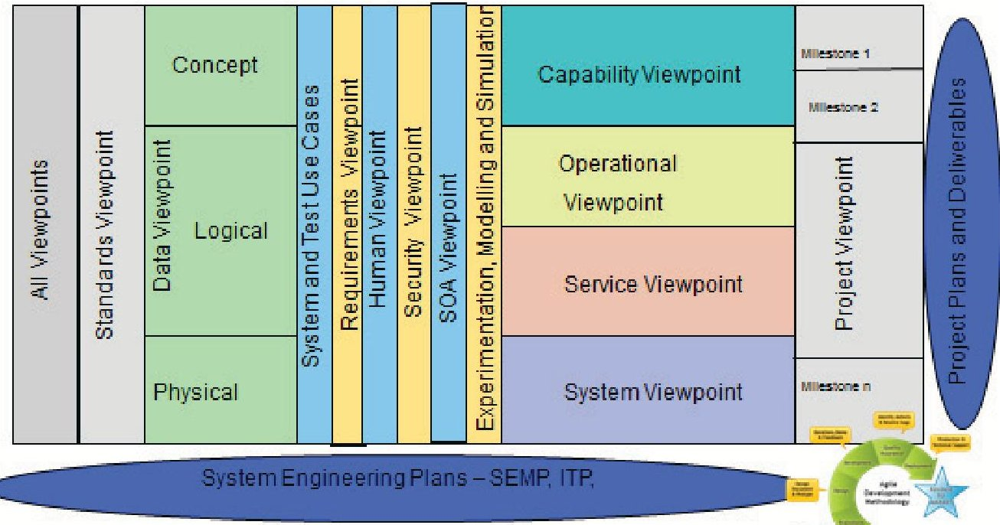
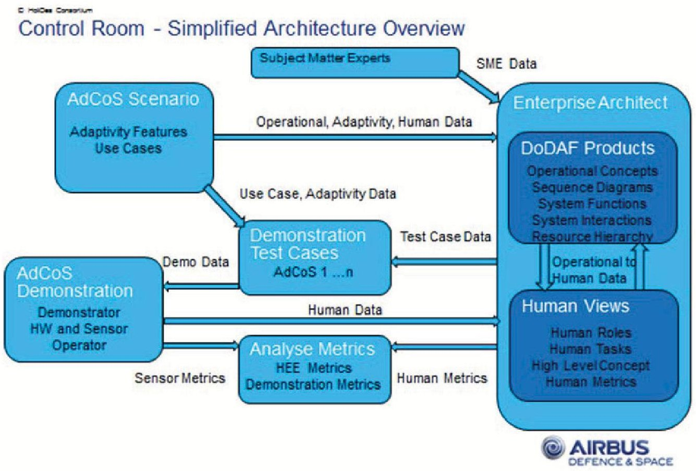
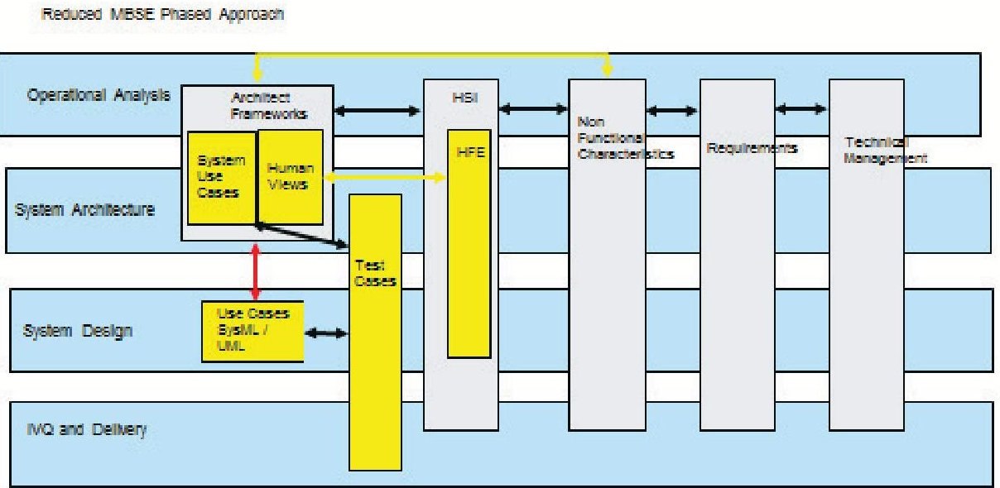

<!-- PDF_PAGE: 1 -->

# 6th International Conference on Applied Human Factors and Ergonomics (AHFE 2015) and the Affiliated Conferences, AHFE 2015

# Implementation of Human System Integration (HSI) and 'non functional characteristics' into the systems engineering lifecycle - a practical approach at Airbus Defence and Space

Robert A Sharples

Expert System Architect, Airbus Space and Defence, Quadrant Houe, Coedkernew, Newport, UK, NP10 8FZ

## Abstract

This paper provides an overview of the process, practices, developments and synergies that Airbus Defence and Space are implementing Human System Integration (HSI) into the Continuous Engineering /Model Based System Engineering (MBSE) throughout the company. The paper highlights these developments, which include internal research programmes, European Union funded research projects, Airbus internal Synergy project. This research includes an EU funded 3 year project HoliDes Holistic Human Factors and System Design of Adaptive Cooperative Human Machine Systems.Continuous engineering within Airbus has included various corporate and divisional Synergy programs and lean and agile initiatives. As our business is defined by Multiple Portfolio products, supplied from multi countries, the MBSE process had to speed up delivery and reduce overall cost. The Airbus process models needed significant amendment due to products supplied via multiple business lines throughout the company. This problem is exacerbated by varying requirements of four national defence requirements, who impose restrictions on the use of Architectural Frameworks (NAF/MODAF/DODAF) and supporting tools. Our Human System Integration (HSI) is continuing from the initial Human View Architectural Framework research to include the nine HSI domains. These nine domains overlap with our current Human factors research and will now allow us to pull in our Non-functional work into our Systems Engineering lifecycle. This paper highlights the research projects Airbus Space and Defence are incorporating in to our overall strategy, these include internal R&D funding and European Union funded research programs. These research projects have highlighted several areas of interest these include, stochastic modelling with respect to Human System Integration and Human views, verification and analysis of emergent behaviour and non-functional properties, which conforms with our own work on non-functional requirements and finally the use of System of System Formal Methods for parts of the lifecycle.

$ \textcircled{c} $ 2015 The Authors. Published by Elsevier B.V. This is an open access article under the CC BY-NC-ND license (http://creativecommons.org/licenses/by-nc-nd/4.0/). Peer-review under responsibility of AHFE Conference

Keywords: Human System Integration (HSI); Human Factors; Model Based System Engineering (MBSE); Architecture frameworks; Human views; Non functional characteristics; Systems Of Systems (SoS)

<!-- PDF_PAGE: 2 -->

## 1. Introduction

This paper defines the ongoing Airbus Defence and Space Research & Technology process for Model Based System Engineering (MBSE) and its integration into the overall system engineering lifecycle.

Section 1 details the high level view of our Model Based System Engineering approach and the overall integration of section 2, 3, 4 and 5. Section 2 defines our approach of introducing Humans in the System Engineering Lifecycle, via Human System Integration (HSI), Section 3 details how our continuing research in Architectural Frameworks with the inclusion of a Human Viewpoint and the integration with HSI. Section 4 details our on-going research integrating Human Views, Architectural Frameworks and Non-functional capabilities into our System of System (SoS) approach. Section 5 details two European Union funded research projects which are directly contributing to our research; the first COMPASS [1], the outputs of which, Airbus DS is interested in, the second HoliDes [2] where Airbus DS are a work package lead. The final section, section 6 details our future system engineering integration plans.

## 2. Model Based System Engineering (MBSE)

The overall objective is to identify an MBSE process to support Airbus Defence and Space portfolio of products, to provide the engineering process and governance to implement, maintain and provide the solution for use within our portfolio, to provide

- reduce costs in terms of

O Define correct project and engineering governance

Ensure customer confidence throughout the lifecycle

Reduce re-work

O 'Get it right' before we define a solution

Reduce paper documentation

Reduce cost in terms of manpower, tools, duration of reviews etc

Remove Non-Quality Issues

- Remove integration risk in our projects

- Drive innovation with the ongoing Model Based System engineering approach

- Together with the project savings defined above, Airbus DS is integrating several other research activities in the our MBSE solution, these include

- Non Functional Characteristics - Airbus DS is developing the integration of HSI into the engineering lifecycle the following is a draft list high level definition of our Taxonomy - Performance, Dependability, Security, Physical, which includes Resilient Cyber Physical Systems (ReCyPhy), Human System Integration, Adaptability and Delivery.

- Human System Integration (section 3)

- Human Views integration into an Architecture Framework (section 4)

- Included EU funded research programs (section 5)

- Future Integration (section 6)

## 3. Human System Integration (HSI)

Airbus DS are using Interim DoDI 5000.2 November 2013 [3] as a basis for the implementation of Human System Integration within our System Of System engineering approach. Over the past three years Airbus DS has been investing in providing Human Views within an Architecture Framework (section 4). This research will need to be correlated with the Human System Integration; our initial impression is that approximately 70% of the HSI is already covered in our Human View Architectural definition. The HSI definitions were developed by Dr Martin Boecker of Airbus DS and are defined below

<!-- PDF_PAGE: 3 -->

## 3.1. Human System Integration definitions

- Manpower - The number of personnel, type of personnel (military, civilian and contractor), required, authorised, and potentially available to train, operate, and support each deployed system

- Personnel - The human knowledge, skills, abilities, and cognitive and physical capabilities required to operate, maintain, and support a system

- Training - The instruction and resources required to provide personnel with the requisite knowledge, skills and abilities to properly operate, maintain and support systems

- Human Factor Engineering - The comprehensive integration of human capabilities and limitations into a system definition, design, development, and evaluation to promote effective human machine integration for optimal total system performance and to minimise physical and mental fatigue

- Environment - Environmental factors concern water, air, and land and the interrelationships which exist among and between water, air, and land and all living things

- Safety - System design characteristics that serve to minimise the potential for mishaps causing death or injury to personnel or threaten the operation of the system

- Occupational Health - System design features that serve to minimise the risk of injury, acute or chronic illness, or disability; and/or enhance job performance of personnel.

- Survivability- The characteristics of a system that reduce fratricide, reduce detectability, prevent attack if detected, prevent damage if attacked, and minimise injury

- Habitability - Characteristics of systems, facilities, personal services, and living conditions that result in sustainable high levels of personal morale, quality of life, safety, health, and comfort, and avoid recruitment and retention problems

## 4. Human views, architecture frameworks and non functional characteristics

The current Enterprise Architecture (EA) philosophy within Airbus Defence and Space does not provide sufficient weight to the human aspects of our current architectures or any proposed changes to our existing systems/products. This R&D task was initiated to investigate the utility of adding Humans Views (HV) to complement the well known and understood Operational, System, Capability and Service Views of our EA philosophy [4]. Following an initial examination of currently available Human View research the NATO Human Views templates were selected as the basis for consideration of the integration of humans into the System Engineering Lifecycle and Model Based System Engineering (MBSE) process.

Figure 1 defines the standard set of Architectural Views, Airbus DS has added several 'new' views these include a set of Human Views based on the NATO standard [5], Systems and Test Cases, Experimentation Modelling and Simulation, an initial Requirements viewpoint with a Security and SOA viewpoints under investigation. These viewpoints are being integrated into the Airbus DS MBSE, together with Human System Integration and Non Functional Characteristics.

<!-- PDF_PAGE: 4 -->

System Of System Framework

Fig. 1. System of System (SoS) Architectural Framework - developed by Airbus DS.

Airbus DS has an ongoing research task to incorporate the following Non-functional characteristics-

- Performance

- Dependability

- Security

- Physical (this will include Resilient Cyber Physical Systems ReCyPhy)

- Human System Integration

- Adaptability

- Delivery

This is a high level view of our current taxonomy, this taxonomy is currently a work in progress and is not in a suitable state for publication as we have several topics in more than one place e.g. security.

## 5. EU funded research programs

This section defines the tow European Union funded research programs that have made a direct impact on this research and hence this paper.

5. 1. HolDies (Holistic Human Factors and system Design of Adaptive Cooperative Human Machine System)[2]

- Lead by The Institute for Information Technology (OFFIS) GE and 30 industry and Academic partners from 7 countries - GE, IT, FR, UK, NL, CZ and ES

- Four Work Packages Domains - Automotive, Medical, Aeronautical and Control Room (Airbus DS Lead)

<!-- PDF_PAGE: 5 -->

Fig. 2. System of System (SoS) Architectural Framework - developed by Airbus DS.

- HoliDes will develop techniques and tools for implementing adaptation in cooperative human-machine systems that will enable to build systems and tasks with increased levels of adaptive automation that (progressively in real-time) shift control from the humans to the technical systems and back with respect to contextual factors including the capacity and load of human operators (based on real-time measurements of e.g. human operator behaviour, intentions and state).

- Human Views are being used assist in the definition of how humans interacted with physical hardware, software and each other. Specifically for our command and control room applications, this may inclusion of Human Dynamic behaviour within modelling and simulations activities.

## 5.2. COMPASS (Comprehensive Modelling for Advanced Systems of Systems) [1]

The COMPASS consortium is a group of researchers and companies committed to collaborative research on model-based techniques for developing and maintaining Systems of Systems (SoS).

Modern networking technologies let systems cooperate by sharing resources and offering services to one another so that the resulting system of systems has a behaviour that is greater than just the sum of its parts. For example, the information systems of fire, police and hospital services can together offer a flexible and responsive SoS for emergency management, even though the individual systems were not intended for collaboration. At a different scale, the integration of systems on board an aircraft can offer more energy-efficient and robust flight control

Our research agenda involves:

- Developing a modelling framework for SoS architectures.

- Providing a sound, formal semantic foundation to support analysis of global SoS properties.

<!-- PDF_PAGE: 6 -->

- Building an open, extendible tools platform with integrated prototype plug-ins for model construction, simulation, test automation, static analysis by model-checking, and proof, and links to an established architectural modelling language.

- Evaluating technical practice and advanced methods through substantial case studies

Airbus DS are ultising the following COMPASS technology in the near and long term In the short term:

- Capturing of non-functional requirements as we have made a similar investment into non-functional characteristics in systems engineering and we may well be able to integrate the work we have done with the COMPASS research

- Architecture Framework Development and Guidelines to identify the synergies with the Airbus DS Architecture framework

- Stochastic Modelling and any integration we can do with our Human Behaviour Static and Dynamic modelling

- Domain Specific roadmap - Emergency Response / Command and Control Room system technology may have a direct input into the HoliDes project

- Security - we are integrating security into our MBSE process so any synergy will be of use

In the longer term (9-12 months) we will be looking at:

- Emergent behaviour

- Formal Analysis

- Fault Tolerance and Dependability

System Engineering Integration

Fig. 3. Simplified MBSE Integration - developed by Airbus DS.

<!-- PDF_PAGE: 7 -->

## 6. Future integration

Figure 3 defines a reduced and simplified version of the Airbus DS Model Based System Engineering approach, the black arrows indicate those processes that have been integrated into our MBSE approach, the yellow lines indicate the integration is underway and the red arrow is part our current research and development tasks.

We have integrated Human View into our architecture framework, together with several other viewpoints as defined in Figure 1 and are in the process of integrating the HSI domain and Non-Functional characteristics.

We have a well-defined process using SysML and UML to 'define' product based solutions for System and Software design, utilizing Use and Test Cases written in parallel, then moving through the SysML diagrams until transferring to UML for the software development. We also have a well-defined process for Operational Concept Analysis and System Architecture using Architecture frameworks, we are current working at bridging and integrating these two processes, to provide an overall MBSE approach, depicted by the red arrow in Figure 3.

## Acknowledgements

Dr Martin Boecker of Airbus DS for the HSI definitions.

## References

[1] COMPASS - Research into Model-Based Techniques for Developing, Analysing and Maintaining System Of System (SoSs) www.thecompassclub.org or www.compass-research.eu

[2] Holides - Holistic Human Factors and System Design of Adaptive Cooperative Human Machine Systems. This research has been performed with support from the EU ARTEMIS JU project HoliDes (http://www.holides.eu/) SP-8, GA No.: 332933. Any contents herein reflect only the authors' views. The ARTEMIS JU is not liable for any use that may be made of the information contained herein.

[3] Human System Integration (HSI) - Interim DoDI Instruction 5000.2 November 25th 2013

[4] Introduction of Human Views into Operational Capability Development within an Architectural Framework - March 2014, Robert A Sharples, Expert, Airbus Space and Defence

[5] NATO Technical Report TR-HFM-155 Human System Integration for Network Centric Warfare February 2010