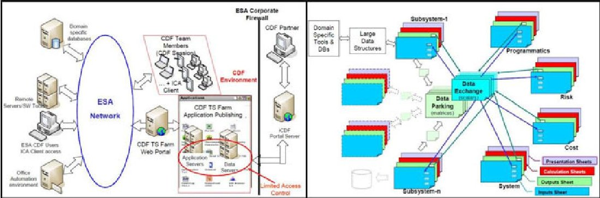
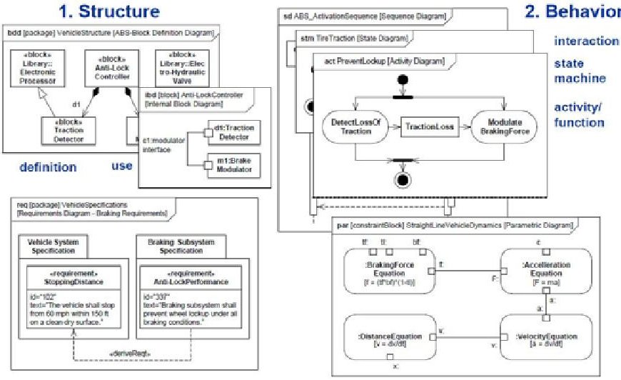
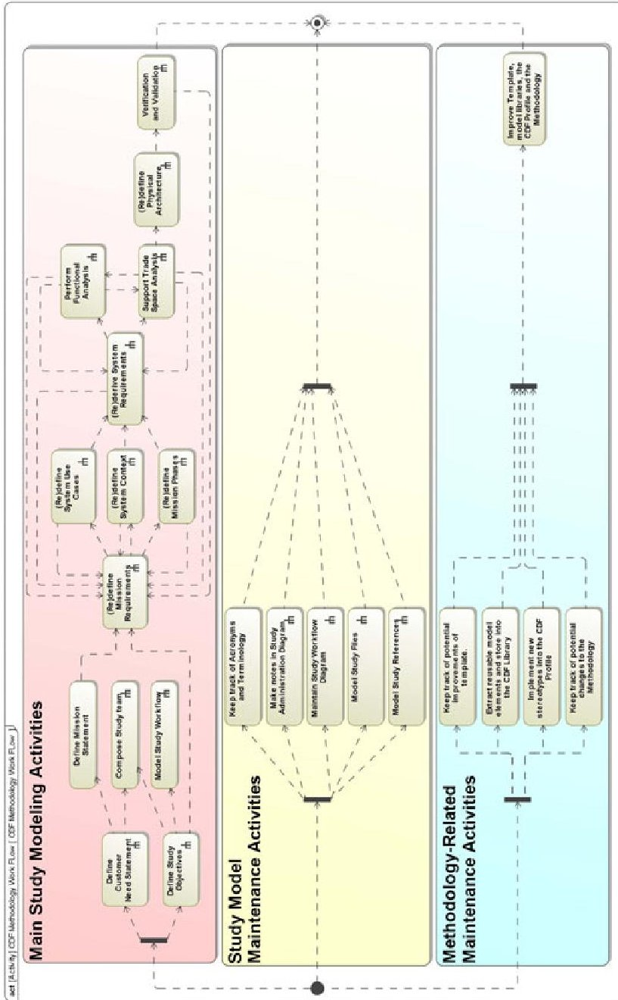
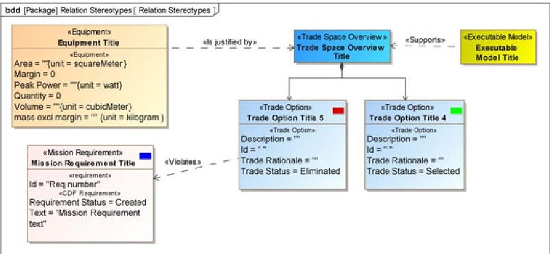
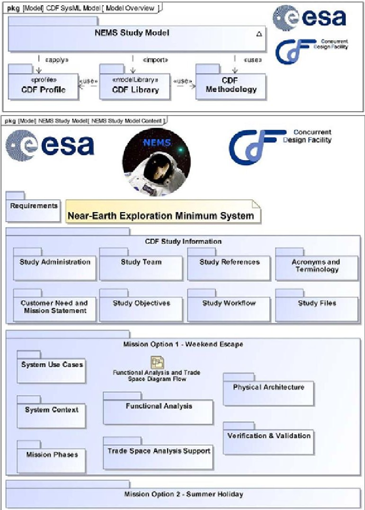
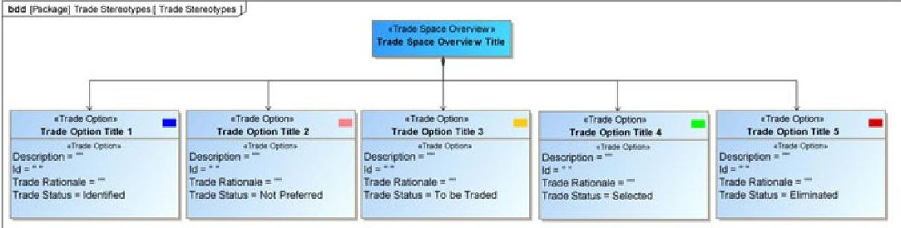

<!-- PDF_PAGE: 1 -->

Chapter 12

# Applicability of SysML to the Early Definition Phase of Space Missions in a Concurrent Environment

Dorus de Lange, Jian Guo, and Hans-Peter de Koning

Abstract. One of latest trends in the field of Systems Engineering (SE) is increased use of models next to and in stead of documents to capture and control information on the system-of-interest under development. This approach is generally called Model Based Systems Engineering (MBSE). An important element of the MBSE approach is the language that is used. The Systems Modeling Language, SysML, is often seen as most promising language by the SE community.

The Concurrent Design Facility (CDF) is a state-of-the-art facility in the field of concurrent engineering and systems engineering research, used to perform feasibility studies for potential future space mission of the European Space Agency (ESA). Currently the CDF uses a simple Excel-based modelling approach. As not much experience with SysML is present at the CDF, research was performed to investigate the potential added value of applying MBSE using SysML to the work performed in the CDF. A methodology and a standard model were developed, followed by its application in a real CDF study to investigate the added value.

From the evaluation of the research, it is concluded that MBSE using SysML is in line with the concurrent engineering approach but is only partially applicable to early design studies. Many of the activities performed during the case study required

Dorus de Lange

Delft University of Technology (TU Delft), Faculty of Aerospace Engineering,

Chair of Space Systems Engineering

e-mail: dorus.de.lange@gmail.com

Jian Guo

Delft University of Technology (TU Delft), Faculty of Aerospace Engineering,

Chair of Space Systems Engineering

e-mail: j.guo@tudelft.nl

<!-- PDF_PAGE: 2 -->

a significant time effort with too little added value. Also, the tool used proved limiting in some of activities. Added value was observed in the capturing of the trade options, decisions and trade rationale in combination with the requirements. It is proposed to integrate these aspects into the CDF studies as starting point for the transition phase to a more model-based approach using SysML.

## 1 Introduction

Over the last few decades projects have become more and more complex, challenging project teams to keep their grip on the design process. The practice of Systems Engineering (SE) was introduced in the late 1950's to guide the technical effort of projects by enhancing the communication between team members, ensuring consistency in the design to finally enhance the overall product quality.

One of latest trends in the field of SE is the use of models to capture and control the systems information. This new SE approach is called Model Based Systems Engineering (MBSE) and is a next step in managing complexity. Gathering all of the systems properties and information in one central model is to increase consistency and enhance the quality of the SE tasks and thus the final product. The Systems Modeling Language (SysML) is a standardized graphical notation language developed by the OMG (Object Management Group) in support of MBSE.

This paper presents the research on the applicability of SysML, performed at the European Space Agency (ESA) in the Systems and Concurrent Engineering Section which includes the Concurrent Design Facility (CDF). The CDF is a state-of-the-art facility in the field of concurrent and systems engineering research. As the use of SysML is gaining interest within the global SE community, more experience with the language in the CDF is desired. In particular, can SysML add value to the studies performed at the CDF? The focus of this paper is on SysML and not so much on the broader field of MBSE.

## 2 ESA CDF

The ESTEC CDF (Concurrent Design Facility), established in 1998, is an integrated concurrent design environment available to all ESA programmes for interdisciplinary and inter-directorate applications.

## 2.1 CDF Activities and Achievements

The CDF performs mostly internal Phase 0 feasibility studies which are to provide ESA with a "faster, cheaper and better" way to thoroughly evaluate mission concepts before selecting Phase A candidate missions. Studies performed at the CDF include [1]: studies of future missions (130+), new launcher concepts (7), complex payload instruments including platform (11), reviews of Industrial Phase A studies (25), joint studies with external parties like NASA/JPL/PDC-Team X or CNES,

<!-- PDF_PAGE: 3 -->

Fig.1 Overview of the CDF hardware infrastructure (left) and the IDM (right) [1].

anomaly investigation of later project phases as well as educational and training activities. Examples of studies for which Phase-A has been initiated include: ExoMars Mars Sample Return, Solar Orbiter, PROBA-3, Small Geo and ESMO [1].

## 2.2 Study Work Logic

For the CDF team the starting point is the preparation phase during which the customer, team leader and systems engineers define the study and mission objectives and start defining the mission requirements. The preparation phase ends with the study Kick-Off (KO) where the whole study team (typically 10 to 20 domain experts) get together for the first time. In the KO the study is explained to the team after which the team comes back together for typically 6 working sessions. A working session is half of a working day, and typically there are one or two working sessions per week. In between the sessions the experts work on the design of their subsystem or domain. The study ends with an Internal Final Presentation (IFP).

## 2.3 Infrastructure

The CDF environment is comprised of hard- and soft-ware, an Integrated Design Model (IDM) and the domain experts. The IDM is an Excel-Based model used for the data exchange between domain expert and is essentially a first step towards a more model-centred design approach. All experts have their own Excel workbooks, linked via a data exchange workbook to exchange the necessary parameters. The IDM is only used for data-exchange and the domain experts have their own domain specific tools to help in the design process (e.g. Matlab, STK, ThermXL, CATIA, NASTRAN). An overview of the CDF infrastructure is shown in figure 1.

The CDF systems engineer often makes use of MS Excel for general calculations and parametric analysis, MS PowerPoint to communicate to the team and requirements engineering tools such as DOORS to manage requirements. Up till now, no central systems model is made; systems information is distributed over several files.

<!-- PDF_PAGE: 4 -->

## 3 Systems Modeling Language

This section provides a summary of the basics of the Systems Modeling Language (SysML) and of previous experience with SysML from literature.

## 3.1 Basics

SysML is based on the UML language, a set of graphical notation standards to create models of systems, initiated in 2001 by OMG and INCOSE. The current version of SysML is version 1.2 [2]. SysML defines 9 diagram types: Activity diagram, Sequence diagram, State machine diagram, Use case diagram, Requirement diagram, Block definition diagram, Internal block diagram, Package diagram, Parametric diagram. These diagrams are grouped in the four pillars that make up the SysML language, shown in figure 2.

3. Requirements

4. Parametrics

Fig. 2 SysML example model of an automatic braking system, showing the four pillars of the SysML language [11].

## 3.2 Review of Use in Space Projects

In investigating the use of SysML in the CDF, first a literature survey was performed. Some conclusions and quotes are shown here. Although there has been scepticism that SysML is not yet mature enough, JPL concluded the opposite after a pilot study where the Jupiter Europa Orbiter Mission was modelled using MagicDraw [8], as can be seen from the following quote [3]:

However, the pilot also found that tools for specifying systems, such as SysML, are mostly ready to do their jobs.

<!-- PDF_PAGE: 5 -->

Another example is the "Modeling Pilot for Early Design Space Missions" study performed by JPL [5]. In this study the goal was to investigate the use of MBSE with SysML for early mission phases. They concluded the following:

The pilot illustrated some of the utility and benefits of the MBSE/SE-CIM (Systems Engineering Conceptual Information Model) approach in the early stages, preformulation/formulation of a space mission. The pilot intended to show that the MBSE approach and in particular the SE-CIM may offer significant benefits for specifying and designing complex mission system in addition to and enhancing the current, more traditional approaches.

Other examples of studies on the use of SysML can be found in [4] [6] [7]. All-inall, experiments have been performed in the recent past, but up till now no evidence was found of any institute, company or agency to have adapted the use of SysML as a new standard, as opposed to the traditional document based approach [12].

## 4 MBSE Methodologies

At the start of any project, a methodology is to be selected. It prescribes what to do, how to do it and in what order.

## 4.1 Existing Methodologies

Many different methodologies exist and a survey of MBSE methodologies was performed by Jeff Estefan, documented in [9], in which he described the current leading MBSE methodologies. Apart from these methodologies, Intecs, ThalesAleniaSpace and ESA developed together an MBSE methodology called the Model-Based methodology to support the Space System Engineering (MBSSE) [10]. The MBSSE is a result of a search for a model based systems engineering methodology, compliant with the relevant ECSS and ISO standards.

## 4.2 Used Methodology

Before selecting a methodology it is important to understand the purpose of the methodology. Criteria for the methodology were that it should be: "as close as possible" to the current CDF methodology and be "as simple as possible" without leaving out valuable activities and artifacts in making it "simple".

After a critical assessment of the methodologies described by Estefan [9], most methodologies were discarded as they were either too much software oriented or contained too many activities which were not applicable to the CDF environment. The Object-Oriented Systems Engineering Method (OOSEM) and the MBSSE were analysed in detail and the relevant activities from both methodologies were combined with newly defined activities into a more streamlined, better implementable

<!-- PDF_PAGE: 6 -->

and more applicable methodology to the CDF. The methodology is shown in the work flow diagram in figure 3. The main activity flow (red) contains the main study activities. The middle flow (yellow) contains model maintenance activities and the blue flow contains methodology maintenance activities.

Fig.3 Simplified work flow diagram (SysML activity diagram) of the proposed methodology to be used in the ESA CDF studies.

<!-- PDF_PAGE: 7 -->

## 5 Case Study

Part of the research included the development of a SysML model that can be used in future CDF studies, called the CMSSM (CDF MBSE SysML Study Model). The CMSSM contains four modules: the CDF profile, the CDF library, the CDF methodology and finally a template. Instead of describing the model it is decided to go to directly to the case study as this shows directly its application.

## 5.1 NEMS CDF Study Background

The CDF study selected for the case study is the Near-Earth Exploration Minimum System (NEMS) study which started with the Kick-Off on 2011-03-23 and the Internal Final Presentation on 2011-04-20. The NEMS mission statement was defined as follows:

Transfer a crew of 3 astronauts from the Earth to an accessible Near-Earth target beyond the Earth-Moon system (e.g. NEO), perform a rendezvous with the target, stay for 10 days to perform EVAs and safely return the crew back to the Earth before the end of 2030.

Note that ESA is not designing a human mission to go to a Near Earth Asteroid, but performed the study to gain a better understanding of the implications as a means to identify critical technologies and development activities.

## 5.2 Model Structure

The drivers for the definition of the modules and the structure of the model were identified as follows:

- the organisation of the model shall support the CDF methodology,

- the packaging of the model shall be "simple" and easy to understand for the CDF system engineers,

- the structure shall be flexible in the sense that it should support any study type,

- the structure shall support multiple mission and system options,

- the model shall be use-able after the CDF study, in next project phases,

- the structure shall encourage/ensure re-use of model elements using libraries,

- a profile shall be set up for CDF specific stereotypes,

The structure of the model was derived iteratively from the drivers listed above, based on new experience gained during the case study. The highest level package diagram is shown in figure 5, showing the four modules: "NEMS Study Model", the "CDF Profile", the "CDF Library" and the "CDF Methodology". The CDF library contains re-useable elements and the CDF profile contains 20 model element stereotypes and three relation stereotypes, specific for the CDF environment, of which

<!-- PDF_PAGE: 8 -->

an example is shown in figure 4. The CDF methodology contains the definition of the CDF methodology (section 4.2), which is also integrated into the template (and thus study model) by means of hyperlinks to detailed activity diagrams to support the modeller in the modelling process. E.g, the functional analysis overview diagram contains a link to the methodology activity diagram containing instructions on the functional analysis activity.

Fig. 4 Example of the relation stereotypes and some of the model element stereotypes as defined in the CDF profile.

## 5.3 NEMS Model in Brief

Figure 5 shows the content overview of the NEMS study model with its main packages. As two mission options were designed during the study, the intention was to model both options. As the options were at least 90 percent the same and variant modelling is not properly supported in SysML or the used tool, it was decided not to model the second design option as no added value to the research would be gained.

The study information is stored in the "CDF Study Information" package. It serves as a starting point to the study, containing most of the background information such as the study objectives, study workflow and references. Requirements management becomes difficult when dealing with multiple mission options in a single SysML model. After trying several methods it was decided to have a single core requirements set for all mission options and add the mission option specific requirements as "Mission Option Requirement" stereotypes, with a different requirement ID prefix as compared to the shared requirements. A new requirement stereotype was introduced to indicate the requirement status by means of Enumeration Literals: created, TBD (To Be Determined), TBC (To Be Confirmed), Fixed and Eliminated (to maintain the ID and history of removed requirements).

<!-- PDF_PAGE: 9 -->

Fig. 5 Highest level package diagram (top) showing the four modules and the model content diagram (bottom) of the NEMS study SysML model.

For the functional analysis the stereotype "Function" of the activity was introduced to capture functions. The support to trade analysis will strongly depend on the type of study. It could vary from support by means of executable SysML in analysis and simulation, to capturing of trade-options and trade rationale. For the NEMS study the latter was the case as the study remained on a relatively high mission level and contained many mission level trades where the identification and rationale of trade-offs stood central. This support was done by introducing the "Trade Option" stereotype of the SysML Block with "Trade Rationale" and "Trade Option Status" as main attributes such that trade option trees can be carefully captured and traced. Trade options can be linked to requirements by means of the "Satisfy" or the "Violates" (stereotype of satisfy, to indicate the opposite) relations. The status indicator is used as is shown in figure 6 and can be set to "Identified" (blue), "Not preferred" (pink), "To be Traded" (yellow), "Selected" (green) and "Eliminated" (red).

<!-- PDF_PAGE: 10 -->

Fig. 6 Trade option stereotype, defined in the CDF profile, used to capture trade options and rationale.

The flow in the model is not everywhere the same, but in general: functions satisfy requirements, functions are allocated to "Trade Space Overviews" which are the trade option discovery trees containing the trade options that are to fulfil the functions and satisfy the requirements up the flow. A trade space results finally in physical architecture elements which make up the system.

## 6 Evaluation

Four methods for the evaluation of the research are used. The modelling history and model statistics were tracked and analysed, difficulties in the modelling process were analysed, an evaluation based on the modelling experience was carried out and finally a questionnaire containing 19 questions was distributed through the CDF team. The questionnaire guided interviewees through the case study model and seven completed forms were received and analysed. In this section the observed strengths and weaknesses of SysML, MagicDraw (used tool) and the use of SysML in the CDF are summarized.

## 6.1 SysML

For the SysML language, the following main points are identified:

- SysML has a steep learning curve, slowing down the transition to MBSE,

- Language is flexible and allows to model all the systems aspects,

- Language is standardized, resulting in an increase of consistency in complex projects and better communication,

- Requirements diagram quickly becomes unreadable when dealing with 100+ requirements, and is not adding value when dealing with only a few requirements when the relations are obvious.

- Relations could be made more readable. A relation such as "Allocate" could be renamed "Is allocated to" to make the relations more self-explanatory for non-SysML experts. The "Satisfy" relation could also be interpreted in two directions, namely as "Satisfies" and "Should Satisfy".

<!-- PDF_PAGE: 11 -->

Based on the performed research, it can be concluded that SysML is a good step towards the standardization of MBSE, but it for sure is not the last step. Its flexibility has advantages but makes the language difficult to learn, severely slowing down the transition phase. For ESA it is important to be involved in SysML as much as possible, as the language is likely going to be become the standard and now is the time to shape it. The more the language is formally standardized and used in time, the less it can be changed later on.

## 6.2 Executable SysML

The modelling of the case study concerned a static model, with no use of executable SysML. For the CDF, two potential applications are identified for executable SysML. Firstly, executable SysML could support in trade-off processes by guiding for example the performance calculations. The second form of executable SysML that could add value is the exchange of information with the IDM. After a brief analysis it was concluded that the performance calculations take a significant effort to model, with only limited re-usability due to the high variance in the CDF studies. Integrating the SysML model with the CDF IDM requires a significant development effort with limited added value due to the overlap.

Based on the limited analysis performed in the thesis work, it is concluded that executable SysML is likely not adding value to the studies performed in the CDF due to the variance in the studies and the limited re-use opportunities. To be more certain of this statement, a dedicated study on executable SysML is highly recommended.

## 6.3 MagicDraw

For the MagicDraw tool, the following main points are identified:

- Tables and matrices need to be improved by adding more flexibility by adding more options for the user. Sorting, zooming, fixing the export function of the generic table which sometimes leaves out some of the attributes,

- Reasonably stable tool with in general an acceptable speed,

- Overall graphics need to be improved, especially the rendering of text in symbols,

- Introduce more basic drawing skills, starting with functionality similar to the PowerPoint "AutoShapes". This allows for making better drawings and thus being able to use the model in communicating to the team,

- Quick layout functions needs to include more user options (for example, distance between symbols) to provide for faster modelling,

Although there are still some weaknesses, MagicDraw is a mature tool for SysML modelling. However, the identified weaknesses need to be diminished before it can be used to its full potential for SysML modelling in the CDF.

<!-- PDF_PAGE: 12 -->

## 6.4 Use of SysML in the CDF

Even though a lot of information is gathered concerning the strengths and weaknesses of SysML, MagicDraw and the used methodology, it is not easy to draw a definite conclusion regarding the applicability of SysML in the CDF. The following concluding statements on MBSE using SysML in the CDF are derived:

- Trade-offs, study assumptions and decisions can be captured in the model to provide the relation to the requirements and increase traceability, thus adding significant value,

- Modelling the study/mission/system provides the modeller with an overall better understanding due to structured and systematic approach,

- Using MagicDraw (v17), the model is less effective in communication to the team as compared to PowerPoint due to limiting drawing capabilities and poor graphical quality. This drawback can be solved by improving the tool. When the diagrams look nicer and clearer, they can be used to communicate to the team, thus removing the need to maintain the usage of both PowerPoint and the model.

- As the IDM is present in the CDF, there is no use in manually modelling the physical architecture properties, as long as no automatic link is present,

- Transition to SysML will be difficult as SysML is a tough language to learn,

- The significant effort of introducing executable SysML likely will not be justified by the resulting added value for the Phase 0 studies performed in the CDF due to limited re-usability opportunities,

- SysML does not provide sufficient support in variant modelling.

For now, MBSE using SysML can add value by using it next to the IDM to model the requirements and trade-offs. When the MagicDraw tool improves graphically, slowly it could be used in communicating to the team. Finally, the modelling activity itself provides the modeller with a better understanding of the system.

## 7 Conclusions

At ESA, attempts have been made before to evaluate the use of SysML in (CDF) studies, but all of these attempts were passive in the sense that whatever was modelled was not used actively during the study itself. Attempts included the modelling of ExoMars during the development of the MBSSE [10] and the modelling of the Mars Atmosphere Sample Return (MREP) CDF Study by a MSc student at the end of 2010. Actively using modelling with SysML results in more direct and practical conclusions related to the strengths, weaknesses and applicability.

Only a small part of the SysML language was used during the case study. It might be that for the Phase-0 studies a kind of "SysML-light" version would be more suitable, after which the full SysML language would be used from Phase-A onwards. The used SysML tool is mature enough to perform valuable work but requires improvements mostly in terms of graphical representation in order to replace the more traditional methods of communication to the CDF team.

<!-- PDF_PAGE: 13 -->

From the research, it is concluded that MBSE using SysML is in line with the concurrent engineering approach but only partially applicable to Phase-0 studies. For now, it is recommended to the CDF to introduce the use of SysML next to the IDM to model the requirements and trade-offs. This would be a good starting point for the transition phase to a more model-driven design approach using SysML. Also, a dedicated study on the applicability of executable SysML is recommended.

Acknowledgements. The authors would like to express acknowledgement to ESA ESTEC and TU Delft for providing support to the thesis work in the CDF.

## References

1. ESA CDF Team. The ESA Concurrent Design Facility: Concurrent Engineering applied to space mission assessments, look for CDF Presentation, www.esa.int/cdf (cited April 12, 2011)

2. OMG SysML Partners. OMG Systems Modeling Language (OMG SysML) Version 1.2, http://www.rsc.org/dose/title of Subordinate document (cited April 12, 2011)

3. Cole, B., Delp, C., Donahue, K.: Piloting Model Based Engineering Techniques for Spacecraft Concepts in Early Formulation. In: JPL and INCOSE. July 12-15, INCOSE, Chicago (2010)

4. Alameda, T., Trisch, T.: Deployment of MBSE processes using SysML. In: 13th Annual Systems Engineering Conference U.S. Army Research, Development and Engineering Command, San Diego, October 25-28 (2010)

5. Mandutianu, S.: Modeling Pilot for Early Design Space Missions. In: 7th Annual Conference on Systems Engineering Research (CSER), April 20-23. Loughborough University (2009)

6. Tactical Science Solutions. Inc. Quicklook Final Report V1.19, in support of the Tactical Satellite-3 design effort (2007)

7. Karban, R., Zamparelli, M., Bauvir, B., Koehler, B., Noethe, L., Balestra, A.: Exploring Model Based Engineering for Large Telescopes - Getting started with descriptive models. Society of Photo-Optical Instrumentation Engineers, SPIE (2008)

8. No Magic, Inc. MagicDraw modeling tool, www.magicdraw.com (cited April 12, 2011)

9. Estefan, J.: INCOSE-TD-2007-003-02: Survey of Model-Based Systems Engineering (MBSE) Methodologies Rev. B. (2008)

10. Mazzini, S.: Model Based Space System Engineering (MBSSE). In: System Design & Simulation Workshop, Rome (October 21, 2010)

11. Friedenthal, S., Moore, A., Steiner, R.: OMG Systems Modeling Language(OMG SysML) Tutorial. In: INCOSE (2006)

12. Eisenmann, H., Miro, J., de Koning, H.P.: MBSE for European Space-Systems Development. INCOSE Insight 12(4), 47-53 (2009)