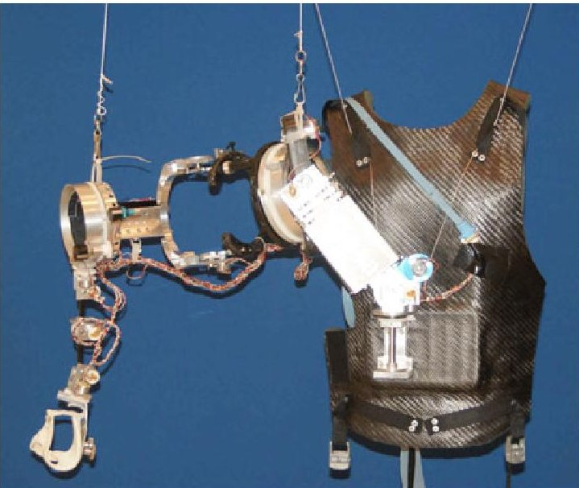
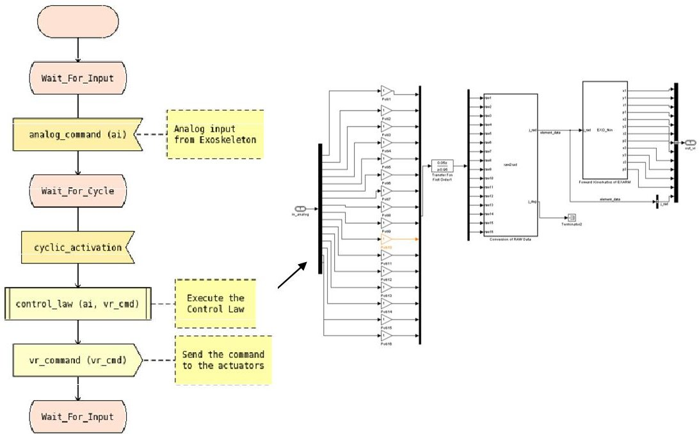
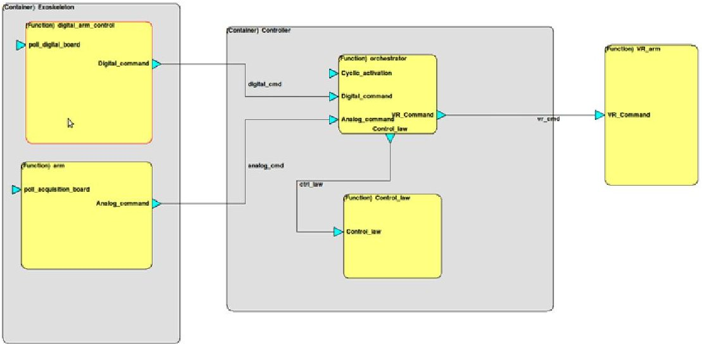
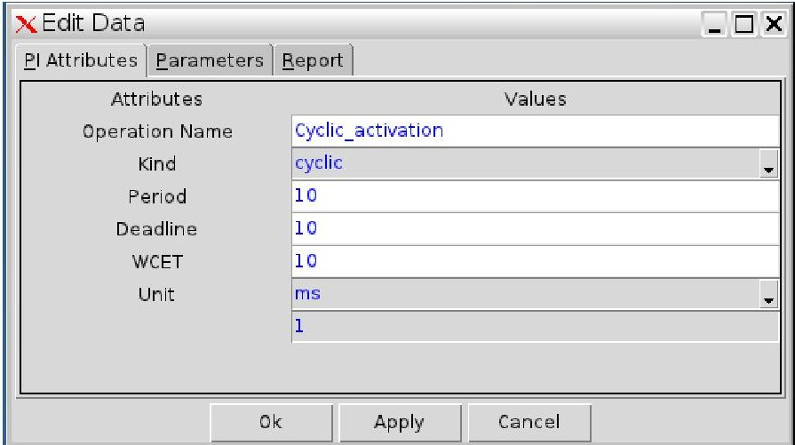
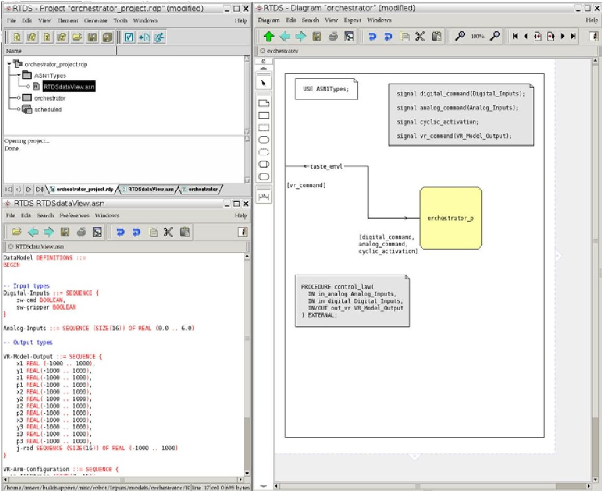
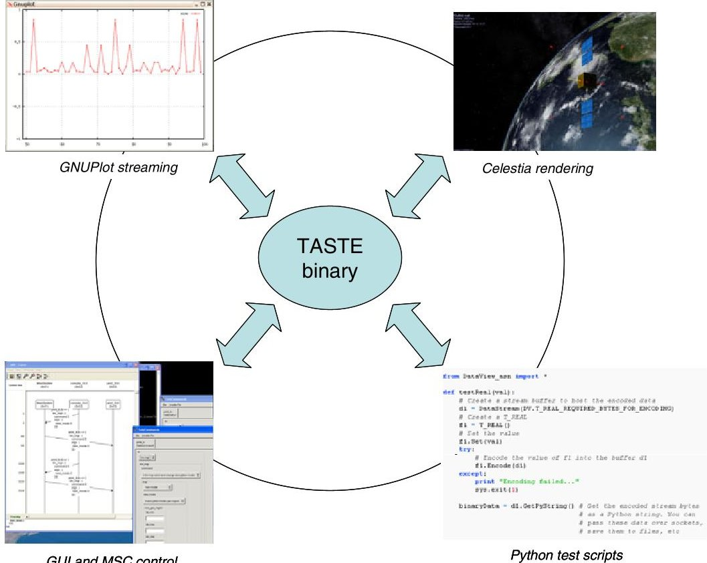
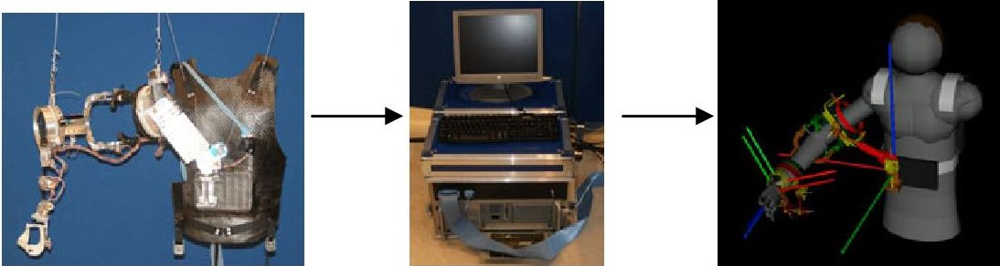

<!-- PDF_PAGE: 1 -->

<div align="center">

# TASTE: A Real-Time Software Engineering Tool-Chain Overview, Status, and Future

</div>

Maxime Perrotin $ ^{1} $ , Eric Conquet $ ^{1} $ , Julien Delange $ ^{1} $ André Schiele $ ^{1} $ , and Thanassis Tsiodras $ ^{2} $

$ ^{1} $ European Space Agency, ESTEC, Keplerlaan 1, 2201AG Noordwijk, The Netherlands {Maxime.Perrotin,Eric.Conquet,Julien.Delange Andre.Schiele}@esa.int $ ^{2} $ Semantix Information Technologies, K. Tsaldari 62, 11476, Athens, Greece ttsiodras@semantix.gr

Abstract. TASTE stands for "The ASSERT Set of Tools for Engineering", in reference to the European FP6 program where it finds its roots. It consists in an open-source tool-chain dedicated to the development of embedded, real-time systems. TASTE addresses the modelling and deployment of distributed systems containing heterogeneous software and hardware components; it focuses on the automation of tedious, error-prone tasks that usually make complex systems difficult to integrate and validate. TASTE relies on two complementary languages, AADL and ASN.1, that allow to create embedded systems which functional parts are made of C, Ada, SDL, SCADE, Simulink and/or VHDL code.

Keywords: ASN.1, SDL, MSC, TASTE, SCADE, AADL, VHDL.

## 1 Introduction

TASTE stands for "The ASSERT Set of Tools for Engineering", in reference to the European FP6 program where it finds its roots. It consists in an open-source toolchain dedicated to the development of embedded, real-time systems. TASTE addresses the modelling and deployment of distributed systems containing heterogeneous software and hardware components; it focuses on the automation of tedious, error-prone tasks that usually make complex systems difficult to integrate and validate.

The philosophy is to let the user only focus on his functional code, letting him write it in the language of his choice, may it be a modelling language or a low-level implementation language. TASTE tools are responsible for putting everything together, including drivers and communication means and ensuring that the execution at runtime is compliant with the specification of the system real-time constraints.

To achieve this, TASTE relies on two simple modelling languages that give enough power to capture all the essential elements of a system that are required to

<!-- PDF_PAGE: 2 -->

generate the tasks, threads, and glue around the user functional code. These two languages are AADL and ASN.1.

Once a set of carefully selected system properties has been captured using these two languages, the core of the system's subcomponents can be developed using C, Ada, SDL (with RTDS or ObjectGEODE), SCADE, Simulink, VHDL, or any combination of these languages. Without any major overhead in the code, TASTE will produce binaries that can be directly executed on several supported targets: native Linux, Real-time Linux (Xenomai), Leon2/RTEMS, and Leon2/ORK.

In addition, TASTE provides many powerful features that help the end user building and validating his system. TASTE is implemented in a way that it is open to extensions; for example it is possible in a dedicated mode to interact with TASTE-generated binaries using Python scripts or interactive user interfaces; it is possible to stream and plot data, to trace internal message exchanges at runtime using message sequence charts (MSCs), to generate documentation, to analyse schedulability, code coverage, etc. TASTE is all but monolithic, contrary to many existing modelling tools which rely on a single modelling paradigm. It has several independent components, which can be used together in an homogeneous way, or which can be taken separately and used in a different development environment.

## 2 Scope

TASTE addresses what we call "heterogeneous computer-based systems", with a particular focus on embedded systems. The main characteristics of these systems are the following:

- They have limited resources;

- They have real-time constraints;

- They contain applications of very different natures (control laws, resource management, protocols, failure detection);

- Parts of the system are developed by different companies;

- They communicate with hardware (sensors and actuators);

- They contain heterogeneous hardware (e.g. with different endianness);

- They can be distributed over several physically independent platforms;

- They may run autonomously for years;

- They may not be physically accessible for maintenance (satellites)

Contrary to "ordinary", desktop-based software, which can be specified and developed by software engineers, our systems require the expertise of external actors such as scientists who define control laws, and for whom the specific challenges of software design - making sure all tasks will run in time, handling resources - are of little interest. Usually these people, who are the key people in the definition of embedded systems, are not able to write "good" software themselves. Very often,

<!-- PDF_PAGE: 3 -->

they will for example prototype their algorithms using a tool (e.g. Simulink) and then pass the models to software engineers who will code and integrate them for the embedded platform. Little automation is done, and there can be important delays between the mock-up and the release of the actual software. Maintenance and modifications are always difficult in that scheme.

The scope of TASTE is targeting this area, where non-software people need to be able to build the software part of system without too much hazardous and uncontrolled dependency on other people for what concerns interfaces, resource management, and real-time issues.

## 3 Case Study

In this section we introduce a case study that highlights each step of the TASTE process and many of the toolset features. The idea is to be very concrete about what TASTE can do for a project, and give some explanations about our technological choices.

## 3.1 Specification of the System

In this system, we want to control a robotic arm using an exoskeleton [1]. The exoskeleton is a set of sensors that an operator puts around his arm to detect movements and transfer them through electrical signals to a computer. The computer receives the sensor data and transforms it into a set of commands sent to a distant mechanical arm. The objective is to allow remote control of robots with a "convenient" user interface.





<div align="center">

Fig.1. ESA Exoskeleton

</div>

<!-- PDF_PAGE: 4 -->

The exoskeleton is connected to an acquisition board (PCI 6071E) $ ^{1} $ , which is placed in an industrial PC. The PC is running Linux with the Xenomai $ ^{2} $ hard realtime extensions . There exists an open-source device driver for the acquisition board called "comedi" $ ^{3} $ , which means that for this setup we did not have to develop any specific low-level device driver.

Regarding the other end of the system, we used an existing 3D model that simulates the movements of a real robotic arm based on commands passed through an UDP (Ethernet) link.

The requirements are to develop an application that:

1. Polls the acquisition board and plot the input data for monitoring

2. Upon reception of sensor data, execute a control law

3. Send the resulting commands to the 3D model.

## 3.2 The Challenge

Following the TASTE approach, we want to put the focus here on the engineering of the functional aspects of the system rather than on software implementation details.

Independently from any constraints, we consider that the best way to address this problem is to model the control law using Matlab Simulink, and the overall orchestration of the system using the SDL language $ ^{4} $ . The combination is good





<div align="center">

Fig. 2. The SDL-Simulink combination to model the system behaviour

</div>

<!-- PDF_PAGE: 5 -->

because it puts together the simplicity of SDL to capture a behaviour using a workflow-like notation that anybody can read, and the power of Simulink to model and simulate a control law.

Without any tool support, implementing such a system is actually quite challenging, for the following reasons:

1. SDL-generated code has to be interfaced with device drivers;

2. Sensors send binary data in a format that is not compatible with SDL or Matlab abstract data types;

3. Actuators need commands to be formatted in packets which format is unknown to SDL or Matlab;

4. SDL-generated code has to be interfaced with Simulink-generated code;

5. The runtime (Linux with Xenomai) has to be configured;

6. If we want to plot data at runtime, some tools have to be found and configured.

These reasons partly explain why in practice the use of modelling tools and code generation is very limited in real projects, and why manual coding is preferred - developers would need to keep a deep knowledge of modelling tools and their (evolving) code generation strategy in order to integrate all components.

Several aspects of the complexity are obviously not related to the use of modelling tools: communication with hardware implies to encode and decode messages at binary level, which is difficult to implement and test, operating system tasks have to be created and configured, scheduling analysis has to prove that the system is feasible, etc. All these aspects have to be carefully addressed when developing a real-time system.

## 3.3 The TASTE Approach: AADL and ASN.1

In order to automate the integration of components and create an executable system, TASTE relies on two complementary languages: AADL and ASN.1. AADL is used to capture the system logical and physical architecture, while ASN.1 is used to express formally all the messages exchanged by the various system interfaces.

These languages are simple and powerful - in fact, there exists almost no alternative to them in terms of capabilities and tool support $ ^{5} $ . TASTE makes extensive use of AADL and ASN.1 in order to generate code, verify properties, and make sure the system will run as it was specified.

## 3.3.1 AADL to Capture the System Architecture

AADL is a language designed to capture the characteristics of system components and their relations. It addresses the logical architecture and the physical architecture of the system. The logical architecture is an abstract representation of the system where mostly the functional blocks are considered, while the physical architecture contains concrete software artefacts: processes, threads, and hardware: processors, memory, busses.

<!-- PDF_PAGE: 6 -->

AADL is textual, but can also be graphically represented. One of the main interests in AADL resides in its capability to be extended with formally-specified properties. If we take for example our control law block, its AADL specification is:

```vhdl

SYSTEM Control_law

    FEATURES

        Control_law : PROVIDES SUBPROGRAM ACCESS FV::Control_law

        {

            Taste::RCMoperationKind => unprotected;

        };

    PROPERTIES

        Source_Language => SIMULINK;

END Control_law;

SUBPROGRAM FV::Control_law

    FEATURES

        in_analog : IN PARAMETER DataView::Analog_Inputs

        { Taste::encoding => NATIVE; };

        out_vr     : OUT PARAMETER DataView::VR_Model_Output

        { Taste::encoding => NATIVE; };

END FV::Control_law;

```

Each property is defined in an AADL "property set", which specifies a set of allowed values as well as the elements to which the property applies. This way, any existing AADL parser can automatically verify the consistency of properties used in the model just as if they were native keywords of the language. For example, the "Source_Language" property is defined this way:

Source_Language : Supported_Source_Languages applies to (system);

Supported_Source_Languages: type enumeration

(Ada95,

ASN1,

Blackbox_Device,

C,

GUI,

RTDS,

SCADE6,

SDL_ObjectGeode,

Simulink,

System_C,

VHDL,

ACN);

## 3.3.2 ASN.1 to Capture Data Types and Their Encoding Rules

ASN.1 is a simple textual language dedicated to data types description. With a concise syntax, it allows to express types and constraints (ranges, optional fields, etc.). It is used industrially in many applications (telecommunication, aeronautics, etc.) and is a well-established standard. The strong point about ASN.1 is that it is supported by a wide variety of mature tools, including open-source tools. ASN.1 permits a non-ambiguous representation of types in a language which is independent from implementation languages, and allows to derive automatic marshallers that follow any kind of binary encoding rules. This characteristic of ASN.1 makes it today the only valid "data modelling" solution to address embedded system issues when focusing on communication between heterogeneous components. The bold reference to DataView::Analog_Inputs in the AADL model above leads to an ASN.1 type:

<!-- PDF_PAGE: 7 -->

-- Analog inputs are 16 voltage lines in range 0 to 6 volts

Analog-Inputs ::= SEQUENCE (SIZE(16)) OF REAL (0.0 .. 6.0)

In order to be able to derive the appropriate marshallers for this data, a separate model is used to specify how the physical device will place bits in memory when encoding the raw values:

Analog-Inputs[size 16] {

    dummy [encoding IEEE754-1985-64, endianness little]

}

## 3.4 The Graphical TASTE Model

AADL models exist either in textual or graphical form. TASTE provides an editor to capture the system attributes in such a way that at no point it is necessary to manually write AADL code. The complete system looks this way:





<div align="center">

Fig. 3. System logical architecture

</div>

In the picture above, the "arm" block on the left corresponds to the input sensors of the exoskeleton, while "VM_arm" function on the right corresponds to the 3D model. In between, the "controller" container in the middle contains the various software functions that interact with the hardware blocks, i.e. the SDL and the Simulink blocks.

Each element of the model contains specific attributes. Interfaces can be cyclic, sporadic, protected (mutual exclusion), or unprotected. We also associate to each function an implementation language and context parameters (allowing configuration information to be captured at model level and used in the implementation code).

What is important is that all these attributes are used by TASTE model transformation tools, that follow a set of rules in order to go from a system abstract model down to a set of tasks and threads that comply with the system requirements.

<!-- PDF_PAGE: 8 -->





<div align="center">

Fig. 4. Attributes of the cyclic_activation interface

</div>

## 3.5 Model Transformation and Code Generation

## 3.5.1 Generation of Code or Model Skeletons

One of the major features of TASTE is to be able to let the user work on functional code (or models) without having to know how to connect it to the rest of the system.





<div align="center">

Fig. 5. TASTE-generated RTDS skeleton

</div>

<!-- PDF_PAGE: 9 -->

For this purpose, TASTE generates application-level skeletons in the implementation language selected by the user, be it a native language (C, Ada) or a modelling language. If we take the example of the SDL block we have defined, and that we called "orchestrator", TASTE generated a complete RTDS project file, including an SDL empty system with a pre-defined set of signals and abstract data types in line with the original ASN.1 data model.

The same feature is provided for Simulink, SCADE, C, Ada, VHDL, and ObjectGEODE. TASTE is extensible by design and in principle any tool can be added to the list, provided that it also comes with a code generator that fulfils embedded system requirements.

## 3.5.2 Processing of the Model to Build the System

TASTE components make use of the user captures properties. Following some predefined rules, the input AADL logical model of the system is transformed into a corresponding physical model. The rules are usually straightforward. For example, if the user specifies a block that contains protected interfaces, it is automatically translated into a shared resource with mutual exclusion on the interfaces. If the user specifies a cyclic interface, then a periodic thread will be specified, etc.

THREAD arm_arm

FEATURES

    analog_command : OUT EVENT DATA PORT

DataView::Analog_Inputs_Buffer.impl;

END arm_arm;

THREAD IMPLEMENTATION arm_arm.others

PROPERTIES

    Initialize_Entrypoint_Source_Text => "init_arm";

    Compute_Entrypoint_Source_Text =>

"po_hi_c_arm_poll_acquisition_board";

    Dispatch_Protocol => Periodic;

    Period => 1 ms;

    Compute_Execution_Time => 0 ms .. 1 ms;

    Source_Stack_Size => 100 KByte;

    Deployment::Priority => 1;

END arm_arm.others;

Based on this physical model, it is possible to apply a variety of analysis using off-the-shelf tools. Among other, we may cite of course scheduling analysis (TASTE includes the CHEDDAR and MAST tools), memory sizing, etc.

Once this physical model of the system is created, an AADL compiler is invoked to generate low-level code that "wraps" the actual user code inside threads or processes, and that handles semaphores, communication, and access to device drivers when needed.

ASN.1 tools are used to automatically convert data at code level between languages (SDL, Simulink, C, Ada), as well as to generate binary encoders and decoders to communicate at packet level with external devices.

For example, if we take the "Analog_Inputs" data type seen before, once given to the TASTE ASN.1 Compiler, the following code is generated:

<!-- PDF_PAGE: 10 -->

```c

typedef struct {

    double arr[16];

} asn1SccAnalog_Inputs;

#define asn1SccAnalog_Inputs_REQUIRED_BYTES_FOR_ENCODING 128

flag asn1SccAnalog_Inputs_ACN_Encode (

    const asn1SccAnalog_Inputs* val,

    BitStream* pBitStrm,

    int* pErrCode,

    flag bCheckConstraints);

flag asn1SccAnalog_Inputs_ACN_Decode(

    asn1SccAnalog_Inputs* pVal,

    BitStream* pBitStrm,

    int* pErrCode);

```

The definition of the Encode and Decode functions provides all the routines to transform data between the C structure and the packet (binary buffer) expected by the actual device. TASTE ASN.1 compilers generate effective, compact code that is compliant with embedded system constraints and coding standards (no dynamic memory allocation, no dependency on any external code, no system calls, etc.).

## 3.6 Runtime Features

TASTE generates binaries that target a set of supported platforms, ranging from native x86 processors running Linux to embedded Leon2 (SPARC) processors with a real-time operating system. All operating system operations are handled by





<div align="center">

Python test scripts

</div>

<div align="center">

Fig. 6. TASTE runtime features

</div>

<!-- PDF_PAGE: 11 -->

TASTE - the generated binary can be directly downloaded on target without any manual intervention.

TASTE provides many additional features at runtime. They are summarized in the following picture. In particular, a strong emphasis has been put on the possibility to write and execute test scripts automatically written using the Python language.

## 4 Conclusion and Future

The complete setup running is pictured below, showing the exoskeleton (on the left) sending data to the computer running the TASTE-generated binary, which in turn translates the sensor information to command a 3D model of the robotic arm. The next step is to replace this 3D model by the real arm. This case study showed how TASTE could easily be used in an environment using real hardware and that it was not limited to small software experiments. In particular, the use of drivers together with our ASN.1-based data modelling technologies showed excellent performance and opens doors to many other kinds of applications.





<div align="center">

Fig. 7. Complete case study setup

</div>

TASTE development has started at the end of the ASSERT project, in 2008[2]. In three years of active development $ ^{6} $ , it has reached a level of maturity which allows it to be used in operational projects and many complex case studies cases have already been performed by various companies, showing that TASTE today has no competitor for the technical issues it addresses. Dissemination outside R&D teams is however a tedious task much more difficult than technical aspects. As of today, TASTE is freely released for all experimental purposes, and some of the companies involved in the tool already provide commercial support. But in order to guarantee a long-term continuation of the project, a further step has to be done, and this is one of our main objectives at the moment. TASTE can live as a product or as a set of separate tools, and several companies have expressed some interest in disseminating the technology outside from the space domain. We are willing to continue funding the TASTE development and make sure it will bring help to many projects which suffer from the so-called software crisis. In the meantime, we are continuously looking for innovative ideas and technologies to include them within the tool-chain.

<!-- PDF_PAGE: 12 -->

## References

1. Schiele, A., Visentin,: The ESA Human Arm Exoskeleton for Space Robotics Telepresence. In: Proceeding of the 7th International Symposium on Artificial Intelligence, Robotics and Automation in Space, i-SAIRAS 2003, NARA, Japan, May 19-23, 2003 (1981)

2. Perrotin, M., Conquet, E., Dissaux, P., Tsiodras, T., Hugues, H.: The TASTE Toolset: turning human designed heterogeneous systems into computer built homogeneous software. In: ERTS 2010, Toulouse (2010)