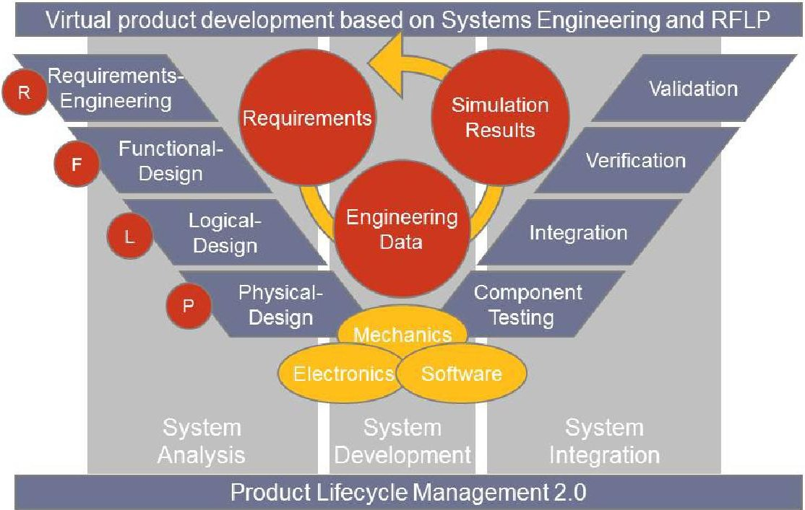
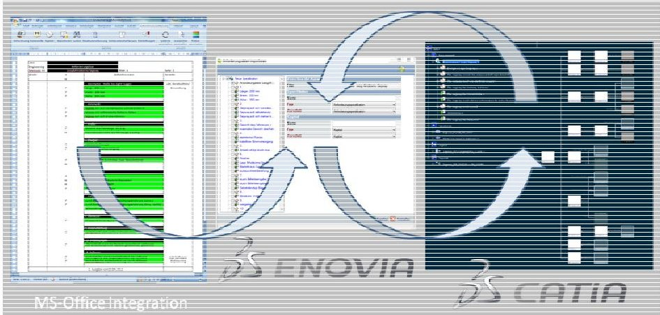
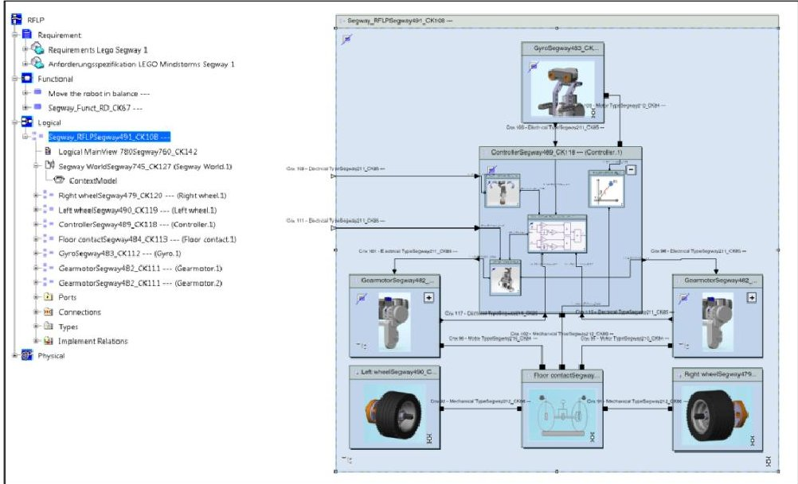
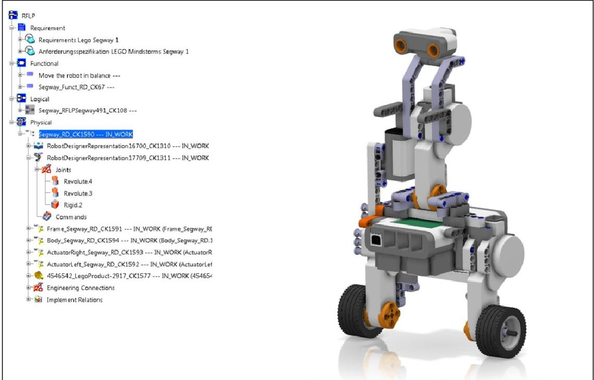
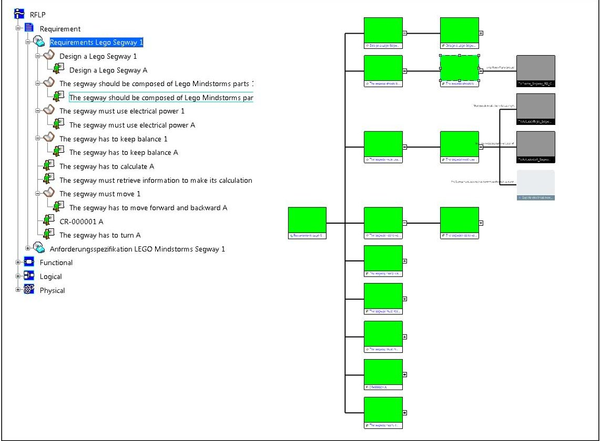
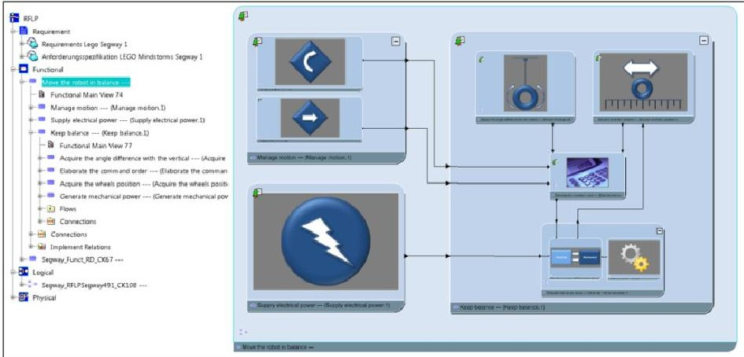
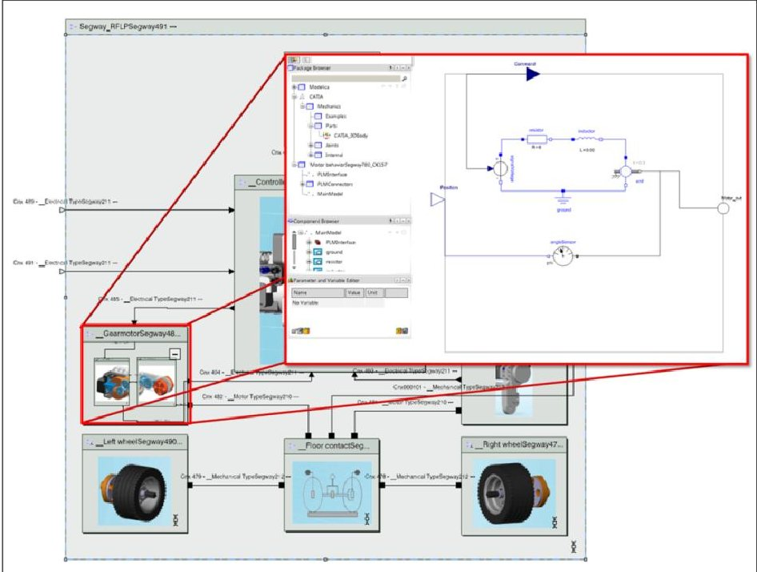

<!-- PDF_PAGE: 1 -->

# Model Based Design with Systems Engineering Based on RFLP Using V6

Sven Kleiner and Christoph Kramer

:em Engineering Methods AG, Rheinstr. 97, 64295 Darmstadt, Germany {kleiner,kramer}@em.ag

Abstract. Today, coping with the different workflows, methods and tools of this inter-disciplinary approach to product development throughout a product's life-cycle is the key challenge for a company. There is evidently a need for requirements engineering and management, as well as model-based design and engineering. More specifically, however, what is required is a unique and integrated methodology for requirements engineering and management, functional and logical design, as well as physical design in different domains for the multidisciplinary development process based on a Systems Engineering approach early in the design process. In this paper, the RFLP approach (Requirements Functional - Logical - Physical) will be presented as the baseline for modelbased design with Systems Engineering that enable close interaction and collaboration between the different engineering disciplines render resources and processes more efficient, enhance quality, and ensure that the target system ultimately meets the requirements, while reducing design cycle time and engineering lead time.

Keywords: Systems Engineering, RFLP, Requirements Engineering and Management, Functional & Logical Design, Mechanical Design, V6.

## 1 Introduction

In recent times, the term Systems Engineering has increasingly cropped up in the context of developing, testing and validating technical systems [1-3]. The "Gesellschaft für Systems Engineering" (GfSE) describes it as a comprehensive engineering activity necessary for the development of complex products [4]. Besides the traditional fields of application (the aerospace industry), the method is becoming increasingly important in other areas such as the automobile industry and medical technology. Here, Systems Engineering serves as a construct for solving complex problems at system level. This procedural model incorporates methods, procedures and resources for developing and implementing technically complex systems, from requirements definition, system analysis and system development all the way to integration of the finished system. Systems Engineering focuses on the process of problem solving, which comprises the two components of system design and project management; its fundamental criterion is "systems thinking". Hierarchization, in other words the

<!-- PDF_PAGE: 2 -->

process of moving from the general to the particular, is just as fundamental a feature as the application and creation of models as structuring aids [5]. The model-based abstracting of complex systems often enables the latter to be broken down into their component parts and the minimized complexity of the real system to be depicted [6]. Emerging from this development, the systems thinking approach has taken center stage in product development with the intention of producing innovative and globally competitive products that meet customer requirements in full [7]. Thanks to the multitude of disciplines (mechanics, electrics/electronics, software) involved in today's innovative products in particular, a command of Systems Engineering is increasingly becoming a genuine competitive advantage for companies which develop and manufacture products. For example, implementing a competitive system for developing mechatronic products would be difficult to achieve with any degree of success without first introducing a method of Systems Engineering and model-based development techniques. It is for this reason that VDI Guideline 2206 was modeled on the Systems Engineering methodology with the aim of ensuring methodical support for the cross-domain development of mechatronic systems while proposing an end-to-end development environment for mechatronic systems [8].

## 2 The RFLP Approach

When it comes to designing and developing complex, multi-disciplinary products, it is essential that the manifold customer requirements, system functions and operating principles of the various disciplines are described and integrated within a common product model. In virtual product development, the various disciplines such as mechanical engineering, electrical/electronic engineering and information technology have access to specific methods and CAx systems which, as a rule, are employed only at certain stages of the product development cycle (e.g. in design, computation and simulation). For this reason, integrated development environments are needed to maintain a holistic view and provide end-to-end support for all systems [9].

## 2.1 The Systems Engineering Procedural Model

In mechatronic product development, Systems Engineering is divided into three main phases: system analysis, system development and system integration. In system analysis, the product being developed is described theoretically in the worksteps requirements definition, functional analysis, logical architecture design and component specification, and specified further via the resulting product models. The system development phase creates product development data (including e.g. 3D CAD models, behavior models). In the system integration phase, the developed components are simulated and tested, integrated in the system, and subjected to continuous verification and validation. In Figure 1, the so-called V model is used to illustrate this procedure.

<!-- PDF_PAGE: 3 -->

Fig.1. Virtual product development based on Systems Engineering and RFLP

## 2.2 General Description of the RFLP Approach

Previous IT systems used in product development offered only limited support of Systems Engineering methods and data of the kind detailed e.g. in ISO Standard 10303 AP 233 "Systems Engineering". This was due to the absence of an integrated information model spanning all product development phases and disciplines, and because many of the IT tools used were geared to specific application areas and consequently were unable to be integrated adequately [9]. For the first time, the so-called RFLP approach for developing mechatronic products could succeed in providing the called-for holistic support for design and development projects based on Systems Engineering. The acronym RFLP stands for Requirements engineering, Functional design, Logical design and Physical design (the 3D CAD model), and describes the process of systematic product development from system analysis to system development, comprising the descending branch of the aforementioned V model based on VDI Guideline 2206 "Development methodology for mechatronic systems" (VDI2206).

The RFLP approach was first implemented as a basis for Systems Engineering in the conventional V6 PLM environment of Dassault Systemes. This approach was tested with the ENOVIA and CATIA systems, taking this solution as an example. Figure 1 shows the artifacts R-F-L-P, along with the development phases system analysis, system development and system integration as supported by the CATIA V6 CAx system and the PLM platform ENOVIA V6 for Systems Engineering.

<!-- PDF_PAGE: 4 -->

## 2.3 Requirements Engineering and Management

The first phase of the RFLP approach is called requirements engineering and comprises requirements engineering and management of all specified requirements. In line with VDI Guidelines 2206 and 2221, client requirements with regard to the product in question are recorded and managed [8, 10]. First, a requirements model is created in the V6 environment in close synchronicity with ENOVIA V6. The requirements can be imported directly into ENOVIA from Microsoft Word, for example. Once in the ENOVIA environment, the requirements are managed and made simultaneously available to the CATIA CAx platform based on the V6 integrated information model. Any changes to these specifications are automatically synchronized between system components and are therefore always up-to-date and globally available within the V6 environment. Figure 2 demonstrates the support of and interaction between Word, ENOVIA V6 and CATIA V6 systems during requirements engineering.

Fig. 2. Requirements engineering and management using Word, ENOVIA and CATIA systems

## 2.4 Functional Design

At the Functional design stage, the VPM Functional Logical Editor workbench is used to link the requirements structure to the functional structure and the logical system structure. The main and sub-functions, and the logical components of the system can be displayed and structured graphically. The functions are derived from requirements in terms of specification and design, and thus expand the requirements model. The main and sub-functions form a basic framework with which to create a functional structure, whereby sub-functions are linked to form main or general functions. A subfunction (or part function) is a transaction broken down into its individual elements; in CATIA V6, these are represented in blocks. Links between individual functions can comprise one of two types: according to engineering design [11], "data flow" connections are defined as a flow of energy, materials or signals. In addition, "control flow" connections can be modeled as so-called activation flows.

<!-- PDF_PAGE: 5 -->

## 2.5 Logical Design

By integrating the Dymola IT solution in CATIA V6, it is possible to create the logical model and then generate a dynamic behavior description using the open Modelica modeling language. Model-based design first involves defining a logical system model as a 2D graph in CATIA V6, connecting the relationships between the various components used. On this basis, an architecture concept is created for the system that describes operating principles as solutions for the defined logical components. With the aid of what is known as Dynamic Behavior Modeling in V6, a specific system behavior modeled with Modelica is stored for each logical component, thus gradually forming a complete, simulation-ready system. Figure 3 shows a sample logical model resulting from behavior modeling in V6.

Fig. 3. Functional design and schematic diagram for electronic scales

## 2.6 Physical Design

With RFLP-based design and development, full simulation of a virtual prototype is facilitated with the aid of a 3D CAD design model (Physical view). To this end, a 3D CAD model is created using the design tools already available in CATIA V5. The 3D parts and assemblies generated via the CATIA/Modelica integration process are now incorporated into the Dymola simulation environment, where they supplement the logical model - now equipped with the behavior description - with the physical characteristics set out in the 3D CAD model. Thus, alterations made to the CAD model directly affect the simulation model and are fully linked to the logical system behavior description in the integrated information model.

<!-- PDF_PAGE: 6 -->

## 2.7 Sample Application for Evaluating the RFLP Approach in V6

The RFLP approach in V6 was evaluated using the example of a LEGO Mindstorm NXT 2.0 robot, and this is discussed below. Modeled on a Segway personal transporter, the robot in question was a two-wheeled, single-axle, electrically driven vehicle, able to maintain balance during forward motion with the aid of an electronic drive control. Management of the robot's forward motion and rotation about its own axis for the purpose of turning right or left was by remote control. A LEGO Mindstorm NXT 2.0 kit comprising two servo-motors with integrated rotary sensor, a gyro sensor for determining position, data communication lines and a set of LEGO modules were available to build the robot. The behavior of the NXT robot with CATIA V6 system was modeled, simulated and optimized, starting with an analysis of the requirements and creation of a requirements list, followed by the design of the functional structure and system architecture.

A list of requirements for the sample application was compiled in MS Word, so that it could be imported into ENOVIA V6 using Microsoft Office Requirements Management Integration. For this purpose, certain passages in the requirements list were defined as requirements, comments or chapters and marked in color in the document. It was possible to configure these definitions individually during the import process. In this step, the list of requirements was declared e.g. as a set of system requirement specifications, and a distinction drawn between client/user requirements, and functional/non-functional requirements. On completion of the import process, the requirements specifications have been integrated into the ENOVIA platform and are depicted both as a requirements model in the RFLP structure tree (Requirements view) and in the form of a 2D graph in CATIA V6 systems (see Figure 4).

Fig. 4. Physical design of the LEGO Mindstorm NXT 2.0 robot

<!-- PDF_PAGE: 7 -->

In the VPM Functional Logical Editor of V6 Systems Workbench, the functional model was then extrapolated from the requirements model and stored in the RFLP structure tree (Functional view). The functions of the NXT robot are displayed in the form of a block diagram, differentiated by main and sub-function and linked together by means of functional flows.

Fig. 5 shows the robot's general mode of operation. The robot's general task of "maintaining balance while moving" is formulated in the main function and divided into the three sub-functions "Maintain balance", "Manage movement" and "Generate electrical energy". These sub-functions are detailed further into sub-functions of lesser complexity, extending all the way to functions such as "Transform electrical energy into mechanical energy", "Query motion specification" and "Adapt mechanical energy". Connecting the individual sub-functions together produces a functional design, i.e. the robot's general mode of operation.

Fig. 5. Requirements for LEGO Mindstorm NXT 2.0 robot

The logical design details the functional architecture via the model-based development of a simulation-ready behavior model for the robot based on defined operating principles and selected technology solutions.

The robot's logical architecture comprises the elements sensor, controller, actuator and control loop. For the sensor, a gyro sensor was adapted to measure the robot's angle (tilt) and position. Mechanical energy is converted into electrical power (actuator) by two electrical servo-motors, which transmit parameters of the gearbox setting to the controller via an integrated rotary sensor. The controller (a 32-bit microprocessor) evaluates and calculates all recorded signals and commands. The control loop is

<!-- PDF_PAGE: 8 -->

interpreted as an inverted pendulum that establishes contact with the ground via two wheels and a single axle, and is governed by a PID regulator integrated in the controller.

Fig. 6. Functional design of the LEGO Mindstorm NXT 2.0 robot

With the aid of the Dynamic Behavior Modeling workbench and Modelica, behavior descriptions are stored for the functions and logical modules and these are then calculated and simulated on the basis of Dymola in CATIA V6 systems. Figure 7 shows the Lego Mindstorm NXT 2.0 robot's electrical drive system created using Modelica.

Fig. 7. Dynamic behavioral modeling of the LEGO Mindstorm NXT 2.0 robot

<!-- PDF_PAGE: 9 -->

CAD-based modeling of individual components and assemblies in CATIA, and the associated definition of a system's form and mechanical properties have been around for years. But the integrated CATIA 3D Body Modelica Library now allows the CAD model to exert a direct influence on the simulation behavior, merging the physical model with the behavior model. This Modelica library allows parameters such as mass, inertia and density to be transferred to the simulation environment directly from the geometry or 3D CAD model. After calculation, the system behavior is described with the aid of the simulation in the form of diagrams, and the movement of the 3D model visualized in an animated sequence. The simulation run is recorded via live plots, which are also used for evaluation and optimization purposes.

## 3 Systems Engineering and the RFLP Approach in Practice

The development of complex technical products calls for comprehensive, multidisciplinary engineering and a holistic approach in the early phases of development. The RFLP approach facilitates multi-disciplinary, model-based development and supports the early analysis, evaluation and optimization of the technical system. This approach was tested using the V6 PLM platform and, specifically, CATIA systems.

The special feature of CATIA V6 systems is that the items of RFLP information are represented on the basis of an integrated data model, so that links between individual development phases and models can be established as and when required. RFLP partial models are linked to each other via so-called implement relations and allow the user e.g. to jump from an individual function - whether main or subfunction - to the implemented requirement or the logical design. In addition, the transparency and traceability of development steps and results are secured by means of informative representations (e.g. the traceability report). The links between the individual RFLP representations mean that data can be validated and verified on a continuous basis.

With V6, the V model can be used to develop technical products in a process that extends from requirements engineering and management via the functional analysis and logical architecture all the way to the physical design of the product in question. The engineer can therefore see at a glance which requirements led to the implementation of a certain logical behavior and the effect this had on the 3D geometry. The V6 PLM platform thus provides an end-to-end Systems Engineering solution along with options for generating and managing the objects that are created during product development. To this end, all modeling results and product information, as well as simulation data and results, are stored in the central ENOVIA PLM environment, where they are available on the database server in an object-oriented, structured format. Which means that a common product model spanning all disciplines and featuring neither interfaces nor breaks in the media chain can be used for Systems Engineering.

The model-based development of technical systems requires engineers to have knowledge of model-based development techniques and of appropriate modeling languages. Model-based development in an interdisciplinary team of several engineers calls for appropriate modeling methods and techniques (e.g. modeling rules and

<!-- PDF_PAGE: 10 -->

conventions) in order to craft models that are at once transparent, robust and maintainable [1]. V6 currently offers a proprietary modeling language for use in the functional and logical design stages of a project. In practice, however, SysML appears to be prevailing as the standard language. Support for and integration of SysML and other standards for system development, e.g. AUTOSAR, in the automobile industry are necessary for enterprise-wide, model-based development.

Today we are seeing other technologies and trends already playing a certain role or coming to the fore in practical terms - and thereby complementing Systems Engineering in general and model-based development based on RFLP in particular (e.g. model-based testing, automatic code generation, co-simulation).

Systems Engineering is a general, procedure-based model that is not geared to specific development challenges and which provides multi-disciplinary development teams with a common means of communication [12]. In addition, the RFLP approach is a successful means of supporting model-based development. The methods and procedures presented here have been tried and tested successfully in practice in a sample V6 application. While the selection and implementation of appropriate integrated IT development tools is necessary when introducing Systems Engineering and the RFLP method, this is not sufficient by itself. The necessary development and support processes must be established, and the project team members involved in Systems Engineering must be well qualified and motivated in order to implement this comprehensive methodology successfully in practice.

## References

1. Alt, M.: Modellbasierte Systementwicklung mit SysML. Carl Hanser Verlag, München (2012)

2. Sendler, U.: http://www.plmportal.org (accessed March 22, 2012)

3. Stark, R., Beier, G., Rothenburg, U., Woll, R.: Modellbasiertes Systems Engineering - Durchgängige Entwicklung mit erlebbaren Prototypen. Digital Engineering Magazin (March 2012)

4. Gesellschaft für Systems Engineering e.V.: GfSE e.V. und Systems Engineering, http://www.gfse.de (accessed on April 17, 2012)

5. Daenzer, W. F., Huber, F.: Systems Engineering Methoden und Praxis. Verlag für Industrielle Organisation, Zürich (1997)

6. Cellier, F.E.: Continous System Modeling. Springer, New York (1991)

7. Janschek, K.: Systementwurf mechatronischer Systeme. Springer, Heidelberg (2010)

8. Verein Deutscher Ingenieure: VDI-Richtlinie 2206, Entwicklungsmethodik für mechatronische Systeme. VDI-Gesellschaft, Düsseldorf (2003)

9. Kleiner, S.: Föderatives Informationsmodell zur Systemintegration für die Entwicklung mechatronischer Produkte. Shaker Verlag, Aachen (2003)

10. Verein Deutscher Ingenieure: VDI-Richtlinie 2221, Methodik zum Entwickeln und Konstruieren technischer Systeme und Produkte. VDI-Gesellschaft, Düsseldorf (1993)

11. Pahl, G., Beitz, W., Feldhusen, J., Grote, K.-H.: Konstruktionslehre, Grundlagen. Springer, Heidelberg (2012)

12. Züst, R.: Einstieg ins Systems Engineering. Orell Füssli Verlag, Zürich (2004)