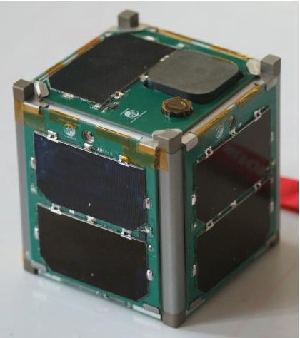
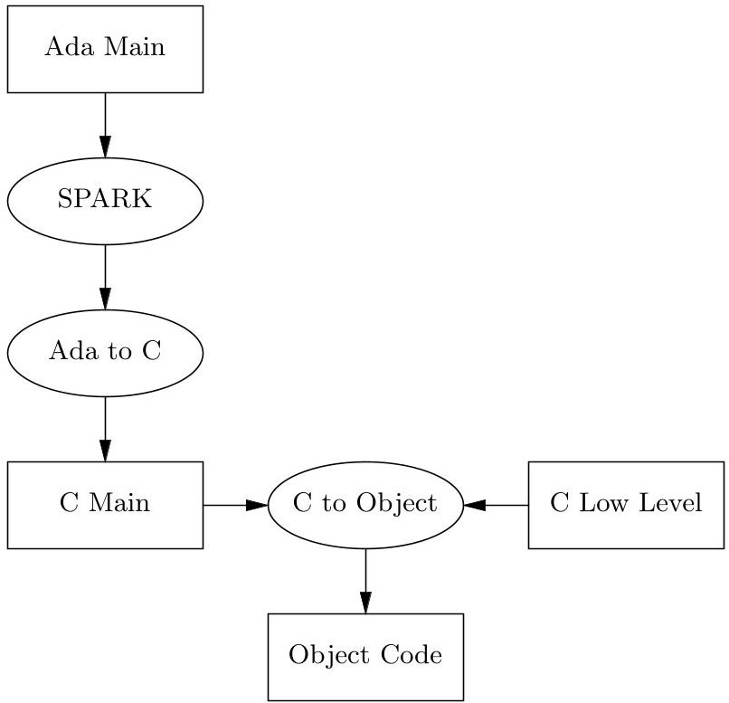
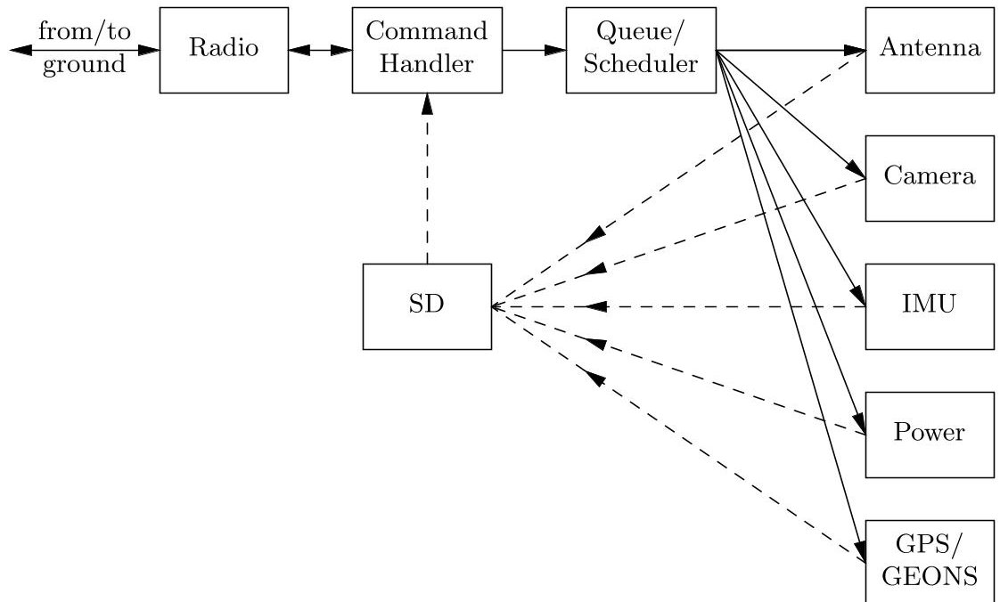

<!-- PDF_PAGE: 1 -->

# A SPARK/Ada CubeSat Control Program

Carl Brandon $ ^{1} $ and Peter Chapin $ ^{2} $

$ ^{1} $ Vermont Technical College, Randolph Center VT 05061, USA $ ^{2} $ Vermont Technical College, Williston VT 05495, USA {CBrandon,PChapin}@vtc.edu

Abstract. With software's increasing role in safety-critical and security sensitive infrastructure it is of paramount importance to educate the next generation of software engineers in the use of high integrity development methods. In this paper we discuss our experience training undergraduate students in the use of SPARK toward the construction of a mission-critical embedded system. In particular the students designed and implemented the control program for a CubeSat nano-satellite that will orbit the Earth as the first step toward the ultimate goal of building a prototype CubeSat that will go to the Moon. Our work shows that inexperienced undergraduates can learn to use SPARK to produce more robust software than might otherwise be the case, even in the environment of a volatile student project.

Keywords: SPARK, student project, CubeSat.

## 1 Introduction

We received a 2009 NASA Consortium Development Grant for work on prototyping and analyzing technologies for a self propelled CubeSat to the Moon that will orbit or land on it. No CubeSat has yet left low earth orbit. The Consortium Development Grant is to have several institutions work together on a project with cooperation with one or more NASA centers. Carl Brandon, as the Scientific Principal Investigator, is leading the project from Vermont Technical College (VTC), with groups at the University of Vermont, Norwich University, and students from St. Michaels College. The construction of the CubeSat and the production of the control software and translation of the navigation software are begin done at Vermont Technical College at both our Randolph Center (main) and Williston campuses. This software work is being done mostly by students under the direction of Peter Chapin. The star tracker camera analysis of near body images is being done at Norwich University by students under the direction of Danner Friend and Jacques Beneat. The analysis of low energy transfer paths to the Moon and radiation exposure analysis is being done at the University of Vermont with students under the direction of Jun Yu.

The eventual goal of the project is to build and get launched a triple CubeSat which will be self propelled to the Moon. Two paths are being investigated. Both will start with a piggy-back ride on a geosynchronous communications satellite

<!-- PDF_PAGE: 2 -->

launch. One option will be for a double CubeSat "booster" with four mono-propellant (hydroxyl ammonium nitrate - methanol (HAN)) thrusters carrying a single CubeSat lander (also with four mono-propellant thrusters) from the apogee of the geosynchronous transfer ellipse on a direct Hohmann transfer orbit to the Moon, la the Apollo missions. The booster would then insert into a Lunar orbit with the lander after a trip of about a week. The lander would then separate from the booster and use its own thrusters for a descent and soft landing on the Moon.

The second option, and more likely due to the hazard of flammable chemical propellants on an expensive communication satellite launch, would be for a xenon ion drive. It would contain 0.5-0.75 kg of xenon in a carbon fiber tank at 200 300 atmospheres. This triple CubeSat would also get a ride to a geosynchronous transfer ellipse, but would stay in the ellipse with a burn of the xenon ion engine near perigee during each orbit of the Earth. This would gradually increase the size of the ellipse over a period of about 10 months when the apogee would reach the Lagrange point, $ \mathrm{L}_{1} $ , about three quarters of the way to the Moon. The ellipse would then be "flipped" to an orbit about the Moon, and the xenon ion drive would burn at perilune during each orbit over a period of about 6 months until the final, relatively low orbit is obtained.

We were selected by NASA for a test flight as part of the ELaNa IV (Educational Launch of Nano-satellites) mission. We will be testing the navigation and other systems that would be used on a Lunar mission. The test spacecraft, a single CubeSat (10cm x 10cm x 10cm, 1.33kg) will be launched in October, 2013, into a 500km orbit, as a secondary payload on the U. S. Air Force ORS-3 (Office of Responsive Space) mission on a Minotaur 1 [10] launch vehicle from Wallops Island, Virginia. The navigation portion will use the NASA Goddard Space Flight Center developed GEONS (Goddard Enhanced Onboard Navigation System) software package. We have started to rewrite that C program in SPARK, which would be completed for the Lunar mission. If we are successful in obtaining additional funding, the Lunar flight would follow the test flight by about six years.

The control program for the ELaNa IV CubeSat is being written in SPARK for greatly increased reliability over the C language software used in almost all CubeSats to date. Most CubeSat failures are believed to be software related. The success of the fairly complicated software on the ELaNa CubeSat will give us confidence for the much more complicated and expensive Lunar mission.

## 2 System Overview

The CubeSat system has several components that are controlled by software, either running on their own hardware or by the overall control software running on the main MSP430 processor. There are components of the control program described in Section 3.3 that interact with each of the hardware components of the CubeSat. The CubeSat requires a power system consisting of photovoltaic cells on all six sides of the CubeSat and the Electrical Power System (EPS)

<!-- PDF_PAGE: 3 -->

which controls the charging of the batteries from the photovoltaic cells, generates the required system voltages, and protects the batteries from over and under voltage. The motherboard mounts the Pluggable Processor Module with the CPU. The radio board contains a receiver and transmitter for satellite communications. There are deployable antennas for transmitter and receiver. The Position and Time Board (PTB) mounts the GPS board, whose CPU we use to run the GEONS navigation software and there is a patch antenna for the GPS. Finally, there is the Inertial Measurement Unit (IMU) and camera board which mounts them and the hysteresis rods for magnetic damping. The CubeSat Kit structure, which mounts everything also has magnets for passive magnetic stabilization along the Earth's magnetic field lines. Figure 1 shows a photograph of our completed CubeSat.

Fig.1. Photograph of our CubeSat

## 2.1 Structure, Motherboard and CPU

The CubeSat structure is an aluminum frame made by CubeSat Kit [6]. It contains their Motherboard (MB) and Pluggable Processor Module (PPM). Our PPM contains a Texas Instruments MSP430F2618 16-bit micro-controller (MCU) with 116KB program memory, 8KB on-chip SRAM, 2 USCI, 8-channel 12-bit ADC, 2-channel 12-bit DAC, 16-bit Timer, 3-channel DMA and on-chip comparator. The motherboard also contains a 2 GB SD card for storage of GPS, IMU, GEONS and camera data prior to transmission to our ground station. In each corner of the structure, we are epoxying Alnico V magnets for passive magnetic stabilization of the CubeSat which will align itself with the earth's magnetic field.

## 2.2 GPS and Position and Time Board

The primary purpose of testing the navigation system will make use of a Novatel OEMV-1 GPS board, previously used on the University of Michigan RAX triple

<!-- PDF_PAGE: 4 -->

CubeSats[12], which has had the CoCom speed and altitude limits removed so it can be used in orbit. We also have the Novatel API activated, which allows us to run software on the GPS board's ARM processor. It is mounted on a University of Michigan designed RAX Position and Time Board (PTB) [13] which allows GPS board access through an SPI bus and the real time clock through an $ \mathrm{I}^{2} \mathrm{C} $ bus. The board also supplies a variety of telemetry items about the GPS power, temperature, etc., over the $ \mathrm{I}^{2} \mathrm{C} $ bus. The PTB access of the GPS will allow communication with the GEONS software running on the GPS ARM CPU. The GPS receiver gets the GPS satellite signals via an Antcom 1.5G15A3F-XT-1 GPS patch antenna [1] with a built in 33 dB gain low noise amplifier (LNA).

## 2.3 Radio

Communication with the CubeSat will be done from our ground station to the Astrodev Helium-100 transceiver [7] on the CubeSat. This radio has a 2m band receiver and 70cm band transmitter with a power of 2.8W. We have frequencies assigned by the International Amateur Radio Union (IARU) which does frequency coordination for non governmental satellites. These frequencies are 145.960MHz for our uplink, and 437.305MHz for our downlink. We will send commands to the satellite via the uplink, and receive data (images, GPS output, inertial measurement unit (IMU) output, system state telemetry and GEONS output) via the downlink. We will have a ground station with 2m circularly polarized crossed Yagi and 70cm circularly polarized crossed Yagi antennas mounted on altitude and azimuth rotors on top of a 50 foot tower. Our ground station radio is an Icom IC-910H satellite radio with 2m, 70cm and 25cm transceivers controlled by SatPC32 software [14]. The radio will use a protocol described below that will ensure non corrupted data. The data will have first been stored on the on-board SD card.

## 2.4 Antennas

Our CubeSat will have deployable antennas for both the 2 m and 70 cm bands. The ISIS AntS antenna system [8] has dual microprocessors and can supply telemetry data as to its state, and receive commands to first arm the antenna, and then to deploy the antennas. The four spring elements are coiled up behind spring hinged doors, held closed by nylon thread which passes over surface mount resistors internally. When the deploy command is received over the $ \mathrm{I}^{2} \mathrm{C} $ interface, the resistors are heated up to melt the thread and release all four antenna elements. The elements on opposite sides of the CubeSat make up a dipole antenna, and the two antennas are perpendicular to each other. The antenna module is mounted on the bottom of the satellite, just outside the internal motherboard.

## 2.5 Electrical Power System

Electrical Power for the CubeSat is supplied by high efficiency photo-voltaic cells (28.3% efficient) made by Spectrolab [16]. These 1W cells are arranged

<!-- PDF_PAGE: 5 -->

with two cells on three sides and the bottom of the CubeSat, and one cell on the top, leaving room for the GPS patch antenna and an aperture for our camera, and one cell on one of the sides leaving room for a charging port, USB port and remove before flight pin. Power from the cells goes to the Clyde Space 1U Electrical Power system board [4]. This board controls the charging of the attached 10Wh 8.2V lithium polymer battery. The board also has regulated voltage outputs of 3.3V and 5.0V as well as the unregulated battery voltage (used in the power amplifier of the radio transmitter). It has protection circuitry for the battery and provides telemetry data as to battery voltage, current and temperature over $ \mathrm{I}^{2} \mathrm{C} $ . It also controls a battery heater to maintain the battery temperature above $ 0^{\circ} \mathrm{C} $

## 2.6 Camera and Inertial Measurement Unit Board

This board has various capabilities not contained on the other commercial boards above. The second part of the magnetic stabilization consists of two HyMu 80 hysteresis rods, perpendicular to each other on this board and the corner Alnico magnets on the main structure. There is a Microstrain 3DM-GX3-25 miniature Attitude Heading Reference System (IMU) [9], utilizing MEMS sensor technology. It combines a triaxial accelerometer, triaxial gyro, triaxial magnetometer, temperature sensors, and an on-board processor running a sophisticated sensor fusion algorithm to provide static and dynamic orientation, and inertial measurements. The C329 color VGA camera module [3] with an f6.0mm F1.6 lens which performs JPEG compression and communicates via an SPI interface. The images of stars and near bodies (sun, earth and moon) will be downloaded for navigation analysis by the GEONS software.

## 3 Project Description

In this section we describe the organization of the project including the tool chain we used, the system architecture, and our approach to testing.

## 3.1 SPARK

SPARK is an annotated sub-language of Ada designed for the development of high integrity software [17]. It has been used successfully in industry to construct mission-critical systems [18].

SPARK is a sub-language of Ada in the sense that it omits numerous Ada features that are not amenable to static analysis. The major omitted features include exception handling, access types, dynamic memory allocation, dynamic dispatch, and recursion. SPARK also restricts Ada in numerous additional ways to ensure that programs have fully specified, unambiguous semantics.

SPARK extends Ada with annotations embedded in comments that enrich interfaces with declarations of information flow and with pre- and post-conditions. The main SPARK tool, the Examiner, uses the annotations, together with the

<!-- PDF_PAGE: 6 -->

code itself, to statically check that no uninitialized data is used and that all results computed by the program are consumed in some way. Furthermore the Examiner generates verification conditions stating conjectures about the runtime checks and the pre- and post-conditions used in the program. These verification conditions are discharged by an automatic theorem prover, the Simplifier, sometimes with human assistance. This provides static assurance that in all cases no runtime checks will fail and that pre- and post-conditions will be honored.

In our project SPARK was used by undergraduate student workers. Although undergraduate use of SPARK has been documented previously [20], this project differs from that earlier work in that here the students are building a "real life" system that will actually fly in space and not just a carefully managed class project.

Our policy was to keep the code submitted to our version control repository examinable at all times with full information flow analysis enabled. Exceptions to this policy were made so that incomplete stubs could be committed in order to facilitate testing. Proofs of freedom from runtime errors were deferred until a particular package was deemed to be stable enough to justify the effort involved in discharging all verification conditions associated with that package.

## 3.2 Tool Chain

The tool chain we used was largely the same as described in [19]. For convenience we briefly summarize the tool chain in Figure 2.

Ada source files were first analyzed using SPARK and then compiled to standard C with an Ada to C translator [15]. The C was then compiled, along with hand written low level C modules, using a commercial C compiler for our target platform [5]. This approach allowed us to develop SPARK programs for targets on which Ada is not otherwise well supported.

One important disadvantage of our approach is that the underlying C compiler is now a source of potential errors in our system. Although compilers are generally robust, silent mis-compilation of correct source code is certainly possible. In our system this concern is particularly acute since the Ada to C translator relies on a human generated configuration file describing the characteristics of the underlying C compiler.

For example, the underlying C compiler for our MSP430 target uses 16 bit integers. We made this known to the Ada to C translator by way of its configuration file so that the Ada type Integer was also taken to be 16 bits. In addition, the SPARK configuration file was used to convey this information to the SPARK tools. A mistake in either level of configuration could result in an undetected error reaching the object code.

We dealt with this problem in part by being cautious; the configuration files are small and amenable to careful review. We also wrote several small programs that exercised some of the issues covered by the configuration files. By manually examining the assembly language produced by the underlying C compiler we

<!-- PDF_PAGE: 7 -->

Fig.2. Tool Chain

were able to verify that our configuration was appropriate, at least in those cases. We hoped that any remaining configuration errors would manifest themselves during testing.

Because we used SPARK to prove freedom from runtime errors we compiled our code base with runtime checks disabled. This resulted in higher execution performance in terms of both space and time.

We also made no use of the Ada runtime system. This was feasible because SPARK prohibits many Ada constructs requiring runtime support [19] and because we eliminated unnecessary runtime checks. We also imposed several additional, minor restrictions on our programming style to avoid unnecessary use of the runtime system. For example, on the MSP430 target the mod operator entailed a call to a runtime support function to properly handle negative arguments. Since we only used mod on positive values, we avoided the runtime system reference by simply using the rem operator instead. The rem operator was directly translated into C's % operator.

Removing the runtime system reduced the memory footprint of our software, which was important in our constrained environment. It also reduced the size of the trusted code base executing on the spacecraft, compensating somewhat for the added risk incurred by injecting an additional compiler into the tool chain.

Since our system consists of two largely independent programs, one running on an MSP430 micro-controller and the other on an ARM architecture processor, we used two independent instances of our tool chain, one for each target.

<!-- PDF_PAGE: 8 -->

## 3.3 Design

No formal specification method nor design methodology was used in the development of our software. Instead the design was done by students, with guidance from faculty, in an informal manner.

The development of the software followed a roughly agile approach with an emphasis on pair-programming and frequent testing. Although we did not use a high integrity development process, the approach used was familiar to the students from their classwork. SPARK augmented the development process in a useful way as describe further in Section 3.4.

Our focus since the summer of 2011 has been on preparing the software for a low Earth orbiting test flight where we intend to exercise several critical subsystems. The software was divided into a main control program responsible for coordinating the general activity of the spacecraft and a navigation program responsible for interacting with the NASA provided GEONS navigation software. The control program executes on a Texas Instruments MSP430F2618 microcontroller [11] mounted on the main processor board of the CubeSat Kit [6]. The navigation program executes on an ARM architecture Intel XScale auxiliary processor on-board the Novatel OEMV-1 GPS receiver.

The control program uses several interfacing technologies to communicate with the various subsystems. Table 1 lists the subsystems used in the test flight and the interfacing method used to interact with that subsystem.

Table 1. Subsystems Used in Test Flight

<table border="1"><tr><td>Subsystem</td><td>Interfacing</td></tr><tr><td>Antenna</td><td>I2C</td></tr><tr><td>Radio</td><td>RS-232</td></tr><tr><td>Camera</td><td>SPI</td></tr><tr><td>Power Supply</td><td>I2C</td></tr><tr><td>Inertial Measurement Unit</td><td>RS-232</td></tr><tr><td>GPS&amp;GEONS</td><td>SPI</td></tr></table>

Each interfacing technology has an associated package that allows SPARK programs to access that interface. Because the Ada compiler we used was unaware of certain low level details of our platform, such as how interrupts are handled, the lowest levels of the interface access code were written in platform specific C compiled directly by our underlying C compiler. However, every attempt was made to to keep the C components of the system trivial so as much application logic as possible could be exposed to SPARK's analysis.

Each subsystem includes a driver package that exposes the basic functionality of that subsystem. These packages interact with the subsystem's hardware via the appropriate interfacing package and were entirely written in SPARK. The

<!-- PDF_PAGE: 9 -->

driver packages are intended to be general and not tied to any specific application. We hope to reuse the driver packages in later flights.

On top of each driver package is a "handler" package that encodes the flight-specific logic of how that subsystem is to be used. For example the antenna handler concerns itself with deploying the antenna at a suitable time after the satellite itself is deployed. To do this it calls subprograms in the antenna driver package to query the deployment status and to start the deployment process. Those subprograms in turn use subprograms in the $ \mathrm{I}^{2} \mathrm{C} $ interfacing package to communicate with the antenna hardware.

The main program consists of a polling executive loop that periodically executes a "work unit" procedure in each handler package. This gives each subsystem an unpreemptable slice of processor time in which it can do its work. After each subsystem is polled in this way the main loop sleeps until the next cycle, putting the processor into a low power mode to conserve energy.

This design makes no use of tasks and thus does not require RavenSPARK. This reduced the runtime support needed, simplified the programming, and made the software more approachable for first time undergraduate SPARK programmers. However, our design does create potentially long delays between when a subsystem relinquishes control and then later regains control. We felt this was acceptable because our system does not have any critical timing requirements. If a subsystem wishes to perform a time sensitive operation, such as reading bulk data from the inertial measurement unit, it can simply retain control until the operation is complete.

Although it is important that the work unit procedures do not execute in an unbounded way, there is no concern of scheduling overruns since there is no particular schedule that must be kept. All the computations done by the work unit procedures are short, and potentially blocking operations are all programmed to time out after a reasonable delay.

In addition to the hardware drivers and their handlers, our system includes several supporting packages. The components of the system communicate using a message passing discipline enabled by a message queue package. Subsystems can thus send commands to each other as necessary.

Figure 3 summarizes the information flow in the system. Commands arrive from the ground station via the radio or are generated in the scheduler. These commands are processed by their respective subsystems when each subsystem is energized by the main loop. In some cases, data produced by a subsystem is saved to storage as a file on the SD card where it is later transferred to Earth.

Commands from the ground station are filtered and potentially handled by a Command Handler package. This package is also responsible for handling data file transfers from the satellite to the ground station. Commands intended for hardware subsystems are forwarded to the message queue for distribution.

Finally a scheduler, implemented as part of the message queue package, generates commands periodically to allow routine operations to be performed even in the common case when the satellite is out of communication with its ground

<!-- PDF_PAGE: 10 -->

Fig. 3. Control Program Architecture

station. This design centralizes the control logic of the program to the scheduler with potential overrides from the ground station when it is available.

## 3.4 Testing

In addition to SPARK information flow analysis and proofs of freedom from runtime error, we also made use of traditional testing techniques. We considered this essential not only to cover correctness properties not explored by SPARK proofs, but also to help cover undischarged verification conditions and, most importantly, to verify proper interfacing with the physical hardware.

Testing was done at three levels.

At the lowest level unit testing was done for components admitting reasonable unit tests. We used the AUnit framework [2] for this purpose.

In addition a mock system was created that provided software simulations of the hardware. The interface to the mock hardware was the same as for the real hardware so that essentially all of the SPARK code was identical between the mock system and the real system. This allowed us to compile the control program as, for example, a Windows executable using the GNAT Ada compiler from AdaCore, and then observe its logged output behavior when driven with suitable test scripts.

The intent of the mock system was to allow meaning behavioral and integration testing without using any physical hardware. Since the student development team was split across two campuses, not all developers had access to the hardware for test purposes, making the mock system essential.

Finally integration and interfacing tests against the physical hardware were done using a CubeSatKit development board [6]. These tests verified proper

<!-- PDF_PAGE: 11 -->

operation of the system against the components that would be used in space. Once our spacecraft was assembled these tests were then executed again on the actual spacecraft, with some adjustments to account for the lab environment.

If SPARK had not been used our test plan would likely have been the same. SPARK was used in our project to supplement the testing and to find faults not easily explored by testing. Although we did not follow a high integrity development process, SPARK was useful in keeping our software in a reasonably selfconsistent state. For example, significant refactoring was needed several times as our understanding of the hardware and system requirements changed. SPARK's analysis caught many errors during these refactorings that might have otherwise gone unnoticed.

A continuing problem for us has been limited time and personnel resources allocated to this project. Student workers turn over quickly, and by the time a student has reached a level where he or she can contribute significantly that student is often ready to graduate. We feel that the rigor imposed by SPARK on our otherwise turbulent environment has significantly enhanced the reliability of our final product.

## 4 Student Participation

Over the months since the project's inception several students have been involved in software development. Table 2 summarizes the number of students involved with notes about their areas of focus.

## Table 2. Student Participation

<table border="1"><tr><td>Time</td><td>Students Notes</td></tr><tr><td>Summer 2011</td><td>2 Design &amp; impl.of radio and interfacing subsystems</td></tr><tr><td>AY 2011-2012</td><td>0 Small enhancements</td></tr><tr><td>Summer 2012</td><td>1 Completed impl.of most subsystems</td></tr><tr><td>Fall 2012</td><td>4 File transfer, integration, navigation program</td></tr></table>

A total of six students have been actively involved in software development. Of these six three had previously taken VTC's High Integrity Programming course where SPARK was introduced in a manner similar to described in [20]. The other three either learned SPARK while working on the project or, in one case, focused exclusively on the C aspects of the project.

The students involved during the summer months worked on the project full time for nine weeks. The students involved during the academic semesters worked on the project part time in addition to their other class obligations. Two of the students in the Fall 2012 semester used the project to fulfill their Senior Projects course requirements.

<!-- PDF_PAGE: 12 -->

All students participated by invitation. Some students were self-selected in the sense that they initiated contact with the project coordinators. Other students knew nothing about the project until they were contacted.

As with many student projects, turnover was a significant problem. Most students only worked on the project for one summer or one semester. Only the student involved during the summer of 2012 continued his involvement into the following semester.

## 4.1 Observations

The number of students involved with the project was not large enough to obtain any meaningful statistical results. However, several informal observations can nevertheless be made.

In general the students involved in the project were able to use SPARK effectively to perform information flow analysis and to produce proofs of freedom from runtime errors. No attempt was made to formally demonstrate higher level correctness properties. Instead high level behavior was verified using traditional testing as described in Section 3.4.

As one might expect, the students who took VTC's High Integrity Programming course were much more comfortable with SPARK, and more immediately productive than those who had not taken the course. There was one notable exception: one remarkable student learned SPARK largely on his own, and yet was nevertheless able to use make good use of the tools almost right away.

Contrary to expectation the students were accepting of the rigors of SPARK programming and did not object to the restrictions imposed by the language nor to the work involved in creating and managing annotations or discharging verification conditions.

In fact several students, both in this project and in VTC's High Integrity Programming course, expressed appreciation for SPARK's restrictions saying that they were happy not to have to worry about confusing features such as access types or dynamic dispatch. The SPARK kernel language is relatively simple and allowed the students to focus on program organization and correctness rather than on finding a way to use the latest fashionable features.

There was a tendency for students to postpone SPARK examination of a package or subsystem until after that package or subsystem was "finished" and ready for testing. Although not universal, some students treated SPARK as a kind of testing tool to be used once the code was believed, via code review, to be functional.

Unfortunately the application of SPARK after the fact was more difficult than the students expected. Often the restrictions imposed by SPARK necessitated significant refactoring of the pre-SPARK implementation. As the students gained experience they came to realize the importance of using SPARK early and of at least bringing the code into an examinable state as soon as possible.

The requirements and subsequent design of the system changed several times during development. As mentioned in Section 3.4 SPARK was useful at keeping the code base organized and self-consistent even in the face of these changes.

<!-- PDF_PAGE: 13 -->

Students were not always timely in updating design documents, but the simple requirement of keeping the software examinable at all times helped to control what might have otherwise been chaotic evolution. In this respect the discipline of SPARK helped inexperienced students produce higher quality software than they might have otherwise.

## 5 Conclusion

We have described the design of a CubeSat and its corresponding control program that we intend to use in our upcoming low Earth orbiting test flight. The software design and implementation in SPARK has been driven by a small collection of undergraduate students with varying abilities and backgrounds.

Although the students have been remarkably successfully at using SPARK in this project to find information flow errors and to prove freedom from runtime errors, we have also faced some challenges. In addition to educating the students about SPARK and about software engineering in general, we also experienced a high turnover rate of student workers and difficulties associated with coordinating students on two campuses. SPARK helped our development process by imposing a level of discipline on it that was easy for students to understand and accept. As a result we feel that it is feasible for motivated undergraduate students to use SPARK effectively on a realistically scaled project.

At the time of this writing we are finalizing our integration tests and proofs of freedom from runtime error. Our current spacecraft has passed thermal and vibration testing. In the longer term we intend to cultivate our team by recruiting second year students to the project who will hopefully be able to stay involved for several years. After the summer of 2013 we will start focusing on the more challenging problem of designing a CubeSat that can reach the moon.

## References

1. Antcom 1.5G15A3F-XT-1 L1 GPS antenna,

http://www.antcom.com/documents/catalogs/L1GPSAntennas.pdf

2. AUnit ada unit testing framework, http://libre.adacore.com/tools/aunit/ (accessed December 9, 2012)

3. C329-SPI-board JPEG compression VGA camera module, http://www.electronics123.net/amazon/datasheet/C329_SPI_data.pdf

4. Clyde space 1U electrical power system, http://www.clyde-space.com/documents/1819

5. Crossworks for MSP430, http://www.rowley.co.uk/msp430/ (accessed November 27, 2012)

6. Cubesat kit home, http://www.cubesatkit.com/ (accessed December 10, 2012)

7. Helium-100 radio, http://www.astrodev.com/public_html2/node/20 (accessed December 9, 2012)

8. ISIS AntS cubesat antenna system,

http://www.isispace.nl/brochures/ISIS_AntS_Brochure_v.7.11.pdf

<!-- PDF_PAGE: 14 -->

9. Microstrain 3DM-GX3-25 miniature attitude heading reference system, http://www.microstrain.com/inertial/3DM-GX3-25-0EM

10. Minotaur space launch vehicles http://www.orbital.com/SpaceLaunch/Minotaur/

11. MSP430F2618, http://www.ti.com/product/msp430f2618 (accessed November 25, 2012)

12. OEMV installation and operation, http://www.novatel.com/assets/Documents/ Manuals/om-20000093.pdf (accessed December 9, 2012)

13. Position and time system for the RAX small satellite mission, http://exploration. engin.umich.edu/blog/wp-content/uploads/2011/09/Spangelo etal 2010b.pdf (accessed December 10, 2012)

14. SatPC32 satellite tracking, antenna and radio-control software, http://www.dk1tb.de/indexeng.html

15. Sofcheck compiler technology,

http://www.sofcheck.com/products/adamagic.html

16. Spectrolab UTJ photovoltaic cell CICs, http://www.spectrolab.com/DataSheets/cells/PV

17. Barnes, J.: SPARK, The Proven Approach to High Integrity Software. Altran Praxis (2012)

18. Chapman, R.: Industrial experience with SPARK. Ada Lett. XX(4), 64-68 (2000), http://doi.acm.org/10.1145/369264.369270

19. Loseby, C., Chapin, P., Brandon, C.: Use of SPARK in a resource constrained embedded system. In: Proceedings of the ACM SIGAda Annual International Conference on Ada and Related Technologies, SIGAda 2009, pp. 87-90. ACM, New York (2009), http://doi.acm.org/10.1145/1647420.1647441

20. Ruocco, A.S.: Experiences using SPARK in an undergraduate CS course. In: Proceedings of the 2005 Annual ACM SIGAda International Conference on Ada: The Engineering of Correct and Reliable Software for Real-Time & Distributed Systems using Ada and Related Technologies, SigAda 2005, pp. 37-40. ACM, New York (2005), http://doi.acm.org/10.1145/1103846.1103852