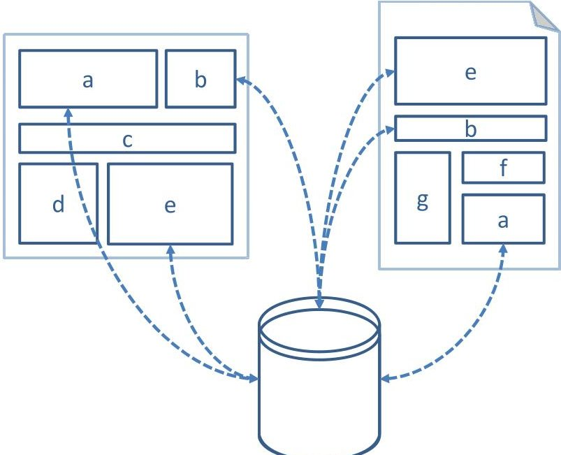
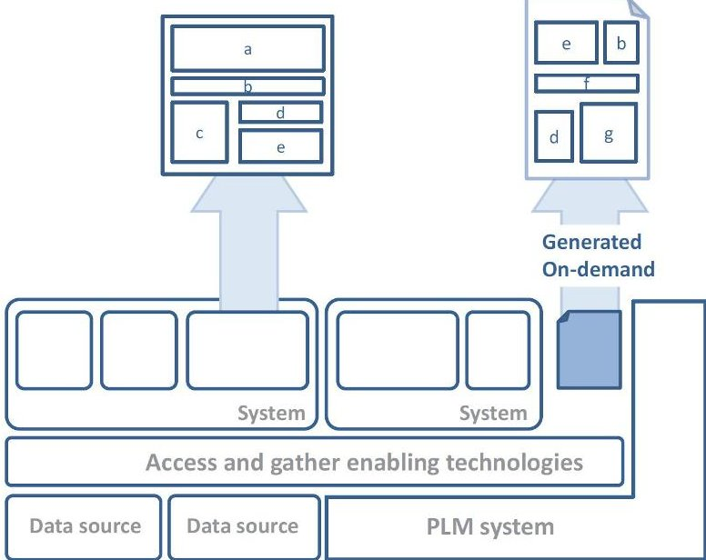

<!-- PDF_PAGE: 1 -->

# Integrating Information in Product Development

Erik Lejon, Michael Lundin, Peter Jeppsson, and Mats Näsström

The Faste Laboratory, Luleå University of Technology, Luleå, Sweden

## Abstract

The amount of product and process related information in the engineering industry is large and constantly growing. Methods and tools are therefore needed to effectively leverage the information, ensuring that it is readily available, contextually understandable and usable for the activity at hand. This paper presents findings from two cases performed at manufacturing companies and an approach for how information effectively can be utilized during the development and lifecycle of a product. The approach primarily addresses the lack of up-to-date information, free of redundancies and accessible from the context where it is needed or will be captured.

Keywords:

Information Management; Product Development; Product Lifecycle Management (PLM)

## 1 INTRODUCTION

The information available within an organization is an asset that can and must be leveraged in order to be competitive. Over time, the amount of product and process related information has increased dramatically. Products are at the same time becoming increasingly diverse and complex, as is the way in which information is exchanged in concurrent product development. This has led to an increased demand for purposeful information, which in turn needs to be efficiently managed during the lifecycle of a product. A large percentage of the product development lead time is spent on acquiring information, information which is a part of the organizational memory. As argued by Kim et al. [1],

"... approximately 90% of organizational memory exists in the form of text-based documents."

Sherman et al. [2] found that the degree to which information from past related product development projects is effectively recorded, retrieved, and reviewed is an contributing factor to new product performance. Sherman et al. [3] concludes that achieving effective R&D integration of information from past projects is the single most important integration factor in reducing development time. Making sure that information is readily available to those who need it could reduce the time spent on searching for, waiting for and translating information. It could in addition reduce the time spent on working with out-of-date information and recreating old information. The time spent searching for information accounts for about 60% of the total operational time in most businesses [4].

Being able to find and acquire supposedly known information is one issue. Research [5] shows, however, that designers may not even be aware of existing information, or for that matter, be willing to disrupt their work in search for relevant information. These findings are strengthened by the studies conducted within the confines of the research presented in this paper, and therefore further underline the need to ensure that the right information is readily available.

Product development decisions, specifically early design decisions, have a significant impact on sustainability [6]. Consideration to the effects decisions will have on later stages in the product lifecycle should enable the development of sustainable products. Efficient information management would allow manufacturers to take a greater responsibility for the sustainability of their products.

Product lifecycle information is to a large extent managed using Product Lifecycle Management (PLM) systems. These PLM systems are a part of a company's total PLM solution, which often consists of

several tools and methods. PLM is a product-centric approach to support information flow throughout a product's lifecycle, and enables the gathering of a substantial amount of product lifecycle information. Stark [7] states that,

"PLM is the business activity of managing, in the most effective way, a company's products all the way across their lifecycles; from the very first idea for a product all the way through until it's retired and disposed of."

The product lifecycle can be divided into three phases: beginning of life, middle of life and end of life [7]. PLM manages the product development process by gathering and making information available for everyone involved in the process. Information managed in the early stages of the lifecycle can be used in the later stages, just as information related to downstream stages can be fed to the earlier stages. This bidirectional flow of lifecycle information could also cross product, project and business boundaries.

Information integration is a major subject within computer science and a lot of work has been done to enable integration of heterogeneous information sources. Approaches include for example canonical data models and ontologies that allow semantic interoperability of information.

Ontology approaches for the integration of various lifecycle information through PLM has also been researched [8-13].

The product information needs differ among various actors involved in the development of a product. This variation in need can be addressed by providing multiple views of the information, each view catering to the specific needs of the actor in question. Research related to multiple views includes, but are not limited to [14-16]. Bouikni et al. [14], presents a multiple views management system capable of generating different views of the product information based on to the need of the actors. Demoly [15] presented a modeling framework for multiple views that supports assembly oriented design. Ding et al. [16] presented an approach to multiple views using multi layered lightweight product representations.

The objective of the ongoing research behind this paper is a proposed, implemented and evaluated approach to the integration of information in product development, with the purpose of effectively leveraging available information assets based on the end users' needs. Research efforts include investigations of information utilization at two industrial manufacturers and the development of a conceptual approach. The approach addresses principle information integration, assuming an integrated PLM solution as the master source of information. The main contribution lies within how information is contextually represented, utilized and captured during

<!-- PDF_PAGE: 2 -->

product development, thus removing static and redundant representations. The conceptual approach presented, aim to ensure contextual information representation for an arbitrary end user in the development of a product. Integrating information into the everyday activities, environments and tools of the end users, should serve to make retention and retrieval into intuitive and natural parts of daily activities. This should in turn ensure awareness of available information, what it means, where it came from and how it can and should be utilized. Integrating relevant and up-to-date information from a PLM solution within the tools used during product development should ensure that users make informed decisions within their everyday tasks.

## 2 METHODOLOGY

The underlying investigation for this paper is part of a research project and has been conducted as two independent and concurrently executed studies. Both studies have been conducted in close collaboration with industry, with the initial objective of acquiring an accurate representation of processes, information flows and information (re)use. The investigations presented have been conducted during the course of three years, and have included company representation ranging from customer relations, order acquisition and delivery to design, automation, simulation and downstream product and process consideration.

## 2.1 Data Collection

Insight into and an understanding of each case company and their development process has primarily been ensured through data collection of a qualitative nature. The qualitative nature of this research stems from the difficulties of clearly quantifying needs and influencing factors within the product development process. There is a need to understand the development process as a whole and how each individual contributes. Sources included archived documents, workshops, observations and in-depth interviews, all to ensure an accurate view of the cases based on multiple and potentially biased sources of evidence [17]. The interviews have been guided and directed just enough to stay relevant. The respondent were allowed free reins to describe their situation and everyday challenges in a way similar to what Bell [18] refer to as semi-structured interviews. Observations were then used to witness the process first hand, in part to corroborate any information gained from interviews and in part to uncover aspects and issues respondents simply had not reflected upon, forgot to mention or perhaps intentionally left unsaid. Workshops could for the purpose of these investigations be described as group interviews and discussion forums, and was during initial stages used to inform involved personnel of the nature and aim of the research. Workshops did also provide a platform for information exchange over divisional borders and an environment for questions and discussions over diverse perspectives and competences. Interviews, observations and workshops have been planned in terms of purpose and general procedure, once execute however, they did have a more open nature. User involvement has been essential, as it has been and will continue to be used throughout the entire process of investigation, development, implementation and evaluation.

## 3 INDUSTRIAL CASES

This paper is based on studies carried out at two industrial product developers and manufacturers in Sweden. One is a supplier to the

automotive industry and the other a tool supplier for the metal cutting industry. This section describes the current state-of-practice and the issues uncovered.

## 3.1 Case A

Case A focus on an R&D center that provides sheet metal safety components for the automotive industry. Finite element simulation of product performance is a driver in the product development. The products are often of complex shapes that require forming simulations to verify and develop manufacturing processes. The center uses a standardized product development process that is common to all R&D centers within the company. Product development for both quotation and serial production is included in this process. The process is managed by documents in which product information is stored and revised. Information is manually duplicated from the product definition (CAD file) into specification documents. These documents are later used as information sources for other activities, activities such as design reviews and pricing. There is a risk that information in these documents is out-of-date or faulty.

There is currently no system implemented for storing and managing product data such as CAD files and documents. All data storage is confined to files managed in folder structures on file servers. Metadata is in turn stored inside files, and to some extent in file names and folder structures respectively, which makes finding the right information using queries difficult. Information available in documents could be searched using full-text searches, but there is no such system implemented. There is an ongoing project within the company to implement a PLM system for management of product data, workflows and other aspects of the products lifecycle. However, the simulation-driven approach currently used is highly iterative and does generate large amounts of data. This has led to the conception of an in-house simulation data management system, which store and archive simulation data associated with a project. The information flow in between design and simulation activities is not managed in a central location. Design generated data is manually exported to the simulation environment, where it is tracked by the simulation data management system. Simulation results are analyzed, which in turn is the foundation for design decisions in product development. The information base for these changes is, however, not captured. A homogeneous product data environment where design and simulation data is managed by the same or integrated systems would allow for a better information flow and, allow decisions based on simulation results to be captured. This is crucial, since the simulation-driven approach used means that a lot of the decisions in the product design are based on information from simulation results. Simulation data management is, according to Fasoli et al. [19], an area that more companies will focus on in the future to complement the management of the design information.

Product information is exported and imported to and from customers and internally within the company several times during the product development process. Although the information often has a high impact on design decisions there is no effective way to track and manage these import/export operations. This makes it hard to ensure that the right information has been sent, but also to track which information has been sent and to whom. The company has in recent years acknowledged that there is a need to capture and make information and experiences accessible in future development. Efforts have been made to achieve this. One example of efforts made is a wiki, where information about available tools and

<!-- PDF_PAGE: 3 -->

methods is documented. Manufacturability properties for materials, such as draft angles, are one example of information documented within the wiki. But to keep the wiki updated, it requires that the users continuously add and revise the information. Experience from previous development projects are saved in a database that is managed by in-house developed software. This software allows search capabilities in terms of projects similar to the one performed, based on requirements, dimensions and markets. This would in turn allow the use of lessons learned, and potentially, design and feature reuse.

## 3.2 Case B

Case B focus on the early stages of product family development, at a company which develops and manufacture tools and tool holders for the metal cutting industry. The early stages do, for the purpose of this study, correspond to the point of pre-study up to, but not including, manufacture. Product applications range from milling, turning and drilling to the interfaces in between tools and machine. An important part of the product portfolio is the customizable product spaces in which customers, through a sales person, can specify a product based on their particular requirements. The company develops product families. They do, however, still develop and provide standard product assortments in the traditional sense, if there is a market for it. Each product family has its own applicable range. This range is governed by a set of parametric components, and in extension, their range of application and the way in which these can be combined. The company in question utilizes an automated generative process, a process which at run time, selects, modifies and combines product modules accordingly. The process generates a complete CAD model as if it was created interactively. In addition, it is also capable of generating 2D and 3D representations for sales and customer evaluation, respectively, along with complete manufacturing documents and programs for subsequent manufacture, validation and marking. This automated process is an essential aspect in realistically providing customers with an entire product space to choose from, as developing each unique product instance on demand would not be feasible in many cases, given the variety and amount of unique orders.

The company in question has a strong foundation in modular reuse. A majority of modules does, however, show signs of being confined to a particular product family, even though efforts are made to ensure that components are generally applicable. The reason for this is that modules, in practice, tend to be built to incorporate more and more properties that are specific to a particular family, in addition to being challenging to locate and understand. All components are, once ready for automation, stored in a module repository, which can be searched using an in-house application. There are, however, ongoing efforts to move over to a combination of ERP (Enterprise Resource Planning) and PLM, where the PLM system would replace the modular repository and the search application. The future aside, components can at this time, as with most documentation, be found over a variety of repositories. Repositories include local repositories, department repositories, company-wide repositories and repositories connected to a project portal for past and present projects. The project portal is usually navigated manually, and user has concerns about the ease of finding what they need. Participation within a project grants access as long as that project is active. Specific access, however, has to be assigned to most users after a project is completed. Most project-related documentation is, however, also stored in a large and unstructured repository, accessible given the appropriate authorization and the keywords to find it. There are also a variety of

supporting databases containing best practice, training documents and formal design instructions. Support ranges from general descriptions of tools, modules and how these should be developed, to regulations such as naming conventions. The company produces a considerate amount of documentation, documentation which essentially is static representations of what at the time of conception hopefully was up-to-date information. There are, to a certain extent, requirements as to what documentation should be generated and when. There are, however, few requirements in terms of what these documents in fact should contain, not to mention the extent and format of the information within. Altogether, this has inevitably resulted in multiple copies and restricted means of attaining what could be usable elsewhere. Efforts are therefore made to enable search over the variety of databases currently used.

The concurrent nature of the product development process, the inherent complexity of development and verification of an entire product space and continuous downstream consideration, naturally require much in terms of informational exchange. Geographically collocated functions within development and synchronous communication are what ultimately ensure that what is needed, is in fact delivered, after a few iterations if need be. One of the major issues today is finding and accessing required information, not necessarily the document where it resides, but the information itself. Access is generally accomplished by limited keyword searches and manual browsing, a time-consuming process that holds no guarantee of finding what is in fact available and relevant for the task at hand. What it all comes down to is providing the right support at the right time, based on the context and needs at hand.

## 3.3 Issues Common in Both Cases

The following section includes the issues found during analysis of the industrial cases.

- The companies produce a considerable amount of product information. This information is spread across several disconnected heterogeneous sources, including the mind of the developer, personal disks, divisional disks and company common disks. Information on disk is primarily confined to static documents. Those involved in the development process do not need, nor do they desire the static representation (document) wherein the information they need resides. They simply want the information itself, the relevant and up-to-date information presented in the, for all intents and purposes most suitable context at that time.

- The lack of centralized product information sources makes finding the right information using queries difficult. It also makes it hard to share information internally as well as externally without creating copies of information that lacks relation to the original.

- The tools for information capture and sharing require manual entry of information that might already exist in, and is disconnected from, the product representation where the information is acquired. They also require separate interfaces and that the information is continuously updated and revised.

- The same fundamental information could potentially be passed on and rewritten in different documents during essential parts of the product development process. Instead of being continuously reused and extended, information is rewritten and formalized for the particular purpose at hand. The challenge lies in ensuring that information, once stored, can be used and reused by systems and individuals, under anticipated and presently undefined circumstances.

<!-- PDF_PAGE: 4 -->

- Aside from issues in terms of reuse, such as actually finding what is required, what currently restricts users is that they may not understand the work that has been done, nor do they have the rationale behind its conception. It is therefore, generally easier to start from scratch, rather than trying to figure out what they are dealing with and what they actually can change without risking problems downstream. Additional information that may be vital for reuse includes information related to traceability, ownership, searchability, purpose, application, rationale, relations and associations.

- Users desire association and relation among product, process and resource information. This includes visual association and contextual communication of information, related not only to the product itself but to specific geometric properties of the product in development. Information tends to only make sense in a specific context. Information could in one case be specific to the individual component geometry, whereas information in another case could describe the relations in between geometric component properties in a larger system, requiring associativity on a number of levels. This is currently achieved through annotated snapshots of the product representation, embedded in text-based documents.

- Investigation shows that designers have to maintain proficiency in a variety of applications and systems in addition to continuously having to switch between them, making them reluctant to add additional applications for the sake of acquiring more information. Some of the tools for information capture and exchange have any connection to the designers other interfaces that are used during product development, such as CAx or Office applications. These tools require the designer to disrupt work to access or capture information.

- There are several downstream product lifecycle aspects that need consideration during product development, including aspects such as performance, manufacturability, cost, customer-specific requirements, reliability, availability and use. Design verification and optimization in terms of these aspects requires a lot of time. Changes made in favor of one aspect often impact another aspect of the product lifecycle, potentially requiring further optimization or process iterations. Information about these interdependencies is not readily available, making the designer reliant on experts downstream to evaluate the impacts of design decisions made.

The core issue, derived from the investigations performed, is the lack of up to date, redundancy free and contextual information, integrated in product development.

## 4 INTEGRATING INFORMATION IN PRODUCT DEVELOPMENT - A CONCEPTUAL APPROACH

This section presents the authors vision of how information should be exchanged and utilized during product development.

The vision for the integration of information in product development is based on performed investigations and identified issues. Documents, the static representation of what at the time of conception was considered relevant information, are broken down into its basic building blocks (objects) and stored in a PLM solution. Much of the document content is in many cases already available in the product definition stored in a PLM solution. An issue when disassembling documents in the traditional sense, is that the objects

left are stripped of the context these had within the document. Contexts such as their relation to other data and information, for example in association to a product, project or lifecycle stage. Each information object would therefore require metadata to govern how and when it is to be used. Every single data or information object should be retained together with the metadata necessary to ensure; traceability (author, version/revision, time stamp), ownership, search ability (name, ID, tag, keyword) as well as understanding and proper use (access/rights, purpose, application, rationale, relations, description). As much metadata as possible is pulled from the authoring context, i.e. the user function, author environment, stage, activity and so on. What cannot be directly derived from the authoring context, should be provided by the user an integrated and natural part of the current activity. The benefits of decomposing the traditional document into its basic components and storing these in a central repository are; (1) each information object can now be associated individually, for instance, to specific aspects of the products geometry; (2) and data and information, once retained, could potentially be formalized and assembled to accommodate new circumstances, and would not have to be rewritten.

Instead of associating an entire document to a product or product family, complemented by annotated static snapshots, information such as a specific requirement can now be associated and if required, be visually connected to everything from system arrangements and components to specific geometrical aspects of a component in development. This would allow for information to be compiled in different views, including view points on the product model as defined by Ding et al. [16]. Information can consequently be created, modified and presented within adapted interfaces or be generated as documents, all based on the current activity and context as illustrated in Figure 1.

Figure 1: Information created and presented in different views.

Information is stored in a main source, a PLM solution, while information requiring storage elsewhere is tightly integrated to ensure that it is up-to-date and free of redundancies. Information flow between activities and the PLM solution is enabled by both commercial-off-the-shelf (COTS) and custom integrations. These integrations are enabled by a service-oriented architecture (SOA)

<!-- PDF_PAGE: 5 -->

provided by the PLM system. SOA enables loosely-coupled systems that are extensible, flexible and fit well with existing legacy system [20]. An overview of this approach is illustrated in Figure 2.

Figure 2: An approach to integration of information in product development.

Retained data and information are upon manual or automated query retrieved and assembled, all based on current needs and context. Contextual consideration could include aspects such as the function, activity, decision and environment at hand. Information from one or multiple repositories is always presented in the, for all intents and purposes, most suitable format or interface in order to maximize understanding and utilization.

The document or static representation, albeit a natural part of daily activities, should ideally be avoided. Static representations could be used if there is no way to ensure access to the actual repository or provide such information in an adapted interface, for instance, in the case of business-to-business exchange. Static representations could, if required, be generated on-demand, as illustrated in Figure 2, and preferably not be stored. All retrieval of said information should, at any given time, be a direct representation of the up-to-date source.

One of the underlying issues with reuse, is that it requires an understanding of the information/object and the rationale behind its conception. The potential of capturing and representing information, such as design rationale [21], to specific aspects of a products geometry should ensure a natural and more streamlined process of retention, while at the same time ensuring awareness, access and contextual representation downstream.

## 5 DISCUSSION

It is desirable to gather all information needed for and created during any given stage of the product's lifecycle in a way that makes it readily available, contextually understandable and usable for the specific activity at hand. Information retention is in the light of performed investigations rarely considered value-adding, as it is essentially reproduced from what has already been done. Information, once retained, should not need to be rewritten, and the retention itself should be a natural and contextually integrated

aspect of continuous development. Appropriate tools that enable information search and presentation are central to achieve this. To enhance the utilization of product information, it should be made available in the interfaces in which it will be used. For example, information that can aid a design decision should be presented in the authoring tools used to implement this decision. Information can be requested when a need arises (pull) or be presented based on the context of the current situation (push). Both manual (pull) and automatic (push) searches can be used to integrate information into the activities during the product development process. Informational reuse is limited by access and awareness [5]. Making the information readily available, searchable and presented within the interfaces used should provide the needed support to leverage existing information in the product development process. This should also allow capture of design decision and design intent together with the information that was used as a basis for that decision.

If the information about requirements, and the impact of design decisions on the fulfillment of these requirements, are readily available during design, the need to rerun verifications is reduced. Automatic checks, based on requirements, within the authoring tool can be used to verify the impact of design decisions. In the approach presented, there is no need to send copies of information for validation and optimization. A reference to the actual product definition can be used instead. This would also allow storage of the results from validation or optimization with a relation to the product definition. Managing and presenting the relations between product definition and the requirements enables the users to better understand the interdependencies between different requirements and the design.

Companies that can integrate information from their PLM solution in their product development process will be able to leverage the information throughout the product lifecycle. It is, however, important to realize that tools and methods developed to effectively enable and support information integration is not enough. User involvement throughout the entire process of finding and integrating product information is important both for actually finding and correctly describing all product related processes and information. It is also important in order to establish an understanding of changes in information management for the users involved. Efforts must be made to ensure that the tools and methods developed are in fact accepted, used, used properly and constitute a valuable addition to the intended users in their everyday activities and the product lifecycle.

## 6 FUTURE WORK

With the conclusions drawn from the cases in this paper it should be possible to begin implementing the approach described and to develop method and tools that can be used to address the issues presented. Future work should include identification of specific cases where tools and methods can be implemented and evaluated. In a longer perspective, identifying and investigating cases at other companies is required in order to ensure that the findings are generally applicable.

## 7 ACKNOWLEDGMENTS

This work was financed by the Faste Laboratory, a VINNOVA (the Swedish Governmental Agency for Innovation Systems) Excellence Center, and was carried out in close collaboration with Gestamp HardTech AB and one other partner company.

<!-- PDF_PAGE: 6 -->

## REFERENCES

[1] Kim, S., Bracewell, R. H., and Wallace, K. M. (2007): Answering engineers' questions using semantic annotations, Artificial Intelligence for Engineering Design, Analysis and Manufacturing, Vol. 21, pp. 155-171.

[2] Sherman, J. D., Berkowitz, D., and Souder, W. E. (2005): New Product Development Performance and the Interaction of Cross-Functional Integration and Knowledge Management, Journal of Product Innovation Management Vol. 22, pp. 399-411.

[3] Sherman, J. D., Souder, W. E., and Jenssen, S. A. (2000): Differential Effects of the Primary Forms of Cross Functional Integration on Product Development Cycle Time, The Journal of Product Innovation Management , Vol. 17, pp. 257-267.

[4] Ameri, F., and Dutta, D. (2005): Product Lifecycle Management: Closing the Knowledge Loops, ComputerAided Design & Applications , Vol. 2, pp. 577-590.

[5] Kim, S., Bracewell, R. H., and Wallace, K. M. (2007): Improving design reuse using context, in: 16th International Conference on Engineering Design, (ICED'07).

[6] Ramani, K., Ramanujan, D., Bernstein, W. Z., Zhao, F., Sutherland, J., Handwerker, C., Choi, J.-K., Kim, H., and Thurston, D. (2010): Integrated Sustainable Life Cycle Design: A Review, Journal of Mechanical Design , Vol. 132, pp. 091004.

[7] Stark, J. (2011): Product Lifecycle Management: 21st Century Paradigm for Product Realisation., Springer London, London.

[8] Monticolo, D., Lahoud, I., Bonjour, E., and Demoly, F. (2012): SemKnow: A Multi-Agent Platform to manage distributed knowledge by using ontologies, in: IMECS 2012 - the International MultiConference of Engineers and Computer Scientists.

[9] Assouroko, I., Ducellier, G., Eynard, B., and Boutinaud, P. (2011): Semantic-based approach for the integration of product design and numerical simulation, in: International Conference on Product Lifecycle Management.

[10] Sudarsan, R., Fenves, S. J., Sriram, R. D., and Wang, F. (2005): A product information modeling framework for product lifecycle management, Computer-Aided Design, Vol. 37, pp. 1399-1411.

[11] Chen, Y.-J., Chen, Y.-M., and Chu, H.-C. (2009): Development of a mechanism for ontology-based product lifecycle knowledge integration, Expert Systems with Applications, Elsevier Ltd, Vol. 36, pp. 2759-2779.

[12] Matsokis, A., and Kiritsis, D. (2010): An ontology-based approach for Product Lifecycle Management, Computers in Industry, Elsevier B.V., Vol. 61, pp. 787-797.

[13] Rachuri, S., Subrahmanian, E., Bouras, a, Fenves, S., Foufou, S., and Sriram, R. (2008): Information sharing and exchange in the context of product lifecycle management: Role of standards, Computer-Aided Design , Vol. 40, pp. 789-800.

[14] Bouikni, N., Rivest, L., and Desrochers, a. (2008): A Multiple Views Management System for Concurrent Engineering and PLM, Concurrent Engineering , Vol. 16, pp. 61-72.

[15] Demoly, F., Monticolo, D., Eynard, B., Rivest, L., and Gomes, S. (2010): Multiple viewpoint modelling framework enabling integrated product-process design, International Journal on Interactive Design and Manufacturing (IJIDeM) , Vol. 4, pp. 269-280.

[16] Ding, L., Davies, D., and McMahon, C. A. (2009): The integration of lightweight representation and annotation for collaborative design representation, Research in Engineering Design, Vol. 20, pp. 185-200.

[17] Yin, R. K. (2009): Case study research: design and methods, Essential guide to qualitative methods in organizational research (Bickman, L., Ed.), Sage Publications.

[18] Bell, J. (2005): Doing your research project: a guide for first-time researchers in education, health and social science, British Journal of Educational Technology, p xv, 267 p., Open University Press.

[19] Fasoli, T., Terzi, S., Jantunen, E., Kortelainen, J., Sääski, J., and Salonen, T. (2011): Challenges in Data Management in Product Life Cycle Engineering, in: Glocalized Solutions for Sustainability in Manufacturing: Proceedings of the 18th CIRP International Conference on Life Cycle Engineering (Hesselbach, J., and Herrmann, C., Eds.), pp 525-530, Springer Berlin Heidelberg, Berlin, Heidelberg.

[20] Wu, Q., Zhou, C., and Jing, T. (2008): Research on SOA Based Framework of Collaborative Design System for Complicated Product, 2008 International Conference on Computer Science and Software Engineering, ieee pp. 400-403.

[21] Lee, J. (1997): Design rationale systems: understanding the issues, IEEE Expert, Vol. 12, pp. 78-85.